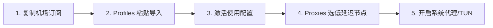

在科学上网与跨国网络加速领域，**“Clash”** 是被提及频率最高、生态最庞大、同时也最容易让新手产生认知混淆的名词。很多刚接触代理的新手经常遇到以下典型困惑：

**“为什么我在 GitHub 下载了 Clash 软件，打开后里面什么都没有，根本连不上网？”**  
**“Clash、Mihomo、Clash Verge Rev 和历史上的 Clash for Windows 到底是什么关系？”**  
**“为什么浏览器可以正常打开 Google，但电脑上的 ChatGPT 桌面客户端或 Git 命令行却连不上？”**  
**“为什么测速明明显示绿色 40ms 低延迟，但在 YouTube 上看视频却一直转圈卡顿？”**

**“Clash” 本身既不是一家卖梯子的公司，也不是一个自带免费节点的服务器网络；它是一个开源的网络代理协议核心与客户端生态。**

要让 Clash 正常工作，必须由**「节点服务商（机场）」、「远程订阅（Subscription URL）」、「GUI 客户端（如 Clash Verge Rev）」与「代理核心（Mihomo）」**协同运行。

本文为你提供 2026 年最系统、最透明的 Clash 生态百科与实操全指南，从底层架构、客户端选型、订阅导入、分流规则到全场景系统排障，手把手带你彻底搞懂 Clash。

---

## ⚡ 30 秒快速看懂：Clash 怎么配、怎么用？

```text
┌─────────────────────────┬───────────────────────────────────┬──────────────────────────────────────┐
│ 你的当前状态 / 需求     │ 核心操作建议与认知基准            │ 推荐执行步骤与产品形态               │
├─────────────────────────┼───────────────────────────────────┼──────────────────────────────────────┤
│ 🖥️ Windows/Mac 电脑新手 │ 界面现代、订阅一键导入、自动化分流│ 优先选用 Clash Verge Rev (基于Mihomo) │
│ 📋 已装软件但列表空白   │ 软件是空壳，需购买并导入机场订阅  │ 从正规专线机场后台复制 Clash 订阅链接 │
│ ⚙️ 路由分流模式选择     │ 保持为「规则 (Rule)」分流模式      │ 国内应用直连不耗流量，国外走加密代理 │
│ 🌐 仅需浏览器查资料     │ 网页端 Google、维基百科、文献检索 │ 开启普通「系统代理 (System Proxy)」即可 │
│ 🤖 桌面 App / 终端开发  │ ChatGPT 桌面版、Git Clone、Docker │ 必须在客户端内开启「TUN 模式 (虚拟网卡)」│
│ 📺 电脑看 YouTube 4K/8K │ 追求高持续带宽吞吐、晚高峰 0 丢包 │ 搭配 IEPL 物理专线套餐 (如光速云)    │
│ 🚨 手机与电脑应急备用   │ 0 月租、按量付费不过期、即开即用  │ 备用星岛梦不限时流量包，多设备同登   │
└─────────────────────────┴───────────────────────────────────┴──────────────────────────────────────┘
```

> 💡 **最核心的新手认知纠错**：
> 1. **Clash 客户端（如 Clash Verge Rev）只是“空壳解析器”**，本身 100% 免费开源，绝不附带任何免费网络；
> 2. **机场服务商才是“汽油”**，购买套餐后获得一串**“订阅链接（Subscription URL）”**，将其导入客户端拉取节点后方可联网；
> 3. **系统代理（System Proxy）** 只管浏览器；**TUN 模式** 通过虚拟网卡接管全电脑所有桌面软件的网络流量。

---

## 一、Clash 全景数据流转架构：从本地到海外出口

理解 Clash 底层的数据流转过程，是理解分流、DNS 解析与网络排障的核心基础：

```mermaid
graph TD
    UserApp[桌面应用: Chrome / Edge / ChatGPT桌面版 / Git / Terminal] --> InboundDecision{流量如何进入 Clash?}
    
    InboundDecision -->|方式 A: 遵循系统代理| SysProxyPort[本地 HTTP/Socks5 监听端口: 127.0.0.1:7897]
    InboundDecision -->|方式 B: 不遵循代理/TUN| VirtualTUN[Wintun / 系统虚拟网卡: 网络层全量接管]
    
    SysProxyPort --> CoreEngine[Mihomo 代理核心引擎 (解析/DNS/路由)]
    VirtualTUN --> CoreEngine
    
    CoreEngine --> RuleEngine{内置 Rule-Set 智能分流规则集}
    
    RuleEngine -->|国内域名/IP: 百度/淘宝/Bilibili| DirectRoute[DIRECT: 走本地宽带光纤直连]
    RuleEngine -->|境外域名/IP: Google/GitHub/OpenAI| ProxyRoute[PROXY: 匹配对应代理组与出口节点]
    
    ProxyRoute --> CryptoTunnel[TLS 加密协议隧道 (Shadowsocks / VLESS / Trojan / Hysteria 2)]
    CryptoTunnel --> DomesticRelay[国内入口服务器 / IEPL 物理专线内网]
    DomesticRelay --> ExitNode[海外出口节点 (香港/日本/新加坡/美国)]
    ExitNode --> TargetServer[目标网站: OpenAI / Google / YouTube 4K]
```

---

## 二、概念彻底澄清：Clash、Mihomo、Clash Verge 与 CFW 到底是什么关系？

许多新手常被网上一堆类似的名词搞得晕头转向，以下大表为你彻底理清它们的技术定位：

```text
┌────────────────────────────────────────────────────────────────────────────────────────┐
│                        Clash 生态核心名词与技术分工全景大表                            │
├────────────────────┬──────────────┬────────────────────────────────────────────────────┤
│ 核心名词           │ 技术层级定位 │ 真实作用与相互关系                                 │
├────────────────────┼──────────────┼────────────────────────────────────────────────────┤
│ **Clash (原版)**   │ 底层代理核心 │ 由 Dreamacro 开发的初代开源代理核心 (已停更)       │
├────────────────────┼──────────────┼────────────────────────────────────────────────────┤
│ **Mihomo (Meta)**  │ 现代代理核心 │ 当前社区最主流的活跃开源核心，支持全协议与原生 TUN │
├────────────────────┼──────────────┼────────────────────────────────────────────────────┤
│ **Clash Verge Rev**│ 桌面 GUI 软件│ 基于 Mihomo 核心开发的现代化跨平台图形客户端 (主力)│
├────────────────────┼──────────────┼────────────────────────────────────────────────────┤
│ **CFW (历史版)**   │ 历史 GUI 软件│ Clash for Windows，历史上最流行但已于 2023 年底停更│
├────────────────────┼──────────────┼────────────────────────────────────────────────────┤
│ **机场 (Airport)** │ 商业服务网络 │ 拥有境外服务器机房与物理专线的独立服务商 (提供订阅)│
└────────────────────┴──────────────┴────────────────────────────────────────────────────┘
```

### 💡 形象比喻：
- **Mihomo** 是高性能的**“汽车发动机”**（负责底层的加解密、路由与网络转发）；
- **Clash Verge Rev** 是精致舒适的**“驾驶室与中控台”**（提供给用户点击、换节点、看测速的可视化操作界面）；
- **机场服务商** 是**“加油站与高速公路网”**（提供节点服务器与跨境专线物理带宽）。

---

## 三、旧版 Clash for Windows (CFW) 用户如何安全迁移？

由于 `Clash for Windows` 已经停止维护，在 2026 年继续使用旧版本可能面临核心协议不兼容（如无法支持最新的 Hysteria 2 或 VLESS-Reality）、TUN 驱动在 Windows 11 崩溃等安全隐患。

### 迁移三步法：
1. **保存订阅链接**：在旧版 CFW 的 Profiles 界面中，右键你的配置卡片复制 URL 地址，或直接登录机场后台重新获取；
2. **彻底退出并卸载 CFW**：在任务栏托盘右键退出 CFW，**确保已关闭系统代理**，避免注册表端口残留；
3. **安装 Clash Verge Rev**：从官方 GitHub Release 下载最新正式版，导入订阅并启用即可无缝衔接。

---

## 四、Clash Verge Rev 导入订阅与配置 5 步全流程（How-To）

跟随以下标准化流程，只需 2 分钟即可完成电脑端的配置：



### 步骤 1：获取 Clash 兼容订阅链接
登录正规专线机场官网后台（如 [光速云](/reviews/guangsu-cloud/) 或 [微风网络](/reviews/weifeng-cloud/)），找到订阅中心，点击「一键导入 Clash」或「复制 Clash 订阅链接」。

### 步骤 2：在 Profiles 界面添加远程订阅
打开 Clash Verge Rev：
1. 点击左侧菜单栏的 **「订阅 (Profiles)」**；
2. 在顶部的 URL 输入框中粘贴刚才复制的订阅链接；
3. 点击右侧的 **「导入 (Import)」** 按钮，等待客户端拉取远程配置文件。

### 步骤 3：激活配置卡片
导入完成后，界面上会出现一个带有机场名称的配置卡片。**右键点击该卡片（或直接左键单选），选择「使用 (Use)」**，确保卡片边缘亮起高亮激活边框。

### 步骤 4：选择代理组与节点
进入左侧 **「代理 (Proxies)」** 页面：
1. 顶部确保路由模式为 **「规则 (Rule)」** 模式；
2. 展开主代理组（通常命名为 PROXY、节点选择 或 自动选择）；
3. 点击右上角 ⚡ 图标批量测速，点击选中一个绿色的低延迟节点（如“香港 01 IEPL”或“日本 01 IEPL”）。

### 步骤 5：开启系统代理或 TUN 模式
进入左侧 **「设置 (Settings)」** 页面：
- 🟢 **常规网页浏览**：打开 **「系统代理 (System Proxy)」** 开关，即可在 Chrome/Edge 浏览器中顺畅访问 Google 与 YouTube；
- 🟣 **需要接管全电脑桌面软件**：先开启「服务模式 (Service Mode)」，随后打开 **「TUN 模式」** 开关。

---

## 五、核心机制全解析：Rule、Global 与 Direct 模式的区别

Clash 的核心精髓在于强大的**自动化规则分流引擎**，在主界面的「Proxies」顶部可以自由切换三种路由模式：

| 路由模式 | 流量处理机制 | 典型适用场景 | 优缺点分析 |
| :--- | :--- | :--- | :--- |
| **规则模式 (Rule)**<br>*(推荐默认)* | 根据内置分流规则匹配域名与 IP：国内走直连，国外走代理 | **日常 99% 的主力使用场景** | 🟢 国内应用极速直连不耗流量，国外自动翻墙；无需频繁手动切换 |
| **全局模式 (Global)**<br>*(故障排查)* | 接管范围内的所有流量全部强制走代理（包括国内网站） | **网络故障诊断**、访问部分小众境外网站 | 🔴 访问国内百度、微信变慢，且白白消耗套餐流量；**不是网络加速模式** |
| **直连模式 (Direct)**<br>*(临时直连)* | 所有流量全部直接连接目标服务器，不经过任何代理节点 | 临时暂停代理、排查本地宽带物理连通性 | 🔴 境外被屏蔽网站（如 Google）将全部无法打开 |

> ⚠️ **关键诊断信号**：
> 如果遇到 **“Global 模式可以打开网页，但切回 Rule 模式就打不开”** 的情况，说明**你的机场节点完全正常**，问题出在规则集匹配失效或客户端 DNS 解析被污染，切勿盲目找机场客服申诉。

---

## 六、深度解析：系统代理 vs TUN 模式（什么时候必须开 TUN？）

很多用户疑惑：“为什么开了 Clash 之后，网页能打开，但命令行、ChatGPT 桌面客户端或者部分游戏还是连不上？”

```text
┌────────────────────────────────────────────────────────────────────────┐
│                   系统代理 (System Proxy) vs TUN 虚拟网卡               │
├────────────────────┬────────────────────┬──────────────────────────────┤
│ 评估维度           │ 系统代理 (System Proxy)│ TUN 模式 (虚拟网卡)          │
├────────────────────┼────────────────────┼──────────────────────────────┤
│ 拦截层次           │ 应用层 (HTTP/Socks5)| 网络层 (IP 数据包全量接管)   │
├────────────────────┼────────────────────┼──────────────────────────────┤
│ 适用程序范围       │ 仅限于主动读取系统代理 │ 强制接管全电脑所有程序，包括：│
│                    │ 的软件 (Chrome/Edge)│ 命令行/Git/Docker/游戏/桌面App│
├────────────────────┼────────────────────┼──────────────────────────────┤
│ 系统权限要求       │ 普通用户权限即可   │ 需要管理员权限 (UAC 授权)    │
├────────────────────┼────────────────────┼──────────────────────────────┤
│ 常见应用场景       │ 网页浏览、Google 搜索、│ ChatGPT 桌面端、GitHub Clone、│
│                    │ 网页看 YouTube 视频 │ 终端开发环境、Telegram 桌面版│
├────────────────────┼────────────────────┼──────────────────────────────┤
│ ⚠️ 致命认知误区     │ 误以为开了系统代理所有 │ 误以为开 TUN 会让“物理网速翻倍”│
│                    │ 软件就都自动走代理了 │ (TUN 只解决接管范围，不加速) │
└────────────────────┴────────────────────┴──────────────────────────────┘
```

---

## 七、Clash DNS 与 Fake-IP 机制浅析

在传统代理模式中，域名解析由本地运营商 DNS 完成，容易遭遇严重的 **DNS 污染与劫持**。

Mihomo 内核引入了先进的 **Fake-IP（伪装 IP）** 机制：
1. 当浏览器请求 `google.com` 时，Clash 本地 DNS 会瞬间返回一个内部保留网段的假 IP（如 `198.18.0.2`）；
2. 浏览器立刻向该假 IP 发起连接，流量被本地虚拟网卡无缝捕获；
3. Clash 核心还原出真实的域名 `google.com`，并通过远端海外代理节点由境外真实 DNS 进行解析与请求。

> 💡 **Fake-IP 的核心优势**：
> 完全绕过了本地运营商的 DNS 污染，同时避免了本地等待 DNS 查询的往返延迟，使网页首包响应速度提升 30% 以上。

---

## 八、节点地区科学选型指南：港、日、新、美怎么选？

| 节点地区 | 物理往返延迟 (Ping) | 适用核心场景 | 优势与注意事项 |
| :--- | :---: | :--- | :--- |
| **🇭🇰 香港 (Hong Kong)** | **20ms ~ 45ms** (极低) | 网页急速浏览、即时通讯、文献检索、日常刷推 | 物理距离最近，响应极快；但注意 Claude 等部分 AI 平台不开放香港 IP |
| **🇯🇵 日本 (Japan)** | **45ms ~ 75ms** (低) | ChatGPT 对话、YouTube 4K/8K 追剧、DMM | 亚洲网络核心中枢，国际互联带宽极充沛，晚高峰抗压极稳 |
| **🇸🇬 新加坡 (Singapore)** | **50ms ~ 80ms** (低) | 东南亚服游戏、TikTok 运营、亚洲备用节点 | 适合中国南方沿海宽带用户，流媒体版权库极其丰富 |
| **🇺🇸 美国 (United States)** | **130ms ~ 180ms** (一般) | Claude 3.5 Sonnet、OpenAI 开发者 API、Docker | 虽物理延迟略高，但所有美区本土 AI 生产力与云原生平台均优先适配 |

> 📌 **测速数字背后的真相**：
> 节点测速显示的延迟（Ping）只是握手响应时间，**不等于下载速度**。香港普通公网节点即使 Ping 只有 25ms，若晚高峰丢包严重，看 4K 依然卡顿；而日本 IEPL 专线虽然 Ping 65ms，但由于独享带宽零丢包，能跑满 500Mbps 宽带。详细原理解析推荐阅读：[《为什么节点延迟低但实际速度慢？》](/issues/low-ping-slow-speed-reasons/)。

---

## 九、Clash 终极故障排查手册（9 级递进排障决策树）

遇到网络故障时，切忌盲目重装软件或更换电脑，请严格按照以下**9 级递进排查链**进行定位：

```text
[1. 裸网测试] ➔ 关闭系统代理，确认电脑能否正常访问国内百度/B站？(排除本地断网)
      ↓ 正常
[2. 检查订阅] ➔ 登录服务商后台，确认流量配额是否耗尽？套餐是否到期？
      ↓ 正常
[3. 节点测速] ➔ 在 Proxies 界面批量测速，是单节点 Timeout 还是全红？(单红换节点，全红看订阅)
      ↓ 全红
[4. 更新订阅] ➔ 在 Profiles 界面点击「Update 刷新」，看能否拉取最新节点？
      ↓ 成功刷新
[5. 确认模式] ➔ 检查路由模式是否被误设为「Direct 直连」？尝试切到「Global」对照测试。
      ↓ Global正常/Rule异常
[6. DNS 检查] ➔ 在设置中将 DNS 解析器设为 1.1.1.1，或清除 DNS 缓存。
      ↓ 仍打不开
[7. TUN 检查] ➔ 若浏览器正常但软件不通，开启 TUN 模式；若开 TUN 断网，先关闭 TUN。
      ↓ 仍异常
[8. 时间同步] ➔ 检查电脑系统时间是否精准同步（时间偏差超 60 秒会导致 TLS 握手失败）。
      ↓ 仍异常
[9. 代理残留] ➔ 检查 Windows 代理设置是否残留 127.0.0.1 端口未释放。
```

### 常见错误代码速查表：
| 错误类型 | 通常意味着什么 | 优先检查与修复方案 |
| :--- | :--- | :--- |
| **Timeout (超时)** | 在规定时间内未能完成网络握手 | 切换同地区备用节点；核查套餐是否过期；刷新订阅 |
| **Connection Refused** | 远端服务器明确拒绝连接或端口未监听 | 节点服务器处于维护状态，切换其他可用节点 |
| **Network Unreachable** | 本地网络路由无法到达目标入口 | 检查本地宽带/Wi-Fi 是否断开，重启路由器 |
| **DNS Error** | 域名解析失败，无法获取服务器 IP | 将客户端 DNS 改为 `1.1.1.1` 或 `8.8.8.8` |
| **TLS Error** | 安全加密证书验证失败 | **立即在系统设置中同步电脑标准北京时间** |
| **Parse Error** | 订阅配置文件语法或格式解析错误 | 服务商订阅链接损坏，联系客服或使用标准订阅 |
| **404 / 403** | 订阅请求资源不存在或鉴权失败 | 重新复制最新订阅链接，或检查套餐是否欠费 |

---

## 十、Clash 高适配性专线品牌推荐矩阵

针对 Clash Verge Rev 订阅一键同步、TUN 兼容性与晚高峰抗压，精选以下真实稳定方案：

```text
┌────────────────────────────────────────────────────────────────────────────────────────┐
│                             2026 Clash 梯子精选品牌候选矩阵                            │
├──────────┬──────────────────────────┬──────────────┬──────────────┬────────────────────┤
│ 适配场景 │ 推荐品牌候选             │ 实际起付门槛 │ 每月流量配额 │ Clash 适配优势     │
├──────────┼──────────────────────────┼──────────────┼──────────────┼────────────────────┤
│ 全能主力 │ 光速云 (GuangSuYun)      │ 约 ¥7.5/月起 │ 59G~238G /月 │ 6年老牌物理专线，Clash一键导入，4K/8K秒开│
│ 平价轻量 │ 微风网络 (BreezeNet)     │ 约 ¥7/月起   │ 50GB / 月    │ 专为网页查资料与AI优化，年付百元内极低负担│
│ 弹性月付 │ 唯兔云 (V2Yun)           │ ¥14.9/月     │ 100GB / 月   │ 15元单月付，60+节点备用，随用随买  │
│ 应急备用 │ 星岛梦 (XingDaoMeng)     │ 约 ¥8/月起   │ 60G/不限时包 │ 0月租不限时包，电脑防断网首选备用通道 │
│ AI/开发  │ 速界 (SpeedWorld)        │ ¥25/月       │ 150GB / 月   │ 原生纯净住宅 IP，ChatGPT/API 秒响应 │
└──────────┴──────────────────────────┴──────────────┴──────────────┴────────────────────┘
```

- 🏆 **全能旗舰首选**：[光速云](/reviews/guangsu-cloud/) —— 全线 IEPL 企业专线，Clash Verge 一键导入，晚高峰 20:00 4K/8K 零卡顿；
- 🍃 **超低预算轻量**：[微风网络](/reviews/weifeng-cloud/) —— 针对电脑轻度查资料与文字 AI 优化的 50GB 小流量专线，年付折算仅约 ¥7/月；
- 💳 **拒绝绑定的单月付**：[唯兔云](/recommend/best-airports/) —— ¥14.9 纯单月付，100GB 充沛流量，节点丰富。

---

## 十一、Clash 使用 18 项安全与配置自查清单

```text
┌────────────────────────────────────────────────────────────────────────┐
│                   Clash 梯子 18 项配置与安全通关清单                   │
├────────────────────────────────────────────────────────────────────────┤
│ □ 1. Clash Verge Rev 是否直接下载自官方 GitHub Release，绝非修改版     │
│ □ 2. 我确认没有在电脑上为了“翻墙”而永久关闭 Windows Defender 或防火墙  │
│ □ 3. 机场订阅链接已成功导入 Profiles，且能正常展示绿色节点与低延迟数值│
│ □ 4. Clash 路由模式已确认为「规则 (Rule)」智能分流模式                 │
│ □ 5. 访问国内网站 (如百度/淘宝/B站) 依然走高速直连，不耗费代理流量   │
│ □ 6. 当需要使用命令行或 ChatGPT 桌面端时，已知晓开启「TUN 模式」       │
│ □ 7. 电脑开机后若无法上网，已掌握检查「Windows 系统代理设置」是否残留 │
│ □ 8. 节点在家庭有线/Wi-Fi 环境下测试 Google 与 YouTube 能秒开加载     │
│ □ 9. 电脑系统时间已与国家标准时间同步（防止 TLS 握手证书报错）        │
│ □ 10. 客户端内已配置加密 DNS (如 1.1.1.1)，避免运营商 DNS 污染        │
│ □ 11. 我确认绝不将自己的专属订阅链接公开截图或发到公共技术社群        │
│ □ 12. 遇到节点偶发红线超时，我已掌握在 Profiles 中「右键一键刷新订阅」 │
│ □ 13. 电脑中已常备第二个备用服务商的订阅或不限时按量流量包            │
│ □ 14. 电脑未同时开启多个互相冲突的代理客户端或虚拟网卡                │
│ □ 15. Mac 电脑已在系统设置中正确授予客户端「网络扩展」或辅助功能权限  │
│ □ 16. 我清楚了解开启梯子并不代表可以匿名违规，承诺文明合法用网        │
│ □ 17. 遇到网络严重异常时，已掌握「先测裸网 ➔ 查订阅 ➔ 调DNS」排查法   │
│ □ 18. 在公司内网使用时，已了解并遵守所在企业的网络信息安全规范        │
└────────────────────────────────────────────────────────────────────────┘
```

---

## 十二、避坑指南：25 个关于“Clash”的致命认知误区

```text
❌ 误区 1：在 GitHub 下载了 Clash 就自动拥有了免费翻墙能力 ➔ 事实：客户端是空壳，必须购买并导入机场订阅。
❌ 误区 2：Clash Verge Rev 是一家卖梯子的商业公司 ➔ 事实：它是一个开源的桌面图形客户端项目。
❌ 误区 3：Mihomo 是卖机场套餐的 ➔ 事实：它是开源的底层代理核心引擎。
❌ 误区 4：Clash 必须一直开着“全局代理 (Global)” ➔ 事实：全局会导致访问国内网站变慢且白白消耗套餐流量。
❌ 误区 5：开启 TUN 模式可以让网速翻倍 ➔ 事实：TUN 只解决流量接管范围，对物理宽带容量没有加速作用。
❌ 误区 6：测速 Ping 越低，看 4K 视频就越快 ➔ 事实：低 Ping 不等于高带宽，晚高峰物理专线零丢包才是关键。
❌ 误区 7：节点数量越多，梯子就越稳定 ➔ 事实：有效节点只需港/日/美 3~5 个，劣质节点只会拖慢更新。
❌ 误区 8：只要连接了美国节点，ChatGPT 就 100% 能用 ➔ 事实：机房共享脏 IP 会被 OpenAI 拦截报 403 阻断。
❌ 误区 9：使用 Clash 必须先彻底关闭 Windows 防火墙 ➔ 事实：正常客户端只需普通网络权限，严禁关闭防火墙。
❌ 误区 10：网盘里下载的“免安装绿色破解版 Clash”更好用 ➔ 事实：第三方篡改包常被植入挖矿木马与后门。
❌ 误区 11：浏览器能用，代表电脑上所有桌面软件都走了代理 ➔ 事实：终端、Git、桌面 App 需配置代理或开启 TUN。
❌ 误区 12：电脑一开机打不开网页一定是电脑坏了 ➔ 事实：多为上一次关机时系统代理端口残留未自动释放。
❌ 误区 13：订阅更新显示 404 代表服务商跑路 ➔ 事实：通常是服务商更换了订阅域名或更新了用户 Token 路径。
❌ 误区 14：App 软件更新等于订阅节点更新 ➔ 事实：软件更新是升级客户端程序，拉取节点需要点击订阅刷新。
❌ 误区 15：核心更新等于订阅节点更新 ➔ 事实：核心更新是升级 Mihomo 引擎，与节点服务器列表无关。
❌ 误区 16：全部节点 Timeout 红色代表机场彻底倒闭 ➔ 事实：多为本地网络断开、流量耗尽或订阅解析错误。
❌ 误区 17：可以同时打开 Clash、v2rayN 和商业 VPN ➔ 事实：多个客户端会互相争抢系统代理与虚拟网卡导致断网。
❌ 误区 18：遇到网络问题第一步必须重装 Windows 系统 ➔ 事实：99% 的问题通过关闭系统代理或重启内核即可解决。
❌ 误区 19：只要能打开 Google 搜索就代表 Netflix 完整解锁 ➔ 事实：需具备原生家庭 IP 才能看全量版权剧集。
❌ 误区 20：IEPL 是一种加密协议 ➔ 事实：IEPL 是国际内网专线物理传输线路，不是代理协议。
❌ 误区 21：VLESS 是一种专线 ➔ 事实：VLESS 是轻量级数据传输协议，不是底层物理线路。
❌ 误区 22：Global 模式是 Clash 的“性能加速模式” ➔ 事实：Global 是全局强制代理，仅用于故障排查。
❌ 误区 23：URL-Test 自动选择出来的节点一定下载最快 ➔ 事实：自动测试只测延迟，不测节点带宽上限。
❌ 误区 24：免费公开分享的 Clash 节点很安全 ➔ 事实：公开节点随时失效，且存在抓包与凭证泄露风险。
❌ 误区 25：订阅链接可以随意发给微信好友 ➔ 事实：订阅包含个人密钥，分享会导致流量被盗刷甚至封号。
```

---

## 十三、常见问题深度解答（FAQ · 40 问）

### Q1：Clash 是什么？
**答**：Clash 是一个基于规则的多协议网络代理核心程序生态，负责在本地建立网络监听、解析远程订阅配置并将流量智能分流至不同的境外服务器。

### Q2：Clash 是不是梯子？
**答**：口语中常被泛称为“Clash 梯子”，但技术上它只是**客户端工具与代理核心**，真正提供网络流量与服务器的是机场服务商。

### Q3：Clash 是不是机场？
**答**：**不是。** 机场是售卖服务器节点与流量的服务商；Clash 是运行在用户手机或电脑上的开源解析与连接软件。

### Q4：Clash 自带免费节点吗？
**答**：**不自带。** 官方正规开源客户端均为纯粹的工具空壳，必须由用户购买并导入外部机场订阅链接才能联网。

### Q5：Clash Verge Rev 是什么？
**答**：它是当前社区最主流的开源跨平台桌面客户端，基于现代 Mihomo 核心开发，拥有美观的 UI 界面并原生支持 Windows、macOS 和 Linux。

### Q6：Clash Verge Rev 自带节点吗？
**答**：**不自带。** 下载安装后必须导入机场订阅才能获取服务器节点列表。

### Q7：Mihomo 是什么？
**答**：Mihomo（原 Clash Meta）是目前维护最积极的开源代理核心引擎，支持 VLESS、Hysteria 2、TUIC 等全协议以及原生 TUN 虚拟网卡技术。

### Q8：Mihomo 和 Clash 有什么区别？
**答**：Mihomo 是在原版 Clash 核心停更后，由开源社区继承并大幅演进的现代化分支核心，协议支持更全面、性能更强。

### Q9：Clash for Windows (CFW) 还能用吗？
**答**：已于 2023 年底停更。虽然旧版仍可勉强运行，但无法支持新协议且存在安全维护隐患，强烈建议迁移至 Clash Verge Rev。

### Q10：Clash 订阅是什么？
**答**：是一串由机场服务商生成的专属 URL 地址，客户端通过该链接可自动下载包含几十个境外服务器节点与分流规则的 Profile 配置文件。

### Q11：Clash 订阅怎么导入？
**答**：打开 Clash Verge Rev 进入「订阅 (Profiles)」页面，在顶部粘贴订阅 URL 并点击「导入」，完成后右键选中该配置即可。

### Q12：订阅和节点有什么区别？
**答**：**订阅**是包含所有节点参数的“远程提货单”；**节点**是提货单中具体的某一台境外代理服务器（如香港 01、日本 02）。

### Q13：Clash Profile 是什么？
**答**：Profile 是 Clash 加载的完整配置文件，包含了节点列表、代理组设置、分流规则集与本地 DNS 解析策略。

### Q14：Clash 节点怎么选？
**答**：日常查资料和低延迟操作首选**香港/日本专线节点**；使用 ChatGPT/Claude 建议首选**日本/美国原生节点**；看流媒体需选标有“解锁”字样的节点。

### Q15：为什么 Clash 节点测速 Ping 很低但速度很慢？
**答**：Ping 只代表连接响应时间，不代表带宽容量；若节点遭遇晚高峰严重超售丢包，即使 Ping 只有 30ms，实际视频下载依然会转圈。

### Q16：Clash 代理组是什么？
**答**：代理组是将多个节点按策略聚合的容器，支持手动选择（Select）、自动测速选优（URL-Test）、故障转移（Fallback）等策略。

### Q17：Auto / URL-Test 自动测速组好用吗？
**答**：适合日常网页查资料；但进行大文件下载或打游戏时建议固定手动选择某个稳定专线节点，避免节点频繁自动切换导致连接断流。

### Q18：Rule 规则模式是什么？
**答**：规则模式是 Clash 最核心的智能分流模式，访问国内网站（百度/淘宝）走直连不耗流量，访问境外网站（Google/YouTube）自动走代理。

### Q19：Global 全局模式是什么？
**答**：全局模式强制接管范围内的所有流量全部走代理，通常用于网络故障排查，日常使用不建议常开。

### Q20：Direct 直连模式是什么？
**答**：直连模式让所有网络请求直接连接目标服务器，不经过任何代理，相当于临时停用代理功能。

### Q21：为什么 Global 能用但 Rule 不能用？
**答**：说明机场节点本身完全正常，故障出在规则集未匹配目标域名或客户端 DNS 发生了解析异常。

### Q22：System Proxy 系统代理是什么？
**答**：系统代理是操作系统级的代理设置，开启后会让 Chrome、Edge 等遵循系统设置的浏览器自动通过 Clash 客户端上网。

### Q23：Clash 为什么要开系统代理？
**答**：如果不开启系统代理（或 TUN 模式），流量就不会被导向 Clash 客户端，即使节点连接成功也无法在浏览器中翻墙。

### Q24：TUN 模式是什么？
**答**：TUN 模式通过在操作系统中创建虚拟网卡，在网络层强制接管全电脑所有软件的流量，包括命令行、Git、游戏与桌面客户端。

### Q25：Clash 一定要开 TUN 模式吗？
**答**：**不一定。** 如果平时只用浏览器查资料看视频，只开「系统代理」即可；仅当需要使用 ChatGPT 桌面版、Git 命令行或游戏时才需开启 TUN。

### Q26：为什么开启 TUN 模式后反而断网？
**答**：多为虚拟网卡驱动未正确安装、权限不足、或其他 VPN 客户端发生路由冲突。可先在设置中安装服务模式并以管理员权限运行。

### Q27：Clash DNS 和 Fake-IP 是什么？
**答**：Fake-IP 是 Clash 将域名映射到内部保留 IP 的机制，彻底避免了本地运营商 DNS 污染并大幅降低了首包解析延迟。

### Q28：Clash 订阅更新失败显示 404 怎么办？
**答**：说明该订阅链接地址已失效，通常是因为服务商更换了订阅域名或更新了个人 Token，需登录机场后台重新复制最新链接。

### Q29：Clash 订阅更新显示 403 怎么办？
**答**：说明该请求被服务商服务器拒绝，通常是因为套餐已欠费过期，或短时间内高频刷新触发了防刷机制。

### Q30：Clash 节点全部显示 Timeout 红色怎么办？
**答**：先关代理确认裸网正常，再登录机场后台确认套餐是否欠费或流量耗尽，最后在 Profiles 中点击刷新订阅。

### Q31：为什么状态栏有代理图标但打不开网页？
**答**：排查所选节点是否超时、全局路由是否误设为 Direct 直连、或电脑系统时间与标准时间存在误差。

### Q32：Clash 客户端打不开闪退怎么办？
**答**：通常是配置文件损坏或安装了错误架构的安装包。备份订阅链接后删除配置目录重新安装最新版本即可。

### Q33：电脑关机重启后连百度都打不开怎么办？
**答**：这是上一次关机时系统代理端口残留。打开 Windows 设置 ➔ 网络 ➔ 代理 ➔ 手动**关闭代理服务器**开关即可秒解。

### Q34：提示 TLS Error 怎么解决？
**答**：进入 Windows 设置 ➔ 时间和语言 ➔ 点击**「立即同步时间」**，确保系统时间与国际标准时间一致。

### Q35：Clash 可以用 ChatGPT 吗？
**答**：可以。选用美区/日区原生纯净专线节点，并确保开启了「系统代理」或「TUN 模式」。

### Q36：Clash 可以看 YouTube 4K 吗？
**答**：可以。选用 **IEPL 物理专线节点**（保障晚高峰 0 丢包），即可轻松跑满 4K 甚至 8K 超高清视频。

### Q37：Clash 免费节点安全吗？
**答**：安全性较低。公开分享的免费节点极易失效，且存在抓包记录用户未加密流量的风险，建议仅作为临时应急。

### Q38：Clash 客户端从哪里下载最安全？
**答**：务必直接从 **GitHub 官方 Release 页面** 下载，坚决不要在第三方网盘或破解软件站下载修改版。

### Q39：Clash 梯子应该选月付还是年付？
**答**：**新用户首次接触某个品牌坚守月付**（¥15 左右），在电脑上实测晚高峰、ChatGPT 与 4K 稳定后，再考虑年付享受折算优惠。

### Q40：一个机场订阅可以同时用在手机和电脑上吗？
**答**：取决于服务商套餐规则。大多数正规机场支持 2~5 台设备同时在线使用，可将同一订阅链接分别导入手机与电脑客户端。

---

## 🏁 总结：Clash 科学上网终极实操心法

要在电脑上获得极致稳定、省心且全场景兼容的上网体验，请牢记以下**三大原则**：

```text
1. 认清工具分工 ➔ Clash Verge Rev 是客户端 (免费开源)，专线机场是节点与汽油 (按月/年订阅)
2. 搞懂代理机制 ➔ 仅看网页用「系统代理」，桌面App/终端/ChatGPT用「TUN 模式」
3. 掌握核心排障 ➔ 开机断网先查系统代理残留，节点超时先测裸网与刷新订阅
```

---

### 📚 延伸进阶阅读与选型专栏
- 🖥️ **电脑端总指南**：[《电脑梯子哪个好？Windows 10/11、Mac梯子工具与客户端完整指南》](/recommend/pc-tizi/)
- 📱 **移动设备总入口**：[《手机梯子哪个好？Android、iPhone梯子工具与新手使用指南》](/recommend/mobile-tizi/)
- 🤖 **Android 独立指南**：[《安卓梯子怎么选？Android客户端、订阅、节点与故障完整指南》](/tutorials/android-tizi/)
- 🍎 **iPhone 独立指南**：[《iPhone梯子怎么用？Shadowrocket、小火箭、订阅与节点新手完整教程》](/tutorials/iphone-tizi/)
- 🏆 **2026 全景大榜**：[《2026梯子推荐：稳定、速度、价格、安全与不同使用场景怎么选》](/recommend/best-tizi/)
- 🎯 **深度决策指南**：[《梯子哪个好用？稳定性、速度、价格、节点与客户端完整选择指南》](/recommend/which-tizi-is-best/)
- 💳 **付费购买指南**：[《付费梯子哪个好？月付、年付、低价与高性价比方案怎么选》](/recommend/paid-tizi/)
- 📖 **基础概念认知**：[《梯子是什么？梯子工具、VPN、机场、代理到底有什么区别？》](/wiki/what-is-tizi/)
- ⚡ **老牌旗舰专线**：[《光速云深度评测：2020老牌IEPL专线与解锁实测》](/reviews/guangsu-cloud/)
- 🍃 **平价轻量专线**：[《微风网络深度评测：小流量套餐值不值得买？》](/reviews/weifeng-cloud/)
- 🛠️ **电脑客户端实操**：[《Clash Verge Rev 下载与安装配置完整教程》](/tutorials/clash-verge-rev/)
- 🚨 **排障实战手册**：[《Clash 有节点但无法上网怎么办？7 步系统排查与修复指南》](/issues/clash-connected-no-internet/)
