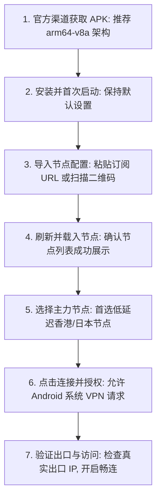
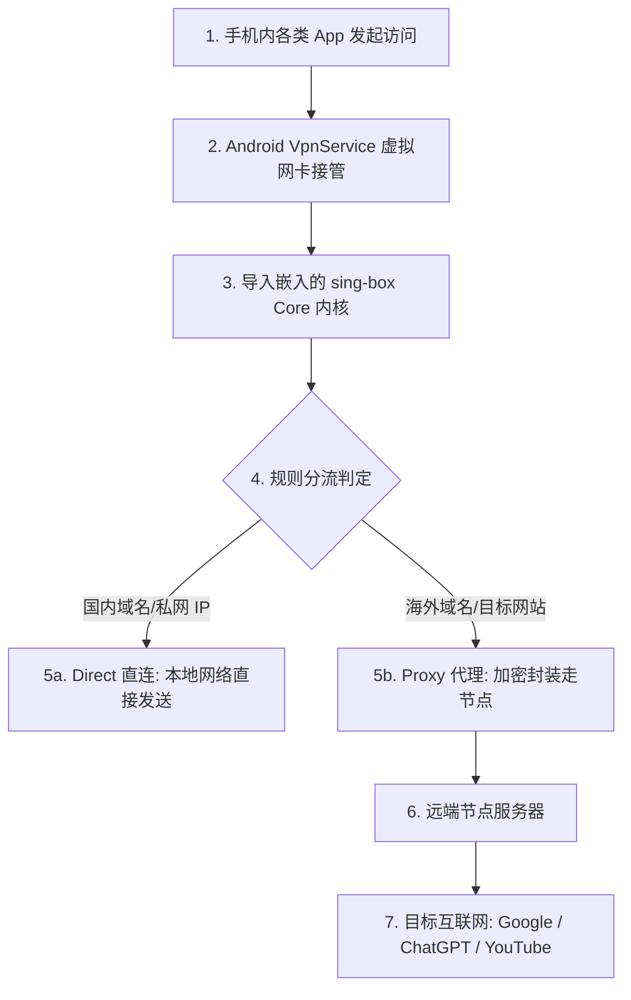
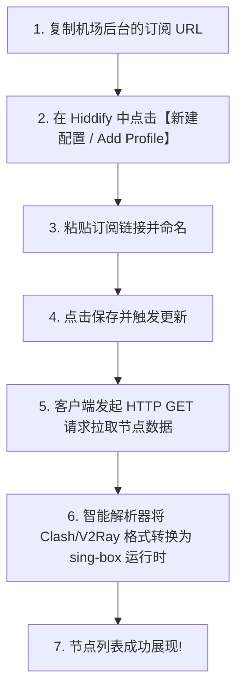
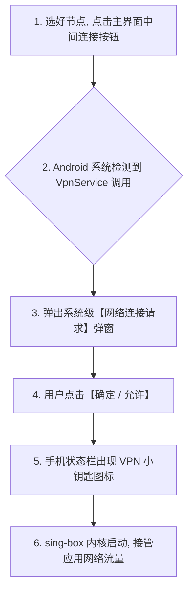

在 Android 安卓手机与平板设备上，**Hiddify（前身为 Hiddify Next）** 凭借极其现代化的 Material You 视觉设计、开箱即用的自动化分流以及对 VLESS-REALITY、Hysteria 2、TUIC 等新一代抗封锁协议的原生支持，成为了当下最受欢迎的科学上网神器之一。

然而，许多刚从 v2rayNG 或 Clash 转过来的安卓用户在首次上手时，常常被各种操作细节与权限弹窗所困扰：

**“从 GitHub 下载 Hiddify 安卓版时，文件列表里的 `arm64-v8a`、`armeabi-v7a` 和 `universal` 到底该下哪一个？”**  
**“安装完打开软件后，为什么界面一片空白没有任何节点？为什么点击连接按钮会弹出系统的‘网络连接请求（VPN权限）’？”**  
**“为什么手机顶部状态栏明明已经出现了 VPN 小钥匙图标，但打开浏览器访问 Google 或 YouTube 却依然提示连接超时？”**  
**“服务商提供的 Clash 或 V2Ray 订阅链接可以直接粘贴进 Hiddify 吗？单节点二维码和多节点订阅有什么本质区别？”**  
**“为什么在软件里测出来的延迟（Ping）只有 30ms，但实际看 4K 视频却疯狂缓冲？选择节点时到底该选香港、日本还是美国？”**

**掌握 Hiddify Android，绝不能停留在“随便装个 APK 点一下连接”的浅层操作，而必须建立一套稳健的“六阶段部署与四层验证机制”！**

使用 Hiddify Android，必须建立一套 **八维 Hiddify 安卓使用与排障模型**：**“认准官方可信发行渠道（Google Play / GitHub Releases） ➔ 正确选择匹配设备架构的 APK（arm64-v8a） ➔ 理解从‘保存订阅 ➔ 网络拉取 ➔ 格式解析 ➔ 节点载入 ➔ VPN建立 ➔ 访问目标’的六阶段流转 ➔ 理性授予 Android VpnService 系统权限（打破‘钥匙图标=翻墙成功’的认知盲区） ➔ 掌握 TUN 虚拟网卡与内外网分流基础 ➔ 遵循‘最小可用配置原则’（首次使用切忌盲改 DNS 与 IPv6） ➔ 实施多层连接验证（UI状态 ➔ 内核日志 ➔ 实际出口IP ➔ 目标业务） ➔ 建立 App、Core 与订阅的三更新协同认知”**。

本文作为 **Hiddify Android 客户端的旗舰级实操主教程**，将带你从零开始完成下载安装、订阅导入、节点调试与全链路排障。

---

## ⚡ 60 秒极速看懂：Hiddify Android 上手核心步骤



- 🚨 **核心认知铁律**：
  - **安装 Hiddify $\ne$ 自动获得翻墙节点**（软件是空壳播放器，订阅是影碟，必须导入服务商订阅）；
  - **状态栏 VPN 钥匙图标 $\ne$ 节点连接成功**（小钥匙仅代表安卓底层 VpnService 管道已建立，不代表远端服务器通信正常）；
  - **初次上手切莫乱改 DNS 与 Routing 规则**，先用默认配置跑通“最小可用连接”！

---

## 一、架构基石：Hiddify Android 流量流转与分工体系

```text
┌────────────────────────────────────────────────────────────────────────────────────────┐
│                        Hiddify Android 六大核心对象职责表                              │
├──────────────┬────────────────────────┬────────────────────────────────────────────────┤
│ 核心对象     │ 归属层级与技术本质     │ 承担职责与安全注意事项                         │
├──────────────┼────────────────────────┼────────────────────────────────────────────────┤
│ **Hiddify App**| 客户端操作界面 (GUI)  | 负责 UI 交互、订阅拉取、节点测速与开关控制     │
│ **sing-box Core**| 底层路由与协议内核   | 负责数据包加密、TUN 虚拟网卡驱动与 DNS 分流    │
│ **Subscription**| 订阅凭据链接 (URL)   | 包含服务器地址与密钥，**属于核心机密，切勿泄露**│
│ **Proxy Node** | 远端代理服务器 (VPS)   | 实际执行网络中转，提供海外公网出口 IP          │
│ **VPN 权限**   | Android 系统 VpnService| 授权 Hiddify 建立虚拟网卡接管整机网络流量      │
│ **TUN 模式**   | 虚拟网络接口技术       | 实现全局/分应用免代理转发，绝非代理协议本身    │
└──────────────┴────────────────────────┴────────────────────────────────────────────────┘
```



---

## 二、第一步：官方可信渠道下载与 APK 架构选择

### 1. 官方下载渠道矩阵
- 🌐 **首选渠道一：Google Play 商店**（需已具备外区 Google 账号，支持全自动后台无缝更新）；
- 🐙 **首选渠道二：官方 GitHub Releases 页面**（最直接、更新最快、无中间商的安全下载源）；
- 🚫 **绝对禁忌**：严禁在第三方破解网站、未知网盘、Telegram 陌生群组下载所谓的“Hiddify 汉化版/魔改版/内置免费节点版”，极易被植入恶意木马或窃取个人隐私。

### 2. APK 架构选型指南（该下载哪一个文件？）
在 GitHub Release 页面中，你会看到多个不同架构的 APK 安装包：

```text
┌────────────────────────────────────────────────────────────────────────────────────────┐
│                        Hiddify APK 文件架构选型速查表                                  │
├──────────────────────────────┬─────────────────────────────────────────────────────────┤
│ 文件命名特征                 │ 适用设备与选型建议                                      │
├──────────────────────────────┼─────────────────────────────────────────────────────────┤
│ **`hiddify-android-arm64-v8a.apk`** | **绝大多数现代安卓手机首选！**（近 6 年主流机型 100% 适用）│
│ `hiddify-android-armeabi-v7a.apk` | 适用于极老旧的 32 位低端手机或老旧电视盒子              │
│ `hiddify-android-x86_64.apk`      | 适用于 PC 上的安卓模拟器（如雷电、夜神、MuMu）          │
│ `hiddify-android-universal.apk`   | 通用完整包，包含所有架构，体积较大（在不确定架构时使用）│
└──────────────────────────────┴─────────────────────────────────────────────────────────┘
```

- 💡 **系统要求**：推荐 Android 8.0 及以上系统版本。

---

## 三、第二步：安装与首次启动权限配置

1. **允许安装未知应用**：若从浏览器下载 APK，系统会提示“允许来自此来源的应用安装”，勾选允许即可。安装完成后建议恢复权限设置，**切勿关闭系统的 Google Play Protect 保护**；
2. **首次打开界面**：Hiddify 界面采用极简卡片式排版。首次进入时，主屏幕核心为大的连接状态面板，下方包含 Profile（配置）、Proxy（节点）、Settings（设置）等核心模块。

---

## 四、第三步：订阅导入与多格式配置解析

Hiddify 支持多样化的导入方式，支持一键识别绝大多数主流服务商格式：

```text
┌────────────────────────────────────────────────────────────────────────────────────────┐
│                        Hiddify 支持的导入方式与协议对照表                              │
├──────────────┬────────────────────────────────┬────────────────────────────────────────┤
│ 导入方式     │ 具体支持的格式与来源           │ 操作要点与注意事项                     │
├──────────────┼────────────────────────────────┼────────────────────────────────────────┤
│ **URL 订阅** | Clash YAML / V2Ray / 通用 Base64| 复制链接 ➔ 点击右上角添加 ➔ 粘贴 URL ➔ 保存│
│ **二维码扫码**| 节点二维码 / 订阅二维码       | 点击扫码图标 ➔ 授权相机 ➔ 秒级解析导入  │
│ **剪贴板导入**| `vless://` / `hy2://` / `ss://`| 复制单节点 URI ➔ 打开软件自动提示导入   │
│ **本地文件** | `.json` / `.yaml` 配置文件     | 支持从手机本地存储导入预设的配置文件   │
└──────────────┴────────────────────────────────┴────────────────────────────────────────┘
```



---

## 五、第四步：节点选择与多地区科学选型

在 Proxy（代理节点）列表中，服务商通常会提供多个国家和地区的服务器：

```text
┌────────────────────────────────────────────────────────────────────────────────────────┐
│                        主流节点地区特性与适用场景简表                                  │
├──────────┬──────────────┬──────────────────────────────────────────────────────────────┤
│ 节点地区 │ 延迟倾向     │ 最佳适用业务场景与选型建议                                   │
├──────────┼──────────────┼──────────────────────────────────────────────────────────────┤
│ **香港** │ 极低 (15~40ms)| 日常网页秒开、外贸办公、手游加速首选；需注意部分 AI 工具风控│
│ **日本** │ 低 (40~80ms)  | 综合素质最佳，全解锁 ChatGPT、Netflix，晚高峰稳定性优异     │
│ **新加坡**| 低 (50~90ms)  | 东南亚流媒体、TikTok 首选，对南亚/澳洲路由友好               │
│ **美国** │ 中高 (130~200ms)| 原生内容最全、部分特定欧美服务专属、大流量下载备用           │
└──────────┴──────────────┴──────────────────────────────────────────────────────────────┘
```

- 💡 **测速指标认知**：
  - 点击节点测速得到的延迟（Ping/URL-Test）仅代表**手机与节点服务器建立握手的时间**；
  - **延迟低并不等于下载带宽大**。看 4K 视频更依赖物理专线的稳定性和抗丢包能力。

---

## 六、第五步：点击连接与授权 Android VPN 权限



### 1. 为什么必须授权 VPN 权限？
Android 操作系统出于安全隔离考虑，任何第三方应用若想接管全局网络流量，必须通过系统标准的 `VpnService` API。**VPN 权限属于系统本地虚拟网卡权限，完全不需要手机 Root！**

### 2. 状态阶梯与“VPN 图标”真伪辨析
```text
┌────────────────────────────────────────────────────────────────────────────────────────┐
│                        Hiddify 状态阶梯与排障递进表                                    │
├──────────────────────────────┬─────────────────────────────────────────────────────────┤
│ 当前达成的状态层级           │ 真实技术状态与排障指引                                  │
├──────────────────────────────┼─────────────────────────────────────────────────────────┤
│ **1. App 安装成功**          │ 仅代表软件安装包正常，尚无任何网络连接能力              │
│ **2. 订阅拉取成功**          │ 成功拿到节点列表，但尚未建立任何加密隧道                │
│ **3. 状态栏出现 VPN 钥匙**   │ **仅代表本地 VpnService 管道已开，不代表节点通信正常！**│
│ **4. 网页秒开 + 出口 IP 改变**| **真正实现科学上网全链路畅通！**                         │
└──────────────────────────────┴─────────────────────────────────────────────────────────┘
```

---

## 七、第六步：全链路连接验证与出口 IP 检测

连接成功后，请按以下 **四步验证法** 确保真实生效：

1. **查验客户端状态**：Hiddify 主界面变为绿色/活跃状态，且有实时的上行/下行速率波形；
2. **访问公网 IP 检测站**：在手机浏览器中打开海外 IP 检测网站（如 `ipinfo.io`），确认显示的 IP 国家已变成所选节点（如日本东京），而非本地运营商宽带；
3. **测试真实目标业务**：打开 YouTube 播放 4K 视频，或访问 Google 搜索确认连接流畅度；
4. **排除旧长连接干扰**：若切换节点后 IP 没变，将浏览器或目标 App 完全划掉杀后台后重新打开，以消除 HTTP/2 长连接缓存。

---

## 八、2026 全协议完美兼容与标准 Hiddify 高速专线推荐

无论 Hiddify 客户端如何优化，**网络性能的物理天花板始终取决于服务器线路质量**。以下为具备原生纯净出口与标准 Hiddify 兼容订阅的标杆服务：

```text
┌────────────────────────────────────────────────────────────────────────────────────────┐
│                        2026 全协议兼容与标准专线推荐                                   │
├──────────┬──────────────────────────┬──────────────┬──────────────┬────────────────────┤
│ 适配场景 │ 推荐品牌候选             │ 实际起付门槛 │ 每月流量配额 │ Hiddify 兼容与专线优势 │
├──────────┼──────────────────────────┼──────────────┼──────────────┼────────────────────┤
│ 旗舰全能 │ 光速云 (GuangSuYun)      │ 约 ¥7.5/月起 │ 59G~238G /月 │ 全线 IEPL 专线，完美适配 Hiddify 多协议订阅，4K 秒开无拥塞│
│ 平价轻量 │ 微风网络 (BreezeNet)     │ 约 ¥7/月起   │ 50GB / 月    │ 优质 BGP 优化专线，纯净轻量，节点更新秒级响应，日常极稳│
│ 弹性月付 │ 唯兔云 (V2Yun)           │ ¥14.9/月     │ 100GB / 月   │ 14.9 元纯单月付，多协议节点充沛，单节点故障秒切  │
│ 应急备用 │ 星岛梦 (XingDaoMeng)     │ 约 ¥8/月起   │ 60G/不限时包 │ 0月租不限时包，永不过期，专线拥塞时随时顶上应急  │
│ 极速专精 │ 速界 (SpeedWorld)        │ ¥25/月       │ 150GB / 月   │ 企业级超大独立专线带宽，AI 与流媒体原生解锁极速响应 │
└──────────┴──────────────────────────┴──────────────┴──────────────┴────────────────────┘
```

- 🏆 **全协议旗舰首选**：[光速云](/reviews/guangsu-cloud/) —— 2020 老牌专线，全线内网 IEPL 专线，标准 Hiddify 订阅一键导入；
- 🍃 **超低预算轻量**：[微风网络](/reviews/weifeng-cloud/) —— 50GB 精品小流量专线，年付折算仅约 ¥7/月；
- 💳 **拒绝绑定的单月付**：[唯兔云](/recommend/best-airports/) —— ¥14.9 纯单月付，100GB 充沛流量。

---

## 九、避坑指南：70 个关于“Hiddify Android 使用”的致命认知误区

```text
❌ 误区 1：下载安装了 Hiddify Android 后手机就能自动免费上网 ➔ 事实：Hiddify 纯粹是客户端外壳，必须导入第三方的节点订阅。
❌ 误区 2：在 GitHub 上下载 APK 时必须下载体积最大的 Universal 版本 ➔ 事实：绝大多数现代手机直接下载 arm64-v8a 性能最好、体积最小。
❌ 误区 3：安装 Hiddify 时必须把手机系统的 Google Play Protect 关掉 ➔ 事实：正版官方 APK 均符合安全规范，无需关闭系统保护。
❌ 误区 4：使用 Hiddify 必须先给手机获取 Root 权限 ➔ 事实：Hiddify 使用系统标准 VpnService API，完全不需要 Root 权限。
❌ 误区 5：只要手机状态栏出现了 VPN 钥匙图标，就代表外网一定连通了 ➔ 事实：钥匙图标仅代表本地虚拟网卡已启动，不证明节点服务器可达。
❌ 误区 6：把订阅链接保存到软件里就等于节点更新成功了 ➔ 事实：保存后必须点击刷新按钮，成功拉取并解析出节点列表才算完成。
❌ 误区 7：别人发的一张单节点二维码就等于一个完整的机场订阅 ➔ 事实：单节点二维码通常只包含 1 个固定服务器，不会自动更新。
❌ 误区 8：在节点列表里挑选 Ping 延迟数值最小的节点看视频一定最快 ➔ 事实：Ping 只代表握手延迟，视频是否卡顿取决于线路物理带宽。
❌ 误区 9：第一次使用 Hiddify 时必须把 DNS、IPv6 和 Routing 全部大改一遍 ➔ 事实：初次上手应遵循最小可用原则，保持默认设置最稳妥。
❌ 误区 10：使用 Hiddify 时必须在安卓系统设置中强行关闭“私人 DNS” ➔ 事实：通常两者可共存，只有发生解析冲突时才做 A/B 测试。
❌ 误区 11：切换了新节点后，打开的网页依然显示旧 IP 说明切换失败 ➔ 事实：浏览器复用了旧的 TCP/QUIC 会话，杀掉应用重新打开即可。
❌ 误区 12：在分应用代理中勾选了微信，就代表微信也必须走海外代理流量 ➔ 事实：勾选仅代表允许进入内核，进入后会被分流规则判定为 Direct 直连。
❌ 误区 13：Hiddify App 升级了就代表底层 Core 和节点订阅也自动更新了 ➔ 事实：App 更新、Core 版本与订阅列表属于三个独立的更新链。
❌ 误区 14：想要停止代理时直接从多任务后台强杀 Hiddify 最干净 ➔ 事实：强杀可能导致系统 VpnService 释放异常，应点击主界面的断开按钮。
❌ 误区 15：Hiddify 支持 Hysteria 2 协议就代表任何网络下都能跑满千兆 ➔ 事实：Hysteria 2 仅改善丢包表现，带宽上限仍受物理网络限制。
```

---

## 十、常见问题深度解答（FAQ · 75 问）

### Q1：Hiddify Android 应该从哪里下载最安全？
**答**：**首选 Google Play 商店或官方 GitHub Releases 页面。** 认准官方签名包，避免在任何第三方非授权网站下载 APK，防止恶意篡改。

### Q2：下载 APK 时，`arm64-v8a` 是什么意思？
**答**：**代表 64 位 ARM 处理器架构。** 目前市面上近几年生产的主流 Android 手机（高通骁龙、联发科天玑等）均为该架构，直接下载 `arm64-v8a.apk` 即可。

### Q3：为什么点击连接会弹出“网络连接请求”？
**答**：**这是 Android 系统的安全机制。** 任何应用建立 VpnService 虚拟网卡接管流量时都必须取得用户授权，点击【确定/允许】即可。

### Q4：为什么状态栏有 VPN 图标但依然打不开网页？
**答**：**钥匙图标仅代表本地 VPN 管道已建立。** 网页打不开通常是节点不可用、配置被判定为 Block 拦截或 DNS 解析超时所致，需在日志中排查。

### Q5：Hiddify 支持导入哪些格式的订阅？
**答**：**支持主流的 Clash YAML、V2Ray 链接、Base64 通用订阅以及 sing-box 配置。** 软件内置智能解析器，可自动转换。

### Q6：扫码导入和粘贴链接导入有什么区别？
**答**：**扫码多用于导入单个固定节点；粘贴 URL 订阅支持拉取几十个节点并实现定期自动刷新。** 日常推荐使用 URL 订阅。

### Q7：节点延迟（Ping）测试显示 Timeout 怎么办？
**答**：**说明该节点服务器当前无法连通。** 可能是该节点处于维护状态、本地网络阻断了连接，或订阅配置参数已过期，尝试刷新订阅或切换其他节点。

### Q8：香港、日本、美国节点平时该怎么选？
**答**：**日常网页浏览与办公选香港/日本（延迟低）；看美区专属流媒体或使用特定 AI 服务选美国节点。**

### Q9：切换节点后为什么查询到的 IP 没有立即改变？
**答**：**因为旧的 TCP/QUIC 网络长连接仍在复用。** 将浏览器彻底关闭（划掉后台任务）后重新打开，强制发起新握手即可看到新 IP。

### Q10：怎么正常关闭 Hiddify？
**答**：**在主界面点击断开（Disconnect）按钮。** 避免直接从后台强杀进程，确保 Android 系统 VpnService 资源被正常注销释放。

### Q11：导入订阅时频繁报错该如何深度解决？
**答**：建议接下来关注本站即将推出的《Hiddify订阅怎么导入？订阅链接、二维码、节点更新与订阅失败完整教程》，或者先阅读 [《sing-box订阅怎么导入？配置、节点更新、二维码与订阅失败完整教程》](/tutorials/sing-box-subscription/)，系统攻克各类导入故障。

---

## 🏁 总结：Hiddify Android 上手核心认知金字塔

掌握 Hiddify Android，请牢记以下**核心铁律**：

```text
1. 认正源 ➔ 认准 GitHub 官方 Release 与 Google Play，主选 arm64-v8a 架构安装包
2. 明权责 ➔ 软件是空壳工具，节点来自服务商订阅，未导订阅无法提供任何代理
3. 破迷思 ➔ 状态栏 VPN 钥匙图标不等于节点连接成功，必须以真实出口 IP 验证为准
4. 守极简 ➔ 初次上手切莫乱改 DNS 与路由规则，先用默认配置建立“最小可用连接”
5. 善排错 ➔ 遇故障先看日志三问：流量进 Core 了吗？命中了什么规则？Outbound 连通了吗？
```

---

### 📚 相关专题延伸阅读
- 🏛️ **Hiddify 生态总览**：[《Hiddify是什么？Hiddify Next、sing-box、V2Ray、Xray与Clash有什么区别？》](/wiki/what-is-hiddify/)
- 📦 **sing-box 订阅教程**：[《sing-box订阅怎么导入？配置、节点更新、二维码与订阅失败完整教程》](/tutorials/sing-box-subscription/)
- 📱 **sing-box Android 教程**：[《sing-box Android怎么用？下载安装、配置、订阅、TUN与完整使用教程》](/tutorials/sing-box-android/)
- 🤖 **v2rayNG Android 教程**：[《v2rayNG Android怎么用？下载安装、节点配置与完整使用教程》](/tutorials/v2rayng-android/)
- ⚡ **老牌旗舰专线评测**：[《光速云深度评测：2020老牌IEPL专线与解锁实测》](/reviews/guangsu-cloud/)
- 🏆 **2026 全景大榜**：[《2026梯子推荐：稳定、速度、价格、安全与不同使用场景怎么选》](/recommend/best-tizi/)
