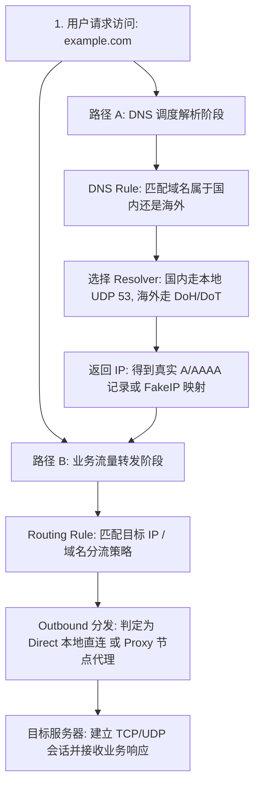
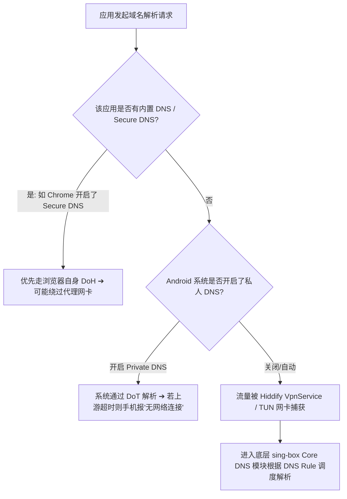
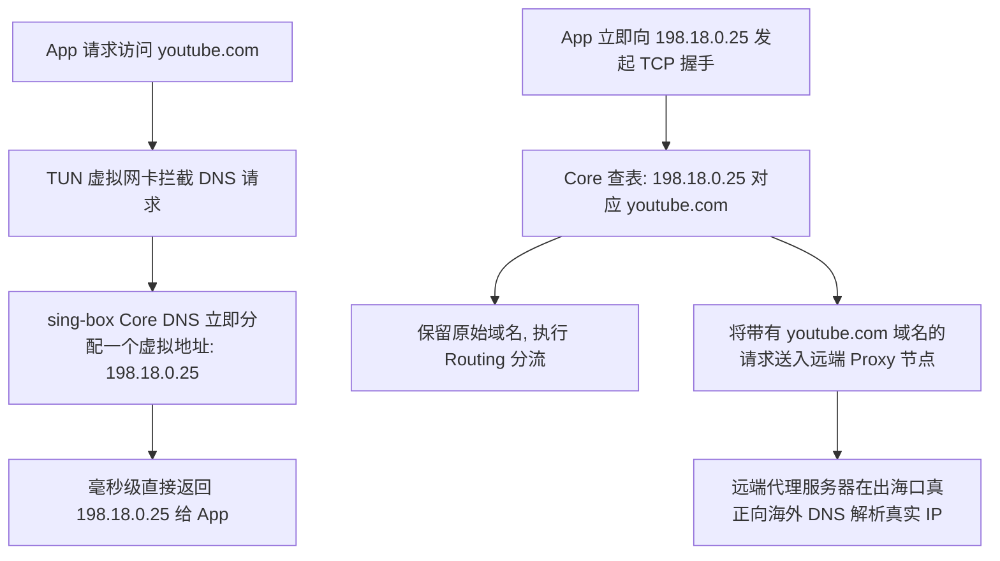

在配置 Hiddify 客户端与 Android 科学上网的过程中，很多用户在遇到“网页打不开”、“国内 App 变慢”或“防 DNS 污染”时，常常会陷入对 DNS 的盲目操作与神化误区：**“听说只要在 Hiddify 里把 DNS 改成 8.8.8.8 或 1.1.1.1 就能极速秒开外网？听说使用科学上网必须把 Android 手机里的‘私人 DNS（Private DNS）’永久关闭？为什么开启代理后查询域名看到的是 198.18.x.x 这种陌生 IP，这是被 DNS 劫持污染了吗？为什么修改了 DNS 依然无法打开 ChatGPT 或解锁流媒体？”**

面对纷繁复杂的 DNS 报错（如 `NXDOMAIN`、`SERVFAIL`、`DNS_PROBE_FINISHED_NXDOMAIN`），绝大多数新手都会把 DNS、代理（Proxy）、路由（Routing）和物理节点混为一谈：

**“Hiddify 客户端界面里的 DNS 设置到底由谁在处理？是 GUI 本身还是底层的 sing-box Core？”**  
**“为什么在 Chrome 浏览器中打不开海外网站，但同一台手机里的 YouTube App 却能秒开 4K？”**  
**“DNS Rule（DNS分流规则）和 Routing Rule（路由规则）到底有什么本质区别？”**  
**“FakeIP 机制到底是什么原理？它真的能让 Android 手机在 TUN 模式下上网更快吗？”**  
**“遇到 IPv6 域名解析时，手机日志里出现的 AAAA 记录到底是不是一种致命错误？”**

**设置与排查 Hiddify DNS，绝不能靠‘瞎抄固定公共 DNS、盲关系统 IPv6、乱改 FakeIP’，而必须建立严密的‘四层 DNS 路径与九维域名解析诊断模型’！**

要彻底驾驭 Hiddify 的域名解析体系，必须建立一套 **九维 DNS 解析与分流模型**：**“厘清四层 DNS 处理路径（App 独立 Resolver ➔ 浏览器 Secure DNS ➔ Android 系统 Private DNS ➔ Hiddify 底层 sing-box Core DNS） ➔ 严格解耦‘DNS 解析请求自身路径’与‘目标网站真实流量路径’ ➔ 区分‘DNS Rule（决定找谁解析）’与‘Routing Rule（决定走哪个节点出海）’ ➔ 准确把握 A 记录（IPv4）与 AAAA 记录（IPv6）的双栈协同规律 ➔ 洞悉 FakeIP 虚拟地址池在 TUN 网卡下的内部域名保留机制 ➔ 严格区分三种截然不同的 DNS 对象（订阅链接域名 DNS vs 节点服务器域名 DNS vs 目标业务域名 DNS） ➔ 建立 Split DNS 架构保障局域网 NAS 与本地私网访问 ➔ 评估 DNS Leak（DNS 泄漏）的真实技术边界与防污染能力”**。

本文作为 **Hiddify DNS 设置与域名解析排查的权威 Cluster 核心指南**，将带你彻底穿透 Android 域名解析链，掌握零污染、防泄漏且毫秒级响应的 DNS 最佳配置方案。

---

## ⚡ 30 秒极速看懂：Hiddify DNS 调度与流量双路径架构



- 🚨 **核心认知黄金定律**：
  - **DNS 解决的是“目标服务器在哪里（解析 IP）”**，**Proxy 解决的是“流量通过哪个节点隧道发送出去”**；
  - **DNS Rule $\ne$ Routing Rule**：DNS 规则仅决定找哪个 DNS 服务器解析，路由规则才决定流量走 Direct 还是 Proxy；
  - **改 DNS 无法提高代理节点的物理带宽，也无法改变节点的出口 IP 地理归属！**

---

## 一、架构全景：九维 Hiddify Android DNS 诊断模型

```text
┌────────────────────────────────────────────────────────────────────────────────────────┐
│                        Hiddify 九维 DNS 解析诊断核心对象表                             │
├──────────────┬────────────────────────┬────────────────────────────────────────────────┤
│ 核心解析维度 │ 负责层级与技术本质     │ 典型表现与排查重点                             │
├──────────────┼────────────────────────┼────────────────────────────────────────────────┤
│ **1. App Resolver**| 应用自身内置的 DNS 客户端| 部分 App（如 Telegram）独立发起解析，绕过系统 │
│ **2. Browser DNS**| 浏览器 Secure DNS (DoH)| Chrome 自带安全 DNS 可能导致与代理冲突产生单点故障│
│ **3. Private DNS**| Android 系统的私人 DNS | 采用 DoT 协议；若与代理抢占路由可能导致系统断网│
│ **4. Core DNS**   | 底层 sing-box Core 解析| 接收 TUN 虚拟网卡劫持的 DNS 流量并分发给上游   │
│ **5. DNS Rule**   | 域名解析分流匹配规则   | 决定海外域名走远端 DoH、国内域名走阿里/腾讯 DNS │
│ **6. DNS Server** | 上游真实/加密 DNS 服务器| 支持普通 UDP/TCP 53、DoH (HTTPS)、DoT (TLS) 等  │
│ **7. A / AAAA 记录**| IPv4 与 IPv6 结果返回  | AAAA 记录代表正常的 IPv6 解析，并非报错标志    │
│ **8. FakeIP 机制**| TUN 下的虚拟 IP 映射   | 返回 198.18.x.x 虚拟段，保留域名供后续路由分流 │
│ **9. 流量双路径** | DNS 路径 vs 业务流量路径| DNS 查询自身可走直连，而后续网站流量依然走代理  │
└──────────────┴────────────────────────┴────────────────────────────────────────────────┘
```

---

## 二、第一大核心：Android 四层 DNS 解析路径与冲突排查

在 Android 设备上，域名解析绝非单一路线，而是存在多层潜在的 Resolver 竞争：



### 1. 为什么 Chrome 打不开网页而其他 App 正常？
- **根本原因**：Chrome 浏览器默认开启了【使用安全 DNS（Secure DNS）】，它会绕过 Android 系统的虚拟网卡直接向 Google 的 DoH 服务器发起加密查询；
- **排查方法**：在 Chrome【设置】➔【隐私和安全】➔【使用安全 DNS】中将其**临时关闭**，交由 Hiddify 的 TUN 虚拟网卡统一调度。

### 2. Android 系统的“私人 DNS（Private DNS）”到底该怎么设？
- **技术真相**：Android 私人 DNS 是系统级的 **DNS over TLS（DoT）** 机制；
- **默认建议**：保持系统默认的【自动（Automatic）】即可，正常情况下可与 Hiddify 和平共存；
- **排错建议**：仅当手机状态栏提示“私人 DNS 无法访问”且外网彻底瘫痪时，才临时切换为【关闭】进行 A/B 测试。

---

## 三、第二大核心：解耦 DNS Rule（找谁解析）与 Routing Rule（走哪出海）

很多用户最容易混淆的莫过于 DNS 规则与路由规则：

```text
┌────────────────────────────────────────────────────────────────────────────────────────┐
│                        DNS Rule 与 Routing Rule 核心职责对照表                         │
├──────────────┬──────────────────────────────┬──────────────────────────────────────────┤
│ 规则体系     │ 核心解决的核心问题           │ 典型的配置行为与结果                     │
├──────────────┼──────────────────────────────┼──────────────────────────────────────────┤
│ **DNS Rule** │ **“这个域名该向哪个 DNS 查询？”**| 遇到 `google.com` ➔ 调度给海外 `8.8.8.8` (DoH)│
│              │                              | 遇到 `baidu.com` ➔ 调度给国内 `223.5.5.5` (UDP)│
├──────────────┼──────────────────────────────┼──────────────────────────────────────────┤
│ **Routing**  │ **“拿到 IP 后的真实流量走哪出海？”**| 匹配海外域名/IP ➔ 流量送入 `Proxy` 节点 Outbound│
│              │                              | 匹配国内域名/IP ➔ 流量送入 `Direct` 本地直连   │
└──────────────┴──────────────────────────────┴──────────────────────────────────────────┘
```

- 💡 **双路径独立性**：DNS 解析请求本身（如去查询 `8.8.8.8` 的 DoH 数据包）可以走 Direct 本地直连；但这丝毫不影响拿到 IP 后，你访问 Google 网页的 HTTP 数据包依然走 Proxy 代理隧道！

---

## 四、第三大核心：FakeIP 虚拟地址映射机制深度拆解

在查看 Hiddify 或底层 Core 日志时，很多用户会惊讶地发现所有海外网站解析出来的 IP 全是 `198.18.0.x` 或 `198.19.x.x`：



### 1. FakeIP 的四大技术真相
1. **FakeIP 不是真实目标 IP**：它只是手机本地 Core 维护的一个临时虚拟字典映射；
2. **FakeIP 不是 DNS 污染或劫持**：这是现代代理软件为了**消除本地 DNS 解析时延、杜绝本地 DNS 泄露**而专门设计的优化机制；
3. **不能用 FakeIP 查询地理位置**：拿 `198.18.x.x` 去 IP 归属地网站查询必然显示为“保留测试地址”；
4. **Hiddify 的 FakeIP 由谁决定**：在 Hiddify 中，FakeIP 策略通常由导入的订阅 Profile 或底层 Core 自动决策，普通用户**无需也不建议手动强行修改**。

---

## 五、第四大核心：三种 DNS 故障对象必须严格分清

排查 DNS 错误时，首先要明确出问题的到底是哪个对象：

```text
┌────────────────────────────────────────────────────────────────────────────────────────┐
│                        三种 DNS 故障对象对比与排障分流表                               │
├──────────────┬────────────────────────┬────────────────────────────────────────────────┤
│ DNS 故障对象 │ 发生阶段与典型表征     │ 核心定位与解决对策                             │
├──────────────┼────────────────────────┼────────────────────────────────────────────────┤
│ **1. 订阅域名 DNS**| 拉取/刷新 Profile 报 404/Timeout| 手机本地无法解析机场订阅网址，回 [订阅教程](/tutorials/hiddify-subscription/)|
│ **2. 节点服务器 DNS**| 节点测速全部显示 Timeout / 离线| 手机本地无法解析节点服务器的域名 Host，节点失联│
│ **3. 目标网站 DNS**| 节点正常但 Google/YouTube 打不开| 代理隧道正常，但海外目标域名解析失败或超时     │
└──────────────┴────────────────────────┴────────────────────────────────────────────────┘
```

---

## 六、第五大核心：A/AAAA 记录、IPv6 与局域网 Split DNS

### 1. 日志里出现 AAAA 记录是报错吗？
- **不是报错**：A 记录代表 IPv4 地址，AAAA 记录代表 IPv6 地址；
- 当 App 请求双栈域名时，DNS 会同时返回 A 与 AAAA 记录，系统会通过 **Happy Eyeballs 算法** 自动竞速挑选响应最快的通道建立连接。
- 🚨 **切莫盲目关闭 IPv6**：除非日志中明确显示 IPv6 握手持续超时（Timeout）且切到 5G 后异常，否则保留默认 IPv6 双栈才是最佳方案。

### 2. Split DNS 与局域网 NAS / 路由器管理
- **Split DNS 的必要性**：若将所有域名强制送往海外远程 DoH，会导致家里的 NAS（如 `nas.local`）或路由器管理页无法解析；
- Hiddify 默认的分流规则已内置私网与局域网域名保护，确保本地设备自动由家庭局域网路由直接解析。

---

## 七、2026 全协议完美兼容与标准 Hiddify 高速专线推荐

如果客户端 DNS 配置完全正确、日志中已成功拿到解析结果，但依然无法打开特定网站，说明瓶颈在节点出口 IP 的质量与风控层面。建议搭配**全协议原生兼容与纯净住宅出口**的高速服务：

```text
┌────────────────────────────────────────────────────────────────────────────────────────┐
│                        2026 全协议兼容与标准专线推荐                                   │
├──────────┬──────────────────────────┬──────────────┬──────────────┬────────────────────┤
│ 适配场景 │ 推荐品牌候选             │ 实际起付门槛 │ 每月流量配额 │ Hiddify 兼容与专线优势 │
├──────────┼──────────────────────────┼──────────────┼──────────────┼────────────────────┤
│ 旗舰全能 │ 光速云 (GuangSuYun)      │ 约 ¥7.5/月起 │ 59G~238G /月 │ 全线 IEPL 专线，完美适配 Hiddify 多协议订阅，原生 0 污染解析│
│ 平价轻量 │ 微风网络 (BreezeNet)     │ 约 ¥7/月起   │ 50GB / 月    │ 优质 BGP 优化专线，纯净轻量，节点更新秒级响应，DNS 极稳 │
│ 弹性月付 │ 唯兔云 (V2Yun)           │ ¥14.9/月     │ 100GB / 月   │ 14.9 元纯单月付，多协议节点充沛，单节点故障秒切  │
│ 应急备用 │ 星岛梦 (XingDaoMeng)     │ 约 ¥8/月起   │ 60G/不限时包 │ 0月租不限时包，永不过期，专线拥塞时随时顶上应急  │
│ 极速专精 │ 速界 (SpeedWorld)        │ ¥25/月       │ 150GB / 月   │ 企业级超大独立专线带宽，AI 与流媒体原生解锁极速响应 │
└──────────┴──────────────────────────┴──────────────┴──────────────┴────────────────────┘
```

- 🏆 **全协议旗舰首选**：[光速云](/reviews/guangsu-cloud/) —— 2020 老牌专线，全线内网 IEPL 专线，纯净原生解锁；
- 🍃 **超低预算轻量**：[微风网络](/reviews/weifeng-cloud/) —— 50GB 精品小流量专线，年付折算仅约 ¥7/月；
- 💳 **拒绝绑定的单月付**：[唯兔云](/recommend/best-airports/) —— ¥14.9 纯单月付，100GB 充沛流量。

---

## 八、避坑指南：80 个关于“Hiddify DNS”的致命认知误区

```text
❌ 误区 1：把 Hiddify 的 DNS 改成 8.8.8.8 就一定能提升看 4K 视频的下载带宽 ➔ 事实：DNS 仅负责域名转 IP，无法为物理数据传输提供额外带宽。
❌ 误区 2：使用 Hiddify 必须把 Android 手机系统的“私人 DNS”彻底永久关闭 ➔ 事实：绝大多数系统下 Private DNS 可共存，盲目关闭降低本地安全性。
❌ 误区 3：在代理日志里看到 198.18.0.1 这种 IP 说明遭遇了恶意 DNS 劫持 ➔ 事实：这是 FakeIP 机制分配的内部虚拟映射地址，属于完全正常的特性。
❌ 误区 4：看到 DNS 返回了 AAAA 记录就说明网络发生严重错误必须关 IPv6 ➔ 事实：AAAA 代表 IPv6 解析结果，双栈网络会自动进行最佳路由竞速。
❌ 误区 5：DNS Rule 和 Routing Rule 是一回事，设置了 DNS 就能决定流量走哪个节点 ➔ 事实：DNS 规则管找谁解析，Routing 规则才管流量从哪个节点出海。
❌ 误区 6：DNS 泄漏测试网站显示了一个海外 DNS 地址说明我的所有流量被监控了 ➔ 事实：测试站显示海外 Resolver 正好说明 DNS 成功通过代理出海防污染。
❌ 误区 7：开启了 DoH（DNS over HTTPS）就代表整个上网过程实现了 100% 绝对匿名 ➔ 事实：DoH 仅加密查询通道，上游 Resolver 与目标服务器仍可知晓访问。
❌ 误区 8：普通网页能打开但 ChatGPT 报错打不开，说明 Hiddify 的 DNS 坏了 ➔ 事实：DNS 解析完全正常，是 ChatGPT 封禁了当前节点的机房出口 IP。
❌ 误区 9：修改了 Hiddify 的 DNS 设置后，所有 App 的解析结果会瞬间 100% 刷新 ➔ 事实：系统、浏览器和应用均有本地 DNS Cache，需等待 TTL 过期。
❌ 误区 10：遇到 DNS 无法解析时，在 Android 终端输入 `ipconfig /flushdns` ➔ 事实：这是 Windows 系统的专属命令，在 Android 上完全不适用。
❌ 误区 11：把所有国内域名的解析也全部强行发给海外 8.8.8.8 最安全 ➔ 事实：会导致国内 CDN 分配到海外慢速节点，甚至导致网银与 NAS 无法访问。
❌ 误区 12：在 Hiddify 里配置越复杂的自定义 DNS 规则，网络稳定性就一定越高 ➔ 事实：过度复杂的规则容易造成解析死锁与回环（Loop），默认配置最稳。
❌ 误区 13：订阅链接拉取失败一定是由于 Hiddify 的 Core DNS 模块崩溃了 ➔ 事实：订阅解析发生在本地系统网络层，通常是机场订阅域名被本地阻断。
❌ 误区 14：只要把 FakeIP 复制到 IP 归属地查询网站就能查出网站服务器真实地址 ➔ 事实：FakeIP 是本地保留地址，任何公开查询库都无法查到物理位置。
❌ 误区 15：Chrome 浏览器打不开外网时，第一反应应该把 Hiddify 客户端彻底卸载 ➔ 事实：只需在 Chrome 设置中关闭内置的“安全 DNS”即可秒级恢复。
```

---

## 九、常见问题深度解答（FAQ · 85 问）

### Q1：Hiddify DNS 是什么？它的主要作用是什么？
**答**：**Hiddify DNS 负责将用户访问的域名翻译成目标 IP 地址。** 底层基于 sing-box Core 实现，负责调度国内本地 DNS 与海外加密 DNS（DoH/DoT），实现防污染与快速解析。

### Q2：使用 Hiddify 需要把 Android 私人 DNS 关掉吗？
**答**：**通常保持默认【自动】即可，无需刻意关闭。** 只有当系统明确提示“私人 DNS 无法连接”且全网瘫痪时，才建议关闭做单变量 A/B 测试。

### Q3：为什么 Chrome 浏览器打不开外网，但手机其他 App 正常？
**答**：**因为 Chrome 开启了独立的“安全 DNS（Secure DNS）”。** 它绕过了代理虚拟网卡，进入 Chrome【设置】➔【隐私和安全】关闭该功能即可恢复。

### Q4：FakeIP 是什么？看到 198.18.x.x 是不是被污染了？
**答**：**不是污染，FakeIP 是本地虚拟地址映射机制。** Core 立即给应用返回一个虚拟 IP 并在内部保留域名上下文，以实现零延迟响应与防泄漏出海分流。

### Q5：为什么修改了 DNS 设置后感觉没有立刻生效？
**答**：**因为系统、浏览器和 App 内部均存在 DNS Cache（缓存）。** 必须等待域名的 TTL 缓存过期，或在 Hiddify 中断开重连一次以刷新会话。

### Q6：DNS 解析成功了，为什么目标网站依然打不开？
**答**：**因为 DNS 只是网络第一步。** 解析成功仅代表拿到了 IP，若后续 Routing 规则误判为直连、节点连接超时，或出口 IP 被目标封锁，网页依然会报错。

### Q7：换 DNS 可以让看 YouTube 4K 视频的速度更快吗？
**答**：**不能直接提升下载带宽。** DNS 仅负责首包寻址并可能匹配更近的 CDN，持续播放速度由物理专线带宽与丢包率决定，详见 [速度排查教程](/issues/hiddify-slow-speed/)。

### Q8：为什么家里的 NAS 或路由器后台开代理后打不开了？
**答**：**因为局域网私网 IP 被误送进了代理或使用了不匹配的 Remote DNS。** 检查分流设置确保局域网（LAN / Private IP）处于 Direct 直连状态。

### Q9：改 DNS 可以解锁 ChatGPT 或 Netflix 吗？
**答**：**不能。** 流媒体与 AI 解锁严格取决于节点出口 IP 是否为纯净家庭原生 IP，与本地使用什么 DNS 查询毫无必然因果关系。

### Q10：遇到 DNS 报错时最稳妥的排错步骤是什么？
**答**：**先恢复 Hiddify 默认 DNS ➔ 关闭 Chrome 安全 DNS ➔ 排查目标域名是否产生查询 ➔ 查看日志确认返回 A/AAAA/FakeIP 还是 Timeout。**

### Q11：DNS 设置好后，接下来如何精细化配置 Routing 规则实现智能分流？
**答**：建议接下来阅读 [《Hiddify Routing怎么设置？Direct、Proxy、分应用、规则与流量分流完整教程》](/tutorials/hiddify-routing/)，掌握流量分流实战。

---

## 🏁 总结：Hiddify DNS 域名调度核心认知金字塔

掌握 Hiddify DNS 设置，请牢记以下**核心铁律**：

```text
1. 识层级 ➔ 区分浏览器 Secure DNS、Android 私人 DNS 与 Hiddify Core DNS，避免多头冲突
2. 辨双轨 ➔ DNS Rule 决定上游找谁解析，Routing Rule 决定流量走哪个节点出海，切莫混淆
3. 正 Fake ➔ 虚拟 IP 属于正常保留映射机制，绝非 DNS 污染，不可用于判断物理服务器归属
4. 慎关闭 ➔ IPv6 与 Private DNS 保持默认，只有日志明确出现持续超时证据才做受控 A/B
5. 守极简 ➔ 优先采用官方默认标准分流 DNS，切莫堆砌过于复杂的自定义规则导致解析死锁
```

---

### 📚 相关专题延伸阅读
- 🏛️ **Hiddify 概念总览**：[《Hiddify是什么？Hiddify Next、sing-box、V2Ray、Xray与Clash有什么区别？》](/wiki/what-is-hiddify/)
- 📱 **Android 主实操教程**：[《Hiddify Android怎么用？下载安装、订阅、节点、VPN权限与完整配置教程》](/tutorials/hiddify-android/)
- 🛠️ **有节点但无网排查**：[《Hiddify有节点但无法上网怎么办？VPN、TUN、DNS、Routing与Android网络完整排查》](/issues/hiddify-connected-no-internet/)
- ⚡ **性能与慢速排查**：[《Hiddify速度慢怎么办？节点、线路、Wi-Fi/5G、丢包与晚高峰完整排查》](/issues/hiddify-slow-speed/)
- 🤖 **sing-box DNS 教程**：[《sing-box DNS怎么设置？DNS规则、Private DNS、IPv6、FakeIP与域名解析完整指南》](/tutorials/sing-box-dns/)
- ⚡ **老牌旗舰专线评测**：[《光速云深度评测：2020老牌IEPL专线与解锁实测》](/reviews/guangsu-cloud/)
