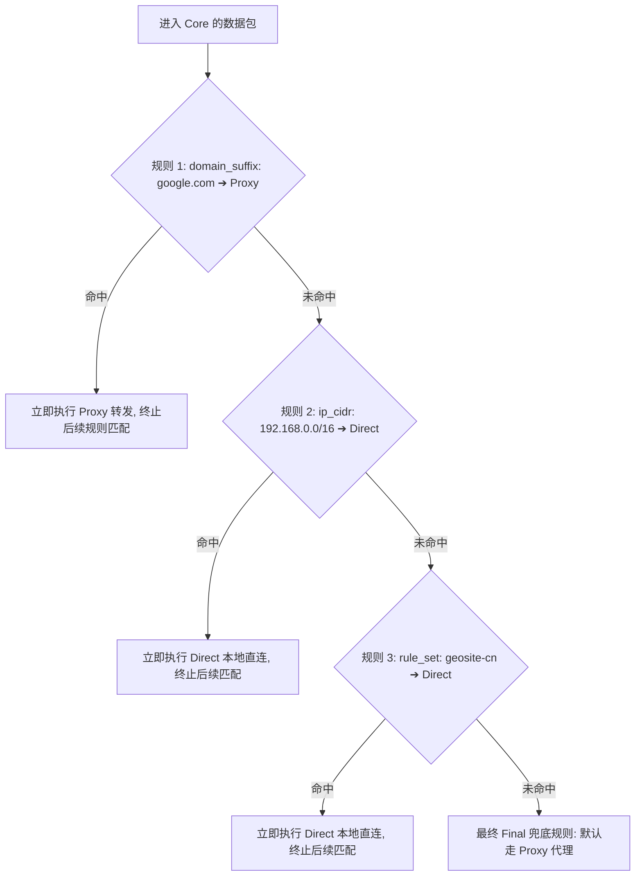

在科学上网与日常网络使用中，很多 Android 用户在配置 Hiddify 客户端时，常常会遇到令人头疼的“分流错乱”与“访问异常”：**“明明选择了日本节点，为什么打开国内的微信、网银 App 提示异地登录甚至直接被风控锁卡？为什么在 Hiddify 里开启了代理，但特定的某个 App（如 Telegram 或 Twitter）却像完全没有联网一样无法加载？为什么家里的私网 NAS（如 192.168.1.x）或路由器后台，一开 Hiddify 就彻底打不开了？为什么在 Speedtest 上测出了超高带宽，但实际节点却慢得要死？”**

面对复杂的流量分流配置，绝大多数新手都会陷入“分应用、TUN 模式、DNS 与 Routing 傻傻分不清”的混乱境地：

**“分应用代理（Per-App）和路由分流规则（Routing Rule）到底有什么先后顺序？谁的优先级更高？”**  
**“Direct（直连）到底意味着什么？它是不是等同于彻底关闭 Hiddify？”**  
**“为什么在分流规则里明明添加了某个网站的域名，刷新浏览器却依然走旧的直连线路？”**  
**“ChatGPT、Claude 或 Netflix 的分流，为什么只在规则里写一个 `chatgpt.com` 根本无法正常使用？”**  
**“Rule Set（规则集）和我们从机场购买的节点订阅到底有什么本质区别？”**

**设置与排查 Hiddify Routing，绝不能靠‘瞎搬 Clash 语法、乱加无效域名、神化全网规则集’，而必须建立严密的‘流量捕获与九维分流决策模型’！**

要彻底驾驭 Hiddify 的智能分流体系，必须建立一套 **九维 Routing 路由与分流架构**：**“厘清分应用（Per-App）与路由规则（Routing）的绝对先后层级（Per-App 决定‘流量是否进入 VPN 网卡’ ➔ Routing 决定‘进入后具体走哪条出站 Outbound’） ➔ 准确理解 Direct（本地直连）、Proxy（代理节点）与 Reject/Block（安全丢弃）三大核心 Action 的本质 ➔ 掌握 Domain 域名规则（Exact / Suffix）与 IP/CIDR 规则的匹配机制 ➔ 辨析 Rule Set（规则集）与节点订阅的数据边界 ➔ 针对 AI 大模型（多 API/CDN 域名组）与流媒体服务实施多维度矩阵式分流 ➔ 守护局域网与私网网段（LAN / 192.168.0.0/16）的直连访问 ➔ 规避 TCP/QUIC 旧长连接复用导致的‘规则已改但未生效’假象 ➔ 建立‘Target 目标 ➔ Rule 规则 ➔ Action 动作 ➔ Outbound 出站 ➔ Exit IP 出口’五维闭环审计链”**。

本文作为 **Hiddify Routing 路由分流与分应用设置的权威 Cluster 核心指南**，将带你彻底攻克流量分流难关，实现国内极速直连、海外无感翻墙与局域网完全隔离的最佳网络体验。

---

## ⚡ 30 秒极速看懂：Hiddify 流量捕获与路由分流全景架构

```mermaid
graph TD
    AppGen[1. Android App 发起网络连接请求] --> Step1{Per-App 分应用过滤: 该 App 是否被允许进入 VPN?}
    
    Step1 -->|被 Exclude 排除 / 未在 Include 白名单| RawNet[完全绕过 Hiddify ➔ 走物理 Wi-Fi / 5G 原始网络]
    Step1 -->|进入 VPN 范围| Step2[2. TUN / VpnService 虚拟网卡拦截流量并注入 Core]
    
    Step2 --> Step3[3. Core 获取请求上下文: 还原目标 Domain 或目标 IP]
    Step3 --> Step4{4. Routing Rule 规则匹配 (First-Match 优先匹配)}
    
    Step4 -->|匹配 Direct 规则 (如国内域名/局域网IP)| ActDirect[Action: Direct ➔ 本地物理宽带出站, 呈现本地真实 IP]
    Step4 -->|匹配 Proxy 规则 (如海外网站/AI/流媒体)| ActProxy[Action: Proxy ➔ 送入 Proxy Outbound 节点隧道, 呈现海外出口 IP]
    Step4 -->|匹配 Reject 规则 (如广告/恶意追踪)| ActReject[Action: Reject ➔ 立即丢弃数据包, 拦截广告加载]
    Step4 -->|未命中任何规则| ActDefault[5. Final 兜底规则: 执行默认出站策略 (通常为 Proxy 或 Direct)]
```

- 🚨 **核心认知黄金定律**：
  - **分应用（Per-App）决定“进不进”**，**Routing 规则决定“怎么走”**；如果某个 App 在 Hiddify 日志中完全没有请求记录，加 100 条 Routing 规则也毫无意义！
  - **Direct（直连）不等于关闭 Hiddify**，它代表数据包经过了本地 Core 的分流判定后，被指示通过本地物理网卡直接发送；
  - **修改 Routing 规则后必须断开重连一次或重启 App**，否则现有的 TCP/QUIC 长连接会继续沿用旧的分流隧道！

---

## 一、架构全景：九维 Hiddify Android Routing 诊断模型

```text
┌────────────────────────────────────────────────────────────────────────────────────────┐
│                        Hiddify 九维路由分流核心对象表                                  │
├──────────────┬────────────────────────┬────────────────────────────────────────────────┤
│ 核心分流维度 │ 负责层级与技术本质     │ 典型表现与排查重点                             │
├──────────────┼────────────────────────┼────────────────────────────────────────────────┤
│ **1. Per-App**| Android 进程级流量过滤 | 决定哪些 App 进入 VpnService；排查 App 无日志问题 │
│ **2. TUN 捕获**| 虚拟网卡流量接管       | 系统底层数据拦截管道；排查整机流量是否被接管   │
│ **3. 上下文识别**| 目标域名与 IP 嗅探    | 通过 Sniff 或 FakeIP 保留真实域名以供分流匹配   │
│ **4. 规则匹配**| Domain / IP / Port 规则| 根据目标特征匹配分流策略；排查规则先后顺序覆盖 │
│ **5. Rule Set**| 外部可复用分流规则集   | 包含成千上万域名的列表文件；排查规则集更新失效 │
│ **6. 路由动作**| Direct / Proxy / Reject| 分流最终决策；Direct 走直连，Proxy 走代理节点  │
│ **7. 出站对象**| Proxy Outbound / 选择器 | 实际发送数据的出口；排查节点选择器是否正确指向 │
│ **8. 出口验证**| 真实出口 IP 检测       | 验证海外站是否呈现节点 IP、国内站是否呈现本地 IP│
│ **9. 业务可用**| ChatGPT / 流媒体风控   | 分流正确后检验目标平台是否接受该节点的出口 IP   │
└──────────────┴────────────────────────┴────────────────────────────────────────────────┘
```

---

## 二、第一大断点：Per-App 分应用（是否进入）与 Routing（进入后怎么走）

```mermaid
graph TD
    AppA[应用 A: 手机银行 / 微信] --> CheckPerApp{Hiddify 分应用设置}
    AppB[应用 B: Chrome / YouTube] --> CheckPerApp
    
    CheckPerApp -->|模式: 仅代理选中的应用 (Include)| IncludeLogic[未勾选的应用完全不进 VPN ➔ 保证网银 100% 绝对直连]
    CheckPerApp -->|模式: 绕过选中的应用 (Exclude)| ExcludeLogic[勾选的应用完全不进 VPN ➔ 其他所有应用交由 Routing 智能分流]
```

### 1. 为什么“勾选 App”可能导致完全相反的结果？
- **Include（仅代理选中的应用 / 白名单）**：只有被勾选的 App 流量才会进入 Hiddify，**未勾选的 App 彻底脱离代理网卡**；若忘记勾选浏览器，浏览器将彻底无法翻墙；
- **Exclude（绕过选中的应用 / 黑名单）**：被勾选的 App 将被系统彻底放行走本地裸网，**其余所有 App 的流量全部交由 Hiddify 的 Routing 规则进行精细化分流**；
- 💡 **日常推荐**：普通用户推荐使用 **Exclude 模式**，仅将国内银行、交管 12123 等对 VPN 极度敏感的少数 App 勾选排除，其余应用交由规则智能分流。

### 2. 核心排查准则
若发现某个特定 App 无论如何都打不开外网，**第一步不是去写复杂的分流规则，而是打开 Hiddify 日志观察打开该 App 时是否有请求进入**：若无请求，100% 是 Per-App 配置错误！

---

## 三、第二大断点：Direct、Proxy 与 Reject 三大路由 Action 深度解析

当数据包通过 TUN 进入底层 sing-box Core 后，Routing 模块会做出以下三大动作之一：

```text
┌────────────────────────────────────────────────────────────────────────────────────────┐
│                        Direct / Proxy / Reject 三大动作对比表                          │
├──────────────┬──────────────────────────────┬──────────────────────────────────────────┤
│ 路由动作     │ 数据包处理流程与本质         │ 典型应用场景                             │
├──────────────┼──────────────────────────────┼──────────────────────────────────────────┤
│ **Direct**   │ Core 不打包加密，直接通过本地物理网卡发出| 局域网 NAS、国内网站（百度/淘宝）、本地 DNS│
│ **Proxy**    │ Core 对数据包进行加密，送入当前选中的节点| 海外网站、Google、YouTube、ChatGPT、GitHub│
│ **Reject**   │ Core 立即丢弃数据包，返回连接拒绝或重置 | 广告域名、隐私跟踪脚本、恶意遥测收集服务│
└──────────────┴──────────────────────────────┴──────────────────────────────────────────┘
```

- 🚨 **Direct 的真相**：Direct 是 Core 内部的一种分流策略，**绝不代表 Hiddify 处于关闭状态**！即使请求走 Direct，Hiddify 依然在后台实时监听与调度。

---

## 四、第三大断点：Domain 规则 vs IP 规则与 First-Match 匹配顺序



### 1. First-Match（优先匹配）铁律
Hiddify 底层的 sing-box Core 严格遵循 **从上到下、首条命中即终止（First-Match）** 的原则：
- 若你在顶部配置了一条 `ip_cidr: 0.0.0.0/0 ➔ Direct`（全网直连）；
- 那么排在它下方的所有 `domain: youtube.com ➔ Proxy` 规则将**全部失效**，因为所有流量在第一行就被全部拦截分流至 Direct！

### 2. 为什么推荐 Domain 规则优于 IP 规则？
- 现代大型网站（如 Google、Cloudflare、Akamai）普遍采用全球 Anycast 与 CDN 架构，**一个域名在不同地区可能对应数千个不断变动的 IP 地址**；
- 硬编码 IP 规则极易失效，而基于 `domain_suffix`（域名后缀）或 Rule Set 规则集进行匹配才是最稳定可靠的方案。

---

## 五、第四大断点：Rule Set（规则集）与订阅节点的本质区别

很多用户经常把“导入分流规则集”与“导入机场节点”混为一谈：

```text
┌────────────────────────────────────────────────────────────────────────────────────────┐
│                        Rule Set（规则集）与 节点订阅 核心对比表                        │
├──────────────┬──────────────────────────────┬──────────────────────────────────────────┤
│ 对象分类     │ 承担职责与包含内容           │ 本质属性                                 │
├──────────────┼──────────────────────────────┼──────────────────────────────────────────┤
│ **节点订阅** │ 包含 VPS 服务器 IP、端口、密码、UUID、协议| **物理出海通道**（没有节点就无法上网）     │
│ **Rule Set** │ 包含成千上万个特定分类的域名/IP 列表规则集| **智能交通警察**（指导哪些流量走哪个通道） │
└──────────────┴──────────────────────────────┴──────────────────────────────────────────┘
```

- 💡 **供应链安全提示**：第三方 Remote Rule Set 会直接决定你哪些网站走代理、哪些网站走直连。切莫盲目导入来源不明的第三方激进规则集，以免发生核心网银被恶意引导代理或正常业务被误杀 Reject 的风险。

---

## 六、第五大断点：AI 平台与流媒体精细化分流实战

为什么只在规则里写一条 `chatgpt.com ➔ Proxy`，ChatGPT 依然无法登录或报错？

```text
┌────────────────────────────────────────────────────────────────────────────────────────┐
│                        ChatGPT 完整服务域名矩阵（单一主域名分流必失败）                │
├──────────────┬──────────────────────────────┬──────────────────────────────────────────┤
│ 服务模块     │ 实际发起的关键子域名         │ 若走错分流可能引发的故障表征             │
├──────────────┼──────────────────────────────┼──────────────────────────────────────────┤
│ **网页主站** │ `chatgpt.com`, `oaistatic.com`| 页面无法加载或样式崩溃                 │
│ **身份认证** │ `auth0.openai.com`           | 登录时死循环转圈或提示 Access Denied     │
│ **核心 API** │ `api.openai.com`             | 聊天界面提示 `Something went wrong`      │
│ **资源与静态**| `oaiusercontent.com`         | 无法上传图片附件、DALL-E 生成图片无法显示│
│ **安全遥测** │ `identrust.com`, `sentry.io` | 若被 Reject 误杀会导致客户端安全握手失败 │
└──────────────┴──────────────────────────────┴──────────────────────────────────────────┘
```

- 🚨 **实战准则**：**针对 AI 与流媒体服务，强烈建议直接引用成熟维护的 `geosite-openai` 或 `geosite-netflix` 规则集**，切莫手动单条硬编码域名！

---

## 七、2026 全协议完美兼容与标准 Hiddify 高速专线推荐

分流规则设置得再完美，如果最终送入的 Proxy 节点出口 IP 属于脏机房 IP，依然会被 ChatGPT 或 Netflix 拒绝访问。建议搭配**全协议原生兼容与多地区原生纯净住宅出口**的高速服务：

```text
┌────────────────────────────────────────────────────────────────────────────────────────┐
│                        2026 全协议兼容与标准专线推荐                                   │
├──────────┬──────────────────────────┬──────────────┬──────────────┬────────────────────┤
│ 适配场景 │ 推荐品牌候选             │ 实际起付门槛 │ 每月流量配额 │ Hiddify 兼容与专线优势 │
├──────────┼──────────────────────────┼──────────────┼──────────────┼────────────────────┤
│ 旗舰全能 │ 光速云 (GuangSuYun)      │ 约 ¥7.5/月起 │ 59G~238G /月 │ 全线 IEPL 专线，完美适配 Hiddify 多协议订阅，原生支持智能分流│
│ 平价轻量 │ 微风网络 (BreezeNet)     │ 约 ¥7/月起   │ 50GB / 月    │ 优质 BGP 优化专线，纯净轻量，规则秒级响应，日常极省心│
│ 弹性月付 │ 唯兔云 (V2Yun)           │ ¥14.9/月     │ 100GB / 月   │ 14.9 元纯单月付，多协议节点充沛，单节点故障秒切  │
│ 应急备用 │ 星岛梦 (XingDaoMeng)     │ 约 ¥8/月起   │ 60G/不限时包 │ 0月租不限时包，永不过期，专线拥塞时随时顶上应急  │
│ 极速专精 │ 速界 (SpeedWorld)        │ ¥25/月       │ 150GB / 月   │ 企业级超大独立专线带宽，AI 与流媒体原生解锁极速响应 │
└──────────┴──────────────────────────┴──────────────┴──────────────┴────────────────────┘
```

- 🏆 **全协议旗舰首选**：[光速云](/reviews/guangsu-cloud/) —— 2020 老牌专线，全线内网 IEPL 专线，原生纯净解锁；
- 🍃 **超低预算轻量**：[微风网络](/reviews/weifeng-cloud/) —— 50GB 精品小流量专线，年付折算仅约 ¥7/月；
- 💳 **拒绝绑定的单月付**：[唯兔云](/recommend/best-airports/) —— ¥14.9 纯单月付，100GB 充沛流量。

---

## 八、避坑指南：80 个关于“Hiddify Routing 路由分流”的致命认知误区

```text
❌ 误区 1：在分应用中勾选了一个 App，就代表该 App 发出的所有流量都会无脑走海外代理 ➔ 事实：进入 VPN 后依然要经过 Routing 规则分流判定。
❌ 误区 2：只要修改了 Hiddify 的分流规则，浏览器正在播放的视频就会立刻切换出海路线 ➔ 事实：现有 TCP/QUIC 会话继续沿用旧连接，需断开重连。
❌ 误区 3：Direct 直连模式等同于把 Hiddify 客户端彻底退出关闭 ➔ 事实：Direct 仅代表该数据包走本地物理网卡发出，Core 仍在后台运行。
❌ 误区 4：选择日本节点后，打开国内测速网站显示本地 IP 说明节点切换失败 ➔ 事实：国内测速站命中了 Direct 直连规则，呈现本地 IP 是完全正确的。
❌ 误区 5：Rule Set（规则集）就是机场提供的节点订阅，导入了规则集就能直接翻墙 ➔ 事实：Rule Set 只有分流规则没有服务器节点，不能单独联网。
❌ 误区 6：把所有海外网站强制设为 Proxy、国内网站强制设为 Direct 就能搞定一切 ➔ 事实：很多海外 CDN（如苹果国内服务）走 Direct 速度才更快。
❌ 误区 7：在规则里只写一个 `openai.com` 就能完美使用 ChatGPT 的所有功能 ➔ 事实：必须配合 API、认证与静态资源等多个完整子域名规则组。
❌ 误区 8：开启 Hiddify 后打不开家里的路由器后台是因为节点服务器坏了 ➔ 事实：是局域网私网 IP（192.168.x.x）被误分流送入了 Proxy 代理。
❌ 误区 9：只要把规则写得越长、规则集堆得越多，网络分流就一定越精准稳定 ➔ 事实：规则过多会导致匹配延迟飙升与解析死锁，保持核心规则最稳。
❌ 误区 10：Clash 的 `DOMAIN-SUFFIX` 规则语法可以直接原样复制粘贴到 Hiddify 配置文件 ➔ 事实：底层 Core 语法与 Schema 存在差异，不能机械混用。
❌ 误区 11：某个特定 App 打不开外网时，应该首先去增加一条针对该域名的路由规则 ➔ 事实：应先看日志确认该 App 是否在分应用设置中被排除了。
❌ 误区 12：Reject 动作只用于屏蔽网页横幅广告，绝不可能影响应用的正常登录 ➔ 事实：部分 App 的登录验证码域名若被规则误杀 Reject，会导致登录彻底失败。
❌ 误区 13：订阅更新后自定义修改的分流规则莫名其妙消失是软件 Bug ➔ 事实：拉取远程订阅会重新生成覆盖本地配置，需在用户自定义层配置覆盖。
❌ 误区 14：只要把分流规则写对，就一定能 100% 解锁 Netflix 奈飞非自制剧 ➔ 事实：规则只管路由通道，能否解锁取决于节点出口 IP 是否被 Netflix 封禁。
❌ 误区 15：Speedtest 测出了 500Mbps 极速，就证明当前选中的代理节点带宽极高 ➔ 事实：Speedtest 很有可能走的是 Direct 本地直连，测出的只是裸网。
```

---

## 九、常见问题深度解答（FAQ · 85 问）

### Q1：Hiddify Routing 是什么？它的主要作用是什么？
**答**：**Hiddify Routing 是流量分流决策系统。** 底层基于 sing-box Core 实现，根据数据包的域名、IP、端口或应用特征，决定该连接走 Direct（本地直连）、Proxy（代理节点）还是 Reject（阻断丢弃）。

### Q2：分应用代理（Per-App）和 Routing 规则谁的优先级更高？
**答**：**分应用代理的优先级绝对高于 Routing 规则。** 分应用决定 App 的流量“是否进入 VPN 管道”；若 App 被排除，其流量根本不会到达 Core，Routing 规则无从生效。

### Q3：为什么切换了日本节点，查询 IP 依然显示我本地的真实宽带？
**答**：**因为你访问的 IP 查询网站命中了 Direct（直连）规则。** 这是智能分流的预期行为；尝试访问海外 IP 查询站（如 `ipinfo.io`），即可看到日本出口 IP。

### Q4：为什么开启 Hiddify 后打不开家里的 NAS 或路由器后台？
**答**：**因为局域网私网 IP（如 192.168.1.1）被分流规则误送入了 Proxy。** 检查 Routing 设置，确保私网地址段（Private IP / LAN）处于 Direct 直连状态。

### Q5：为什么修改了分流规则后，网页并没有按照新规则走？
**答**：**因为浏览器与操作系统复用了旧的 TCP/QUIC 长连接。** 修改规则后，建议在 Hiddify 主界面断开重连一次，并彻底重启目标浏览器或 App。

### Q6：ChatGPT 怎么配置分流才能正常使用？
**答**：**必须对 OpenAI 的完整域名矩阵进行代理。** 包括 `chatgpt.com`、`oaistatic.com`、`auth0.openai.com` 及 `api.openai.com`，建议直接使用 `geosite-openai` 规则集。

### Q7：Direct 模式会消耗我的机场订阅流量吗？
**答**：**完全不消耗。** Direct 走的是你本地的物理宽带与运营商网络，数据包不经过机场 VPS 代理服务器，因此不会扣除任何套餐流量额度。

### Q8：为什么主页能正常打开，但点击登录或验证码就无限报错？
**答**：**通常是身份认证或验证码子域名被 Reject 规则误杀了。** 查看实时日志定位被阻断的请求域名，并为其单独配置 Direct 或 Proxy 放行规则。

### Q9：Rule Set 规则集更新会导致 Hiddify 瞬时断网吗？
**答**：**可能会引起 1~2 秒的会话刷新。** 规则集重载会促使底层 Core 刷新路由表，建议将规则集更新频率保持为每日一次即可。

### Q10：遇到分流故障时，最科学的排错步骤是什么？
**答**：**看日志确认 App 是否进 Core ➔ 确认目标域名/IP ➔ 查看命中的具体规则 ➔ 确认执行的 Action 与 Outbound ➔ 验证真实出口 IP。**

### Q11：Hiddify 客户端报错或启动失败闪退该怎么排查？
**答**：建议接下来阅读 [《Hiddify打不开/配置报错怎么办？Core启动失败、版本兼容、Profile错误与Android运行环境完整排查》](/issues/hiddify-config-error/)，系统攻坚底层崩溃与配置迁移。

---

## 🏁 总结：Hiddify Routing 流量调度核心认知金字塔

掌握 Hiddify Routing 分流，请牢记以下**核心铁律**：

```text
1. 严分层 ➔ 分应用决定是否进网卡，Routing 决定进入后怎么走，分应用未勾选则规则全失效
2. 识三动 ➔ Direct 走本地宽带不耗流量，Proxy 走节点出海，Reject 拦截广告但谨防误杀
3. 顺首匹 ➔ 规则遵循 First-Match 优先匹配，具体规则放上方，宽泛规则与 Final 兜底放末尾
4. 矩阵分 ➔ AI 与流媒体涉及复杂子域名矩阵，优先引用标准 Rule Set，切莫单写主域名
5. 闭环验 ➔ 遵循“目标 ➔ 规则 ➔ 动作 ➔ 出站 ➔ 出口 IP”五维闭环审计，断开重连破旧长连接
```

---

### 📚 相关专题延伸阅读
- 🏛️ **Hiddify 概念总览**：[《Hiddify是什么？Hiddify Next、sing-box、V2Ray、Xray与Clash有什么区别？》](/wiki/what-is-hiddify/)
- 📱 **Android 主实操教程**：[《Hiddify Android怎么用？下载安装、订阅、节点、VPN权限与完整配置教程》](/tutorials/hiddify-android/)
- 📦 **订阅导入专项教程**：[《Hiddify订阅怎么导入？订阅链接、二维码、节点更新与订阅失败完整教程》](/tutorials/hiddify-subscription/)
- 🛠️ **有节点但无网排查**：[《Hiddify有节点但无法上网怎么办？VPN、TUN、DNS、Routing与Android网络完整排查》](/issues/hiddify-connected-no-internet/)
- 🌐 **DNS 设置与排查**：[《Hiddify DNS怎么设置？Private DNS、IPv6、FakeIP与域名解析完整指南》](/tutorials/hiddify-dns/)
- 🤖 **sing-box 分流教程**：[《sing-box Route怎么设置？Direct、Proxy、Block、Rule Set与分流完整教程》](/tutorials/sing-box-routing/)
- ⚡ **老牌旗舰专线评测**：[《光速云深度评测：2020老牌IEPL专线与解锁实测》](/reviews/guangsu-cloud/)
