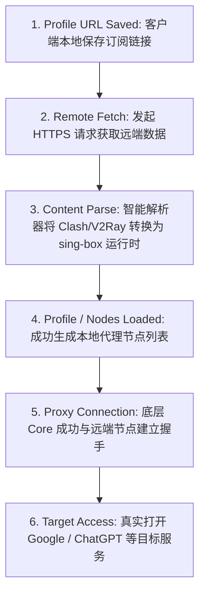
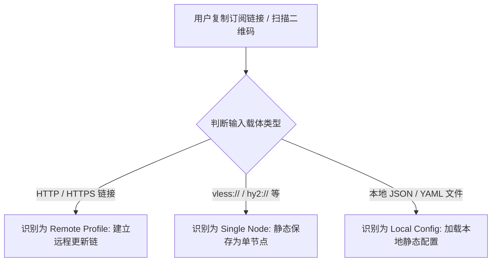
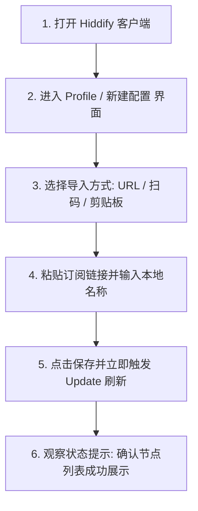
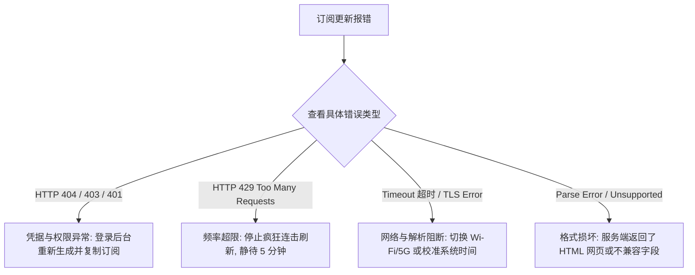
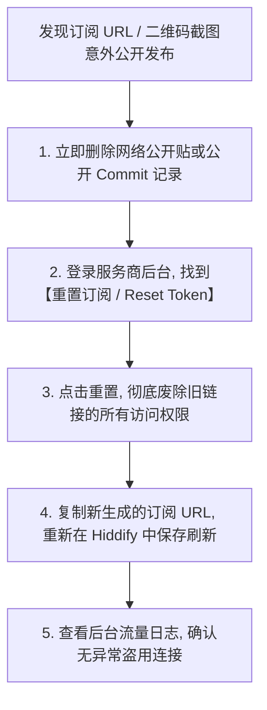

在使用 **Hiddify（及早期 Hiddify Next）** 客户端进行科学上网时，**“订阅导入与配置分发”** 是让本地客户端与远端代理集群建立连接的最核心枢纽。无论是在 Android 手机、Windows 电脑还是 macOS / iOS 设备上，如果无法正确获取并解析 Profile 配置，整个客户端就只是一个没有任何网络路由能力的空壳。

然而，在实际导入与更新订阅的过程中，绝大多数用户都会遭遇一系列令人困惑的报错与异常状态：

**“为什么把机场提供的订阅链接粘贴进 Hiddify 保存后，节点列表依然空空如也，必须手动点击刷新（Update）？”**  
**“点击更新订阅时，为什么会弹出 `HTTP 404 Not Found`、`403 Forbidden` 或 `429 Too Many Requests` 报错？”**  
**“为什么在 Wi-Fi 下更新订阅提示 `Timeout 超时` 或 `TLS Error`，切换到手机 5G 流量后却能秒级成功？”**  
**“服务商提供的 Clash YAML、V2Ray 链接或 sing-box JSON 到底能不能直接导入 Hiddify？所谓的‘Parse Error’到底在哪个环节崩了？”**  
**“为什么扫描服务商给的二维码后，列表里只多出了一个单节点，而不是几十个国家的节点列表？订阅 Token 泄露了该怎么办？”**

**理解 Hiddify 订阅，绝不能停留在“复制粘贴一条神秘链接”的机械操作，而必须建立一套清晰的“八维配置生命周期与分层排错模型”！**

掌握 Hiddify 订阅导入与分发机制，必须穿透以下 **八维 Hiddify 订阅诊断与排障体系**：**“厘清客户端（Hiddify）与订阅提供商（Airport/VPS）的权责边界 ➔ 拆解 Subscription URL、Remote Profile 与 Single Node URI 的数据结构差异 ➔ 建立‘四层格式兼容模型’（订阅格式 ➔ GUI解析器 ➔ sing-box底层Core ➔ 节点服务端） ➔ 理解从‘保存配置 ➔ 远程拉取 ➔ 格式解析 ➔ 节点生成 ➔ 代理连接 ➔ 目标访问’的六阶段流转 ➔ 掌握二维码（QR）、剪贴板与 Deep Link 的真实载体属性 ➔ 严格区分‘订阅服务器超时（Subscription Timeout）’与‘代理节点超时（Node Timeout）’的本质差异 ➔ 科学应对 404、403、429 与 Parse Error 等经典错误 ➔ 严守订阅 Token 与私密配置的安全防护底线”**。

本文作为 **Hiddify 订阅与配置分发专项 Cluster 核心指南**，将带你彻底攻克各类订阅导入、节点刷新与解析失败难题。

---

## ⚡ 60 秒极速看懂：Hiddify 订阅六阶段流转架构



- 🚨 **核心认知铁律**：
  - **保存订阅链接 $\ne$ 远程拉取成功**（保存只是本地记账，未发起网络请求）；
  - **远程拉取成功 $\ne$ 格式解析成功**（若服务器返回 HTML 报错页，解析器会报 Parse Error）；
  - **节点成功生成 $\ne$ 节点一定可联网**（节点列表仅代表配置有效，节点连通性需单独测试）；
  - **订阅 URL 包含高危敏感 Token**，严禁在公开截图、公共仓库或未脱敏日志中泄露！

---

## 一、核心概念：Subscription URL、Remote Profile 与单节点

```text
┌────────────────────────────────────────────────────────────────────────────────────────┐
│                        Hiddify 核心配置载体全维度对比表                                │
├──────────────┬────────────────────────┬──────────────┬──────────────┬──────────────────┤
│ 配置载体类型 │ 技术本质与数据结构     │ 是否自动更新 │ 包含节点数量 │ 适用场景与敏感度 │
├──────────────┼────────────────────────┼──────────────┼──────────────┼──────────────────┤
│ **Remote Profile**| 远程托管的动态配置文件| ✅ 支持定时刷新| 几十~上百个   | 主流机场首选，包含完整密钥，**极度敏感**│
│ **Subscription URL**| 标准 HTTP(S) 订阅链接 | ✅ 支持一键拉取| 批量节点集群  | 服务商用户后台一键复制，**极度敏感**│
│ **Single Node URI**| `vless://` / `hy2://` 等 | ❌ 静态固定  | 仅 1 个单节点 | 临时自建节点测试、好友分享，单点凭据│
│ **Local Config** | 本地 `.json` / `.yaml` 文件| ❌ 需手动替换  | 自定义完整规则| 极客定制规则、无网离线导入，需妥善保存│
└──────────────┴────────────────────────┴────────────────────────────────────────────────┘
```



---

## 二、第一大核心基石：四层格式兼容模型

在导入订阅时，许多用户会问：“为什么同一个订阅链接在 v2rayNG 能用，在 Hiddify 里却报错？” 这是因为代理配置必须通过 **四层兼容性漏斗**：

```text
┌────────────────────────────────────────────────────────────────────────────────────────┐
│                        现代代理客户端四层格式兼容漏斗模型                              │
├──────────────┬────────────────────────────────┬────────────────────────────────────────┤
│ 体系分层     │ 承担职责与技术要求             │ 常见崩溃点与排错指引                   │
├──────────────┼────────────────────────────────┼────────────────────────────────────────┤
│ **1. 订阅格式层** | 服务端分发的数据格式规范       | 服务端返回格式畸变或非标准 Base64 编码 │
│ **2. GUI 解析层** | Hiddify 内置的格式转换解析器   | 无法识别私有字段，或服务器返回 HTML 报错页│
│ **3. 内核引擎层** | 底层 sing-box Core 的协议支持   | 配置包含旧版本 Core 废弃的 Deprecated 字段│
│ **4. 远端节点层** | 节点服务器物理配置与握手验证   | 节点证书过期、端口被阻断或密码错误     │
└──────────────┴────────────────────────────────┴────────────────────────────────────────┘
```

### 1. 主流格式在 Hiddify 中的兼容实测
- **Hiddify / sing-box 原生格式**：兼容性 100%，解析速度最快，原生支持新协议与高级分流规则；
- **Clash / Mihomo YAML 格式**：Hiddify 内置转换器可解析大部分标准 Proxies 节点列表与基础规则组；
- **V2Ray 传统订阅（Base64 / 节点列表）**：完美兼容标准的 VLESS、VMess、Trojan、Shadowsocks 批量链接；
- **“通用订阅”真相**：“通用订阅”并非国际标准，而是服务商对自身 Base64 或 Clash 订阅的统称，若导入失败建议在后台切换为“Clash 订阅”或“sing-box 订阅”再次尝试。

---

## 三、实操教程：Hiddify 订阅导入全流程（URL / 扫码 / 剪贴板）



### 1. 订阅 URL 导入标准 5 步法
1. **获取链接**：登录机场服务商用户后台，复制“Hiddify 订阅”、“sing-box 订阅”或“Clash 订阅”链接；
2. **新建配置**：打开 Hiddify 客户端，点击主界面或配置管理菜单中的【添加配置 / Add Profile】；
3. **输入参数**：选择从链接添加，在 URL 输入框中完整粘贴刚刚复制的订阅链接，并在名称栏输入便于识别的备注（如“光速云专线”）；
4. **保存并刷新**：点击【保存】，并在配置列表中点击该 Profile 旁边的【刷新 / Update】按钮；
5. **确认节点载入**：切换至 Proxy 代理列表页，确认已成功加载出香港、日本、美国等节点。

### 2. 二维码与剪贴板导入精要
- **二维码扫码**：点击扫码图标并授权相机权限，对准屏幕或纸质二维码即可。**注意：若扫码后列表中仅出现 1 个节点，说明该二维码本身就是单节点 URI，而非批量订阅**；
- **剪贴板自动识别**：复制有效的订阅链接或 `vless://` 节点后，打开 Hiddify 通常会自动弹出“检测到剪贴板配置，是否导入”的快捷提示。

---

## 四、核心故障诊断：订阅更新失败全场景排查

```text
┌────────────────────────────────────────────────────────────────────────────────────────┐
│                        Hiddify 订阅导入与更新故障全景速查表                            │
├──────────────┬──────────────────────────────┬──────────────────────────────────────────┤
│ 报错现象     │ 根本技术原因                 │ 针对性黄金排错方案                       │
├──────────────┼──────────────────────────────┼──────────────────────────────────────────┤
│ **HTTP 404** │ 订阅链接路径错误或 Token 失效 │ 登录服务商后台重新复制最新生成的专属链接 │
│ **HTTP 403** │ 服务器拒绝访问 / WAF 拦截 / 欠费│ 检查套餐有效性，切换 5G/Wi-Fi 进行网络 A/B测试│
│ **HTTP 429** │ 请求过频 / 触发防刷速率限制  │ 停止频繁点击刷新，调大自动更新间隔时间   │
│ **Timeout**  │ 客户端无法连通订阅服务器域名 │ 检查本地网络 DNS，或挂已有节点后再更新   │
│ **TLS Error**| 本地系统时间偏差或证书不匹配  │ 校准手机/电脑系统时间至秒级自动同步      │
│ **Parse Error**| 返回了非法的 HTML/损坏的配置 │ 确认订阅未过期，尝试在后台切换订阅输出格式│
└──────────────┴──────────────────────────────┴──────────────────────────────────────────┘
```



### 1. 深度辨析：订阅 Timeout vs 节点 Timeout
- **订阅 Timeout（Subscription Timeout）**：发生在手机访问服务商订阅服务器（如 `sub.example.com`）拉取配置文件的阶段，受本地宽带直连质量影响；
- **节点 Timeout（Node Timeout）**：发生在底层 sing-box Core 与实际代理服务器建立加密握手的阶段，受物理海缆专线质量影响。**两者完全处于不同网络链路，切莫混为一谈！**

### 2. 为什么服务端返回 HTTP 200 仍会报 Parse Error？
当机场服务器触发防爬拦截、账号欠费重定向或节点维护时，服务器往往会返回一个状态码为 200 的 **HTML 登录或错误网页**。Hiddify 解析器期望接收 JSON 或 YAML 文本，强行解析 HTML 代码结构必然导致 `Parse Error: Invalid syntax`。

---

## 五、2026 全协议完美兼容与标准 Hiddify 高速专线推荐

订阅系统的稳定性直接决定了日常使用的省心程度。选择提供**多格式智能下发、高防订阅分发节点与 IEPL 企业专线**的优质服务至关重要：

```text
┌────────────────────────────────────────────────────────────────────────────────────────┐
│                        2026 全协议兼容与标准专线推荐                                   │
├──────────┬──────────────────────────┬──────────────┬──────────────┬────────────────────┤
│ 适配场景 │ 推荐品牌候选             │ 实际起付门槛 │ 每月流量配额 │ Hiddify 兼容与专线优势 │
├──────────┼──────────────────────────┼──────────────┼──────────────┼────────────────────┤
│ 旗舰全能 │ 光速云 (GuangSuYun)      │ 约 ¥7.5/月起 │ 59G~238G /月 │ 全线 IEPL 专线，完美适配 Hiddify 多协议订阅，4K 秒开无拥塞│
│ 平价轻量 │ 微风网络 (BreezeNet)     │ 约 ¥7/月起   │ 50GB / 月    │ 优质 BGP 优化专线，纯净轻量，节点更新秒级响应，日常极稳│
│ 弹性月付 │ 唯兔云 (V2Yun)           │ ¥14.9/月     │ 100GB / 月   │ 14.9 元纯单月付，多协议节点充沛，单节点故障秒切  │
│ 应急备用 │ 星岛梦 (XingDaoMeng)     │ 约 ¥8/月起   │ 60G/不限时包 │ 0月租不限时包，永不过期，专线拥塞时随时顶上应急  │
│ 极速专精 │ 速界 (SpeedWorld)        │ ¥25/月       │ 150GB / 月   │ 企业级超大独立专线带宽，AI 与流媒体原生解锁极速响应 │
└──────────┴──────────────────────────┴──────────────┴──────────────┴────────────────────┘
```

- 🏆 **全协议旗舰首选**：[光速云](/reviews/guangsu-cloud/) —— 2020 老牌专线，全线内网 IEPL 专线，标准 Hiddify 订阅一键导入；
- 🍃 **超低预算轻量**：[微风网络](/reviews/weifeng-cloud/) —— 50GB 精品小流量专线，年付折算仅约 ¥7/月；
- 💳 **拒绝绑定的单月付**：[唯兔云](/recommend/best-airports/) —— ¥14.9 纯单月付，100GB 充沛流量。

---

## 六、安全与隐私防线：订阅 Token 泄露与应急处理



- 🔒 **三大安全铁律**：
  1. **切勿使用不可信的在线第三方“订阅转换器”**：公共转换站可轻易捕获你的订阅 URL 与所有节点的底层密码和 UUID；
  2. **公开日志前必须彻底脱敏**：在向社区求助发日志时，必须将链接中的 `token=`、`uuid`、`password` 和服务器 IP 完全打码；
  3. **代码仓库切莫提交 Profile**：绝对不要将包含真实订阅信息的 `.json` 配置文件 commit 到 GitHub 公开仓库中。

---

## 七、避坑指南：75 个关于“Hiddify 订阅导入”的致命认知误区

```text
❌ 误区 1：只要把订阅链接保存到 Hiddify，客户端就自动完成更新了 ➔ 事实：保存只是记下链接，必须主动点击刷新按钮触发网络拉取。
❌ 误区 2：订阅更新提示 HTTP 404 就代表机场服务商一定跑路了 ➔ 事实：404 通常是链接拼写错误、路径变更或后台重置了 Token。
❌ 误区 3：订阅更新提示 HTTP 403 就代表账号一定被管理员封禁了 ➔ 事实：403 可能是触发了服务商防火墙拦截或套餐已到期。
❌ 误区 4：看到 HTTP 429 报错应该多点几次刷新碰碰运气 ➔ 事实：429 代表请求过频，疯狂点击只会延长服务端的封锁时间。
❌ 误区 5：扫码导入后列表里只有一个节点说明 Hiddify 解析失败了 ➔ 事实：该二维码可能原本就是一个单节点 URI，而非批量订阅。
❌ 误区 6：只要把自动更新频率设置成每 10 分钟一次就能保证节点最快 ➔ 事实：高频刷新极易触发 429 限制并消耗手机额外电量。
❌ 误区 7：订阅更新超时（Timeout）说明当前选中的代理节点挂了 ➔ 事实：订阅超时是手机访问订阅网站受阻，与代理节点好坏无关。
❌ 误区 8：节点列表更新后旧节点减少了，说明 Hiddify 出现了 Bug ➔ 事实：服务商在服务端下线了部分故障服务器，客户端同步进行了清理。
❌ 误区 9：所有的 Clash 订阅链接都能 100% 无条件导入 Hiddify ➔ 事实：若 Clash 包含复杂的私有 Script 脚本分流，可能解析失败。
❌ 误区 10：使用第三方的万能订阅转换网站转换链接绝对安全 ➔ 事实：第三方转换站能完整读取你的所有节点密钥与访问凭据。
❌ 误区 11：在网上求助发报错截图时只要把域名打码就绝对安全了 ➔ 事实：URL 路径中的 Token 才是核心凭据，Token 必须打码。
❌ 误区 12：订阅链接泄露后只要把发的帖子删掉就万事大吉了 ➔ 事实：搜索引擎或恶意爬虫可能已缓存，必须在后台重置 Token。
❌ 误区 13：订阅刷新提示 TLS Error 时只要把证书验证关掉就能解决 ➔ 事实：关闭验证会导致中间人攻击，应先校准本地系统时间。
❌ 误区 14：只要把所有能找到的免费订阅全加进 Hiddify 就能提速 ➔ 事实：无效节点过多会导致测速卡顿与分流策略错乱。
❌ 误区 15：更新了配置列表中的 Profile A，当前正在运行的 Profile B 也会同步更新 ➔ 事实：必须切换并更新当前活跃的 Active Profile。
```

---

## 八、常见问题深度解答（FAQ · 80 问）

### Q1：Hiddify 订阅链接怎么导入？
**答**：**打开 Hiddify ➔ 点击【新建配置/Add Profile】➔ 粘贴订阅链接 ➔ 点击保存 ➔ 手动点击刷新（Update）按钮拉取节点。**

### Q2：为什么保存订阅后节点列表是空的？
**答**：**因为尚未执行远程拉取。** 保存只是在本地记录了 URL 地址，必须点击该配置旁边的刷新按钮，完成 HTTP Fetch 和 Parse 之后才会生成节点。

### Q3：Hiddify 订阅更新报错 404 怎么办？
**答**：**说明订阅链接地址无效。** 登录机场用户后台，确认是否有最新的专属订阅入口，或点击“重置订阅信息”后重新复制完整链接。

### Q4：Hiddify 订阅更新报错 403 怎么办？
**答**：**说明请求被服务器拒绝。** 先检查套餐是否欠费或流量耗尽，随后切换手机 5G 流量与 Wi-Fi 进行网络测试，排除本地 IP 被防火墙拦截的可能。

### Q5：Hiddify 订阅更新报错 429 怎么办？
**答**：**说明短时间内刷新过于频繁。** 停止反复点击刷新，静待 5~10 分钟让服务端速率限制窗口重置，并建议在设置中将自动更新间隔调至 12 小时以上。

### Q6：Hiddify 提示 Parse Error 是什么原因？
**答**：**说明返回的内容无法被解析为合法节点配置。** 最常见的原因是机场返回了 HTML 登录报错网页、使用了 Hiddify 尚不支持的私有格式，或 Base64 编码损坏。

### Q7：扫码导入和复制 URL 导入有什么区别？
**答**：**二维码多用于导入单个固定节点；URL 订阅能批量拉取数十个节点并支持未来自动更新。** 长期使用强烈建议通过 URL 订阅导入。

### Q8：为什么同一个订阅在 Wi-Fi 下更新超时，切 5G 却正常？
**答**：**因为家庭宽带的本地 DNS 或运营商路由阻断了订阅服务器域名。** 5G 使用了移动蜂窝网络的独立 DNS，可有效绕过局域网解析故障。

### Q9：订阅链接不小心发到公开群里了怎么办？
**答**：**立即登录机场后台点击“重置订阅/Reset Token”。** 仅删除公开聊天记录无效，必须通过后台废除旧密钥并生成全新的订阅链接。

### Q10：第三方订阅转换网站安全吗？
**答**：**存在极高泄露风险。** 公共转换服务能完全读取你的所有节点服务器 IP、密码与 Token，强烈建议优先使用服务商后台提供的原生兼容格式。

### Q11：节点已经成功导入，但点击连接依然无法上网怎么办？
**答**：建议接下来关注本站即将推出的《Hiddify有节点但无法上网怎么办？VPN、TUN、DNS、Routing与Android网络完整排查》，或者先阅读 [《sing-box有节点但无法上网怎么办？TUN、DNS、Route与Android网络完整排查》](/issues/sing-box-connected-no-internet/)，系统解决底层网络链路故障。

---

## 🏁 总结：Hiddify 订阅分发与排障核心认知金字塔

掌握 Hiddify 订阅管理，请牢记以下**核心铁律**：

```text
1. 识层级 ➔ 存链接 ≠ 拉取成功，拉取成功 ≠ 解析成功，节点生成 ≠ 连通外网
2. 辨报错 ➔ 404看链接，403查权限，429等冷却，Timeout查网络，Parse查格式
3. 防泄露 ➔ 订阅URL与二维码等同账号密码，严禁公开，遇险立即后台重置Token
4. 慎转换 ➔ 拒绝不可信的第三方在线转换工具，优先选用服务商原生Hiddify/Clash订阅
5. 善分流 ➔ 节点已出现但无法联网属于后续链路问题，切莫在订阅层盲目反复刷新
```

---

### 📚 相关专题延伸阅读
- 🏛️ **Hiddify 概念总览**：[《Hiddify是什么？Hiddify Next、sing-box、V2Ray、Xray与Clash有什么区别？》](/wiki/what-is-hiddify/)
- 📱 **Android 主实操教程**：[《Hiddify Android怎么用？下载安装、订阅、节点、VPN权限与完整配置教程》](/tutorials/hiddify-android/)
- 📦 **sing-box 订阅教程**：[《sing-box订阅怎么导入？配置、节点更新、二维码与订阅失败完整教程》](/tutorials/sing-box-subscription/)
- 🤖 **v2rayNG 订阅教程**：[《v2rayNG订阅怎么导入？节点更新、二维码与订阅失败完整排查》](/tutorials/v2rayng-subscription/)
- ⚡ **老牌旗舰专线评测**：[《光速云深度评测：2020老牌IEPL专线与解锁实测》](/reviews/guangsu-cloud/)
- 🏆 **2026 全景大榜**：[《2026梯子推荐：稳定、速度、价格、安全与不同使用场景怎么选》](/recommend/best-tizi/)
