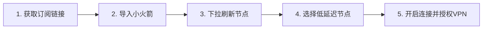
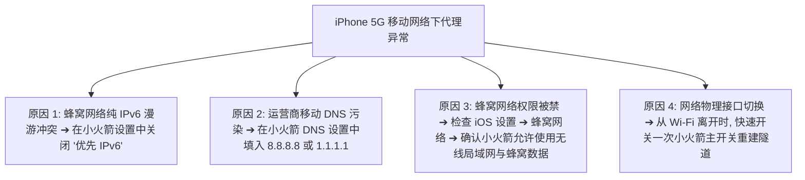

对于使用 iPhone 和 iPad 的苹果用户来说，**Shadowrocket（俗称“小火箭”）** 几乎是科学上网领域的代名词。然而，许多刚接触 iOS 代理的新手常常遇到一系列令人困惑的问题：

**“为什么我在 App Store 付费下载了小火箭，打开后里面却空空如也，根本连不上网？”**  
**“为什么状态栏显示了 VPN 图标，但 Safari 浏览器却提示无网络连接？”**  
**“为什么把节点切到了美国，我的 App Store 还是中国区？”**  
**“为什么在家里连 Wi-Fi 刷 YouTube 极速，一出门切换到 5G 移动网络就彻底转圈？”**

**“iPhone 梯子”并不是某一个可以一键免费上网的独立 App，而且 Shadowrocket 本身只是一个空壳客户端，绝不自带任何免费网络节点。**

要让 iPhone 顺畅、高速且安全地访问海外网络，必须搞清**「iOS 客户端（如小火箭）」、「节点服务商（机场）」与「订阅链接（远程配置）」**三者的协同关系。

本文专为 iOS / iPadOS 用户量身定制，为你全面拆解小火箭的配置全流程、节点科学选型、iOS 底层网络分流机制、Wi-Fi 与蜂窝数据交叉排障，以及 ChatGPT 与 YouTube 4K 的最佳实战设置。

---

## ⚡ 30 秒快速看懂：iPhone 梯子怎么配？

```text
┌─────────────────────────┬───────────────────────────────────┬──────────────────────────────────────┐
│ 你的 iPhone 当前状态    │ 核心操作建议与原则                │ 推荐执行步骤与产品形态               │
├─────────────────────────┼───────────────────────────────────┼──────────────────────────────────────┤
│ 🛒 尚未拥有客户端       │ 登录海外 Apple ID 在 App Store 购买│ 认准开发者 Shadowrocket (约 $2.99)    │
│ 📋 已有客户端但无节点   │ 需要购买专线机场套餐获取订阅链接  │ 选用支持小火箭一键导入的老牌专线机场 │
│ ⚙️ 首次导入配置         │ 全局路由模式必须保持为「配置」    │ 开启智能分流，国内应用直连不耗流量   │
│ 🤖 手机用 ChatGPT App   │ 避免被 OpenAI 拦截报 403 阻断     │ 选用具备美区/日区原生纯净 IP 的专线  │
│ 📺 手机看 YouTube 4K    │ 追求高持续带宽、晚高峰 0 丢包     │ 选用 IEPL 物理专线套餐 (如光速云)    │
│ 📶 Wi-Fi 正常 5G 断网   │ 移动运营商 DNS 污染或纯 IPv6 冲突 │ 将远程 DNS 设为 8.8.8.8 并关闭 IPv6  │
│ 🚨 手机防断网应急备用   │ 0 月租、流量长期不过期、即开即用  │ 手机备用星岛梦不限时按量流量包       │
└─────────────────────────┴───────────────────────────────────┴──────────────────────────────────────┘
```

> 💡 **最核心的新手认知纠错**：
> 1. **Shadowrocket（小火箭）只是一个解析工具（空壳车辆）**，购买它只是支付了软件开发者的买断授权费；
> 2. **机场服务商才是“汽油”**，你必须向正规服务商购买套餐，将生成的**“订阅链接（Subscription URL）”**导入小火箭中，获取具体的服务器节点后才能联网。

---

## 一、iPhone 梯子数据流转架构：小火箭如何工作？

理解 iOS 底层代理数据流转，能让你秒懂 90% 的连接与排障逻辑：

```mermaid
graph TD
    iOSApp[iPhone 应用程序: Safari / YouTube / ChatGPT App] --> NetExt[iOS 系统 NetworkExtension 框架]
    
    NetExt -->|由系统 VPN 接口接管所有网络流量| SRCore[Shadowrocket (小火箭) 客户端核心]
    
    SRCore --> RuleEngine{内置 Config 规则分流引擎}
    
    RuleEngine -->|国内域名/IP: 微信/淘宝/抖音/百度| Direct[DIRECT: 本地蜂窝网络/Wi-Fi 极速直连]
    RuleEngine -->|海外域名/IP: Google/YouTube/OpenAI| Proxy[PROXY: 打包走 TLS 加密代理隧道]
    
    Proxy --> Crypto[加密协议传输 (Shadowsocks / VLESS / Trojan / Hysteria 2)]
    Crypto --> CellularWiFi[本地 Wi-Fi 路由器 或 4G/5G 基站]
    CellularWiFi --> BorderRelay[国内入口服务器 / IEPL 物理专线内网]
    BorderRelay --> ExitServer[海外出口服务器节点 (香港/日本/新加坡/美国)]
    ExitServer --> TargetWeb[目标网站: OpenAI / Google / YouTube / Netflix]
```

---

## 二、Shadowrocket 是什么？小火箭与传统商业 VPN 有何区别？

在中文互联网中，用户常把 Shadowrocket 称为“小火箭梯子”，但在技术和商业形态上，它与传统 VPN 存在本质差异：

| 评估维度 | Shadowrocket (小火箭) | 传统商业 VPN App |
| :--- | :--- | :--- |
| **产品本质** | **第三方开源/商业代理客户端工具** | 服务商一体化封闭式专有 App |
| **节点提供方式** | 🔴 **不自带节点**，需用户自行导入机场订阅 | 🟢 自带服务商官方提供的服务器列表 |
| **网络分流能力** | 🟢 **顶级规则分流**（国内直连不耗流量，国外走代理） | 🔴 通常为全设备全局代理，国内应用严重减速 |
| **协议支持度** | 🟢 支持 SS、VLESS、Trojan、Hysteria 2、TUIC 等全协议 | 🔴 仅支持服务商专有协议或 OpenVPN/WireGuard |
| **晚高峰表现** | 🟢 搭配企业级 IEPL 物理专线，晚高峰 0 丢包满速 | 🔴 遭遇国际公网骨干网拥堵时易断流卡顿 |
| **费用结构** | 客户端一次性买断（约 $2.99）+ 独立机场套餐月费 | 仅收取统一的月度/年度会员订阅费 |

---

## 三、iPhone 科学上网成本结构：客户端费用 vs 机场套餐费用

许多新手常被误导以为“花 20 多元买了小火箭就能永久免费上网”，这是必须纠正的财务常识：

```text
┌────────────────────────────────────────────────────────────────────────┐
│                   iPhone 科学上网完整成本构成拆解                      │
├────────────────────┬──────────────────┬────────────────────────────────┤
│ 费用项目           │ 支付对象         │ 费用性质与真实含义             │
├────────────────────┼──────────────────┼────────────────────────────────┤
│ 1. 客户端授权费用  │ 苹果 App Store   │ 一次性买断费用（约 $2.99），仅购买│
│ (如 Shadowrocket)  │ (海外 Apple ID)  │ 软件使用权，不含任何流量与服务器│
├────────────────────┼──────────────────┼────────────────────────────────┤
│ 2. 专线网络套餐费用│ 机场服务商       │ 周期性订阅费用（如 ¥7~15/月），购买│
│ (流量与服务器节点) │ (如光速云/微风)  │ 每月 50G~100G 专线带宽与节点维护服务│
└────────────────────┴──────────────────┴────────────────────────────────┘
```

> ⚠️ **切记**：
> 凡是宣称“购买某 App 即可永久免翻墙、免节点费”的工具，通常为内置流氓广告或短期跑路软件；**合规的做法始终是：可信客户端 + 正规专线订阅**。

---

## 四、Shadowrocket（小火箭）新手配置 5 步通关教程（How-To）

跟随以下 5 个标准化步骤，只需 2 分钟即可完成 iPhone 的科学上网配置：



### 步骤 1：从机场后台复制订阅链接
登录你的专线机场官网后台（如 [光速云](/reviews/guangsu-cloud/) 或 [微风网络](/reviews/weifeng-cloud/)），进入用户中心：
- 方式 A（一键导入）：在 Safari 浏览器中点击「一键导入 Shadowrocket」，系统会自动唤醒小火箭并完成配置；
- 方式 B（手动复制）：点击「复制订阅链接」或「Shadowrocket 订阅」。

### 步骤 2：在 Shadowrocket 中手动添加订阅
如果选择手动添加：
1. 打开 Shadowrocket App，点击右上角的 **「+」** 号；
2. 在「类型（Type）」一栏中，点击并切换为 **「Subscribe（订阅）」**（千万不要选错成 Shadowsocks 或 VLESS）；
3. 在「URL」一栏中，粘贴刚才复制的订阅链接；
4. 「备注（Remark）」一栏可随意填写（如“主力专线”），点击右上角 **「保存（Save）」**。

### 步骤 3：下拉更新并加载节点列表
保存后，小火箭会自动向服务器发送请求并拉取节点。若未自动加载，可在首页找到刚才添加的订阅分组，**向右滑动并点击「更新」** 或直接在首页空白处下拉刷新。成功后即可看到香港、日本、美国等几十个节点。

### 步骤 4：确认全局路由为「配置」模式
在小火箭首页中部，找到 **「全局路由（Global Routing）」**：
- 🟢 **务必选择「配置 (Config)」**：实现国内外智能自动分流（访问百度、微信直连，访问 Google、YouTube 走代理）；
- 🔴 **切勿选「直连 (Direct)」**：会导致所有流量都不走代理；
- 🟡 **不建议常开「代理 (Proxy)」**：全局代理会导致打开国内 App 极度缓慢且白白浪费套餐流量。

### 步骤 5：选择节点并开启主连接
1. 在节点列表中点击测速，点击选中一个绿色的低延迟节点（如“香港 01 IEPL”或“日本 01 IEPL”）；
2. 拨动首页顶部的 **主连接开关**；
3. 首次开启时，iOS 系统会弹出授权提示框：**“‘Shadowrocket’想添加 VPN 配置”**，点击 **「允许 (Allow)」** 并完成 Face ID / Touch ID 或锁屏密码验证；
4. 屏幕顶部状态栏出现 **[VPN]** 小方块图标，打开 Safari 访问 `google.com` 测试连通性。

---

## 五、iOS 安全与证书红线：绝对不要做这 3 件事！

苹果 iOS 系统拥有强大的沙盒安全机制，但在使用网络代理时，仍需坚守以下安全红线：

```text
┌────────────────────────────────────────────────────────────────────────┐
│                   iPhone 科学上网 3 大绝对安全禁区                     │
├────────────────────────────────────────────────────────────────────────┤
│ ❌ 禁区 1：坚决不在通用设置中安装未知的「描述文件 (Profile)」         │
│ ➔ 正常的代理使用只需要在 App 内添加 VPN 配置，绝不需要安装额外描述文件 │
├────────────────────────────────────────────────────────────────────────┤
│ ❌ 禁区 2：坚决不信任任何来源不明的「CA 根证书」                      │
│ ➔ 陌生根证书能够解密你访问的所有 HTTPS 银行与密码明文，带来巨大灾难   │
├────────────────────────────────────────────────────────────────────────┤
│ ❌ 禁区 3：普通用户严禁随意开启「HTTPS 解密 (MITM)」功能              │
│ ➔ MITM（中间人解密）是开发者抓包专用功能，日常翻墙完全不需要开启     │
└────────────────────────────────────────────────────────────────────────┘
```

> 🛑 **Apple ID 地区与节点出口地区的区别**：
> 很多新手以为“小火箭连上了美国节点，App Store 就会自动变成美区”，这是完全错误的认知。**App Store 的地区是由你的 Apple ID 账号所属国家决定的，与你当前连接的代理 IP 没有任何关联**。

---

## 六、节点地区科学选型指南：港、日、新、美怎么选？

| 节点地区 | 物理往返延迟 (Ping) | 适用核心场景 | 优势与注意事项 |
| :--- | :---: | :--- | :--- |
| **🇭🇰 香港 (Hong Kong)** | **20ms ~ 45ms** (极低) | 网页急速浏览、即时通讯、Twitter 刷推 | 物理距离最近，响应极快；但注意 Claude 等部分 AI 平台不开放香港 IP |
| **🇯🇵 日本 (Japan)** | **45ms ~ 75ms** (低) | ChatGPT 对话、YouTube 4K 追剧、Pixiv | 亚洲网络核心中枢，对各大国际应用兼容性极佳，晚高峰抗压极稳 |
| **🇸🇬 新加坡 (Singapore)** | **50ms ~ 80ms** (低) | TikTok、东南亚流媒体、备用亚洲节点 | 适合中国南方沿海用户，流媒体版权库极其丰富 |
| **🇺🇸 美国 (United States)** | **130ms ~ 180ms** (一般) | Claude 3.5 Sonnet、OpenAI API、美区服务 | 虽物理延迟稍高，但所有美区本土 AI 生产力与云原生平台均完美支持 |

> 📌 **延迟与速度真相**：
> 测速显示的 Ping 只是连接响应时间，**不等于下载速度**。香港节点虽然 Ping 只有 30ms，但如果遇上公网拥堵丢包，看 4K 的体验远不如 Ping 65ms 但独享带宽零丢包的日本 IEPL 专线。详细原理解析推荐阅读：[《为什么节点延迟低但实际速度慢？》](/issues/low-ping-slow-speed-reasons/)。

---

## 七、为什么 Wi-Fi 能用，切换到 4G/5G 蜂窝网络就断网？

这是 iPhone 用户在日常移动通勤中遇到频率最高的故障场景：



---

## 八、iPhone 核心应用场景实战建议

| 应用场景 | 手机端体验痛点 | 核心选型与设置建议 |
| :--- | :--- | :--- |
| **🤖 手机 ChatGPT 官方 App** | 提示 `Something went wrong` 或报 403 阻断 | **选用美区/日区原生纯净专线节点**；若仍报错，需在 iOS 系统设置中将语言/地区设为英文/美区并重启 App |
| **🧠 Claude 3.5 iOS App** | 账号容易被平台风控封禁 | 必须使用纯净美区固定专线节点，切忌在短时间内频繁在香港、日本、美国节点间乱跳 |
| **📺 手机 YouTube 4K 播放** | 晚高峰或信号较差时自动降画质至 480P | 优先选择 **IEPL 物理专线节点**（晚高峰 0 丢包），在 YouTube App 设置中将画质首选项固定为“更高画质” |
| **🎬 手机 Netflix / Disney+** | 只能看少量自制剧，搜不到特定版权剧集 | 确认全局路由为「配置」模式，并选中标有“原生解锁”或“全解锁”的节点 |
| **📡 手机开热点给 Mac/iPad 用** | iPhone 能翻墙，但连热点的 iPad 打不开网页 | 默认热点不经过代理。需在小火箭设置中开启**「代理共享」**并在下游设备中手动设置 HTTP 代理 |

---

## 九、Shadowrocket 高频故障排查大表（终极排错决策树）

遇到网络故障时，切忌盲目删除 App 或重新购买套餐，请严格按照下表排查：

| 故障表现 | 核心诱因定位 | 快速排查与修复步骤 |
| :--- | :--- | :--- |
| **订阅更新显示 404** | 服务商订阅链接路径变更或 Token 重置 | 登录机场后台重新复制最新订阅链接，在小火箭中覆盖更新 |
| **订阅更新显示 403** | 套餐已欠费过期，或短时间内刷新过于频繁 | 核对账户余额与套餐有效期，稍等 5 分钟后再试 |
| **所有节点全部显示 Timeout 红色** | 节点离线、流量用尽或本地网络断开 | 关代理测裸网是否正常，核对套餐剩余流量，下拉刷新订阅 |
| **Global 模式可用，但 Config 模式不可用** | 规则集匹配失效或本地 DNS 解析故障 | 将小火箭 DNS 设为 `1.1.1.1`，或更新小火箭内置规则文件 |
| **状态栏有 VPN 标但打不开任何网页** | 所选节点超时、或全局路由被误设为 Direct | 测速切换可用绿色节点，将全局路由切回「配置 (Config)」 |
| **Wi-Fi 通畅，但 5G 无法打开 Google** | 运营商蜂窝网络 DNS 污染或 IPv6 冲突 | 在小火箭设置中将 DNS 改为 `8.8.8.8`，并关闭 IPv6 开关 |
| **锁屏放一阵子后后台断开** | 系统网络接口休眠（通常在极端省电状态） | 关闭 iOS 低电量模式，并在设置中开启小火箭的「后台 App 刷新」 |

---

## 十、iPhone 高适配性专线品牌推荐矩阵

针对 iPhone 小火箭一键订阅兼容性、移动端低流量起付与晚高峰抗压，精选以下真实稳定方案：

```text
┌────────────────────────────────────────────────────────────────────────────────────────┐
│                             2026 iPhone 梯子精选品牌候选矩阵                           │
├──────────┬──────────────────────────┬──────────────┬──────────────┬────────────────────┤
│ 适配场景 │ 推荐品牌候选             │ 实际起付门槛 │ 每月流量配额 │ iPhone / 小火箭优势│
├──────────┼──────────────────────────┼──────────────┼──────────────┼────────────────────┤
│ 全能主力 │ 光速云 (GuangSuYun)      │ 约 ¥7.5/月起 │ 59G~238G /月 │ 6年老牌物理专线，小火箭一键秒导入，4K极稳│
│ 平价轻量 │ 微风网络 (BreezeNet)     │ 约 ¥7/月起   │ 50GB / 月    │ 专为手机查资料与AI优化，年付百元内极低负担│
│ 灵活月付 │ 唯兔云 (V2Yun)           │ ¥14.9/月     │ 100GB / 月   │ 15元单月付，60+节点备用，随用随买  │
│ 应急备用 │ 星岛梦 (XingDaoMeng)     │ 约 ¥8/月起   │ 60G/不限时包 │ 0月租不限时包，iPhone防断网首选备用通道 │
│ AI专精   │ 速界 (SpeedWorld)        │ ¥25/月       │ 150GB / 月   │ 原生纯净住宅 IP，ChatGPT App 秒登录 │
└──────────┴──────────────────────────┴──────────────┴──────────────┴────────────────────┘
```

- 🏆 **全能旗舰首选**：[光速云](/reviews/guangsu-cloud/) —— 全线 IEPL 企业专线，完美适配小火箭全协议，晚高峰 20:00 4K 零卡顿；
- 🍃 **超低预算轻量**：[微风网络](/reviews/weifeng-cloud/) —— 针对手机轻度查资料与文字 AI 优化的 50GB 小流量专线，年付折算仅约 ¥7/月；
- 💳 **拒绝绑定的单月付**：[唯兔云](/recommend/best-airports/) —— ¥14.9 纯单月付，100GB 充沛流量，节点丰富。

---

## 十一、iPhone 梯子使用 18 项安全与配置自查清单

```text
┌────────────────────────────────────────────────────────────────────────┐
│                   iPhone 梯子 18 项配置与安全通关清单                  │
├────────────────────────────────────────────────────────────────────────┤
│ □ 1. Shadowrocket 是否在 App Store 官方商店购买下载，绝非破解版 IPA    │
│ □ 2. 我确认没有在 iPhone 设置中安装任何未知的「描述文件 (Profile)」   │
│ □ 3. 我确认没有在通用设置中信任任何陌生机构的「CA 根证书」            │
│ □ 4. 机场订阅链接已成功导入小火箭，且能正常展示绿色节点与低延迟数值   │
│ □ 5. 小火箭全局路由模式已确认为「配置 (Config)」智能分流模式           │
│ □ 6. 访问国内网站 (如百度/淘宝) 是否依然走高速直连，不耗费代理流量   │
│ □ 7. 节点在家庭 Wi-Fi 环境下测试 Google 与 YouTube 能秒开加载         │
│ □ 8. iPhone 断开 Wi-Fi 切换至 5G 蜂窝网络后，依然能够顺畅访问海外网络  │
│ □ 9. ChatGPT 官方 iOS App 能够正常登录并顺利发送 Prompt                │
│ □ 10. 小火箭设置中已配置安全 DNS (如 1.1.1.1)，避免运营商 DNS 污染    │
│ □ 11. 在遇到 5G 无法上网时，已尝试在小火箭设置中关闭「优先 IPv6」开关  │
│ □ 12. 我确认绝不将自己的专属订阅链接公开截图或分享至未授权社群        │
│ □ 13. 遇到节点偶发红线超时，我已掌握在小火箭内「向右滑动刷新订阅」   │
│ □ 14. iPhone 中已常备第二个备用服务商的订阅或不限时按量流量包         │
│ □ 15. 当开启手机热点给 iPad/Mac 使用时，已了解如何配置代理共享        │
│ □ 16. 我清楚了解 Apple ID 商店地区与节点出口地区是两个独立概念        │
│ □ 17. 我确认在小火箭中未随意开启不必要的 HTTPS 解密 (MITM) 功能       │
│ □ 18. 我已了解开启梯子并不等于完全匿名，并承诺文明合规用网           │
└────────────────────────────────────────────────────────────────────────┘
```

---

## 十二、避坑指南：20 个关于“iPhone 与小火箭”的致命误区

```text
❌ 误区 1：花 20 多元买了小火箭就自动拥有了翻墙能力 ➔ 事实：小火箭只是空壳工具，必须购买并导入机场订阅。
❌ 误区 2：Shadowrocket 是一家卖梯子的海外公司 ➔ 事实：它是一款独立第三方代理客户端软件。
❌ 误区 3：状态栏出现 [VPN] 小方块图标就代表网络通畅 ➔ 事实：图标只代表本地虚拟网卡已开启，节点离线仍无法上网。
❌ 误区 4：节点测速 Ping 越低，在 iPhone 上看视频越快 ➔ 事实：低 Ping 不等于高带宽，晚高峰丢包率才是关键。
❌ 误区 5：iPhone 科学上网一定要常年开启“代理 (Proxy) 全局模式” ➔ 事实：全局会导致国内 App 卡顿且浪费流量。
❌ 误区 6：连接了美国节点，App Store 就会自动变成美区 ➔ 事实：App Store 地区由 Apple ID 决定，与代理 IP 无关。
❌ 误区 7：iOS 必须越狱才能使用科学上网 ➔ 事实：在 App Store 下载 Shadowrocket 即可免越狱完美使用。
❌ 误区 8：普通翻墙需要开启小火箭的 HTTPS 解密 (MITM) ➔ 事实：MITM 是高级抓包功能，日常翻墙坚决无需开启。
❌ 误区 9：安装所谓的“加速描述文件”可以让梯子更快 ➔ 事实：未知描述文件存在严重安全风险，坚决不要安装。
❌ 误区 10：5G 测速跑满几百兆，看视频就绝不卡 ➔ 事实：长视频依赖持续吞吐，瞬间峰值不代表持续稳定。
❌ 误区 11：Wi-Fi 能用 5G 不能用就是机场服务器坏了 ➔ 事实：多为蜂窝运营商 DNS 污染或纯 IPv6 冲突导致。
❌ 误区 12：订阅更新显示 404 代表服务商跑路 ➔ 事实：通常是服务商更换了订阅域名或更新了用户 Token。
❌ 误区 13：免费共享的小火箭 Apple ID 下载的软件很安全 ➔ 事实：共享账号极易导致手机被锁为“丢失模式”变砖。
❌ 误区 14：只要买了付费专线就 100% 永远不出任何问题 ➔ 事实：仍需掌握刷新订阅、切换节点等基础维护技能。
❌ 误区 15：iPhone 开热点给电脑，电脑就自动翻墙了 ➔ 事实：热点流量默认不经代理，需开启代理共享或电脑端装客户端。
❌ 误区 16：遇到无法上网第一步必须卸载重装 App ➔ 事实：应按“裸网 -> 订阅 -> 换节点 -> 调DNS”排查，重装多无用。
❌ 误区 17：全部节点 Timeout 红色代表机场跑路 ➔ 事实：多为订阅链接过期、流量耗尽或本地网络临时受阻。
❌ 误区 18：只要能打开 Google 搜索就代表 Netflix 完整解锁 ➔ 事实：需具备原生住宅 IP 才能看全量版权剧。
❌ 误区 19：小火箭越贵越好 ➔ 事实：Shadowrocket 官方定价仅约 $2.99，第三方高价代充多为智商税。
❌ 误区 20：订阅链接可以随意发给微信好友 ➔ 事实：订阅包含个人密钥，泄露会导致流量被盗刷甚至封号。
```

---

## 十三、常见问题深度解答（FAQ · 35 问）

### Q1：iPhone 梯子怎么用？
**答**：标准流程分三步：**第一步在 App Store 下载 Shadowrocket（小火箭）；第二步在正规专线机场（如光速云/微风网络）购买套餐并复制订阅链接；第三步在小火箭中导入订阅并开启连接**。

### Q2：Shadowrocket（小火箭）是什么？
**答**：Shadowrocket 是 iOS 平台上最主流的专业代理客户端工具软件，负责管理节点、建立本地加密隧道并实现国内外流量智能规则分流。

### Q3：Shadowrocket 自带节点吗？
**答**：**不自带。** 小火箭是纯粹的工具软件，本身不提供任何免费网络服务器，必须由用户自行购买并导入外部机场订阅。

### Q4：购买了 Shadowrocket 之后还要买机场吗？
**答**：**是的，必须购买。** 购买小火箭只是支付了软件本身的授权费，而访问境外网站所消耗的流量和服务器线路需要通过机场服务商按月或按年订阅。

### Q5：小火箭在国区 App Store 能搜到吗？
**答**：搜不到。由于政策合规要求，小火箭仅在非国区 App Store（如美区、港区、日区）上架，需登录海外 Apple ID 进行购买下载。

### Q6：可以使用网上的共享 Apple ID 下载小火箭吗？
**答**：**强烈不建议。** 公共共享账号风险极高，一旦有人恶意锁机，你的 iPhone 可能会被锁定变砖；建议自行注册或持有专属海外 Apple ID。

### Q7：iPhone 机场订阅链接是什么？
**答**：是服务商为你的账户生成的远程配置 URL，小火箭通过该链接能一键自动拉取几十个可用的服务器节点及智能分流规则。

### Q8：订阅和节点有什么区别？
**答**：**订阅**是包含所有节点信息的“远程提货单”；**节点**是提货单中具体的某一台境外代理服务器（如香港 IEPL 01、日本 IEPL 02）。

### Q9：小火箭的全局路由为什么一定要选「配置 (Config)」？
**答**：选择「配置」模式可以实现**智能自动分流**——访问微信、淘宝等国内网站走本地直连高速且不耗流量，访问 Google、YouTube 自动走代理。

### Q10：为什么节点测速显示 Ping 很低，但看视频依然卡顿？
**答**：Ping 只代表连接响应时间，不代表带宽容量。如果节点遭遇晚高峰严重超售丢包，即使 Ping 只有 30ms，实际视频下载依然会转圈。

### Q11：Shadowrocket 节点全部显示 Timeout 红色怎么办？
**答**：先关代理确认手机裸网正常，再登录机场后台确认套餐是否欠费或流量耗尽，最后在小火箭内向右滑动刷新订阅。

### Q12：为什么状态栏显示了 [VPN] 图标，但打不开任何网页？
**答**：VPN 图标只表示本地虚拟网卡已开启。排查所选节点是否超时、全局路由是否误选为 Direct 直连、或本地 DNS 发生了解析污染。

### Q13：订阅更新显示 404 错误是什么原因？
**答**：通常是因为服务商更换了订阅域名，或者你的个人订阅 Token 被系统重置，需登录官网重新复制最新订阅链接。

### Q14：订阅更新显示 403 错误是什么原因？
**答**：说明该请求被服务商防火墙拦截，通常是因为套餐已过期、欠费，或者短时间内高频刷新触发了防刷机制。

### Q15：为什么 Wi-Fi 能用，切换到 4G/5G 蜂窝网络就失效？
**答**：移动蜂窝网络下运营商下发了有污染的本地 DNS 或启用了纯 IPv6 冲突。在小火箭设置中将 DNS 手动改为 `8.8.8.8` 并关闭 IPv6 开关即可解决。

### Q16：为什么 5G 能用，连接公司或家里 Wi-Fi 却失效？
**答**：通常是因为企业内网防火墙阻断了代理端口，或家用路由器存在 DNS 劫持。可尝试切换其他协议端口的节点。

### Q17：iPhone 锁屏后小火箭会自动断开吗？
**答**：通常不会。iOS 具备完善的后台网络代理机制；若发生断开，请检查是否开启了系统极端低电量模式，并在设置中确认开启了小火箭的后台 App 刷新。

### Q18：开启小火箭会很耗电吗？
**答**：在「配置」分流模式下耗电极低；但若开启了持续调试日志记录、高频自动测速或遭遇频繁断线重连，会增加电池消耗。

### Q19：iPhone 手机用 ChatGPT 官方 App 打不开怎么办？
**答**：选用美区/日区原生纯净专线节点；在 iOS 设置中将系统语言与地区设为美区；彻底退出 ChatGPT App 后重新打开。

### Q20：iPhone 手机用 Claude 容易被封号是什么原因？
**答**：Claude 对出口 IP 的机房属性审查极严。必须使用高信誉的原生住宅 IP 节点，并避免在不同国家节点间频繁切换。

### Q21：iPhone 看 YouTube 4K 怎么设置最流畅？
**答**：选用 **IEPL 物理专线节点**（保障晚高峰 0 丢包），在 YouTube App 设置中将画质固定为“更高画质”。

### Q22：iPhone 看 Netflix 无法解锁版权剧怎么办？
**答**：需在节点列表中选用明确标有“原生解锁”或“全解锁”的节点，并确认小火箭全局路由处于「配置」模式。

### Q23：iPhone 开热点给电脑用，电脑能直接翻墙吗？
**答**：默认不能。需在小火箭设置中开启「代理共享」，并在电脑端手动填入 iPhone 的局域网 IP 与代理端口。

### Q24：小火箭需要开启 HTTPS 解密 (MITM) 吗？
**答**：**坚决不需要。** MITM 是开发者抓包调试专用功能，日常科学上网开启不仅毫无作用，还会带来证书安全隐患。

### Q25：科学上网需要安装系统描述文件吗？
**答**：**坚决不需要。** 正常的代理只需在 App 内授权添加 VPN 配置，凡要求安装来历不明描述文件的网站均存在严重风险。

### Q26：免费的公开小火箭节点安全吗？
**答**：安全性较低。公开分享的免费节点随时可能失效，且共享 IP 欺诈分极高，OpenAI 等平台会直接阻断，建议作为临时应急。

### Q27：订阅链接可以发给微信好友吗？
**答**：**坚决不能。** 订阅链接包含个人账户密钥，泄露会导致他人盗刷你的月度流量配额，甚至因多 IP 滥用导致账号被封。

### Q28：连接了美国节点，Apple ID 怎么还是中国区？
**答**：Apple ID 地区是由你的账户资料决定的，与你当前连接的代理网络出口 IP 完全无关，需在账户设置中手动更换国家地区。

### Q29：小火箭支持哪些代理协议？
**答**：全面支持 Shadowsocks、VLESS、Trojan、Hysteria 2、TUIC、Socks5、HTTP 等几乎全量主流现代协议。

### Q30：除了小火箭，iPhone 还有哪些好用的梯子客户端？
**答**：还可以选用 **Stash（支持 Clash 完整生态）、Surge iOS（高端开发者神器）以及 sing-box iOS 官方版**。

### Q31：iPhone 梯子应该选月付还是年付？
**答**：**新用户首次接触某个品牌建议坚守月付**（¥15 左右），在 iPhone 上实测 Wi-Fi/5G 与晚高峰稳定后，再考虑年付享受折算优惠。

### Q32：如何测试当前节点是否原生解锁流媒体？
**答**：在 Safari 浏览器中打开 `netflix.com` 或直接在小火箭内使用流媒体检测脚本，查看能否完整展示非自制剧海报。

### Q33：小火箭节点测速显示黑色数字是什么意思？
**答**：黑色数字通常表示该节点尚未进行连通性测试，点击该节点或点击测试图标即可发起测速并显示绿色延迟。

### Q34：小火箭怎么设置开机自动连接？
**答**：只需保持主开关开启状态，iOS 系统会在重启后自动恢复上一次的 VPN 代理活动状态。

### Q35：什么时候需要彻底重装小火箭？
**答**：日常网络故障只需检查节点与订阅，只有当 App 持续闪退崩溃或升级 iOS 后底层配置冲突时才需重装。

---

## 🏁 总结：iPhone 科学上网终极实操心法

要在 iPhone 上获得极致丝滑、省电且无感的上网体验，请牢记以下**三大原则**：

```text
1. 认清工具本质 ➔ 小火箭是客户端 (一次买断)，专线机场是节点与汽油 (按月/年订阅)
2. 坚守分流模式 ➔ 全局路由锁定「配置 (Config)」，国内应用极速直连，不浪费宝贵流量
3. 筑牢安全底线 ➔ 拒绝安装未知描述文件与根证书，关闭不必要的 MITM，保护个人订阅 URL
```

---

### 📚 延伸进阶阅读与选型专栏
- 📱 **移动设备总入口**：[《手机梯子哪个好？Android、iPhone梯子工具与新手使用指南》](/recommend/mobile-tizi/)
- 🤖 **Android 独立指南**：[《安卓梯子怎么选？Android客户端、订阅、节点与故障完整指南》](/tutorials/android-tizi/)
- 🏆 **2026 全景大榜**：[《2026梯子推荐：稳定、速度、价格、安全与不同使用场景怎么选》](/recommend/best-tizi/)
- 🎯 **深度决策指南**：[《梯子哪个好用？稳定性、速度、价格、节点与客户端完整选择指南》](/recommend/which-tizi-is-best/)
- 💳 **付费购买指南**：[《付费梯子哪个好？月付、年付、低价与高性价比方案怎么选》](/recommend/paid-tizi/)
- 📖 **基础概念认知**：[《梯子是什么？梯子工具、VPN、机场、代理到底有什么区别？》](/wiki/what-is-tizi/)
- ⚡ **老牌旗舰专线**：[《光速云深度评测：2020老牌IEPL专线与解锁实测》](/reviews/guangsu-cloud/)
- 🍃 **平价轻量专线**：[《微风网络深度评测：小流量套餐值不值得买？》](/reviews/weifeng-cloud/)
- 🛠️ **电脑客户端配置**：[《Clash Verge Rev 下载与安装配置完整教程》](/tutorials/clash-verge-rev/)
- 🚨 **排障实战手册**：[《Clash 有节点但无法上网怎么办？7 步系统排查与修复指南》](/issues/clash-connected-no-internet/)
