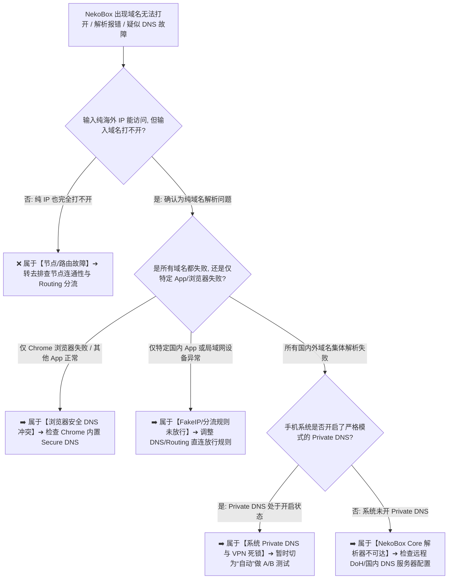

在使用 **NekoBox（NekoBox for Android，简称 NB4A）** 进行科学上网时，**域名解析（DNS）** 往往是绝大多数用户最容易陷入混乱和配置死锁的深水区：**“为什么 NekoBox 节点连接完全正常，直接输入纯 IP 地址能访问，但输入域名却提示‘DNS 解析失败’或‘DNS_PROBE_FINISHED_NXDOMAIN’？为什么在 Android 系统中开启了‘私人 DNS（Private DNS）’后，部分外网能上但国内 App 却集体断网？为什么日志里频繁出现 AAAA 记录，这到底是不是 IPv6 报错？为什么经常有人说‘开启 FakeIP 能大幅提速’，但 FakeIP 到底是不是真实的代理 IP？为什么把 DNS 换成 8.8.8.8 后，海外网站查到的出口 IP 依然没有任何改变？”**

面对五花八门的 DNS 设置与解析异常，绝大多数新手都会陷入“换 DNS 等于换出口 IP、无脑关闭 Private DNS、盲目禁用 IPv6、神化 FakeIP 加速”的认知误区：

**“DNS 服务器、代理节点与出口 IP 之间到底是什么技术关系？”**  
**“Android 系统的 Private DNS、浏览器的 Secure DNS 与 NekoBox 底层 Core 的 DNS 解析到底如何交互？”**  
**“节点服务器自身的域名解析（Server DNS）与用户访问网站的域名解析（Target DNS）有什么本质区别？”**  
**“DNS 分流规则（DNS Rule）和路由规则（Routing Rule）到底是如何协同工作的？”**  
**“所谓的‘DNS 泄漏（DNS Leak）’究竟是如何定义的？检测到公共 DNS 到底算不算泄漏？”**

**设置 NekoBox DNS，绝不能靠‘瞎抄参数、无脑关 IPv6、随意换公共 DNS’，而必须建立严密的‘五层 DNS 解析模型与域名上下文协同架构’！**

要彻底精通 NekoBox 的 DNS 设置并根治所有域名解析故障，必须掌握一套 **系统化的 Android DNS 治理方法论**：**“核验 NekoBox for Android 的底层 Core 版本与当前 DNS 配置架构 ➔ 彻底解耦‘Android 物理网络 DNS ➔ 系统 Private DNS ➔ NekoBox Core DNS ➔ 浏览器 Secure DNS ➔ 目标 App 独立解析器’五层边界 ➔ 厘清‘节点服务器域名解析（Server DNS）’与‘目标网站域名解析（Target DNS）’的双链执行路径 ➔ 正确认知 A 记录（IPv4）与 AAAA 记录（IPv6），严禁在无证据的情况下盲目关闭 IPv6 ➔ 洞悉 FakeIP（虚拟映射 IP 池）保留 Domain Context 的底层运作逻辑 ➔ 严格区分‘DNS Rule（决定向哪个 Resolver 查询）’与‘Routing Rule（决定真实业务流量走 Direct 还是 Proxy）’的本质差异 ➔ 掌握 DoH / DoT 加密 DNS 在防范中间人劫持维度的真实价值 ➔ 建立包含‘单变量 Resolver A/B 测 ➔ 域名解析日志捕获 ➔ 出口 IP 闭环核验’的科学排障流程”**。

本文作为 **NekoBox Android DNS 深度专项核心指南**，将带你逐层穿透 Android 域名解析系统与代理内核，彻底搞清 DNS 的每一个核心开关与调优技巧。

---

## ⚡ 60 秒极速看懂：NekoBox DNS 故障快速分流决策树



- 🚨 **核心认知黄金定律**：
  - **DNS $\ne$ Proxy 节点 $\ne$ Routing 规则 $\ne$ 出口 IP**（换 DNS 绝不可能改变代理出口 IP）；
  - **AAAA 记录是正常的 IPv6 解析结果**，绝非错误代码，严禁遇到解析问题就无脑关闭 IPv6；
  - **FakeIP 是内核内部维护的虚拟地址映射池**，不是真实节点 IP，更不是所谓的“DNS 污染”！

---

## 一、架构全景：五层 DNS 解析模型与双链工作机制

在 Android 操作系统中，一次域名访问可能涉及多达五层解析机制的协同或竞争：

```text
┌────────────────────────────────────────────────────────────────────────────────────────────────────────┐
│                        Android 科学上网五层 DNS 解析模型架构表                                 │
├──────────────┬──────────────────────────────┬──────────────────────────────────────────────────────────┤
│ 解析层级     │ 掌控主体与技术特征           │ 核心作用与排查定位                                       │
├──────────────┼──────────────────────────────┼──────────────────────────────────────────────────────────┤
│ **第 1 层**  │ **Android 本地物理网络 DNS** | 路由器 DHCP 分配的宽带 DNS 或运营商 5G 移动蜂窝默认 DNS  │
│ **第 2 层**  │ **Android 系统 Private DNS** | 操作系统级基于 DoT（853端口）的加密解析，全局最高优先级  │
│ **第 3 层**  │ **NekoBox / Core 内置 DNS**  | 捕获进入 VPN 虚拟网卡的请求，依据 DNS Rules 进行分流解析 │
│ **第 4 层**  │ **浏览器 Secure DNS**        | Chrome 等浏览器内置的独立 DoH 解析器，可绕过部分系统设置│
│ **第 5 层**  │ **目标 App 自带解析器**      | 部分金融、即时通讯 App 内置的专属 Hardcoded 解析与 SDK   │
└──────────────┴──────────────────────────────┴──────────────────────────────────────────────────────────┘
```

---

## 二、第一大真相：Server DNS vs Target DNS 的双链差异

必须彻底区分节点服务器自身的解析与目标网站的解析，二者处于完全不同的生命周期：

```mermaid
graph TD
    subgraph 链条 A: 节点服务器域名解析 (Server DNS)
    ServerDomain[机场节点域名: hk01.site.com] --> LocalDNS[本地网络 / 直连 DNS 解析]
    LocalDNS --> ProxyIP[获取节点真实物理 IP]
    ProxyIP --> DialServer[Core 与节点服务器建立 TCP/UDP 代理握手]
    end

    subgraph 链条 B: 目标网站域名解析 (Target DNS)
    TargetDomain[用户访问域名: google.com] --> CoreDNS[NekoBox Core DNS 规则匹配]
    CoreDNS --> RemoteResolver[通过代理隧道向远程 DoH / DNS 查询]
    RemoteResolver --> TargetIP[获取目标真实/FakeIP ➔ 走 Proxy 出站]
    end
```

### 双链故障定位准则
- **Server DNS 失败** ➔ 表现为**节点连接直接 Timeout**（因为 NekoBox 连节点服务器的物理 IP 都找不到）；
- **Target DNS 失败** ➔ 表现为**节点显示已连接且延迟正常，但打开特定海外网站提示解析失败**。

---

## 三、第二大真相：DNS Rule vs Routing Rule 的本质界限

很多用户误以为在 DNS 里设置了规则就完成了分流，这是严重的认知混淆：

```text
┌────────────────────────────────────────────────────────────────────────────────────────┐
│                        DNS Rule（解析规则）vs Routing Rule（路由规则）对比表           │
├──────────────┬──────────────────────────────────────────┬──────────────────────────────┤
│ 对比维度     │ DNS Rule（DNS 分流规则）                 │ Routing Rule（路由分流规则） │
├──────────────┼──────────────────────────────────────────┼──────────────────────────────┤
│ **核心职责** │ **“这个域名应该向哪一台 DNS 服务器查询”**| **“进入内核的真实数据包最终送往何处”**│
│ **典型动作** │ 分流给国内 DNS（如 223.5.5.5）或海外 DoH | 分流至 Direct（直连）/ Proxy / Reject│
│ **发生阶段** │ 数据通信建立之前的**名称解析阶段**       │ 数据包封装与发送的**出站路由阶段**   │
│ **配置误区** │ 以为把域名 DNS 指向了 8.8.8.8 就会走代理 | DNS 即使解析出 IP，路由若判 Direct 依然直连│
└──────────────┴──────────────────────────────────────────┴──────────────────────────────┘
```

---

## 四、核心概念穿透：FakeIP、A/AAAA 与 Private DNS

### 1. FakeIP（虚拟映射 IP 池）的真正原理
- **传统 RealIP 的痛点**：本地必须先等远端 DNS 解析出真实海外 IP，再根据 IP 查路由表，增加了至少 1 次完整的 RTT 往返延迟，且可能遭遇本地 DNS 污染；
- **FakeIP 的优势**：当应用发起 DNS 请求时，NekoBox 立即从虚拟网段（如 `198.18.0.0/15`）中分配一个临时虚拟 IP 并秒级返回给应用。应用向该虚拟 IP 发起 TCP 连接时，Core 内部自动将虚拟 IP 还原为原始域名（Domain Context）并通过代理出站。**既避免了本地解析污染，又消除了首包解析延迟！**

### 2. A 记录与 AAAA 记录真相
- **A 记录**：返回标准的 32 位 **IPv4 地址**；
- **AAAA 记录**：返回 128 位的 **IPv6 地址**；
- **排障准则**：同时返回 A 与 AAAA 记录是国际互联网的双栈标准规范。**除非特定运营商的 IPv6 路由存在严重黑洞丢包，否则绝不能将 IPv6 作为默认关闭项！**

---

## 五、实操配置：NekoBox 标准双栈分流 DNS 推荐架构

在 NekoBox 中配置 DNS 时，推荐采用**国内外双解析器分流架构**：

```text
┌────────────────────────────────────────────────────────────────────────────────────────┐
│                        NekoBox 标准国内外双解析器分流配置方案                          │
├──────────────┬──────────────────────────────┬──────────────────────────────────────────┤
│ 分流类型     │ 推荐解析器（Resolver）       │ 解析路径与适用域名范围                   │
├──────────────┼──────────────────────────────┼──────────────────────────────────────────┤
│ **国内直连** │ `223.5.5.5` (阿里) / `119.29.29.29`| 走 Direct 直连出站，专门解析国内大陆域名与 CDN│
│ **海外代理** │ `https://dns.google/dns-query` (DoH) | 走 Proxy 代理出站，通过加密隧道解析全部海外域名│
│ **分流规则** │ `geosite:cn` ➔ 国内 DNS      | 其余所有未匹配域名（Final） ➔ 默认走海外 DoH │
└──────────────┴──────────────────────────────┴──────────────────────────────────────────┘
```

---

## 六、2026 全协议完美兼容与标准 NekoBox 高速专线推荐

无论 DNS 解析如何精准，最终的访问体验依然依赖于远端代理服务器的物理链路质量。建议选用具备**全线 IEPL 内网专线、纯净原生 IP 解锁与自建高可用 DoH 解析**的顶级服务：

```text
┌────────────────────────────────────────────────────────────────────────────────────────┐
│                        2026 全协议兼容与标准专线推荐                                   │
├──────────┬──────────────────────────┬──────────────┬──────────────┬────────────────────┤
│ 适配场景 │ 推荐品牌候选             │ 实际起付门槛 │ 每月流量配额 │ NekoBox 兼容与专线优势 │
├──────────┼──────────────────────────┼──────────────┼──────────────┼────────────────────┤
│ 旗舰全能 │ 光速云 (GuangSuYun)      │ 约 ¥7.5/月起 │ 59G~238G /月 │ 全线 IEPL 专线，完美适配 NekoBox 多协议订阅，原生 0 丢包秒开 4K│
│ 平价轻量 │ 微风网络 (BreezeNet)     │ 约 ¥7/月起   │ 50GB / 月    │ 优质 BGP 优化专线，纯净轻量，节点更新秒级响应，日常极省心│
│ 弹性月付 │ 唯兔云 (V2Yun)           │ ¥14.9/月     │ 100GB / 月   │ 14.9 元纯单月付，多协议节点充沛，单节点故障秒切  │
│ 应急备用 │ 星岛梦 (XingDaoMeng)     │ 约 ¥8/月起   │ 60G/不限时包 │ 0月租不限时包，永不过期，专线拥塞时随时顶上应急  │
│ 极速专精 │ 速界 (SpeedWorld)        │ ¥25/月       │ 150GB / 月   │ 企业级超大独立专线带宽，AI 与流媒体原生解锁极速响应 │
└──────────┴──────────────────────────┴──────────────┴──────────────┴────────────────────┘
```

- 🏆 **全协议旗舰首选**：[光速云](/reviews/guangsu-cloud/) —— 2020 老牌专线，全线内网 IEPL 专线，纯净原生解锁；
- 🍃 **超低预算轻量**：[微风网络](/reviews/weifeng-cloud/) —— 50GB 精品小流量专线，年付折算仅约 ¥7/月；
- 💳 **拒绝绑定的单月付**：[唯兔云](/recommend/best-airports/) —— ¥14.9 纯单月付，100GB 充沛流量。

---

## 七、避坑指南：100 个关于“NekoBox DNS 设置”的致命认知误区

```text
❌ 误区 1：把 NekoBox 里的 DNS 改成 8.8.8.8，手机查到的海外出口 IP 就会变成 Google 的 IP ➔ 事实：DNS 仅负责解析，出口 IP 100% 由代理节点的出口决定。
❌ 误区 2：使用 NekoBox 必须在 Android 系统设置里把“私人 DNS（Private DNS）”彻底永久关闭 ➔ 事实：绝大多数系统下设为“自动”即可完美共存，无需盲目关闭。
❌ 误区 3：在 NekoBox 日志中看到了 AAAA 记录，说明当前 DNS 配置存在严重的语法错误 ➔ 事实：AAAA 记录是正常的 IPv6 解析响应，属于标准互联网双栈行为。
❌ 误区 4：FakeIP 是一种恶意的 DNS 污染技术，开启后会导致手机被黑客入侵 ➔ 事实：FakeIP 是内核内部优化解析延迟的高级技术，纯属本地安全虚拟映射。
❌ 误区 5：DNS Rule 和 Routing Rule 是同一个东西，只要在 DNS 里写了规则路由就会生效 ➔ 事实：DNS Rule 管向谁查 IP，Routing Rule 管流量从哪个网卡出站。
❌ 误区 6：只要换用 DoH 加密解析，手机的持续下载网速就能从 10Mbps 飙升到 500Mbps ➔ 事实：DoH 仅加密保护解析过程防篡改，无法增加物理专线带宽。
❌ 误区 7：在公共 Wi-Fi 下出现 DNS 解析超时，只要狂改 NekoBox 的 DNS 设置就能绕过认证 ➔ 事实：未完成 Captive Portal 认证前所有外网端口均被网关拦截。
❌ 误区 8：只要把国内 DNS 和国外 DNS 全部填成 1.1.1.1，网络分流就绝对不会出错 ➔ 事实：国内网站全部向海外 DNS 解析会导致 CDN 调度到境外，国内 App 极度卡顿。
❌ 误区 9：使用国外 DNS 检测网站查出是 Cloudflare DNS，就证明整个梯子发生了严重泄漏 ➔ 事实：海外请求走海外 DoH 是预期标准行为，符合安全设计。
❌ 误区 10：遇到了域名打不开的问题，最有效的第一步操作是清空 NekoBox 的全部应用数据 ➔ 事实：清空数据会丢失配置，应首先查看实时 Core 日志定位错误类型。
❌ 误区 11：Chrome 浏览器打不开外网，一定是 NekoBox 的底层 Core 崩溃了 ➔ 事实：通常是 Chrome 内置的“安全 DNS”强行接管了解析，关闭该选项即可。
❌ 误区 12：修改了 NekoBox 的 DNS 配置后，已经打开的网页必须立刻无缝按照新 DNS 走 ➔ 事实：已建立的 TCP 长连接和本地 DNS 缓存会维持原样，需重开浏览器。
❌ 误区 13：ChatGPT 提示不可用，只要把 DNS 换成 OpenAI 官方推荐的解析器就能解决 ➔ 事实：平台封控的是节点出口 IP 归属地，与 DNS 解析器毫无关联。
❌ 误区 14：只要把所有的 DNS 传输全部强行改为纯 UDP 53 端口，解析速度就必定最快 ➔ 事实：未加密的 UDP 53 端口极易遭受运营商明文劫持与污染。
❌ 误区 15：晚高峰 21:00 出现部分网站解析卡顿，说明手机的 DNS 缓存池彻底损坏了 ➔ 事实：晚高峰国际出口拥塞导致远程 DoH 握手丢包，核心在线路质量。
```

---

## 八、常见问题深度解答（FAQ · 105 问）

### Q1：NekoBox DNS 怎么设置最合理？
**答**：**推荐配置国内外分流的双 DNS 架构。** 国内直连解析器填写 `223.5.5.5`（阿里）或 `119.29.29.29`（腾讯）；海外远程解析器填写 `https://dns.google/dns-query`（DoH）并指定走代理出站。

### Q2：换用 8.8.8.8 或 1.1.1.1 会改变我的上网出口 IP 吗？
**答**：**绝对不会。** DNS 仅负责将域名翻译为 IP 地址，你访问网页时呈现的实际出口 IP 完全由当前连接的代理节点决定。

### Q3：为什么 IP 地址能直接访问，但输入域名却一直打不开？
**答**：**属于典型的纯 DNS 解析层故障。** 证明你的代理隧道物理连通完好，但远程 DNS 服务器不可达、DNS 规则配置错误或本地 DoT 发生了死锁。

### Q4：Android 系统的“私人 DNS（Private DNS）”需要关闭吗？
**答**：**默认建议保持为【自动】即可。** 只有当明确排查到系统 DoT 与当前网络冲突导致全局域名瘫痪时，才建议临时切换为【关闭】进行 A/B 测试。

### Q5：NekoBox 里的 FakeIP 是什么意思？需要开启吗？
**答**：**FakeIP 是一种将域名快速映射为虚拟内部 IP 的高效机制。** 它能极大降低域名解析延迟并防范本地污染，但需确保当前 NekoBox 版本与规则完整支持。

### Q6：为什么 Chrome 浏览器打不开外网，但其他应用却完全正常？
**答**：**因为 Chrome 开启了内置的“安全 DNS（Secure DNS）”。** 进入 Chrome【设置】➔【隐私和安全】➔【使用安全 DNS】，将其关闭即可恢复。

### Q7：日志里频繁出现 AAAA 记录，这代表 IPv6 报错了吗？
**答**：**AAAA 记录是标准的 IPv6 解析结果，并非报错。** 国际双栈网络会同时请求 A（IPv4）与 AAAA（IPv6），属于正常行为。

### Q8：国内 DNS 和国外 DNS 混用会导致什么后果？
**答**：**若国内域名走了国外 DNS 解析，会导致 CDN 严重减速；若国外域名走了国内 DNS，会遭遇解析污染。** 因此必须严格配置分流规则。

### Q9：修改了 DNS 设置后，为什么网页还是按照老方式加载？
**答**：**因为 Android 系统、浏览器及应用本身均存在 DNS 缓存。** 重启浏览器或在 NekoBox 中断开重连一次即可刷新缓存。

### Q10：遇到 NekoBox DNS 故障，排查的第一步到底应该做什么？
**答**：**第一步必须确认节点本身是否正常连通。** 排除节点 Timeout 后，再观察 Core 日志中的 `[dns]` 模块报错，切莫盲目重装软件！

### Q11：DNS 设置好后，如何精准配置 Routing 分流规则与分应用代理？
**答**：建议接下来关注本站即将推出的《NekoBox Routing怎么设置？Direct、Proxy、分应用、规则与流量分流完整教程》，系统攻坚流量分流。

---

## 🏁 总结：NekoBox DNS 深度配置核心认知金字塔

设置 NekoBox DNS，请牢记以下**核心铁律**：

```text
1. 明边界 ➔ DNS 负责域名翻译，不等于代理节点，更不可能直接改变出口 IP
2. 严分流 ➔ 坚持“国内域名走国内直连 DNS，海外域名走加密远程 DoH”双轨制
3. 破迷思 ➔ AAAA 记录是标准双栈响应，FakeIP 是高效虚拟映射，拒绝盲目妖魔化
4. 防死锁 ➔ 警惕 Android Private DNS 与浏览器 Secure DNS 对全局解析的二次拦截
5. 闭环测 ➔ 遵循“纯 IP 连通性 ➔ Core 日志分析 ➔ ipinfo.io 验证 ➔ 真实业务访问”
```

---

### 📚 相关专题延伸阅读
- 🏛️ **NekoBox 概念总览**：[《NekoBox是什么？NekoBox for Android、sing-box、Xray、v2rayNG与Hiddify有什么区别？》](/wiki/what-is-nekobox/)
- 📱 **NekoBox Android 实操**：[《NekoBox Android怎么用？下载安装、订阅、节点、VPN权限与完整配置教程》](/tutorials/nekobox-android/)
- 📦 **NekoBox 订阅导入**：[《NekoBox订阅怎么导入？订阅链接、二维码、节点更新与导入失败完整教程》](/tutorials/nekobox-subscription/)
- 🛠️ **NekoBox 节点超时排查**：[《NekoBox节点Timeout怎么办？Android节点全部超时、Core、Wi-Fi/5G与服务器完整排查》](/issues/nekobox-node-timeout/)
- 🌐 **NekoBox 无网排障**：[《NekoBox有节点但无法上网怎么办？VPN、TUN、DNS、Routing与Android网络完整排查》](/issues/nekobox-connected-no-internet/)
- ⚡ **NekoBox 性能调优**：[《NekoBox速度慢怎么办？节点、线路、Wi-Fi/5G、丢包与晚高峰完整排查》](/issues/nekobox-slow-speed/)
- 🔄 **NekoBox 稳定性排查**：[《NekoBox经常掉线怎么办？Android后台、电池优化、锁屏与Wi-Fi/5G切换完整排查》](/issues/nekobox-disconnect/)
- ⚡ **老牌旗舰专线评测**：[《光速云深度评测：2020老牌IEPL专线与解锁实测》](/reviews/guangsu-cloud/)
