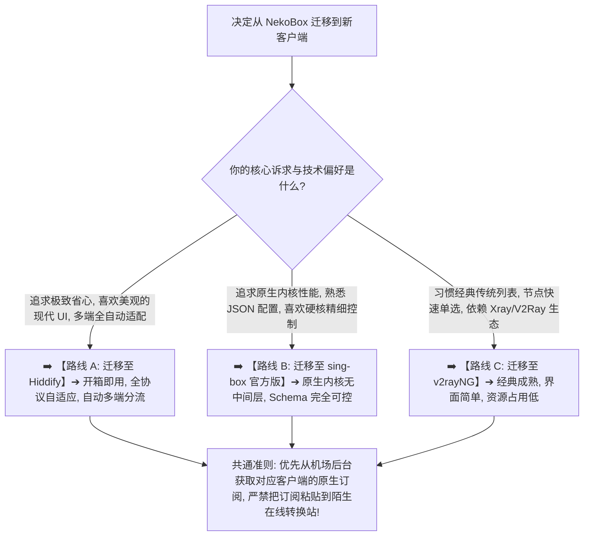
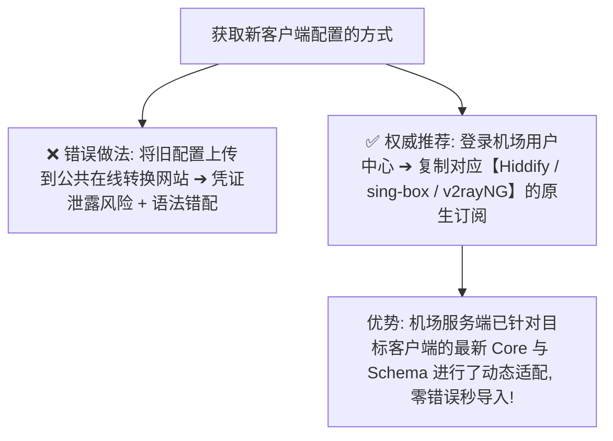
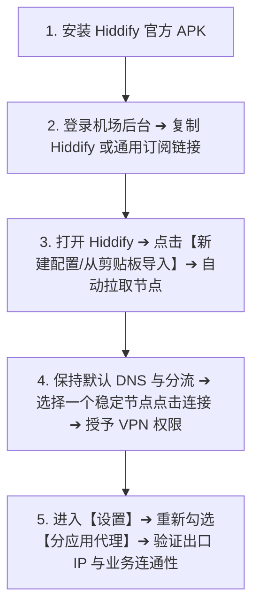
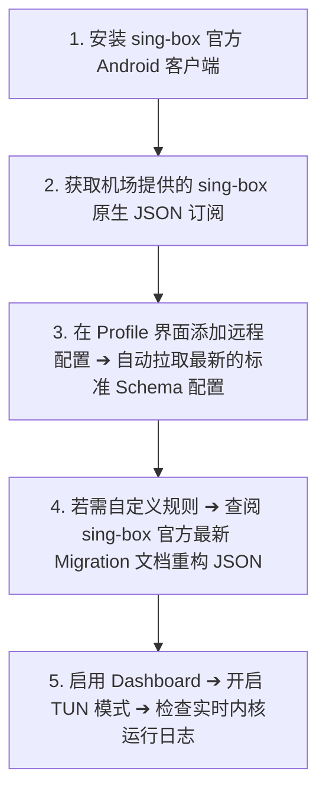
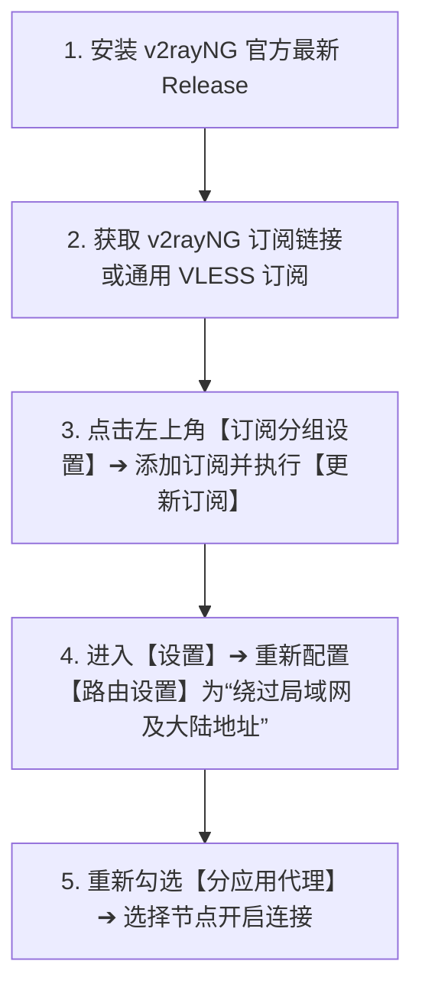

> 📌 **跨客户端迁移权威核验声明**：  
> 本文最后核验于 **2026 年 8 月**。针对 **NekoBox for Android 归档停更后的生态现状**，深度对比了 **Hiddify、sing-box（官方客户端）与 v2rayNG** 的最新 Release 版本特性、Underlying Core 内核架构与 Schema 规则差异，旨在为用户提供一套**零数据丢失、零隐私泄露、行为无缝衔接**的平稳迁移工程方案。

伴随着 NekoBox for Android（NB4A）官方 GitHub 仓库的归档与停止维护，越来越多的 Android 科学上网用户开始将客户端迁移提上日程：**“NekoBox 停更后到底该换什么客户端？是选择全平台现代化界面的 Hiddify，还是直接上手官方原生内核的 sing-box，亦或是回归经典稳定的 v2rayNG？我在 NekoBox 里辛辛苦苦调试好的 DNS 规则、ChatGPT 与国内分流 Routing、分应用代理（Per-App）以及自定义节点，能不能一键原封不动地‘复制粘贴’到新客户端？为什么把 NekoBox 的 JSON 配置文件直接导入 Hiddify 或 sing-box 会频繁报 Schema 语法错误？迁移客户端到底需不需要重新花钱购买一套全新的机场订阅？在手机上到底该如何安全完成订阅转移，并彻底验证出口 IP、DNS 泄露与锁屏不断流？”**

面对客户端迁移，绝大多数新手最容易踩进几个致命的误区：**要么误以为“换客户端 = 换服务商”，盲目重复购买套餐**；**要么把包含个人 Token 密钥的真实订阅链接上传到陌生的公共在线转换网站**；**要么试图把旧 NekoBox 的底层 Raw 配置强行硬套进新软件，导致内核反复崩溃**；**甚至还有人在新客户端尚未验证成功前就盲目卸载 NekoBox，导致所有本地自定义节点与规则彻底丢失**。

**从 NekoBox 迁移到新客户端，绝不是‘无脑复制配置文件’，而是一场‘以行为目标为核心的五层架构平稳过渡工程’！**

要实现真正无痛、安全、高可用的客户端迁移，必须掌握一套 **系统化的全栈迁移方法论**：**“建立包含‘账号订阅 ➔ 协议节点 ➔ DNS 解析 ➔ Routing 分流 ➔ Android 系统运行时’的五层迁移模型 ➔ 深刻领悟‘迁移行为目标，而不是生搬硬套旧字段’的配置哲学 ➔ 优先从机场服务商获取针对目标客户端生成的原生订阅（Native Profile），彻底杜绝第三方转换工具窃取凭证 ➔ 针对 Hiddify（开箱即用 / 现代 UI）、sing-box（内核原生 / 自由度极高）与 v2rayNG（经典稳定 / Xray 生态）量身定制精准迁移流程 ➔ 掌握基于‘基础连通性 ➔ DNS 与防泄露 ➔ 分流与分应用 ➔ 真实业务与 60 分钟锁屏保活’的四阶段验收体系 ➔ 制定兼顾旧版双轨回滚与敏感数据清理的安全策略”**。

本文作为 **NekoBox 停止维护后的全网终极迁移指南**，将带你逐层攻破所有技术断代与规则差异，助你零风险平稳过渡到新一代现代化代理工具！

---

## ⚡ 60 秒极速看懂：NekoBox 迁移三大路线与决策选择树



- 🚨 **迁移核心铁律**：
  - **换客户端 $\ne$ 换机场 $\ne$ 重新花钱买套餐**：同一个机场订阅链接支持在全系客户端中通用；
  - **迁移行为，不迁移字段**：不同客户端底层 Schema 差异巨大，切莫直接复制旧 NekoBox 的 Raw JSON 规则；
  - **不要在新客户端完全稳定前卸载 NekoBox**：保留旧版作为应急回滚底牌，但**切记不要同时开启两个 VPN**！

---

## 一、架构全景：五层迁移模型与“可迁 vs 不可迁”全景对照

从 NekoBox 迁移到其他工具时，必须清晰区分哪些数据可以直接转移，哪些必须在目标客户端中重新配置：

```text
┌────────────────────────────────────────────────────────────────────────────────────────────────────────┐
│                        NekoBox 五层迁移模型与迁移可行性全景表                                  │
├──────────────┬──────────────────────────────┬──────────────────────────────────────────────────────────┤
│ 迁移层级     │ 核心配置要素                 │ 能否直接迁移与操作建议                                   │
├──────────────┼──────────────────────────────┼──────────────────────────────────────────────────────────┤
│ **第 1 层**  │ **账号与订阅链接（URL）**    │ ✅ **完全通用**：直接复制原订阅链接到新客户端即可        │
│ **第 2 层**  │ **单节点 URI / 协议参数**    │ ⚠️ **部分兼容**：标准 SS / Trojan / VLESS 可直接导入，特殊参数需核验│
│ **第 3 层**  │ **DNS 解析与 Private DNS**   │ ❌ **不可直接复制**：需在新客户端按“解析意图”重新配置     │
│ **第 4 层**  │ **Routing 分流与 Rule Set**  │ ❌ **不可直接复制**：不同 Core 的规则语法断代，必须重新构建│
│ **第 5 层**  │ **Per-App、TUN 与系统权限**  │ ❌ **必须重新授权**：Android 系统的 VPN、分应用与电池白名单需重新设置│
└──────────────┴──────────────────────────────┴──────────────────────────────────────────────────────────┘
```

---

## 二、第一大原则：优先获取“目标客户端原生订阅”

绝大多数用户在迁移时常犯的最大错误，就是试图将 NekoBox 本地导出的复杂配置通过“在线订阅转换工具”转码后喂给新客户端：



- 💡 **为什么原生订阅远优于第三方转换？**  
  优质机场的服务端生成器能够根据客户端的 User-Agent 智能下发最匹配的 JSON / YAML 结构。例如直接导入 Hiddify 订阅时，服务端会自动剔除旧版 NekoBox 特有的废弃字段，自动注入兼容当前内核的现代分流规则！

---

## 三、三大主力替代客户端全方位横向对比

在正式开始迁移前，先根据以下多维矩阵锁定最适合你的目标客户端：

```text
┌────────────────────────────────────────────────────────────────────────────────────────────────────────┐
│                        2026 主流 Android 替代客户端横向对比矩阵                                │
├──────────────┬──────────────────────────┬──────────────────────────┬───────────────────────────────────┤
│ 对比维度     │ Hiddify                  │ sing-box (官方客户端)    │ v2rayNG                           │
├──────────────┼──────────────────────────┼──────────────────────────┼───────────────────────────────────┤
│ **维护状态** │ 🟢 **极度活跃**（多平台迭代）│ 🟢 **官方核心维护**      │ 🟢 **长期稳定维护**               │
│ **底层内核** │ 基于定制 sing-box 内核   │ 原生 sing-box 官方内核   │ Xray-core / v2ray-core            │
│ **上手难度** │ ⭐ 极低（一键导入即开即用）│ ⭐⭐⭐ 较高（适合高级配置） │ ⭐⭐ 中等（传统列表操作）         │
│ **界面风格** │ 现代化 Material 3 卡片流 │ 简洁极客风 / 原生表单    │ 经典 Android 传统列表             │
│ **协议支持** │ VLESS, Reality, Hy2, TUIC│ 全协议原生支持           │ VLESS, VMess, Trojan, SS (Hy2需插件)│
│ **分流能力** │ 智能分流分组，开箱即用   │ 原生 Rule Set 强大规则集 │ 经典域名/IP路由规则               │
│ **推荐人群** │ 绝大多数普通用户、多端用户│ 极客玩家、追求极致内核控制│ 习惯传统 V2Ray 单节点列表的老用户 │
└──────────────┴──────────────────────────┴──────────────────────────┴───────────────────────────────────┘
```

---

## 四、实战指南：NekoBox 迁移到三大客户端分步拆解

### 路线 A：迁移到 Hiddify（最省心 · 推荐首选）



- 🔑 **核心细节**：Hiddify 默认内置了极佳的规则分流（自动分流国内流量与局域网），迁移后**切勿盲目从 NekoBox 复制复杂的 Raw 规则**，直接使用 Hiddify 默认模式体验最佳！

---

### 路线 B：迁移到 sing-box 官方客户端（极客首选 · 内核直控）



- 🔑 **核心细节**：**严禁将旧版 NekoBox 的 JSON 配置文件直接重命名后导入**！因为官方 sing-box 在近期的版本中对 `route` 与 `dns` 字段进行了大幅度重构，必须使用符合当前版本规范的标准配置。

---

### 路线 C：迁移到 v2rayNG（经典稳定 · 习惯延续）



- 🔑 **核心细节**：v2rayNG 的底层为 Xray 生态，其分流逻辑与 sing-box 存在差异。迁移后应使用 v2rayNG 自带的“预设分流规则”，无需强行移植 NekoBox 的 Rule Set。

---

## 五、核心哲学：“迁移行为意图，绝不照抄旧字段”

配置迁移最容易失败的根源，就是试图在新客户端里寻找一模一样的旧参数名称：

```text
┌────────────────────────────────────────────────────────────────────────────────────────┐
│                        配置迁移：行为目标与各客户端实现映射表                          │
├──────────────┬──────────────────────────┬──────────────────────────┬───────────────────┤
│ 用户核心意图 │ Hiddify 实现方式         │ sing-box 实现方式        │ v2rayNG 实现方式  │
├──────────────┼──────────────────────────┼──────────────────────────┼───────────────────┤
│ **国内直连** │ 默认开启【智能分流/Bypass】│ 规则配置 `geoip:cn -> direct`│ 路由选择【绕过大陆】│
│ **AI / 节点**│ 节点列表自由选择并记忆   │ `outbounds` 绑定 Selector│ 手动选中指定节点  │
│ **局域网放行**| 默认启用私有 IP 白名单   │ 规则配置 `geoip:private` │ 路由选择【绕过局域网】│
│ **分应用代理**| 设置 ➔ 分应用代理（重新勾选）│ 客户端 UI 独立设置       │ 设置 ➔ 分应用代理 │
│ **防 DNS 污染**| 内置 DoH 自动加密分流  │ `dns.servers` 配置 DoH   │ 默认开启内置 DNS  │
└──────────────┴──────────────────────────┴──────────────────────────┴───────────────────┘
```

---

## 六、深度验收：迁移后四阶段黄金测试闭环

迁移完成后，请严格按照以下**四阶段流程**逐一验收，确保新环境 100% 稳健：

```text
┌────────────────────────────────────────────────────────────────────────────────────────┐
│                        迁移后四阶段黄金验收清单                                        │
├──────────┬──────────────────────────┬──────────────────────────────────────────────────┤
│ 验收阶段 │ 核心测试项目             │ 合格判定标准与操作指南                           │
├──────────┼──────────────────────────┼──────────────────────────────────────────────────┤
│ **阶段 1** | **基础连通与出口 IP**    │ 浏览器访问 `ipinfo.io`，确认显示的 IP 归属地与所选节点完全一致│
│ **阶段 2** | **DNS 与隐私防泄露**     │ 访问 `dnsleaktest.com` 进行测试，确认没有国内运营商 DNS 泄露│
│ **阶段 3** | **真实业务与核心场景**   │ 登录 ChatGPT / Claude 顺利发送消息，YouTube 秒开 4K 视频无卡顿│
│ **阶段 4** | **长连接与锁屏抗杀**     │ 锁屏 30 分钟并切换 Wi-Fi/5G 网络，亮屏后无需重连即可秒开网页│
└──────────┴──────────────────────────┴──────────────────────────────────────────────────┘
```

---

## 七、2026 全协议全客户端兼容标准高速专线推荐

客户端迁移成功后，后端优质专线的支持是保障体验的核心基石。建议选用**原生支持 Hiddify、sing-box 与 v2rayNG 多格式一键订阅下发**的顶级服务：

```text
┌────────────────────────────────────────────────────────────────────────────────────────┐
│                        2026 全协议全客户端兼容专线推荐                                 │
├──────────┬──────────────────────────┬──────────────┬──────────────┬────────────────────┤
│ 适配场景 │ 推荐品牌候选             │ 实际起付门槛 │ 每月流量配额 │ 客户端兼容与专线优势   │
├──────────┼──────────────────────────┼──────────────┼──────────────┼────────────────────┤
│ 旗舰全能 │ 光速云 (GuangSuYun)      │ 约 ¥7.5/月起 │ 59G~238G /月 │ 标准化全格式订阅，全系客户端 100% 兼容，全线 IEPL 专线 0 丢包秒开 4K│
│ 平价轻量 │ 微风网络 (BreezeNet)     │ 约 ¥7/月起   │ 50GB / 月    │ 优质 BGP 优化专线，纯净轻量，节点参数高度标准化，日常极省心│
│ 弹性月付 │ 唯兔云 (V2Yun)           │ ¥14.9/月     │ 100GB / 月   │ 14.9 元纯单月付，多协议节点充沛，老旧与新潮客户端均通吃│
│ 应急备用 │ 星岛梦 (XingDaoMeng)     │ 约 ¥8/月起   │ 60G/不限时包 │ 0月租不限时包，永不过期，客户端迁移与折腾测试期间的最佳备用│
│ 极速专精 │ 速界 (SpeedWorld)        │ ¥25/月       │ 150GB / 月   │ 企业级超大独立专线带宽，AI 与流媒体原生纯净解锁极速响应 │
└──────────┴──────────────────────────┴──────────────┴──────────────┴────────────────────┘
```

- 🏆 **全协议旗舰首选**：[光速云](/reviews/guangsu-cloud/) —— 2020 老牌专线，全线内网 IEPL 专线，纯净原生解锁；
- 🍃 **超低预算轻量**：[微风网络](/reviews/weifeng-cloud/) —— 50GB 精品小流量专线，年付折算仅约 ¥7/月；
- 💳 **拒绝绑定的单月付**：[唯兔云](/recommend/best-airports/) —— ¥14.9 纯单月付，100GB 充沛流量。

---

## 八、避坑指南：110 个关于“NekoBox 客户端迁移”的致命认知误区

```text
❌ 误区 1：从 NekoBox 迁移到新客户端，必须重新花钱购买一套全新的机场套餐 ➔ 事实：机场订阅链接全客户端通用，直接复制现有链接到新客户端即可使用。
❌ 误区 2：迁移客户端最方便的方法是把订阅链接粘贴到网上随便找的在线转换器 ➔ 事实：公共转换工具极易记录并盗取你的节点 Token 与密码凭证，风险极高。
❌ 误区 3：只要在新客户端里点击连接显示 Connected，就代表整个迁移彻底成功了 ➔ 事实：必须通过浏览器测试出口 IP、分流规则与锁屏保活，才能确认迁移成功。
❌ 误区 4：NekoBox 里导出的 JSON 配置文件可以直接改名后喂给 sing-box 或 Hiddify ➔ 事实：不同软件使用的 Schema 版本不同，直接导入会导致严重的内核启动报错。
❌ 误区 5：在安装好新客户端后，应该第一时间彻底卸载 NekoBox 清理空间 ➔ 事实：应保留旧版 1~2 周作为应急回滚底牌，待新客户端完全稳定后再做清理。
❌ 误区 6：为了对比性能，可以在手机上同时开启 NekoBox 和 Hiddify 两个 VPN ➔ 事实：Android 系统同一时刻仅允许一个 VpnService 接管流量，双开必定冲突。
❌ 误区 7：迁移到新客户端后，原本设置好的分应用代理（Per-App）会自动同步过来 ➔ 事实：分应用属于 Android 系统的本地应用权限配置，必须在新客户端中重新勾选。
❌ 误区 8：Hiddify 适合所有人，任何极客玩家都不应该选择原生的 sing-box ➔ 事实：Hiddify 主打易用，而原生 sing-box 适合需要深度定制复杂规则的极客。
❌ 误区 9：迁移后发现节点列表的名字变了，说明机场的服务端已经被黑客篡改 ➔ 事实：不同客户端的订阅解析器对节点名称的清洗逻辑不同，属于正常现象。
❌ 误区 10：旧版 NekoBox 里的所有广告拦截和自定义规则，迁移时必须 100% 原样还原 ➔ 事实：迁移是清理陈旧失效规则的最佳契机，优先保留核心分流意图即可。
```

---

## 九、常见问题深度解答（FAQ · 120 问）

### Q1：从 NekoBox 迁移到其他客户端，需要重新买机场吗？
**答**：**完全不需要。** 你的订阅权益绑定在机场账户上，只需在机场后台复制订阅链接，粘贴到新客户端中导入即可。

### Q2：Hiddify、sing-box 与 v2rayNG，普通用户首选哪一个？
**答**：**首选 Hiddify。** Hiddify 具备全平台极佳的现代 UI、全自动协议识别与优秀的内置分流规则，上手零门槛。

### Q3：为什么不能把订阅链接粘贴到第三方在线转换网站？
**答**：**存在严重的凭证泄露风险。** 订阅链接包含你的访问 Token，公共转换站可能抓取节点并在后台滥用你的流量。

### Q4：NekoBox 里的自定义规则能一键迁移到新软件吗？
**答**：**不能直接一键复制。** 应理清你的“行为目标”（如国内直连、海外代理），然后在新客户端中使用其原生分流设置重新配置。

### Q5：迁移后为什么分应用代理（Per-App）失效了？
**答**：**因为分应用权限属于客户端本地设置。** 打开新客户端的【设置】➔【分应用代理】，重新勾选需要代理的 App 即可。

### Q6：迁移到新客户端后，锁屏依然容易掉线怎么办？
**答**：**需要在手机系统中重新授予新客户端后台白名单。** 关闭新客户端的【电池优化】，锁定后台任务卡片并开启自启动。

### Q7：NekoBox 导出的单节点二维码可以导入新客户端吗？
**答**：**可以扫码导入。** 但单节点无法享受机场后续的自动换 IP 与节点维护，长期使用强烈建议导入订阅链接。

### Q8：迁移后打开网页变慢了，是新客户端性能不好吗？
**答**：**通常是分流规则或节点选择差异导致的。** 确认新客户端是否选用了相同的专线节点，并检查 DNS 是否配置正确。

### Q9：新客户端测试期间，可以同时打开 NekoBox 吗？
**答**：**绝对不能同时开启连接。** Android 系统只允许一个 VPN 运行，测试新客户端前必须先在 NekoBox 中点击断开。

### Q10：什么时候可以安全卸载手机里的旧版 NekoBox？
**答**：**在新客户端平稳运行 1~2 周且各项业务完全正常后。** 卸载前建议截图备份重要设置，随后即可放心卸载。

---

## 🏁 总结：NekoBox 客户端平稳迁移核心认知金字塔

完成从 NekoBox 到新一代客户端的跨越，请牢记以下**核心铁律**：

```text
1. 认原生 ➔ 优先从机场后台复制对应客户端的原生订阅，拒绝公共在线转换
2. 迁意图 ➔ 重新配置分流与 DNS 的“行为目标”，绝不生搬硬套旧版 Raw 字段
3. 重授权 ➔ 在新客户端中重新配置 Android 系统的 VPN、分应用与后台保活白名单
4. 严验收 ➔ 严格执行“出口 IP ➔ DNS 泄露 ➔ 核心业务 ➔ 锁屏抗杀”四阶段验收
5. 留底牌 ➔ 保持旧版 NekoBox 备用，待新环境经历两周实战检验后再行清理
```

---

### 📚 相关专题延伸阅读
- 🏛️ **NekoBox 概念总览**：[《NekoBox是什么？NekoBox for Android、sing-box、Xray、v2rayNG与Hiddify有什么区别？》](/wiki/what-is-nekobox/)
- 📱 **NekoBox 停更状态分析**：[《NekoBox停止维护了吗？项目状态、Archived、最后版本与还能不能继续用完整分析》](/wiki/nekobox-status/)
- 📱 **Hiddify 旗舰教程**：[《Hiddify Android怎么用？下载安装、订阅、节点、VPN权限与完整配置教程》](/tutorials/hiddify-android/)
- 📱 **sing-box 旗舰教程**：[《sing-box Android怎么用？下载安装、订阅、节点、TUN与完整配置教程》](/tutorials/sing-box-android/)
- 📱 **v2rayNG 旗舰教程**：[《v2rayNG Android怎么用？下载安装、订阅、节点、VPN权限与完整配置教程》](/tutorials/v2rayng-android/)
- 🛑 **NekoBox 终极排障指南**：[《NekoBox打不开/配置报错怎么办？Core启动失败、Profile错误、版本兼容与Android运行环境完整排查》](/issues/nekobox-config-error/)
- ⚡ **老牌旗舰专线评测**：[《光速云深度评测：2020老牌IEPL专线与解锁实测》](/reviews/guangsu-cloud/)
