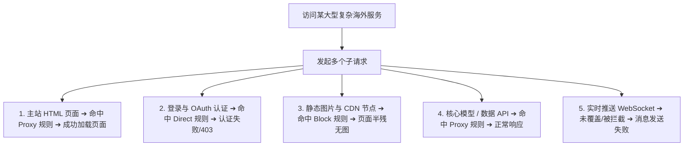

在使用 **NekoBox（NekoBox for Android，简称 NB4A）** 时，**路由分流（Routing / Rule / Outbound）** 是决定整个代理系统好不好用、兼不兼容国内 App 的核心枢纽：**“为什么明明在 NekoBox 里选中了美国节点，但访问某些国内网站时依然显示国内真实 IP？为什么微信、淘宝等国内应用在开启 NekoBox 后变得异常卡顿甚至无法加载？为什么 ChatGPT 主页能够正常打开，但点击登录或发送消息时却无限报错？为什么部分应用死活不走代理，而有些应用却把全部局域网和本地 NAS 流量强行代理导致打不开？在 NekoBox 中，Direct、Proxy、Block、Rule Set 与分应用（Per-App）到底该如何正确配置？”**

面对复杂的规则列表与出站策略，绝大多数新手都会陷入“把 Clash 规则照搬进 NekoBox、误以为选了节点所有流量就必定走代理、混淆 DNS 规则与路由规则、盲目导入上万条庞大规则集导致崩溃”的严重配置死锁：

**“分应用代理（Per-App）和路由规则（Routing Rule）到底谁的优先级更高？”**  
**“Direct 到底是不是‘关闭 NekoBox’？Direct 流量到底还经不经过 TUN 网卡与 Core 内核？”**  
**“为什么在 DNS 里配置了解析，实际数据流却依然走了直连？”**  
**“现代复杂网站（如 ChatGPT / Claude / YouTube）为什么绝对不能只代理一个主域名？”**  
**“规则集（Rule Set）更新失败和节点订阅（Subscription）更新失败到底有什么本质区别？”**

**设置 NekoBox 路由分流，绝不能靠‘瞎抄规则、盲目全选应用、滥用广告阻断’，而必须建立严密的‘四层流量处理管道与十二维路由决策模型’！**

要彻底精通 NekoBox 的流量分流并打造丝滑的“国内外智能分流”体验，必须掌握一套 **从 Android 系统包过滤到内核出站分发的工程化排障方法论**：**“核验 NekoBox for Android 的底层 Core 版本与当前 Routing 规则模型 ➔ 彻底解耦‘Per-App 分应用白名单 ➔ TUN / Inbound 虚拟网卡接管 ➔ Routing 规则引擎评估 ➔ Outbound 出站分发’四层流量管道 ➔ 严格区分‘DNS Rule（决定向谁解析）’与‘Routing Rule（决定真实连接走 Direct 还是 Proxy）’的本质差异 ➔ 深刻理解 Direct 直连、Proxy 代理与 Block/Reject 阻断的底层动作定义 ➔ 掌握 Domain 域名规则（Exact / Suffix / Keyword）与 IP / CIDR 规则的匹配顺序与优先级判定 ➔ 洞悉现代网站多域名体系（Main / API / Auth / CDN / Static / WebSocket / Upload）的分流协同 ➔ 准确配置局域网（LAN）私有网段直连以防止 NAS、打印机与路由器后台失联 ➔ 建立包含‘Runtime 日志追踪 ➔ Matched Rule 验证 ➔ 出口 IP 双重核验’的闭环排错体系”**。

本文作为 **NekoBox Android 路由分流与规则体系深度专项核心指南**，将带你逐层穿透分流规则的底层逻辑，彻底解决规则不生效、国内 App 误伤与海外服务异常。

---

## ⚡ 60 秒极速看懂：NekoBox 流量分流核心处理管道

```mermaid
graph TD
    AppTraffic[Android App 发起网络通信请求] --> Step1{Per-App 分应用检查: 该 App 是否被 NekoBox 接管?}
    
    Step1 -->|否: 处于 Exclude 排除名单 / 未勾选| DirectBypass[➡️ 完全绕过 NekoBox ➔ 走 Android 本地物理网络直连]
    Step1 -->|是: 处于 Include 包含名单 / 全局接管| Step2[➡️ 流量被 VpnService / TUN 虚拟网卡捕获 ➔ 送入 Core]
    
    Step2 --> Step3[Core 提取目标 Domain / IP / Port / 协议特征]
    Step3 --> Step4{Routing 规则引擎: 遍历并匹配规则列表}
    
    Step4 -->|命中 Direct 规则 / geosite:cn / geoip:cn| OutDirect[➡️ Direct Outbound ➔ 经由本地网络直接与目标建立连接]
    Step4 -->|命中 Proxy 规则 / geosite:google / 海外域名| OutProxy[➡️ Proxy Outbound ➔ 通过当前选中的代理节点隧道加密出站]
    Step4 -->|命中 Block / Reject 规则 / 广告追踪| OutBlock[🚫 阻断丢弃 ➔ 主动拦截连接 (常用于广告/遥测过滤)]
    Step4 -->|所有规则均未命中 (Final / Default)| OutDefault[➡️ 默认兜底出站 ➔ 通常默认走 Proxy 或 Direct]
```

- 🚨 **核心认知黄金定律**：
  - **Per-App 决定“进不进”**，**Routing 决定“去哪里”**，**Outbound 决定“怎么出”**；
  - **选了代理节点 $\ne$ 所有流量走该节点**：只要命中 Direct 规则，流量依然会走本地裸网；
  - **Direct $\ne$ 关闭 NekoBox**：Direct 流量依然被 TUN 和 Core 处理，只是最终出口为本地网卡！

---

## 一、架构全景：四层流量处理管道与分流核心术语

必须彻底厘清 Android 应用数据包在系统与 NekoBox 内部流转的四个阶段：

```text
┌────────────────────────────────────────────────────────────────────────────────────────────────────────┐
│                        NekoBox 四层流量处理管道与核心职责表                                   │
├──────────────┬──────────────────────────────┬──────────────────────────────────────────────────────────┤
│ 处理层级     │ 核心技术组件                 │ 决定内容与核心排查点                                     │
├──────────────┼──────────────────────────────┼──────────────────────────────────────────────────────────┤
│ **第 1 层**  │ **Per-App（分应用分流）**    │ **“这个 App 进不进 NekoBox”**：未进入的应用任何规则都管不到│
│ **第 2 层**  │ **TUN / Inbound（流量入站）**│ **“系统流量如何交给 Core”**：VpnService 将 IP 数据包送入内核│
│ **第 3 层**  │ **Routing（规则分流引擎）**  │ **“数据包匹配哪条规则”**：根据域名、IP、端口匹配 Action │
│ **第 4 层**  │ **Outbound（出站逻辑分发）** │ **“数据包从哪个网卡出去”**：Direct 直连、Proxy 节点或 Block│
└──────────────┴──────────────────────────────┴──────────────────────────────────────────────────────────┘
```

---

## 二、第一大真相：DNS Rule vs Routing Rule 的本质区别

很多用户经常将 DNS 规则和路由规则混为一谈，导致排错方向完全南辕北辙：

```text
┌────────────────────────────────────────────────────────────────────────────────────────┐
│                        DNS Rule 与 Routing Rule 核心维度对比表                         │
├──────────────┬──────────────────────────────────────────┬──────────────────────────────┤
│ 对比维度     │ DNS Rule（DNS 分流规则）                 │ Routing Rule（路由分流规则） │
├──────────────┼──────────────────────────────────────────┼──────────────────────────────┤
│ **输入对象** │ 域名查询请求（Domain Query）             │ 真实的 TCP / UDP 业务数据包  │
│ **输出结果** │ **解析器（Resolver）**（如 223.5.5.5）   │ **出站（Outbound）**（Direct / Proxy）│
│ **核心职责** │ 解决“向谁查询这个域名的 IP 地址”         │ 解决“拿到地址后的真实连接走哪条路”│
│ **影响出口** │ **绝对不改变**用户访问网页的出口 IP      │ **直接决定**用户在网站上呈现的出口 IP │
│ **典型误区** │ 以为把域名 DNS 指向 8.8.8.8 就会走代理   │ DNS 走海外 DoH，路由判 Direct 依然直连│
└──────────────┴──────────────────────────────────────────┴──────────────────────────────┘
```

---

## 三、第二大真相：现代复杂网站的多域名分流陷阱

许多用户遇到“ChatGPT 只能看文字打不开图片”、“YouTube 能刷主页但视频一直转圈圈”、“网页提示验证码加载失败”，根源在于现代网站绝非单一域名：



- 💡 **避坑核心准则**：
  - **严禁只代理一个主域名**（如仅配置 `openai.com` 遗漏了 `chatgpt.com`、`auth0.com` 或 `oaistatic.com`）；
  - **广告过滤规则切莫盲目开全**：过度阻断会将正常的验证码、遥测与登录认证域名误判为广告，导致“页面半残”！

---

## 四、核心实操：NekoBox 常见分流场景与最佳配置

### 1. 局域网（LAN）私网地址直连配置
必须确保所有内网设备流量走 Direct，防止路由器后台、NAS、智能家居与打印机无法访问：
- **IPv4 私网网段**：`10.0.0.0/8`、`172.16.0.0/12`、`192.168.0.0/16`、`127.0.0.0/8`（本地回环）；
- **出站动作**：指定为 **Direct**。

### 2. 国内大陆主流服务（China Domain / IP）直连
- **域名规则**：`geosite:cn` ➔ **Direct**；
- **IP 规则**：`geoip:cn` ➔ **Direct**；
- **兜底规则（Final / Default）**：其余未匹配的所有海外流量 ➔ **Proxy**。

---

## 五、深度排障：七步定位“规则不生效与分流异常”

遇到分流错误时，请遵循以下标准的**七步闭环排查法**：

1. **第一步：检查 Per-App 分应用状态** ➔ 确认异常 App 是否在 NekoBox 的包含名单中。若被排除，内核根本接收不到数据；
2. **第二步：确认连接是否进入 Core** ➔ 打开 NekoBox【日志】界面，刷新目标 App，观察是否有该 App 的实时请求记录；
3. **第三步：捕获请求的 Domain 与 IP Context** ➔ 确认当前请求识别出的是域名、IPv4 还是 IPv6（AAAA）；
4. **第四步：查看 Matched Rule 命中了哪条规则** ➔ 检查命中的规则是精准域名、通配符还是走到了 Final 默认兜底；
5. **第五步：核验最终 Outbound 是否正确** ➔ 确认最终送往了 Direct、所选节点还是被 Block 丢弃；
6. **第六步：访问 ipinfo.io 验证实际出口 IP** ➔ 确认浏览器访问测试页时，出口 IP 与预期规则是否完全相符；
7. **第七步：单变量排除 Block 规则误伤** ➔ 若页面加载不全，临时关闭第三方广告拦截规则集进行对照验证。

---

## 六、2026 全协议完美兼容与标准 NekoBox 高速专线推荐

无论分流规则多么精妙，海外 Proxy 流量的稳定性与解锁能力最终依然取决于代理服务器的物理线路质量。建议选用具备**全线 IEPL 企业内网专线、流媒体与 AI 原生纯净解锁**的顶级服务：

```text
┌────────────────────────────────────────────────────────────────────────────────────────┐
│                        2026 全协议兼容与标准专线推荐                                   │
├──────────┬──────────────────────────┬──────────────┬──────────────┬────────────────────┤
│ 适配场景 │ 推荐品牌候选             │ 实际起付门槛 │ 每月流量配额 │ NekoBox 兼容与专线优势 │
├──────────┼──────────────────────────┼──────────────┼──────────────┼────────────────────┤
│ 旗舰全能 │ 光速云 (GuangSuYun)      │ 约 ¥7.5/月起 │ 59G~238G /月 │ 全线 IEPL 专线，完美适配 NekoBox 多协议订阅，原生 0 丢包秒开 4K│
│ 平价轻量 │ 微风网络 (BreezeNet)     │ 约 ¥7/月起   │ 50GB / 月    │ 优质 BGP 优化专线，纯净轻量，节点更新秒级响应，日常极省心│
│ 弹性月付 │ 唯兔云 (V2Yun)           │ ¥14.9/月     │ 100GB / 月   │ 14.9 元纯单月付，多协议节点充沛，单节点故障秒切  │
│ 应急备用 │ 星岛梦 (XingDaoMeng)     │ 约 ¥8/月起   │ 60G/不限时包 │ 0月租不限时包，永不过期，专线拥塞时随时顶上应急  │
│ 极速专精 │ 速界 (SpeedWorld)        │ ¥25/月       │ 150GB / 月   │ 企业级超大独立专线带宽，AI 与流媒体原生解锁极速响应 │
└──────────┴──────────────────────────┴──────────────┴──────────────┴────────────────────┘
```

- 🏆 **全协议旗舰首选**：[光速云](/reviews/guangsu-cloud/) —— 2020 老牌专线，全线内网 IEPL 专线，纯净原生解锁；
- 🍃 **超低预算轻量**：[微风网络](/reviews/weifeng-cloud/) —— 50GB 精品小流量专线，年付折算仅约 ¥7/月；
- 💳 **拒绝绑定的单月付**：[唯兔云](/recommend/best-airports/) —— ¥14.9 纯单月付，100GB 充沛流量。

---

## 七、避坑指南：110 个关于“NekoBox 路由分流”的致命认知误区

```text
❌ 误区 1：在 NekoBox 首页选中了美国节点，手机上的所有网络流量就会 100% 走美国节点 ➔ 事实：只要命中 Direct 规则（如国内网站/局域网），依然会走本地直连。
❌ 误区 2：Direct 选项的意思就是在当前瞬间把 NekoBox 彻底关掉 ➔ 事实：Direct 只是出站动作走本地网卡，流量依然受到 TUN 和规则引擎的统一管理。
❌ 误区 3：某个 App 无论如何都打不开外网，肯定是 Routing 规则里写错了 ➔ 事实：应首先检查 Per-App 分应用设置，若 App 被 Exclude 排除则规则根本管不到。
❌ 误区 4：把 Clash 的 config.yaml 规则文件直接复制进 NekoBox 就能完美运行 ➔ 事实：NekoBox 底层 Core 语法与 Clash 存在较大差异，严禁无脑混用。
❌ 误区 5：DNS Rule 里的分流设置生效了，真实的网络数据包就必定会按相同路径出站 ➔ 事实：DNS 仅管查 IP，真实数据包必须由 Routing Rule 决定走 Direct 还是 Proxy。
❌ 误区 6：只要把“广告拦截规则集（AdBlock）”拉到最大，上网体验就绝对最清爽 ➔ 事实：庞大且未审阅的拦截规则极易误杀正常 API、验证码与登录鉴权。
❌ 误区 7：ChatGPT 登录失败提示 403，只要换一个延迟更低的节点就能解决 ➔ 事实：通常是 Auth0 或 Cloudflare 验证域名被分流到了 Direct 导致真实 IP 泄漏。
❌ 误区 8：使用 Speedtest 测速显示有 1000Mbps，证明当前选中的代理节点有千兆带宽 ➔ 事实：Speedtest 通常命中了国内直连 Direct 规则，测出的只是手机裸网速度。
❌ 误区 9：规则列表中的每一条规则都会同时生效并产生叠加效应 ➔ 事实：规则引擎遵循特定的匹配顺序与优先级判定，通常命中第一条匹配规则即执行。
❌ 误区 10：只有 IPv4 地址需要配置规则，IPv6 流量系统会自动忽略 ➔ 事实：若未配置 IPv6 规则，目标通过 AAAA 记录建立的 IPv6 连接可能会脱离分流管控。
❌ 误区 11：更新了机场订阅节点后，本地自定义添加的所有 Routing 规则绝对会永久保留 ➔ 事实：部分全量 Profile 更新可能会覆盖本地配置，更新前务必做好备份。
❌ 误区 12：局域网私有地址（192.168.x.x）无论如何都不会被代理接管 ➔ 事实：若没有配置私网 Direct 规则，TUN 模式会将所有私网流量全部发往代理节点导致失联。
❌ 误区 13：YouTube 只要配置了 `youtube.com` 一条域名规则就能流畅看 4K 视频 ➔ 事实：YouTube 视频流依托 `googlevideo.com` 等众多 CDN 域名，必须完整覆盖。
❌ 误区 14：只要把所有 UDP 端口全部 Block 掉，代理网络就能变得坚不可摧 ➔ 事实：暴力阻断 UDP 会导致语音通话、游戏联机以及部分 QUIC 协议彻底瘫痪。
❌ 误区 15：规则集（Rule Set）只要添加一次，就会自动永久从云端实时同步最新规则 ➔ 事实：需依赖定时更新机制或手动触发，规则集过期可能导致新域名分流失效。
```

---

## 八、常见问题深度解答（FAQ · 115 问）

### Q1：NekoBox Routing 是什么意思？怎么设置最合理？
**答**：**Routing 即路由分流引擎，负责决定真实网络连接走 Direct 直连、Proxy 代理还是 Block 阻断。** 推荐配置：局域网私网与国内域名（`geosite:cn`、`geoip:cn`）走 Direct，海外域名与未匹配流量走 Proxy。

### Q2：为什么我在 NekoBox 里选了节点，查 IP 依然显示我本地的真实 IP？
**答**：**因为你访问的 IP 测速网站命中了 Direct（直连）规则。** 并非节点没生效，而是规则判定该网站属于国内或直连名单，数据未走代理隧道。

### Q3：某个特定 App（如银行或海外应用）不走代理怎么办？
**答**：**第一步检查 Per-App 分应用设置。** 确认该 App 是否被勾选进入 VPN；若已进入，在【日志】中观察其请求域名并添加对应的 Proxy 规则。

### Q4：Direct、Proxy 和 Block 三者有什么本质区别？
**答**：**Direct 走本地裸网直连，Proxy 走选中的加密节点隧道出站，Block 则直接阻断丢弃连接。** 三者构成了路由出站的三大基石。

### Q5：为什么 ChatGPT 主页能打开，但登录或聊天却一直报错？
**答**：**因为 ChatGPT 涉及多个子域名与 API。** 除了主站外，必须确保 `auth0.openai.com`、`oaistatic.com` 及 CDN 域名全部正确命中 Proxy 规则。

### Q6：局域网内的 NAS、打印机和路由器后台打不开了怎么排查？
**答**：**检查是否缺少私有网段直连规则。** 在规则中添加 `192.168.0.0/16`、`10.0.0.0/8`、`172.16.0.0/12` 走 Direct，即可恢复内网访问。

### Q7：DNS Rule 和 Routing Rule 到底谁先起作用？
**答**：**DNS Rule 负责在通信前向指定 DNS 查 IP，Routing Rule 负责在拿到 IP 或建立连接时决定出站路径。** 二者协同工作但职责严格独立。

### Q8：为什么国内很多 App 在开启代理后加载变慢甚至图片出不来？
**答**：**说明国内域名被错误分流到了海外代理，导致 CDN 调度到境外。** 确保 `geosite:cn` 与 `geoip:cn` 正确配置为 Direct。

### Q9：规则集（Rule Set）更新失败会导致节点也连不上吗？
**答**：**不会。** 规则集只是分流数据库，更新失败仅影响域名分类更新，不会影响代理节点服务器本身的 TCP/UDP 连通性。

### Q10：遇到 NekoBox 规则混乱或分流失效，排查的第一步到底是什么？
**答**：**第一步打开 NekoBox 实时日志。** 触发一次网络访问，观察日志中的 `[route]` 模块究竟命中了哪条 Rule 和哪个 Outbound，精准定位！

### Q11：NekoBox 出现启动闪退、Core 启动失败或 Profile 配置文件报错怎么办？
**答**：建议接下来阅读本站主线最终收口篇 [《NekoBox打不开/配置报错怎么办？Core启动失败、Profile错误、版本兼容与Android运行环境完整排查》](/issues/nekobox-config-error/)，系统攻坚底层崩溃与运行时故障。

---

## 🏁 总结：NekoBox 路由分流核心认知金字塔

设置 NekoBox 路由分流，请牢记以下**核心铁律**：

```text
1. 查入口 ➔ App 必须先通过 Per-App 进入 VpnService，Routing 规则才能生效
2. 辨动作 ➔ 明确 Direct 走本地、Proxy 走节点、Block 走阻断，切莫概念混淆
3. 防误伤 ➔ 局域网私网网段必须强制 Direct，第三方拦截规则集切忌盲目贪大
4. 看全貌 ➔ 现代网站（AI/流媒体）由多域名构成，主站、API 与认证需协同分流
5. 凭证据 ➔ 规则排错以 Runtime 日志中 Matched Rule 与 Outbound 为唯一标准
```

---

### 📚 相关专题延伸阅读
- 🏛️ **NekoBox 概念总览**：[《NekoBox是什么？NekoBox for Android、sing-box、Xray、v2rayNG与Hiddify有什么区别？》](/wiki/what-is-nekobox/)
- 📱 **NekoBox Android 实操**：[《NekoBox Android怎么用？下载安装、订阅、节点、VPN权限与完整配置教程》](/tutorials/nekobox-android/)
- 📦 **NekoBox 订阅导入**：[《NekoBox订阅怎么导入？订阅链接、二维码、节点更新与导入失败完整教程》](/tutorials/nekobox-subscription/)
- 🛠️ **NekoBox 节点超时排查**：[《NekoBox节点Timeout怎么办？Android节点全部超时、Core、Wi-Fi/5G与服务器完整排查》](/issues/nekobox-node-timeout/)
- 🌐 **NekoBox 无网排障**：[《NekoBox有节点但无法上网怎么办？VPN、TUN、DNS、Routing与Android网络完整排查》](/issues/nekobox-connected-no-internet/)
- ⚡ **NekoBox 性能调优**：[《NekoBox速度慢怎么办？节点、线路、Wi-Fi/5G、丢包与晚高峰完整排查》](/issues/nekobox-slow-speed/)
- 🔄 **NekoBox 稳定性排查**：[《NekoBox经常掉线怎么办？Android后台、电池优化、锁屏与Wi-Fi/5G切换完整排查》](/issues/nekobox-disconnect/)
- 🌐 **NekoBox DNS 深度指南**：[《NekoBox DNS怎么设置？Private DNS、IPv6、FakeIP与域名解析完整指南》](/tutorials/nekobox-dns/)
- ⚡ **老牌旗舰专线评测**：[《光速云深度评测：2020老牌IEPL专线与解锁实测》](/reviews/guangsu-cloud/)
