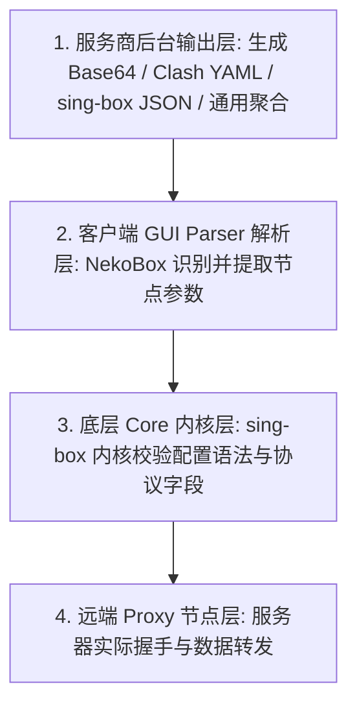
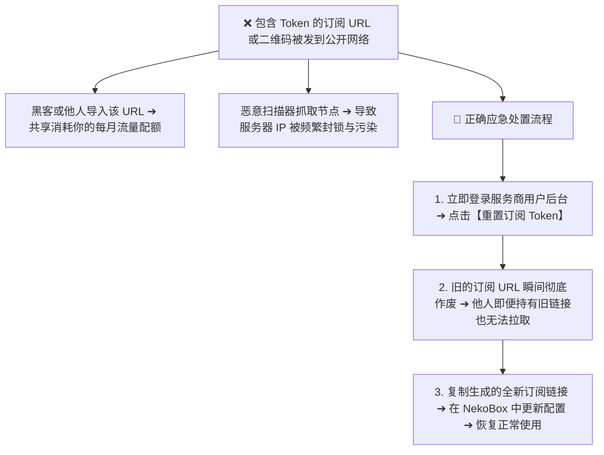

在使用 **NekoBox（NekoBox for Android，简称 NB4A）** 进行科学上网时，**订阅导入与节点更新**是绝大多数用户遇到报错最频繁、认知断层最严重的环节：**“为什么从机场后台复制了订阅链接粘贴进 NekoBox，点击更新后却弹出‘404 Not Found’或‘403 Forbidden’？为什么提示‘HTTP 200 OK’却紧接着报错‘Parse Error’或‘Unsupported Format’？为什么扫码导入后列表里只有一个节点而不是全套节点组？为什么有的节点在 v2rayNG 里能正常使用，复制进 NekoBox 却解析为空？为什么订阅更新成功且节点都在，点击连接却全部显示‘Timeout’超时？”**

面对五花八门的报错弹窗与格式分歧，很多新手都会陷入“盲目连续刷新、病急乱投医找在线转换器、把订阅问题与节点超时混为一谈”的排查误区：

**“NekoBox 客户端本身会不会自带免费节点或自动分发订阅？”**  
**“把 Clash 的 YAML 订阅文件改名成 `.json` 后能直接导入 NekoBox 吗？”**  
**“为什么在 Wi-Fi 下更新订阅提示超时，切换到 5G 手机网络却能秒级拉取成功？”**  
**“更新订阅后节点数量突然变少，甚至部分地区节点凭空消失，这是服务商跑路了吗？”**  
**“如果不小心把包含订阅 Token 的链接或二维码发到了公开聊天群，该如何彻底阻断流量被盗用？”**

**排查 NekoBox 订阅故障，绝不能靠‘瞎改 URL 字符、疯狂点击刷新、随意上传到陌生转换站’，而必须建立严密的‘四层格式兼容与七阶段生命周期诊断模型’！**

要彻底攻克 NekoBox 的订阅与配置分发问题，必须掌握一套 **系统化的链路诊断与凭据安全法则**：**“核验 NekoBox for Android 项目的实际版本维护边界 ➔ 厘清‘服务商输出格式 ➔ NekoBox GUI 解析器 ➔ 底层 sing-box Core 内核 ➔ 远端代理服务器’四层兼容拓扑 ➔ 彻底解耦‘订阅链接（Subscription URL） ➔ 远程配置（Remote Configuration） ➔ 本地配置（Local Config） ➔ 单节点链接（Single Node URI）’的技术边界 ➔ 建立从‘URL 保存 ➔ 远程拉取 ➔ HTTP/TLS 握手 ➔ 格式识别 ➔ 内容解析 ➔ 节点生成 ➔ 隧道调用’的七阶段诊断阶梯 ➔ 精准区分‘订阅服务器请求超时（Subscription Timeout）’与‘代理节点握手超时（Node Timeout）’的本质差异 ➔ 洞悉 HTTP 200 下返回 HTML 拦截页导致 Parse Error 的核心根源 ➔ 建立严格的 Subscription Token 与二维码凭据防泄露与应急轮换规范”**。

本文作为 **NekoBox 订阅与配置分发专项核心教程**，将带你彻底穿透订阅导入的每一个底层环节，快速攻坚所有常见导入与更新故障。

---

## ⚡ 60 秒极速看懂：NekoBox 订阅导入与全链路生命周期

```mermaid
graph TD
    SubURL[1. 机场后台获取兼容的 NekoBox / 通用订阅 URL] --> SaveLocal[2. NekoBox 新建分组 ➔ 粘贴 URL 并保存]
    
    SaveLocal --> HttpFetch[3. 点击更新 ➔ 客户端发起 HTTP/HTTPS 远程拉取 (Remote Fetch)]
    HttpFetch --> CheckHTTP{HTTP 状态码是否正常?}
    
    CheckHTTP -->|404 / 403 / 429 / 5xx| FailHTTP[❌ 接口错误 / Token 失效 / 触发风控限流]
    CheckHTTP -->|HTTP 200 OK| CheckFormat{内容是否为支持的代理配置格式?}
    
    CheckFormat -->|返回 HTML 拦截页 / 损坏文本| FailParse[❌ Parse Error / Unsupported Format]
    CheckFormat -->|合法 Base64 / JSON / 节点集合| SuccessParse[4. Parser 成功解析 ➔ 生成节点列表]
    
    SuccessParse --> LoadCore[5. 底层 Core 加载配置 ➔ 用户选择节点 ➔ 建立 Proxy 连接]
```

- 🚨 **核心认知黄金定律**：
  - **NekoBox 是客户端工具，不提供任何订阅与节点服务**；
  - **保存订阅链接 $\ne$ 远程拉取成功 $\ne$ 格式解析成功 $\ne$ 节点可用**；
  - **订阅 Timeout 与节点 Timeout 处于完全不同的网络层级**：订阅超时代表访问订阅发布服务器失败，节点超时代表代理节点物理不可达；
  - **订阅链接与二维码属于高敏感隐私凭据**，严禁在公开网络发布，泄露后必须立即在服务商后台重置 Token！

---

## 一、架构全景：四大配置对象的本质区别与核心特性矩阵

在导入配置前，首先必须彻底区分 **订阅链接、远程配置、本地配置与单节点** 的技术实体：

```text
┌────────────────────────────────────────────────────────────────────────────────────────────────────────┐
│                   Subscription URL vs Remote Config vs Local Config vs Single Node                     │
├──────────────┬──────────────────┬──────────────────┬──────────────────┬────────────────────────────────┤
│ 对象类型     │ 核心概念与本质   │ 包含节点数量     │ 远程自动更新     │ 适用场景与安全考量             │
├──────────────┼──────────────────┼──────────────────┼──────────────────┼────────────────────────────────┤
│ **订阅链接** │ 远程动态获取地址 | 通常包含多地区节点| 支持一键/自动刷新| **最推荐的日常主力使用方式**   │
│ (Subscription)| (带 Token 的 URL)| (数十至数百个)   | 线路变动自动同步 | 包含敏感 Token，严禁公开泄露   │
├──────────────┼──────────────────┼──────────────────┼──────────────────┼────────────────────────────────┤
│ **远程配置** │ 完整的远程 JSON/ | 包含完整节点与   | 支持远程定时拉取 | 适合高级玩家的集中化配置管理   │
│ (Remote Conf)| 规则策略文件     | DNS/分流策略     | 自动覆盖本地规则 | 格式对 Core Schema 版本要求严格 │
├──────────────┼──────────────────┼──────────────────┼──────────────────┼────────────────────────────────┤
│ **本地配置** │ 手机本地保存的   | 固定节点与策略   | 不支持远程自动更新| 离线环境使用或自建规则备份     │
│ (Local Conf) │ 静态 JSON 文本   | (需手动修改维护) | 需手动重新导入   | 安全性高（不依赖外部 URL）     │
├──────────────┼──────────────────┼──────────────────┼──────────────────┼────────────────────────────────┤
│ **单节点 URI**| 独立代理服务器参数| 仅有 1 个独立节点| 彻底不支持自动更新| 临时测试、自建 VPS 或朋友分享  │
│ (Single Node)| (`vless://` 等)  | 静态不可变       | 节点 IP 变更即失效| 适合单点验证，不适合做主力订阅 │
└──────────────┴──────────────────┴──────────────────┴──────────────────┴────────────────────────────────┘
```

---

## 二、第一大真相：四层格式兼容模型（为什么同一个链接有的软件能用、有的不行？）

很多用户最常问的问题是：“为什么同一个订阅链接，在 v2rayNG 里好好的，放到 NekoBox 里就报错？”



### 1. 常见订阅格式在 NekoBox 中的兼容边界
- **Base64 编码的单节点集合（通用/V2Ray 格式）**：包含多行 `vless://`、`vmess://`、`trojan://`、`ss://` 或 `hysteria2://` 链接，经 Base64 编码后下发。**这是 NekoBox 兼容性最好的标准订阅形式**；
- **Clash / Mihomo YAML 订阅**：专门针对 Clash 内核设计的 YAML 配置文件。**NekoBox 原生无法直接将完整的 Clash 规则文件当做核心配置运行**，除非服务商提供了自动格式转换或客户端内置了转换模块；
- **sing-box 原生 JSON 订阅**：虽然 NekoBox 底层使用 sing-box 内核，但由于 sing-box 官方在版本演进中频繁调整了 `outbounds` 与 `route` 的 Schema 语法，**过新或过旧的 sing-box JSON 可能与 NekoBox 内部封装的 Core 版本产生版本错配**。

---

## 三、实操教程：NekoBox 订阅与节点导入的三大核心方式

```text
┌────────────────────────────────────────────────────────────────────────────────────────┐
│                        NekoBox 导入订阅标准操作流程图                                  │
├────────────────────────────────────────────────────────────────────────────────────────┤
│ 步骤 1：打开 NekoBox ➔ 点击左侧导航栏 ➔ 进入【分组】或【配置】管理页面                 │
│ 步骤 2：点击右上角【+】号 ➔ 选择【新建分组】或【添加配置】                            │
│ 步骤 3：在分组类型中选择【订阅】(Subscription) ➔ 输入自定义分组名称（如“主力机场”）    │
│ 步骤 4：在“订阅链接”输入框中粘贴完整的 Subscription URL ➔ 点击右上角保存勾号          │
│ 步骤 5：在分组列表中找到刚刚保存的分组 ➔ 点击【更新】或【刷新】按钮                  │
│ 步骤 6：等待客户端下载并解析完成 ➔ 主界面节点列表成功呈现各地区节点                   │
└────────────────────────────────────────────────────────────────────────────────────────┘
```

### 1. 二维码（QR Code）扫码导入的正确认知
- **扫码前核验载体**：电脑屏幕上的二维码可能是一个包含 50 个节点的完整【订阅 URL】，也可能仅仅是 1 个【单节点 URI】（如单个 `vless://`）；
- **扫码后节点数量**：若扫码后列表仅增加 1 个节点，说明该二维码本身就是单节点配置，并非导入失败；若扫码后提示解析错误，请确认相机是否完整聚焦在二维码正中心。

### 2. 剪贴板一键导入单节点
- 复制任意标准的 `vless://`、`vmess://`、`trojan://`、`ss://` 或 `hysteria2://` 链接；
- 打开 NekoBox，点击右上角菜单，选择【从剪贴板导入】（Import from clipboard），节点将秒级出现在默认分组中。

---

## 四、核心故障诊断：七大高频订阅报错与精准排查指南

```text
┌────────────────────────────────────────────────────────────────────────────────────────┐
│                        NekoBox 订阅导入与更新故障全景排查表                            │
├──────────────┬──────────────────────────────┬──────────────────────────────────────────┤
│ 报错类型     │ 底层故障根源                 │ 精准解决方案与排障动作                   │
├──────────────┼──────────────────────────────┼──────────────────────────────────────────┤
│ **404 错误** | 订阅链接失效、复制截断或过期 | 登录服务商后台，重新复制最新的订阅 URL    │
│ **403 错误** | 权限拒绝、Token 轮换或受限   | 检查账户套餐是否到期，或在后台重置 Token │
│ **429 错误** | 短时间内请求次数过多（限流） | 停止狂点刷新，等待 15~30 分钟后再次拉取  │
│ **Timeout**  | 无法连接到订阅分发服务器     | 切换 Wi-Fi / 5G，检查本地 DNS 是否解析受阻│
│ **Parse 错误**| 返回了 HTML 网页或不兼容格式 | 确认链接返回的是纯文本节点而非登录拦截页  │
│ **节点变少** | 服务端下架了部分拥塞线路     | 属于服务商正常节点调优，重新测速可用节点  │
│ **重复节点** | 多次重复添加了同一个订阅分组 | 进入分组管理，删除多余的重复订阅分组      │
└──────────────┴──────────────────────────────┴──────────────────────────────────────────┘
```

### 1. 深度攻坚：为什么 HTTP 200 依然会提示 Parse Error？
- **现象**：状态栏提示订阅请求返回了 200 OK，但下方紧接着报错 `Parse Error`，列表依然为空；
- **技术真相**：服务商后台在遭遇高并发防护（如 Cloudflare / CDN WAF）或用户账户需要重新登录时，服务器虽然返回了 HTTP 200 响应，但**返回的数据体（Body）实际上是一段 HTML 网页代码或验证码页面，而不是 Base64 编码的节点参数**。NekoBox 的解析器无法将 HTML 解析为节点对象，从而抛出格式解析异常。

### 2. 深度攻坚：订阅超时（Subscription Timeout）与节点超时（Node Timeout）的区别
- **订阅超时**：发生在从手机向机场的 **Web 服务器**（如 `sub.example.com`）请求配置文件的阶段；
- **节点超时**：发生在向实际的 **代理中继服务器**（如香港、日本的 Proxy IP）发送数据包的阶段；
- **排查法则**：如果订阅更新成功但节点全部连不上，请立即停止刷新订阅，转去排查节点连接网络！

---

## 五、凭据安全：Subscription Token 泄露的致命风险与应急轮换

订阅链接中的 URL 通常包含你的唯一专属凭据（Token / UUID / Key）：



- ⚠️ **安全警告**：切勿将包含私人 Token 的订阅链接提交到公共 GitHub 仓库、公开论坛或使用不可信的第三方“在线订阅转换”公共站点，以免节点凭据被第三方非法转卖或滥用。

---

## 六、2026 全协议完美兼容与标准 NekoBox 高速专线推荐

订阅获取顺畅只是起点，要想获得稳定无拥塞的翻墙体验，必须依赖**具备多格式自适应分发、全协议原生支持与企业级专线**的高品质服务：

```text
┌────────────────────────────────────────────────────────────────────────────────────────┐
│                        2026 全协议兼容与标准专线推荐                                   │
├──────────┬──────────────────────────┬──────────────┬──────────────┬────────────────────┤
│ 适配场景 │ 推荐品牌候选             │ 实际起付门槛 │ 每月流量配额 │ NekoBox 兼容与专线优势 │
├──────────┼──────────────────────────┼──────────────┼──────────────┼────────────────────┤
│ 旗舰全能 │ 光速云 (GuangSuYun)      │ 约 ¥7.5/月起 │ 59G~238G /月 │ 全线 IEPL 专线，完美适配 NekoBox 多协议订阅，原生 0 丢包秒开 4K│
│ 平价轻量 │ 微风网络 (BreezeNet)     │ 约 ¥7/月起   │ 50GB / 月    │ 优质 BGP 优化专线，纯净轻量，节点更新秒级响应，日常极省心│
│ 弹性月付 │ 唯兔云 (V2Yun)           │ ¥14.9/月     │ 100GB / 月   │ 14.9 元纯单月付，多协议节点充沛，单节点故障秒切  │
│ 应急备用 │ 星岛梦 (XingDaoMeng)     │ 约 ¥8/月起   │ 60G/不限时包 │ 0月租不限时包，永不过期，专线拥塞时随时顶上应急  │
│ 极速专精 │ 速界 (SpeedWorld)        │ ¥25/月       │ 150GB / 月   │ 企业级超大独立专线带宽，AI 与流媒体原生解锁极速响应 │
└──────────┴──────────────────────────┴──────────────┴──────────────┴────────────────────┘
```

- 🏆 **全协议旗舰首选**：[光速云](/reviews/guangsu-cloud/) —— 2020 老牌专线，全线内网 IEPL 专线，纯净原生解锁；
- 🍃 **超低预算轻量**：[微风网络](/reviews/weifeng-cloud/) —— 50GB 精品小流量专线，年付折算仅约 ¥7/月；
- 💳 **拒绝绑定的单月付**：[唯兔云](/recommend/best-airports/) —— ¥14.9 纯单月付，100GB 充沛流量。

---

## 七、避坑指南：85 个关于“NekoBox 订阅导入”的致命认知误区

```text
❌ 误区 1：在 NekoBox 中点击保存订阅链接后，即使不点更新节点也会立刻加载出来 ➔ 事实：保存只是写入本地配置，必须执行一次主动拉取才能生成节点。
❌ 误区 2：只要订阅链接导入成功，节点列表里的所有节点就必定 100% 全部可用 ➔ 事实：订阅成功仅代表配置获取正常，远端节点是否在线需要单独测速。
❌ 误区 3：遇到 404 错误说明 NekoBox 软件自身损坏，必须卸载重装 ➔ 事实：404 是远程服务器资源未找到，通常是订阅链接写错或被后台重置。
❌ 误区 4：遇到 403 错误代表你的宽带 IP 被国家防火墙彻底封锁了 ➔ 事实：403 通常是服务商鉴权失败、套餐过期或触发了服务商的 WAF 防护。
❌ 误区 5：遇到 429 错误时应该疯狂点击刷新按钮直到成功为止 ➔ 事实：429 是请求过于频繁触发了限流，继续狂刷会导致封禁时间延长。
❌ 误区 6：任何 Clash 的 YAML 订阅文件只要直接改扩展名为 `.json` 就能在 NekoBox 运行 ➔ 事实：YAML 与 JSON 语法及底层规则 Schema 迥异，无法直接混用。
❌ 误区 7：把订阅链接放到公共在线转换网站转换格式完全没有任何安全隐私风险 ➔ 事实：公共转换站可完全捕获你的订阅 Token 与节点敏感密码。
❌ 误区 8：扫码导入配置后列表里只有一个节点，说明本次扫码操作彻底失败了 ➔ 事实：若二维码本身编码的是单节点 URI，生成 1 个节点属于正常现象。
❌ 误区 9：订阅自动更新频率设置得越高（如每 5 分钟一次），网络就越稳定 ➔ 事实：过频更新不仅徒增耗电与流量，还极易触发服务商 429 限流。
❌ 误区 10：更新订阅后发现节点数量变少，说明 NekoBox 吞掉了部分节点 ➔ 事实：通常是服务商下架了故障维护节点，或新协议未被旧版客户端识别。
❌ 误区 11：在 Wi-Fi 下更新订阅提示超时，说明服务商的订阅服务器彻底跑路了 ➔ 事实：可能是本地路由器 DNS 污染，切换 5G 手机网络往往能秒级拉取。
❌ 误区 12：订阅链接泄露后只要在聊天软件里“撤回消息”就万事大吉了 ➔ 事实：爬虫与第三方软件可能已即时抓取，必须在服务商后台重置 Token。
❌ 误区 13：订阅拉取成功后节点全部显示 Timeout，说明订阅文件本身损坏了 ➔ 事实：订阅拉取属于 Web 访问，节点超时属于代理连接，两者处于不同层级。
❌ 误区 14：只要把 NekoBox 的 DNS 设置改成 1.1.1.1 就能修复所有的 Parse Error ➔ 事实：Parse Error 是内容格式不兼容导致，与本地 DNS 解析无关。
❌ 误区 15：单节点链接导入后会随着服务商的线路调整而自动同步更新 ➔ 事实：单节点 URI 是静态死配置，IP 或端口变更后必须重新手动导入。
```

---

## 八、常见问题深度解答（FAQ · 90 问）

### Q1：NekoBox 订阅链接是什么？从哪里可以获取？
**答**：**订阅链接是服务商提供的一串包含专属 Token 的远程 URL。** 用户在机场官网后台购买套餐后，在“仪表盘”或“一键订阅”处复制对应的 NekoBox 格式或通用聚合订阅链接。

### Q2：为什么把订阅链接粘贴进 NekoBox 后，节点列表空空如也？
**答**：**因为保存 URL 并不等于执行了拉取动作。** 保存分组后，必须点击该分组右侧的【更新】或【刷新】按钮，等待软件从服务器下载节点数据。

### Q3：更新订阅时提示“404 Not Found”是什么原因？
**答**：**说明订阅服务器上找不到该链接资源。** 通常是因为复制链接时遗漏了末尾字符、服务商更换了订阅 API 路径，或者后台重置了 Token 导致旧链接作废。

### Q4：更新订阅时弹出“403 Forbidden”该怎么解决？
**答**：**说明服务器拒绝了本次请求。** 先检查套餐是否已到期或流量是否耗尽，若账户正常，通常是触发了服务商的防刷机制或需要重新生成新 Token。

### Q5：为什么更新订阅会提示“429 Too Many Requests”？
**答**：**说明短时间内请求过于频繁。** 停止手动连续点击刷新，等待 15 至 30 分钟让服务器限流计数器重置后再试。

### Q6：提示“HTTP 200 OK”为什么还会出现“Parse Error”？
**答**：**因为返回的数据体是 HTML 网页而非节点配置。** 服务商网站开启了验证码防护或返回了报错页面，导致客户端解析器无法识别。

### Q7：NekoBox 可以直接导入 Clash 的 YAML 订阅吗？
**答**：**不能直接无缝运行。** Clash 使用 YAML 语法和专属分流规则，建议在服务商后台选择输出为“V2Ray / 通用 / sing-box”格式后再导入。

### Q8：扫码导入后为什么列表里只有一个节点？
**答**：**因为该二维码本身是单节点 URI。** 如果需要导入包含几十个节点的完整列表，必须扫描提供【订阅链接】的聚合二维码。

### Q9：订阅更新提示超时（Timeout）该怎么排查？
**答**：**先切换网络测试。** 尝试从 Wi-Fi 切换到 5G 手机热点，排查是否为家庭宽带的本地 DNS 污染导致无法解析订阅域名。

### Q10：如果不小心公开了订阅链接该怎么办？
**答**：**立即登录机场后台点击【重置订阅信息】。** 重置后旧链接与 Token 瞬间失效，重新复制新生成的订阅链接导入 NekoBox 即可。

### Q11：订阅导入成功且节点都在，但连接后全部超时该怎么办？
**答**：建议接下来关注本站即将推出的《NekoBox节点Timeout怎么办？Android节点全部超时、Core、Wi-Fi/5G与服务器完整排查》，系统攻坚节点连接层故障。

---

## 🏁 总结：NekoBox 订阅与配置分发核心认知金字塔

管理 NekoBox 订阅，请牢记以下**核心铁律**：

```text
1. 辨实体 ➔ 订阅链接是动态远程分发通道，单节点是静态死配置，两者不可混淆
2. 懂阶段 ➔ 保存 URL $\ne$ 远程拉取成功 $\ne$ 格式解析成功 $\ne$ 节点连通可用
3. 分层级 ➔ 404/403 是 Web 订阅层故障，节点全部 Timeout 是代理连接层故障
4. 拒转换 ➔ 优先使用服务商原生的通用/Base64格式，切勿将敏感 Token 提交给公共转换站
5. 护凭据 ➔ 订阅 URL 与二维码等同于账号密码，一旦泄露立即在后台重置 Token 止损
```

---

### 📚 相关专题延伸阅读
- 🏛️ **NekoBox 概念总览**：[《NekoBox是什么？NekoBox for Android、sing-box、Xray、v2rayNG与Hiddify有什么区别？》](/wiki/what-is-nekobox/)
- 📱 **NekoBox Android 实操**：[《NekoBox Android怎么用？下载安装、订阅、节点、VPN权限与完整配置教程》](/tutorials/nekobox-android/)
- 📱 **Hiddify 订阅教程**：[《Hiddify订阅怎么导入？订阅链接、二维码、节点更新与订阅失败完整教程》](/tutorials/hiddify-subscription/)
- 🌐 **v2rayNG 订阅教程**：[《v2rayNG订阅怎么导入？订阅链接、二维码、单节点与更新失败完整教程》](/tutorials/v2rayng-subscription/)
- ⚡ **VLESS 协议科普**：[《VLESS协议是什么？与VMess有什么区别？性能、安全性与流控完整科普》](/protocols/vless-vs-vmess/)
- ⚡ **老牌旗舰专线评测**：[《光速云深度评测：2020老牌IEPL专线与解锁实测》](/reviews/guangsu-cloud/)
