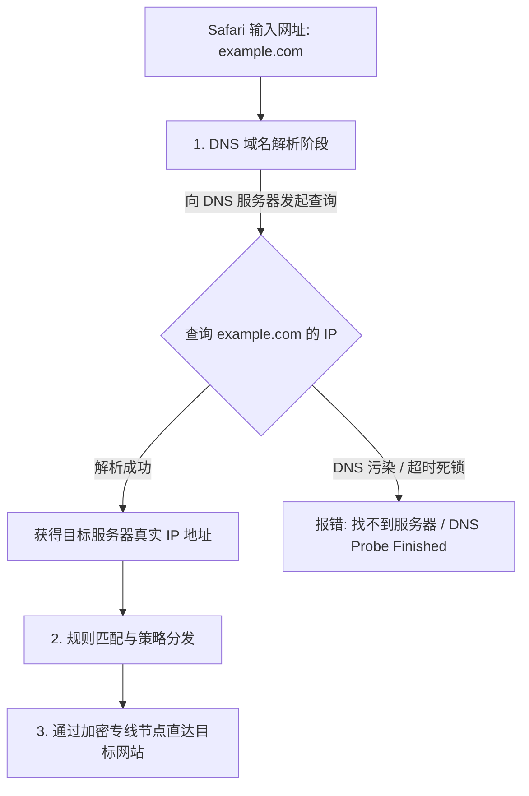
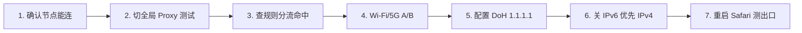

在 iPhone 上使用 Shadowrocket（小火箭）时，很多用户经常遇到一系列让人摸不着头脑的“灵异”故障：

**“小火箭节点测速全是绿色的几十毫秒，为什么 Safari 打开 Google 和维基百科却一直提示‘找不到服务器’？”**  
**“为什么在家里连 Wi-Fi 翻墙一切正常，一出门切到 5G 移动蜂窝网络就大面积解析失败？”**  
**“为什么网站的主页面能够打开，但网页里的图片、视频或登录验证码却一直转圈加载不出来？”**  
**“在小火箭设置里把 DNS 改成 `1.1.1.1` 或 `8.8.8.8`，真的能让梯子网速提升十倍吗？”**  
**“DoH（DNS over HTTPS）和 DoT 是什么？开启 IPv6 解析到底会不会导致节点连不上？”**

**在 Shadowrocket 中，DNS 负责将人类可读的网址域名（如 `google.com`）翻译成计算机底层可通信的 IP 地址。** 节点连接正常，仅仅代表从你的手机到境外代理服务器的“通道”通了；如果域名解析在起点就发生死锁、污染或超时，手机依然无法打开网页。

但必须澄清：**DNS 绝非解决所有翻墙故障的“万能灵丹”**。如果节点本身全部 Timeout，或者机场订阅 404 报错，盲改 DNS 毫无意义。

本文专注于 **Shadowrocket 的“DNS 域名解析机制、DoH 安全配置与 IPv6 优化”**，带你从 **三域名 DNS 诊断模型、Wi-Fi/5G 2×2 对照矩阵到 A/AAAA 记录排障** 建立体系化认知，彻底搞定小火箭域名解析死锁与特定网站打不开的问题。

---

## ⚡ 30 秒快速看懂：Shadowrocket DNS 核心认知与速查

```text
┌────────────────────────────────────────────────────────────────────────┐
│            Shadowrocket DNS 核心作用与故障 30 秒速查表                 │
├──────────────┬──────────────────────────────┬──────────────────────────┤
│ 概念/场景    │ 底层运作逻辑                 │ 核心排障动作与正确定位   │
├──────────────┼──────────────────────────────┼──────────────────────────┤
│ **DNS 的本质**│ 将域名转换为 IP 的“地址簿”   │ 仅影响首屏建立，不提升带宽│
├──────────────┼──────────────────────────────┼──────────────────────────┤
│ **节点通但网页断**│ 代理通道完好，但域名解析失败 │ 设为 DoH 加密 DNS 1.1.1.1│
├──────────────┼──────────────────────────────┼──────────────────────────┤
│ **5G 蜂窝断流** │ 移动 5G 分配 IPv6 引发解析冲突│ 小火箭设置优先使用 IPv4  │
├──────────────┼──────────────────────────────┼──────────────────────────┤
│ **全局通配置断**│ Rule 模式下域名未被分流命中  │ 检查规则而非盲改 DNS     │
└──────────────┴──────────────────────────────┴──────────────────────────┘
```

> 💡 **必须厘清的七大文章定位分工**：
> - **《Shadowrocket怎么用》**：负责**小火箭全功能与 iOS 基础入门总览**（主 Pillar）；
> - **《Shadowrocket订阅怎么导入》**：负责**订阅 404/403、节点为空**（配置层）；
> - **《Shadowrocket节点Timeout怎么办》**：负责**节点测试超时、全部标红**（连接层）；
> - **《Shadowrocket有节点但无法上网》**：负责**综合断网排查**（故障层）；
> - **《Shadowrocket速度慢怎么办》**：负责**4K 缓冲卡顿、晚高峰掉速**（性能优化）；
> - **《Shadowrocket规则怎么设置》**：负责**Rule/Global/Direct 分流策略**（规则层）；
> - **本篇《Shadowrocket DNS怎么设置》**：负责**域名解析、DoH/DoT、IPv6 与网站解析故障**（DNS 专项）。

---

## 一、核心原理：DNS 解析在科学上网链路中的真实角色

很多新手常常把 DNS、梯子节点和网络带宽混淆在一起。在完整的网络请求中，DNS 处于整个链路的最前沿：



### 为什么节点正常但依然打不开网站？
- **节点连接测试（Ping / Delay）**：测试的是“你的手机 ➔ 机场服务器”的物理连通性；
- **真实打开网页**：必须先成功完成“域名 ➔ IP”的 DNS 解析。如果本地网络或运营商 DNS 发生解析死锁，请求压根无法发送到节点，表现为网页无限转圈或提示无法访问。

---

## 二、独创方法论：Shadowrocket“三域名 DNS 对象模型”

排查小火箭的 DNS 问题，首先必须弄清楚**到底是哪一个环节的域名解析发生了故障**：

```text
┌────────────────────────────────────────────────────────────────────────┐
│               Shadowrocket 三大 DNS 解析对象深度对比表                 │
├────────────────────┬────────────────────┬──────────────────────────────┤
│ DNS 解析对象       │ 典型的故障报错表现 │ 正确的排障方向与归属专题     │
├────────────────────┼────────────────────┼──────────────────────────────┤
│ **1. 订阅服务器域名**│ 订阅拉取失败、提示 │ **属于订阅层故障**           │
│ (如 `sub.airport.com`)│ HTTP 404 / 403 / 超时 ➔ 转《Shadowrocket订阅怎么导入》│
├────────────────────┼────────────────────┼──────────────────────────────┤
│ **2. 节点服务器域名**│ 节点测速全部显示红色 │ **属于连接层故障**           │
│ (如 `hk01.node.com`) │ Timeout / 连接失败  ➔ 转《Shadowrocket节点Timeout》│
├────────────────────┼────────────────────┼──────────────────────────────┤
│ **3. 目标网站域名**  │ 节点测速全绿，但特定 │ **属于 DNS 专项与规则层**    │
│ (如 `google.com`)   │ 网站（Google）打不开 ➔ **属于本篇重点排查范围**      │
└────────────────────┴────────────────────┴──────────────────────────────┘
```

---

## 三、传统 DNS vs DoH (DNS over HTTPS) vs DoT (DNS over TLS) 深度对比

在小火箭中，你可以选择多种不同的 DNS 协议类型：

| DNS 协议类型 | 底层传输通道 | 是否加密 | 防污染与抗劫持能力 | 对首屏速度的影响 | 推荐配置语法示例 |
| :--- | :---: | :---: | :---: | :---: | :--- |
| **传统 UDP DNS** | UDP 端口 53 | ❌ 否 (明文) | 🔴 **极差**（易被运营商劫持或污染） | ⚡ 极快（约 5~15ms） | `223.5.5.5`, `119.29.29.29` |
| **DoH (加密)** | HTTPS 端口 443 | 🟢 **强加密** | 🟢 **极强**（混入标准 HTTPS 流量） | ⏱️ 略微增加握手耗时 | `https://1.1.1.1/dns-query` |
| **DoT (加密)** | TLS 端口 853 | 🟢 **强加密** | 🟡 **良好**（部分网络会封锁 853 端口）| ⏱️ 略微增加握手耗时 | `tls://dns.google` |

> 📌 **技术澄清：DoH 是网络加速器吗？**
> - **坚决不是！** DoH 的核心价值是**防止 DNS 查询记录被第三方窥探和篡改**，它无法增加你的节点物理带宽。如果有人声称“开启 DoH 提速十倍”，纯属伪科学谣言。

---

## 四、公共 DNS 权威核验与安全配置推荐

在小火箭底部 **「设置 ➔ DNS」** 中，推荐配置以下经过全球安全验证的官方公共 DoH 服务器：

```text
┌────────────────────────────────────────────────────────────────────────┐
│                   全球主流高可用安全 DoH 推荐清单                      │
├────────────────────┬───────────────────────────────────────────────────┤
│ **1. Cloudflare**  │ URL: `https://1.1.1.1/dns-query`                  │
│ *(全球速度领先)*   │ 特点：全球 Anycast 节点覆盖，承诺零日志，解析极快 │
├────────────────────┼───────────────────────────────────────────────────┤
│ **2. Google Public**│ URL: `https://8.8.8.8/dns-query`                  │
│ *(权威全球解析)*   │ 特点：与 Google 全球 CDN 深度联动，解析结果极其准确│
├────────────────────┼───────────────────────────────────────────────────┤
│ **3. Quad9**       │ URL: `https://9.9.9.9/dns-query`                  │
│ *(安全威胁拦截)*   │ 特点：瑞士非营利机构运营，自动拦截恶意钓鱼域名    │
├────────────────────┼───────────────────────────────────────────────────┤
│ **4. 阿里公共 DNS** │ URL: `https://223.5.5.5/dns-query`                │
│ *(国内直连优化)*   │ 特点：国内访问极速，适合作为直连分流的国内解析器  │
└────────────────────┴───────────────────────────────────────────────────┘
```

---

## 五、IPv4 (A 记录) vs IPv6 (AAAA 记录) 与 5G 移动蜂窝断流深度排查

很多 iPhone 用户在切到 5G 移动网络后频繁出现“打不开网页”，核心根因往往出在 **IPv6 解析冲突**：

```mermaid
graph TD
    DnsLookup[发起 DNS 解析: 访问境外网站] --> QueryBoth[同时请求 A 记录 (IPv4) 和 AAAA 记录 (IPv6)]
    
    QueryBoth --> ResultBoth{DNS 同时返回了 IPv4 和 IPv6 地址}
    
    ResultBoth -->|iPhone 5G 优先尝试 IPv6 通道| TryIPv6[尝试通过 IPv6 建立连接]
    TryIPv6 -->|境外节点或运营商 IPv6 路由不通| IPv6Fail[连接死锁 ➔ 页面白屏报错超时]
    
    ResultBoth -->|小火箭设置强制仅使用 IPv4| ForceIPv4[强制走稳定的 IPv4 专线隧道 ➔ 5G 秒开恢复]
```

### 5G 蜂窝网络下 IPv6 冲突标准修复方案：
1. 打开小火箭底部 **「设置 ➔ DNS」**；
2. 找到 **「IPv6」** 或 **「仅使用 IPv4 解析」** 选项；
3. **开启“仅使用 IPv4”**（屏蔽 AAAA 记录），避免手机在 5G 弱信号下盲目尝试不稳定的 IPv6 链路；
4. 短暂开启 **「飞行模式」** 5 秒后关闭，重置 iPhone 蜂窝网络连接栈。

---

## 六、Wi-Fi vs 5G 移动蜂窝网络 2×2 DNS 诊断矩阵

```text
┌────────────────────────────────────────────────────────────────────────┐
│                   本地 Wi-Fi 与 5G 网络 DNS 交叉排障矩阵               │
├────────────────────┬───────────────────────────────────────────────────┤
│ 现象 1：           │ 排除境外节点问题。重点排查：家用宽带 DNS 污染或   │
│ 5G 正常，Wi-Fi 打不开│ 路由器开启了安全防火墙拦截了特定域名              │
├────────────────────┼───────────────────────────────────────────────────┤
│ 现象 2：           │ 排除家庭宽带问题。重点排查：移动运营商 5G IPv6 冲 │
│ Wi-Fi 正常，5G 打不开│ 突，或 iPhone 蜂窝网络中未赋予小火箭网络访问权限   │
├────────────────────┼───────────────────────────────────────────────────┤
│ 现象 3：           │ 说明故障集中在分流规则错误、目标网站机房封锁或节点│
│ Wi-Fi 与 5G 均打不开│ 整体服务端维护，需按照 7 步法深入排查             │
└────────────────────┴───────────────────────────────────────────────────┘
```

---

## 七、真伪辨析：DNS 泄露（DNS Leak）到底是什么？

在网络安全测试中，很多新手被“DNS 泄露”吓到，必须客观认识其技术边界：

```text
┌────────────────────────────────────────────────────────────────────────┐
│                   DNS 泄露真相与安全边界大揭秘                         │
├────────────────────┬───────────────────────────────────────────────────┤
│ **DNS 泄露的定义** │ 在开启代理时，部分 DNS 解析请求没有经过加密代理   │
│                    │ 隧道，而是由本地宽带运营商的默认 DNS 服务器进行了解析│
├────────────────────┼───────────────────────────────────────────────────┤
│ **它会泄露什么？** │ 仅泄露你正在访问**哪个网站的域名**（如 `baidu.com`）│
├────────────────────┼───────────────────────────────────────────────────┤
│ **它不会泄露什么？**│ ❌ **绝对不会泄露你的账号密码、聊天记录或交易数据**│
│                    │ 所有的 HTTPS 通信内容全程经过端到端 TLS 强加密    │
├────────────────────┼───────────────────────────────────────────────────┤
│ **如何彻底防泄露** │ 在小火箭设置中启用 **DoH 加密解析**，并开启远程 DNS│
└────────────────────┴───────────────────────────────────────────────────┘
```

---

## 八、Shadowrocket DNS 故障 7 步标准修复流程

遇到网站打不开、提示找不到服务器，请严格按照以下**7 步递进排查链**操作：



### 步骤 1：确认小火箭节点本身可以正常连通
- 在节点列表中测试延迟，确认所选节点显示绿色延迟数值，排除节点本身物理超时。

### 步骤 2：切换为「全局 (Proxy)」模式进行基准测试
- 若切为全局模式后网页能够秒开，说明节点与基础 DNS 完好，故障锁定在分流规则；若全局依然打不开，进入 DNS 与网络排查。

### 步骤 3：查看连接日志排查规则分流
- 确认目标域名没有被错误规则标记为 `DIRECT` 直连撞墙，或被去广告规则 `REJECT` 误杀。

### 步骤 4：进行 Wi-Fi 与 5G 移动蜂窝网络 A/B 对照
- 切换网络测试，秒级定位是家庭宽带路由器 DNS 拦截还是移动蜂窝网络问题。

### 步骤 5：在设置中配置公共安全 DoH 服务器
- 进入小火箭「设置 ➔ DNS」，将 DNS 服务器手动指定为 `https://1.1.1.1/dns-query`。

### 步骤 6：在 5G 环境下开启“仅使用 IPv4 解析”
- 屏蔽不稳定的 AAAA 记录，彻底消除移动 5G 基站下的 IPv6 寻址冲突。

### 步骤 7：彻底退出 Safari 重新打开验证
- 上滑退出浏览器清除旧的 TCP 长连接与 DNS 缓存，访问 `ipinfo.io` 确认出口正常。

---

## 九、Shadowrocket 高可用专线品牌推荐矩阵

针对原生 DNS 智能解析、ChatGPT/Claude 纯净解锁与抗网络断流，精选以下真实稳定服务商：

```text
┌────────────────────────────────────────────────────────────────────────────────────────┐
│                        2026 Shadowrocket 高可用专线品牌候选矩阵                        │
├──────────┬──────────────────────────┬──────────────┬──────────────┬────────────────────┤
│ 适配场景 │ 推荐品牌候选             │ 实际起付门槛 │ 每月流量配额 │ DNS 解析与专线优势 │
├──────────┼──────────────────────────┼──────────────┼──────────────┼────────────────────┤
│ 旗舰全能 │ 光速云 (GuangSuYun)      │ 约 ¥7.5/月起 │ 59G~238G /月 │ 6年老牌物理专线，自带海外原生 Clean DNS，零污染│
│ 平价轻量 │ 微风网络 (BreezeNet)     │ 约 ¥7/月起   │ 50GB / 月    │ 移动端日常查资料首选，小火箭极速同步，低延迟秒开│
│ 弹性月付 │ 唯兔云 (V2Yun)           │ ¥14.9/月     │ 100GB / 月   │ 15元纯单月付，多国原生独立出口，随用随买 │
│ 应急备用 │ 星岛梦 (XingDaoMeng)     │ 约 ¥8/月起   │ 60G/不限时包 │ 0月租不限时包，主力断流瞬间切换，防失联必备 │
│ AI/开发  │ 速界 (SpeedWorld)        │ ¥25/月       │ 150GB / 月   │ 原生住宅 IP 节点，ChatGPT/Claude 专属独立通道 │
└──────────┴──────────────────────────┴──────────────┴──────────────┴────────────────────┘
```

- 🏆 **全能旗舰首选**：[光速云](/reviews/guangsu-cloud/) —— 全线企业级 IEPL 物理专线，服务端自带原生海外递归 DNS，彻底告别解析污染；
- 🍃 **超低预算轻量**：[微风网络](/reviews/weifeng-cloud/) —— 针对手机端日常查资料优化的 50GB 小流量专线，年付折算仅约 ¥7/月；
- 💳 **拒绝绑定的单月付**：[唯兔云](/recommend/best-airports/) —— ¥14.9 纯单月付，100GB 充沛流量，节点丰富。

---

## 十、Shadowrocket DNS 与域名排障 18 项自查通关清单

```text
┌────────────────────────────────────────────────────────────────────────┐
│                   Shadowrocket DNS 排障 18 项自查通关清单              │
├────────────────────────────────────────────────────────────────────────┤
│ □ 1. 我清楚了解 DNS 负责将域名翻译成 IP，不直接决定下载带宽上限        │
│ □ 2. 遇到打不开网页时，我确认当前节点在列表中显示绿色正常延迟          │
│ □ 3. 我知道如何区分：订阅域名故障、节点域名故障与目标网站域名故障      │
│ □ 4. 我尝试过将全局路由切换为「全局 (Proxy)」模式进行对比测试         │
│ □ 5. 我已在小火箭设置中将 DNS 手动配置为公共 DoH 地址 (如 1.1.1.1)    │
│ □ 6. 在 5G 移动蜂窝网络下遇到断流时，我已尝试开启“仅使用 IPv4 解析”    │
│ □ 7. 手机切到 5G 蜂窝网络测试过，排除了家庭 Wi-Fi 路由器的 DNS 拦截    │
│ □ 8. 在 iPhone「设置-蜂窝网络」中确认 Shadowrocket 拥有网络访问权限   │
│ □ 9. 我清楚了解 DNS 泄露不会导致账号密码或聊天内容泄露               │
│ □ 10. 切换 DNS 或节点后，我已彻底上滑退出 Safari 重新打开清除缓存     │
│ □ 11. 我没有在手机 Host 映射中为动态 CDN 网站（如 YouTube）写死 IP    │
│ □ 12. 我确认没有为了“修 DNS”而在手机上安装来源不明的 CA 根证书        │
│ □ 13. 我确认没有盲目开启高风险的 MITM 中间人解密功能                  │
│ □ 14. 手机未同时开启其他互相冲突的商业 VPN 或网络加速扩展             │
│ □ 15. 如果只有 ChatGPT 打不开，我知道是机房 IP 风控而非 DNS 故障       │
│ □ 16. 我清楚了解修改 DNS 无法修复节点 Timeout 超时与订阅 404 报错     │
│ □ 17. 手机中已常备第二个备用服务商的专线订阅或 0 月租不限时流量包      │
│ □ 18. 如果使用了免费公开节点，我知道其极易解析失效，需自备稳定专线    │
└────────────────────────────────────────────────────────────────────────┘
```

---

## 十一、避坑指南：30 个关于“小火箭 DNS 设置”的致命认知误区

```text
❌ 误区 1：DNS 就是梯子节点本身 ➔ 事实：DNS 是将域名转换为 IP 的工具，节点是传输加密数据的服务器。
❌ 误区 2：修改小火箭 DNS 可以让节点的下载网速提升十倍 ➔ 事实：DNS 仅影响首包解析时间，对持续下载带宽毫无影响。
❌ 误区 3：DNS 测速显示的延迟越低，看 4K 视频就越流畅 ➔ 事实：DNS 测速快只代表响应快，视频流畅看节点带宽和丢包率。
❌ 误区 4：Cloudflare 的 1.1.1.1 是适合全球所有人的唯一完美 DNS ➔ 事实：不同运营商与网络环境下，公共 DNS 表现各异。
❌ 误区 5：Google 的 8.8.8.8 在国内任何网络下都能极速直连 ➔ 事实：部分国内宽带直连 8.8.8.8 会受到干扰丢包，需用 DoH。
❌ 误区 6：DoH 加密解析等于手机实现了 100% 绝对匿名 ➔ 事实：DoH 仅加密 DNS 查询过程，访问的落地 IP 依然对节点可见。
❌ 误区 7：DNS Leak（DNS泄露）代表我的银行密码被黑客盗取了 ➔ 事实：仅代表运营商能看到你查询了什么域名，内容全程强加密。
❌ 误区 8：节点显示 Timeout 红色可以通过修改 DNS 彻底修复 ➔ 事实：超时是服务器物理断连，改 DNS 毫无作用。
❌ 误区 9：订阅更新提示 404 错误是由于 DNS 污染导致的 ➔ 事实：404 是服务商链接失效或输错，与 DNS 完全无关。
❌ 误区 10：Global 能用而 Rule 不能用，100% 是 DNS 的锅 ➔ 事实：也可能是规则集把域名误设为了 Direct 直连撞墙。
❌ 误区 11：IPv6 是导致小火箭所有断网故障的罪魁祸首 ➔ 事实：IPv6 是现代网络标准，仅在移动基站路由异常时需临时避让。
❌ 误区 12：遇到小火箭任何问题，第一步必须立刻关闭手机 IPv6 ➔ 事实：先做 Wi-Fi/5G A/B 测试，有明确冲突证据时再调整。
❌ 误区 13：DNS 里的 AAAA 记录是用来给网络“四倍加速”的 ➔ 事实：AAAA 记录是标准的 IPv6 地址查询记录名称。
❌ 误区 14：修改小火箭 DNS 可以让香港节点的出口 IP 变成美国 IP ➔ 事实：出口 IP 由落地服务器决定，DNS 无法改变地理位置。
❌ 误区 15：换一个纯净的境外 DNS 就能让所有节点自动解锁 Netflix ➔ 事实：Netflix 检测机房 IP 属性，与本地 DNS 无关。
❌ 误区 16：修改 DNS 能让被 OpenAI 封锁的机房节点重新支持 ChatGPT ➔ 事实：OpenAI 封锁的是出口 IP 段，改 DNS 毫无效果。
❌ 误区 17：公共 DNS 一定在所有指标上都优于宽带运营商默认 DNS ➔ 事实：运营商默认 DNS 在解析国内本地 CDN 时往往更近更快。
❌ 误区 18：只要节点连得上，分流规则就和 DNS 没有任何关系 ➔ 事实：基于 IP 的分流规则极度依赖 DNS 解析出的真实 IP。
❌ 误区 19：打开一个第三方 DNS Leak 检测网站就能代表手机所有 App ➔ 事实：检测网站仅测试浏览器当前环境，不能代表全局。
❌ 误区 20：在小火箭 Host 中给网站写死固定 IP 比动态解析更稳定 ➔ 事实：现代大型网站频繁更换 CDN IP，写死容易直接死锁。
❌ 误区 21：只要网页打不开，就统统归咎于 GFW 的“DNS污染” ➔ 事实：也有可能是本地断网、规则误判或目标平台停机维护。
❌ 误区 22：遇到 DNS 故障第一步必须重置 iPhone 全部网络设置 ➔ 事实：重置会抹掉所有 Wi-Fi 密码，配置 DoH 即可解决。
❌ 误区 23：在 iPhone 上安装第三方 CA 证书能解决 DNS 解析错误 ➔ 事实：正常 DNS 调试坚决不装证书，乱装证书极度危险。
❌ 误区 24：MITM（中间人解密）是小火箭的高级 DNS 加速功能 ➔ 事实：MITM 是抓包分析工具，与 DNS 完全不是一回事。
❌ 误区 25：修改了小火箭 DNS 后不需要退出浏览器就会瞬间生效 ➔ 事实：浏览器有 DNS 与 TCP 缓存，必须彻底上滑重开。
❌ 误区 26：同时在小火箭里填入十几个 DNS 地址能叠加网速 ➔ 事实：多填只会按顺序轮询或并发竞争，无法叠加物理带宽。
❌ 误区 27：家庭路由器上的 DNS 设置会自动覆盖小火箭内部 DNS ➔ 事实：小火箭接管虚拟网卡后，内部 DNS 拥有最高优先级。
❌ 误区 28：去广告规则拦截了图片加载，改 DNS 就能修好 ➔ 事实：是 REJECT 规则误杀了图片域名，需修改分流规则。
❌ 误区 29：免费公开的 Smart DNS 可以代替付费专线节点 ➔ 事实：Smart DNS 不提供流量加密与中转通道，极易失效。
❌ 误区 30：遇到 DNS 报错必须立刻卸载重装 Shadowrocket ➔ 事实：在设置中一键恢复默认 DNS 或填入 1.1.1.1 即可恢复。
```

---

## 十二、常见问题深度解答（FAQ · 40 问）

### Q1：Shadowrocket DNS 是什么意思？
**答**：指小火箭在接管 iPhone 网络流量后，用于将用户访问的域名（如 `google.com`）翻译为 IP 地址的解析服务与配置。

### Q2：小火箭 DNS 怎么设置？
**答**：打开小火箭底部「设置 ➔ DNS」，点击右上角添加或修改主 DNS 服务器，推荐填入官方安全 DoH 地址：`https://1.1.1.1/dns-query`。

### Q3：Shadowrocket 需要手动修改 DNS 吗？
**答**：默认情况下使用系统推荐 DNS 即可；若遇到特定网站打不开、5G 移动网络断流或宽带 DNS 污染时，建议手动配置 DoH。

### Q4：为什么小火箭节点测速正常但打开网页却提示找不到服务器？
**答**：说明从手机到节点的加密代理隧道是通的，但**域名解析阶段发生了死锁或污染**，导致手机无法获取目标网站的真实 IP。

### Q5：为什么直接输入网站 IP 能打开，输入域名却打不开？
**答**：**这是 100% 的 DNS 解析故障。** 说明网络传输通道完全正常，仅为本地 DNS 无法将该域名翻译成对应的 IP 地址。

### Q6：Shadowrocket 出现 DNS Timeout（解析超时）怎么办？
**答**：在小火箭设置中将 DNS 手动切换为公共安全 DoH 地址（如 `https://1.1.1.1/dns-query` 或 `8.8.8.8`），并彻底重启 Safari 浏览器。

### Q7：Global 模式能用而 Rule 模式打不开网页，和 DNS 有关吗？
**答**：有关。在 Rule 模式下，小火箭需要结合 DNS 解析出的 IP 进行规则匹配，若 DNS 返回了污染 IP 可能导致分流误判为 Direct 直连撞墙。

### Q8：修改 DNS 能提高节点的下载速度吗？
**答**：**不能。** DNS 仅负责把域名翻译成 IP，影响的是网页首屏点击反应时间，对长视频播放和文件下载带宽毫无提速作用。

### Q9：DNS 会影响 YouTube 视频播放速度吗？
**答**：通常不会直接影响播放带宽；但优质 DNS 能帮你解析到地理距离更近的 Google CDN 节点，略微改善首帧加载时间。

### Q10：修改 DNS 能解决 ChatGPT 打不开报错的问题吗？
**答**：若 Google 正常而 ChatGPT 报错，属于**节点出口 IP 被 OpenAI 官方风控拦截**，修改 DNS 无法解决，需切换原生专线节点。

### Q11：修改 DNS 能解锁 Netflix 奈飞非自制剧吗？
**答**：**不能。** Netflix 严格检测落地机房的 IP 属性与版权库归属，修改本地 DNS 无法改变节点的出海出口属性。

### Q12：DoH（DNS over HTTPS）是什么？
**答**：是一种通过标准 HTTPS 加密通道传输 DNS 查询请求的技术，能彻底防止查询记录被运营商窥探、篡改或植入弹窗广告。

### Q13：DoT（DNS over TLS）和 DoH 有什么区别？
**答**：DoT 走专用的 853 端口进行 TLS 加密；DoH 走标准的 443 端口伪装成普通网页流量，在复杂网络环境下的抗封锁能力更强。

### Q14：公共安全 DNS 和宽带运营商默认 DNS 哪个好？
**答**：科学上网访问境外网站时，**公共安全 DoH 远优于运营商默认 DNS**；访问国内日常服务时，运营商 DNS 解析本地 CDN 略微更快。

### Q15：Cloudflare 的 1.1.1.1 适合小火箭吗？
**答**：非常适合。Cloudflare 拥有全球 Anycast 网络，DoH 响应极快且承诺不记录用户个人查询隐私。

### Q16：DNS Leak（DNS 泄露）是什么意思？
**答**：指在使用代理时，部分域名的查询请求没有走境外加密隧道，而是直接向本地宽带运营商发起了明文查询。

### Q17：DNS 泄露会导致我的银行卡密码被盗吗？
**答**：**绝对不会。** DNS 查询仅包含访问的网址域名，所有账户密码与交易数据均受 HTTPS 端到端强加密保护。

### Q18：IPv4 和 IPv6 有什么本质区别？
**答**：IPv4 是传统的 32 位地址（如 `192.168.1.1`）；IPv6 是新一代 128 位超大容量地址，国内 5G 蜂窝网络已全面普及部署。

### Q19：DNS 中的 A 记录和 AAAA 记录是什么？
**答**：`A 记录` 用于查询域名对应的 IPv4 地址；`AAAA 记录` 用于查询域名对应的 IPv6 地址。

### Q20：为什么连家里 Wi-Fi 正常，切到 5G 移动蜂窝网络就打不开网页？
**答**：国内移动/电信 5G 默认启用 IPv6，若境外节点对 IPv6 路由兼容不佳会引发寻址死锁。在小火箭设置中开启“仅使用 IPv4 解析”即可。

### Q21：遇到小火箭网络异常，需要彻底关闭 IPv6 吗？
**答**：不建议盲目关闭；仅当在 5G 蜂窝网络下确认存在解析冲突，或日志中频繁提示 IPv6 超时报错时再开启“仅使用 IPv4”。

### Q22：为什么 5G 正常，连家里 Wi-Fi 却打不开境外网页？
**答**：说明家庭宽带运营商在本地对该域名的 DNS 进行了拦截污染，或家用路由器开启了安全防火墙，在小火箭中配置 DoH 即可解决。

### Q23：修改小火箭 DNS 后为什么没有立即生效？
**答**：因为 Safari 浏览器和 iOS 系统会缓存之前的解析结果。**修改后必须彻底上滑退出 Safari 并重启**方可生效。

### Q24：DNS 缓存（Cache）和 TTL 是什么意思？
**答**：缓存是本地保存的解析记录，TTL 是该记录的有效存活时间（如 300 秒），在 TTL 过期前系统不会重复向服务器发起查询。

### Q25：为什么只有一个特定网站打不开，其他网站全部秒开？
**答**：说明基础代理链路完全正常，问题仅出在该特定域名的 DNS 解析死锁、被分流规则误设为 Direct、或该网站自身服务器宕机。

### Q26：为什么网页文字能加载出来，但图片和验证码一直转圈？
**答**：因为现代网站的图片和验证码部署在独立的二级域名 CDN 上，该 CDN 域名可能被 DNS 错误解析或被去广告规则误杀。

### Q27：Safari 能正常翻墙，为什么某个特定 App 无法联网？
**答**：该 App 可能使用了独立的私有 API 域名，未被内置规则收录并被默认直连撞墙，在小火箭连接日志中找到该域名设为 PROXY 即可。

### Q28：订阅服务器域名解析失败会有什么表现？
**答**：表现为在首页向下拉动刷新订阅时提示 **HTTP 404 / 403 / 连接超时**，且节点列表无法更新。

### Q29：节点服务器域名解析失败会有什么表现？
**答**：表现为该节点在列表中测试连通性时显示红色的 **Timeout（连接超时）**，无法建立加密代理隧道。

### Q30：目标网站域名解析失败会有什么表现？
**答**：节点测试全绿且订阅更新正常，但用 Safari 打开特定网页时提示 **“无法打开页面，因为找不到服务器”**。

### Q31：DNS Timeout 和节点 Timeout 有什么区别？
**答**：**DNS Timeout** 是向域名解析服务器查询超时；**节点 Timeout** 是与代理机房服务器建立 TCP/TLS 握手连接超时。

### Q32：小火箭中的 Host 映射功能是干什么的？
**答**：允许用户手动指定某个域名必须解析为某个固定 IP（类似电脑的 hosts 文件），属于高级调试功能。

### Q33：可以给 Google 或 YouTube 写死固定 IP 吗？
**答**：**强烈不建议。** 大型跨国网站拥有上万个动态负载均衡 IP，写死单个 IP 极易在机房维护时导致全网死锁。

### Q34：小火箭修改 DNS 需要在手机上安装证书吗？
**答**：**坚决不需要！** 正常配置 DNS 完全无需安装任何描述文件或证书，要求安装证书的均存在严重隐私安全隐患。

### Q35：MITM 中间人解密是 DNS 的一种功能吗？
**答**：**完全不是。** MITM 是用于解密 HTTPS 流量的抓包调试功能，与将域名翻译为 IP 的 DNS 机制毫无关系。

### Q36：手机开启飞行模式再关闭对刷新 DNS 有用吗？
**答**：有用。短暂开启飞行模式 5 秒后关闭，可以强制 iOS 清空本地暂存的蜂窝网络 DNS 缓存并重新注册基站。

### Q37：局域网投屏搜不到电视是 DNS 导致的吗？
**答**：通常不是 DNS 导致，而是缺少了局域网直连规则，在小火箭配置中添加 `IP-CIDR,192.168.0.0/16,DIRECT` 即可。

### Q38：什么时候才真正需要考虑更换 DNS？
**答**：当节点连接正常、分流规则无误，但特定域名反复提示解析超时，或 5G 移动网络频繁断流时。

### Q39：什么时候换 DNS 完全没有任何作用？
**答**：当节点本身全部 Timeout 标红、机场订阅过期欠费、或看 YouTube 视频由于物理带宽不足卡顿转圈时。

### Q40：如何打造一套最稳定无故障的小火箭 DNS 方案？
**答**：在设置中配置 **Cloudflare 官方安全 DoH (`https://1.1.1.1/dns-query`)**，在 5G 弱网下开启 **优先 IPv4 解析**，并搭配企业级 IEPL 专线节点。

---

## 🏁 总结：Shadowrocket DNS 调优终极心法

彻底掌握小火箭 DNS 设置与排障，请牢记以下**四维解析核心法则**：

```text
1. 准确定位 ➔ 分清订阅域名、节点域名与目标网站域名，找准故障对象
2. 首选加密 ➔ 主力配置官方 DoH (1.1.1.1)，从根源上彻底规避明文 DNS 污染
3. 避让冲突 ➔ 5G 蜂窝网络频繁断流开启优先 IPv4，消除 AAAA 记录死锁
4. 拒绝万能 ➔ 节点全红查服务器，4K 卡顿查带宽，切忌遇事盲改 DNS
```

---

### 📚 延伸进阶阅读与选型专栏
- 📱 **小火箭超级Pillar**：[《Shadowrocket怎么用？小火箭订阅、节点、规则与iPhone完整配置教程》](/tutorials/shadowrocket-tizi/)
- 📋 **规则与策略教程**：[《Shadowrocket规则怎么设置？Rule、Global、Direct、代理策略与分流完整教程》](/tutorials/shadowrocket-rules/)
- 🚨 **断网排查手册**：[《Shadowrocket有节点但无法上网怎么办？小火箭规则、DNS、Wi-Fi与5G完整排查》](/issues/shadowrocket-connected-no-internet/)
- 🔴 **节点超时专题**：[《Shadowrocket 节点 Timeout 怎么办？全部节点红色与网络异常排查》](/issues/shadowrocket-node-timeout/)
- ⚡ **速度与晚高峰**：[《Shadowrocket速度慢怎么办？节点、线路、Wi-Fi、5G与晚高峰完整排查》](/issues/shadowrocket-slow-speed/)
- 📋 **订阅导入教程**：[《Shadowrocket订阅怎么导入？小火箭订阅链接、节点更新与订阅失败完整教程》](/tutorials/shadowrocket-subscription-import/)
- 📱 **iPhone 设备总指南**：[《iPhone梯子怎么用？Shadowrocket、小火箭、订阅与节点新手完整教程》](/tutorials/iphone-tizi/)
- ⚡ **老牌旗舰专线**：[《光速云深度评测：2020老牌IEPL专线与解锁实测》](/reviews/guangsu-cloud/)
- 🍃 **平价轻量专线**：[《微风网络深度评测：小流量套餐值不值得买？》](/reviews/weifeng-cloud/)
- 🏆 **2026 全景大榜**：[《2026梯子推荐：稳定、速度、价格、安全与不同使用场景怎么选》](/recommend/best-tizi/)
