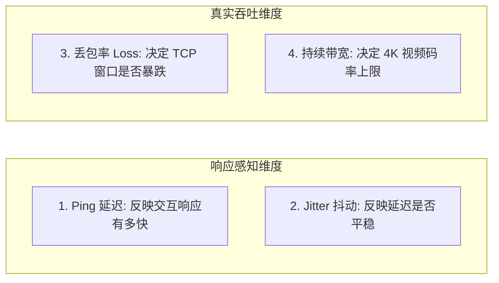
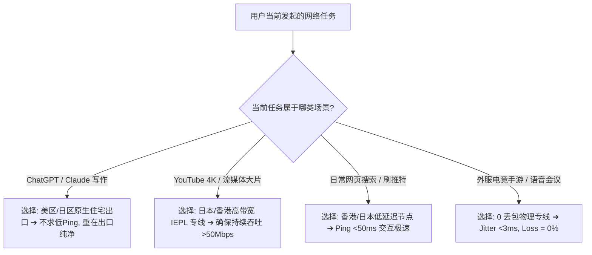

在 iPhone 上打开 Shadowrocket（小火箭）订阅后，很多用户面对列表中几十个甚至上百个节点时，最常见的第一反应就是：**“直接点击右上角的测速按钮，然后挑一个 Ping 延迟最低、数字最小的绿色节点点连接。”**

然而，随之而来的却是一连串让人费解的现象：

**“为什么选了 Ping 只有 20ms 的香港节点，看 YouTube 4K 视频却卡成了幻灯片；而切到 85ms 的日本节点反而秒开拖动不缓冲？”**  
**“为什么在小火箭里选了美国节点，Google 网页秒开，但打开 ChatGPT 却频繁提示‘Access Denied’或‘地区不可用’？”**  
**“为什么白天测速飞快的节点，一到晚上 20:00~23:00 晚高峰就频频断流、网页一直转圈？”**  
**“为什么同一个节点在家里 Wi-Fi 飞快，出门换成 5G 移动蜂窝网络就变得极慢？”**  
**“香港、日本、新加坡、美国节点到底各自适合什么场景？节点名称里的‘2x / 3x 倍率’是不是代表速度翻倍？”**

**在 Shadowrocket 中，绝对不存在一个对所有用户、所有网络环境、所有应用场景都‘最好’的固定神级节点。**

Ping 测速仅仅反映了数据包往返的极简交互响应时间，根本无法代表节点的**持续吞吐带宽、丢包率（Packet Loss）、晚高峰抗拥塞能力和落地出口 IP 质量**。

本文专注于 **Shadowrocket 的“节点选型与决策模型”**，带你从 **香港/日本/新加坡/美国四大主流地区特征、延迟/Jitter/丢包/带宽四维网络指标、IEPL/中转/直连线路辨析，到 ChatGPT/Claude 与 Netflix/YouTube 场景化选型** 建立立体认知，手把手教你搭建一套“主力 + 备用 + 专项”的高可用 iOS 节点架构。

---

## ⚡ 30 秒快速选节点决策流：按真实业务场景精准匹配

```text
┌────────────────────────────────────────────────────────────────────────┐
│            Shadowrocket 节点按场景极速选型 30 秒决策表                 │
├──────────────┬──────────────────────────────┬──────────────────────────┤
│ 核心使用场景 │ 推荐首选地区与优先指标       │ 核心选型逻辑与注意事项   │
├──────────────┼──────────────────────────────┼──────────────────────────┤
│ **日常网页/社交**│ 🟢 **香港 / 日本 / 新加坡**  │ 物理距离近、交互响应快； │
│ (Google/推特)│ 重点看：**低 Ping (<80ms)**  │ 优先选择丢包率 <1% 的节点 │
├──────────────┼──────────────────────────────┼──────────────────────────┤
│ **AI 生产力**│ 🟢 **美国 / 日本 / 新加坡**  │ 必须避开未开放地区；     │
│ (ChatGPT/Claude) 重点看：**原生出口 IP 纯净度**│ 文字交互不求极低 Ping，稳最重要│
├──────────────┼──────────────────────────────┼──────────────────────────┤
│ **4K 超高清视频**│ 🟢 **日本 / 香港 / 新加坡**  │ 极速缓冲看**持续吞吐带宽**│
│ (YouTube 4K) │ 重点看：**晚高峰 0 丢包**    │ 忽视 Ping，重点看下载速度 │
├──────────────┼──────────────────────────────┼──────────────────────────┤
│ **流媒体锁区剧**│ 🟢 **新加坡 / 日本 / 美国**  │ 必须能完整识别对应版权库；│
│ (Netflix/Disney+)重点看：**机房解锁状态**   │ 网站能打开≠视频能正常播放 │
├──────────────┼──────────────────────────────┼──────────────────────────┤
│ **外服电竞联机**│ 🟢 **靠近游戏服务器所在地区**│ 严防延迟波动；           │
│ (日服/亚服)  │ 重点看：**极低 Jitter + 0 丢包** 200Mbps 带宽不如 0 丢包专线│
└──────────────┴──────────────────────────────┴──────────────────────────┘
```

> 💡 **必须厘清的七大文章定位分工**：
> - **《Shadowrocket怎么用》**：负责**小火箭客户端生态全功能与 App Store 入门总览**（主 Pillar）；
> - **《Shadowrocket订阅怎么导入》**：负责**订阅 404/403、解析失败、节点为空**（配置层）；
> - **《Shadowrocket节点Timeout怎么办》**：负责**节点测试超时、全部标红、端口连不上**（连接层）；
> - **《Shadowrocket有节点但无法上网》**：负责**节点已连通但打不开网页、DNS死锁**（故障排查）；
> - **《Shadowrocket速度慢怎么办》**：负责**已有节点但网速卡顿、晚高峰掉速**（性能排障）；
> - **《Shadowrocket规则怎么设置》**：负责**Rule/Global/Direct 模式与分流策略**（规则层）；
> - **本篇《Shadowrocket节点怎么选》**：负责**节点地区、线路架构、IP 质量与场景化决策**（决策选型）。

---

## 一、底层认知：Shadowrocket“节点”到底包含哪些要素？

在小火箭中，一个所谓的“节点”绝不是一个单薄的 IP 地址，而是一整套**网络路由与服务器配置的集合体**：

```mermaid
graph TD
    UserPhone[iPhone 发起请求] --> Inbound[1. 国内入口服务器 (BGP/专线机房)]
    Inbound --> Transit[2. 跨境通信通道 (IEPL物理专线 / IPLC / 公网中转)]
    Transit --> Outbound[3. 境外落地服务器 (香港/日本/美国数据中心)]
    Outbound --> EgressIP[4. 最终出口 IP (原生住宅/商业机房/广播IP)]
    EgressIP --> TargetServer[5. 目标平台 (OpenAI / YouTube / Netflix)]
```

### 为什么节点名称不能完全相信？
- **名称只是标签**：服务商在后台填写的“香港 01 | 原生 IP | 4K秒开”只是可自定义的备注字符串；
- **入口与出口分离**：很多节点虽然叫“美国 01”，其入口可能在深圳，通过内网专线送达美国，真实出口 IP 是否纯净需通过工具验证；
- **同地区多节点差异**：同一个订阅里的“日本 01”和“日本 02”，可能运行在不同机房或不同上游线路上，性能可能大相径庭。

---

## 二、四大主流节点地区横向全景对比与适用场景

```text
┌────────────────────────────────────────────────────────────────────────┐
│               Shadowrocket 四大主流节点地区深度全景对比                │
├──────────────┬──────────────┬──────────────┬──────────────┬────────────┤
│ 节点地区     │ 典型延迟区间 │ 核心突出优势 │ 主要潜在局限 │ 最推荐场景 │
├──────────────┼──────────────┼──────────────┼──────────────┼────────────┤
│ **香港 (HK)** │ ⚡ 15~45ms   │ 物理距离最近，│ 晚高峰易拥挤，│ 日常主力、 │
│              │ (专线极低)   │ 网页秒开感极强│ 部分 AI 不支持│ 移动端轻量 │
├──────────────┼──────────────┼──────────────┼──────────────┼────────────┤
│ **日本 (JP)** │ ⏱️ 40~85ms   │ 国际带宽充沛，│ 移动部分线路直│ YouTube 4K、│
│              │ (亚服枢纽)   │ 路由稳定且抗抖│ 连延迟略高于港│ 开发者工具 │
├──────────────┼──────────────┼──────────────┼──────────────┼────────────┤
│ **新加坡(SG)**│ ⏱️ 50~95ms   │ 东南亚枢纽，  │ 距离华北稍远，│ 备用主力、 │
│              │ (中转首选)   │ AI/流媒体支持好│ 线路质量跨度大│ 流媒体解锁 │
├──────────────┼──────────────┼──────────────┼──────────────┼────────────┤
│ **美国 (US)** │ 🌐 130~220ms │ 全球服务大本营│ 物理延迟高，  │ ChatGPT、  │
│              │ (跨洋光缆)   │ AI 兼容性最顶级│ 不适合外服电竞│ 美区独占剧 │
└──────────────┴──────────────┴──────────────┴──────────────┴────────────┘
```

### 1. 香港节点（Hong Kong）
- **核心优势**：地理位置最近，光纤物理延迟极低（广东专线可低至 15ms），网页点击交互感几乎与国内本地无异；
- **核心短板**：用户扎堆最严重，低质中转机场极易晚高峰拥堵；且部分 AI 平台（如未开放区域）对香港 IP 存在限制；
- **适用结论**：**日常网页浏览、刷推特/Instagram、微信/查资料的第一主力候选**。

### 2. 日本节点（Japan）
- **核心优势**：国际出口带宽极其充沛，东京/大阪机房到欧美骨干网互联极佳，看高清视频吞吐性能极强；
- **核心短板**：对中国北方与华东网络友好，华南部分直连路由可能略有绕行；
- **适用结论**：**YouTube 4K 播放、GitHub 代码拉取、Google 全家桶与日常备用首选**。

### 3. 新加坡节点（Singapore）
- **核心优势**：跨国企业亚太总部集中地，IP 纯净度普遍较高，对各类流媒体与 AI 服务兼容度极佳；
- **核心短板**：地理距离稍远于香港，普通直连线路延迟偏高（约 70~100ms）；
- **适用结论**：**香港与日本拥堵时的最佳亚服备用通道、东南亚独占流媒体解锁首选**。

### 4. 美国节点（United States）
- **核心优势**：全球互联网中心，所有新兴 AI 产品（ChatGPT/Claude/Sora）与美区流媒体的第一发源地，IP 兼容性最强；
- **核心短板**：受横跨太平洋海底光缆物理距离限制，基础 Ping 延迟普遍在 140~200ms；
- **适用结论**：**ChatGPT/Claude 生产力写作、美区独占资源访问、大模型 API 调用的专属节点**。

---

## 三、网络指标四维拆解：为什么 Ping 最低不等于网速最快？

很多新手迷信小火箭主界面的延迟测速，必须深刻理解网络性能的四大独立指标：



### 核心指标深度辨析表：
| 网络性能指标 | 测试的底层物理含义 | 影响的核心业务场景 | 优秀标准参考值 |
| :--- | :--- | :--- | :---: |
| **Ping 延迟 (Latency)** | 单个数据包往返所需的时间（毫秒） | 网页点击打开速度、游戏按键响应 | 香港 <40ms / 日本 <80ms |
| **Jitter 抖动** | 连续数据包之间延迟变化的离散程度 | 语音通话断续、视频会议卡顿 | `< 5ms` (越平稳越好) |
| **丢包率 (Packet Loss)** | 数据包在跨境传输中丢失的百分比 | 导致 TCP 剧烈重传、4K 视频转圈死锁 | **`0.0%` (严禁 >1%)** |
| **持续吞吐 (Download)** | 连续不间断下载大文件时的实际速率 | YouTube 4K/8K 缓冲、游戏大包下载 | `> 50 Mbps` |

> 🔍 **经典反常识剖析：20ms 香港为什么会输给 85ms 日本？**
> - **20ms 劣质中转**：虽然 Ping 只有 20ms，但晚高峰丢包率高达 8%。由于 TCP 拥塞控制机制，一旦丢包，传输速率直接暴跌 50% 并不断重传，导致 4K 视频疯狂缓冲；
> - **85ms 优质 IEPL 专线**：虽然物理延迟有 85ms，但内网专线丢包率为 **0.0%**，TCP 窗口持续全速释放，几秒钟就能预加载数分钟的 4K 缓冲。

---

## 四、线路架构深度辨析：直连 vs 中转 vs IEPL 物理专线

选择节点时，决定长期稳定性的不是协议名称（Shadowsocks/Trojan/VLESS），而是底层的**线路承载架构**：

```text
┌────────────────────────────────────────────────────────────────────────┐
│                  科学上网三大主流线路架构深度对比表                    │
├──────────────┬──────────────────────────────┬──────────────────────────┤
│ 线路架构类型 │ 物理传输路径机制             │ 晚高峰稳定性与选型建议   │
├──────────────┼──────────────────────────────┼──────────────────────────┤
│ **1. 普通直连**│ 手机 ➔ 公网国际出口 ➔ 境外机房│ 🔴 **晚高峰波动大**：易受国际│
│ *(入门便宜)* │ 途经公共海底光缆，无任何优化 │ 出口拥塞影响，适合极低预算│
├──────────────┼──────────────────────────────┼──────────────────────────┤
│ **2. BGP 中转**│ 手机 ➔ 国内高防中转机房 ➔ 境外│ 🟡 **性价比突出**：国内多线 BGP│
│ *(主流均衡)* │ 优化出口公网隧道送达落地服务器│ 接入，稳定性优于直连     │
├──────────────┼──────────────────────────────┼──────────────────────────┤
│ **3. IEPL 专线**│ 手机 ➔ 国内入口 ➔ 企业内网物理│ 🟢 **顶级稳定性首选**：完全不走│
│ *(旗舰高端)* │ 光纤专线 ➔ 境外机房 (不过公网GFW)│ 公网，晚高峰 0 丢包，首选│
└──────────────┴──────────────────────────────┴──────────────────────────┘
```

---

## 五、经典实战场景节点选型指南

针对现代高频需求，提供科学的节点配置策略：



### 1. ChatGPT / Claude 生产力 AI 节点选型
- **首选地区**：美国、日本、新加坡；
- **核心准则**：避开被 OpenAI 严格风控的数据中心共享 IP。若 Google 正常而 ChatGPT 报错 403/Access Denied，直接换用美区原生专线节点。

### 2. YouTube 4K / Netflix 高清流媒体节点选型
- **首选地区**：日本、香港、新加坡、美国；
- **核心准则**：在 YouTube 视频上右键开启 **“Stats for Nerds（详细统计信息）”**，观察 Connection Speed 是否稳定在 50,000 Kbps 以上。

### 3. 外服电竞与低延迟语音会议选型
- **首选地区**：严格靠近游戏服务器物理所在国（如亚服选香港/日本）；
- **核心准则**：只选 **IEPL 企业级内网专线**，严禁使用公网直连节点，确保对局丢包率为 0。

---

## 六、构建高可用节点拓扑：“主力 + 备用 + 专项”配置法则

不要寄希望于“一个节点包打天下”，科学的节点布局应当是层次分明的：

```text
┌────────────────────────────────────────────────────────────────────────┐
│                   Shadowrocket 高可用三层节点架构                      │
├────────────────────────────────────────────────────────────────────────┤
│ 【第一层：主力节点 (Primary)】 ➔ 香港 01 / 日本 01 (IEPL 专线)          │
│   负责日常 80% 的网页浏览、社交媒体、查资料，追求低延迟与极速响应       │
│                                                                        │
│ 【第二层：备用节点 (Backup)】  ➔ 新加坡 02 / 日本 03 (跨机房/跨线路)    │
│   当主力节点所在机房维护或海底光缆故障时，1 秒无缝手动切换            │
│                                                                        │
│ 【第三层：专项节点 (Special)】 ➔ 美西 AI 专线 / 美区 Netflix 独占       │
│   配合小火箭分流规则，专供 ChatGPT、Claude 或美区独占流媒体调用        │
└────────────────────────────────────────────────────────────────────────┘
```

---

## 七、Shadowrocket 高可用多地区专线品牌推荐矩阵

针对全地区覆盖、晚高峰 0 丢包与原生出口 IP，精选以下真实稳定服务商：

```text
┌────────────────────────────────────────────────────────────────────────────────────────┐
│                        2026 Shadowrocket 节点专线品牌候选矩阵                          │
├──────────┬──────────────────────────┬──────────────┬──────────────┬────────────────────┤
│ 适配场景 │ 推荐品牌候选             │ 实际起付门槛 │ 每月流量配额 │ 节点地区与线路优势 │
├──────────┼──────────────────────────┼──────────────┼──────────────┼────────────────────┤
│ 全球旗舰 │ 光速云 (GuangSuYun)      │ 约 ¥7.5/月起 │ 59G~238G /月 │ 全球 IPLC/IEPL 专线，港日新美全原生出口，晚高峰 0 丢包│
│ 平价轻量 │ 微风网络 (BreezeNet)     │ 约 ¥7/月起   │ 50GB / 月    │ 移动端日常查资料首选，香港/日本低延迟专线，超高性价比│
│ 弹性月付 │ 唯兔云 (V2Yun)           │ ¥14.9/月     │ 100GB / 月   │ 15元纯单月付，多国节点丰富，适合短期测试与备用 │
│ 应急备用 │ 星岛梦 (XingDaoMeng)     │ 约 ¥8/月起   │ 60G/不限时包 │ 0月租不限时包，节点长期有效，主力断网秒级顶上 │
│ AI/开发  │ 速界 (SpeedWorld)        │ ¥25/月       │ 150GB / 月   │ 原生住宅 IP 节点，ChatGPT/Claude 专属独立出口 │
└──────────┴──────────────────────────┴──────────────┴──────────────┴────────────────────┘
```

- 🏆 **全能节点旗舰首选**：[光速云](/reviews/guangsu-cloud/) —— 全球 IPLC/IEPL 纯内网物理专线，港日新美多机房容灾，晚高峰 0 丢包；
- 🍃 **超低预算轻量**：[微风网络](/reviews/weifeng-cloud/) —— 针对手机端日常查资料优化的 50GB 小流量专线，年付折算仅约 ¥7/月；
- 💳 **拒绝绑定的单月付**：[唯兔云](/recommend/best-airports/) —— ¥14.9 纯单月付，100GB 充沛流量，节点丰富。

---

## 八、Shadowrocket 节点选型 18 项自查通关清单

```text
┌────────────────────────────────────────────────────────────────────────┐
│                   Shadowrocket 节点选型 18 项自查通关清单              │
├────────────────────────────────────────────────────────────────────────┤
│ □ 1. 我清楚了解 Ping 延迟仅代表交互响应，不等于下载带宽上限            │
│ □ 2. 挑选节点时，我结合了当前具体用途（日常浏览 / AI / 4K 视频 / 游戏） │
│ □ 3. 我在同一个地区内至少测试了 2~3 个不同编号的候选节点               │
│ □ 4. 针对同一节点，我在白天与晚上 20:00~23:00 晚高峰分别进行了对比测试 │
│ □ 5. 我在家里 Wi-Fi 和出门 5G 移动蜂窝网络下分别验证了节点表现         │
│ □ 6. 我清楚了解节点名称（如“原生IP”）只是标签，已通过工具验证真实出口  │
│ □ 7. 针对 ChatGPT/Claude，我优先选择了美区/日区等受支持地区的纯净节点  │
│ □ 8. 针对 YouTube 4K 视频，我通过 Stats for Nerds 验证了持续吞吐带宽   │
│ □ 9. 针对 Netflix 奈飞，我实际播放了非自制剧确认了版权区识别正常       │
│ □ 10. 针对外服电竞联机，我优先选择了丢包率为 0.0% 的企业级 IEPL 专线   │
│ □ 11. 我清楚了解节点倍率（如 2x）代表流量扣除比例，不代表网速翻倍      │
│ □ 12. 我清楚了解“不限流量”不等于“不限速”，需重点考察晚高峰带宽储备    │
│ □ 13. 我在小火箭中建立了“主力节点 + 异地备用节点 + AI 专项节点”的架构 │
│ □ 14. 我没有每隔两分钟就因为 Ping 差几毫秒而神经质地频繁切换节点       │
│ □ 15. 手机中已常备第二个备用服务商的订阅或 0 月租不限时流量包          │
│ □ 16. 我清楚了解如果所有节点全部标红 Timeout，应先去排查服务器连通性   │
│ □ 17. 我没有为了“捡便宜”而长期在核心私人账号上使用高风险免费公开节点 │
│ □ 18. 如果更新了订阅，我会在常用主力节点上重新进行一次快速连通性验证   │
└────────────────────────────────────────────────────────────────────────┘
```

---

## 九、避坑指南：30 个关于“小火箭节点选择”的致命认知误区

```text
❌ 误区 1：小火箭测速 Ping 最低的就是全网第一神级节点 ➔ 事实：低 Ping 仅代表交互快，持续下载可能因丢包而极度卡顿。
❌ 误区 2：香港节点一定比日本和新加坡节点速度更快 ➔ 事实：香港节点用户扎堆易晚高峰拥堵，日本专线吞吐往往更高。
❌ 误区 3：美国节点延迟有 180ms，属于完全不能用的垃圾节点 ➔ 事实：文字型 AI 与美区独占服务对延迟不敏感，美国出口最稳定。
❌ 误区 4：地理距离离自己越近，节点翻墙速度就绝对越快 ➔ 事实：实际速度取决于 ISP 国际路由、中转带宽与丢包率。
❌ 误区 5：订阅里的节点数量越多越好，有 200 个节点的机场才算良心 ➔ 事实：大部分是无人维护的充数垃圾节点，核心看专线质量。
❌ 误区 6：测过一次“日本 01”很慢，就断定该机场的所有日本节点都慢 ➔ 事实：同地区不同节点走不同机房，需交叉测试 2~3 个。
❌ 误区 7：节点名字写着“香港 01”，出海就绝对是香港原生机房 ➔ 事实：服务商备注可随意填写，真实出口需通过 IP 查询工具验证。
❌ 误区 8：在 Speedtest 测出 500Mbps，看 YouTube 4K 就绝对不会缓冲 ➔ 事实：测速服务器路径优良，不代表到 Google CDN 晚高峰不丢包。
❌ 误区 9：只要标了 IEPL 专线，就保证 100% 永不掉线、永不波动 ➔ 事实：专线也存在机房入口过载或带宽超售的可能。
❌ 误区 10：中转节点一定在所有指标上都碾压普通直连节点 ➔ 事实：低劣中转服务器晚高峰 CPU 跑满时，体验可能不如纯净直连。
❌ 误区 11：Hysteria 2 协议节点一定比 Shadowsocks 节点网速更快 ➔ 事实：协议只是隧道打包方式，无法突破底层物理光纤带宽。
❌ 误区 12：选了美国节点，就 100% 保证能打开并正常使用 ChatGPT ➔ 事实：OpenAI 封锁大量数据中心机房 IP，需纯净住宅/原生 IP。
❌ 误区 13：节点名称带“AI 专线”标签，就代表获得了 OpenAI 官方授权 ➔ 事实：只是机场挑选了解锁良好的出口，依然需动态实测。
❌ 误区 14：香港节点打不开 ChatGPT 说明小火箭客户端坏了 ➔ 事实：OpenAI 官方未在香港开展业务并主动屏蔽了香港 IP。
❌ 误区 15：能打开 YouTube 网页，就代表该节点看 4K 视频毫无压力 ➔ 事实：打开网页只需几十 KB 流量，4K 播放需要持续 50Mbps 带宽。
❌ 误区 16：能打开 Netflix 首页并登录，就代表该节点完全解锁了奈飞 ➔ 事实：必须能完整播放非自制剧，否则属于仅解锁自制剧的半解锁。
❌ 误区 17：标有“原生 IP”的节点就能永久保证流媒体 100% 解锁 ➔ 事实：流媒体平台风控规则每周更新，解锁状态属于动态博弈。
❌ 误区 18：住宅 IP 节点的下载速度一定比机房数据中心节点更快 ➔ 事实：住宅 IP 胜在风控低，机房 IP 往往带宽储备更大。
❌ 误区 19：共享 IP 节点绝对不能用来登录任何境外账号 ➔ 事实：普通查资料与日常浏览毫无影响，核心金融账号建议独立环境。
❌ 误区 20：节点倍率 2x 代表网速是 1x 节点的 2 倍 ➔ 事实：倍率仅代表扣除流量的比例（用 1G 扣 2G），与网速无数学关系。
❌ 误区 21：不限流量的节点套餐一定比限流量的套餐更划算 ➔ 事实：不限流量套餐极易被邻居大流量下载挤爆，晚高峰极其卡顿。
❌ 误区 22：白天测速飞快的节点，晚上 21:00 体验也一定一模一样 ➔ 事实：晚高峰是骨干网拥堵期，必须在晚高峰单独复测。
❌ 误区 23：同群网友测速 1000Mbps 的节点，自己用也一定能跑满 ➔ 事实：本地宽带（电信/联通/移动）与地理位置不同，表现差异巨大。
❌ 误区 24：免费公开节点 Ping 只有 15ms，可以放心作为主力节点 ➔ 事实：免费节点极度不稳定且存在严重的公网中间人嗅探风险。
❌ 误区 25：玩日服游戏一定要选香港节点因为香港延迟最低 ➔ 事实：跨国游戏应直连日本节点，选香港会导致数据在香港二次绕行。
❌ 误区 26：每隔两分钟就因为 Ping 差 3ms 在小火箭里来回切换节点 ➔ 事实：频繁跨国切 IP 极易触发 Google/ChatGPT 账号安全风控。
❌ 误区 27：只要买了大流量套餐，手机里留一个节点就足够了 ➔ 事实：必须保留异地备用节点（如香港+日本），防止突发断网。
❌ 误区 28：切换节点后网页还是打不开，说明新节点也是坏的 ➔ 事实：Safari 暂存了旧 TCP 连接与 DNS 缓存，需上滑退出重开。
❌ 误区 29：节点显示红色 Timeout，可以通过换节点地区解决 ➔ 事实：全红超时属于配置或订阅失效，需先查连通性基础。
❌ 误区 30：只要某个节点今天速度快，就代表它一年 365 天都一样快 ➔ 事实：网络质量随骨干网负载动态变化，需掌握科学选型方法。
```

---

## 十、常见问题深度解答（FAQ · 45 问）

### Q1：Shadowrocket 节点怎么选？
**答**：**按真实用途选型**：日常网页首选香港/日本（低 Ping）；ChatGPT 首选美区/日区纯净出口；YouTube 4K 看持续带宽与晚高峰丢包；游戏严格靠近服务器机房。

### Q2：小火箭节点 Ping 延迟越低越好吗？
**答**：**不一定。** 低 Ping 仅代表交互响应快（适合查网页和打游戏）；看 4K 视频更看重持续下载带宽和 0 丢包率，20ms 高丢包节点远不如 80ms 0 丢包专线。

### Q3：为什么香港节点 Ping 只有 20ms，看视频却很卡？
**答**：因为该节点晚高峰存在严重的**网络拥塞和丢包**；TCP 协议一旦丢包就会疯狂重传并剧烈降低传输速率，导致视频频频缓冲。

### Q4：为什么 100ms 的美国节点比 20ms 的香港节点下载更快？
**答**：因为该美国节点拥有百兆级充沛带宽且丢包率为 0，大文件持续吞吐能力极强；而 20ms 香港节点可能处于带宽超售状态。

### Q5：香港、日本、新加坡、美国节点哪个好？
**答**：各具优势：**香港**延迟极低适宜日常；**日本**带宽充沛适宜 4K 视频；**新加坡**兼顾亚服与流媒体；**美国**出口纯净最适合 AI 生产力。

### Q6：Shadowrocket 香港节点有什么优缺点？
**答**：**优点**是离大陆最近、延迟低至十几毫秒、操作顺手；**缺点**是晚高峰扎堆拥堵，且部分 AI 平台（如 OpenAI）未开放香港地区。

### Q7：Shadowrocket 日本节点有什么优缺点？
**答**：**优点**是国际带宽极大、网络极其稳定、对 4K 视频与开发者工具极佳；**缺点**是华南部分网络直连延迟略高于香港。

### Q8：Shadowrocket 新加坡节点适合什么用户？
**答**：适合东南亚出海用户、外贸跨境电商、以及在香港和日本节点晚高峰拥挤时作为高稳定性的亚服备用通道。

### Q9：Shadowrocket 美国节点延迟高还能用吗？
**答**：**完全可用。** 150~200ms 的延迟在查资料和使用 ChatGPT 写作时几乎无感知，且美区拥有最广泛的服务兼容性。

### Q10：Shadowrocket 哪个节点最适合 ChatGPT？
**答**：首选**美国、日本或新加坡**的原生专线节点；必须避开 OpenAI 封锁的共享机房 IP，且绝不能使用香港节点。

### Q11：为什么 Google 能打开，但 ChatGPT 却报错不可用？
**答**：因为 Google 对出口机房 IP 极度宽容，而 OpenAI 部署了严格的风控机制，主动封禁了大量数据中心共享 IP 和未开放地区。

### Q12：Shadowrocket 哪个节点最适合 YouTube 4K？
**答**：首选**日本或香港的大带宽 IEPL 专线节点**；在视频详细统计中确认 Connection Speed 稳定在 50 Mbps 以上且丢包为 0。

### Q13：为什么 Speedtest 测速几百兆，看 YouTube 却依然转圈？
**答**：因为 Speedtest 连接的是优化的本地测速机房，而 YouTube 流量走的是 Google 境外 CDN，两者国际路径和晚高峰拥堵截然不同。

### Q14：Shadowrocket 哪个节点最适合 Netflix 奈飞？
**答**：首选服务商标注支持流媒体解锁的**新加坡、日本或美国原生节点**，并实际播放非自制剧进行验证。

### Q15：能打开 Netflix 首页就代表该节点解锁奈飞了吗？
**答**：**不代表。** 必须能够正常点击播放带版权保护的非自制剧（如绝命毒师），仅能看自制剧属于机房 IP 被半屏蔽状态。

### Q16：外服电竞手游应该选哪个地区的节点？
**答**：严格选择**游戏官方服务器所在的物理地区**（如日服手游选日本节点），并必须选用丢包率为 0.0% 的企业级 IEPL 专线。

### Q17：Jitter（网络抖动）是什么意思？
**答**：指连续数据包往返延迟的波动幅度；Jitter 过大（如忽上忽下几百毫秒）会导致语音通话断续、游戏瞬移卡顿。

### Q18：丢包率（Packet Loss）对翻墙有什么致命影响？
**答**：丢包会导致数据反复重传，直接摧毁 TCP 传输窗口，哪怕只丢包 3%，4K 视频下载速度也会断崖式暴跌 80% 以上。

### Q19：Shadowrocket 节点延迟多少算正常？
**答**：香港专线 15~45ms，日本专线 45~85ms，新加坡 60~95ms，美国 140~200ms 均属于非常健康的物理正常范围。

### Q20：订阅里的节点数量是不是越多越好？
**答**：**不是。** 优质机场提供 20~40 个高可用专线节点即可满足所有需求；几百个节点的往往充斥着大量虚标的无人维护节点。

### Q21：为什么同一个地区（如日本01与02）速度差很多？
**答**：因为不同编号的节点可能接入了不同的国内入口（如上海入口 vs 广州入口），或运行在不同的境外数据中心机房。

### Q22：直连节点、中转节点与 IEPL 专线有什么区别？
**答**：直连走公网海缆易受干扰；中转经国内机房转发；IEPL 专线全程走企业内网物理光纤，不经过公网 GFW，晚高峰最稳定。

### Q23：IEPL 专线节点一定比直连节点网速更快吗？
**答**：**晚高峰优势极大。** 白天两者差距不大，但在晚高峰 20:00~23:00，直连公网严重丢包，IEPL 专线仍能保持 0 丢包满速。

### Q24：节点协议（如 Hysteria2 / Trojan）会决定网速吗？
**答**：协议主要影响弱网抗丢包与握手效率，但决定网速上限的核心永远是**底层的物理光纤带宽储备和线路质量**。

### Q25：节点名称里的“2x / 3x 倍率”是什么意思？
**答**：代表消耗套餐流量的扣除比例；例如用 2x 节点看 1GB 视频会从账户中扣除 2GB 配额，**绝不代表网速变成 2 倍**。

### Q26：为什么部分高倍率节点的网络体验更好？
**答**：因为服务商通常会为高倍率节点分配成本更高、用户更少的纯净独享专线，本质是资源分配优势而非数学倍率提速。

### Q27：不限流量的节点套餐值得购买吗？
**答**：需谨慎。不限流量套餐极易引来大流量重度下载用户，导致晚高峰共享带宽被彻底榨干，普通用户体验极其卡顿。

### Q28：原生 IP 和机房广播 IP 有什么区别？
**答**：原生 IP 是机房本地原生分配的纯净 IP，机房广播 IP 是跨国宣告的机房段；原生 IP 被流媒体和 AI 封锁的概率极低。

### Q29：住宅 IP 节点比普通机房节点更好吗？
**答**：住宅 IP 风控评级极高，适合防封号与爬虫；但普通机房专线节点的下行物理带宽通常更充沛，适合大流量下载。

### Q30：为什么在家里 Wi-Fi 和出门 5G 下，同一个节点速度差异巨大？
**答**：因为 Wi-Fi 走的是家用宽带（如电信），5G 走的是移动蜂窝基站，两者到机场国内入口机房的物理网络路径完全不同。

### Q31：如何科学测试一个节点的晚高峰性能？
**答**：在晚上 20:30~22:30 黄金拥堵时段，打开 YouTube 4K 视频播放 5 分钟，观察详细统计中的连接速度与丢包情况。

### Q32：如何搭建自己的日常节点拓扑结构？
**答**：设置 1 个低延迟香港/日本作为【主力日常节点】，1 个新加坡作为【异地备用节点】，1 个美区原生作为【AI 专项节点】。

### Q33：小火箭节点需要每天频繁更换吗？
**答**：**严禁频繁切换。** 只要当前主力节点稳定，就长期固定使用；频繁跨国切换出口 IP 极易触发重要账号的安全风控封禁。

### Q34：为什么切换了新节点后网页还是打不开？
**答**：Safari 浏览器存在 TCP 长连接与 DNS 缓存，**切换节点后必须彻底上滑退出 Safari 重新打开**方可生效。

### Q35：节点名称写着“流媒体专线”就一定能解锁 Disney+ 吗？
**答**：需实际测试。流媒体平台的风控规则频繁动态变动，必须以当日实际播放结果为准。

### Q36：免费节点可以用来作为日常主力节点吗？
**答**：**强烈不建议。** 免费公开节点不仅速度极慢、随时断网，还存在严重的公网抓包与流量嗅探等隐私安全风险。

### Q37：Claude 应该选择什么地区的节点？
**答**：首选**美国、英国或日本**的原生节点；避开未支持地区，并确保出口 IP 未被 Anthropic 官方列入机房黑名单。

### Q38：Gemini 应该选择什么地区的节点？
**答**：首选**美国或日本**节点；除了节点出口支持外，还需确保 Google 账号本身的服务地区设定合规。

### Q39：如何查看小火箭当前的真实出海出口 IP？
**答**：在连接节点后，使用 Safari 访问权威 IP 检测网站（如 `ipinfo.io` 或 `ip138.com`），查看显示的地理位置与运营商。

### Q40：什么时候应该考虑更换节点？
**答**：当当前主力节点持续丢包、看视频缓冲、或遇到目标平台（如 ChatGPT）提示区域限制报错时。

### Q41：什么时候才真正需要考虑更换机场服务商？
**答**：当该机场所有地区的节点在晚高峰持续大面积断流、丢包率居高不下、客服失联或工单长期无人处理时。

### Q42：为什么两个不同的机场节点测速延迟相同，实际体验天差地别？
**答**：因为一家使用的是 0 丢包的企业级物理专线，另一家使用的是超售严重的公网中转，丢包率与真实带宽储备完全不同。

### Q43：外贸跨境电商人员应该怎么选节点？
**答**：严格选择目标客户所在国（如美区/欧洲）的**高纯净度原生专线节点**，长期固定单一出口 IP，防止店铺被判定关联封禁。

### Q44：苹果 App Store 下载慢应该切什么节点？
**答**：App Store 在国内拥有高速直连 CDN，在小火箭中将 Apple 域名设为 DIRECT 直连，或切到香港低延迟专线即可秒速下载。

### Q45：如何打造一套最省心、零维护的小火箭节点使用方案？
**答**：订阅一家拥有 **IEPL 纯物理专线** 的老牌服务商，日常默认连接香港/日本主力节点，在分流规则中将 AI 导向美区，并常备一个 0 月租流量包防失联。

---

## 🏁 总结：Shadowrocket 节点科学选型终极心法

彻底掌握小火箭节点选型，请牢记以下**四维选型黄金法则**：

```text
1. 场景优先 ➔ 网页查资料选香港，4K 视频选日本，AI 生产力选美区，按需定地区
2. 突破迷信 ➔ 拒绝单纯迷信低 Ping 测速，0 丢包率与持续带宽才是流畅之本
3. 线路为王 ➔ 认准 IEPL/IPLC 企业级物理专线，从底层彻底免疫晚高峰骨干网拥堵
4. 容灾布局 ➔ 搭建“主力 + 备用 + 专项”三层拓扑，配合分流规则实现全自动化出海
```

---

### 📚 延伸进阶阅读与选型专栏
- 📱 **小火箭超级Pillar**：[《Shadowrocket怎么用？小火箭订阅、节点、规则与iPhone完整配置教程》](/tutorials/shadowrocket-tizi/)
- 📋 **规则与策略教程**：[《Shadowrocket规则怎么设置？Rule、Global、Direct、代理策略与分流完整教程》](/tutorials/shadowrocket-rules/)
- 🌐 **DNS 解析调优**：[《Shadowrocket DNS 怎么设置？小火箭 DNS、域名解析、IPv6 与网站打不开完整指南》](/tutorials/shadowrocket-dns/)
- ⚡ **速度与晚高峰**：[《Shadowrocket速度慢怎么办？节点、线路、Wi-Fi、5G与晚高峰完整排查》](/issues/shadowrocket-slow-speed/)
- 🔴 **节点超时专题**：[《Shadowrocket 节点 Timeout 怎么办？全部节点红色与网络异常排查》](/issues/shadowrocket-node-timeout/)
- 🚨 **断网排查手册**：[《Shadowrocket有节点但无法上网怎么办？小火箭规则、DNS、Wi-Fi与5G完整排查》](/issues/shadowrocket-connected-no-internet/)
- 📋 **订阅导入教程**：[《Shadowrocket订阅怎么导入？小火箭订阅链接、节点更新与订阅失败完整教程》](/tutorials/shadowrocket-subscription-import/)
- 📱 **iPhone 设备总指南**：[《iPhone梯子怎么用？Shadowrocket、小火箭、订阅与节点新手完整教程》](/tutorials/iphone-tizi/)
- ⚡ **老牌旗舰专线**：[《光速云深度评测：2020老牌IEPL专线与解锁实测》](/reviews/guangsu-cloud/)
- 🍃 **平价轻量专线**：[《微风网络深度评测：小流量套餐值不值得买？》](/reviews/weifeng-cloud/)
- 🏆 **2026 全景大榜**：[《2026梯子推荐：稳定、速度、价格、安全与不同使用场景怎么选》](/recommend/best-tizi/)
