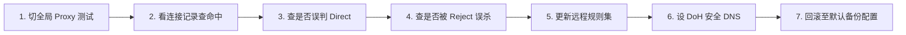

在 iPhone 上使用 Shadowrocket（小火箭）时，很多用户最常问的不是“怎么添加节点”，而是**“为什么主界面有 Rule、Global、Direct 三种模式？它们到底有什么区别？分流规则到底该怎么设置？”**

**“在小火箭主界面选了日本节点，为什么打开 ChatGPT 查 IP 却显示走的是美国节点？”**  
**“为什么把全局路由切到‘全局 (Proxy)’能秒开网页，一切回‘配置 (Rule)’就直接断网？”**  
**“为什么打开微信、淘宝等国内 App 时，经常感觉变卡甚至白白消耗了梯子的流量？”**  
**“网上下载的几万条第三方‘去广告规则包’，为什么导入后很多网站的登录和验证码直接死锁？”**  
**“什么是 DOMAIN、DOMAIN-SUFFIX、IP-CIDR、GEOIP 和 FINAL？分流规则到底按什么顺序生效？”**

**在 Shadowrocket 中，Rule（配置）、Global（全局）和 Direct（直连）绝非“速度快慢”的等级档位，而是三种截然不同的流量路由接管策略。**

理解小火箭的分流规则，核心在于理清完整的网络控制链路：**「App 请求 ➔ DNS 解析 ➔ 规则自上而下匹配 ➔ 策略/策略组分发 ➔ 指定具体节点 ➔ 最终出海出口 IP」**。

本文专注于 **Shadowrocket 的“分流规则体系与策略组配置”**，带你从**核心模式辨析、规则匹配语法、策略组绑定、国内直连优化到故障回滚**建立体系化认知，手把手教你打造一套干净、高效、永不冲突的 iOS 智能分流系统。

---

## ⚡ 30 秒快速看懂：Rule、Global 与 Direct 核心区别

```text
┌────────────────────────────────────────────────────────────────────────┐
│            Shadowrocket 全局路由三大模式 30 秒速查对比表               │
├──────────────┬──────────────────────────────┬──────────────────────────┤
│ 路由模式     │ 流量底层处理机制             │ 核心使用场景与排障价值   │
├──────────────┼──────────────────────────────┼──────────────────────────┤
│ **配置 (Rule)**│ 按照规则智能分流：国内 App 直│ 🟢 **日常主力首选**：省流量、│
│ *(默认推荐)* │ 连本地，海外被墙网站走代理   │ 微信不绕路、4K 秒开      │
├──────────────┼──────────────────────────────┼──────────────────────────┤
│ **全局 (Proxy)│ 强制所有流经小火箭的流量 100%│ 🔧 **故障排障专用**：用于快│
│ *(排障利器)* │ 全部经过所选的唯一代理节点   │ 速验证节点本身是否能上网 │
├──────────────┼──────────────────────────────┼──────────────────────────┤
│ **直连 (Direct)│ 所有网络流量直接直连本地网络，│ ⚠️ **临时测裸网**：相当于关│
│ *(纯直连)*   │ 不经过任何境外代理服务器     │ 闭代理，被墙网站无法打开 │
└──────────────┴──────────────────────────────┴──────────────────────────┘
```

> 💡 **必须厘清的六大文章定位分工**：
> - **《Shadowrocket怎么用》**：负责**小火箭客户端生态全功能与 App Store 入门总览**（主 Pillar）；
> - **《Shadowrocket订阅怎么导入》**：负责**订阅 404/403、解析失败、节点为空**（配置层）；
> - **《Shadowrocket节点Timeout怎么办》**：负责**节点测试超时、全部标红、端口连不上**（连接层）；
> - **《Shadowrocket有节点但无法上网》**：负责**节点已连通但打不开网页、DNS死锁**（故障排查）；
> - **《Shadowrocket速度慢怎么办》**：负责**能上网但 4K 缓冲、晚高峰掉速**（性能优化）；
> - **本篇《Shadowrocket规则怎么设置》**：负责**Rule/Global/Direct 机制、策略组配置与分流逻辑**（规则与策略）。

---

## 一、核心概念：Shadowrocket 完整流量分流链路全景拆解

很多新手误以为 *“我在小火箭首页选了日本节点，手机里所有网页就都会走日本”*。在智能分流体系下，真实的流量流向是高度结构化的：

```mermaid
graph TD
    AppReq[iPhone 发起请求: 访问 openai.com] --> TunCapture[Shadowrocket 虚拟网卡接管流量]
    TunCapture --> ModeCheck{当前全局路由模式?}
    
    ModeCheck -->|全局 Proxy 模式| ForceProxy[无视任何规则 ➔ 强制直发主界面选中的节点]
    ModeCheck -->|直连 Direct 模式| ForceDirect[无视任何规则 ➔ 强制走本地宽带直连 ➔ 访问失败被墙]
    ModeCheck -->|配置 Rule 模式| RuleEngine[进入智能规则引擎 ➔ 从上到下依次匹配]
    
    RuleEngine --> Match1{命中 DOMAIN-SUFFIX, openai.com?}
    Match1 -->|是| GroupAI[分发至策略组: AI-Proxy ➔ 指向纯净美区节点 ➔ 成功打开]
    Match1 -->|否| Match2{命中 GEOIP, CN (国内 IP)?}
    
    Match2 -->|是| ActionDirect[执行 DIRECT 策略 ➔ 走本地光纤 ➔ 微信秒开且省流量]
    Match2 -->|否| Fallback[进入 FINAL 兜底策略 ➔ 走默认 PROXY 节点]
```

### 为什么选了日本节点，特定网站却显示其他国家 IP？
这就是**策略组（Policy Group）**的作用。如果你的订阅规则中将 `ChatGPT` 绑定到了【AI 独立分组】，而该分组内指定了【美国 01】节点，那么即使你在小火箭首页手动切到了日本节点，访问 ChatGPT 时依然会自动走美国出口。

---

## 二、三大全局路由模式深度横向对比大表

| 评估维度 | **配置 (Rule) 模式** | **全局 (Proxy) 模式** | **直连 (Direct) 模式** |
| :--- | :--- | :--- | :--- |
| **底层运作原理** | 逐条匹配分流规则集，决定 Direct/Proxy/Reject | 所有流经流量强制走指定单一节点 | 所有流量强制走本地物理网络 |
| **访问国内网站** | 🟢 **本地直连**（延迟低，不消耗境外套餐） | 🔴 **绕道海外**（延迟变高，白白扣除流量） | 🟢 **本地直连** |
| **访问海外网站** | 🟢 **走指定境外节点**（智能科学上网） | 🟢 **走指定境外节点** | 🔴 **无法打开**（直接撞墙） |
| **局域网设备互联**| 🟢 **完美支持**（NAS/打印机/AirPlay 正常） | ⚠️ **可能异常**（部分局域网流量被劫持） | 🟢 **正常直连** |
| **故障排障价值** | 用于日常生产与娱乐主力环境 | 🔧 **黄金排障工具**（验证节点是否断网） | 用于测试本地纯物理裸网质量 |
| **常见致命误区** | 误以为 Rule 会降低下载速度 | 误以为 Global 是“提速模式”或“高速通道” | 误以为 Direct 会提供某种代理加密 |

---

## 三、Shadowrocket 核心规则匹配类型全景解析

小火箭支持多种高精度的分流匹配语法，规则按照**「从上到下、先匹配先执行」**的原则运作：

```text
┌────────────────────────────────────────────────────────────────────────┐
│                   Shadowrocket 六大常见规则类型对照表                  │
├────────────────────┬───────────────────────────────────────────────────┤
│ **1. DOMAIN**      │ **完整域名精确匹配**。例如 `DOMAIN,example.com,PROXY`│
│                    │ 仅精确匹配 `example.com`，不包含其子域名          │
├────────────────────┼───────────────────────────────────────────────────┤
│ **2. DOMAIN-SUFFIX│ **域名后缀包含匹配** *(最常用)*。                  │
│                    │ 例如 `DOMAIN-SUFFIX,google.com,PROXY`，涵盖所有子域│
├────────────────────┼───────────────────────────────────────────────────┤
│ **3. DOMAIN-KEYWORD│ **域名关键字模糊匹配**。例如 `DOMAIN-KEYWORD,ai,PROXY`│
│                    │ 只要网址中包含 `ai` 即命中 (容易发生大面积误杀)   │
├────────────────────┼───────────────────────────────────────────────────┤
│ **4. IP-CIDR**     │ **IP 网段范围匹配**。例如 `IP-CIDR,192.168.0.0/16,DIRECT`│
│                    │ 专用于局域网、私有网络或固定机房 IP 段的分流      │
├────────────────────┼───────────────────────────────────────────────────┤
│ **5. GEOIP**       │ **IP 地理归属数据库匹配**。例如 `GEOIP,CN,DIRECT`  │
│                    │ 自动识别全球 IP 归属地，中国大陆 IP 自动直连      │
├────────────────────┼───────────────────────────────────────────────────┤
│ **6. FINAL**       │ **最终兜底匹配** *(必不可少)*。例如 `FINAL,PROXY`  │
│                    │ 当前面所有规则均未命中时，剩余流量统一执行该动作  │
└────────────────────┴───────────────────────────────────────────────────┘
```

> ⚠️ **新手避坑重点**：
> - **尽量少用 `DOMAIN-KEYWORD`**：比如写了 `DOMAIN-KEYWORD,bank,DIRECT` 想让银行直连，但如果访问一个境外网站叫 `usbank.com` 也会被错误直连导致无法打开；
> - **兜底规则（FINAL）决定整体基调**：海外用户通常设 `FINAL,DIRECT`，国内用户通常设 `FINAL,PROXY`。

---

## 四、策略（Policy）与策略组（Policy Group）的本质区别

在小火箭中，**“策略”**与**“节点”**是两个完全不同的层级概念：

```text
┌────────────────────────────────────────────────────────────────────────┐
│                       节点 vs 策略组关系示意图                         │
├────────────────────────────────────────────────────────────────────────┤
│ 【具体节点 (Node)】 ➔ 香港 01 / 日本 02 / 美西专线 (真实的物理服务器)  │
│                                                                        │
│ 【策略组 (Policy Group)】 ➔ 包含多个节点的“智能容器”                  │
│   ├── 容器 A (AI 专线组)   ➔ 绑定 [美西原生 01, 日本原生 02] (手动选择)│
│   ├── 容器 B (自动测速组) ➔ 绑定 [全部香港节点] (自动选择延迟最低节点)│
│   └── 容器 C (流媒体组)   ➔ 绑定 [新加坡 01, 香港 03] (故障自动转移)  │
└────────────────────────────────────────────────────────────────────────┘
```

### 策略执行四大基本动作：
1. **`DIRECT` (直连)**：流量不经任何代理，直接通过 iPhone 本地物理网络发起请求（国内微信/淘宝/美团首选）；
2. **`PROXY` (代理)**：流量分发至主界面选中的主力节点或指定策略组；
3. **`REJECT` (拦截/丢弃)**：主动断开该网络请求，常用于过滤已知恶意追踪代码与广告接口；
4. **`自定义策略组`**：将特定流量导向专门的节点集合。

---

## 五、经典实战场景：AI / YouTube / 局域网分流配置实操

针对现代科学上网高频场景，推荐以下科学的分流配置思路：

```mermaid
graph TD
    UserReq[各类日常网络请求] --> Router[Shadowrocket 规则引擎]
    
    Router -->|局域网 192.168.x.x / 10.x.x.x| DirectLAN[DIRECT ➔ 路由器/NAS/AirPlay 秒连]
    Router -->|国内网站 (GEOIP, CN / baidu.com)| DirectCN[DIRECT ➔ 走电信/联通光纤, 零延迟]
    Router -->|ChatGPT / Claude / OpenAI 域名| GroupAI[AI 策略组 ➔ 强制走美区/日区原生纯净专线]
    Router -->|YouTube / Netflix / Disney+ 域名| GroupMedia[流媒体策略组 ➔ 走大带宽香港/新加坡节点]
    Router -->|其他未知境外流量| FallbackFinal[FINAL ➔ 默认走主力 PROXY 节点]
```

### 1. 国内应用直连（DIRECT）配置原则
- 规则配置：`GEOIP,CN,DIRECT` + `DOMAIN-SUFFIX,cn,DIRECT`；
- 收益：国内 App 访问延迟从 150ms 降至 10ms，且完全不消耗境外机场套餐流量。

### 2. AI 生产力工具（ChatGPT / Claude）专属分流
- 规则配置：将 OpenAI、Claude 常用域名归入独立策略组；
- 收益：无需频繁在主界面手动切节点，访问 ChatGPT 永远自动走纯净不封号的美区出口。

### 3. 局域网设备互联（防 AirPlay / NAS 无法连接）
- 规则配置：`IP-CIDR,192.168.0.0/16,DIRECT,no-resolve`；
- 收益：彻底解决开启小火箭后无法投屏到电视、找不到局域网 NAS 的痛点。

---

## 六、三类更新深度辨析：App 更新 vs 订阅更新 vs 规则更新

很多用户将软件、节点与规则的更新混为一谈，必须严格区分：

| 维护对象 | 具体更新操作位置 | 更新的底层数据内容 | 是否会改变节点 IP | 是否会改变分流规则 |
| :--- | :--- | :--- | :---: | :---: |
| **小火箭 App 更新** | 苹果 App Store | 客户端底层内核、UI 与协议兼容性 | ❌ 否 | ❌ 否 |
| **机场订阅更新** | 小火箭首页向下拉动屏幕 | 最新服务器节点列表、端口与密钥 | 🟢 **是** | ⚠️ 可能覆盖远程策略 |
| **分流规则集更新** | 底部「配置」➔ 远程文件更新 | 最新的境内外域名黑白名单与分流规则 | ❌ 否 | 🟢 **是** |

> 🛡️ **修改规则前第一铁律**：在对任何配置文件进行编辑前，长按该配置文件点击 **「复制 / 备份」**。一旦改错导致断网，可一秒切回备份文件恢复。

---

## 七、Shadowrocket 规则故障 7 步标准排查流程

遇到“全局模式能用，一切回规则模式就打不开网页”，请按以下决策链排查：



### 步骤 1：切换至「全局 (Proxy)」模式进行基准测试
- 若全局模式能正常打开 Google，**100% 证明节点服务器完好**，故障锁定在分流规则集或策略组指向。

### 步骤 2：在小火箭底部查看「连接 / 日志」
- 打开网页的同时观察连接记录，确认目标网址（Host）到底命中了哪一条具体规则。

### 步骤 3：排查是否被错误标记为了 `DIRECT`
- 很多海外新兴网站若未被规则库收录，易被兜底规则误判为 Direct 导致直接撞墙，需手动添加 `DOMAIN-SUFFIX` 设为 `PROXY`。

### 步骤 4：排查是否被去广告规则 `REJECT` 误杀
- 检查登录、验证码或支付接口是否命中拦截规则，临时关闭激进的第三方去广告规则。

### 步骤 5：更新远程分流规则集文件
- 在「配置」页面向右滑动远程规则文件，点击更新拉取最新的域名白名单。

### 步骤 6：配置 DoH 安全加密 DNS
- 在小火箭设置中指定 DNS 为 `https://1.1.1.1/dns-query`，防止宽带 DNS 污染干扰域名规则匹配。

### 步骤 7：一键回滚至官方默认标准配置
- 若修改过多导致逻辑死锁，直接重新下载机场提供的默认配置文件或恢复备份。

---

## 八、Shadowrocket 高兼容智能分流专线品牌推荐矩阵

针对智能规则分流兼容、ChatGPT/Claude 原生解锁与抗网络断流，精选以下真实稳定服务商：

```text
┌────────────────────────────────────────────────────────────────────────────────────────┐
│                        2026 Shadowrocket 高可用专线品牌候选矩阵                        │
├──────────┬──────────────────────────┬──────────────┬──────────────┬────────────────────┤
│ 适配场景 │ 推荐品牌候选             │ 实际起付门槛 │ 每月流量配额 │ 规则分流与策略组优势 │
├──────────┼──────────────────────────┼──────────────┼──────────────┼────────────────────┤
│ 智能全能 │ 光速云 (GuangSuYun)      │ 约 ¥7.5/月起 │ 59G~238G /月 │ 6年老牌专线，订阅自带 AI/流媒体高精策略组，零误杀│
│ 平价轻量 │ 微风网络 (BreezeNet)     │ 约 ¥7/月起   │ 50GB / 月    │ 移动端规则纯净，国内直连极度省流，年付百元内首选 │
│ 弹性月付 │ 唯兔云 (V2Yun)           │ ¥14.9/月     │ 100GB / 月   │ 15元纯单月付，支持全规则自动分流，多国原生节点 │
│ 应急备用 │ 星岛梦 (XingDaoMeng)     │ 约 ¥8/月起   │ 60G/不限时包 │ 0月租不限时包，规则兼容性强，主力断网无缝切换 │
│ AI/开发  │ 速界 (SpeedWorld)        │ ¥25/月       │ 150GB / 月   │ 原生住宅 IP 节点，ChatGPT/Claude 专属独立分流组 │
└──────────┴──────────────────────────┴──────────────┴──────────────┴────────────────────┘
```

- 🏆 **智能分流旗舰首选**：[光速云](/reviews/guangsu-cloud/) —— 全线企业级 IEPL 物理专线，自带完善的 AI 与流媒体策略组，晚高峰 0 丢包；
- 🍃 **超低预算轻量**：[微风网络](/reviews/weifeng-cloud/) —— 针对手机端日常查资料优化的 50GB 小流量专线，年付折算仅约 ¥7/月；
- 💳 **拒绝绑定的单月付**：[唯兔云](/recommend/best-airports/) —— ¥14.9 纯单月付，100GB 充沛流量，节点丰富。

---

## 九、Shadowrocket 规则配置 18 项自查通关清单

```text
┌────────────────────────────────────────────────────────────────────────┐
│                   Shadowrocket 规则配置 18 项自查通关清单              │
├────────────────────────────────────────────────────────────────────────┤
│ □ 1. 我清楚了解 Rule、Global 和 Direct 是流量路由方式而非速度档位      │
│ □ 2. 我的日常主力环境保持在「配置 (Rule)」模式                         │
│ □ 3. 我知道在排查故障时，可以临时切到「全局 (Proxy)」模式进行对照      │
│ □ 4. 我确认全局路由没有误切为「直连 (Direct)」模式                     │
│ □ 5. 在对配置文件进行手动编辑前，我已经完成了配置文件的备份复制        │
│ □ 6. 我在规则末尾配置了正确的兜底规则 (如 FINAL,PROXY 或 FINAL,DIRECT) │
│ □ 7. 国内 IP (GEOIP,CN) 和主流国内域名已正确设置为 DIRECT 直连         │
│ □ 8. 局域网私有网段 (192.168.0.0/16) 已配置为 DIRECT 直连 (防投屏失效) │
│ □ 9. 我没有盲目导入来源不明、包含几万条拦截规则的激进第三方去广告包   │
│ □ 10. 如果某个特定网站打不开，我已在连接日志中确认了其真实命中规则     │
│ □ 11. 我清楚了解规则只能改变出口路径，无法让被封锁的节点自动复活       │
│ □ 12. 我清楚了解规则无法提高物理带宽，看 4K 卡顿需切换大带宽专线       │
│ □ 13. 我确认没有在手机上安装来路不明的 CA 根证书或开启高风险 MITM      │
│ □ 14. 切换分流策略后，我已彻底上滑退出 Safari 重新打开清除 TCP 连接缓存│
│ □ 15. 手机中已常备第二个备用服务商的订阅或 0 月租不限时流量包          │
│ □ 16. 我已在小火箭设置中将 DNS 手动配置为公共 DoH 地址 (如 1.1.1.1)    │
│ □ 17. 如果 AI 服务报错，我确认其分流策略组绑定的是美区或日区纯净节点   │
│ □ 18. 如果更新订阅覆盖了自定义规则，我知道如何从本地备份中重新恢复     │
└────────────────────────────────────────────────────────────────────────┘
```

---

## 十、避坑指南：30 个关于“小火箭分流规则”的致命认知误区

```text
❌ 误区 1：Global 全局模式是小火箭的提速模式，日常应该永远开启 ➔ 事实：Global 是排障工具，常开导致国内 App 变慢且巨额扣量。
❌ 误区 2：Rule 配置模式会拖慢手机网速 ➔ 事实：Rule 仅做毫秒级路由匹配，国内直连反而大幅提速。
❌ 误区 3：Direct 直连模式也会提供某种代理翻墙功能 ➔ 事实：Direct 等于关闭代理，所有被墙网站将全部无法访问。
❌ 误区 4：在小火箭首页选了日本节点，手机里所有数据就绝对走日本 ➔ 事实：特定域名若命中独立策略组，会按策略组绑定节点出海。
❌ 误区 5：分流规则条数越多越好，上万条规则才算专业 ➔ 事实：规则越臃肿越容易发生严重误杀，且增加本地匹配延迟。
❌ 误区 6：所有国内网站都必须强制走 Direct 直连 ➔ 事实：部分跨国服务或特定查询可根据需求走海外出口。
❌ 误区 7：所有海外网站都必须强制走 Proxy 代理 ➔ 事实：海外未被墙且延迟极低的直连 CDN 走 Direct 速度更快。
❌ 误区 8：DOMAIN-SUFFIX（域名后缀）一定比 DOMAIN（精确域名）高级 ➔ 事实：两者针对不同粒度，精确域名能防止子域名被误伤。
❌ 误区 9：IP 规则永远比域名规则更准确 ➔ 事实：现代大型网站普遍采用动态 CDN IP，域名规则远比 IP 规则维护成本低。
❌ 误区 10：GEOIP 数据库识别结果永远 100% 准确 ➔ 事实：IP 广播库存在漂移，部分跨国企业 IP 可能被误判。
❌ 误区 11：Auto 自动测速策略选出来的节点就是看 4K 最快的 ➔ 事实：Auto 仅测探测 URL 延迟，不代表持续大文件吞吐性能。
❌ 误区 12：策略组（Policy Group）就是节点本身 ➔ 事实：策略组是节点的容器，一个策略组可包含多个节点与分流逻辑。
❌ 误区 13：PROXY 关键字代表一个固定死板的单一服务器 ➔ 事实：PROXY 在小火箭中代表指向主界面手动选择的主力节点。
❌ 误区 14：REJECT 规则只会拦截广告，绝对不会影响正常功能 ➔ 事实：激进的 REJECT 常误杀登录鉴权、图片加载与支付接口。
❌ 误区 15：去广告规则包越大，网页浏览体验就越干净 ➔ 事实：容易导致各类 App 频繁报错闪退或提示无网络。
❌ 误区 16：网上分享的远程规则集绝对安全无害 ➔ 事实：恶意规则集可将特定流量恶意重定向或进行流量监听。
❌ 误区 17：直接复制网友的规则文件就一定最适合自己 ➔ 事实：每个人的主力节点、常用 App 与网络环境各不相同。
❌ 误区 18：Global 能用而 Rule 不能用，说明节点坏了 ➔ 事实：说明节点 100% 完好，故障出在规则匹配或 DNS 死锁上。
❌ 误区 19：只要规则报错，盲改手机 DNS 为 8.8.8.8 就一定能修好 ➔ 事实：若规则逻辑本身冲突，改 DNS 毫无作用。
❌ 误区 20：优化分流规则可以让节点的物理下行带宽翻倍 ➔ 事实：规则只管路由分发，无法突破服务器硬件带宽上限。
❌ 误区 21：修改规则可以降低从大陆到美国的物理光纤延迟 ➔ 事实：光纤物理延迟由地理距离决定，任何规则都无法打破物理定律。
❌ 误区 22：通过修改规则能把香港节点的出口 IP 变成美国原生 IP ➔ 事实：出口 IP 由落地机房决定，规则只能决定走哪个节点。
❌ 误区 23：导入一条 Netflix 规则就能让所有节点自动解锁奈飞 ➔ 事实：规则只能把流量引向该节点，能否解锁看机房 IP 属性。
❌ 误区 24：ChatGPT 报错打不开一定是分流规则写错了 ➔ 事实：也可能是该节点出口 IP 被 OpenAI 官方拉黑。
❌ 误区 25：节点连接 Timeout 超时可以通过修改分流规则修复 ➔ 事实：超时是服务器物理连不上，修改规则无济于事。
❌ 误区 26：订阅更新 404 错误可以通过修改分流规则修复 ➔ 事实：404 是订阅链接失效，与规则完全无关。
❌ 误区 27：在 App Store 更新小火箭会自动更新分流规则 ➔ 事实：App 更新只更新软件本体，分流规则需在配置页手动更新。
❌ 误区 28：在小火箭下拉刷新订阅会更新所有分流规则 ➔ 事实：下拉只拉取节点列表，只有订阅自带全配置时才会变动规则。
❌ 误区 29：打开一个 IP 查询网站显示本地 IP，代表手机代理完全失效 ➔ 事实：该查询网站可能命中了 DIRECT 直连规则。
❌ 误区 30：遇到分流异常必须立刻卸载重装 Shadowrocket ➔ 事实：重装会清空已有配置，切到全局模式或回滚备份即可。
```

---

## 十一、常见问题深度解答（FAQ · 40 问）

### Q1：Shadowrocket Rule（配置）模式是什么意思？
**答**：配置模式会根据内置的分流规则集，对每个网络请求进行智能判断：国内网站和 App 自动直连（DIRECT），被墙海外网站走代理（PROXY）。

### Q2：Shadowrocket Global（全局）模式是什么意思？
**答**：全局模式强制所有流经小火箭的网络请求 100% 全部通过当前选中的唯一代理节点出海，不进行任何分流判断。

### Q3：Shadowrocket Direct（直连）模式是什么意思？
**答**：直连模式让所有流量直接走本地物理网络，不经过任何代理服务器，相当于临时关闭翻墙功能。

### Q4：Rule、Global、Direct 三种模式日常应该选哪个？
**答**：**强烈推荐日常默认使用「配置 (Rule)」模式**。既能秒开海外网站，又不会导致国内微信、淘宝绕道海外，兼顾速度与流量节省。

### Q5：Global 模式是不是比 Rule 模式网速更快？
**答**：**不会更快。** Global 模式只是路由策略，无法提高物理带宽；常开反而会导致访问国内网站绕道海外大幅变慢并消耗套餐流量。

### Q6：为什么 Global 模式能正常上网，切回 Rule 模式就断网？
**答**：**这 100% 证明你的节点完好无损。** 故障出在规则集未收录目标域名导致其被直连撞墙，或本地规则策略组指向了错误的失效节点。

### Q7：为什么选了日本节点，查出口 IP 却显示香港？
**答**：说明当前访问命中了订阅自带的独立策略组（如“自动选择”或“视频分组”），该分组内绑定的是香港节点，覆盖了主界面的手动选择。

### Q8：Direct 模式下流量会走代理加密吗？
**答**：**完全不会。** Direct 模式直接通过手机本地网络直连目标服务器，没有任何加密隧道和代理转发。

### Q9：小火箭分流规则是什么？
**答**：是一组定义网络请求去向的指令集，通过匹配域名、IP 或关键字，决定每个数据包是直连（DIRECT）、代理（PROXY）还是拦截（REJECT）。

### Q10：Shadowrocket 规则怎么设置？
**答**：进入小火箭底部「配置」，点击当前使用的配置文件 ➔「添加规则」，选择匹配类型（如 `DOMAIN-SUFFIX`）、填入域名并指定策略动作。

### Q11：Shadowrocket 策略组（Policy Group）是什么？
**答**：策略组是节点的“智能容器”，可将多个节点归类为一个组（如 AI 组、流媒体组），支持手动选择、延迟自动测速（URL-Test）或故障转移。

### Q12：策略组和具体节点有什么区别？
**答**：节点是具体的单一服务器；策略组是包含多个节点的管理单元，规则分流通常指向策略组，再由策略组决定走哪个具体节点。

### Q13：为什么不同网站会显示不同的出口 IP？
**答**：因为分流规则将不同的网站分发到了不同的策略组或节点（例如 Google 走香港出口，ChatGPT 自动走美国出口），属于正常智能分流。

### Q14：小火箭的分流规则有没有优先级？
**答**：**有。** 规则遵循**自上而下匹配、先命中先执行**的原则；一旦前面的精确规则被命中，后面的规则将直接被跳过不再执行。

### Q15：DOMAIN 规则和 DOMAIN-SUFFIX 规则有什么区别？
**答**：`DOMAIN` 仅精确匹配完整域名（如 `example.com`）；`DOMAIN-SUFFIX` 匹配该域名及其所有子域名（如 `a.example.com`、`b.example.com`）。

### Q16：DOMAIN-KEYWORD 规则有什么优缺点？
**答**：优点是能用一个词匹配大量相关网址；缺点是**极其容易发生大面积误杀**，不建议普通用户随意添加。

### Q17：IP-CIDR 规则适合用在什么场景？
**答**：适用于明确的 IP 网段分流，最常用于局域网私有网段（如 `192.168.0.0/16`）的强制直连，保障本地设备互联通畅。

### Q18：GEOIP 规则是如何工作的？
**答**：通过内置的 IP 地理数据库自动识别目标服务器归属地，最常见的 `GEOIP,CN,DIRECT` 可实现所有中国大陆服务器自动直连。

### Q19：FINAL（兜底规则）有什么重要作用？
**答**：当一个网络请求没有命中前面任何一条规则时，由 FINAL 规则决定其最终去向。国内用户通常设为 `FINAL,PROXY` 防漏网。

### Q20：Shadowrocket 中的 PROXY 动作代表什么？
**答**：代表让匹配的数据包通过当前主界面选中的主力代理节点，或交给指定的上一级代理策略进行出海转发。

### Q21：Shadowrocket 中的 REJECT 动作代表什么？
**答**：代表主动丢弃该网络请求并切断连接，主要用于拦截广告接口、数据分析追踪器及恶意域名。

### Q22：去广告规则为什么会导致某些网站无法登录？
**答**：因为很多网站的登录图形验证码、风控探针或第三方登录 SDK 被激进的去广告规则误判为追踪器并 REJECT 拦截。

### Q23：导入第三方远程规则集安全吗？
**答**：**需认准知名可信来源。** 恶意规则集可能将你的金融或隐私流量重定向到不安全节点，切勿导入来路不明的“破解/万能规则包”。

### Q24：规则集更新和订阅更新是一回事吗？
**答**：**不是。** 订阅更新只拉取节点 IP 和密钥；规则集更新是在「配置」页面拉取最新的境内外域名分流清单。

### Q25：为什么更新订阅后我的自定义分流规则不见了？
**答**：因为部分机场提供的订阅是“全量托管配置”，更新订阅时会覆盖整个配置文件。建议将个人规则添加到独立的本地配置中。

### Q26：小火箭可以为 ChatGPT 单独配置美国节点吗？
**答**：可以。在配置中建立一个 AI 策略组并绑定美国节点，然后添加规则 `DOMAIN-SUFFIX,openai.com,AI策略组` 即可。

### Q27：小火箭可以为 YouTube 单独配置大带宽节点吗？
**答**：可以。建立流媒体策略组绑定香港/新加坡大带宽节点，添加 `DOMAIN-SUFFIX,youtube.com,流媒体策略组`。

### Q28：国内网站怎么设置强制直连？
**答**：添加规则：类型选 `GEOIP`，内容填 `CN`，策略选 `DIRECT`；或添加 `DOMAIN-SUFFIX,cn,DIRECT`。

### Q29：如何排查某个特定网站打不开是哪条规则导致的？
**答**：在小火箭底部打开「连接 / 日志」，刷新该网页并查看对应的域名请求，观察其匹配的策略是 DIRECT、REJECT 还是走错了节点。

### Q30：DNS 设置会影响小火箭的规则分流吗？
**答**：**会直接影响。** 若本地 DNS 发生解析死锁或污染，小火箭无法将域名与 IP 规则进行准确比对，可能导致分流误判。

### Q31：修改分流规则能提升视频下载速度吗？
**答**：**不能。** 分流规则只决定走哪条路线，下载网速取决于所选节点的物理带宽储备和线路质量。

### Q32：修改分流规则能解决节点 Timeout 超时吗？
**答**：**不能。** Timeout 是节点服务器在物理网络上无法连通，规则无法修复失效的机房服务器。

### Q33：修改分流规则能解决订阅 404 报错吗？
**答**：**不能。** 订阅 404 是服务商链接失效或拼写错误，与本地分流规则毫无关系。

### Q34：在小火箭里修改规则前为什么必须先备份？
**答**：分流规则逻辑环环相扣，一旦语法改错可能引发全网断流，备份后可在 1 秒内一键回滚恢复。

### Q35：分流规则数量是不是越多越好？
**答**：**并不是。** 规则过量会增加手机 CPU 匹配负担并大幅提高误杀率，一套包含基础国内直连与海外代理的精简规则最为高效稳定。

### Q36：局域网投屏（AirPlay）搜不到电视怎么配规则？
**答**：在配置中添加一条本地私有网段规则：`IP-CIDR,192.168.0.0/16,DIRECT,no-resolve` 即可完美恢复投屏。

### Q37：为什么 Safari 正常，而某个 App 无法翻墙？
**答**：该 App 可能使用了未被规则库收录的私有 API 域名，被兜底规则误判为直连撞墙，在连接日志中找到该域名并设为 PROXY 即可。

### Q38：什么时候应该将小火箭恢复为默认规则？
**答**：当手动修改过多导致大量常见网站无法打开、规则冲突严重且无法定位时，重新拉取一份纯净的默认配置文件。

### Q39：新手需要自己从零手动编写几千条规则吗？
**答**：**完全不需要。** 正规专线机场提供的订阅均自带维护良好的标准分流配置，新手直接使用默认配置即可满足 99% 的需求。

### Q40：如何打造一套兼顾速度与安全的小火箭配置？
**答**：主力选用企业级 **IEPL 物理专线**，日常保持 **「配置 (Rule)」模式**（国内 GEOIP 直连），为 AI 和流媒体设置独立策略组，并常备备份配置。

---

## 🏁 总结：Shadowrocket 分流规则配置终极心法

彻底掌握小火箭分流规则，请牢记以下**四维配置核心法则**：

```text
1. 辨清模式 ➔ 日常主力用 Rule 智能分流，排错诊断切 Global 验证连通性
2. 理清链路 ➔ 请求先经 DNS 与自上而下规则匹配，再由策略组分发至节点
3. 遵循精简 ➔ 规则重在精准而非盲目堆量，慎用易误杀的 DOMAIN-KEYWORD
4. 备份为王 ➔ 任何手动修改前必先复制备份，遇全网断流一秒回滚自愈
```

---

### 📚 延伸进阶阅读与选型专栏
- 📱 **小火箭超级Pillar**：[《Shadowrocket怎么用？小火箭订阅、节点、规则与iPhone完整配置教程》](/tutorials/shadowrocket-tizi/)
- 📋 **订阅导入教程**：[《Shadowrocket订阅怎么导入？小火箭订阅链接、节点更新与订阅失败完整教程》](/tutorials/shadowrocket-subscription-import/)
- 🚨 **断网排查手册**：[《Shadowrocket有节点但无法上网怎么办？小火箭规则、DNS、Wi-Fi与5G完整排查》](/issues/shadowrocket-connected-no-internet/)
- 🔴 **节点超时专题**：[《Shadowrocket 节点 Timeout 怎么办？全部节点红色与网络异常排查》](/issues/shadowrocket-node-timeout/)
- ⚡ **速度与晚高峰**：[《Shadowrocket速度慢怎么办？节点、线路、Wi-Fi、5G与晚高峰完整排查》](/issues/shadowrocket-slow-speed/)
- 📱 **iPhone 设备总指南**：[《iPhone梯子怎么用？Shadowrocket、小火箭、订阅与节点新手完整教程》](/tutorials/iphone-tizi/)
- ⚡ **老牌旗舰专线**：[《光速云深度评测：2020老牌IEPL专线与解锁实测》](/reviews/guangsu-cloud/)
- 🍃 **平价轻量专线**：[《微风网络深度评测：小流量套餐值不值得买？》](/reviews/weifeng-cloud/)
- 🏆 **2026 全景大榜**：[《2026梯子推荐：稳定、速度、价格、安全与不同使用场景怎么选》](/recommend/best-tizi/)
