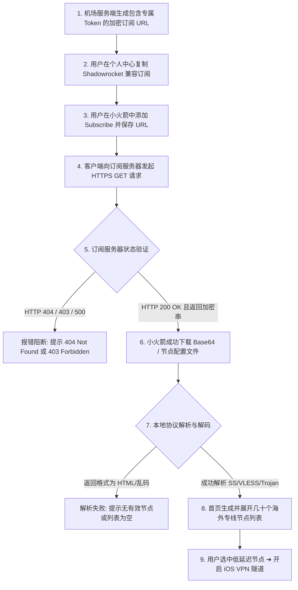
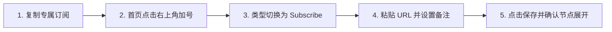

在 iPhone 和 iPad 上使用 Shadowrocket（小火箭）时，**“导入与更新订阅”** 是所有翻墙操作的第一个核心门槛。许多新手在购买了机场套餐后，经常在订阅环节遇到各种困惑与报错：

**“在机场后台复制了小火箭订阅链接，粘贴到软件里保存后，为什么节点列表依然空空如也？”**  
**“为什么在首页向下拉动刷新订阅时，突然弹出 404 Not Found 或 403 Forbidden 报错？”**  
**“服务商明明发公告说新增了香港和日本专线节点，为什么我手机里显示的还是几个月前的旧节点？”**  
**“为什么家里 Wi-Fi 下能成功拉取订阅，一出门切到 5G 移动蜂窝网络就提示连接超时（Timeout）？”**

**“成功添加订阅链接”仅代表客户端在本地记录了一串 URL 地址，并不等于“节点已经成功下载”，更不等于“节点能够正常联网”。**

一条完整的订阅生命周期需要经过：**「服务商生成专属 Token ➔ 客户端发起 HTTPS 请求 ➔ 服务端响应配置 ➔ 小火箭本地协议解码 ➔ 生成节点列表 ➔ 建立加密连接」** 六大环节。任何一环出现阻断，都会导致订阅更新失败或节点为空。

本文专注于 **Shadowrocket 的“订阅配置层”**，为你彻底讲清小火箭订阅链接的底层机制、正确导入与批量更新流程、常见报错排查及安全隐私防护。

---

## ⚡ 30 秒快速上手：Shadowrocket 订阅导入速查表

```text
┌─────────────────────────┬───────────────────────────────────┬──────────────────────────────────────┐
│ 你的当前需求 / 故障现象 │ 核心操作建议与认知基准            │ 推荐执行步骤与排查方案               │
├─────────────────────────┼───────────────────────────────────┼──────────────────────────────────────┤
│ 📋 首次导入机场订阅     │ 首页右上角「+」➔ 类型选 Subscribe │ 粘贴专属 URL ➔ 命名 ➔ 点击右上角保存 │
│ 🔄 批量刷新与更新节点   │ 服务商新增/更换节点后需手动同步   │ 在小火箭首页空白处「向下拉动」即可刷新│
│ ❌ 提示 HTTP 404 报错   │ 订阅 URL 地址失效或 Token 已变更   │ 登录机场后台重新复制最新的专属订阅链接│
│ ⛔ 提示 HTTP 403 报错   │ 权限不足、套餐过期或触发防刷机制  │ 检查账户余额与套餐状态，稍等 5 分钟  │
│ 📭 订阅保存后节点为空   │ 返回了 HTML 网页或订阅格式不兼容  │ 优先选用机场明确标注的 Shadowrocket 格式│
│ ⚠️ 订阅链接不慎公开泄露 │ 流量可能被盗刷或多设备挤占被封号  │ 立即进入服务商后台点击「重置订阅 Token」│
└─────────────────────────┴───────────────────────────────────┴──────────────────────────────────────┘
```

> 💡 **必须厘清的故障分层关系**：
> - **本篇《Shadowrocket订阅怎么导入》**：专门解决**“订阅 URL 无法更新、404/403 报错、节点列表为空、Token 泄露”**等配置层问题；
> - **《Shadowrocket节点Timeout怎么办》**：专门解决**“节点已经成功显示在列表里，但测速全部超时或无法连通”**的连接层问题；
> - **《Shadowrocket有节点但无法上网》**：专门解决**“节点测速正常且已开启 VPN，但 Safari 打不开网页”**的接管层问题；
> - **《Shadowrocket怎么用》**：负责**小火箭客户端全功能、Rule/Global 模式与 iOS 基础生态**总览。

---

## 一、Shadowrocket 订阅生命周期全景拆解

理解小火箭从一条 URL 链接生成几十个节点的完整流程，是进行精准排障的基础：



---

## 二、核心概念彻底厘清：订阅、节点与 App 更新的区别

许多新手常常混淆“订阅”、“节点”与“App”三者的概念，导致遇到问题时盲目卸载软件：

```text
┌────────────────────────────────────────────────────────────────────────────────────────┐
│                   订阅、节点与客户端更新关系全景大表                                   │
├────────────────────┬──────────────┬────────────────────────────────────────────────────┤
│ 核心实体           │ 本质与定位   │ 相互依赖关系与更新方式                             │
├────────────────────┼──────────────┼────────────────────────────────────────────────────┤
│ **订阅 (Subscribe)**│ 远程配置入口 │ 类似一张“云端提货单”，包含一组节点服务器的连接参数 │
├────────────────────┼──────────────┼────────────────────────────────────────────────────┤
│ **节点 (Node)**    │ 单台代理服务器│ 类似提货单中的“具体商品”（如香港 01、日本 02 专线）│
├────────────────────┼──────────────┼────────────────────────────────────────────────────┤
│ **小火箭客户端**   │ 本地解析软件 │ 类似“提货与执行工具”，只负责读取提货单并建立连接   │
└────────────────────┴──────────────┴────────────────────────────────────────────────────┘
```

### 💡 关键认知纠偏：
1. **服务商新增节点 $\neq$ 需要更新小火箭 App**：当机场增加了新节点时，**完全不需要去 App Store 升级小火箭软件**，只需在小火箭首页向下拉动“更新订阅”即可拉取最新节点；
2. **订阅保存成功 $\neq$ 节点成功拉取**：在小火箭中填入 URL 点击保存，只是将链接存入了本地数据库；必须执行一次成功的网络请求并完成本地解码，节点才会真正出现在列表中；
3. **节点变红超时 $\neq$ 订阅失效**：如果节点列表已经展示出来了，但测速提示 Timeout，说明订阅早就成功了，故障出在节点服务器或本地网络连接层。

---

## 三、订阅链接是密码级敏感资产：安全防护三大铁律

每条专属订阅链接的后缀通常包含一串独一无二的 **Token 鉴权密钥**（例如 `https://example.com/api/v1/client/subscribe?token=a1b2c3d4e5f6...`）：

```text
┌────────────────────────────────────────────────────────────────────────┐
│                   订阅链接泄露导致的四大严重后果                       │
├────────────────────┬───────────────────────────────────────────────────┤
│ 后果 1：流量被盗刷 │ 任何人拿到你的订阅链接，都能直接导入自己的设备，  │
│                    │ 在短时间内将你每月几百 GB 的高速流量彻底耗尽      │
├────────────────────┼───────────────────────────────────────────────────┤
│后果 2：账号被封禁  │ 机场通常对同时在线设备数有严格限制（如 2~5 台）， │
│                    │ 泄露导致多地 IP 并发连接，极易触发系统反盗刷封号  │
├────────────────────┼───────────────────────────────────────────────────┤
│后果 3：节点频繁拥堵│ 外部人员蹭用你的专用专线入口，导致你的看视频延迟暴│
│                    │ 增、丢包严重                                      │
├────────────────────┼───────────────────────────────────────────────────┤
│后果 4：隐私关联暴露│ 部分恶意嗅探者可通过 Token 关联查询到你的注册邮箱 │
└────────────────────┴───────────────────────────────────────────────────┘
```

> 🛑 **订阅安全三大铁律**：
> 1. **绝不公开分享**：绝对不要将带有完整 Token 的订阅 URL 发送到 QQ 群、微信群、Telegram 公共群、论坛或 GitHub 开源仓库中；
> 2. **教程截图必打码**：在向他人求助或发布截图时，必须将 URL 中间的 Token 字符串完全涂黑遮盖；
> 3. **泄露后立即重置**：若怀疑订阅已被盗用，**第一步不是修改小火箭设置，而是立即登录机场后台点击「重置订阅 Token」**，使旧链接瞬间作废。

---

## 四、Shadowrocket 导入订阅 5 步全流程（最新 UI 标准）

跟随以下标准化步骤，即可在 1 分钟内完成订阅导入与节点更新：



### 步骤 1：获取 Shadowrocket 兼容订阅链接
1. 打开正规专线机场官网（如 [光速云](/reviews/guangsu-cloud/) 或 [微风网络](/reviews/weifeng-cloud/)），登录用户中心；
2. 在仪表盘的“便捷导入”区域，点击 **「复制 Shadowrocket 订阅链接」** 或 **「一键导入小火箭」**；
3. *注：若服务商提供了多种格式，务必优先选择标有 Shadowrocket / 小火箭 / iOS 的专属格式，尽量不要复制 Clash 专用格式。*

### 步骤 2：在小火箭中添加入口
1. 在 iPhone / iPad 上打开 Shadowrocket 客户端；
2. 进入底部的「首页 (Home)」标签页；
3. 点击右上角的 **「+」号图标** 进入添加配置页面。

### 步骤 3：切换类型为 Subscribe
1. 点击第一行的 **「类型 (Type)」** 选项；
2. 在弹出的菜单列表中，将默认的协议类型改为 **「Subscribe」**。

### 步骤 4：粘贴 URL 并设置备注名称
1. 在 **「URL」** 输入框中，长按并粘贴刚才复制的专属订阅链接；
2. 在 **「备注 (Remark)」** 输入框中，填写便于区分的名称（例如 `01-光速云物理专线` 或 `02-微风主力`）；
3. *注：如果同时拥有多个机场的订阅，规范命名能避免日后切换时发生混乱。*

### 步骤 5：点击保存并拉取节点列表
1. 点击页面右上角的 **「完成 / 保存 (Save)」** 按钮；
2. 小火箭会自动向目标服务器发送请求，并在 1~3 秒内返回结果；
3. 返回主界面后，你会看到刚才添加的订阅分组下方整齐展开了由几十个国家和地区组成的节点列表。

---

## 五、批量更新与日常维护：节点怎么刷新？

机场服务商会定期对节点服务器进行维护、更换被阻断的入口 IP、或上线新的大带宽物理专线：

```text
┌────────────────────────────────────────────────────────────────────────┐
│                   Shadowrocket 节点更新三大正确姿势                    │
├────────────────────┬───────────────────────────────────────────────────┤
│ 方式 1：           │ 在小火箭主界面空白处，用手指**向下拉动屏幕并松开**│
│ 下拉一键极速刷新   │ 客户端会自动刷新所有已添加的订阅，拉取最新节点    │
├────────────────────┼───────────────────────────────────────────────────┤
│ 方式 2：           │ 找到具体的某个订阅分组名称，向左滑动或点击右侧信息│
│ 单个订阅定向更新   │ 图标，单独点击「更新」按钮                        │
├────────────────────┼───────────────────────────────────────────────────┤
│ 方式 3：           │ 进入小火箭「设置 ➔ 订阅」，开启**「打开应用时自动 │
│ 启动时自动静默更新 │ 更新」**功能，每次启动 App 自动同步最新配置        │
└────────────────────┴───────────────────────────────────────────────────┘
```

> ⚠️ **新手误区提醒**：
> **不要高频疯狂刷新订阅！** 每隔几秒连续下拉刷新，不仅不会提高节点网速，反而容易触发机场订阅服务器的 WAF 防火墙策略，导致你的 IP 被临时拉黑封锁 15~30 分钟。

---

## 六、订阅导入与更新失败终极排查手册（按错误类型分类）

当小火箭提示更新失败或列表为空时，切勿盲目重装软件，请对照以下错误分类表进行针对性修复：

```text
┌────────────────────────────────────────────────────────────────────────────────────────┐
│                   Shadowrocket 订阅更新常见报错原因与精准解决方案                      │
├──────────────┬──────────────────────────────┬──────────────────────────────────────────┤
│ 报错类型     │ 底层技术根因                 │ 最快排查与解决步骤                       │
├──────────────┼──────────────────────────────┼──────────────────────────────────────────┤
│ **HTTP 404** │ 订阅链接 URL 不存在或已失效  │ 登录机场后台重新复制最新生成的专属订阅链接│
├──────────────┼──────────────────────────────┼──────────────────────────────────────────┤
│ **HTTP 403** │ 权限被拒绝 (欠费或高频防刷)  │ 检查套餐是否过期；若正常，暂停刷新等待10分钟 │
├──────────────┼──────────────────────────────┼──────────────────────────────────────────┤
│ **HTTP 401** │ Token 鉴权失败或签名无效     │ 后台点击「重置订阅链接」，重新导入新 URL │
├──────────────┼──────────────────────────────┼──────────────────────────────────────────┤
│ **Timeout**  │ 订阅服务器未能在限时内响应   │ 关代理测手机裸网；切手机 5G 蜂窝网络排查 │
├──────────────┼──────────────────────────────┼──────────────────────────────────────────┤
│ **TLS Error**│ 加密证书验证失败或握手超时   │ **检查 iPhone 设置中的“自动设置时间”是否开启**│
├──────────────┼──────────────────────────────┼──────────────────────────────────────────┤
│ **节点为空** │ 订阅返回了 HTML 网页或非标准串│ 确认复制的是 Shadowrocket 格式而非 Clash 格式│
└──────────────┴──────────────────────────────┴──────────────────────────────────────────┘
```

### 1. 深度解析：为什么 HTTP 404 绝不等于“机场跑路”？
HTTP 404 代表客户端请求的 Web 路径不存在。常见原因包括：
- 服务商为了防御攻击，更换了解析订阅的 API 域名或路径；
- 用户在后台点击了重置 Token，导致旧订阅 URL 变成了无效死链；
- 用户复制链接时不小心漏掉了末尾的几个字符，或在开头粘贴了多余的空格。

### 2. 深度解析：为什么返回了 HTML 页面会导致“节点列表为空”？
某些机场后台开启了 Cloudflare 5 秒盾人机验证或反代缓存。当小火箭请求订阅时，服务器返回的不是 Base64 编码的节点列表，而是一个包含 JavaScript 的 HTML 网页代码。小火箭无法解析 HTML，因而判定为“0 个有效节点”。遇到这种情况，可尝试切换手机 5G 蜂窝网络重新刷新。

---

## 七、单节点导入与二维码扫描指南

除了通过订阅链接批量拉取几十个节点外，小火箭还支持单节点手动配置与二维码极速导入：

### 1. 扫描二维码导入单节点或订阅
1. 打开小火箭主界面，点击左上角的 **「扫描」图标**；
2. 允许小火箭访问 iPhone 相机权限；
3. 将取景框对准服务商后台或他人分享的节点二维码，小火箭会自动识别并将其添加到列表中。

### 2. 手动填入单节点配置
1. 点击主界面右上角的 **「+」号**；
2. 点击「类型」，选择该节点对应的协议（如 `Shadowsocks`、`VLESS`、`Trojan` 或 `Hysteria 2`）；
3. 在下方依次填入：**服务器地址（域名/IP）、端口号、密码 / UUID**；
4. 若为 Reality / TLS 协议，在高级选项中填入 SNI 与 Public Key；
5. 点击保存即可完成单节点录入。

---

## 八、在线第三方订阅转换的巨大隐私风险

部分用户由于拿到了非 Shadowrocket 格式的订阅，习惯使用网上的“免费在线订阅转换工具”（Subconverter）：

```text
┌────────────────────────────────────────────────────────────────────────┐
│                 第三方在线订阅转换工具安全风险深度剖析                 │
├────────────────────┬───────────────────────────────────────────────────┤
│ 风险 1：           │ 你提交的完整订阅链接（含 Token 密钥）会被第三方的 │
│ 订阅 Token 遭截获  │ 后台服务器完整记录并保存在日志数据库中            │
├────────────────────┼───────────────────────────────────────────────────┤
│ 风险 2：           │ 某些不良公共转换站会静默将你的高速专线节点替换为  │
│ 节点被篡改或插桩   │ 带有恶意广告拦截或钓鱼嗅探的私有中继节点          │
├────────────────────┼───────────────────────────────────────────────────┤
│ 风险 3：           │ 转换站服务器宕机或被封锁，导致你的小火箭频繁报错  │
│ 引入额外的单点故障 │ 404 或超时，增加排障难度                          │
└────────────────────┴───────────────────────────────────────────────────┘
```

> 🛡️ **安全建议**：
> 绝大多数正规商业机场（如 [光速云](/reviews/guangsu-cloud/)、[微风网络](/reviews/weifeng-cloud/)）均原生提供纯净的 Shadowrocket 订阅链接，**强烈建议直接使用服务商官方提供的直连格式，绝不轻易向第三方网站提交私人订阅**。

---

## 九、Shadowrocket 高兼容订阅专线品牌推荐矩阵

针对 iOS 小火箭订阅格式原生兼容、一键导入与节点自动同步，精选以下真实稳定服务商：

```text
┌────────────────────────────────────────────────────────────────────────────────────────┐
│                        2026 Shadowrocket 高兼容专线品牌候选矩阵                        │
├──────────┬──────────────────────────┬──────────────┬──────────────┬────────────────────┤
│ 适配场景 │ 推荐品牌候选             │ 实际起付门槛 │ 每月流量配额 │ 订阅与小火箭兼容优势│
├──────────┼──────────────────────────┼──────────────┼──────────────┼────────────────────┤
│ 全能主力 │ 光速云 (GuangSuYun)      │ 约 ¥7.5/月起 │ 59G~238G /月 │ 6年老牌物理专线，原生小火箭订阅，一键拉取4K秒开│
│ 平价轻量 │ 微风网络 (BreezeNet)     │ 约 ¥7/月起   │ 50GB / 月    │ 手机端查资料首选，小火箭订阅极速同步，百元内年付│
│ 弹性月付 │ 唯兔云 (V2Yun)           │ ¥14.9/月     │ 100GB / 月   │ 15元纯单月付，60+多国节点备用，多端通用订阅 │
│ 应急备用 │ 星岛梦 (XingDaoMeng)     │ 约 ¥8/月起   │ 60G/不限时包 │ 0月租不限时包，永久有效，iPhone 防失联必备 │
│ AI/开发  │ 速界 (SpeedWorld)        │ ¥25/月       │ 150GB / 月   │ 原生住宅 IP 节点，ChatGPT/Claude 专属订阅 │
└──────────┴──────────────────────────┴──────────────┴──────────────┴────────────────────┘
```

- 🏆 **全能旗舰首选**：[光速云](/reviews/guangsu-cloud/) —— 全线企业级 IEPL 物理专线，后台提供原生 Shadowrocket 专属订阅，晚高峰 20:00 4K 零卡顿；
- 🍃 **超低预算轻量**：[微风网络](/reviews/weifeng-cloud/) —— 针对手机轻度查资料与文字 AI 优化的 50GB 小流量专线，年付折算仅约 ¥7/月；
- 💳 **拒绝绑定的单月付**：[唯兔云](/recommend/best-airports/) —— ¥14.9 纯单月付，100GB 充沛流量，多协议兼容。

---

## 十、Shadowrocket 订阅安全与排障 18 项通关自查清单

```text
┌────────────────────────────────────────────────────────────────────────┐
│                   Shadowrocket 订阅配置 18 项自查通关清单              │
├────────────────────────────────────────────────────────────────────────┤
│ □ 1. 订阅链接是从正规服务商后台直接复制的官方专属格式 (非第三方转换)  │
│ □ 2. 在小火箭中添加时，已将「类型 (Type)」明确选为「Subscribe」        │
│ □ 3. 复制的 URL 完整无缺，未漏掉开头 https:// 或末尾的 Token 参数     │
│ □ 4. 粘贴 URL 时已核查前后没有多余的空格或隐形换行符                   │
│ □ 5. 点击保存后，小火箭首页成功展示出几十个包含具体地区的节点列表     │
│ □ 6. 我已掌握在小火箭首页向下拉动屏幕以快速批量刷新所有节点           │
│ □ 7. 遇到 404 报错时，已优先登录机场后台核验是否需要重新获取最新链接   │
│ □ 8. 遇到 403 报错时，已登录后台核实套餐未欠费且账户状态正常           │
│ □ 9. 手机切到 5G 移动网络测试过订阅刷新，排除了家庭 Wi-Fi 拦截干扰     │
│ □ 10. iPhone 系统设置中的「自动设置时间」处于开启状态 (避免 TLS 报错)  │
│ □ 11. 我确认绝不将带有专属 Token 的订阅链接公开发布到群聊或 GitHub     │
│ □ 12. 遇到订阅链接不慎泄露时，我知道应立即在后台点击「重置订阅 Token」 │
│ □ 13. 我清楚了解订阅保存成功并不代表节点一定能连通，两者属于不同层级   │
│ □ 14. 如果服务商新增了节点，我知道只需在手机上下拉刷新而无需重装软件   │
│ □ 15. 我已为不同的主力与备用机场订阅设置了清晰易懂的备注名称           │
│ □ 16. 我没有为了“提速”而每隔几秒连续疯狂刷新订阅触发防刷封锁          │
│ □ 17. 遇到节点列表为空时，我已先排查格式兼容性而非直接判定机场跑路     │
│ □ 18. 手机中已常备第二个备用订阅链接以防突发单点故障                   │
└────────────────────────────────────────────────────────────────────────┘
```

---

## 十一、避坑指南：20 个关于“小火箭订阅与节点”的致命认知误区

```text
❌ 误区 1：只要把订阅链接保存到小火箭里，就代表一定能正常翻墙 ➔ 事实：保存只是存下地址，必须成功更新并解析出节点。
❌ 误区 2：在 App Store 花钱买下 Shadowrocket 就自动自带终身免费订阅 ➔ 事实：软件是空壳工具，订阅需向机场购买。
❌ 误区 3：所有机场的 Clash 订阅链接都可以直接在小火箭里使用 ➔ 事实：部分格式不兼容，优先使用 Shadowrocket 专属订阅。
❌ 误区 4：订阅更新提示 HTTP 404 说明这家机场绝对跑路了 ➔ 事实：多为服务商更换了订阅域名或更新了用户 Token 路径。
❌ 误区 5：订阅更新提示 HTTP 403 一定是因为套餐流量被用光了 ➔ 事实：也可能是频繁连续刷新触发了机房的 WAF 防刷防火墙。
❌ 误区 6：节点列表全部显示红线超时代表订阅导入失败 ➔ 事实：节点能展示说明订阅已完全成功，超时属于节点连接层故障。
❌ 误区 7：订阅更新成功后，所有节点的下载网速就会自动翻倍 ➔ 事实：更新仅同步最新 IP 和端口，与物理带宽无直接关系。
❌ 误区 8：机场后台新增了专线节点，必须把小火箭 App 卸载重装 ➔ 事实：完全不需要重装软件，首页向下拉动刷新即可同步。
❌ 误区 9：订阅更新失败第一步必须立刻删除已添加的订阅 ➔ 事实：盲目删除会导致丢失诊断信息，应先核查 URL 与套餐状态。
❌ 误区 10：把专属订阅链接发到技术论坛让别人帮忙看很安全 ➔ 事实：Token 泄露会导致高速流量被他人瞬间盗刷殆尽。
❌ 误区 11：在 GitHub 上公开上传包含订阅链接的代码很方便 ➔ 事实：GitHub 抓取机器人会在几秒内盗走你的全部节点流量。
❌ 误区 12：网上的免费在线订阅转换工具 100% 绝对安全 ➔ 事实：公共转换站会截获你的 Token 甚至篡改节点插桩。
❌ 误区 13：订阅返回内容为空一定是因为手机中毒了 ➔ 事实：多为网络阻断返回了 HTML 网页或服务商配置解析异常。
❌ 误区 14：一个订阅链接可以在无数台手机和电脑上同时无限使用 ➔ 事实：具体取决于服务商套餐规定的同时在线设备数限制。
❌ 误区 15：重置订阅 Token 会导致已购买的套餐天数清零 ➔ 事实：重置仅更换密码密钥，不影响账户内的剩余流量与时间。
❌ 误区 16：小火箭只要连上 Wi-Fi 就能永久自动更新节点 ➔ 事实：若服务商域名被墙或 Wi-Fi 开启了拦截，更新依然会失败。
❌ 误区 17：订阅链接里的每一个节点都是一家独立运营的机场 ➔ 事实：整条订阅里的几十个节点全属于同一家服务商的网络。
❌ 误区 18：扫描别人截图里的节点二维码一定能长期使用 ➔ 事实：单节点二维码极易失效，且脱离了订阅无法自动更新。
❌ 误区 19：只要遇到订阅报错就必须修改 iPhone 的系统 DNS ➔ 事实：先关代理测裸网并核对 URL 完整性才是第一排障步。
❌ 误区 20：订阅链接可以永久保存一辈子无需更换 ➔ 事实：随着服务商基础设施升级，定期获取最新订阅是标准操作。
```

---

## 十二、常见问题深度解答（FAQ · 40 问）

### Q1：Shadowrocket 订阅是什么？
**答**：是一串由机场服务商生成的专属 URL 地址，小火箭通过该链接可向服务器发起请求，一键批量下载并解析几十个境外节点服务器的连接配置。

### Q2：Shadowrocket 订阅链接在哪里获取？
**答**：登录你所购买的机场服务商官网后台，在用户中心或仪表盘中找到“订阅链接”区域，点击复制标有 Shadowrocket 或通用格式的链接。

### Q3：小火箭订阅怎么导入？
**答**：打开小火箭，点击首页右上角 **「+」号** ➔ 类型选 **「Subscribe」** ➔ 在 URL 栏粘贴链接 ➔ 填写备注 ➔ 点击右上角保存，即可自动拉取节点。

### Q4：为什么订阅添加成功后，节点列表依然是空的？
**答**：说明 URL 虽已保存，但**拉取或解析环节失败了**。常见原因包括订阅 URL 不完整、套餐已过期、或服务器返回了 HTML 网页导致无法解析。

### Q5：小火箭节点怎么更新？
**答**：在小火箭首页空白处，**用手指直接向下拉动屏幕并松开**，客户端会自动重新请求订阅服务器并同步最新的节点列表。

### Q6：订阅更新失败弹出 404 Not Found 是什么意思？
**答**：代表请求的订阅路径不存在。通常是因为服务商更换了订阅域名、重置了系统 Token、或用户复制链接时漏掉了字符。

### Q7：订阅更新失败弹出 403 Forbidden 是什么原因？
**答**：代表请求被服务器拒绝。常见原因包括账户套餐欠费过期、流量耗尽、或短时间内连续刷新触发了服务商的防刷保护。

### Q8：订阅更新提示 Timeout 超时怎么办？
**答**：说明手机无法连接到订阅服务器。先关闭小火箭确认裸网正常，尝试将手机 Wi-Fi 切换为 5G 移动蜂窝网络重新刷新。

### Q9：订阅更新提示 TLS Error 是怎么回事？
**答**：通常是因为 **iPhone 的系统时间与真实时间不同步**。进入 iPhone「设置 ➔ 通用 ➔ 日期与时间」，确保开启“自动设置”即可解决。

### Q10：Shadowrocket 可以直接导入 Clash 订阅吗？
**答**：部分支持，但容易因 YAML 语法差异导致解析失败。**强烈建议优先使用机场后台明确提供的 Shadowrocket 专属订阅链接**。

### Q11：为什么服务商新增了节点，但我手机里没有显示？
**答**：因为小火箭不会实时感知远端变化，必须在首页手动**向下拉动刷新订阅**，客户端才会从服务器下载包含新节点的配置文件。

### Q12：更新节点需要升级 Shadowrocket 软件吗？
**答**：**完全不需要。** 节点属于服务商提供的网络配置，更新节点只需在小火箭内刷新订阅，与 App Store 的软件版本无关。

### Q13：订阅更新成功后，为什么节点测速全部显示 Timeout？
**答**：**订阅成功与节点连通属于两个不同层级。** 节点能显示说明订阅层已过关，全部超时属于节点连接层故障，需排查本地网络或专线状态。

### Q14：订阅链接泄露了会被盗刷流量吗？
**答**：**100% 会。** 任何人只要获取了你的订阅 URL，都能直接导入小火箭使用你的套餐流量。

### Q15：订阅链接不小心公开了该怎么处理？
**答**：立刻登录机场官网后台，找到订阅管理页面，点击 **「重置订阅链接 / 重置 Token」**，旧链接便会瞬间作废失效。

### Q16：不小心把订阅链接提交到了 GitHub 怎么办？
**答**：单纯在 GitHub 上删除文件无法抹除 commit 历史记录，必须立即在机场后台点击**重置订阅 Token**。

### Q17：使用在线订阅转换工具有风险吗？
**答**：有较大隐私风险。公共转换站会记录你的 Token 密钥，甚至存在篡改节点的风险，建议优先使用服务商原生订阅。

### Q18：为什么连 Wi-Fi 无法更新订阅，切到 5G 却可以？
**答**：说明家用宽带的 DNS 发生了解析污染，或者家用路由器开启了安全防火墙拦截了订阅服务器的域名。

### Q19：为什么连 5G 无法更新，连 Wi-Fi 却可以？
**答**：说明蜂窝网络下的 IPv6 路由异常，或 iPhone「设置 ➔ 蜂窝网络」中未赋予 Shadowrocket 网络访问权限。

### Q20：订阅可以同时在 iPhone 和 iPad 上使用吗？
**答**：可以。将同一个订阅链接分别添加到 iPhone 和 iPad 的小火箭中即可，但需注意服务商套餐的同时在线设备数上限。

### Q21：订阅可以同时在手机和电脑上使用吗？
**答**：可以。手机使用 Shadowrocket 格式，电脑（如 Clash Verge Rev）使用 Clash 格式，只要在套餐允许的设备数量内即可。

### Q22：小火箭怎么扫描二维码导入节点？
**答**：点击首页左上角「扫描」图标，对准后台提供的单节点或订阅二维码扫描即可秒级录入。

### Q23：扫描别人分享的节点二维码安全吗？
**答**：临时应急尚可，但无法保障长期可用性与隐私安全，且脱离了订阅体系无法自动更新。

### Q24：为什么订阅里的节点名称会出现乱码？
**答**：通常是因为服务商在命名节点时使用了特殊的 Emoji 或非标准 UTF-8 编码，通常不影响实际网络连接。

### Q25：为什么更新订阅后，列表中出现了重复的节点？
**答**：可能是重复添加了两个相同的订阅链接，或者服务商后台推送了重复配置。在小火箭中删除多余的订阅即可。

### Q26：如何给不同的订阅分组设置备注名称？
**答**：在添加或编辑 Subscribe 时，在「备注 (Remark)」栏填入自定义名称（如“主力专线”、“备用小流量”）。

### Q27：小火箭支持开启自动更新订阅吗？
**答**：支持。进入小火箭「设置 ➔ 订阅」，开启“打开应用时更新”，每次打开 App 会自动在后台静默刷新。

### Q28：疯狂频繁刷新订阅会有什么后果？
**答**：容易触发服务商订阅服务器的 WAF 防火墙阈值，导致当前 IP 被临时拉黑 15~30 分钟。

### Q29：套餐过期了还能刷新出节点吗？
**答**：取决于服务商策略。多数机场在欠费后会返回 403 错误或返回空列表，导致节点无法更新。

### Q30：为什么官网能正常打开，但订阅却更新失败？
**答**：因为机场的 Web 官网系统与订阅分发服务器通常运行在不同的独立服务器上，订阅接口可能正在临时维护。

### Q31：为什么旧节点还能翻墙，但订阅已经无法更新了？
**答**：因为旧节点的连接参数已经缓存在手机本地；但若不尽快修复订阅，一旦服务器更换 IP，你将彻底断网。

### Q32：可以在小火箭里手动修改节点参数吗？
**答**：订阅拉取的节点默认不可手动修改（因下次更新会被覆盖）；但手动添加的单节点可以随时点击右侧编辑参数。

### Q33：如何删除不需要的旧订阅？
**答**：在小火箭首页找到该订阅的分组标题，**向左滑动屏幕，点击红色的「删除」按钮**即可连同其下所有节点一并清除。

### Q34：小火箭订阅失败需要卸载重装 App 吗？
**答**：**绝大多数情况下不需要。** 99% 的订阅失败是由 URL 错误、套餐到期或网络阻断引起的，重装软件毫无意义。

### Q35：免费公开分享的小火箭订阅能用吗？
**答**：可用性极差且失效极快，常常伴随严重的晚高峰卡顿和隐私嗅探风险，建议仅作为极特殊情况下的临时过渡。

### Q36：一个订阅链接能用多久？
**答**：只要你的套餐正常续费且未在后台点击重置 Token，订阅链接可以长期持续使用数月甚至数年。

### Q37：订阅解析错误（Parse Error）怎么排查？
**答**：排查服务商返回的是否为标准 Base64 文本，或联系服务商客服核实当前订阅分发接口是否异常。

### Q38：小火箭支持订阅智能分流规则吗？
**答**：支持。小火箭不仅能订阅节点，还支持在「配置」页面中订阅远程智能分流规则集（如 ACL4SSR 或 Loyalsoldier）。

### Q39：换了新 iPhone 怎么把旧手机的小火箭订阅迁移过去？
**答**：在新 iPhone 上登录已购 Apple ID 下载 Shadowrocket 后，重新从机场后台复制订阅链接导入即可。

### Q40：遇到订阅长期无法恢复怎么快速脱困？
**答**：常备一个 **0 月租的不限时按量流量包**（如星岛梦）作为备用订阅，主机场订阅故障时一键切换备用节点。

---

## 🏁 总结：Shadowrocket 订阅管理终极心法

高效、安全地管理小火箭订阅，请牢记以下**三大原则**：

```text
1. 来源纯正 ➔ 坚决使用机场官方原生 Shadowrocket 格式，不把私人订阅提交给未知转换站
2. 守护资产 ➔ 订阅 Token 等同于账号密码，绝不公开截图，一旦泄露立即在后台重置
3. 科学排障 ➔ 区分订阅层(404/403/为空)与连接层(Timeout/没网)，遇故障先下拉刷新测裸网
```

---

### 📚 延伸进阶阅读与选型专栏
- 📱 **小火箭超级Pillar**：[《Shadowrocket怎么用？小火箭订阅、节点、规则与iPhone完整配置教程》](/tutorials/shadowrocket-tizi/)
- 📱 **iPhone 设备总指南**：[《iPhone梯子怎么用？Shadowrocket、小火箭、订阅与节点新手完整教程》](/tutorials/iphone-tizi/)
- 🔴 **节点超时专题**：[《Clash 节点 Timeout 怎么办？全部节点红色与网络异常排查》](/issues/clash-node-timeout/)
- 🚨 **断网排查手册**：[《Clash 有节点但无法上网怎么办？7 步系统排查与修复指南》](/issues/clash-connected-no-internet/)
- 📉 **测速深度解析**：[《为什么机场节点延迟低但实际速度慢？》](/issues/low-ping-slow-speed-reasons/)
- ⚡ **老牌旗舰专线**：[《光速云深度评测：2020老牌IEPL专线与解锁实测》](/reviews/guangsu-cloud/)
- 🍃 **平价轻量专线**：[《微风网络深度评测：小流量套餐值不值得买？》](/reviews/weifeng-cloud/)
- 🏆 **2026 全景大榜**：[《2026梯子推荐：稳定、速度、价格、安全与不同使用场景怎么选》](/recommend/best-tizi/)
