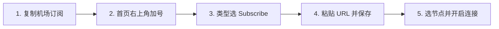

在 iPhone 与 iPad 的科学上网生态中，**Shadowrocket（中文俗称“小火箭”）** 是知名度最高、使用人数最广、综合体验最均衡的代理客户端。然而，刚接触 iOS 翻墙的新手用户往往会产生一系列认知误区与操作困扰：

**“为什么我在 App Store 付费下载了 Shadowrocket，打开后里面空空如也，连不上网？”**  
**“Shadowrocket 软件本身、机场服务商、订阅链接和节点之间到底是什么关系？”**  
**“为什么 iPhone 顶部状态栏已经显示了 VPN 图标，但打开 Google 或 ChatGPT 依然打不开？”**  
**“连接了美国节点，为什么我的 Apple ID 还是国区？手机连 Wi-Fi 正常但切到 5G 移动蜂窝网络就断流？”**

**Shadowrocket 是一款运行在 iOS / iPadOS 上的纯粹网络代理客户端工具，它本身 100% 不自带任何免费服务器节点，也不是一家售卖翻墙流量的“机场”公司。**

要让小火箭顺畅翻墙，必须遵循**「机场服务商 ➔ 专属订阅链接 ➔ Shadowrocket 客户端 ➔ iOS 系统 VPN 接口 ➔ 智能分流规则」**的完整通信链路。

本文为你提供 2026 年最系统、最权威的 Shadowrocket（小火箭）新手全景实操指南，从底层架构、软件购买、订阅导入、分流规则到全场景系统排障，手把手带你彻底掌握小火箭。

---

## ⚡ 30 秒快速看懂：Shadowrocket 怎么配、怎么用？

```text
┌─────────────────────────┬───────────────────────────────────┬──────────────────────────────────────┐
│ 你的当前状态 / 需求     │ 核心操作建议与认知基准            │ 推荐执行步骤与产品形态               │
├─────────────────────────┼───────────────────────────────────┼──────────────────────────────────────┤
│ 📱 刚下载完小火箭的新手 │ 软件是空壳工具，需导入机场订阅链接│ 从正规专线机场后台复制 Shadowrocket 链接│
│ 📋 订阅导入与节点更新   │ 首页右上角「+」➔ 类型选 Subscribe │ 粘贴 URL ➔ 自动拉取几十个海外专线节点 │
│ ⚙️ 路由分流模式选择     │ 保持为「配置 (Rule)」分流模式      │ 国内 App 极速直连，国外请求走加密代理 │
│ 🔑 首次点击连接开关     │ 弹出“Shadowrocket 想添加 VPN 配置” │ 必须点击「允许」并输入 iPhone 锁屏密码│
│ 🌐 解决 5G 移动网络断流 │ 蜂窝数据下断连或提示网络不可达    │ 进入设置将本地 DNS 解析设为 1.1.1.1   │
│ 📺 看 YouTube / Netflix │ 追求 4K 零缓冲秒开、晚高峰 0 丢包  │ 搭配 IEPL 企业物理专线套餐 (如光速云) │
│ 🚨 手机防断网应急备用   │ 0 月租、不限时流量包、随用随扣    │ 备用星岛梦不限时包，多设备同登防失联 │
└─────────────────────────┴───────────────────────────────────┴──────────────────────────────────────┘
```

> 💡 **最核心的新手认知纠错**：
> 1. **买软件 $\neq$ 买网络**：App Store 花费（约 \$2.99）仅购买了软件使用权，**节点流量需要另外向机场服务商按月/年订阅**；
> 2. **状态栏 VPN 图标 $\neq$ 节点可用**：iOS 状态栏的 `[VPN]` 图标仅代表小火箭接管了本地网络接口，不代表海外节点握手成功；
> 3. **普通翻墙绝不装证书**：正常使用小火箭**绝不需要安装 CA 根证书或开启 HTTPS 解密 (MITM)**，请务必保护手机隐私。

---

## 一、Shadowrocket 全景数据流转架构：从 iPhone 到海外出口

理解小火箭在 iOS 内部的数据流转过程，是理解分流、DNS 解析与网络排障的核心基础：

```mermaid
graph TD
    UserApp[iPhone 应用: Safari / Chrome / ChatGPT App / YouTube / X / 微信] --> InboundDecision{iOS NetworkExtension 虚拟网卡}
    
    InboundDecision --> ShadowrocketEngine[Shadowrocket 本地代理核心引擎]
    
    ShadowrocketEngine --> RuleEngine{内置 Rule 规则分流引擎}
    
    RuleEngine -->|国内域名/IP: 微信/淘宝/百度/Bilibili| DirectRoute[DIRECT: 走本地 Wi-Fi/5G 基站直连]
    RuleEngine -->|境外域名/IP: Google/YouTube/OpenAI| ProxyRoute[PROXY: 匹配对应策略组与出口节点]
    RuleEngine -->|广告/隐私追踪: 常见分析与广告 SDK| RejectRoute[REJECT: 本地丢弃静默拦截]
    
    ProxyRoute --> CryptoTunnel[TLS 加密协议隧道 (Shadowsocks / VLESS / Trojan / Hysteria 2)]
    CryptoTunnel --> DomesticRelay[国内入口服务器 / IEPL 物理专线内网]
    DomesticRelay --> ExitNode[海外出口落地机房 (香港/日本/新加坡/美国)]
    ExitNode --> TargetServer[目标海外网站: Google / OpenAI / YouTube 4K]
```

---

## 二、概念彻底澄清：Shadowrocket、小火箭、机场与传统 VPN 的关系

许多新手常被网上一堆类似的名词搞得晕头转向，以下大表为你彻底理清它们的技术定位：

```text
┌────────────────────────────────────────────────────────────────────────────────────────┐
│                   Shadowrocket 生态核心名词与技术分工全景大表                          │
├────────────────────┬──────────────┬────────────────────────────────────────────────────┤
│ 核心名词           │ 技术层级定位 │ 真实作用与相互关系                                 │
├────────────────────┼──────────────┼────────────────────────────────────────────────────┤
│ **Shadowrocket**   │ iOS 客户端软件│ 运行在 iPhone/iPad 上的第三方开源协议代理工具      │
├────────────────────┼──────────────┼────────────────────────────────────────────────────┤
│ **小火箭**         │ 俗称/别名    │ 中文互联网对 Shadowrocket 客户端的通用俗称 (同义词)│
├────────────────────┼──────────────┼────────────────────────────────────────────────────┤
│ **机场 (Airport)** │ 商业服务网络 │ 拥有境外服务器机房与物理专线的独立服务商 (提供订阅)│
├────────────────────┼──────────────┼────────────────────────────────────────────────────┤
│ **订阅 (Sub URL)** │ 远程配置接口 │ 服务商提供的一串加密 URL，小火箭通过它自动同步节点 │
├────────────────────┼──────────────┼────────────────────────────────────────────────────┤
│ **传统商业 VPN**   │ 传统网络工具 │ 如 ExpressVPN，采用单一全量隧道，无规则智能分流能力│
└────────────────────┴──────────────┴────────────────────────────────────────────────────┘
```

### 💡 核心认知厘清：
- **Apple ID 地区与节点地区无关**：注册外区（如美区/港区）Apple ID 仅用于在 App Store 中购买下载 Shadowrocket 软件；下载完成后，无论连接香港节点还是日本节点，**手机原有的 Apple ID 地区绝不会发生任何改变**；
- **小火箭购买费用与机场套餐费用完全独立**：App Store 付款给苹果官方开发者，机场套餐付款给网络服务商。

---

## 三、Shadowrocket 获取与购买渠道指南

由于政策与 App Store 区域上架规则，Shadowrocket 未在国区 App Store 上架：

| 获取途径 | 安全等级 | 风险评估与注意事项 |
| :--- | :---: | :--- |
| **自建外区 Apple ID 购买 (最推荐)** | 🟢 **100% 安全** | 注册美区/港区账号，通过官方礼品卡充值购买（约 \$2.99 一次性买断），终身绑定个人账号 |
| **购买正规独享外区已购账号** | 🟢 **安全可控** | 购买带小火箭已购记录的独享 Apple ID，在 App Store 登录下载后换回原账号 |
| **公共免费共享 Apple ID** | 🔴 **极度危险** | 容易因账号被锁导致无法退出；**绝对禁止在 iPhone「设置 (iCloud)」中登录他人账号** |
| **第三方助手安装的“破解版 IPA”** | 🔴 **严禁使用** | 常被植入恶意代码、窃取私有订阅链接、导致 App 频繁闪退无法更新 |

> ⚠️ **新手生命线警示**：
> 登录任何第三方或海外 Apple ID 时，**只能在「App Store」应用右上角的头像处登录，绝对不要在 iPhone 系统「设置 ➔ iCloud」处登录**，否则手机可能被远程锁死变成砖头！

---

## 四、Shadowrocket 导入订阅与配置 5 步全流程（How-To）

跟随以下标准化流程，只需 2 分钟即可完成 iPhone 端的完整配置：



### 步骤 1：获取 Shadowrocket 兼容订阅链接
登录正规专线机场官网后台（如 [光速云](/reviews/guangsu-cloud/) 或 [微风网络](/reviews/weifeng-cloud/)），进入用户中心，找到订阅区域，点击「复制 Shadowrocket 订阅链接」或「复制通用订阅」。

### 步骤 2：在小火箭中添加订阅
1. 打开 Shadowrocket 客户端，进入主界面；
2. 点击右上角的 **「+」号** 进入节点添加页面；
3. 点击第一行的 **「类型 (Type)」**，在弹出的菜单中将其改为 **「Subscribe (订阅)」**。

### 步骤 3：粘贴 URL 并保存
1. 在 **「URL」** 一栏中粘贴刚才复制的订阅链接；
2. 在 **「备注 (Remark)」** 一栏填写便于识别的名称（如“01-主力专线”）；
3. 点击右上角的 **「完成 / 保存」** 按钮，客户端会自动向服务器发起请求并展开拉取几十个节点。

### 步骤 4：选择代理节点并测速
回到主界面：
1. 点击「连通性测试」对所有节点批量测速；
2. 点击选中一个绿色的低延迟专线节点（如“香港 01 IEPL”或“日本 01 IEPL”），选中后节点左侧会出现黄色或绿色高亮圆点。

### 步骤 5：开启连接并授权 iOS 系统 VPN 配置
1. 确保全局路由模式保持为 **「配置 (Rule)」**；
2. 拨动主界面最顶部的 **「未连接」开关**；
3. 首次开启时，iOS 系统会弹出窗口提示：*“Shadowrocket 想添加 VPN 配置”*，**必须点击「允许 (Allow)」并输入 iPhone 锁屏密码或通过 Face ID 验证**；
4. 顶部状态栏亮起 `[VPN]` 小图标，打开 Safari 访问 Google 即可畅快上网。

---

## 五、核心机制全解析：配置 (Rule)、全局 (Proxy) 与 直连 (Direct)

在主界面的「全局路由」选项中，可以自由切换三种工作模式：

| 路由模式 | 流量处理机制 | 典型适用场景 | 优缺点分析 |
| :--- | :--- | :--- | :--- |
| **配置模式 (Rule)**<br>*(推荐默认)* | 按照内置规则集智能分流：国内网站直连，国外被墙网站走代理 | **日常 99% 的主力使用场景** | 🟢 国内微信、淘宝极速直连不耗流量，国外自动翻墙；无需频繁开关 |
| **全局代理 (Proxy)**<br>*(故障排查)* | 所有流经小火箭的数据包强制全部走代理节点 | **网络故障诊断**、访问部分小众境外冷门网站 | 🔴 访问国内网站变慢且白白消耗套餐流量；**不是性能加速模式** |
| **直连模式 (Direct)**<br>*(临时直连)* | 所有流量直接连接目标服务器，不经过任何代理节点 | 临时暂停代理功能、排查本地宽带物理连通性 | 🔴 境外被屏蔽网站（如 Google）将全部无法打开 |

> ⚠️ **关键诊断信号**：
> 如果遇到 **“全局模式可以打开网页，但切回配置模式就打不开”** 的情况，说明**你的机场节点完全正常**，问题出在分流规则集未收录目标域名或本地 DNS 解析被污染。

---

## 六、iOS VPN 配置与证书安全深度剖析（普通翻墙绝不装证书）

很多新手在网上看了一些过时的教程，盲目在小火箭中生成证书并安装到 iPhone 系统中，这存在巨大的隐私安全隐患：

```text
┌────────────────────────────────────────────────────────────────────────┐
│                 系统 VPN 授权 vs HTTPS 解密 (MITM) 证书区别            │
├────────────────────┬────────────────────┬──────────────────────────────┤
│ 对比维度           │ iOS 系统 VPN 授权  │ HTTPS 解密 (MITM) 根证书     │
├────────────────────┼────────────────────┼──────────────────────────────┤
│ 授权方式           │ 首次连接时输入锁屏密码│ 下载描述文件并到系统设置中信任│
├────────────────────┼────────────────────┼──────────────────────────────┤
│ 真实用途           │ 允许小火箭建立本地虚拟 │ 用于解密 HTTPS 流量以实现去广告│
│                    │ 网卡以拦截网络流量 │ 或脚本重写等高级开发调试     │
├────────────────────┼────────────────────┼──────────────────────────────┤
│ 普通翻墙是否需要   │ ✅ **必须授权**    │ ❌ **坚决不需要！**          │
├────────────────────┼────────────────────┼──────────────────────────────┤
│ 隐私与安全风险     │ 正常系统网络权限   │ ⚠️ 若信任来源不明的根证书，可能│
│                    │ 安全受 iOS 沙盒保护│ 导致网银、密码明文被中间人截获│
└────────────────────┴────────────────────┴──────────────────────────────┘
```

> 🛑 **安全底线**：
> **日常使用机场节点看视频、查资料、用 ChatGPT，100% 不需要安装任何 CA 根证书！** 遇到任何要求“必须安装描述文件并信任根证书才能使用”的机场或教程，请立即提高警惕。

---

## 七、蜂窝网络 vs Wi-Fi 断流深度排查

很多 iPhone 用户常遇到：“连家里 Wi-Fi 很顺畅，但一出门切到 5G 移动蜂窝网络就提示网络连接失败”：

### 核心诱因与秒级修复方案：
1. **蜂窝网络 IPv6 阻断**：国内运营商的 5G 移动网络普遍默认分配 IPv6 地址，若节点对 IPv6 兼容较差会导致断流。在小火箭的「设置」中将 DNS 解析优先设为 IPv4；
2. **本地 DNS 解析死锁**：在小火箭的「设置 ➔ DNS」中，将 DNS 服务器手动指定为公共高可用 DoH 地址：`https://1.1.1.1/dns-query` 或 `8.8.8.8`；
3. **无线局域网与蜂窝权限未开启**：进入 iPhone「设置 ➔ 蜂窝网络 ➔ 找到 Shadowrocket」，确保其网络权限设置为 **「无线局域网与蜂窝数据」**。

---

## 八、节点地区科学选型指南：港、日、新、美怎么选？

| 节点地区 | 物理往返延迟 (Ping) | 适用核心场景 | 优势与注意事项 |
| :--- | :---: | :--- | :--- |
| **🇭🇰 香港 (Hong Kong)** | **20ms ~ 45ms** (极低) | 网页急速浏览、即时通讯、文献检索、日常刷推 | 物理距离最近，交互秒响应；但注意 Claude/部分 AI 平台不开放香港 IP |
| **🇯🇵 日本 (Japan)** | **45ms ~ 75ms** (低) | ChatGPT 对话、YouTube 4K 追剧、DMM、TikTok | 亚洲网络核心枢纽，国际互联带宽极充沛，晚高峰抗压极稳 |
| **🇸🇬 新加坡 (Singapore)** | **50ms ~ 80ms** (低) | 东南亚服手游、TikTok 运营、亚洲备用节点 | 适合中国南方移动/电信宽带用户，流媒体版权库极其丰富 |
| **🇺🇸 美国 (United States)** | **130ms ~ 180ms** (一般) | Claude 3.5 Sonnet、OpenAI 开发者 API、Docker | 虽物理延迟略高，但所有美区本土 AI 生产力与云原生平台均优先适配 |

> 📌 **测速数字背后的真相**：
> 节点测速显示的延迟（Ping）只是握手响应时间，**不等于下载速度**。香港普通公网节点即使 Ping 只有 25ms，若晚高峰丢包严重，看 4K 依然卡顿；而日本 IEPL 专线虽然 Ping 65ms，但由于独享带宽零丢包，能跑满 500Mbps 宽带。详细原理解析推荐阅读：[《为什么节点延迟低但实际速度慢？》](/issues/low-ping-slow-speed-reasons/)。

---

## 九、Shadowrocket 终极排障手册（7 步递进排查法）

遇到网络故障时，切忌盲目卸载重装小火箭，请严格按照以下**7 步递进排查链**进行定位：

```mermaid
graph TD
    SubTrouble[Shadowrocket 网络故障排查] --> Step1[1. 关小火箭测裸网 ➔ 确认手机基础网络正常]
    Step1 --> Step2[2. 首页下滑刷新订阅 ➔ 确保节点 IP 与端口为最新]
    Step2 --> Step3[3. 连续切换 3 个不同地区节点 ➔ 排除单节点维护]
    Step3 --> Step4[4. 切到「全局 (Proxy)」模式测试 ➔ 判定是否为规则/DNS问题]
    Step4 --> Step5[5. 切换 Wi-Fi 与 5G 蜂窝网络 ➔ 排除本地网络环境干扰]
    Step5 --> Step6[6. 检查系统时间 ➔ 确保 iPhone 开启了自动设置时间]
    Step6 --> Step7[7. 登录机场后台 ➔ 核实套餐未欠费且流量未耗尽]
```

### 常见错误代码速查表：
| 错误类型 | 通常意味着什么 | 优先检查与修复方案 |
| :--- | :--- | :--- |
| **Timeout (超时)** | 在规定时间内未能完成网络握手 | 切换同地区备用节点；核查套餐是否过期；下滑刷新订阅 |
| **Connection Refused** | 远端服务器明确拒绝连接或端口未监听 | 节点服务器处于维护状态，切换其他可用节点 |
| **Network Unreachable** | 本地网络路由无法到达目标入口 | 检查手机 Wi-Fi/5G 是否断开，重启蜂窝网络 |
| **DNS Error** | 域名解析失败，无法获取服务器 IP | 将客户端 DNS 改为 `1.1.1.1` 或 `8.8.8.8` |
| **TLS Error** | 安全加密证书验证失败 | **确保 iPhone 设置中的“自动设置时间”处于开启状态** |
| **404 / 403** | 订阅请求资源不存在或鉴权失败 | 重新复制最新订阅链接，或检查套餐是否欠费 |

---

## 十、Shadowrocket 高适配性专线品牌推荐矩阵

针对 iOS 小火箭订阅一键导入、规则兼容性与晚高峰抗压，精选以下真实稳定方案：

```text
┌────────────────────────────────────────────────────────────────────────────────────────┐
│                        2026 Shadowrocket 精选专线品牌候选矩阵                          │
├──────────┬──────────────────────────┬──────────────┬──────────────┬────────────────────┤
│ 适配场景 │ 推荐品牌候选             │ 实际起付门槛 │ 每月流量配额 │ 小火箭适配优势     │
├──────────┼──────────────────────────┼──────────────┼──────────────┼────────────────────┤
│ 全能主力 │ 光速云 (GuangSuYun)      │ 约 ¥7.5/月起 │ 59G~238G /月 │ 6年老牌物理专线，一键导入小火箭，4K秒开 0 丢包│
│ 平价轻量 │ 微风网络 (BreezeNet)     │ 约 ¥7/月起   │ 50GB / 月    │ 专为手机端查资料与AI优化，年付百元内极低负担│
│ 弹性月付 │ 唯兔云 (V2Yun)           │ ¥14.9/月     │ 100GB / 月   │ 15元单月付，60+多国节点备用，随用随买 │
│ 应急备用 │ 星岛梦 (XingDaoMeng)     │ 约 ¥8/月起   │ 60G/不限时包 │ 0月租不限时包，iPhone防断网首选备用通道 │
│ AI/开发  │ 速界 (SpeedWorld)        │ ¥25/月       │ 150GB / 月   │ 原生纯净住宅 IP，ChatGPT/Claude 秒级响应 │
└──────────┴──────────────────────────┴──────────────┴──────────────┴────────────────────┘
```

- 🏆 **全能旗舰首选**：[光速云](/reviews/guangsu-cloud/) —— 全线企业级 IEPL 物理专线，Shadowrocket 格式完美兼容，晚高峰 20:00 4K 零卡顿；
- 🍃 **超低预算轻量**：[微风网络](/reviews/weifeng-cloud/) —— 针对手机轻度查资料与文字 AI 优化的 50GB 小流量专线，年付折算仅约 ¥7/月；
- 💳 **拒绝绑定的单月付**：[唯兔云](/recommend/best-airports/) —— ¥14.9 纯单月付，100GB 充沛流量，节点丰富。

---

## 十一、Shadowrocket 使用 18 项安全与配置自查清单

```text
┌────────────────────────────────────────────────────────────────────────┐
│                   Shadowrocket 18 项配置与安全通关清单                 │
├────────────────────────────────────────────────────────────────────────┤
│ □ 1. Shadowrocket 是通过官方 App Store 获取的正版应用，绝非破解版 IPA   │
│ □ 2. 仅在 App Store 内登录外区 Apple ID，未在 iPhone「设置-iCloud」登录 │
│ □ 3. 机场订阅链接已成功导入，且主界面能正常展示几十个服务器节点列表   │
│ □ 4. 首次开启连接时，已在系统弹窗中点击「允许」并正确添加了 VPN 配置   │
│ □ 5. 全局路由模式已确认为「配置 (Rule)」智能分流模式                   │
│ □ 6. 访问国内应用 (如微信/淘宝/B站) 依然走直连，不消耗套餐流量        │
│ □ 7. 批量测速后，所选节点显示为具体绿色延迟数值 (如 35ms / 60ms)       │
│ □ 8. 在 iPhone 设置中已确认「自动设置时间」处于开启状态 (防 TLS 报错)  │
│ □ 9. 我确认未在手机上安装任何来源不明的 CA 根证书或开启全局 MITM 解密  │
│ □ 10. 手机切到 5G 蜂窝网络时，Safari 依然能正常打开 Google 与 YouTube   │
│ □ 11. 我确认绝不将自己的专属订阅链接公开截图或发到公共技术社群        │
│ □ 12. 遇到节点偶发红线超时，我已掌握在首页直接向下拉动「一键刷新订阅」│
│ □ 13. 手机中已常备第二个备用服务商的订阅或不限时按量流量包            │
│ □ 14. 手机未同时开启其他互相冲突的商业 VPN 或网络加速应用             │
│ □ 15. 已确认 Shadowrocket 在蜂窝设置中拥有「无线局域网与蜂窝数据」权限 │
│ □ 16. 我清楚了解开启翻墙并不代表可以匿名违规，承诺文明合法用网        │
│ □ 17. 遇到网络严重异常时，已掌握「先测裸网 ➔ 刷新订阅 ➔ 切全局」排查法 │
│ □ 18. 在公共 Wi-Fi 环境下使用时，开启小火箭能对出站网络数据进行加密保护│
└────────────────────────────────────────────────────────────────────────┘
```

---

## 十二、避坑指南：25 个关于“Shadowrocket / 小火箭”的致命认知误区

```text
❌ 误区 1：在 App Store 花钱买了 Shadowrocket 就自动拥有了免费翻墙能力 ➔ 事实：客户端是空壳，必须导入机场订阅。
❌ 误区 2：Shadowrocket 是一家卖梯子的商业公司 ➔ 事实：它是一款独立的第三方代理客户端工具。
❌ 误区 3：小火箭节点就是小火箭官方提供的 ➔ 事实：节点全由第三方机场服务商提供。
❌ 误区 4：必须一直开着“全局路由 (Proxy)”模式 ➔ 事实：全局会导致访问国内微信、淘宝变慢且浪费套餐流量。
❌ 误区 5：状态栏亮起 VPN 图标就代表一定能翻墙 ➔ 事实：VPN 图标只代表小火箭开启了本地接口，不代表节点可用。
❌ 误区 6：连接了美国节点，iPhone 的 Apple ID 就会变成美区 ➔ 事实：节点出口 IP 与 Apple ID 账号所属区域完全无关。
❌ 误区 7：普通使用小火箭必须先下载并信任 CA 根证书 ➔ 事实：正常翻墙 100% 不需要装证书，装证书有隐私泄露风险。
❌ 误区 8：开启 MITM（中间人解密）可以让网速翻倍 ➔ 事实：MITM 是高级抓包解密功能，与网络速度毫无加速关系。
❌ 误区 9：测速 Ping 越低，在 YouTube 上看 4K 视频就越快 ➔ 事实：低 Ping 不等于高带宽，晚高峰物理专线 0 丢包才是关键。
❌ 误区 10：可以在 iPhone「设置-iCloud」中直接登录网上的共享 Apple ID ➔ 事实：极其危险！手机会被远程锁死敲诈勒索。
❌ 误区 11：在网上下载免费的“小火箭破解版 IPA”很划算 ➔ 事实：破解版常被植入后门、盗取订阅 Token 甚至窃取密码。
❌ 误区 12：订阅更新显示 404 代表服务商跑路 ➔ 事实：通常是服务商更换了订阅域名或更新了用户 Token 路径。
❌ 误区 13：订阅更新显示 403 一定是因为流量耗尽 ➔ 事实：也可能是短时间内高频刷新触发了服务商防火墙。
❌ 误区 14：只要连接了美国节点，ChatGPT 就 100% 能用 ➔ 事实：机房共享脏 IP 会被 OpenAI 拦截报 403 阻断。
❌ 误区 15：一个节点超时代表整个机场所有节点都坏了 ➔ 事实：单节点维护很常见，应切换其他 2~3 个节点交叉测试。
❌ 误区 16：可以同时打开 Shadowrocket、Surge 和商业 VPN ➔ 事实：多个客户端会互相争抢 iOS 系统 VPN 接口导致断网。
❌ 误区 17：遇到打不开网页第一步必须把小火箭卸载重装 ➔ 事实：重装无法解决订阅失效或节点超时，多为徒劳。
❌ 误区 18：只要能打开 Google 搜索就代表 Netflix 完整解锁 ➔ 事实：需具备原生家庭住宅 IP 才能看全量版权剧集。
❌ 误区 19：IEPL 是一种加密协议 ➔ 事实：IEPL 是国际内网专线物理传输线路，不是代理协议。
❌ 误区 20：5G 移动网络的速度永远比 Wi-Fi 稳定 ➔ 事实：5G 基站信号波动或运营商 IPv6 干扰常导致断流。
❌ 误区 21：订阅链接可以随意发给微信好友使用 ➔ 事实：订阅包含个人密钥，分享会导致流量被盗刷甚至封号。
❌ 误区 22：小火箭锁屏后断开是手机中毒了 ➔ 事实：多为 iOS 系统的后台应用刷新机制暂停了非活跃网络活动。
❌ 误区 23：免费公开分享的节点很安全 ➔ 事实：公开节点随时失效，且存在抓包记录用户未加密流量的风险。
❌ 误区 24：改个“神奇 DNS”能让小火箭速度提升 10 倍 ➔ 事实：DNS 仅影响域名首包解析，不影响视频下载带宽。
❌ 误区 25：购买了 Shadowrocket 之后必须年年续费软件 ➔ 事实：App Store 购买为一次性买断，后续终身免费更新。
```

---

## 十三、常见问题深度解答（FAQ · 40 问）

### Q1：Shadowrocket 是什么？
**答**：Shadowrocket 是一款运行在 iOS（iPhone/iPad）上的高性能多协议代理客户端工具，支持 Shadowsocks、VLESS、Trojan、Hysteria 2 等全协议解析与智能规则分流。

### Q2：小火箭是什么？
**答**：**“小火箭” 是中文用户对 Shadowrocket 客户端的通用俗称**，因为其应用图标为一颗发射的火箭，两者指的是同一个软件。

### Q3：Shadowrocket 是不是梯子？
**答**：口语中常被泛称为“小火箭梯子”，但技术上它只是**客户端工具**，真正提供网络流量与境外服务器节点的是机场服务商。

### Q4：Shadowrocket 是不是机场？
**答**：**不是。** 机场是售卖服务器节点与流量的服务商；Shadowrocket 是运行在 iPhone 上的开源协议解析与连接软件。

### Q5：Shadowrocket 自带免费节点吗？
**答**：**不自带。** 官方 App Store 下载的正版软件为纯粹的工具空壳，必须由用户购买并导入外部机场订阅链接才能联网。

### Q6：购买了 Shadowrocket 后还需要买机场吗？
**答**：**必须购买。** 购买小火箭仅获得了软件使用授权，要实现科学上网还必须向机场服务商按月或按年订阅服务器流量。

### Q7：Shadowrocket 当前在 App Store 多少钱？
**答**：在美区/港区 App Store 的官方售价通常为 **\$2.99 美元（或 HK\$ 23 港币）**，为一次性买断制，后续大版本更新完全免费。

### Q8：为什么在中国大陆 App Store 搜不到 Shadowrocket？
**答**：由于政策监管原因，该软件未在中国大陆区 App Store 上架。需使用美区、港区或台区等海外 Apple ID 登录 App Store 后方可搜索并下载。

### Q9：Shadowrocket 订阅是什么？
**答**：是一串由机场服务商生成的专属 URL 地址，小火箭通过该链接可一键自动下载并解析包含几十个境外服务器节点与分流规则的配置文件。

### Q10：Shadowrocket 怎么导入订阅？
**答**：打开小火箭，点击右上角 **「+」号** ➔ 类型选择 **「Subscribe」** ➔ 在 URL 栏粘贴订阅链接 ➔ 点击右上角保存，即可自动拉取节点列表。

### Q11：小火箭怎么导入单个节点？
**答**：点击右上角「+」号，类型选择对应的协议（如 Shadowsocks、VLESS 或 Trojan），手动填入服务器地址、端口、UUID 和密码后保存；或直接点击左上角扫描节点的二维码。

### Q12：Shadowrocket 订阅和节点有什么区别？
**答**：**订阅**是包含所有节点信息的“云端提货单”；**节点**是提货单中具体的某一台境外代理服务器（如香港 01、日本 02）。

### Q13：Shadowrocket 可以扫描二维码导入吗？
**答**：可以。点击小火箭首页左上角的**「扫描」图标**，对准机场后台提供的节点或订阅二维码扫描，即可秒级导入配置。

### Q14：小火箭节点怎么选？
**答**：日常查资料和低延迟操作首选**香港/日本专线节点**；使用 ChatGPT/Claude 建议首选**日本/美国原生专线节点**；看流媒体需选标有“解锁”字样的节点。

### Q15：为什么 Shadowrocket 节点测速 Ping 很低但速度很慢？
**答**：Ping 只代表连接响应时间，不代表带宽容量；若节点遭遇晚高峰严重超售丢包，即使 Ping 只有 30ms，实际视频下载依然会转圈。

### Q16：Shadowrocket 节点全部显示 Timeout 怎么办？
**答**：先关小火箭确认手机裸网正常，在首页**向下拉动刷新订阅**；若仍全红，切换手机 5G 热点测试，排查家庭 Wi-Fi 阻断。

### Q17：订阅更新显示 404 怎么办？
**答**：说明该订阅链接地址已失效，通常是因为服务商更换了订阅域名或重置了个人 Token，需登录官网后台重新复制最新链接。

### Q18：订阅更新显示 403 怎么办？
**答**：说明请求被服务器拒绝，通常是因为套餐已欠费过期，或者短时间内高频刷新触发了防刷机制，稍等 5 分钟后再试。

### Q19：Shadowrocket 显示 VPN 图标但无法上网怎么办？
**答**：排查所选节点是否超时、全局路由是否误设为 Direct 直连、或 iPhone 设置中的时间未开启自动同步。

### Q20：配置 (Rule) 模式是什么？
**答**：配置模式是小火箭的智能分流模式，访问国内网站（百度/淘宝/微信）走直连不耗流量，访问境外网站（Google/YouTube）自动走代理。

### Q21：全局代理 (Proxy) 模式是什么？
**答**：全局模式强制接管范围内的所有流量全部走代理，通常用于网络故障排查，日常使用不建议常开。

### Q22：直连 (Direct) 模式是什么？
**答**：直连模式让所有网络请求直接连接目标服务器，不经过任何代理，相当于临时停用翻墙功能。

### Q23：为什么全局模式能用，配置模式不能用？
**答**：说明机场节点本身完全正常，故障出在规则集未匹配目标域名或本地 DNS 发生了解析异常。

### Q24：Shadowrocket 需要手动修改 DNS 吗？
**答**：正常情况下使用默认 DNS 即可；若在 5G 移动网络下遇到网页打不开，可在设置中将 DNS 手动指定为 `1.1.1.1` 或 `8.8.8.8`。

### Q25：Shadowrocket 需要安装 CA 证书吗？
**答**：**坚决不需要。** 正常翻墙完全无需安装证书，只有需要进行 HTTPS 流量解密与去广告脚本开发的高级用户才需配置。

### Q26：Shadowrocket 需要开启 MITM 吗？
**答**：**不需要。** MITM 是中间人解密技术，开启不仅不会提升网速，反而增加手机功耗并带来潜在安全风险。

### Q27：为什么连 Wi-Fi 正常，但切到 5G 蜂窝网络就断网？
**答**：排查 iPhone「设置 ➔ 蜂窝网络 ➔ Shadowrocket」权限是否开启；并在小火箭设置中优先启用 IPv4 解析。

### Q28：为什么连 5G 正常，但连家里 Wi-Fi 却无法联网？
**答**：说明家用路由器开启了端口防火墙拦截，或宽带运营商在本地存在特定协议阻断。可尝试在路由器中更改 DNS 或切换专线节点。

### Q29：Shadowrocket 为什么速度慢？
**答**：速度慢多因本地 Wi-Fi 信号衰减、晚高峰国际出口拥堵或节点超售丢包所致。建议选用 **企业级 IEPL 物理专线套餐**。

### Q30：Shadowrocket 经常掉线怎么办？
**答**：在 iOS 设置中确保开启了 Shadowrocket 的后台应用刷新权限，并在小火箭设置中开启“按需求连接”。

### Q31：Shadowrocket 耗电严重吗？
**答**：正常网络代理耗电极低；只有当开启了复杂的本地脚本重写或持续进行几十 GB 的大流量 4K 视频下载时，电量消耗才会明显上升。

### Q32：Shadowrocket 可以用 ChatGPT 吗？
**答**：可以。选用美区或日区纯净的原生专线节点，并确保全局路由为“配置”模式即可顺畅使用官方 App 与网页版。

### Q33：Shadowrocket 可以看 YouTube 4K 吗？
**答**：可以。选用 **IEPL 物理专线节点**（保障晚高峰 0 丢包），即可轻松跑满 4K 甚至 8K 超高清视频。

### Q34：Shadowrocket 可以看 Netflix 吗？
**答**：可以。选用机场列表中标有“Netflix / 奈飞解锁”的原生住宅节点即可观看全量版权剧集。

### Q35：Shadowrocket 免费节点安全吗？
**答**：安全性较低。公开分享的免费节点极易失效，且存在抓包记录用户未加密流量的风险，建议仅作为临时应急。

### Q36：一个机场订阅可以同时在 iPhone 和电脑上使用吗？
**答**：取决于服务商套餐规则。大多数正规机场支持 2~5 台设备同时在线使用，可将同一订阅链接分别导入小火箭与电脑客户端。

### Q37：小火箭订阅链接泄露了怎么办？
**答**：立刻登录机场官网后台，找到订阅管理页面，点击「重置订阅 Token / 重置链接」，使旧链接彻底作废。

### Q38：Shadowrocket 可以在 iPad 和 Mac 上使用吗？
**答**：可以。在搭载 Apple Silicon（M1/M2/M3/M4）芯片的 Mac 电脑上，可直接在 Mac App Store 中下载并运行 iPad 版 Shadowrocket。

### Q39：为什么小火箭一开启，手机发热严重？
**答**：检查是否误开启了 MITM 解密或加载了超大型复杂重写脚本；日常使用关闭所有解密功能即可保持清凉省电。

### Q40：Shadowrocket 梯子应该选月付还是年付？
**答**：**新用户首次接触某个品牌坚守月付**（¥15 左右），在 iPhone 上实测晚高峰、5G 蜂窝与 4K 稳定后，再考虑年付享受折算优惠。

---

## 🏁 总结：Shadowrocket 科学上网终极实操心法

要在 iPhone 上获得极致稳定、省电且全场景兼容的上网体验，请牢记以下**三大原则**：

```text
1. 认清工具分工 ➔ Shadowrocket 是客户端 (一次性买断)，专线机场是节点与汽油 (按月/年订阅)
2. 守住安全底线 ➔ 正常翻墙绝不装 CA 根证书，绝不开启 MITM 解密，保护个人隐私
3. 掌握核心排障 ➔ 节点超时直接向下拉动刷新订阅，5G 断流检查蜂窝权限与修改 DNS
```

---

### 📚 延伸进阶阅读与选型专栏
- 📱 **iPhone 设备总指南**：[《iPhone梯子怎么用？Shadowrocket、小火箭、订阅与节点新手完整教程》](/tutorials/iphone-tizi/)
- 📱 **移动设备总入口**：[《手机梯子哪个好？Android、iPhone梯子工具与新手使用指南》](/recommend/mobile-tizi/)
- 🤖 **Android 独立指南**：[《安卓梯子怎么选？Android客户端、订阅、节点与故障完整指南》](/tutorials/android-tizi/)
- 💻 **电脑端总指南**：[《电脑梯子哪个好？Windows 10/11、Mac梯子工具与客户端完整指南》](/recommend/pc-tizi/)
- 🛠️ **Clash 生态总指南**：[《Clash梯子怎么用？Clash Verge Rev、Mihomo、订阅与节点完整教程》](/tutorials/clash-tizi/)
- 🔴 **节点超时专题**：[《Clash 节点 Timeout 怎么办？全部节点红色与网络异常排查》](/issues/clash-node-timeout/)
- ⚡ **老牌旗舰专线**：[《光速云深度评测：2020老牌IEPL专线与解锁实测》](/reviews/guangsu-cloud/)
- 🍃 **平价轻量专线**：[《微风网络深度评测：小流量套餐值不值得买？》](/reviews/weifeng-cloud/)
- 🏆 **2026 全景大榜**：[《2026梯子推荐：稳定、速度、价格、安全与不同使用场景怎么选》](/recommend/best-tizi/)
