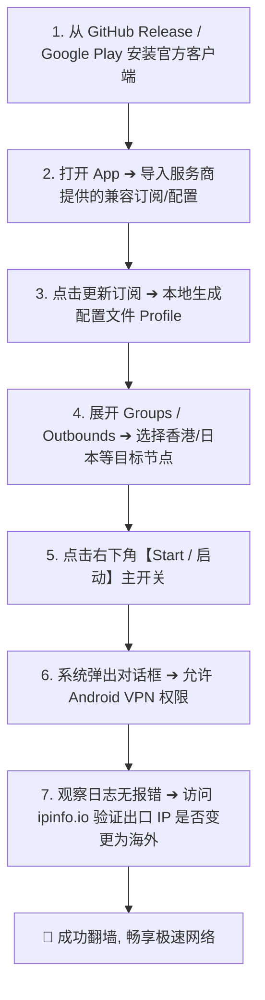
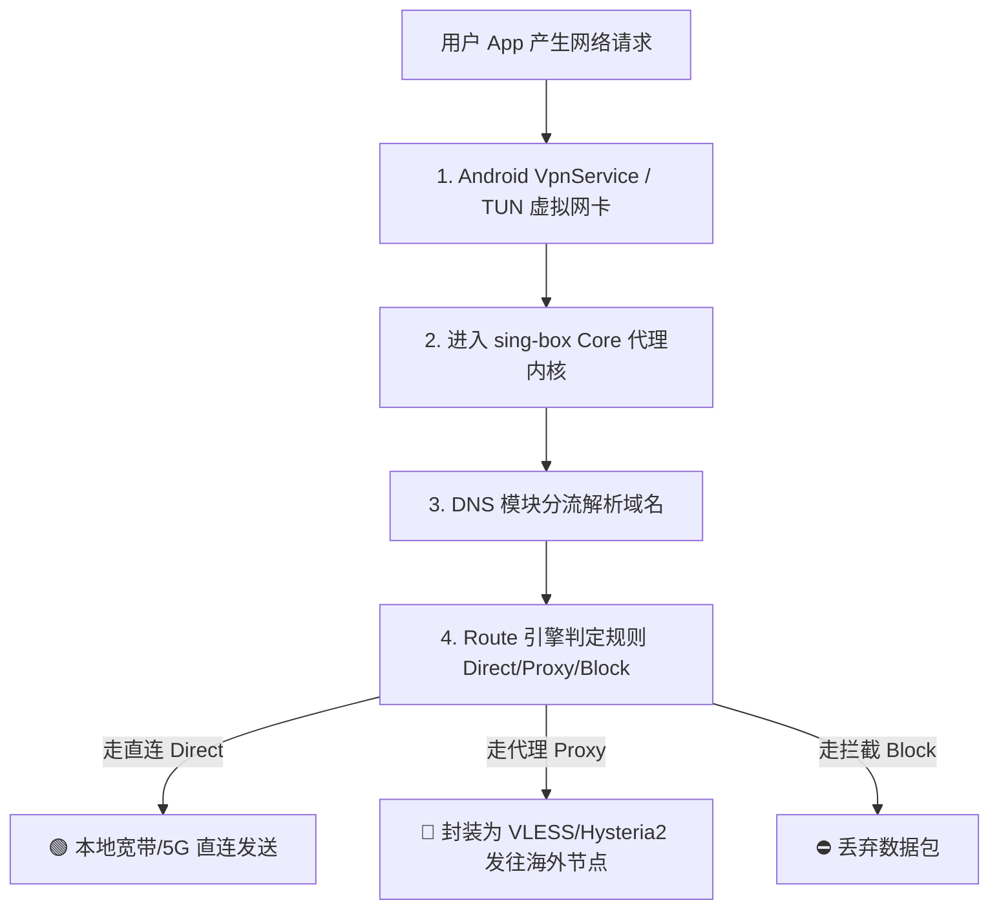
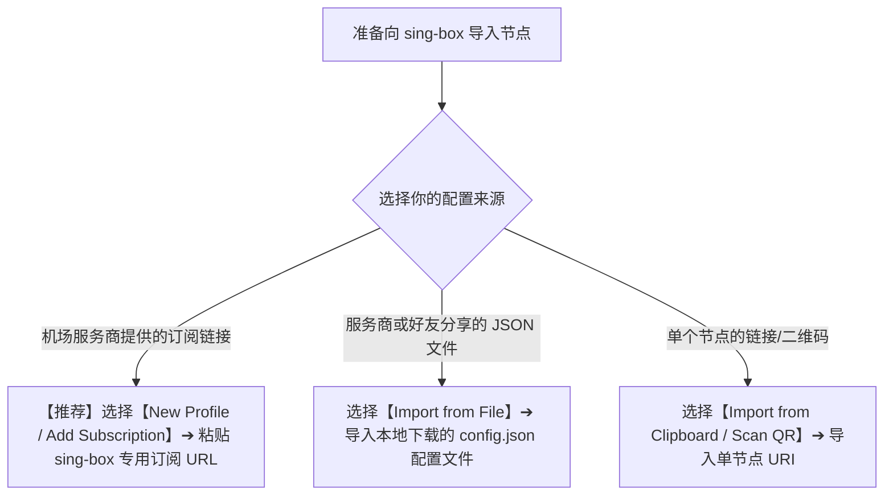
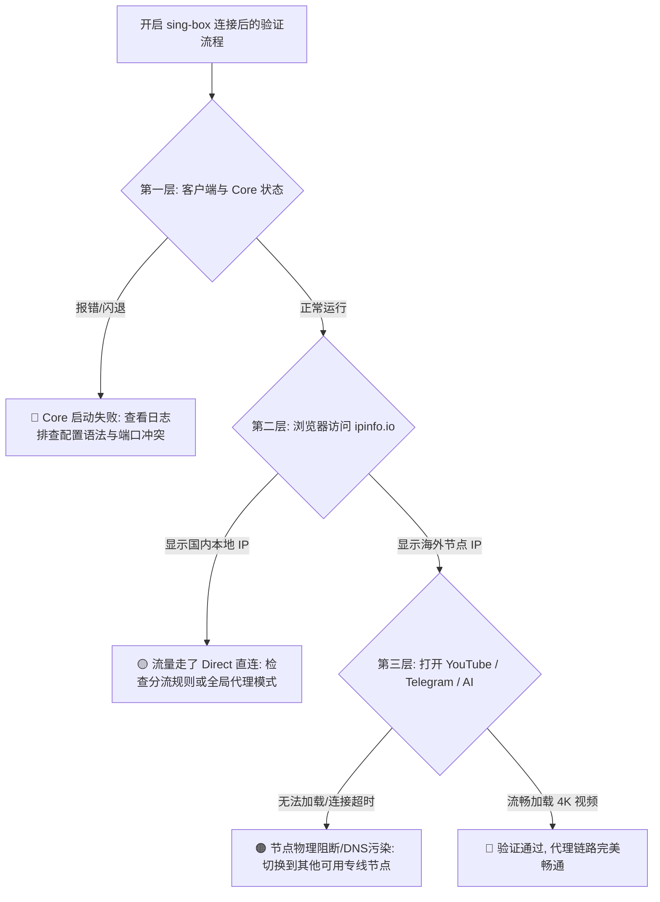

在 Android 安卓手机或平板设备上，**sing-box** 凭借其现代化的底层架构、原生高效的 TUN 虚拟网卡接管能力以及对 VLESS、REALITY、Hysteria 2、Trojan、Shadowsocks 等主流协议的全面支持，正在迅速成为众多极客与进阶用户的首选代理工具。

然而，对于刚刚从 v2rayNG、Clash 或小火箭迁移过来的新手用户来说，sing-box 的使用逻辑往往显得相当陌生甚至令人困惑：

**“sing-box 的安卓客户端到底去哪里下载才是官方正版？APK 后缀那么多，我的手机到底该选 `arm64-v8a` 还是 `universal`？”**  
**“为什么我把机场复制给我的 Clash 订阅或者 V2Ray 订阅直接粘贴进 sing-box，会提示‘解析错误’或‘配置格式不受支持’？”**  
**“手机状态栏上明明已经弹出了 VPN 钥匙图标，为什么打开 Google 或 YouTube 却依然提示‘无法连接到互联网’？”**  
**“sing-box 里面的 TUN 模式到底是什么？它和安卓系统的 VpnService 是什么关系？开启 TUN 会不会让手机非常耗电？”**  
**“导入了订阅之后，到底该怎么切换节点？为什么选中了日本节点，去查 IP 却依然显示国内本地的电信/联通 IP？”**  
**“作为一个刚上手的新手，第一次配置 sing-box 时到底需不需要手写复杂的 JSON 文件，或者修改 DNS 和 Route 路由规则？”**  
**“遇到节点 Timeout、有节点但打不开网页、连接频繁断开或配置报错时，应该按照怎样的顺序进行排查？”**

**sing-box 在 Android 上的日常使用，本质上是一个标准严谨的“五步流转流水线”：从官方可信渠道安装客户端 ➔ 导入服务商提供的兼容配置或订阅 ➔ 选择目标代理出口（Outbound 节点） ➔ 授权 Android 系统 VpnService 并启动内核 ➔ 进行出口 IP 与实际网络的三层验证。**

新手配置 sing-box，切忌一上来就盲目去折腾上千行复杂的自定义 JSON 脚本，而必须建立一套 **八维 Android sing-box 实操认知模型**：**“先分清 GUI 与 Core ➔ 认准官方 APK 与 CPU 架构 ➔ 理解‘配置文件 vs 订阅 vs 单节点’ ➔ 掌握 VpnService 与 TUN 流量接管 ➔ 严格执行三层连接验证 ➔ 保持默认 Route 与 DNS 最小化 ➔ 区分‘App更新 / Core更新 / 订阅更新’ ➔ 建立精准的故障分流通道”**。

本文作为 **sing-box Android 客户端实操使用主教程与入门 Pillar 指南**，将为你提供 **最详尽、最标准的 10 步上手指南，带你从零基础小白无缝跨越到熟练配置**。

---

## ⚡ 60 秒极速上手：sing-box Android 核心操作流水线



- 🚨 **新手第一黄金法则**：
  - **VPN 图标出现 ≠ 节点连接成功**：状态栏的“小钥匙/VPN”图标仅代表 Android 系统的虚拟网卡接口被激活，并不代表远端海外服务器已经通畅。必须通过“日志无报错 + 出口 IP 切换成功 + 实际网页打开”进行 **三层验证**！

---

## 一、架构基石：客户端、Core、配置、订阅与 TUN 的从属关系

在点击任何按钮之前，先用 1 分钟理清以下 **核心概念的从属逻辑**，能帮你避开 90% 的低级配置错误：

```text
┌────────────────────────────────────────────────────────────────────────────────────────┐
│                        sing-box Android 五大核心组件关系表                             │
├──────────────┬────────────────────────┬────────────────────────┬───────────────────────┤
│ 组件名称     │ 物理存在形式           │ 承担的核心职责         │ 常见认知误区与排查要点│
├──────────────┼────────────────────────┼────────────────────────┼───────────────────────┤
│ **1. GUI 客户端**│ Android App 图形界面   │ 提供人机操作交互、管理配置| GUI 只是外壳，不等于 Core 引擎本身│
│ **2. sing-box Core**| 底层代理引擎（C++/Go） │ 加密握手、路由匹配、DNS 解析| 运行在后台，是所有代理计算的核心│
│ **3. 配置文件**│ 本地结构化 JSON 数据   │ 告诉 Core 如何管理入口与出口| 包含 Inbound、Outbound、Route 等│
│ **4. 订阅链接**│ 远程 HTTP/HTTPS URL 链接│ 服务商远程分发节点配置的入口| **保存订阅 ≠ 更新成功 ≠ 节点可用**│
│ **5. TUN / VPN**│ Android VpnService 网卡│ 将手机全局或分应用流量送入 Core| 接管系统流量，**不是代理协议本身** │
└──────────────┴────────────────────────┴────────────────────────┴───────────────────────┘
```



---

## 二、第一阶段：下载与安装官方正版客户端

安装来源是代理安全的基石。绝不能在任何不可信的第三方小网站、论坛网盘或不明 Telegram 群中下载所谓的“破解版”或“免翻版”：

```text
┌────────────────────────────────────────────────────────────────────────────────────────┐
│                        官方可信下载渠道与 APK 架构选择指南                             │
├──────────────┬────────────────────────┬────────────────────────────────────────────────┤
│ 下载渠道     │ 访问方式与特点         │ 适用人群与建议                                 │
├──────────────┼────────────────────────┼────────────────────────────────────────────────┤
│ **Google Play**│ 官方应用商店搜索下载   │ 拥有海外 Google 账号的用户，支持全自动安全更新 │
│ **GitHub Release**│ 官方开源仓库 Release 页面│ **国内用户首选渠道**，直接下载最新稳定版 APK   │
│ **APK 选型** │ `arm64-v8a.apk`        │ **首选推荐！** 适配 2017 年以后的绝大多数现代安卓手机│
│ **通用备选** │ `universal.apk`        │ 包含所有 CPU 库，体积稍大，不确定手机架构时最稳│
└──────────────┴────────────────────────┴────────────────────────────────────────────────┘
```

- 💡 **版本与架构注意事项**：
  - 现代 Android 智能手机（高通骁龙、天玑、联发科、麒麟、Tensor、Exynos 等）绝大多数均为 64 位架构，直接选择 `arm64-v8a` 性能最高、体积最小；
  - 安装时如果系统提示“未知来源应用”，属于 Android 正常安全防护机制，确认为官方 GitHub 正品后允许本次安装即可。

---

## 三、第二阶段：配置文件 vs 订阅链接 vs 单节点 URI

很多新手在导入时不知道该选哪一项，必须分清这三者的使用场景：

```text
┌────────────────────────────────────────────────────────────────────────────────────────┐
│                        配置文件 vs 订阅链接 vs 单节点对比表                            │
├──────────────┬────────────────────────┬────────────────────────┬───────────────────────┤
│ 导入方式     │ 数据载体形式           │ 核心优势               │ 局限性与使用建议      │
├──────────────┼────────────────────────┼────────────────────────┼───────────────────────┤
│ **远程订阅** │ `https://.../api/sub`  │ 支持一键自动更新全量节点| **新手首选！** 机场节点变动时可秒级刷新│
│ **本地配置** │ `.json` 格式文本文件   │ 结构完整，支持深度自定义规则| 静态配置，节点 IP 变更后需手动重新导入│
│ **单节点 URI**│ `vless://` / `hysteria2://`| 简单快速，扫码即用      | 只能导入单个节点，无法批量同步最新服务器│
└──────────────┴────────────────────────┴────────────────────────┴───────────────────────┘
```



- 🚨 **重要兼容性警告：为什么不能直接导入 Clash YAML 订阅？**
  - Clash 使用的是 YAML 语法和策略组模型；
  - sing-box 使用的是标准的 JSON 语法和 Inbound/Outbound/Route 模型；
  - **两者配置文件不能直接通用！** 请在机场后台直接复制明确标有 **“sing-box 订阅”** 的链接，或者使用客户端内置的合法兼容转换模块。

---

## 四、第三阶段：实战 10 步完整配置与首次连接图解

以下为在 Android 手机上配置 sing-box 的标准标准化流程：

```mermaid
graph TD
    S1[1. 安装官方 APK ➔ 启动 sing-box] --> S2[2. 进入 Profiles / 配置管理界面]
    S2 --> S3[3. 点击右上角【+】号 ➔ 选择 New Profile / 添加订阅]
    S3 --> S4[4. 输入自定义名称 ➔ 粘贴 sing-box 专用订阅 URL ➔ 保存]
    S4 --> S5[5. 点击刚添加的 Profile ➔ 执行【Update / 更新】拉取节点]
    S5 --> S6[6. 回到主界面 ➔ 展开 Outbounds 节点列表选择目标地区 (如香港/日本)]
    S6 --> S7[7. 点击主界面右下角【Start / 启动】圆形按钮]
    S7 --> S8[8. 允许 Android 系统弹出的【网络连接 / VPN 权限请求】]
    S8 --> S9[9. 查看状态变为 Running ➔ 观察状态栏出现 VPN 钥匙图标]
    S9 --> S10[10. 打开浏览器访问 ipinfo.io 验证海外 IP ➔ 打开 YouTube 测试]
```

### 1. 订阅更新状态四阶段模型
在操作订阅时，请务必牢记以下四个独立阶段，便于精准定界故障：
1. **订阅保存**：订阅链接成功存入 App 数据库（此时尚未发起网络请求）；
2. **订阅获取与解析**：App 成功请求服务商服务器并解析出节点列表（生成可用配置）；
3. **内核连接建立**：sing-box Core 与远端节点成功完成加密握手；
4. **实际网络访问**：用户的数据包成功通过海外节点到达 Google/YouTube 等目标网站。

---

## 五、第四阶段：三层连接验证法（杜绝假连与假翻墙）

连接启动后，**切勿只看状态栏有没有小钥匙**，必须按照以下标准步骤进行 **三层验证**：

```text
┌────────────────────────────────────────────────────────────────────────────────────────┐
│                        sing-box 连接状态三层验证标准表                                 │
├──────────────┬────────────────────────┬────────────────────────┬───────────────────────┤
│ 验证层级     │ 操作方法与检查点       │ 预期正常表现           │ 异常表现与排查方向    │
├──────────────┼────────────────────────┼────────────────────────┼───────────────────────┤
│ **第一层：Core 状态**│ 查看客户端主页与日志页 │ 显示 Running，无 Fatal 错误| 报 Parse Error ➔ 配置损坏；报 Panic ➔ 架构错误│
│ **第二层：出口 IP**  │ 浏览器访问 `ipinfo.io`  │ 显示选中的香港/日本/美国 IP| **仍显示国内 IP** ➔ 检查 Route 是否走了 Direct│
│ **第三层：目标业务**│ 打开 YouTube / Google   │ 4K 秒开，搜索响应迅速  │ 网页打不开 ➔ 节点被墙或 DNS 污染，换节点排查│
└──────────────┴────────────────────────┴────────────────────────┴───────────────────────┘
```



---

## 六、第五阶段：日常维护与“三种更新”严格辨析

代理工具的日常维护涉及三种完全不同的更新维度，**切勿混淆概念**：

```text
┌────────────────────────────────────────────────────────────────────────────────────────┐
│                        App 更新 vs Core 更新 vs 订阅更新区别表                         │
├──────────────┬────────────────────────┬────────────────────────┬───────────────────────┤
│ 维护类型     │ 更新的对象             │ 解决的核心问题         │ 操作频率与建议        │
├──────────────┼────────────────────────┼────────────────────────┼───────────────────────┤
│ **订阅更新** │ 节点列表与服务器 IP    │ 获取机场最新的可用节点与域名| 每周 1~2 次，或节点失效时随时更新│
│ **App 更新** │ Android 图形客户端     │ 修复安卓系统兼容性、UI 交互 Bug| 出现新版本稳定版时按需升级    │
│ **Core 更新**│ sing-box 底层协议内核  │ 升级加密协议特性、提高吞吐效率| 通常随 App 自动打包，亦可手动升级│
└──────────────┴────────────────────────┴────────────────────────┴───────────────────────┘
```

- 💡 **安全退出建议**：
  - 不使用代理时，请在主界面点击 **“Stop / 停止”** 按钮正常关闭 VPN 连接；
  - 避免直接在系统后台强杀（Force Stop）App，以防虚拟网卡网关未正常恢复导致手机短暂断网。

---

## 七、2026 全协议完美兼容与标准 sing-box 高速专线推荐

无论客户端如何优化，节点底层的**物理线路质量、专线带宽与原生出口纯净度**始终是决定网络体验的根本。以下为经过 2026 年多协议、跨内核实测的标杆专线：

```text
┌────────────────────────────────────────────────────────────────────────────────────────┐
│                        2026 全协议兼容与标准专线推荐                                   │
├──────────┬──────────────────────────┬──────────────┬──────────────┬────────────────────┤
│ 适配场景 │ 推荐品牌候选             │ 实际起付门槛 │ 每月流量配额 │ sing-box 兼容与专线优势│
├──────────┼──────────────────────────┼──────────────┼──────────────┼────────────────────┤
│ 旗舰全能 │ 光速云 (GuangSuYun)      │ 约 ¥7.5/月起 │ 59G~238G /月 │ 全线 IEPL 专线，完美适配 sing-box/Xray/Clash，原生纯净 IP 0 封锁│
│ 平价轻量 │ 微风网络 (BreezeNet)     │ 约 ¥7/月起   │ 50GB / 月    │ 优质 BGP 优化专线，轻量随身，标准协议下发，手机日常极稳│
│ 弹性月付 │ 唯兔云 (V2Yun)           │ ¥14.9/月     │ 100GB / 月   │ 14.9 元纯单月付，多协议节点充沛，单节点故障秒切  │
│ 应急备用 │ 星岛梦 (XingDaoMeng)     │ 约 ¥8/月起   │ 60G/不限时包 │ 0月租不限时包，永不过期，专线拥塞时随时顶上应急  │
│ 极速专精 │ 速界 (SpeedWorld)        │ ¥25/月       │ 150GB / 月   │ 企业级超大独立专线带宽，AI 与流媒体分流极速响应     │
└──────────┴──────────────────────────┴──────────────┴──────────────┴────────────────────┘
```

- 🏆 **全协议旗舰首选**：[光速云](/reviews/guangsu-cloud/) —— 2020 老牌专线，全线内网 IEPL 专线，原生纯净 IP 完美通过 AI 认证；
- 🍃 **超低预算轻量**：[微风网络](/reviews/weifeng-cloud/) —— 50GB 精品小流量专线，年付折算仅约 ¥7/月；
- 💳 **拒绝绑定的单月付**：[唯兔云](/recommend/best-airports/) —— ¥14.9 纯单月付，100GB 充沛流量。

---

## 八、避坑指南：60 个关于“sing-box Android”的致命认知误区

```text
❌ 误区 1：只要安装了 sing-box Android 客户端，手机就能自动免费翻墙 ➔ 事实：必须配置有效的远端节点才能上网。
❌ 误区 2：状态栏出现 VPN 钥匙图标就代表梯子一定已经连通了 ➔ 事实：VPN 图标只代表虚拟网卡启动，不代表远端服务器可用。
❌ 误区 3：TUN 模式是一种速度比 VLESS 更加先进的加密代理协议 ➔ 事实：TUN 是虚拟网卡流量接管机制，属于系统网络层。
❌ 误区 4：开启 TUN 模式一定能让翻墙网速实现物理翻倍 ➔ 事实：网速由物理线路与服务器带宽决定，TUN 只管接管流量。
❌ 误区 5：使用 sing-box 必须把安卓手机进行 Root 越狱 ➔ 事实：通过系统标准的 VpnService 即可免 Root 稳定运行。
❌ 误区 6：可以直接把 Clash 的 YAML 订阅链接粘贴进 sing-box ➔ 事实：配置文件语法与数据模型完全不同，无法直接识别。
❌ 误区 7：可以直接把 v2rayN 电脑端的配置文件改名给安卓用 ➔ 事实：移动端涉及特定的 Inbound 与路由参数，不可盲搬。
❌ 误区 8：在网上随便找个不知名的“免费订阅在线转换网”很安全 ➔ 事实：第三方转换器可能会窃取你的私人 Token 盗刷流量。
❌ 误区 9：新手第一次使用 sing-box 就必须纯手写 1000 行 JSON ➔ 事实：新手首选标准一键订阅与图形化界面。
❌ 误区 10：只要延迟测试（Ping）显示 50ms，下载速度就一定会飞快 ➔ 事实：低 Ping 仅代表握手快，不代表带宽与晚高峰丢包率好。
❌ 误区 11：节点名称写着“香港 01”就代表出口 IP 一定在香港 ➔ 事实：部分节点可能使用落地机中转，以实际查 IP 网站为准。
❌ 误区 12：在 sing-box 里切换了节点，正在播放的视频会立刻无缝变 IP ➔ 事实：旧连接长连接仍会复用，建议重新打开 App。
❌ 误区 13：订阅保存成功就等同于所有节点都已经可以使用 ➔ 事实：还必须经过节点握手与出口路由匹配。
❌ 误区 14：遇到网络问题第一步就必须在手机设置里把 Private DNS 关闭 ➔ 事实：盲目修改系统 DNS 可能引发国内网页解析异常。
❌ 误区 15：sing-box 能够自动帮你在手机上解锁 Netflix 和 ChatGPT ➔ 事实：解锁取决于节点出口 IP 质量，与客户端无关。
❌ 误区 16：所有安卓手机都可以随意下载 32 位的 armeabi-v7a 包 ➔ 事实：现代 64 位手机应首选 arm64-v8a 获得最佳性能。
❌ 误区 17：订阅更新就是客户端 App 软件升级 ➔ 事实：订阅更新只刷新节点列表，不更新客户端程序本身。
❌ 误区 18：更新了客户端 App 就等同于刷新了最新节点 ➔ 事实：App 升级不会自动同步最新的机场服务器地址。
❌ 误区 19：退出 sing-box 最好的方法就是在多任务界面直接向上划掉 ➔ 事实：应在主界面点击 Stop，防止虚拟网卡残留。
❌ 误区 20：多开两个不同的 VPN 软件能起到“双重加速”效果 ➔ 事实：Android 同时只允许一个 VpnService 工作，会互相冲突。
```

---

## 九、常见问题深度解答（FAQ · 65 问）

### Q1：sing-box Android 客户端怎么用？最核心的步骤是什么？
**答**：**核心五步走**：1. 安装正版 arm64 APK；2. 导入兼容的 sing-box 订阅链接；3. 更新拉取节点列表；4. 选择目标节点并启动；5. 授权 VPN 权限并查 IP 验证。

### Q2：sing-box Android 官方正版应该去哪里下载？
**答**：推荐前往 **GitHub 官方开源 Release 页面** 或 **Google Play 商店**。绝不可在不明第三方下载站或网盘中下载修改版。

### Q3：下载 APK 时，`arm64-v8a` 和 `universal` 怎么选？
**答**：**绝大多数现代安卓手机无脑选 `arm64-v8a`**；如果不确定自己的手机 CPU 架构，可以下载包含所有运行库的 `universal` 通用包。

### Q4：为什么状态栏有了 VPN 钥匙图标，但依然打不开网页？
**答**：**VPN 图标仅代表本地网卡已接管流量。** 若仍打不开网页，高概率是选中的节点服务器已失效（Timeout）、配置格式有误或遭遇 DNS 污染。

### Q5：Clash 的订阅链接可以直接在 sing-box 里使用吗？
**答**：**不能直接导入。** Clash 与 sing-box 的配置规则语法完全不同。请在服务商后台复制专门的 sing-box 订阅，或使用官方客户端的转换能力。

### Q6：什么是 TUN 模式？sing-box 默认需要开启吗？
**答**：**TUN 是虚拟网卡流量接管技术。** 在 Android 端，sing-box 通过调用系统的 VpnService 实现 TUN 全局/智能接管，日常开启代理即自动工作。

### Q7：使用 sing-box Android 客户端需要给手机 Root 权限吗？
**答**：**完全不需要 Root。** sing-box 通过 Android 官方标准的 VpnService 接口捕获网络流量，普通未 Root 手机均可完美流畅运行。

### Q8：为什么选了日本节点，去国内查 IP 网站还是显示本地 IP？
**答**：**这是正常的分流机制生效了。** 默认的 Route 路由规则会对国内网站走 Direct 直连，以保证国内 App 速度。访问海外 `ipinfo.io` 即可看到日本 IP。

### Q9：切换节点后，为什么当前打开的 App 没有立刻切换出口 IP？
**答**：**这是 TCP/QUIC 旧长连接复用导致的。** 浏览器或 App 保持了原先建立的 Socket 通道。强退并重新打开该 App，即可强制走新节点。

### Q10：遇到节点全部 Timeout 怎么办？
**答**：1. 点击更新订阅同步最新服务器；2. 检查手机系统时间是否精准到秒；3. 切换 Wi-Fi 与 5G 排除本地宽带拦截；4. 换用其他可用节点。

### Q11：sing-box 出现 `Core Error / Parse Error` 怎么解决？
**答**：说明导入的配置文件存在语法错误或非法字符。删除该配置，重新从机场后台复制干净标准的 sing-box 订阅导入即可。

### Q12：经常在后台锁屏掉线怎么办？
**答**：在系统设置 ➔ 应用管理 ➔ 找到 sing-box，将电池优化设为 **“无限制 / 不优化”**，并允许后台高耗电与自启动权限。

### Q13：sing-box 支持导入单个 `vless://` 或 `hysteria2://` 节点吗？
**答**：**支持。** 复制节点链接后，在 App 中选择“从剪贴板导入”或直接扫描节点的二维码，即可快速生成单节点配置。

### Q14：使用第三方在线订阅转换安全吗？
**答**：**存在隐私与流量泄露风险。** 将私人订阅上传至未知第三方网站可能导致 Token 泄露，强烈建议仅使用服务商原生提供的订阅。

### Q15：新手下一步应该学习什么进阶内容？
**答**：建议接下来深入阅读系列专题：[《sing-box是什么？和V2Ray、Xray、Clash有什么区别？》](/wiki/what-is-sing-box/) 与 [《安卓梯子怎么选？2026 Android科学上网客户端全景指南》](/tutorials/android-tizi/)。

---

## 🏁 总结：sing-box Android 核心操作认知金字塔

使用 sing-box Android 客户端，请牢记以下**核心铁律**：

```text
1. 认正品 ➔ 认准 GitHub 官方 Release 与 arm64-v8a 架构包，远离第三方修改版
2. 辨订阅 ➔ 专链专入，切莫把原生 Clash YAML 订阅直接塞给 sing-box
3. 破假象 ➔ 状态栏钥匙图标只代表 VPN 启动，三层验证（Core+IP+网页）才是真连通
4. 守底线 ➔ 新手坚持使用默认 Route 与 DNS 预设，切莫第一天盲目手写千行 JSON
5. 识更新 ➔ 区分订阅更新（刷节点）、App更新（升UI）与Core更新（升引擎）
```

---

### 📚 相关专题延伸阅读
- 🌐 **sing-box 概念总入口**：[《sing-box是什么？和V2Ray、Xray、Clash有什么区别？Core、协议与客户端完整解析》](/wiki/what-is-sing-box/)
- 📱 **Android 梯子全景大榜**：[《安卓梯子怎么选？2026 Android科学上网客户端全景指南》](/tutorials/android-tizi/)
- 🤖 **Android v2rayNG 主教程**：[《v2rayNG怎么用？Android下载安装、订阅、节点与完整配置教程》](/tutorials/v2rayng-android/)
- 💻 **Windows 客户端教程**：[《v2rayN怎么用？Windows下载安装、订阅、节点与系统代理完整教程》](/tutorials/v2rayn-windows/)
- 🛡️ **协议对比专题**：[《VLESS是什么？和VMess有什么区别？》](/protocols/vless-vs-vmess/)
- 🐱 **Clash 内核深度解析**：[《Mihomo和Clash有什么区别？Clash.Meta内核完整解析》](/wiki/mihomo-vs-clash/)
- ⚡ **老牌旗舰专线评测**：[《光速云深度评测：2020老牌IEPL专线与解锁实测》](/reviews/guangsu-cloud/)
- 🏆 **2026 全景大榜**：[《2026梯子推荐：稳定、速度、价格、安全与不同使用场景怎么选》](/recommend/best-tizi/)
