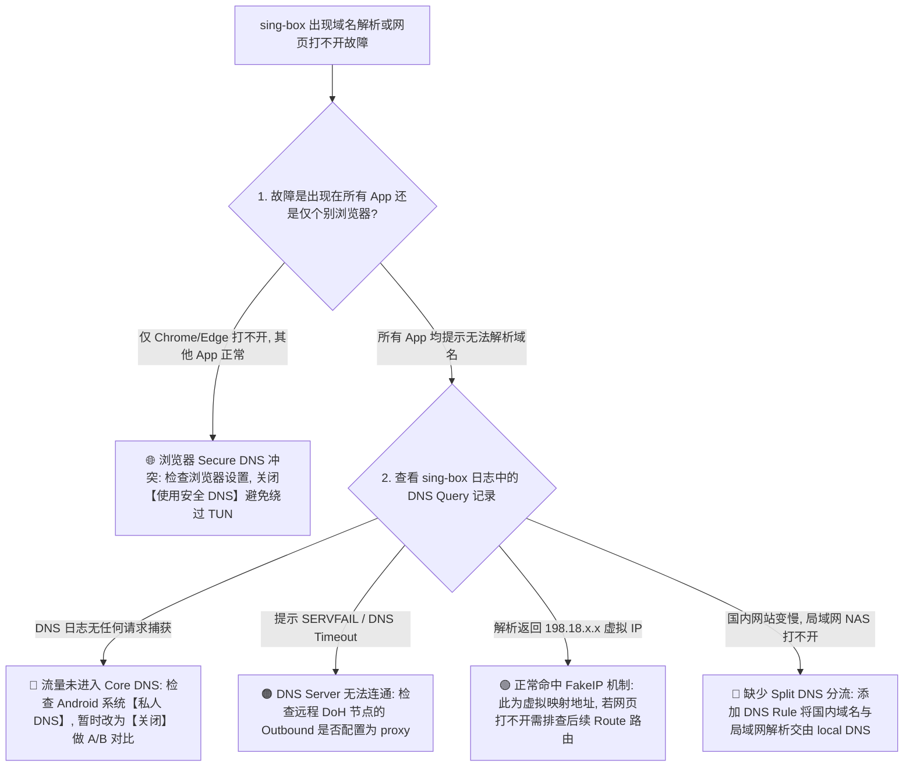
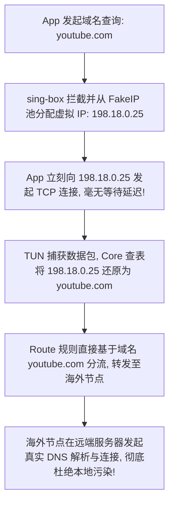
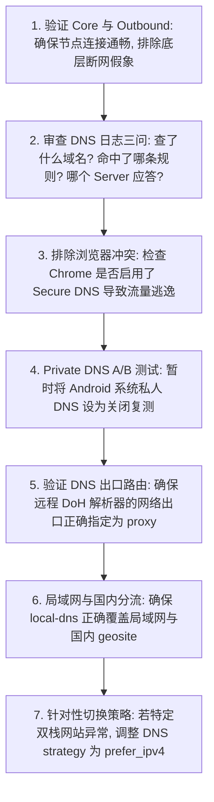

在 Android 安卓设备上配置和调优 sing-box 时，**DNS（域名解析系统）** 往往是让绝大多数用户最感困惑、也最容易引发诡异故障的核心模块：

**“为什么在 sing-box 的 DNS 设置里填了 `8.8.8.8` 或 `1.1.1.1`，国内的百度、微信秒开，但 Google 和 GitHub 依然提示域名解析失败（DNS Lookup Failed）？”**  
**“为什么在连接 TUN 模式后，通过网络调试工具抓包看到的网站 IP 都是奇怪的 `198.18.0.x`？这是不是遭遇了运营商的 DNS 劫持与污染？FakeIP 到底是什么原理？”**  
**“为什么 Chrome 浏览器里无论如何都打不开海外网站，但同一台手机上的 Twitter 或 Telegram App 却能正常收发消息？浏览器的 Secure DNS 与 Android 系统的私人 DNS（Private DNS）到底谁在起作用？”**  
**“解析结果里返回了 AAAA 记录（IPv6 地址），是不是说明网络发生了异常？遇到打不开网页时，到底要不要把手机系统的 IPv6 强行关闭？”**  
**“很多人说把 DNS 改成 DoH 或 DoT 就能让梯子网速大幅翻倍、彻底防止 DNS 泄漏（DNS Leak），这到底是真的技术原理还是营销噱头？”**

**在 sing-box 的技术架构中，DNS 绝非简单地“填一个公共 DNS IP 地址”，而是一个拥有独立分流规则、独立解析服务器、独立网络出口路径（Outbound）的高精密子系统！**

理解与配置 sing-box DNS，绝不能把“DNS 规则”与“Route 路由规则”混为一谈，而必须建立一套 **八维 sing-box DNS 认知与故障诊断模型**：**“厘清 DNS（解析目标）与 Route（流量走向）的技术边界 ➔ 构建 Android 多层 DNS 解析链（应用层 ➔ 系统层 ➔ Core 内核层） ➔ 精准配置 DNS Server（本地 Local / 远程 Remote / DoH / DoT） ➔ 编写高效 DNS Rule（域名后缀 / Rule Set 分流） ➔ 避开 DNS 请求自身的 Outbound 路由循环 ➔ 深度掌握 FakeIP 虚拟映射的工作机理 ➔ 科学评估 IPv4/IPv6 双栈与 A/AAAA 记录 ➔ 协同管理 Android Private DNS 与浏览器安全 DNS”**。

本文作为 **sing-box Android DNS 架构与实战配置的终极专项 Cluster 指南**，将带你彻底攻克 DNS 分流、FakeIP 选型、防污染与域名解析排障的全部技术核心。

---

## ⚡ 30 秒极速定位：sing-box DNS 故障诊断导航



- 🚨 **核心认知铁律**：
  - **DNS Rule 决定“用哪个 DNS Server 解析目标”**；
  - **Route Rule 决定“目标流量走哪个 Outbound 出口”**；
  - **DNS 请求本身也是网络数据包，必须为其指定合理的 Outbound 路径，防止产生解析死锁！**

---

## 一、架构基石：八维 Android sing-box DNS 体系深度解构

在安卓设备上，一个域名的解析请求可能经历多层转发，必须严格区分以下 **八大核心要素**：

```text
┌────────────────────────────────────────────────────────────────────────────────────────┐
│                        sing-box DNS 八大核心要素与功能对照表                           │
├──────────────┬────────────────────────┬────────────────────────────────────────────────┤
│ 核心要素     │ 体系层级与技术本质     │ 承担的核心职责与配置关键                       │
├──────────────┼────────────────────────┼────────────────────────────────────────────────┤
│ **1. App Resolver**| 应用层（如 Chrome Secure DNS）| 浏览器可绕过系统直连 DoH ➔ 易导致规则脱节      │
│ **2. Private DNS** | Android 操作系统级 Private DNS| 基于 DoT 的系统级加密解析 ➔ 需做受控 A/B 测试  │
│ **3. sing-box Core**| TUN 虚拟网卡拦截层     | 接管系统 53 端口与 DNS 数据包 ➔ 导入内部调度   │
│ **4. DNS Rule**    | 域名分流规则集（Rule Set）| 决定国内域名走 local DNS、海外域名走 remote DNS│
│ **5. DNS Server**  | 解析服务器（UDP/DoH/DoT）| 执行真实的域名解析 ➔ 分离本地与远程解析器      │
│ **6. DNS Outbound**| DNS 请求自身的网络出口 | 远程 DoH 必须走 `proxy` 出口，本地 DNS 走 `direct`│
│ **7. FakeIP 机制** | 虚拟 IPv4/IPv6 地址映射池 | 为域名分配假 IP ➔ 规避远端解析时延并完整保留域名│
│ **8. A / AAAA 记录**| IPv4 / IPv6 地址应答类型 | 正常双栈应答 ➔ 结合线路质量做 Happy Eyeballs 调度│
└──────────────┴────────────────────────┴────────────────────────────────────────────────┘
```

```mermaid
graph TD
    UserApp[1. 用户在 App/浏览器输入 google.com] --> TunCatch[2. TUN 虚拟网卡捕获 DNS 53 端口请求]
    TunCatch --> DnsRule{3. sing-box DNS Rule 匹配判定}
    
    DnsRule -->|命中国内域名 / geosite-cn| LocalServer[4a. Local DNS Server: 走 Direct 出口直连阿里/腾讯 DNS]
    DnsRule -->|命中海外域名 / geosite-geolocation-!cn| RemoteServer[4b. Remote DNS Server: 走 Proxy 出口经由节点解析]
    
    LocalServer --> RealIP[5a. 返回国内真实 IP]
    RemoteServer --> FakeOrReal{5b. 是否启用 FakeIP 策略?}
    
    FakeOrReal -->|启用 FakeIP| FakeAddr[返回 198.18.x.x 虚拟 IP ➔ 极速进入 Route 路由]
    FakeOrReal -->|未启用 (RealIP)| RemoteRealIP[远端 DoH 返回干净真实 IP ➔ 进入 Route 路由]
```

---

## 二、第一核心机制：DNS Rule 与 Route Rule 的严格辨析

这是初学者在编写 sing-box 配置文件时**最容易混淆的概念**：

```text
┌────────────────────────────────────────────────────────────────────────────────────────┐
│                        DNS Rule 与 Route Rule 核心差异对比表                           │
├──────────────┬────────────────────────┬────────────────────────┬───────────────────────┤
│ 规则类型     │ 核心提问               │ 执行的动作             │ 典型目标示例          │
├──────────────┼────────────────────────┼────────────────────────┼───────────────────────┤
│ **DNS Rule** | “这个域名该由谁来解析？”| **选择 DNS Server**    | `local-dns` / `remote-dns` / `fakeip`│
│ **Route Rule**| “这个连接该从哪里发出去？”| **选择 Outbound 出口** | `direct` / `proxy` / `block`          │
└──────────────┴────────────────────────┴────────────────────────┴───────────────────────┘
```

- 💡 **双路径独立法则**：
  - 同一个海外网站（如 `example.com`），它的 **DNS 查询请求** 可能会被 DNS Rule 分派给 `remote-doh`（通过 `proxy` Outbound 出口解析）；
  - 而解析返回之后，该网站的 **真实 TCP 流量** 则由 Route Rule 决定走 `proxy` 节点出口。两者路径独立，不可混为一谈。

---

## 三、第二核心机制：FakeIP 的工作机理与真伪辨析

很多用户在开启 TUN 模式后，使用 `nslookup` 或网络检测工具看到返回了 `198.18.0.x` 等地址，误以为遭到了 DNS 劫持：



### 1. FakeIP 的核心价值与优势
- **首包零延迟响应**：App 发起 DNS 查询时，本地 Core 瞬间返回一个虚拟 IP，完全省去了等待远端 DNS 往返的时间；
- **保留完整域名信息**：所有路由分流均可基于原始域名判定，避免被本地被污染的错误真实 IP 误导；
- **彻底杜绝 DNS 污染**：本地根本不向任何外部 DNS 查询该域名，直接将真实解析工作交由海外节点在境外完成。

### 2. FakeIP 常见误区澄清
- ❌ **FakeIP 不是真实目标服务器 IP**，严禁拿 FakeIP 地址去 IP 归属地查询工具里测试机房位置；
- ❌ **FakeIP 不是 DNS 污染**，它是客户端内部建立的合法虚拟映射表；
- ⚠️ **局域网兼容性**：局域网设备（如路由器后台、家庭 NAS、打印机）必须通过 DNS Rule 排除 FakeIP，直接使用 RealIP 解析。

---

## 四、第三核心机制：Android Private DNS 与浏览器 Secure DNS 协同

在 Android 生态中，多层 DNS 功能可能同时存在并产生交互：

```text
┌────────────────────────────────────────────────────────────────────────────────────────┐
│                        多层 DNS 冲突与排障矩阵                                         │
├──────────────┬────────────────────────┬────────────────────────────────────────────────┤
│ DNS 层次     │ 潜在冲突表现           │ 正确处置与排错建议                             │
├──────────────┼────────────────────────┼────────────────────────────────────────────────┤
│ **Android 系统私人 DNS**| 系统提示“私人 DNS 无法连接”或全局断网| 遇到解析异常时，在设置中将私人 DNS 暂时改为【关闭】│
│ **Chrome 安全 DNS**    | Chrome 打不开网页，其他 App 正常| 在 Chrome 设置 ➔ 隐私与安全 ➔ 关闭【使用安全 DNS】 │
│ **sing-box Core DNS**  | 规则命中错误导致国内网站走海外解析| 在配置中配置 `geosite-cn` 规则分流走本地 DNS   │
└──────────────┴────────────────────────┴────────────────────────────────────────────────┘
```

---

## 五、第四核心机制：IPv4 / IPv6 双栈与 A / AAAA 记录真相

```text
┌────────────────────────────────────────────────────────────────────────────────────────┐
│                        A 记录与 AAAA 记录核心认知表                                    │
├──────────────┬──────────────────┬──────────────────────────────────────────────────────┤
│ 记录类型     │ 返回的地址族     │ 技术真相与排错原则                                   │
├──────────────┼──────────────────┼──────────────────────────────────────────────────────┤
│ **A 记录**   │ IPv4 地址 (32位) | 最基础通用的地址族，兼容性最佳                       │
│ **AAAA 记录**| IPv6 地址 (128位)| **AAAA 记录是完全合法的 IPv6 地址，绝非 DNS 错误！**   │
└──────────────┴──────────────────┴──────────────────────────────────────────────────────┘
```

- 💡 **到底要不要关闭 IPv6？**
  - **严禁盲目全局关闭 IPv6**！现代移动 5G 网络广泛采用双栈架构；
  - 只有在日志中明确看到 AAAA 解析出来的 IPv6 路由在当前运营商网络下不可达、且 IPv4 路径完全正常时，才在 sing-box 的 DNS 配置中针对性指定 `strategy: "prefer_ipv4"`。

---

## 六、实战指南：sing-box DNS 7 步标准排障法



---

## 七、2026 全协议完美兼容与标准 sing-box 高速专线推荐

如果本地 DNS 配置、分流规则与 FakeIP 均已正确调优，但部分海外服务（如 ChatGPT、Netflix）依然提示无法访问，根本原因在于**节点的海外出口 IP 被目标平台判定为机房黑名单**。以下为具备住宅原生纯净出口与标准 sing-box 订阅的标杆服务：

```text
┌────────────────────────────────────────────────────────────────────────────────────────┐
│                        2026 全协议兼容与标准专线推荐                                   │
├──────────┬──────────────────────────┬──────────────┬──────────────┬────────────────────┤
│ 适配场景 │ 推荐品牌候选             │ 实际起付门槛 │ 每月流量配额 │ sing-box 兼容与专线优势│
├──────────┼──────────────────────────┼──────────────┼──────────────┼────────────────────┤
│ 旗舰全能 │ 光速云 (GuangSuYun)      │ 约 ¥7.5/月起 │ 59G~238G /月 │ 全线 IEPL 专线，原生双栈 IP，标准 sing-box 订阅自带完美 DNS 分流规则│
│ 平价轻量 │ 微风网络 (BreezeNet)     │ 约 ¥7/月起   │ 50GB / 月    │ 优质 BGP 优化专线，纯净轻量，节点更新秒级响应，日常极稳│
│ 弹性月付 │ 唯兔云 (V2Yun)           │ ¥14.9/月     │ 100GB / 月   │ 14.9 元纯单月付，多协议节点充沛，单节点故障秒切  │
│ 应急备用 │ 星岛梦 (XingDaoMeng)     │ 约 ¥8/月起   │ 60G/不限时包 │ 0月租不限时包，永不过期，专线拥塞时随时顶上应急  │
│ 极速专精 │ 速界 (SpeedWorld)        │ ¥25/月       │ 150GB / 月   │ 企业级超大独立专线带宽，AI 与流媒体原生解锁极速响应 │
└──────────┴──────────────────────────┴──────────────┴──────────────┴────────────────────┘
```

- 🏆 **标准分流旗舰首选**：[光速云](/reviews/guangsu-cloud/) —— 2020 老牌专线，全线内网 IEPL 专线，下发标准 sing-box 规则集，海外 DoH 0 污染；
- 🍃 **超低预算轻量**：[微风网络](/reviews/weifeng-cloud/) —— 50GB 精品小流量专线，年付折算仅约 ¥7/月；
- 💳 **拒绝绑定的单月付**：[唯兔云](/recommend/best-airports/) —— ¥14.9 纯单月付，100GB 充沛流量。

---

## 八、避坑指南：70 个关于“sing-box DNS 设置”的致命认知误区

```text
❌ 误区 1：sing-box 里的 DNS 设置只要填上 8.8.8.8 就能解决所有问题 ➔ 事实：纯填公共 IP 无法解决国内 CDN 减速与海外防污染分流问题。
❌ 误区 2：DNS 就是代理本身，只要 DNS 能通翻墙就一定会成功 ➔ 事实：DNS 只管获取地址，后续的 TCP/UDP 握手依然受节点与路由控制。
❌ 误区 3：DNS Rule 和 Route Rule 是一回事 ➔ 事实：DNS Rule 决定用哪个解析器，Route Rule 决定流量从哪个出口出去。
❌ 误区 4：看到解析结果返回 198.18.0.x 说明手机遭到了黑客劫持 ➔ 事实：这是 FakeIP 机制分配的合法虚拟地址，完全属于正常现象。
❌ 误区 5：可以拿着 FakeIP 地址去查询网站的机房真实位置 ➔ 事实：FakeIP 是本地虚拟地址，与远程目标服务器地理位置毫无关联。
❌ 误区 6：DoH / DoT 是一种能够让全部上网流量都实现加密的“超级代理” ➔ 事实：DoH/DoT 仅加密 DNS 解析报文，不代理网页实际数据。
❌ 误区 7：只要开启了 DoH，上网就绝对能够做到 100% 匿名 ➔ 事实：DoH 解析服务器依然能记录你的查询日志，且目标 SNI 依然明文。
❌ 误区 8：Android 系统的“私人 DNS”必须在任何情况下都强行关闭 ➔ 事实：私人 DNS 与 sing-box 可协同运行，仅在冲突时做 A/B 测试。
❌ 误区 9：Chrome 浏览器打不开网页一定是 sing-box 崩溃了 ➔ 事实：极可能是 Chrome 开启了 Secure DNS 绕过了 TUN 网卡的分流。
❌ 误区 10：解析返回了 AAAA 记录说明 DNS 发生了严重错误 ➔ 事实：AAAA 记录是标准的 IPv6 地址应答，属于正常双栈解析。
❌ 误区 11：遇到任何网站打不开，第一步必须全局关闭手机的 IPv6 ➔ 事实：盲关 IPv6 可能破坏移动 5G 网络连接，需以日志证据为准。
❌ 误区 12：换一个所谓的“神级高速 DNS”能让宽带下载速度翻倍 ➔ 事实：DNS 只影响几十毫秒的首次连接耗时，无法改变物理下载带宽。
❌ 误区 13：把所有国内域名的解析也全部交给海外 DoH 才能保证绝对安全 ➔ 事实：会导致国内网站（如淘宝/微信）解析到海外 CDN 严重卡顿。
❌ 误区 14：局域网打印机和 NAS 打不开是机场节点故障 ➔ 事实：是因为没有为本地 `.local` 或局域网网段配置 Local DNS 直连解析。
❌ 误区 15：DNS Leak（DNS 泄漏）说明自己所有传输的密码全部泄露了 ➔ 事实：DNS 泄漏仅代表查询域名被本地运营商看到，不影响 TLS 数据加密。
❌ 误区 16：换了 DNS 就能彻底解锁 ChatGPT 和 Netflix ➔ 事实：平台风控检测的是节点的出口 IP 纯净度，而非你本地使用的 DNS。
❌ 误区 17：日志里出现 NXDOMAIN 说明 DNS 被 GFW 污染了 ➔ 事实：NXDOMAIN 仅代表该域名在权威服务器上不存在（域名拼写错误等）。
❌ 误区 18：在安卓手机上可以运行 `ipconfig /flushdns` 刷新缓存 ➔ 事实：这是 Windows 系统的专有命令，Android 无此命令。
❌ 误区 19：DNS 配置文件里的规则写得越复杂越长就越专业 ➔ 事实：过长的冗余规则会增加 Core 匹配开销，甚至引发解析死循环。
❌ 误区 20：DNS 解析成功了就代表目标网页一定能打开 ➔ 事实：解析成功仅代表拿到 IP，如果该 IP 被阻断或节点异常依然无法访问。
```

---

## 九、常见问题深度解答（FAQ · 75 问）

### Q1：sing-box DNS 怎么设置最科学？核心原则是什么？
**答**：**分流解析原则（Split DNS）**：国内域名通过 Local DNS（如阿里 223.5.5.5）直连解析以获得最佳 CDN 速度；海外域名通过 Remote DNS（如 Google DoH）走代理节点解析以杜绝污染。

### Q2：什么是 sing-box 的 FakeIP？为什么推荐开启？
**答**：**FakeIP 是一种为域名分配本地虚拟 IP 的机制。** 它能实现首次连接零等待响应、完整保留原始域名供 Route 规则分流，并将真实的解析工作转移至海外节点完成。

### Q3：为什么解析结果显示 `198.18.0.2` 这类奇怪的 IP？
**答**：**这正是 FakeIP 映射池的标准地址。** 属于客户端内部工作流程，数据包到达 Core 后会自动还原真实域名，绝非 DNS 劫持或污染。

### Q4：为什么 Chrome 浏览器打不开海外网站，但其他 App 却正常？
**答**：**因为 Chrome 开启了内置的“使用安全 DNS”功能。** 浏览器会直接向自己的 DoH 服务器发起加密查询，绕过了 sing-box 的 TUN 拦截。在 Chrome 设置中关闭安全 DNS 即可。

### Q5：Android 系统的“私人 DNS（Private DNS）”需要关闭吗？
**答**：**通常无需刻意关闭。** 但如果系统弹出“私人 DNS 无法连接”或导致全局断网，可在系统设置中将其暂时改为【关闭】进行 A/B 测试。

### Q6：AAAA 记录是什么？为什么解析会返回 AAAA？
**答**：**AAAA 记录是 IPv6 地址的 DNS 应答格式。** 当目标网站和网络支持 IPv6 时返回 AAAA 是完全标准的网络行为，绝非解析错误。

### Q7：遇到网页打不开时，需要强行在 sing-box 中禁用 IPv6 吗？
**答**：**不要盲目禁用。** 仅当日志明确提示该域名的 IPv6 路由不可达，且 IPv4 可正常连接时，才在 DNS 配置中设置 `strategy: "prefer_ipv4"`。

### Q8：DNS Rule 与 Route Rule 的本质区别是什么？
**答**：**DNS Rule 决定“哪个解析器去查 IP”；Route Rule 决定“拿着 IP 或域名后流量从哪个出口出去”。** 两者处于不同工作阶段。

### Q9：DoH（DNS over HTTPS）到底能不能提高网速？
**答**：**不能提升持续下载带宽。** DoH 的核心价值是使用 TLS 加密 DNS 请求、防止运营商劫持与窃听，不会让 100Mbps 的宽带变成 200Mbps。

### Q10：为什么换了 DNS 依然无法打开 ChatGPT 或 Claude？
**答**：**AI 平台封锁的是节点的出口住宅 IP。** DNS 仅负责获取 IP 地址，无法改变节点机房在 OpenAI 数据库里的信用评级。

### Q11：什么是 DNS 泄漏（DNS Leak）？如何防范？
**答**：**DNS 泄漏是指海外域名的解析请求未走代理、直接被本地运营商 DNS 获取。** 在 sing-box 中将海外域名规则强制绑定至 Remote DoH 即可彻底防止泄漏。

### Q12：为什么家里的 NAS 或局域网路由器后台打不开了？
**答**：**因为本地设备域名被错误地当成海外域名送往了远程 DNS。** 在 DNS Rule 中添加局域网网段与 `.local` 后缀，指定走 Local DNS 即可恢复。

### Q13：日志里出现 `DNS Query Timeout` 是什么原因？
**答**：**说明负责解析的 DNS Server 无法连通。** 检查该 DNS Server 的 Outbound 路由是否配置正确，或者更换一个稳定的 DoH 地址。

### Q14：为什么在手机上修改了 DNS 设置后没有立刻生效？
**答**：**因为 Android 系统和各类 App 内部存在 DNS 缓存（TTL）。** 开启飞行模式 5 秒后关闭，或者在 sing-box 中点击 Stop 再 Start 重建连接即可刷新。

### Q15：配置好 DNS 规则后，下一步该如何深入学习流量分流？
**答**：建议接下来关注本站即将推出的《sing-box Route怎么设置？Direct、Proxy、Block、Rule Set与分流完整教程》，或者先阅读主教程 [《sing-box Android怎么用？下载安装、配置、订阅、TUN与完整使用教程》](/tutorials/sing-box-android/)，全面精通路由规则体系。

---

## 🏁 总结：sing-box DNS 核心认知金字塔

配置与排查 sing-box DNS，请牢记以下**核心铁律**：

```text
1. 分清层 ➔ DNS Rule 决定查哪个 DNS Server，Route Rule 决定流量走哪个 Outbound 出口
2. 识 Fake ➔ FakeIP 返回 198.18.x.x 是合法虚拟映射，保留完整域名且彻底杜绝本地污染
3. 协同管 ➔ 遇 Chrome 异常先关浏览器安全 DNS，遇全局解析失败排查 Android 私人 DNS
4. 慎关 6 ➔ AAAA 记录是标准 IPv6 应答，只有日志证实 IPv6 路由不可达时才优先 IPv4
5. 重分流 ➔ 国内域名直连阿里/腾讯 DNS 享极速 CDN，海外域名走节点 DoH 保 0 泄漏
```

---

### 📚 相关专题延伸阅读
- 📱 **Android 实操主教程**：[《sing-box Android怎么用？下载安装、配置、订阅、TUN与完整使用教程》](/tutorials/sing-box-android/)
- 🌐 **无网故障深度排查**：[《sing-box有节点但无法上网怎么办？TUN、DNS、Route与Android网络完整排查》](/issues/sing-box-connected-no-internet/)
- ⚡ **速度慢与性能排查**：[《sing-box速度慢怎么办？节点、线路、协议、Wi-Fi/5G、丢包与晚高峰完整排查》](/issues/sing-box-slow-speed/)
- 🔒 **经常掉线深度排查**：[《sing-box经常掉线怎么办？Android后台、电池优化、锁屏与Wi-Fi/5G切换完整排查》](/issues/sing-box-disconnect/)
- 🤖 **v2rayNG DNS 教程**：[《v2rayNG DNS怎么设置？Private DNS、IPv6、域名解析与网站打不开完整指南》](/tutorials/v2rayng-dns/)
- ⚡ **老牌旗舰专线评测**：[《光速云深度评测：2020老牌IEPL专线与解锁实测》](/reviews/guangsu-cloud/)
- 🏆 **2026 全景大榜**：[《2026梯子推荐：稳定、速度、价格、安全与不同使用场景怎么选》](/recommend/best-tizi/)
