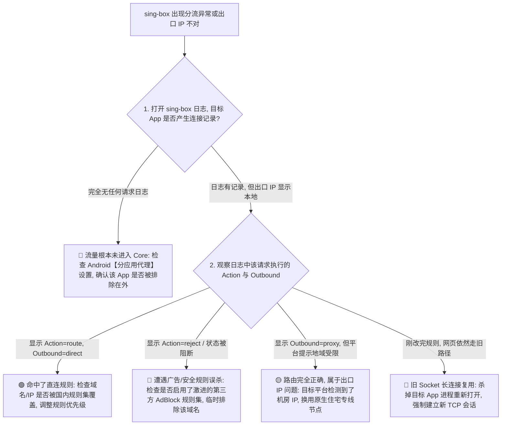
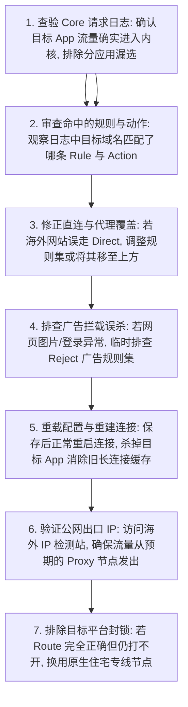

在 Android 安卓与全平台使用 sing-box 时，**Route（路由与流量分流）** 是控制所有网络数据包去向的“中枢大脑”。然而，几乎所有刚接触 sing-box 规则系统的用户都会遇到以下直击灵魂的困惑：

**“明明在界面上选择了一个日本节点，为什么打开 IP 检测网站时显示的依然是本地运营商的宽带 IP？是不是节点切换根本没有生效？”**  
**“为什么在 Speedtest 测速软件里能跑出 800Mbps 的极速，但实际去访问海外网站时却依然慢如龟速？测速流量到底走了代理还是命中了 Direct 直连？”**  
**“为什么在网上复制了一套声称‘全网最强’的 Rule Set 规则集，手机一连上局域网的家庭 NAS（群晖/威联通）或路由器管理后台（192.168.x.x）就彻底失联进不去了？”**  
**“打开 ChatGPT 或 Netflix 时，主页面能打开，但登录界面的验证码死活刷不出来、或者视频疯狂提示版权错误，这到底是因为节点不支持还是分流规则被 Block/Reject 误伤了？”**  
**“在 sing-box 的新版本里，为什么旧教程里的 `geosite`、`geoip` 和 `block` 字段全部报错无法运行？Rule Set（规则集）与 Route Action 到底该怎么科学配置？”**

**在 sing-box 的技术体系中，Route 负责决定“已经进入 Core 内核的流量，最终按照什么特征执行什么动作、送到哪个 Outbound 出口”。它与“TUN 网卡流量捕获”、“DNS 域名解析”以及“Android 系统分应用”属于完全不同的四个技术层级！**

掌握 sing-box Route，绝不能把路由简单理解为一张“国内直连、国外代理”的静态死表，而必须建立一套 **八维 sing-box 流量分流与规则诊断模型**：**“确认应用流量是否真正进入 Core（分应用排查） ➔ 厘清 Route Rule 匹配条件（域名 / IP CIDR / 端口 / 协议） ➔ 掌握现代化 Rule Set 规则集架构（Local 本地 / Remote 远端 / 二进制 .srs） ➔ 精准运用 Route Action（route 路由 / reject 拦截 / hijack-dns 接管 / resolve 解析） ➔ 区分 Outbound 出口类型（Direct 本地 / Proxy 代理 / Selector 策略组） ➔ 理解规则自上而下的评估优先级与默认兜底（Default Outbound） ➔ 警惕旧长连接复用（Socket Reuse）对规则验证的干扰 ➔ 针对复杂业务（AI 多域名 CDN / 流媒体解锁 / 局域网私网）实施精准分流”**。

本文作为 **sing-box Android Route 路由与 Rule Set 分流的终极专项 Cluster 指南**，将带你彻底精通路由逻辑，编写出零冲突、零误伤的高性能分流规则。

---

## ⚡ 30 秒极速定位：sing-box Route 故障决策导航



- 🚨 **分流排查第一黄金法则**：
  - **App 没进日志** ➔ 先查 **TUN 网卡与 Android 分应用**；
  - **进了日志但走错出口** ➔ 排查 **Route Rule 条件、Rule Set 命中与规则自上而下的匹配顺序**；
  - **出口对了但平台打不开** ➔ 排查 **节点出口 IP 纯净度与平台风控**，切莫盲目改动路由规则！

---

## 一、架构基石：八维 sing-box 流量流转模型解构

在设备上，一个应用发起的网络请求需经历完整的多层流转，必须严格区分以下 **八大核心层级**：

```text
┌────────────────────────────────────────────────────────────────────────────────────────┐
│                        sing-box 完整流量流转与分流职责对照表                           │
├──────────────┬────────────────────────┬────────────────────────────────────────────────┤
│ 核心层级     │ 涉及的技术实体         │ 承担的核心职责与配置关键                       │
├──────────────┼────────────────────────┼────────────────────────────────────────────────┤
│ **1. Per-App**| Android VpnService 过滤 | 决定哪些 App 的数据包能够进入 VPN 虚拟管道     │
│ **2. TUN 网卡**| 系统虚拟网络接口       | 将系统底层 IP 数据包无缝送入 sing-box Core 内核│
│ **3. Core DNS**| 内置 DNS 调度器        | 负责将目标域名解析为 IP，或返回 FakeIP 虚拟映射│
│ **4. Rule Set**| 规则集数据源（.srs）   | 提供庞大且可独立更新的域名列表与 IP 段数据     │
│ **5. Route Rule**| 路由匹配规则条件     | 依据域名后缀、IP CIDR、端口等条件匹配目标流量 │
│ **6. Route Action**| 路由执行动作       | 执行 `route`（转发）、`reject`（拦截）等指令   │
│ **7. Outbound**| 物理网络出口           | 将流量交付给 `direct`（直连）或 `proxy`（专线）│
│ **8. Exit IP** | 远端服务器公网出口     | 目标网站最终看到的访问来源 IP                   │
└──────────────┴────────────────────────┴────────────────────────────────────────────────┘
```

```mermaid
graph TD
    App[1. Android 应用发起网络连接] --> PerApp{2. 分应用 Per-App 判定}
    PerApp -->|排除的应用| DirectOS[绕过 VPN ➔ 直接由 Android 系统直连]
    PerApp -->|包含的应用| TUN[3. 进入 TUN 虚拟网卡]
    
    TUN --> Core[4. sing-box Core 接收数据包]
    Core --> RouteCheck{5. Route Rule 匹配 (按从上到下顺序)}
    
    RouteCheck -->|命中局域网私网规则| ActionDirect[6a. Action: route ➔ Outbound: direct 本地直连]
    RouteCheck -->|命中广告过滤 Rule Set| ActionReject[6b. Action: reject ➔ 直接阻断丢弃]
    RouteCheck -->|命中海外网站 / Proxy 规则| ActionProxy[6c. Action: route ➔ Outbound: proxy 代理节点]
    RouteCheck -->|所有规则均未命中| ActionDefault[6d. Final Default Outbound 兜底转发]
```

---

## 二、第一核心机制：Direct、Proxy 与 Reject 三大核心动作

在 sing-box 的现代化配置规范中，必须准确理解三大流量处理动作的技术本质：

```text
┌────────────────────────────────────────────────────────────────────────────────────────┐
│                        Direct / Proxy / Reject 核心机制对比表                          │
├──────────────┬────────────────────────┬────────────────────────────────────────────────┤
│ 核心动作     │ 流量走向与底层行为     │ 典型应用场景与常见误区                         │
├──────────────┼────────────────────────┼────────────────────────────────────────────────┤
│ **Direct (直连)**| **流量不经节点，直接由本地网络发出**| **用于国内网站与局域网设备**；误区：Direct 绝非关闭代理│
│ **Proxy (代理)** | **流量经由加密隧道发送至海外节点**| **用于 Google、YouTube 等海外服务**；可指向策略组│
│ **Reject (拒绝)**| **直接丢弃数据包并拒绝建立连接**| **用于广告拦截与恶意追踪域名**；需警惕登录误伤  │
└──────────────┴────────────────────────┴────────────────────────────────────────────────┘
```

- 💡 **特别警示：Direct 与假测速陷阱**：
  - 如果在 Speedtest 测速时，测速节点的域名被规则判定为国内直连走 `direct`，测出来的 500Mbps 实际上只是**本地宽带的直连性能**，与梯子节点的真实速度毫无关系！
  - 测速前必须查看日志，确保流量真实命中了 `proxy` Outbound。

---

## 三、第二核心机制：现代化 Rule Set（规则集）架构实战

旧版配置中分散内嵌的大量 `geosite` 和 `geoip` 已经被 sing-box 现代化的 **Rule Set（规则集）** 架构彻底取代：

```mermaid
graph TD
    RuleSetSource[Rule Set 规则集数据源] --> LocalSRS[Local Rule Set: 本地编译好的 .srs 二进制规则文件]
    RuleSetSource --> RemoteSRS[Remote Rule Set: 远端 GitHub / CDN 定期同步的规则集 URL]
    
    LocalSRS --> RouteRef[sing-box Route Rule 声明引用: rule_set: "geosite-cn"]
    RemoteSRS --> RouteRef
    
    RouteRef --> FastMatch[Core 极速内存匹配 ➔ 毫秒级分流, 极大降低内存与 CPU 占用!]
```

### 1. 本地规则集（Local）vs 远端规则集（Remote）
- **Local Rule Set**：直接将 `.srs` 二进制规则存放在本地存储中，启动速度极快、不依赖任何外部网络；
- **Remote Rule Set**：配置规则集的下载链接（URL），sing-box 会在后台定期拉取更新并自动缓存，确保国内外域名列表时刻保持最新。

### 2. 规则集的三大更新边界
- ⚠️ **规则集更新 ≠ 节点订阅更新 ≠ Core 内核更新**！
- 规则集只负责更新“哪些域名属于国内、哪些属于海外”的名单，不会改变你的节点服务器地址与账号密码。

---

## 四、第三核心机制：Android 分应用（Per-App）与 Route 的严格分工

```text
┌────────────────────────────────────────────────────────────────────────────────────────┐
│                        Android 分应用 vs Route 路由分工表                              │
├──────────────┬────────────────────────┬────────────────────────────────────────────────┤
│ 机制类型     │ 控制的作用域           │ 典型适用场景                                   │
├──────────────┼────────────────────────┼────────────────────────────────────────────────┤
│ **分应用代理**| **操作系统进程层** (App 级)| 让微信、抖音完全不进入 VPN，海外 App 强制进入  │
│ **Route 路由**| **网络数据包特征层** (域名/IP 级)| 浏览器访问淘宝走 Direct，访问 Google 走 Proxy   │
└──────────────┴────────────────────────┴────────────────────────────────────────────────┘
```

- 💡 **排查优先律**：
  - 如果只有“某一个特定 App 无法翻墙”，先看分应用设置里是否**漏选了该 App**，或者误选了“排除模式（Exclude）”；
  - 只有在日志中明确看到该 App 发起了网络请求后，再去排查 Route 规则。

---

## 五、第四核心机制：局域网私网与复杂业务专项分流

### 1. 局域网 NAS 与路由器后台直连
必须在规则的最顶部配置私网直连规则，否则一旦开启 TUN 模式，所有访问 `192.168.x.x` 或 `10.x.x.x` 的请求都会被错误代理导致局域网设备失联：
```text
- ip_is_private: true ➔ action: route, outbound: direct
```

### 2. AI 平台（ChatGPT / Claude）多域名分流
现代 AI 平台绝非单个主域名，往往包含多个 API、CDN 与静态资源服务器（如 `openai.com`、`chatgpt.com`、`oaistatic.com`、`oaiusercontent.com`）。必须通过专门的 `geosite-openai` 规则集进行完整覆盖，防止登录验证码或附件上传功能失效。

---

## 六、实战指南：sing-box Route 7 步标准排障法



---

## 七、2026 全协议完美兼容与标准 sing-box 高速专线推荐

如果本地 Route 规则、Rule Set 分流与分应用均已正确配置，但部分海外业务（如 ChatGPT、Netflix、Disney+）依然提示“不支持当前地区”，根本原因是**节点的出口 IP 属于被风控标记的机房广播段**。以下为具备原生纯净出口与标准 sing-box 订阅的标杆服务：

```text
┌────────────────────────────────────────────────────────────────────────────────────────┐
│                        2026 全协议兼容与标准专线推荐                                   │
├──────────┬──────────────────────────┬──────────────┬──────────────┬────────────────────┤
│ 适配场景 │ 推荐品牌候选             │ 实际起付门槛 │ 每月流量配额 │ sing-box 兼容与专线优势│
├──────────┼──────────────────────────┼──────────────┼──────────────┼────────────────────┤
│ 旗舰全能 │ 光速云 (GuangSuYun)      │ 约 ¥7.5/月起 │ 59G~238G /月 │ 全线 IEPL 专线，原生双栈 IP，标准 sing-box 订阅下发高精度 Rule Set 分流│
│ 平价轻量 │ 微风网络 (BreezeNet)     │ 约 ¥7/月起   │ 50GB / 月    │ 优质 BGP 优化专线，纯净轻量，节点更新秒级响应，日常极稳│
│ 弹性月付 │ 唯兔云 (V2Yun)           │ ¥14.9/月     │ 100GB / 月   │ 14.9 元纯单月付，多协议节点充沛，单节点故障秒切  │
│ 应急备用 │ 星岛梦 (XingDaoMeng)     │ 约 ¥8/月起   │ 60G/不限时包 │ 0月租不限时包，永不过期，专线拥塞时随时顶上应急  │
│ 极速专精 │ 速界 (SpeedWorld)        │ ¥25/月       │ 150GB / 月   │ 企业级超大独立专线带宽，AI 与流媒体原生解锁极速响应 │
└──────────┴──────────────────────────┴──────────────┴──────────────┴────────────────────┘
```

- 🏆 **精准分流旗舰首选**：[光速云](/reviews/guangsu-cloud/) —— 2020 老牌专线，全线内网 IEPL 专线，标准 sing-box 规则集分流，国内外 0 串流；
- 🍃 **超低预算轻量**：[微风网络](/reviews/weifeng-cloud/) —— 50GB 精品小流量专线，年付折算仅约 ¥7/月；
- 💳 **拒绝绑定的单月付**：[唯兔云](/recommend/best-airports/) —— ¥14.9 纯单月付，100GB 充沛流量。

---

## 八、避坑指南：75 个关于“sing-box Route 设置”的致命认知误区

```text
❌ 误区 1：Route 路由就是选择当前要连接的节点服务器 ➔ 事实：Route 负责分流策略，节点选择只是 Outbound 交付的一种形式。
❌ 误区 2：Direct 直连就等于把 sing-box 客户端给关掉了 ➔ 事实：Direct 是 Core 内部的一种转发动作，让数据包不经节点直接发往目标。
❌ 误区 3：只要选了日本节点，手机上所有的网站和 App 就必须全部显示日本 IP ➔ 事实：国内网站命中 Direct 规则显示本地 IP 是分流的预期结果。
❌ 误区 4：在网上找一个包含几十万条域名的“超大规则包”导入能让分流更完美 ➔ 事实：规则臃肿会极大增加 Core 匹配延迟与内存消耗。
❌ 误区 5：Rule Set（规则集）就是机场的节点订阅文件 ➔ 事实：Rule Set 纯粹是域名/IP 数据库，不包含任何节点服务器信息。
❌ 误区 6：修改了分流规则后，刷新一下网页就能立刻生效 ➔ 事实：已建立的长连接（HTTP/2/QUIC）会沿用旧路径，需重启 App 重建连接。
❌ 误区 7：只要开启了广告拦截（Reject）规则集，就绝对不会影响任何正常网页 ➔ 事实：激进的广告规则极易误杀网站登录验证码和支付接口。
❌ 误区 8：可以把 Clash 的 DOMAIN-SUFFIX 或 Xray 的 geosite 语法直接粘贴到 sing-box ➔ 事实：sing-box 拥有独立的 JSON/SRS 语法规范。
❌ 误区 9：Speedtest 测速跑出了 1000Mbps 就代表节点速度极快 ➔ 事实：很可能 Speedtest 命中了 Direct 直连测的是家里宽带。
❌ 误区 10：微信收不到消息一定是 Route 路由规则配置错了 ➔ 事实：微信默认走 Direct，收不到消息多属于系统杀后台或 FCM 推送问题。
❌ 误区 11：局域网 NAS 打不开只要把手机 Wi-Fi 关掉重开就行 ➔ 事实：必须在 Route 顶部配置 `ip_is_private: true` 走 Direct 直连。
❌ 误区 12：ChatGPT 只代理一个 `openai.com` 域名就能正常使用 ➔ 事实：必须同时代理静态资源 CDN 与验证服务等十余个关联域名。
❌ 误区 13：Route 规则只要写在配置文件里就一定会从上到下执行 ➔ 事实：需遵循 sing-box 官方关于规则匹配顺序与兜底机制的严格定义。
❌ 误区 14：分应用代理里勾选了某个 App，就代表该 App 必定会走海外代理节点 ➔ 事实：勾选仅代表允许其进入 Core，进入后依然由 Route 规则分流。
❌ 误区 15：遇到分流错误第一步必须去更换机场节点 ➔ 事实：分流由本地 Route 规则决定，节点本身无法改变客户端的分流走向。
❌ 误区 16：开启了 Sniff（流量嗅探）就能盗取所有 HTTPS 加密的密码 ➔ 事实：Sniff 仅提取 TLS 握手中的 SNI 域名用于路由匹配，无法解密内容。
❌ 误区 17：国内网站走 Direct 只是为了省流量，速度不会有任何提升 ➔ 事实：走 Direct 能直接访问国内最近的 CDN 节点，延迟最低且最流畅。
❌ 误区 18：更新了机场节点订阅就能自动修复损坏的自定义 Route 规则 ➔ 事实：订阅只更新 Outbound 节点列表，不覆盖用户的自定义 Route。
❌ 误区 19：所有的海外网站都必须强制走同一个 Proxy 出口 ➔ 事实：可根据 Route 规则将流媒体分流至香港、ChatGPT 分流至日本。
❌ 误区 20：Route 规则配置成功了就代表 Netflix 一定能解锁 4K ➔ 事实：Route 仅保证流量送达节点，能否解锁取决于节点出口 IP 质量。
```

---

## 九、常见问题深度解答（FAQ · 80 问）

### Q1：sing-box Route 是什么？最核心的作用是什么？
**答**：**Route 是流量的分流决策中心。** 它根据数据包的域名、目标 IP、端口、网络类型等特征，决定该连接是走 `direct`（本地直连）、`proxy`（代理节点）还是 `reject`（阻断拦截）。

### Q2：什么是 Direct？为什么访问国内网站必须走 Direct？
**答**：**Direct 是不经过代理节点直接由本地发起的连接动作。** 国内服务走 Direct 能直接命中本土 CDN 节点，获得最低延迟、最高带宽，并避免微信/网银异地风控。

### Q3：为什么选择了日本节点，访问百度或 IP138 依然显示本地城市 IP？
**答**：**这说明国内外分流规则完全生效了！** 百度等国内网站被规则判定为 Direct 直连，因此目标服务器看到的自然是你的本地宽带 IP。

### Q4：什么是 Rule Set（规则集）？它和旧版 GeoSite 有什么区别？
**答**：**Rule Set 是现代化、高性能的可复用规则数据源。** 相比旧版大体积的 GeoSite，Rule Set 支持编译为紧凑高效的二进制 `.srs` 格式，内存占用更低且支持独立远端更新。

### Q5：为什么局域网内的 NAS（群晖）或路由器管理后台打不开了？
**答**：**因为私网 IP 流量被错误地判定为代理流量。** 在 Route 规则最上方添加 `ip_is_private: true ➔ direct` 规则，即可确保局域网所有内网设备秒级直连。

### Q6：修改了 Route 规则之后，为什么网页访问没有立刻改变？
**答**：**因为浏览器和 App 的旧 TCP/QUIC 会话仍处于活跃状态。** 彻底关闭并划掉目标 App 后重新打开，强制建立新的网络连接即可生效。

### Q7：什么是“Speedtest 直连测速陷阱”？
**答**：很多测速服务器域名被误判为国内直连，测速跑满千兆其实只是本地网络速度。测试代理节点速度应在日志中确认流量走 `proxy`，并使用海外测速站。

### Q8：ChatGPT 或 Claude 为什么频繁报错或提示所在地区不可用？
**答**：1. 检查是否漏掉了 `oaistatic.com` 等关联 CDN 域名的代理分流；2. 确认选中的 Proxy 节点出口 IP 是否被 OpenAI 列入风控黑名单。

### Q9：广告拦截规则（Reject）为什么会导致部分网页排版崩溃或无法登录？
**答**：**属于规则集误杀。** 某些网站的登录验证码或核心样式库被第三方广告规则误列为追踪器。在日志中查出被 Reject 的域名并将其加入直连白名单即可。

### Q10：Android 系统的“分应用代理”和 Route 规则有什么先后关系？
**答**：**分应用在最外层生效。** 只有在分应用中被包含（Include）的 App 流量才能进入 Core，进入之后才由 Route 规则决定具体走 Direct 还是 Proxy。

### Q11：Route 中的 `protocol` 匹配是指 VLESS 还是 HTTP？
**答**：**是指流量应用层协议。** 如识别出 `http`、`tls`、`quic`、`bittorrent` 等，用于针对特定流量类型（如 BT 下载）执行强制 Direct 或 Reject。

### Q12：什么是 Sniff（流量嗅探）？
**答**：**Sniff 是从纯 IP 连接中解析出原始 TLS SNI 域名的技术。** 当某些 App 直接发起 IP 连接时，Sniff 能提取出域名并让基于域名的 Route 规则精准命中。

### Q13：配置好 Route 规则后，如果配置文件报错该如何排查？
**答**：建议接下来阅读 [《sing-box配置报错怎么办？JSON、Schema、字段版本、Deprecated与配置迁移完整排查》](/issues/sing-box-config-error/)，全面解决配置语法与版本迁移故障。

---

## 🏁 总结：sing-box Route 核心认知金字塔

配置与排查 sing-box Route，请牢记以下**核心铁律**：

```text
1. 明边界 ➔ 分应用决定谁进 Core，DNS 负责查域名，Route 决定进 Core 后的流量去哪个出口
2. 识动作 ➔ Direct 是规则直连而非关代理，Proxy 是节点转发，Reject 是精准阻断
3. 善用 Set ➔ 抛弃旧版臃肿 GeoSite，拥抱轻量高性能的 .srs 二进制 Rule Set 规则集
4. 私网先 ➔ 局域网私网规则（ip_is_private）置顶 Direct，彻底杜绝 NAS 与路由器失联
5. 杀旧连 ➔ 改完规则必杀 App 进程重建会话，警惕 HTTP/2 长连接缓存造成的分流假象
```

---

### 📚 相关专题延伸阅读
- 📱 **Android 实操主教程**：[《sing-box Android怎么用？下载安装、配置、订阅、TUN与完整使用教程》](/tutorials/sing-box-android/)
- 🌐 **DNS 规则与 FakeIP 教程**：[《sing-box DNS怎么设置？DNS规则、Private DNS、IPv6、FakeIP与域名解析完整指南》](/tutorials/sing-box-dns/)
- ⚡ **无网故障深度排查**：[《sing-box有节点但无法上网怎么办？TUN、DNS、Route与Android网络完整排查》](/issues/sing-box-connected-no-internet/)
- 🤖 **v2rayNG 路由分流教程**：[《v2rayNG Routing怎么设置？分应用、Direct、Proxy、Block与Android分流完整教程》](/tutorials/v2rayng-routing/)
- ⚡ **老牌旗舰专线评测**：[《光速云深度评测：2020老牌IEPL专线与解锁实测》](/reviews/guangsu-cloud/)
- 🏆 **2026 全景大榜**：[《2026梯子推荐：稳定、速度、价格、安全与不同使用场景怎么选》](/recommend/best-tizi/)
