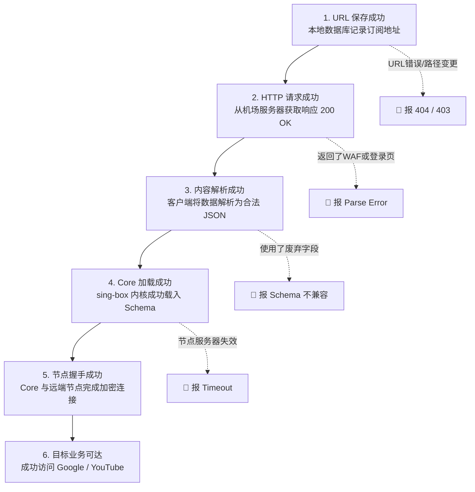
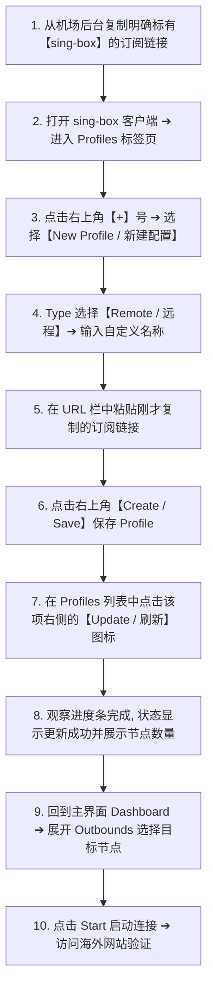
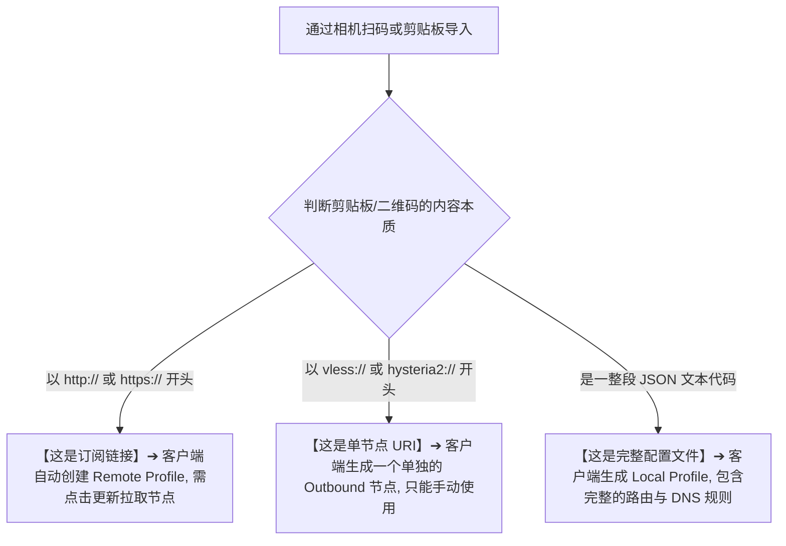
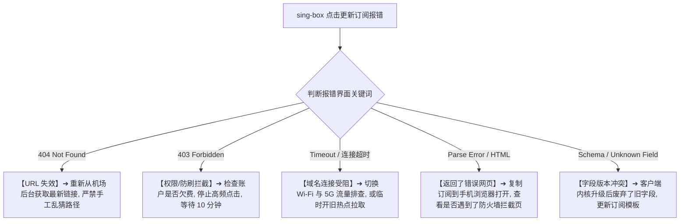

在配置和使用 sing-box 客户端（无论是 Android、Windows、macOS 还是 iOS 端）时，用户面临的第一个、也是最容易触发报错的关键动作，就是 **“导入订阅、拉取远程配置文件或扫描节点二维码”**。

与传统的 v2rayNG 或 Clash 相比，sing-box 的配置分发与解析机制更为严谨、结构化程度更高。但也正因如此，很多新手在导入订阅时频繁遭遇各种各样令人困惑的报错与异常状态：

**“为什么从机场后台复制了订阅链接粘贴进 sing-box，一点击更新就弹窗报错 `404 Not Found` 或 `403 Forbidden`？”**  
**“为什么状态栏显示 HTTP 200 获取成功，但紧接着却提示 `JSON parse error` 或 `Invalid configuration schema`？”**  
**“为什么在 App 里点击了保存订阅，主界面上却一个节点都没有出现？保存成功到底等不等于更新成功？”**  
**“可以把 Clash 的 YAML 订阅、v2rayN 的订阅或者 Xray 的 JSON 文件直接改后缀塞给 sing-box 导入吗？”**  
**“用相机扫描节点的二维码，为什么有时候导入的是一个单一节点，有时候导入的却是一整个 Profile 配置文件？”**  
**“更新订阅之后，为什么以前能用的旧节点突然消失了，或者节点列表里出现了大量重名的重复节点？”**  
**“遇到订阅拉取 Timeout、TLS 握手报错、返回 HTML 网页源码或者版本升级后旧配置失效时，该按照怎样的逻辑精准排错？”**  
**“不小心把包含私人 Token 的订阅链接公开截图发到了网上，到底有多大安全风险？如何紧急补救？”**

**sing-box 中的“订阅”不能被简单地理解为一个万能通用的文本链接。它本质上是由图形化客户端（GUI）负责从远程服务器发起 HTTP/HTTPS 请求获取数据，并将其解析为符合 sing-box Schema 规范的结构化配置，最终交由底层 Core 加载并建立网络 Outbound。**

新手排查订阅故障，切忌在遇到错误时盲目去换 DNS、关防火墙或卸载重装，而必须建立一套 **八维 sing-box 订阅诊断模型**：**“确认分发载体（订阅 vs 远程配置 vs 本地 JSON vs 单节点） ➔ 辨析格式 Schema 兼容性 ➔ 跟踪 HTTP 状态码（404/403/429/5xx） ➔ 识别内容解析与 HTML 误读 ➔ 审查 Schema 语法与版本迁移 ➔ 区分 Core 加载与节点握手 ➔ 观察节点列表渲染机制 ➔ 建立严密的安全与凭据防护”**。

本文作为 **sing-box 订阅导入、配置分发、节点更新与故障排查的终极专项 Cluster 指南**，将为你彻底理清 **订阅全生命周期的流转逻辑，并给出立竿见影的排障解决方案**。

---

## ⚡ 60 秒极速看懂：sing-box 订阅流转六阶段模型



- 🚨 **排错核心铁律**：
  - **保存成功 ≠ 获取成功 ≠ 解析成功 ≠ Core加载成功 ≠ 节点可用 ≠ 翻墙成功**！
  - 遇到故障必须先确定卡在上述 **哪一个具体阶段**，切勿在第一阶段报 404 时去乱改第六阶段的 DNS 或系统路由！

---

## 一、架构基石：必须拆解的“四大配置分发载体”

在 sing-box 生态中，数据载体主要分为以下 **四种完全不同的形态**，绝不能混为一谈：

```text
┌────────────────────────────────────────────────────────────────────────────────────────┐
│                        sing-box 四大配置分发载体深度对比表                             │
├──────────────┬────────────────────────┬────────────────────────┬───────────────────────┤
│ 载体形态     │ 真实数据内容           │ 核心工作机制           │ 适用场景与优缺点      │
├──────────────┼────────────────────────┼────────────────────────┼───────────────────────┤
│ **1. 远程订阅**│ `https://.../api/sub`  │ GUI 定期拉取并生成节点 │ **最推荐！** 机场节点变更时可全自动一键刷新│
│ **2. 远程配置**│ 托管在远端的完整 JSON  │ 直接覆盖加载整套规则配置| 适合托管团队/进阶规则，但会覆盖本地设置│
│ **3. 本地配置**│ 本地 `.json` 文本文件  │ 静态导入，本地离线运行 │ 适合极客深度定制，缺点是无法远程自动更新│
│ **4. 单节点 URI**| `vless://...` / `hy2://`| 单独导入某一个具体服务器| 适合扫码临时应急，无法批量管理服务器矩阵│
└──────────────┴────────────────────────┴────────────────────────┴───────────────────────┘
```

### 1. GUI 订阅能力 ≠ Core 内核自带功能
- **sing-box Core 本身**：只负责读取本地标准 JSON 配置并启动 Inbound/Outbound；
- **GUI 客户端（如 SFA、sing-box 桌面版等）**：在 Core 外层封装了“下载远程 HTTP 链接、解析 Base64 或特定格式、转换为 JSON 并写入本地”的 **订阅管理模块**。
- 因此，不同客户端的“订阅界面”和“解析兼容度”可能存在细微差异。

---

## 二、第二核心概念：格式边界（为什么 Clash YAML / V2Ray 订阅不能直接套用）

很多新手最常犯的错误，就是把其他客户端的订阅链接直接塞给 sing-box：

```text
┌────────────────────────────────────────────────────────────────────────────────────────┐
│                        三大主流代理工具配置体系格式边界表                              │
├──────────────┬──────────────────┬──────────────────┬───────────────────────────────────┤
│ 代理生态     │ 核心配置文件格式 │ 节点与分流架构   │ 与 sing-box 的直接兼容性          │
├──────────────┼──────────────────┼──────────────────┼───────────────────────────────────┤
│ **sing-box** │ 结构化 JSON      │ Inbound/Outbound/Route| **原生标准格式**，字段严格遵循 Schema 规范│
│ **Clash / Meta**| 声明式 YAML     │ Proxies / Proxy Groups| ❌ **不直接通用！** 语法、策略组模型完全不同│
│ **V2Ray 传统**| Base64 编码 URI 列表| 单节点链接聚合   │ ⚠️ 部分 GUI 支持转换，但原生 Core 不接受原始列表│
│ **Xray-core**| 经典 JSON 嵌套   │ Routing / Outbounds| ❌ **不直接通用！** 顶层字段与 DNS 结构差异显著│
└──────────────┴──────────────────┴──────────────────┴───────────────────────────────────┘
```

- 🚨 **防踩坑定律：相同协议 ≠ 相同 Schema**
  - 虽然大家都支持 VLESS 或 Trojan，但 Clash 用 YAML 的 `proxies:` 字段描述，Xray 用 JSON 的 `outbounds[].settings` 描述，sing-box 则用 `outbounds[].type` 描述；
  - **绝不能把 Clash YAML 文件的后缀改成 `.json` 强行导入 sing-box**，这必然导致解析器报 Fatal 语法错误！

---

## 三、第三核心场景：实战 10 步导入与更新流程

以下为在 Android 客户端（SFA / 现代 sing-box GUI）中导入远程订阅的标准流程：



### 💡 为什么保存了订阅却没有节点？
- 新手常以为“点击了保存按钮就万事大吉”。**事实并非如此！**
- 保存（Save）只是在手机本地记录了这个 URL，**必须点击“Update / 更新”按钮**，客户端才会真正联网去下载远端内容并解析出节点！

---

## 四、第四核心场景：二维码与剪贴板导入深度剖析



- 💡 **扫码误区澄清**：
  - 如果你扫描的是机场提供的“单节点二维码”，导入后列表里**必然只有这一个节点**，这完全正常，并不是“订阅丢失了”！
  - 只有扫描“订阅二维码”时，客户端才会拉取全量节点列表。

---

## 五、第五核心大山：订阅常见故障深度排障全景矩阵

当点击更新订阅报错时，请严格根据 **错误类型与状态码** 进行针对性排障：

```text
┌────────────────────────────────────────────────────────────────────────────────────────┐
│                        sing-box 订阅更新高频错误排查表                                 │
├──────────────┬────────────────────────┬────────────────────────┬───────────────────────┤
│ 报错表现     │ 底层技术根因           │ 典型诱发场景           │ 正确解决方案与修复操作│
├──────────────┼────────────────────────┼────────────────────────┼───────────────────────┤
│ **404 Not Found**│ 请求的订阅路径不存在   │ 订阅 URL 输错、服务商变更接口| 重新登录机场后台复制最新的 sing-box 专用链接│
│ **403 Forbidden**│ 服务器拒绝当前请求     │ Token 过期、被 WAF 拦截| 检查账户状态，避免在 1 分钟内超高频连续刷新│
│ **429 Rate Limit**│ 触发服务器防刷频率限制│ 自动刷新设置过密（如每分钟刷）| 停止高频刷新，等待 15 分钟冷却后重新拉取│
│ **Timeout / 超时**│ 无法连接到订阅服务器  │ 订阅域名被本地宽带拦截或污染| **开启 Wi-Fi ➔ 5G 切换测试**，或先用临时节点连代理拉取│
│ **TLS / 证书错误**│ HTTPS 握手证书校验失败 │ 手机系统时间慢了几分钟、证书过期| 将手机时间校准为“自动与网络同步”，切勿盲装未知 CA│
│ **Parse Error**  │ 返回的内容无法解析为 JSON| **服务器返回了 HTML 登录页/防刷验证**| 用浏览器打开订阅 URL，查看是否弹出了 Cloudflare 验证│
│ **Schema Error** │ JSON 字段不符合规范    │ 复制了旧版配置，使用了已废弃字段| 核对当前 sing-box 版本，参照官方 Migration 更新字段│
└──────────────┴────────────────────────┴────────────────────────┴───────────────────────┘
```



---

## 六、实战指南：sing-box 订阅排障 7 步法

```mermaid
graph TD
    S1[1. 确认客户端版本: 确认所用的 GUI 与底层 sing-box Core 为最新稳定版] --> S2[2. 明确订阅格式: 确认从服务商后台获取的是明确标有 sing-box 的专用链接]
    S2 --> S3[3. 记录失败状态码: 区分是 404/403 (服务端拒绝) 还是 Timeout (网络不通)]
    S3 --> S4[4. 浏览器辅助验证: 将订阅 URL 粘贴进手机浏览器访问, 查看返回的是 JSON 还是 HTML 报错页]
    S4 --> S5[5. 双网环境 A/B 测试: 切换 Wi-Fi 与 4G/5G 排除本地运营商 DNS 污染]
    S5 --> S6[6. 检查系统时间: 确保 Android 系统时间与北京时间秒级精准同步]
    S6 --> S7[7. 妥善保护凭据: 排错日志对外求助时, 严格对 URL 中的 Token 与服务器 IP 打码]
```

---

## 七、2026 全协议完美兼容与标准 sing-box 高速专线推荐

如果你不想在移动端频繁遭遇订阅 404、格式不兼容、JSON 报错或频繁更新失败，选择一家具备 **全自动下发标准 sing-box 订阅、全线 IEPL 独立企业专线** 的旗舰服务商是根本之道：

```text
┌────────────────────────────────────────────────────────────────────────────────────────┐
│                        2026 全协议兼容与标准专线推荐                                   │
├──────────┬──────────────────────────┬──────────────┬──────────────┬────────────────────┤
│ 适配场景 │ 推荐品牌候选             │ 实际起付门槛 │ 每月流量配额 │ sing-box 兼容与专线优势│
├──────────┼──────────────────────────┼──────────────┼──────────────┼────────────────────┤
│ 旗舰全能 │ 光速云 (GuangSuYun)      │ 约 ¥7.5/月起 │ 59G~238G /月 │ 原生下发标准 sing-box JSON 订阅，全线 IEPL 专线，0 报错 0 崩溃│
│ 平价轻量 │ 微风网络 (BreezeNet)     │ 约 ¥7/月起   │ 50GB / 月    │ 优质 BGP 优化专线，纯净轻量，节点更新秒级响应，日常极稳│
│ 弹性月付 │ 唯兔云 (V2Yun)           │ ¥14.9/月     │ 100GB / 月   │ 14.9 元纯单月付，多协议节点充沛，单节点故障秒切  │
│ 应急备用 │ 星岛梦 (XingDaoMeng)     │ 约 ¥8/月起   │ 60G/不限时包 │ 0月租不限时包，永不过期，专线拥塞时随时顶上应急  │
│ 极速专精 │ 速界 (SpeedWorld)        │ ¥25/月       │ 150GB / 月   │ 企业级超大独立专线带宽，AI 与流媒体分流极速响应     │
└──────────┴──────────────────────────┴──────────────┴──────────────┴────────────────────┘
```

- 🏆 **全协议标准兼容旗舰首选**：[光速云](/reviews/guangsu-cloud/) —— 2020 老牌专线，全线内网 IEPL 专线，原生标准 sing-box 订阅一键导入 0 报错；
- 🍃 **超低预算轻量**：[微风网络](/reviews/weifeng-cloud/) —— 50GB 精品小流量专线，年付折算仅约 ¥7/月；
- 💳 **拒绝绑定的单月付**：[唯兔云](/recommend/best-airports/) —— ¥14.9 纯单月付，100GB 充沛流量。

---

## 八、避坑指南：60 个关于“sing-box 订阅与配置导入”的致命认知误区

```text
❌ 误区 1：sing-box 订阅和 Clash YAML 订阅是完全通用的 ➔ 事实：底层语法与数据结构完全不同，无法直接跨客户端混用。
❌ 误区 2：在客户端里点击了“保存订阅”，节点列表就会自动出现 ➔ 事实：保存只是记录链接，必须手动点击“Update / 更新”拉取。
❌ 误区 3：订阅更新成功了，就代表里面的所有节点都绝对能翻墙 ➔ 事实：更新成功只代表拿到了配置，节点可用性还需实际连接测试。
❌ 误区 4：更新订阅报 404 就说明这家机场彻底跑路倒闭了 ➔ 事实：404 通常是因为复制的 URL 路径有误或服务商更换了订阅域名。
❌ 误区 5：更新订阅报 403 说明自己的账号一定被封禁了 ➔ 事实：高频重复点击触发了 WAF 防刷限制，等待 15 分钟即可解除。
❌ 误区 6：可以通过手工修改订阅链接里的参数强行转换成 sing-box ➔ 事实：格式转换需服务端按 Schema 重新打包，手改字符无效。
❌ 误区 7：在网上找一个未知的免费“在线订阅转换网站”非常安全 ➔ 事实：第三方网站极易记录你的私有 Token 并盗刷你的高速流量。
❌ 误区 8：二维码导入进来的内容绝对全都是多节点的“订阅” ➔ 事实：很多二维码只是单个节点的 `vless://` 链接，只有一个节点。
❌ 误区 9：更新订阅后原本的旧节点数量变少了，一定是软件坏了 ➔ 事实：服务商在云端维护下线了故障节点，客户端同步了最新列表。
❌ 误区 10：订阅更新频率设置得越高越好，最好每 5 分钟自动更新一次 ➔ 事实：超高频请求会白白消耗电量并触发服务器 429 封禁。
❌ 误区 11：报 JSON Parse Error 说明手机的 Android 系统坏了 ➔ 事实：说明服务端返回的不是合法 JSON，例如返回了拦截 HTML。
❌ 误区 12：把包含自己 Token 的订阅链接公开截图发到论坛求助没关系 ➔ 事实：任何人拿到这个 URL 都能直接提取你的全部节点和流量。
❌ 误区 13：订阅打码只需要把开头的域名部分涂抹掉即可 ➔ 事实：真正敏感的是 URL 中包含的私密 Token、User ID 与长串秘钥。
❌ 误区 14：报 TLS Error 时只要去网上下载安装一个陌生根证书就能解决 ➔ 事实：盲装未知根证书会导致手机遭遇中间人抓包窃密风险。
❌ 误区 15：sing-box 版本升级后，三年前的旧 JSON 配置永远可以无缝运行 ➔ 事实：内核升级会废弃部分旧字段，需根据 Schema 迁移。
❌ 误区 16：订阅链接拉取超时（Timeout）说明节点服务器物理断网了 ➔ 事实：这是访问“订阅网站”超时，和“节点服务器”不是一回事。
❌ 误区 17：只要更新订阅成功了，手机就能自动解锁 Netflix 和 ChatGPT ➔ 事实：流媒体与 AI 可用性取决于节点出口 IP 属性。
❌ 误区 18：更新了客户端 App 就等同于刷新了最新订阅节点 ➔ 事实：App 更新只升级软件程序，必须手动更新订阅同步节点。
❌ 误区 19：删除重复节点最好的办法是把整个软件卸载重装 ➔ 事实：在 Profile 管理中删除多余的重复订阅项即可恢复清爽。
❌ 误区 20：所有标有“通用订阅”的链接都能在 sing-box 中完美识别 ➔ 事实：所谓“通用”通常仅指传统 Base64 聚合，不等于标准 sing-box。
```

---

## 九、常见问题深度解答（FAQ · 65 问）

### Q1：sing-box 订阅怎么导入？最标准的步骤是什么？
**答**：**标准四步法**：1. 从服务商后台复制专用的 sing-box 订阅链接；2. 在客户端 Profiles 界面新建 Remote Profile 并粘贴链接保存；3. 点击 Update 更新拉取节点；4. 展开 Outbounds 选点连接。

### Q2：为什么从机场复制的 Clash 订阅无法在 sing-box 里使用？
**答**：**因为配置 Schema 完全不同。** Clash 使用 YAML 语法和策略组；sing-box 使用 JSON 语法和 Inbound/Outbound 模型。请在机场后台直接复制专属的 sing-box 链接。

### Q3：为什么保存了订阅之后，主界面上依然没有节点？
**答**：**保存不等于更新。** 点击 Save 仅仅是在本地记录了 URL，必须点击该 Profile 右侧的 **“Update / 刷新”** 按钮，App 才会向服务器发起请求下载并解析节点。

### Q4：更新订阅报错 `404 Not Found` 是什么原因？怎么解决？
**答**：**说明订阅 URL 地址不存在。** 常见原因是复制时遗漏了字符、链接已过期，或服务商更换了订阅域名。重新登录机场后台复制最新链接导入即可。

### Q5：更新订阅报错 `403 Forbidden` 是什么原因？
**答**：**说明请求被服务器拒绝。** 可能是你的套餐已到期、流量耗尽，或者 1 分钟内连续点击刷新触发了服务商的防刷安全拦截。等待 15 分钟后再试。

### Q6：更新订阅报 `Timeout / 连接超时` 怎么办？
**答**：**说明当前网络无法连接到订阅服务器。** 尝试关闭 Wi-Fi 切换到 4G/5G 流量更新；或者先开启其他可用梯子连接代理后再点击更新订阅。

### Q7：报错 `JSON parse error / Invalid configuration` 是怎么回事？
**答**：**说明返回的内容不是合法的 sing-box 配置。** 高概率是服务商服务器返回了 Cloudflare 拦截验证码网页或 HTML 报错页。用手机浏览器直接打开该链接排查内容。

### Q8：扫描二维码导入后，为什么列表里只有一个节点？
**答**：**因为该二维码本身就是“单节点二维码”**（包含单个 `vless://` 链接）。这属于正常现象，若需全量节点请扫描“订阅二维码”或导入订阅链接。

### Q9：使用第三方“在线订阅转换工具”安全吗？
**答**：**存在严重泄露风险。** 第三方转换站能直接获取你的私有 Token，可能会被盗刷流量或记录节点信息。强烈建议仅使用机场官方原生提供的 sing-box 链接。

### Q10：不小心把订阅链接发到公开群聊或论坛了怎么办？
**答**：**立刻登录机场后台重置订阅链接！** 点击后台的“重置 Token / 重置订阅”，旧链接会瞬间作废失效，然后将新生成的链接重新导入客户端。

### Q11：为什么更新订阅后，旧节点的名字或数量变了？
**答**：**这是服务商云端同步的结果。** 机场运维人员调整了节点服务器、增加了新线路或下线了维护节点，客户端刷新后会自动与云端保持最新一致。

### Q12：sing-box 支持导入单节点的 `vless://` 或 `hysteria2://` 吗？
**答**：**支持。** 复制单节点链接后，在 App 中选择“从剪贴板导入”（Import from Clipboard），即可直接生成单个 Outbound 进行连接。

### Q13：为什么订阅更新成功、内核也启动了，却依然打不开网页？
**答**：说明订阅获取阶段完全正常，问题发生在后端的代理连接或路由分流层。可能是选中的节点服务器故障，或者 DNS 发生了污染。

### Q14：自动更新订阅应该多久刷新一次合适？
**答**：**建议设置为 12 小时至 24 小时更新一次。** 既能保证及时获取最新的节点变化，又不会因频繁请求浪费电量或触发服务器防刷机制。

### Q15：遇到订阅更新成功但就是连不上网，下一步该看哪篇教程？
**答**：建议接下来关注本站即将推出的《sing-box有节点但无法上网怎么办？TUN、DNS、Route与Android网络完整排查》，或者先阅读主教程 [《sing-box Android怎么用？下载安装、配置、订阅、TUN与完整使用教程》](/tutorials/sing-box-android/)，深入排查流量接管与分流故障。

---

## 🏁 总结：sing-box 订阅与配置分发核心认知金字塔

管理与排查 sing-box 订阅，请牢记以下**核心铁律**：

```text
1. 辨阶段 ➔ 严分保存、HTTP 获取、内容解析、Core 加载与节点连接六大独立阶段
2. 专链专入 ➔ 认准服务商原生 sing-box JSON 订阅，拒绝把 Clash YAML 强改后缀混用
3. 破假象 ➔ 保存订阅只是记网址，主动点击 Update 才能真正拉取到最新节点列表
4. 抓根本 ➔ 报 Parse Error 多为抓到了 HTML 拦截页，403 多为频率超限，404 多为路径失效
5. 守隐私 ➔ 订阅 Token 等同账户密码，严禁公开截图，严禁使用未知第三方在线转换器
```

---

### 📚 相关专题延伸阅读
- 📱 **Android 实操主教程**：[《sing-box Android怎么用？下载安装、配置、订阅、TUN与完整使用教程》](/tutorials/sing-box-android/)
- 🌐 **sing-box 概念总入口**：[《sing-box是什么？和V2Ray、Xray、Clash有什么区别？Core、协议与客户端完整解析》](/wiki/what-is-sing-box/)
- 📥 **v2rayNG 订阅指南**：[《v2rayNG订阅怎么导入？订阅链接、节点更新、二维码与更新失败完整教程》](/tutorials/v2rayng-subscription/)
- 🐱 **Clash 订阅指南**：[《Clash订阅链接怎么导入？节点更新、转换与更新失败排查》](/tutorials/clash-subscription-import/)
- 💻 **Windows 客户端教程**：[《v2rayN怎么用？Windows下载安装、订阅、节点与系统代理完整教程》](/tutorials/v2rayn-windows/)
- ⚡ **老牌旗舰专线评测**：[《光速云深度评测：2020老牌IEPL专线与解锁实测》](/reviews/guangsu-cloud/)
- 🏆 **2026 全景大榜**：[《2026梯子推荐：稳定、速度、价格、安全与不同使用场景怎么选》](/recommend/best-tizi/)
