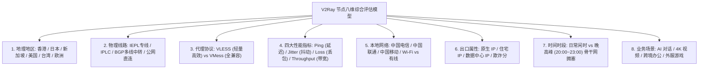
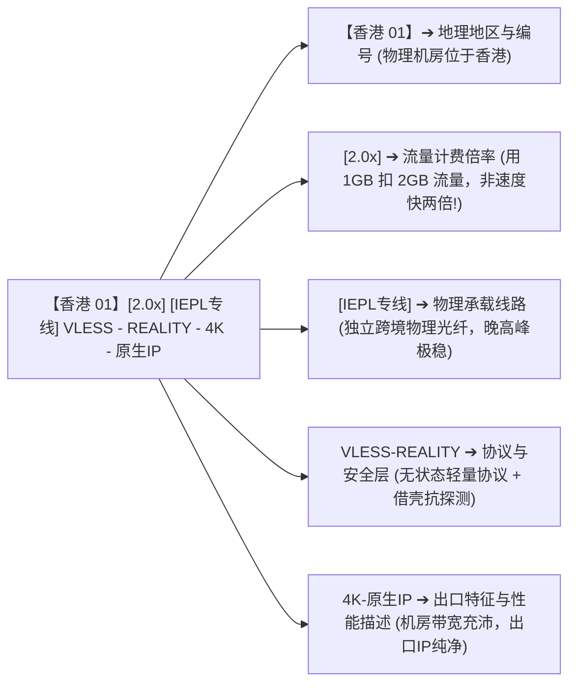

在配置 v2rayN、v2rayNG、Shadowrocket 或各类代理客户端时，面对机场订阅中下发的几十个甚至上百个节点，绝大多数用户都会陷入巨大的选择困难与误区：**“香港 01、日本 02、新加坡 03、美国 04……到底该选哪一个？”**

在很多新手的刻板印象中，往往存在着大量过于简单化、甚至完全错误的判断逻辑：

**“香港离大陆最近，所以香港节点网速一定最快、体验最好吗？”**  
**“为什么客户端测速显示香港节点只有 25ms，但打开 YouTube 看 4K 视频却疯狂转圈卡顿？”**  
**“美国节点的延迟普遍高达 150ms~200ms，是不是完全没有使用价值、应该直接删掉？”**  
**“为什么同一个日本节点，白天用起来丝滑流畅，一到晚上 8 点就频繁断流掉线？”**  
**“为什么中国移动宽带连香港节点很快，换成中国电信宽带后却变得奇慢无比？”**  
**“节点名称里标注的‘2x 倍率’是什么意思？是不是代表这个节点的网速比 1x 节点快两倍？”**  
**“ChatGPT、Claude、Netflix 和打游戏，对节点的要求到底有什么本质不同？”**  
**“节点名字写着‘香港 IEPL VLESS 原生 IP’，这一长串标签到底该怎么拆解？入口地区和真实出口 IP 是一回事吗？”**

**V2Ray 节点选择绝不能只看“香港、日本、新加坡、美国”这几个孤立的地理标签。**

在真实的网络环境中，**“节点地理位置 ≠ 物理线路质量 ≠ 交互延迟（Ping） ≠ 持续带宽（Mbps） ≠ 出口 IP 属性”**。

- 一个 **20ms 的香港公网直连节点**，在晚高峰可能因为国际骨干网拥塞丢包 30%，看视频频繁卡顿；
- 而一个 **180ms 的美国企业级 IEPL 专线节点**，由于物理内网零丢包且带宽充沛，能够轻松秒开 4K 乃至 8K 视频，大文件下载也能跑满千兆宽带。

本文作为 **V2Ray 节点选型、性能指标与使用场景的终极深度指南**，将带你建立严谨的 **八维节点评估模型**，彻底讲透 **四大主力地区优缺点、Ping/Jitter/Loss/Throughput 指标真相、物理线路与倍率机制、以及针对 AI、视频、游戏与下载的定制化选型策略**。

---

## ⚡ 30 秒极速选节点：按场景与指标快速决策

```text
┌────────────────────────────────────────────────────────────────────────┐
│                   V2Ray 节点 30 秒场景极速决策流                       │
├──────────────────┬──────────────────┬──────────────────────────────────┤
│ 核心使用场景     │ 推荐首选地区     │ 核心关注指标 (优先级从高到低)    │
├──────────────────┼──────────────────┼──────────────────────────────────┤
│ **网页浏览/查资料** 香港 / 日本 / 台湾 │ 低 Ping (交互响应极快) > 低 Jitter │
│ **AI 对话 (ChatGPT)** 美国 / 日本 / 新加坡 纯净出口 IP > 稳定性 > 低丢包 (无需大带宽)│
│ **YouTube/流媒体** 日本 / 香港 / 新加坡 持续高带宽 (Throughput) > 0 丢包 > Ping│
│ **外服电竞游戏** 香港 / 日本 (专线)  超低 Ping (<60ms) > 0 丢包 > 极低 Jitter│
│ **大文件/Git/开发** 美国 / 日本        充沛持续下载/上传带宽 > 稳定性   │
└──────────────────┴──────────────────┴──────────────────────────────────┘
```

---

## 一、认知基石：八维 V2Ray 节点评估模型

为什么网络上关于“哪个国家节点最好”的争论永远没有标准答案？因为评判一个节点必须综合以下 **八个核心维度**：



---

## 二、实战解构：一串复杂的节点名称到底该怎么拆？

机场订阅中的节点名称通常混合了多个维度的营销与技术标签。让我们以外科手术式的细致度进行结构拆解：

```text
典型节点全名：
【香港 01】[2.0x] [IEPL专线] VLESS - REALITY - 4K - 原生IP
```



### 关键概念澄清：入口地区 vs 真实出口 IP
- **入口地区**：你的电脑第一跳连接的服务器位置（如深圳中转机房）；
- **出口地区**：经过多段网络转发后，最终访问目标网站（如 Google/OpenAI）时展现的海外公网 IP 所在地；
- 💡 **防坑提示**：某些标为“香港”的节点，可能只是入口在香港，最终出口可能被中转到了新加坡或美国。判断节点的真实地区，必须在连接后访问专业 IP 查询网站核验。

---

## 三、四大核心地区深度横评：优势、劣势与适用场景

```text
┌────────────────────────────────────────────────────────────────────────────────────────┐
│                        四大主流节点地区全方位横向对比表                                │
├──────────────┬──────────────┬──────────────┬────────────────────────┬──────────────────┤
│ 节点地区     │ 物理延迟倾向 │ 晚高峰特征   │ 最强优势场景           │ 潜在短板与注意事项 │
├──────────────┼──────────────┼──────────────┼────────────────────────┼──────────────────┤
│ **香港 (HK)**│ 极低 (15~50ms)│ 极易拥堵(公网)日常网页、即时通信、低延迟│ 晚高峰公网易塞车、部分平台限制│
│ **日本 (JP)**│ 较低 (45~80ms)│ 相对平稳     │ 4K视频、东亚游戏、香港最佳备用│ 部分机房 IP 被严格风控 │
│ **新加坡(SG)**│ 中等 (60~100ms) 国际出口丰富  │ 东南亚业务、AI 备用、跨国多线 │ 某些中国北方运营商可能绕路 │
│ **美国 (US)**│ 较高(140~220ms) 带宽管径极大  │ 美区专属服务、大文件下载、AI │ 物理延迟高，不适合即时对战游戏│
└──────────────┴──────────────┴──────────────┴────────────────────────┴──────────────────┤
```

```mermaid
graph TD
    subgraph 1. 香港节点 (Hong Kong)
        HK_Pro[优势: 物理距离最近，光纤往返延迟极低 (15-40ms)，网页与交互秒开]
        HK_Con[劣势: 用户扎堆最严重，若走普通公网直连，晚高峰丢包率极高]
    end

    subgraph 2. 日本节点 (Japan)
        JP_Pro[优势: 国际出口充沛，直连与中转均极稳，延迟 50ms 左右，是香港黄金备用]
        JP_Con[劣势: 某些日本本土流媒体对住宅原生 IP 判定极其严格]
    end

    subgraph 3. 新加坡节点 (Singapore)
        SG_Pro[优势: 东南亚核心数据中心枢纽，国际互联极佳，多国网络中继站]
        SG_Con[劣势: 物理距离较日本稍远，北方宽带用户延迟略高]
    end

    subgraph 4. 美国节点 (United States)
        US_Pro[优势: 全球互联网骨干网中心，机房带宽极其充沛廉价，原生支持全部美区 AI 服务]
        US_Con[劣势: 受太平洋物理光纤距离限制，物理延迟无法突破 140ms]
    end
```

---

## 四、打破低 Ping 迷信：四大性能指标全维度解析

很多用户在客户端里测速时，只看列表右侧的数字（如 `35ms`），以为数字越小网速就越快。这是最大的认知误区！

```mermaid
graph LR
    subgraph 性能指标四面体
        Ping[1. Ping (往返延迟): 影响交互响应速度]
        Jitter[2. Jitter (延迟抖动): 影响语音与游戏平稳度]
        Loss[3. Loss (数据丢包率): 致命! 超过 5% 即引发视频卡顿与断流]
        Throughput[4. Throughput (持续带宽): 决定 4K 视频码率与大文件下载速度]
    end
```

### 1. 为什么“低 Ping 节点”看视频反而疯狂卡顿？
- **Ping 仅代表一个极小数据包的往返耗时**，根本不代表服务器能够向你持续吐出多少数据量；
- 如果一个香港节点延迟只有 20ms，但机房出口总带宽被千人挤爆（超售），或者公网丢包率达到 15%，TCP 协议就会疯狂要求重传数据，导致 YouTube 4K 缓存中断、疯狂卡顿。

### 2. 为什么“高 Ping 美国节点”下载大文件反而极快？
- 美国机房的国际出口通常拥有 10Gbps~40Gbps 的海量物理带宽；
- 只要网络丢包率为 0，虽然建立连接的前 0.2 秒略有延迟，一旦 TCP 拥塞控制窗口完全打开，下载速度就能瞬间跑满 500Mbps~1000Mbps。

### 3. Jitter（抖动）与 Packet Loss（丢包）的杀伤力
- **Jitter（抖动）**：如果一个节点一会儿 40ms、一会儿 200ms，波动剧烈会导致 Zoom 视频会议声音断续、外服游戏人物瞬移；
- **Packet Loss（丢包）**：**丢包是所有长连接和视频播放的头号杀手！** 当丢包率超过 3% 时，TCP 吞吐量会呈断崖式下跌；丢包率超过 10% 时，任何代理连接都会频繁断流。

---

## 五、线路与倍率的真相：IEPL 专线 vs 直连 vs 计费倍率

```mermaid
graph TD
    subgraph 线路层级 vs 节点表现
        LineA[1. 普通公网直连 (163/普通BGP)] -->|白天正常，晚高峰国际出口拥塞丢包 20%+| ExpA[❌ 晚高峰卡顿断流]
        LineB[2. 优质中转优化 (BGP入口 ➔ 多线转发)] -->|经国内骨干中转，跨境较顺畅| ExpB[⚠️ 综合表现尚可]
        LineC[3. 企业级 IEPL/IPLC 物理专线] -->|全国内网独立光纤直接出境，物理 0 丢包| ExpC[✅ 晚高峰 4K 丝滑秒开]
    end
```

### 1. 线路倍率（0.5x / 1.0x / 2.0x / 3.0x）到底是什么？
- ❌ **致命误解**：“2.0x 节点代表速度比 1.0x 快两倍，所以我应该只选倍率最高的！”
- 💡 **真实含义**：**倍率是机场对你消耗流量的“计费乘数”！**
  - **0.5x 节点**：你实际下载了 1GB 视频，后台只扣除 0.5GB 流量套餐（通常用于普通大流量下载）；
  - **1.0x 节点**：标准计费，用 1GB 扣 1GB；
  - **2.0x / 3.0x 节点**：通常代表该节点租用了极其昂贵的高成本企业级专线（如高带宽专线），因此用 1GB 会扣除 2GB~3GB 套餐配额。

---

## 六、本地运营商（ISP）与网络环境的巨大变量

同一个 V2Ray 节点，为什么张三用着极速，李四用着却连不上？因为中国三大运营商的国际出口路由截然不同：

```text
┌────────────────────────────────────────────────────────────────────────────────────────┐
│                     三大运营商宽带在不同节点下的典型表现倾向                           │
├──────────────┬────────────────────────┬────────────────────────┬───────────────────────┤
│ 运营商网络   │ 公网国际出口特征       │ 推荐首选节点与线路     │ 避坑建议              │
├──────────────┼────────────────────────┼────────────────────────┼───────────────────────┤
│ **中国电信** │ 晚高峰 163 骨干网拥堵严重│ 必须优先选 **IEPL 专线** 或 CN2/优化线路│ 慎用普通公网直连香港节点 │
│ **中国联通** │ 国际出口带宽充沛，互联好│ 广泛适配日本、香港、欧洲公网直连与专线│ 联通直连日本/欧洲表现常有惊喜│
│ **中国移动** │ 香港 CMI 出口互联极佳  │ 优先选 **香港 CMI 直连** 或 IEPL 专线 │ 访问美国与欧洲部分公网易绕路│
└──────────────┴────────────────────────┴────────────────────────┴───────────────────────┘
```

- 📶 **排查法则**：如果电脑连家庭 Wi-Fi 测速很慢，不妨断开 Wi-Fi，用手机开 5G 热点进行 A/B 测试。如果热点下速度飞快，说明问题出在本地路由器或家庭宽带上，与节点本身无关。

---

## 七、实战指南：科学选择 V2Ray 节点的 7 步标准法

```mermaid
graph TD
    S1[1. 测定本地裸网基线: 确认宽带测速是否正常] --> S2[2. 明确当前核心场景: AI / 视频 / 游戏 / 下载]
    S2 --> S3[3. 初选 2-3 个对应目标地区节点]
    S3 --> S4[4. 执行客户端延迟初筛: 剔除 Timeout 与异常节点]
    S4 --> S5[5. 进行真实业务测速: 打开 YouTube 4K 或实际下载]
    S5 --> S6[6. 晚高峰 (20:30~22:30) 复测: 验证抗拥塞丢包表现]
    S6 --> S7[7. 确立主备容灾架构: 1 个主节点 + 1-2 个跨地区备用节点]
```

1. **第一步：明确场景** —— 是为了查资料写代码、看 YouTube 4K，还是玩外服游戏？
2. **第二步：初选地区** —— 查资料选香港，看视频选日本/香港，美区 AI 选美国；
3. **第三步：延迟初筛** —— 在客户端进行单次连通性测试，排除全红或丢包节点；
4. **第四步：真实业务跑分** —— 打开 YouTube 统计信息（Stats for nerds）查看 Connection Speed；
5. **第五步：晚高峰压测** —— 在晚上 9 点再次运行，观察丢包率是否上升；
6. **第六步：核验出口 IP** —— 访问 `ipinfo.io` 确认出口地区与欺诈分符合预期；
7. **第七步：跨地区主备** —— 主用选香港，备用选日本或新加坡（严禁把备用节点全放在同一个地区）。

---

## 八、2026 全地区覆盖与全专线高速服务推荐

无论你需要超低延迟的香港近端节点，还是需要大带宽、纯净 IP 的美日专线，选择一家具备 **全线 IEPL 专线、多地区多节点矩阵** 的高可用服务商是最佳解决方案：

```text
┌────────────────────────────────────────────────────────────────────────────────────────┐
│                        2026 全地区节点与抗拥塞专线推荐                                 │
├──────────┬──────────────────────────┬──────────────┬──────────────┬────────────────────┤
│ 适配场景 │ 推荐品牌候选             │ 实际起付门槛 │ 每月流量配额 │ 节点地区与专线优势 │
├──────────┼──────────────────────────┼──────────────┼──────────────┼────────────────────┤
│ 旗舰全能 │ 光速云 (GuangSuYun)      │ 约 ¥7.5/月起 │ 59G~238G /月 │ 港/日/新/美/台/英 全线 IEPL 专线，晚高峰 0 丢包  │
│ 平价轻量 │ 微风网络 (BreezeNet)     │ 约 ¥7/月起   │ 50GB / 月    │ 优质 BGP 优化，轻量极速，适合日常查资料与轻度办公  │
│ 弹性月付 │ 唯兔云 (V2Yun)           │ ¥14.9/月     │ 100GB / 月   │ 14.9 元纯单月付，多地区原生 IP 出口，节点丰富      │
│ 应急备用 │ 星岛梦 (XingDaoMeng)     │ 约 ¥8/月起   │ 60G/不限时包 │ 0月租不限时包，节点永不过期，多地区联调备用首选    │
│ 极速专精 │ 速界 (SpeedWorld)        │ ¥25/月       │ 150GB / 月   │ 企业级大带宽独立专线，流媒体与 AI 4K 秒开零缓冲    │
└──────────┴──────────────────────────┴──────────────┴──────────────┴────────────────────┘
```

- 🏆 **全地区全专线旗舰首选**：[光速云](/reviews/guangsu-cloud/) —— 2020 老牌专线，港日新美全覆盖，晚高峰物理级 0 丢包；
- 🍃 **超低预算轻量**：[微风网络](/reviews/weifeng-cloud/) —— 50GB 精品小流量专线，年付折算仅约 ¥7/月；
- 💳 **拒绝绑定的单月付**：[唯兔云](/recommend/best-airports/) —— ¥14.9 纯单月付，100GB 充沛流量。

---

## 九、避坑指南：45 个关于“节点选择”的致命认知误区

```text
❌ 误区 1：香港节点网速在任何情况下都绝对是第一名 ➔ 事实：公网直连香港节点在晚高峰极易拥堵，体验可能远逊于专线日本节点。
❌ 误区 2：日本节点一定比香港节点慢 ➔ 事实：日本国际出口大、带宽充沛，在中转或专线下综合吞吐表现常超越香港。
❌ 误区 3：美国节点延迟高，所以看 4K 视频一定很卡 ➔ 事实：美国机房带宽充沛，只要丢包率为 0，跑满 4K/8K 极其轻松。
❌ 误区 4：节点列表里 Ping 最低的那个节点一定是最好的 ➔ 事实：Ping 仅反映响应时间，不代表带宽容量与丢包率。
❌ 误区 5：低 Ping 就一定等同于拥有高下载带宽 ➔ 事实：20ms 的节点完全可能被限速在 10Mbps。
❌ 误区 6：高 Ping 节点绝对无法进行大文件高速下载 ➔ 事实：大文件下载看持续吞吐，180ms 节点完全能跑满千兆。
❌ 误区 7：客户端测出的延迟数字就是底层的 ICMP Ping ➔ 事实：客户端通常进行的是 HTTP 连接握手测速，受协议握手影响。
❌ 误区 8：Speedtest 测速跑满 500M，看 YouTube 就绝对不卡 ➔ 事实：Speedtest 是短时间多线程突发压测，YouTube 看持续 CDN 稳定性。
❌ 误区 9：Jitter（抖动）指标只对程序员有用，普通人不用看 ➔ 事实：Jitter 高会导致视频会议卡顿、语音断续和外服游戏瞬移。
❌ 误区 10：丢包率只要不超过 20% 就不影响正常上网 ➔ 事实：丢包率超过 3% 就会导致 TCP 吞吐骤降，超过 10% 频繁断流。
❌ 误区 11：节点名称写着“香港 01”，其实际出口 IP 一定在香港 ➔ 事实：节点可能存在多段中继，需以实际出口 IP 查询为准。
❌ 误区 12：使用 VLESS 协议的节点一定比使用 VMess 的节点快 ➔ 事实：物理线路质量占 80% 影响权重，协议差异影响微乎其微。
❌ 误区 13：REALITY 节点天生自带超低游戏延迟 ➔ 事实：REALITY 仅负责安全伪装，物理延迟由光纤传播距离决定。
❌ 误区 14：IEPL 专线节点承诺了物理 0 丢包，所以无论何时都绝对不卡 ➔ 事实：若服务商机房总带宽被严重超售塞满，专线依然会拥塞。
❌ 误区 15：中转节点一定在所有指标上都比直连节点好 ➔ 事实：中转增加了中间转发跳数，若中转机房性能差反会导致延迟上升。
❌ 误区 16：直连节点一定拥有比中转节点更低的物理延迟 ➔ 事实：国际公网路由可能严重绕路，直连延迟有时反而高于优质内网中转。
❌ 误区 17：2.0x 倍率节点的网速比 1.0x 节点快两倍 ➔ 事实：倍率是流量套餐计费扣除乘数，与网速快慢毫无关系。
❌ 误区 18：0.5x 倍率节点速度一定很慢、不值得用 ➔ 事实：0.5x 是商家的促销让利节点，适合用来批量下载大文件。
❌ 误区 19：只要节点标有“原生 IP”，就能 100% 保证解锁 Netflix ➔ 事实：流媒体平台风控策略动态更新，原生 IP 也有被标记的可能。
❌ 误区 20：住宅 IP 一定在所有方面都优于数据中心机房 IP ➔ 事实：住宅 IP 稳定性和带宽通常不如数据中心，需按具体业务选择。
❌ 误区 21：玩外服游戏只需要看下载带宽有多大 ➔ 事实：游戏只传输几 KB 坐标数据，核心看 Ping、Jitter 和 0 丢包。
❌ 误区 22：写代码查资料必须要 1000Mbps 的极速节点 ➔ 事实：文本交互只需几兆带宽，核心看首包响应速度（低 Ping）。
❌ 误区 23：同地区的一个节点能代表该地区的全部节点质量 ➔ 事实：不同节点分配的后端服务器与带宽负载各不相同。
❌ 误区 24：白天测试很慢的节点，在晚高峰表现一定更差 ➔ 事实：部分节点可能在白天进行维护或负载调度，需多时段复测。
❌ 误区 25：只要在某个节点上测速跑出高分，它一年四季都会一样快 ➔ 事实：网络环境处于动态变化中，需定期重新评估主备节点。
❌ 误区 26：手机热点测速慢一定说明海外节点挂了 ➔ 事实：手机蜂窝基站信号弱也会导致本地链路成为性能瓶颈。
❌ 误区 27：中国电信宽带和中国联通宽带用同一个节点体验完全一样 ➔ 事实：电信和联通的国际出口互联架构差异极大，需分别实测。
❌ 误区 28：新加坡节点只适合新加坡当地华人使用 ➔ 事实：新加坡是亚太重要数据中心枢纽，国内用户使用同样极其广泛。
❌ 误区 29：美国节点只适合在美国出差的人使用 ➔ 事实：国内用户访问 OpenAI、GitHub、美区流媒体时美国节点是核心主力。
❌ 误区 30：备用节点应该全部选择同一个地区的其他节点 ➔ 事实：若该地区海底光缆中断，同地区备用节点会全军覆没（必须跨地区）。
❌ 误区 31：机场提供的节点数量越多（如 200 个），证明质量越高 ➔ 事实：大量虚标的公网垃圾节点毫无意义，30~50 个精品专线节点远胜虚标。
❌ 误区 32：节点标签写了“游戏专线”，不打游戏的人就绝对不能连 ➔ 事实：游戏专线意味着低延迟和低丢包，日常浏览同样体验极佳。
❌ 误区 33：节点标签写了“流媒体专线”，就不能用来查资料写代码 ➔ 事实：流媒体专线出口 IP 纯净且带宽充沛，日常全场景通用。
❌ 误区 34：修改客户端的 Routing 规则能改变节点的物理延迟 ➔ 事实：Routing 仅决定流量走哪个节点，无法改变物理光纤耗时。
❌ 误区 35：修改 DNS 地址能把美国节点的 180ms 变成 30ms ➔ 事实：DNS 仅负责域名解析，物理延迟受光速物理极限约束。
❌ 误区 36：只要使用了专线节点，本地 Wi-Fi 信号只有一格也不影响上网 ➔ 事实：本地 Wi-Fi 丢包会导致整个代理链路发生物理阻断。
❌ 误区 37：所有的香港节点都能免验证直接使用 ChatGPT ➔ 事实：ChatGPT 对香港 IP 存在严格区域限制，需配合分流或美日节点。
❌ 误区 38：节点延迟测试结果一直在跳，说明电脑中毒了 ➔ 事实：公网路由抖动和服务器负载波动会导致延迟轻微跳动，属正常现象。
❌ 误区 39：同一个节点在 Windows 和 iPhone 上体验绝对完全一致 ➔ 事实：不同设备的无线网卡性能、系统调度和客户端 Core 会产生差异。
❌ 误区 40：只要节点能打开 Google，就代表该节点没有任何丢包 ➔ 事实：打开网页只需几次握手，微小丢包在静态网页上难以察觉。
❌ 误区 41：节点上传速度（Upload）对普通用户完全不重要 ➔ 事实：AI 上传大文档、视频会议推流与网盘同步极度依赖上传带宽。
❌ 误区 42：选择节点时应该把所有节点的自动测速排序全部打开 ➔ 事实：频繁的后台全量测速会占用本地带宽并对机场服务器造成压力。
❌ 误区 43：只要买了最贵的机场套餐，随便连哪个节点速度都一样 ➔ 事实：不同节点的路由出口和承载业务各异，仍需按场景科学选择。
❌ 误区 44：香港节点访问所有海外网站都比美国节点快 ➔ 事实：如果目标网站服务器在美国且无亚洲 CDN，香港节点还需跨洋中转。
❌ 误区 45：只要选好了主节点，这一辈子就再也不需要更换了 ➔ 事实：定期核验节点状态、维护 1 主 2 备的高可用架构才是长久之道。
```

---

## 十、常见问题深度解答（FAQ · 50 问）

### Q1：V2Ray 节点怎么选？
**答**：**按场景选地区，按线路定质量。** 日常网页与即时交互首选香港；4K 视频与综合娱乐首选日本；AI 对话与美区专属服务首选美国；外服游戏优先选择具备低 Jitter 与 0 丢包的 IEPL 专线节点。

### Q2：香港节点和日本节点哪个更好？
**答**：**香港延迟更低，日本带宽与稳定性更均衡。** 香港物理距离最近（15~40ms），交互极快；日本出口带宽大且晚高峰拥塞相对较轻，是香港的黄金替代。

### Q3：美国节点延迟那么高，还有必要用吗？
**答**：**非常有必要。** 美国是全球互联网骨干中心，机房带宽极大且纯净度高，在访问 OpenAI/Claude 官方接口、美区特定流媒体及大文件下载时表现极佳。

### Q4：为什么香港节点测速延迟很低，看 4K 视频却卡顿？
**答**：**低 Ping 不等于高带宽或零丢包。** 如果该节点为公网直连且遭遇晚高峰超售拥堵，丢包率上升会导致 TCP 重传，引发视频疯狂缓冲。

### Q5：节点名称里的“2.0x 倍率”是什么意思？
**答**：**倍率是计费乘数，不是网速倍数！** 2.0x 表示你使用 1GB 流量，后台会扣除 2GB 套餐配额，通常代表该节点租用了高成本独立专线。

### Q6：什么是 Jitter（延迟抖动）？
**答**：Jitter 是网络延迟的波动幅度。抖动过大会导致外服游戏瞬移、视频会议卡顿和语音断续，是衡量网络平稳度的关键指标。

### Q7：什么是 Packet Loss（丢包率）？
**答**：丢包率指传输过程中丢失数据包的百分比。丢包超过 3% 就会导致下载吞吐骤降，超过 10% 会引发代理连接频繁断流。

### Q8：玩外服游戏应该怎么选节点？
**答**：**严选“低 Ping + 极低 Jitter + 0 丢包”的专线节点。** 游戏不需要大带宽，核心看网络稳定性；亚服优先选港日专线，美服选美西专线。

### Q9：看 YouTube 4K 应该怎么选节点？
**答**：**优先看持续吞吐带宽（Throughput）与 0 丢包。** 建议选用日本、香港或新加坡的大带宽专线节点，确保缓冲条持续跑在播放进度前面。

### Q10：使用 ChatGPT 应该选哪个地区的节点？
**答**：**优先选美国、日本或新加坡纯净出口节点。** ChatGPT 对香港 IP 有区域限制，且对机房恶意请求风控严格，纯净度比低延迟更重要。

### Q11：入口地区和出口地区有什么区别？
**答**：入口是你第一跳接入的国内机房（如深圳），出口是最终访问网站时展现的海外 IP 所在地（如香港或美国）。

### Q12：为什么同一个节点在移动宽带快，在电信宽带慢？
**答**：三大运营商的国际骨干出口和互联策略不同。移动走香港 CMI 出口顺畅，电信普通 163 晚高峰拥堵，需搭配不同优化线路。

### Q13：如何建立合理的主备节点架构？
**答**：**建议 1 主 2 备且跨地区容灾。** 主节点选香港，备用节点选日本和新加坡，避免单地区海缆故障导致全部失联。

### Q14：节点超时（Timeout）测速全红怎么办？
**答**：首先检查本地网络与系统时间，若仅单个节点超时说明服务器离线或维护，换用备用节点并更新订阅。

### Q15：为什么手机 5G 热点测速比家里 Wi-Fi 还要快？
**答**：说明家庭路由器性能不足、Wi-Fi 存在信道干扰、或家庭宽带国际出口受限，此时瓶颈在本地而非海外节点。

### Q16：原生 IP 和机房数据中心 IP 有什么区别？
**答**：原生 IP 在地理数据库中注册地与实际机房一致且欺诈分较低，更容易绕过流媒体与 AI 平台的区域风控。

### Q17：VLESS 节点一定比 VMess 节点体验更好吗？
**答**：**不一定。** 协议仅影响 CPU 内部计算开销，只要物理线路带宽充沛且 0 丢包，两者的实际网速几乎无差。

### Q18：节点测速很快，但 GitHub Clone 为什么依然很慢？
**答**：可能是客户端没有配置针对 GitHub 的分流规则导致走直连，或者该节点的美国出口到 GitHub CDN 路由不佳。

### Q19：什么时候应该选用台湾节点？
**答**：台湾节点延迟与香港相仿（40~60ms），且解锁动画疯（Bahamut）、LINE 以及台湾本土流媒体体验极佳。

### Q20：日常使用需要天天切换不同的节点吗？
**答**：**完全不需要。** 选定一个稳定、低丢包的优质专线作为默认主节点，仅在需要特定地区服务或突发故障时切换备用。

---

## 🏁 总结：V2Ray 节点选型核心认知金字塔

掌握节点选择与性能调优，请牢记以下**核心铁律**：

```text
1. 破迷信 ➔ 地区不等于速度，低 Ping 不等于高带宽，2x 倍率不等于速度翻倍
2. 抓核心 ➔ 晚高峰稳定看丢包与物理专线，视频流畅看持续吞吐，游戏平稳看 Jitter
3. 分场景 ➔ 网页交互选近端香港，4K 影音选大带宽日本，AI 与美区服务选纯净美国
4. 辨入口 ➔ 区分国内中转入口与海外真实出口，以实际出口 IP 归属判定业务可用性
5. 建主备 ➔ 确立“1 主 + 2 备”跨地区容灾架构，从容应对任何海缆波动与晚高峰拥塞
```

---

### 📚 延伸进阶阅读与选型专栏
- 🚀 **现代协议深度解析**：[《VLESS是什么？VLESS、VMess、TLS、REALITY到底有什么区别》](/protocols/vless-vs-vmess/)
- 📜 **经典协议深度指南**：[《VMess是什么？VMess节点、UUID、TLS与VLESS区别完整指南》](/protocols/vmess-protocol/)
- 🌐 **生态架构权威百科**：[《V2Ray和Xray有什么区别？V2Fly、Xray-core、VLESS与REALITY完整解析》](/wiki/v2ray-vs-xray/)
- 💻 **Windows 客户端主教程**：[《v2rayN怎么用？Windows下载安装、订阅、节点、系统代理与TUN完整教程》](/tutorials/v2rayn-windows/)
- 🛣️ **线路深度科普**：[《IEPL、IPLC与中转直连有什么区别？跨境专线深度解析》](/protocols/iepl-vs-iplc-transit/)
- 🚨 **节点超时故障排查**：[《v2rayN节点 Timeout 怎么办？全部节点连接超时、Core、网络与服务器异常完整排查》](/issues/v2rayn-node-timeout/)
- ⚡ **老牌旗舰专线**：[《光速云深度评测：2020老牌IEPL专线与解锁实测》](/reviews/guangsu-cloud/)
- 🍃 **平价轻量专线**：[《微风网络深度评测：小流量套餐值不值得买？》](/reviews/weifeng-cloud/)
- 🏆 **2026 全景大榜**：[《2026梯子推荐：稳定、速度、价格、安全与不同使用场景怎么选》](/recommend/best-tizi/)
