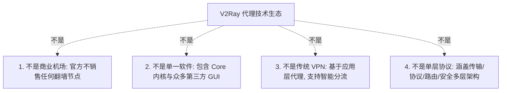
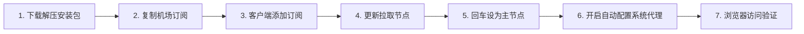

在科学上网与网络技术社区中，**“V2Ray”** 是被提及频率最高、但也是被新手误解最深的名词之一。

很多刚刚接触翻墙的新手用户，经常会产生一系列充满困惑的疑问：

**“我在网上下载了所谓的‘V2Ray 软件’（比如 v2rayN 或 v2rayNG），为什么打开后界面空空如也，连不上任何网页？”**  
**“V2Ray 到底是一家卖梯子的公司、一款翻墙软件、一个代理内核，还是一种网络协议？”**  
**“为什么很多机场提供的节点写着 VMess、VLESS、Trojan、Shadowsocks，它们和 V2Ray 到底是什么关系？”**  
**“VLESS 是不是就是 VMess 的‘第二代升级版’？VLESS 一定比 VMess 速度更快、更安全吗？”**  
**“经常看到的 Xray、V2Fly、REALITY、WebSocket、gRPC、TLS、Inbound、Outbound 到底各代表什么层次？”**  
**“在 Windows、安卓、iPhone 和 Mac 电脑上，如何正确导入 V2Ray 订阅并开启系统代理或 TUN 模式？”**

**V2Ray 通常指 Project V / V2Fly 项目相关的代理技术生态，而不是一个单独的“机场服务商”，更不是一款安装后就会自带免费服务器节点的商业 VPN 软件。**

普通用户在日常使用中所接触到的，实际上是一个由多个独立层级紧密协作的完整体系：**「用户界面客户端（如 v2rayN/v2rayNG） ➔ 代理核心（v2ray-core / Xray-core） ➔ 服务商订阅与节点配置 ➔ 代理协议（VMess/VLESS） ➔ 传输与安全加密（TCP/WS/TLS/REALITY） ➔ 物理专线网络 ➔ 境外出口 IP」**。

本文作为 **V2Ray 生态的核心母舰级 Pillar 总指南**，将带你从 **基础概念厘清、核心/客户端关系、VMess 与 VLESS 协议深度对比、跨平台客户端选型、订阅与节点导入，到四层故障排查与安全隐私** 建立立体化的完整技术认知。

---

## ⚡ 30 秒快速看懂：V2Ray 生态核心全景速查

```text
┌────────────────────────────────────────────────────────────────────────┐
│               V2Ray 生态核心概念 30 秒分层速查对照表                   │
├──────────────┬──────────────────────────────┬──────────────────────────┤
│ 概念名词     │ 真实技术定位与作用           │ 常见致命认知误区         │
├──────────────┼──────────────────────────────┼──────────────────────────┤
│ **V2Ray**    │ 模块化网络代理技术的总生态   │ ❌ 误以为是卖节点的机场  │
├──────────────┼──────────────────────────────┼──────────────────────────┤
│ **Core (内核)**│ 负责处理数据加密与流量转发的底层│ ❌ 误以为是图形界面软件  │
│ *(v2ray/Xray)*│ 核心程序 (命令行运行)        │                          │
├──────────────┼──────────────────────────────┼──────────────────────────┤
│ **GUI 客户端**│ 用户操作的图形界面外壳       │ ❌ 误以为自带翻墙服务器  │
│ *(v2rayN/NG)*│ (负责管理 Core 与订阅节点)   │                          │
├──────────────┼──────────────────────────────┼──────────────────────────┤
│ **VMess**    │ V2Ray 原创的有状态对称加密代理协议│ ❌ 误以为是物理专线名称  │
├──────────────┼──────────────────────────────┼──────────────────────────┤
│ **VLESS**    │ 去除冗余加密、极度轻量的高性能协议│ ❌ 误以为是 VMess 的升级版│
├──────────────┼──────────────────────────────┼──────────────────────────┤
│ **节点/订阅**│ 机场服务商提供的远程服务器连接参数│ ❌ 误以为是 V2Ray 官方发售│
└──────────────┴──────────────────────────────┴──────────────────────────┘
```

---

## 一、破除迷思：V2Ray 究竟是什么？“四不是”核心澄清

要真正用好 V2Ray，必须首先破除新手最常见的四大认知误区：



### 1. V2Ray 不是机场服务商
- **真相**：V2Ray（Project V）是一个纯开源的技术项目。官方团队**绝不拥有、不运营、也不向公众销售任何代理服务器**。
- **关系**：第三方机场服务商采购服务器后，部署了支持 V2Ray 协议的服务端，并将节点配置打包为“订阅链接”交付给用户。

### 2. V2Ray 不是一个单一的安装软件
- **真相**：V2Ray 本身由底层的 Core（核心引擎）构成。你在 Windows 上下载的 `v2rayN`、在安卓上下载的 `v2rayNG`，本质上都是第三方开发者为方便普通用户操作而开发的**图形界面外壳（GUI）**。

### 3. V2Ray 不是传统的商业 VPN
- **真相**：传统 VPN（如 OpenVPN、WireGuard）是在操作系统层面建立全局虚拟网络通道；而 V2Ray 是一个**高度模块化的多协议代理平台**，天生支持域名分流、国内直连、路由策略与流量特征伪装。

### 4. V2Ray 不是一个孤立的协议名称
- **真相**：V2Ray 生态内包含了多种代理协议（VMess、VLESS、Trojan、Shadowsocks 等）、多种底层传输方式（TCP、WebSocket、gRPC 等）以及多种安全层技术（TLS、REALITY）。

---

## 二、血缘演进：Project V、V2Fly 与 Xray 的深度关系解密

在搜索 V2Ray 教程时，你经常会看到 Project V、V2Fly、v2ray-core 与 Xray-core，它们之间的演进关系如下：

```text
┌────────────────────────────────────────────────────────────────────────┐
│                  V2Ray 生态历史演进与分支脉络图                        │
├────────────────────────────────────────────────────────────────────────┤
│ 1. 【Project V 时代 (2015~2019)】                                      │
│    由创始人 Victoria Raymond 发起，首创 VMess 协议与模块化架构         │
│                                                                        │
│ 2. 【V2Fly 社区接旗 (2019~至今)】                                     │
│    原作者隐退后，开源社区组建 V2Fly 组织接管开发，维护官方 `v2ray-core` │
│                                                                        │
│ 3. 【Xray-core 分支崛起 (2020~至今)】                                 │
│    由 XTLS 团队基于 V2Ray 分支创立独立项目 `Xray-core`，主打高性能    │
│    强力推广 VLESS 协议、XTLS 与 REALITY 伪装技术，成为现代客户端核心主力│
└────────────────────────────────────────────────────────────────────────┘
```

> ⚠️ **严谨技术红线**：
> - **严禁把“Xray 等同于 V2Ray”**：Xray 是一个拥有独立代码库和技术演进路线的分支项目；
> - **现代客户端现状**：目前主流的 `v2rayN`、`v2rayNG` 等客户端，底层通常同时内置或支持一键切换 `Xray-core` 和 `v2ray-core`。

---

## 三、架构拆解：GUI 客户端与 Core 内核的分工体系

理解客户端与内核的关系，是解决 90%“软件打不开”、“节点连不上”问题的金钥匙：

```mermaid
graph LR
    User[用户操作界面] --> GUI[GUI 客户端 (v2rayN / v2rayNG)]
    GUI -->|解析订阅, 生成 JSON 配置| Core[底层 Core 内核 (Xray / v2ray-core)]
    Core -->|系统网络接管| SysNet[System Proxy / TUN 虚拟网卡]
    Core -->|建立加密代理隧道| RemoteServer[境外专线节点服务器]
```

### 核心与客户端分工职责：
- **GUI 客户端（如 v2rayN）**：负责提供漂亮的视窗界面、保存订阅链接、管理节点列表、自动测速、切换路由规则，并将用户的点击操作转化为底层内核能看懂的 `config.json` 文件；
- **底层 Core（如 Xray-core）**：负责在后台默默执行底层的网络 TCP/UDP 握手、协议加解密、TLS 握手、数据流分发与路由分流。

---

## 四、协议篇：VMess vs VLESS 深度横向全景对比

很多新手最常纠结的问题是：**“我的机场同时提供 VMess 节点和 VLESS 节点，我到底该选哪一个？”**

```text
┌────────────────────────────────────────────────────────────────────────┐
│                   VMess vs VLESS 核心技术特性全景大比拼                │
├────────────────────┬────────────────────┬──────────────────────────────┤
│ 评估维度           │ **VMess 协议**     │ **VLESS 协议**               │
├────────────────────┼────────────────────┼──────────────────────────────┤
│ **诞生时间与定位** │ 2015年，V2Ray 原创 │ 2020年，轻量无状态设计       │
├────────────────────┼────────────────────┼──────────────────────────────┤
│ **协议设计理念**   │ 自带对称加密体系   │ **自身不加密，将安全交给 TLS**│
├────────────────────┼────────────────────┼──────────────────────────────┤
│ **客户端时间要求** │ 极其严格 (误差<90秒)│ 宽松无强校验                 │
├────────────────────┼────────────────────┼──────────────────────────────┤
│ **性能与 CPU 消耗**│ 存在二次加解密开销 │ **极高吞吐、极低 CPU 占用**   │
├────────────────────┼────────────────────┼──────────────────────────────┤
│ **主流伪装搭配**   │ VMess + WS + TLS   │ VLESS + TCP/gRPC + REALITY   │
├────────────────────┼────────────────────┼──────────────────────────────┤
│ **客户端兼容生态** │ 全平台老旧客户端均支持│ 需较新版 Core (Xray/v2ray v5)│
└────────────────────┴────────────────────┴──────────────────────────────┘
```

> 🔍 **技术澄清：VLESS 一定比 VMess 速度快吗？**
> - **不一定。** VLESS 由于去除了内部冗余加密，在千兆大带宽下 CPU 占用更低、首包握手更轻快；但**决定的速度上限永远取决于服务器物理带宽和线路质量**。如果底层是拥堵的公网线路，VLESS 也无法凭空提速。

---

## 五、层次分明：协议、传输、安全层与物理线路“四层解耦模型”

这是全网最容易被混淆的概念层级。必须清晰建立**四层解耦模型**：

```mermaid
graph TD
    Layer4[1. 代理协议层 (Proxy Protocol)] -->|定义身份认证与数据封装| P1[VLESS / VMess / Trojan / Shadowsocks]
    
    Layer3[2. 网络传输层 (Transport Layer)] -->|定义数据在网络中怎么跑| T1[TCP / WebSocket / gRPC / HTTPUpgrade]
    
    Layer2[3. 安全与伪装层 (Security Layer)] -->|提供加密通道与防探测| S1[TLS / XTLS / REALITY / None]
    
    Layer1[4. 物理线路层 (Circuit Layer)] -->|底层的真实跨境网络通道| C1[IEPL内网专线 / IPLC / BGP中转 / 公网直连]
```

### 概念拆解实例：“香港 VLESS-gRPC-REALITY IEPL 专线节点”
- **香港**：境外服务器落地出口所在地理位置；
- **VLESS**：代理协议（负责认证与数据调度）；
- **gRPC**：底层网络传输方式（负责数据流传输）；
- **REALITY**：安全伪装层（模拟真实境外大厂 TLS 证书特征）；
- **IEPL 专线**：物理通信线路（不过公网 GFW 的企业内网物理光纤）。

---

## 六、全平台主流 V2Ray 客户端推荐与选型矩阵

不同操作系统有其各自成熟、官方维护的图形客户端：

```text
┌────────────────────────────────────────────────────────────────────────┐
│                   2026 全平台主流 V2Ray 兼容客户端选型表               │
├──────────────┬──────────────────┬──────────────┬───────────────────────┤
│ 操作系统平台 │ 推荐核心客户端   │ 核心支持特性 │ 获取与下载推荐渠道    │
├──────────────┼──────────────────┼──────────────┼───────────────────────┤
│ **Windows**  │ **v2rayN**       │ 支持 Xray/Mihomo 双核，支持 TUN 模式，│ 官方 GitHub Releases 仓库│
│ *(电脑端主力)*│ *(首选推荐)*     │ 界面功能极其强大且成熟                │ (认准 2dust/v2rayN)   │
├──────────────┼──────────────────┼──────────────┼───────────────────────┤
│ **Android**  │ **v2rayNG**      │ 深度适配 Android 底层，支持应用分流，  │ 官方 GitHub / Google Play│
│ *(安卓端主力)*│ *(首选推荐)*     │ 耗电控制极佳，轻量稳定                │ (认准 2dust/v2rayNG)  │
├──────────────┼──────────────────┼──────────────┼───────────────────────┤
│ **iPhone/iPad│ **Shadowrocket** │ 完美兼容 VMess/VLESS/Trojan 订阅，    │ 苹果海外区 App Store   │
│ *(iOS 必备)* │ *(小火箭)*       │ iOS 平台霸主级工具，智能分流极强      │ (需自备美区 Apple ID) │
├──────────────┼──────────────────┼──────────────┼───────────────────────┤
│ **macOS**    │ **FoXray / V2RayU│ 专为 Mac 菜单栏设计，支持原生 M 系列芯片│ 官方 GitHub / Mac AppStore│
│ *(苹果电脑)* │ 或 sing-box**    │ 内存占用极低，支持全量协议            │                       │
└──────────────┴──────────────────┴──────────────┴───────────────────────┘
```

> 🛡️ **客户端下载第一安全红线**：
> - 坚决只从**官方 GitHub Release** 或 **官方 App Store** 下载客户端；
> - 严禁从各类“绿色软件站”、“破解网盘”或“某度搜索推广广告”下载带有后门的二次打包安装包！

---

## 七、新手 7 步标准上手流程：以 Windows v2rayN 为例



### 步骤 1：下载并解压客户端
- 前往 GitHub 下载 `v2rayN-With-Core.zip`（自带 Xray 内核），解压到非中文路径文件夹中。

### 步骤 2：从机场后台复制 V2Ray 订阅链接
- 登录机场后台，在“一键导入”或“订阅管理”中点击 **“复制 V2Ray / 通用订阅链接”**。

### 步骤 3：在客户端中添加订阅
- 打开 v2rayN 顶部菜单栏 ➔ 点击 **「订阅分组」➔「订阅分组设置」➔「添加」**，将复制的链接粘贴到“可选地址（URL）”一栏。

### 步骤 4：更新拉取全部服务器节点
- 点击顶部 **「订阅分组」➔「更新全部订阅（不通过代理）」**，列表中瞬间刷出香港、日本、美国等数十个节点。

### 步骤 5：选择主力节点设为活动连接
- 选中一个延迟较低的香港或日本节点，按下键盘 **Enter（回车键）**，节点名称变为蓝色/高亮即代表选中。

### 步骤 6：在底部开启「自动配置系统代理」
- 将 v2rayN 底部任务栏的路由模式设为 **「绕过大陆 (Bypass Mainland)」**，系统代理下拉框选择 **「自动配置系统代理 (Set System Proxy)」**（任务栏右下角小图标由蓝变红）。

### 步骤 7：打开浏览器测试出海连接
- 打开 Safari 或 Edge 浏览器，访问 `google.com` 或 `ipinfo.io`，确认出口 IP 正常变更为境外机房。

---

## 八、V2Ray 四层故障排查中枢：对症下药排错指南

遇到翻墙故障时，切忌盲目乱改设置，应遵循 **“四层故障诊断模型”** 逐层定位：

```text
┌────────────────────────────────────────────────────────────────────────┐
│                   V2Ray 四层故障排查中枢诊断表                         │
├────────────────────┬────────────────────┬──────────────────────────────┤
│ 故障发生层级       │ 典型报错与核心现象 │ 权威排障动作与解决方案       │
├────────────────────┼────────────────────┼──────────────────────────────┤
│ **第一层：订阅配置**│ 订阅更新报错 404， │ 检查订阅是否过期欠费；       │
│                    │ 节点列表空空如也   │ 确认机场后台订阅链接是否拼错 │
├────────────────────┼────────────────────┼──────────────────────────────┤
│ **第二层：节点连接**│ 节点测速全部显示红 │ 检查本地宽带是否断网；       │
│                    │ 色的 -1ms 或超时   │ 检查 Core 内核是否被防火墙拦截│
├────────────────────┼────────────────────┼──────────────────────────────┤
│ **第三层：流量接管**│ 节点绿色但打不开网 │ 检查底部系统代理是否开启；   │
│                    │ 页面 (有节点没网)  │ 检查路由是否误设为“全局直连” │
├────────────────────┼────────────────────┼──────────────────────────────┤
│ **第四层：目标性能**│ 网页能开但 4K 缓冲，│ 属于晚高峰国际出口拥堵；     │
│                    │ 晚高峰严重卡顿     │ 切换为企业级 IEPL 物理专线   │
└────────────────────┴────────────────────┴──────────────────────────────┘
```

---

## 九、2026 V2Ray 高可用多协议专线品牌推荐矩阵

针对原生支持 VLESS/VMess 协议、晚高峰 0 丢包与全平台客户端兼容，精选以下真实稳定服务商：

```text
┌────────────────────────────────────────────────────────────────────────────────────────┐
│                        2026 V2Ray 多协议高可用专线品牌候选矩阵                         │
├──────────┬──────────────────────────┬──────────────┬──────────────┬────────────────────┤
│ 适配场景 │ 推荐品牌候选             │ 实际起付门槛 │ 每月流量配额 │ 协议支持与专线优势 │
├──────────┼──────────────────────────┼──────────────┼──────────────┼────────────────────┤
│ 旗舰全能 │ 光速云 (GuangSuYun)      │ 约 ¥7.5/月起 │ 59G~238G /月 │ 全线 IEPL 专线，原生支持 VLESS/Trojan，晚高峰 0 丢包│
│ 平价轻量 │ 微风网络 (BreezeNet)     │ 约 ¥7/月起   │ 50GB / 月    │ 移动端日常查资料首选，小流量高性价比，年付百元内 │
│ 弹性月付 │ 唯兔云 (V2Yun)           │ ¥14.9/月     │ 100GB / 月   │ 15元纯单月付，多国节点丰富，适合短期测试与备用 │
│ 应急备用 │ 星岛梦 (XingDaoMeng)     │ 约 ¥8/月起   │ 60G/不限时包 │ 0月租不限时包，节点长期有效，主力断网秒级顶上 │
│ AI/开发  │ 速界 (SpeedWorld)        │ ¥25/月       │ 150GB / 月   │ 原生住宅 IP 节点，ChatGPT/Claude 专属独立出口 │
└──────────┴──────────────────────────┴──────────────┴──────────────┴────────────────────┘
```

- 🏆 **多协议旗舰首选**：[光速云](/reviews/guangsu-cloud/) —— 全线企业级 IEPL 物理专线，完美下发 VLESS / VMess / Shadowsocks 全协议订阅，晚高峰秒开 4K；
- 🍃 **超低预算轻量**：[微风网络](/reviews/weifeng-cloud/) —— 针对手机端与日常查资料优化的 50GB 小流量专线，年付折算仅约 ¥7/月；
- 💳 **拒绝绑定的单月付**：[唯兔云](/recommend/best-airports/) —— ¥14.9 纯单月付，100GB 充沛流量，节点丰富。

---

## 十、避坑指南：35 个关于“V2Ray 使用”的致命认知误区

```text
❌ 误区 1：V2Ray 是一家海外翻墙公司，下载软件就能免费上网 ➔ 事实：V2Ray 是开源技术项目，安装客户端后必须配置节点才能上网。
❌ 误区 2：v2rayN 就是 V2Ray Core 本身 ➔ 事实：v2rayN 只是图形界面外壳，底层依赖 Xray-core 或 v2ray-core 执行代理。
❌ 误区 3：v2rayNG 是安卓版官方服务器 ➔ 事实：v2rayNG 是安卓手机端的第三方客户端。
❌ 误区 4：V2Ray 和 Xray 完全是一模一样的软件 ➔ 事实：Xray 是独立的强力分支项目，主导了 VLESS 和 REALITY 协议的演进。
❌ 误区 5：VLESS 是 VMess 的第二代版本升级，VMess 已经被彻底淘汰 ➔ 事实：两者设计理念不同，VMess 依然在大量通用场景中稳定服役。
❌ 误区 6：只要节点采用 VLESS 协议，下载网速就一定会翻倍 ➔ 事实：协议只影响加解密开销，决定网速上限的是物理光纤带宽。
❌ 误区 7：VLESS 协议一定比 VMess 协议更安全 ➔ 事实：VLESS 自身不加密，必须依赖 TLS 或 REALITY 等安全层提供保护。
❌ 误区 8：REALITY 是一种最新的节点国家或地区名称 ➔ 事实：REALITY 是一种伪装真实 TLS 握手特征的安全层技术。
❌ 误区 9：WebSocket（WS）是一种全新的科学上网代理协议 ➔ 事实：WebSocket 属于网络传输层方式，需搭配 VMess 或 VLESS 运行。
❌ 误区 10：gRPC 传输方式一定在所有网络下都比 TCP 更快 ➔ 事实：gRPC 多路复用在弱网下抗丢包较好，但在高 QoS 网络下可能被限速。
❌ 误区 11：IEPL 专线是 V2Ray 协议的一种 ➔ 事实：IEPL 是企业级物理内网光纤线路，与应用层协议无关。
❌ 误区 12：订阅链接就是单个节点的 vmess:// 链接 ➔ 事实：单节点链接只含 1 个服务器，订阅链接包含几十个节点的自动更新入口。
❌ 误区 13：订阅是由 V2Ray 官方在官方应用商店统一下发的 ➔ 事实：订阅来自具体的第三方机场服务商。
❌ 误区 14：所有 V2Ray 客户端的配置字段都可以互相通用 ➔ 事实：不同 Core（如 Xray 与 sing-box）的配置 JSON 语法存在巨大差异。
❌ 误区 15：节点测速 Ping 越低，看 YouTube 4K 视频就越流畅 ➔ 事实：低 Ping 仅代表响应快，4K 流畅看持续下行带宽与 0 丢包率。
❌ 误区 16：选了 VLESS 节点就保证 100% 能正常使用 ChatGPT ➔ 事实：ChatGPT 风控出口 IP，与代理协议名称毫无关系。
❌ 误区 17：VMess 节点绝对无法用来观看 Netflix 奈飞流媒体 ➔ 事实：能否看奈飞取决于落地机房 IP 是否解锁，与协议无关。
❌ 误区 18：开启 TUN 模式是小火箭或 v2rayN 的网络加速开关 ➔ 事实：TUN 仅扩大流量接管范围（接管游戏与命令行），不增加带宽。
❌ 误区 19：System Proxy（系统代理）开启后所有软件都会走翻墙 ➔ 事实：部分不遵循系统代理的命令行工具或游戏需配合 TUN 模式。
❌ 误区 20：在 GitHub 升级了 v2rayN 客户端，节点列表就会自动刷新 ➔ 事实：客户端升级只更新程序本体，节点需手动点击“更新订阅”。
❌ 误区 21：节点显示红色 Timeout 就一定是机场跑路了 ➔ 事实：也可能是本地断网、客户端防火墙拦截或机房临时维护。
❌ 误区 22：开源客户端意味着所有免费节点都绝对安全可信 ➔ 事实：客户端开源只保证软件无毒，节点提供者依然能探测未加密的明文流量。
❌ 误区 23：遇到 V2Ray 连接失败，第一步必须彻底关闭 Windows Defender ➔ 事实：放行 Core 程序网络权限即可，关全杀毒极度危险。
❌ 误区 24：在网上随便找的绿色破解版 v2rayN 比官方版更好用 ➔ 事实：第三方网盘版极易被植入挖矿木马或键盘记录器。
❌ 误区 25：只要使用了 V2Ray，网上冲浪就实现了 100% 绝对匿名 ➔ 事实：访问网站时提交的个人账号、Cookie 和行为依然会被记录。
❌ 误区 26：Clash 和 V2Ray 是同一款软件的不同叫法 ➔ 事实：Clash 是基于规则的独立代理生态，与 V2Ray 属于不同技术分支。
❌ 误区 27：iPhone 上必须安装名为“V2Ray 官方版”的软件 ➔ 事实：iOS 端使用 Shadowrocket、Loon、Stash 等兼容工具即可。
❌ 误区 28：同时在电脑上打开 Clash 和 v2rayN 会实现双重加速 ➔ 事实：两款工具会疯狂争抢 10808/7890 端口，导致全网断流死锁。
❌ 误区 29：节点配置里的 UUID 可以随便发给网友共享 ➔ 事实：UUID 是你的个人身份认证凭证，泄露会导致套餐流量被盗刷。
❌ 误区 30：把电脑系统时间调快 5 分钟不会影响翻墙 ➔ 事实：VMess 协议要求时间误差小于 90 秒，时间不准会导致全网断流。
❌ 误区 31：更新 Core 内核一定会自动修复订阅链接失效 ➔ 事实：内核只管传输，订阅失效需在机场后台重新获取。
❌ 误区 32：只要节点连得上，微信和国内网站就一定会变卡 ➔ 事实：客户端默认开启“绕过大陆”分流，国内流量走本地光纤直连。
❌ 误区 33：V2Ray 只能在 Windows 电脑上使用 ➔ 事实：V2Ray 协议跨平台全兼容，涵盖 Win/Mac/Android/iOS/Linux。
❌ 误区 34：只要买了大流量套餐，手机里留一个节点就足够了 ➔ 事实：必须保留异地备用节点（如香港+日本），防止单点故障。
❌ 误区 35：免费公开节点 Ping 只有 20ms，可以放心长期使用 ➔ 事实：免费节点存活期极短且存在严重的公网中间人嗅探风险。
```

---

## 十一、常见问题深度解答（FAQ · 50 问）

### Q1：V2Ray 是什么？
**答**：V2Ray 是围绕 Project V 发展起来的开源代理技术生态，包含底层代理核心（Core）与多种网络协议，用于构建安全、灵活的网络通道。

### Q2：V2Ray 是软件还是协议？
**答**：**两者皆非单一指代。** V2Ray 是一套技术生态体系，包含底层内核（如 v2ray-core）、多种代理协议（VMess/VLESS）以及众多第三方图形客户端。

### Q3：V2Ray 是不是 VPN？
**答**：**不完全是。** 传统 VPN 是系统底层的全局虚拟通道；V2Ray 属于应用层代理框架，天生具备域名分流、特征伪装与多协议路由能力。

### Q4：V2Ray 是不是机场？
**答**：**坚决不是。** V2Ray 官方团队只开发开源代码，不拥有也不销售任何服务器；提供收费节点的是第三方机场服务商。

### Q5：V2Ray 是不是节点？
**答**：**不是。** 节点是服务器的具体连接参数（IP、端口、密钥）；V2Ray 是用于解析这些参数并建立加密通信的工具和技术。

### Q6：V2Ray 怎么用？
**答**：新手标准流程：① 下载可信客户端（如 Windows 用 v2rayN）；② 获取机场订阅链接并导入；③ 更新节点并设为主连接；④ 开启系统代理即可出海。

### Q7：V2Ray 客户端是什么？
**答**：指为方便普通用户操作而开发的图形界面软件（如 v2rayN、v2rayNG、Shadowrocket），负责管理订阅节点并调度底层内核。

### Q8：V2Ray Core 是什么？
**答**：指在后台真正执行数据传输、协议封装、TLS 加密和流量分流的核心命令行程序（如 `v2ray-core` 或 `Xray-core`）。

### Q9：V2Fly 是什么？
**答**：在 Project V 原作者隐退后，由开源社区志愿者组建的维护组织，负责维护官方正统的 `v2ray-core` 开源仓库与文档。

### Q10：Project V 是什么？
**答**：包含 V2Ray 内核及周边模块化工具集的母项目总称，是 V2Ray 技术的发源地。

### Q11：Xray 是什么？
**答**：由 XTLS 团队基于 V2Ray 创立的独立高性能分支项目，主导了 VLESS 协议与 REALITY 伪装技术，是现代客户端最常用的底层内核。

### Q12：V2Ray 和 Xray 有什么区别？
**答**：Xray 是 V2Ray 的超集分支，性能更强、对 VLESS/REALITY 的支持更深度；两者代码库独立，但客户端生态高度重叠通用。

### Q13：v2rayN 是什么？
**答**：Windows 操作系统上最主流、功能最完备的开源 V2Ray 图形客户端（由 2dust 维护），支持一键切换 Xray/Mihomo 内核与 TUN 模式。

### Q14：v2rayNG 是什么？
**答**：Android 安卓手机上最主流的开源 V2Ray 客户端，通过调用 Android VpnService 实现系统级智能分流与科学上网。

### Q15：v2rayN 和 V2Ray 有什么区别？
**答**：v2rayN 是 Windows 上的“图形外壳”；V2Ray 是底层技术生态。v2rayN 必须依赖 V2Ray/Xray 的 Core 才能正常工作。

### Q16：Windows 电脑推荐用什么 V2Ray 客户端？
**答**：**强烈首选 v2rayN**。功能成熟、更新频繁、全协议支持完备，且原生支持 TUN 虚拟网卡与订阅自动更新。

### Q17：Android 安卓手机推荐用什么 V2Ray 客户端？
**答**：**强烈首选 v2rayNG**。界面简洁清爽、耗电低、支持分应用代理，且与各类机场订阅完美兼容。

### Q18：iPhone 苹果手机可以使用 V2Ray 节点吗？
**答**：**可以。** iOS 用户使用海外 App Store 下载的 **Shadowrocket（小火箭）** 或 **Stash**，均可完美导入 V2Ray 订阅与节点。

### Q19：Mac 苹果电脑推荐用什么 V2Ray 客户端？
**答**：推荐使用 **FoXray**、**V2RayU** 或基于图形内核的 **sing-box for Mac**，均完美适配 Apple M 系列芯片。

### Q20：V2Ray 节点是什么？
**答**：指支持 V2Ray 协议（如 VMess 或 VLESS）的境外代理服务器配置参数，包含地址、端口、UUID、传输方式等信息。

### Q21：V2Ray 订阅是什么？
**答**：机场服务商提供的一个 HTTP 网址，客户端通过该网址可以一次性自动拉取数十个境外节点的最新配置信息。

### Q22：V2Ray 订阅从哪里获取？
**答**：在正规专线机场（如光速云、微风网络等）注册并购买套餐后，在后台控制面板点击“复制 V2Ray 订阅”即可获得。

### Q23：V2Ray 订阅怎么导入客户端？
**答**：以 v2rayN 为例：点击菜单栏「订阅分组」➔「添加」➔ 粘贴订阅链接并保存 ➔ 点击「更新全部订阅」即可刷出节点。

### Q24：单节点链接（vmess://）和订阅有什么区别？
**答**：`vmess://` 开头的单节点链接只包含一台固定服务器的参数；订阅链接是一个网络入口，能批量同步几十台服务器并自动更新。

### Q25：VMess 协议是什么？
**答**：V2Ray 原创的对称加密代理协议，客户端与服务端通过预设的 UUID 认证，天生具备强防探测能力，但对系统时间精度要求极高。

### Q26：VLESS 协议是什么？
**答**：一种极度轻量化、无状态的现代代理协议。它自身不做冗余对称加密，将安全交由底层的 TLS/REALITY，吞吐极高且 CPU 占用极低。

### Q27：VMess 和 VLESS 有什么本质区别？
**答**：VMess 内部自带握手加密机制且强依赖时钟同步；VLESS 去除了内部加密封装，由外部 TLS 护航，更加轻快高效。

### Q28：VLESS 一定比 VMess 速度更快吗？
**答**：**不一定。** VLESS 仅降低了设备 CPU 加解密开销，网络网速上限核心取决于机场服务器的物理光纤带宽储备。

### Q29：VLESS 一定比 VMess 更安全吗？
**答**：安全取决于完整配置。VLESS 必须配合 TLS/REALITY 才能保证安全，若配置为明文传输则毫无安全性可言。

### Q30：VMess 协议现在还能稳定使用吗？
**答**：**完全可以。** 搭配 WebSocket + TLS 伪装的 VMess 节点，依然是目前全球兼容性最强、抗封锁极佳的经典方案之一。

### Q31：节点配置里的 UUID 是什么意思？
**答**：通用唯一定位符（格式如 `8位-4位-4位-4位-12位`），充当你在该节点上的专属身份认证密钥，严禁泄露给陌生人。

### Q32：为什么使用 VMess 协议必须校准电脑时间？
**答**：VMess 协议认证包含动态时间戳校验，如果你的设备系统时间与标准北京时间误差超过 **90 秒**，连接将直接被服务器拒绝。

### Q33：TLS 是什么？
**答**：传输层安全协议（用于 HTTPS 加密的底层标准），用于在用户与代理服务器之间建立坚不可摧的强加密防窃听通道。

### Q34：SNI 是什么意思？
**答**：服务器名称指示（Server Name Indication），在 TLS 握手初期告诉服务器客户端想要访问哪一个具体域名。

### Q35：WebSocket（WS）传输方式有什么用？
**答**：将代理流量伪装成标准的 WebSocket 网页全双工通信数据包，可轻松穿越各类严苛的企业与公共防火墙。

### Q36：gRPC 传输方式有什么特点？
**答**：基于 HTTP/2 标准的现代高效传输协议，具备原生多路复用与极低延迟开销，在高负载跨境传输中表现抢眼。

### Q37：REALITY 是什么？
**答**：Xray 团队开发的前沿安全层技术，能够直接借用并模拟海外知名大厂（如微软、苹果）的真实 TLS 证书特征，彻底消除自签名证书指纹。

### Q38：REALITY 和 VLESS 是一回事吗？
**答**：**不是同一层。** VLESS 是代理协议（管认证），REALITY 是安全伪装层（管握手特征），两者常组合使用（VLESS-REALITY）。

### Q39：协议和线路有什么本质区别？
**答**：**协议**（VLESS/VMess）描述数据包怎么打包加密；**线路**（IEPL/直连）描述数据包在物理世界中走公网海缆还是内网物理光纤。

### Q40：V2Ray System Proxy（系统代理）是什么？
**答**：告诉 Windows 或 macOS 操作系统：“请把所有遵循系统代理设置的浏览器流量，自动转发给 v2rayN 监听的本地端口”。

### Q41：V2Ray TUN 模式是什么意思？
**答**：在操作系统中创建一张虚拟网卡，强制接管整台电脑 100% 的网络流量（包含游戏、命令行、后台服务），实现真全局代理。

### Q42：开启 TUN 模式会提高下载网速吗？
**答**：**不会。** TUN 模式只扩大流量接管的应用范围，无法增加物理带宽，看 4K 视频卡顿需切换高带宽专线节点。

### Q43：V2Ray 节点有了但打不开网页怎么办？
**答**：① 检查任务栏右下角 v2rayN 图标是否由蓝变红（是否开启系统代理）；② 检查路由是否误设为全局直连；③ 重启浏览器清除缓存。

### Q44：V2Ray 节点全部显示 -1ms 或 Timeout 怎么办？
**答**：① 检查本地网络宽带是否畅通；② 检查杀毒软件是否拦截了 `xray.exe`；③ 点击更新订阅确认节点 IP 是否发生变更。

### Q45：免费公开的 V2Ray 节点安全吗？
**答**：**存在严重安全隐患。** 免费节点极不稳定、随时断网，且节点搭建者有可能对未加密的明文 HTTP 流量进行窥探和抓包。

### Q46：使用 V2Ray 可以正常访问 ChatGPT 吗？
**答**：可以。但必须选用美区、日区或新加坡的**纯净原生专线节点**，且避开被 OpenAI 封锁的共享机房数据中心 IP。

### Q47：使用 V2Ray 可以流畅看 YouTube 4K 吗？
**答**：可以。选择持续吞吐带宽充沛、晚高峰 0 丢包的日本或香港 IEPL 专线节点即可实现秒开拖动不缓冲。

### Q48：V2Ray 和 Clash 相比哪个更好？
**答**：各具特色：**Clash** 胜在策略组分流规则强大、界面极客；**V2Ray/v2rayN** 胜在协议底层更新极快（秒级支持 REALITY/VLESS）、多内核切换灵活。

### Q49：使用 V2Ray 需要彻底关闭电脑杀毒软件吗？
**答**：**坚决不需要！** 正常使用只需在 Windows Defender 中将 v2rayN 所在的文件夹添加为“信任排除项”即可，切勿裸奔关闭杀毒。

### Q50：如何搭建一套最稳定无故障的 V2Ray 科学上网环境？
**答**：订阅一家拥有 **IEPL 纯物理专线** 的老牌服务商，电脑端使用 **v2rayN（内置 Xray 内核）**，日常保持“绕过大陆”智能分流，并常备备份节点。

---

## 🏁 总结：V2Ray 生态技术认知终极模型

彻底掌握 V2Ray 技术与客户端使用，请牢记以下**六维核心模型**：

```text
1. 明确角色 ➔ V2Ray 是技术生态而非机场，v2rayN 是外壳，Core 才是执行引擎
2. 厘清层次 ➔ 协议(VLESS) ≠ 传输(WS/gRPC) ≠ 安全(REALITY) ≠ 物理线路(IEPL)
3. 按需选型 ➔ PC 端首选 v2rayN，安卓选 v2rayNG，iOS 选小火箭，全平台通用
4. 专线为王 ➔ 决定 4K 流畅与晚高峰稳定的是物理线路带宽，而非单纯协议名称
```

---

### 📚 延伸进阶阅读与选型专栏
- 💻 **电脑端梯子总指南**：[《电脑梯子怎么用？Windows/Mac客户端、订阅导入与防断流配置教程》](/recommend/pc-tizi/)
- 📱 **小火箭超级Pillar**：[《Shadowrocket怎么用？小火箭订阅、节点、规则与iPhone完整配置教程》](/tutorials/shadowrocket-tizi/)
- 🚀 **Clash 超级Pillar**：[《Clash梯子怎么用？Clash Verge Rev、Mihomo、订阅与节点完整教程》](/tutorials/clash-tizi/)
- 📱 **iPhone 设备总指南**：[《iPhone梯子怎么用？Shadowrocket、小火箭、订阅与节点新手完整教程》](/tutorials/iphone-tizi/)
- ⚡ **老牌旗舰专线**：[《光速云深度评测：2020老牌IEPL专线与解锁实测》](/reviews/guangsu-cloud/)
- 🍃 **平价轻量专线**：[《微风网络深度评测：小流量套餐值不值得买？》](/reviews/weifeng-cloud/)
- 🏆 **2026 全景大榜**：[《2026梯子推荐：稳定、速度、价格、安全与不同使用场景怎么选》](/recommend/best-tizi/)
