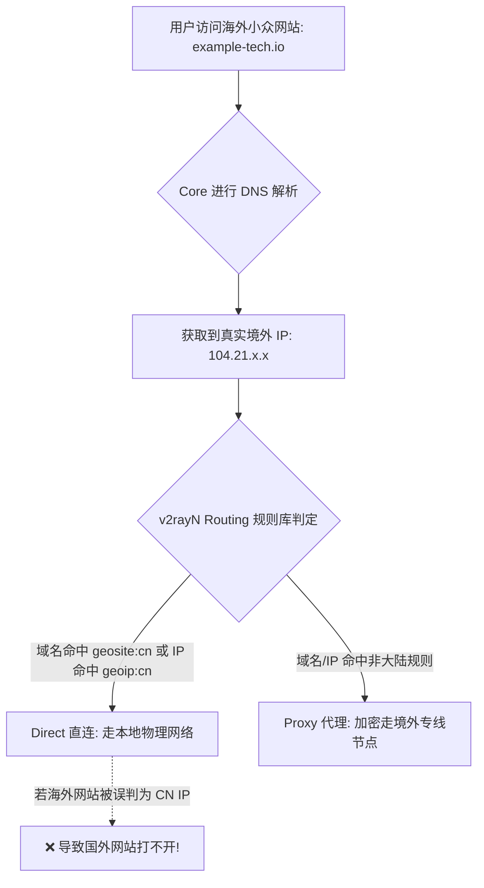
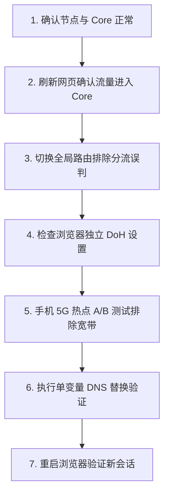

在 Windows 电脑上使用 v2rayN 科学上网时，最常困扰用户的一类看似隐蔽、却极其顽固的连接故障莫过于：**“明明节点测速完全正常、系统代理和 Core 引擎均已就绪，但在 Chrome 或 Edge 中打开 Google、Twitter 或某个特定海外小众网站时，却频繁提示 `DNS_PROBE_FINISHED_NXDOMAIN`、`ERR_NAME_NOT_RESOLVED` 或持续加载超时；而另一些网站却能秒开！”**

面对这种“节点能通但特定网页打不开”的离奇现象，很多用户往往会陷入病急乱投医的困境与误区：

**“为什么明明能连上境外节点，但浏览器就是无法解析目标网站的域名？”**  
**“Windows 系统 DNS、v2rayN Core 内部 DNS 和 Chrome/Edge 的 Secure DNS（DoH）到底有什么区别？为什么修改了电脑网卡 DNS 却对翻墙毫无效果？”**  
**“为什么在 Edge 浏览器里能打开某个网站，而在 Chrome 里却死活打不开？”**  
**“AAAA 记录到底是什么？听说它是‘四倍加速记录’，开启 IPv6 会不会导致所有节点集体断网？遇到打不开网页是不是第一步就该去网卡里禁用 IPv6？”**  
**“DoH（DNS over HTTPS）和 DoT 到底是不是一种翻墙代理协议？把 DNS 改成 `1.1.1.1` 或 `8.8.8.8` 真的能让下载速度翻倍吗？”**  
**“为什么开启 TUN 模式之后，电脑的所有域名解析反而全部超时瘫痪？”**  
**“DNS 和 Routing（路由规则）之间到底是什么关系？为什么错误的 DNS 解析会导致流量被错误地判定为直连（Direct）？”**

**v2rayN 中的 DNS（域名系统）负责将人类可读的网址域名（如 `google.com`）翻译转换为底层网络通信必须依赖的 IP 地址（如 `142.250.x.x` 或 IPv6 地址）。节点和 Core 连接正常，仅代表出海隧道畅通；如果域名解析在本地或远端遭到污染、超时阻断或 IPv6 寻址死锁，浏览器依然会直接报错断网。**

但千万不要把 DNS 当作万能的“网速加速器”。**DNS 仅在首次建立连接的瞬间决定寻址目标与最近的 CDN 节点边缘，它绝对无法凭空增加代理节点的持续物理下载带宽！**

本文作为 **v2rayN DNS 寻址机制与 Windows 域名解析的权威深度指南**，将带你从 **三类 DNS 故障对象辨析、系统/Core/浏览器三层 DNS 架构、A/AAAA 与 IPv6 寻址实战、DoH 加密解析原理，到 DNS 与 Routing 路由分流联动排障** 建立透彻的科学认知。

---

## ⚡ 30 秒快速诊断：v2rayN DNS 故障排查流

```text
┌────────────────────────────────────────────────────────────────────────┐
│                   v2rayN DNS 故障 30 秒极速诊断决策流                  │
├────────────────────────────────────────────────────────────────────────┤
│ 1. 【节点通畅否】➔ 节点全红 Timeout ➔ 先去排查节点连接，不要盲目改 DNS  │
│ 2. 【流量进 Core 否】➔ 刷新网页底部日志无反应 ➔ 先去排查系统代理/TUN 端口 │
│ 3. 【特定网站打不开】➔ Google 能开但某小众站打不开 ➔ 路由误判为 Direct  │
│    ➔ 将底部路由规则临时切换为「全局 (Global)」测试是否为分流规则缺陷   │
│ 4. 【三层 DNS 隔离】➔ Chrome 挂但 Edge 正常 ➔ 检查 Chrome 是否开了独立 DoH│
│ 5. 【IPv6 寻址排查】➔ Wi-Fi 失败但手机热点正常 ➔ 检查是否命中死锁 AAAA 记录 │
│ 6. 【守提速基线】➔ 严禁迷信“换 DNS 能让 YouTube 4K 翻倍”的谣言         │
└────────────────────────────────────────────────────────────────────────┘
```

---

## 一、破除迷思：三种 DNS 对象与三层 DNS 架构

排查 DNS 故障的第一步，必须精准切分**「你在解析哪个域名」**以及**「是谁在执行解析」**：

```mermaid
graph TD
    subgraph 三大 DNS 目标对象
        Obj1[1. 机场订阅域名 (sub.xxx.com)] --> SubError[解析失败 ➔ 订阅更新 404/Timeout]
        Obj2[2. 节点服务器域名 (hk01.xxx.com)] --> NodeError[解析失败 ➔ 节点测速全红 -1ms]
        Obj3[3. 目标访问网站域名 (google.com)] --> WebError[解析失败 ➔ 网页提示无法解析域名 (本篇核心!)]
    end
```

```text
┌────────────────────────────────────────────────────────────────────────┐
│                   Windows 翻墙环境中的三层 DNS 架构                    │
├──────────────┬────────────────────────┬────────────────────────────────┤
│ DNS 层级     │ 运行位置与技术载体     │ 影响范围与排障优先级           │
├──────────────┼────────────────────────┼────────────────────────────────┤
│ **1. 浏览器**│ Chrome / Edge 内部的   │ **最高优先级**。若开启了安全   │
│ **DoH 引擎** │「使用安全 DNS」机制    │ DNS，浏览器会绕过系统与 Core   │
├──────────────┼────────────────────────┼────────────────────────────────┤
│ **2. 系统**  │ Windows 适配器中由宽带 │ 影响所有普通 Windows 本地应用  │
│ **System DNS**│ 路由器或手动分配的 DNS │ (如国内软件、基础网络连接)     │
├──────────────┼────────────────────────┼────────────────────────────────┤
│ **3. 代理**  │ Xray-core / sing-box   │ 负责处理送入代理隧道后的海外   │
│ **Core DNS** │ 内核内部配置的远程 DNS │ 域名解析 (防 GFW 污染核心)     │
└──────────────┴────────────────────────┴────────────────────────────────┘
```

> 💡 **核心定律**：如果浏览器开启了独立的 DoH 安全 DNS，它会直接向第三方服务器（如 Cloudflare）发起加密查询，此时你在 Windows 网卡或路由器里修改任何 DNS，对该浏览器都**完全不起作用**！

---

## 二、寻址底座：A 记录、AAAA 记录与 IPv6 真实边界

现代互联网正在从 IPv4 向 IPv6 全面过渡，理解这两类 DNS 记录是解决“网站打不开”的关键：

```mermaid
graph TD
    DomainReq[浏览器发起域名查询: example.com] --> DNSQuery{DNS 解析服务器}
    
    DNSQuery -->|返回 A 记录| IPv4Addr[IPv4 地址: 93.184.216.34 (32位经典地址)]
    DNSQuery -->|返回 AAAA 记录| IPv6Addr[IPv6 地址: 2606:2800:220:1:248:1893:25c8:1946 (128位)]
    
    IPv4Addr --> RouteEngine[进入 v2rayN 路由与出站选择]
    IPv6Addr --> RouteEngine
```

### 1. A 记录 vs AAAA 记录
- **A 记录（Address Record）**：将域名映射到标准的 **IPv4 地址**；
- **AAAA 记录（Quad-A Record）**：将域名映射到现代的 **IPv6 地址**（因 IPv6 地址长度为 128 位，是 IPv4 32 位的 4 倍，故称 AAAA）。
- ❌ **破除小白误区**：AAAA 记录代表的是 IPv6 格式，**绝不是“四倍网速加速记录”**！

### 2. 为什么部分宽带下 IPv6 会导致网站打不开？
- 很多家庭宽带虽然分配了公网 IPv6 地址，但本地运营商的 IPv6 国际出口路由极其劣质甚至发生丢包阻断。当 DNS 同时返回 A 和 AAAA 记录时，Windows 默认会优先尝试连接 IPv6 地址，从而导致长时间卡顿转圈。
- 🚫 **技术红线**：**不要一遇到打不开网页就无脑去禁用电脑网卡 IPv6！** 只有在有线/Wi-Fi 与手机 5G 热点做 A/B 测试、且日志明确提示 IPv6 连接超时时，才需在 v2rayN 内部针对代理流量做 IPv4 优先策略。

---

## 三、传输加密：DoH、DoT 与传统 DNS 本质区别

```text
┌────────────────────────────────────────────────────────────────────────┐
│                   传统 DNS 与现代加密 DNS 全方位对比                   │
├──────────────┬────────────────────────┬────────────────────────────────┤
│ 比较维度     │ 传统 UDP/TCP 53 DNS    │ DoH (DNS over HTTPS)           │
├──────────────┼────────────────────────┼────────────────────────────────┤
│ **传输协议** │ 明文 UDP / TCP 53 端口 │ 加密 HTTPS (TCP 443 端口)      │
│ **防污染能力**│ ❌ 极弱 (极易被 GFW 抢答)| ✅ 极强 (流量混入正常 HTTPS 中)│
│ **解析延迟** │ 极快 (无加密握手开销)  │ 微慢 (多一层 TLS 握手开销)     │
│ **是否是代理**│ ❌ 否 (仅查询域名 IP)  │ ❌ 否 (绝不是 VLESS 等节点协议)│
│ **能提升带宽吗** ❌ 绝对不能增加下载带宽│ ❌ 绝对不能增加下载带宽        │
└──────────────┴────────────────────────┴────────────────────────────────┘
```

### 1. DoH（DNS over HTTPS）与 DoT 不是“翻墙代理协议”
- 很多新手误以为配置了 DoH 就能代替梯子节点直接出海。DoH 改变的**仅仅是 DNS 查询数据包的传输加密方式**，防止本地宽带运营商偷窥或篡改解析结果。一旦域名解析完成，实际的网页数据传输依然需要合法的出海代理隧道。

### 2. 常用权威公共 DNS 参考（核验可用）
- 🌐 **Google Public DNS**：`8.8.8.8` / `8.8.4.4`（DoH 地址：`https://dns.google/dns-query`）
- ⚡ **Cloudflare DNS**：`1.1.1.1` / `1.0.0.1`（DoH 地址：`https://cloudflare-dns.com/dns-query`）
- 🛡️ **Quad9 安全 DNS**：`9.9.9.9`（DoH 地址：`https://dns.quad9.net/dns-query`）

---

## 四、中枢联动：DNS 与 Routing（路由分流）的深度关系

DNS 与 Routing 绝对不是各自孤立的模块，它们在 v2rayN 内部紧密相扣：



### 1. 域名规则 vs IP 规则
- **基于域名的分流**：v2rayN 直接根据网址域名（如 `*.google.com`）决定走 Proxy，不需要提前解析 IP；
- **基于 IP 的分流**：当规则库没有明确收录某个生僻小众网站时，Core 必须先通过 DNS 解析出该网站的真实 IP，再根据 `geoip.dat` 判断该 IP 属于国内还是国外。

### 2. CDN 对访问速度的间接影响
- 为什么有时候换了 DNS 感觉打开网页更快了？**因为大型跨国网站在全球分布着数千个 CDN 节点**。使用靠近代理服务器出口的优质 DNS，能让 CDN 给你分配响应最快、物理距离最近的边缘机房，从而大幅降低首屏加载时间（TTFB）。

---

## 五、标准 7 步通关排障流程（Checklist）



1. **第一步：确认节点自身通畅** —— 节点测速必须有正常延迟数字，排除远端机房失联；
2. **第二步：确认流量已送入 Core** —— 刷新网页，观察 v2rayN 底部日志是否有实时请求刷出；
3. **第三步：排除 Routing 误杀** —— 将底部路由临时切为 **「全局（Global）」**，若网页瞬间能开，说明是分流规则误判；
4. **第四步：检查浏览器 DoH** —— 进入 Chrome 设置 ➔ 隐私和安全 ➔ 安全 ➔ 将安全 DNS 设为系统默认；
5. **第五步：手机热点交叉验证** —— 连手机 5G 热点测试，排除家庭宽带运营商 DNS 投毒与 IPv6 异常；
6. **第六步：单变量更换 Core DNS** —— 在参数设置中配置 `8.8.8.8` 或 `1.1.1.1`，切勿同时修改其他参数；
7. **第七步：重启浏览器生效** —— 彻底关闭浏览器标签页并重新打开，使新的 DNS 解析生效。

---

## 六、2026 高可用原生防污染优质专线推荐

无论本地 DNS 如何调优，海外目标网站解析的最终质量依然取决于节点出口的 DNS 转发能力。建议选择标配 **自建无污染 DNS 转发中枢** 的企业级专线品牌：

```text
┌────────────────────────────────────────────────────────────────────────────────────────┐
│                        2026 稳定防 DNS 污染物理专线推荐                                │
├──────────┬──────────────────────────┬──────────────┬──────────────┬────────────────────┤
│ 适配场景 │ 推荐品牌候选             │ 实际起付门槛 │ 每月流量配额 │ DNS 解析与专线优势 │
├──────────┼──────────────────────────┼──────────────┼──────────────┼────────────────────┤
│ 旗舰全能 │ 光速云 (GuangSuYun)      │ 约 ¥7.5/月起 │ 59G~238G /月 │ 全线 IEPL 专线，自建无污染 Anycast DNS 中枢，4K 秒开│
│ 平价轻量 │ 微风网络 (BreezeNet)     │ 约 ¥7/月起   │ 50GB / 月    │ 优质 BGP 优化线路，纯净 DNS 转发，日常查资料办公首选│
│ 弹性月付 │ 唯兔云 (V2Yun)           │ ¥14.9/月     │ 100GB / 月   │ 纯单月付，多地区原生 IP 出口，DNS 解析精准防绕路   │
│ 应急备用 │ 星岛梦 (XingDaoMeng)     │ 约 ¥8/月起   │ 60G/不限时包 │ 0月租不限时包，节点长期有效，DNS 调试应急首选      │
│ AI/开发  │ 速界 (SpeedWorld)        │ ¥25/月       │ 150GB / 月   │ 独立原生大带宽出口，ChatGPT/Docker 解析秒响应      │
└──────────┴──────────────────────────┴──────────────┴──────────────┴────────────────────┘
```

- 🏆 **自建无污染解析首选**：[光速云](/reviews/guangsu-cloud/) —— 全球企业级 IEPL 专线，内置智能防污染 DNS 矩阵；
- 🍃 **超低预算轻量**：[微风网络](/reviews/weifeng-cloud/) —— 针对 PC 端日常查资料优化的 50GB 小流量专线，年付折算仅约 ¥7/月；
- 💳 **拒绝绑定的单月付**：[唯兔云](/recommend/best-airports/) —— ¥14.9 纯单月付，100GB 充沛流量，节点丰富。

---

## 七、避坑指南：35 个关于“v2rayN DNS”的致命认知误区

```text
❌ 误区 1：DNS 就是代理节点服务器 ➔ 事实：DNS 是域名地址簿，节点是实际的数据传输通道。
❌ 误区 2：把电脑 DNS 改成 8.8.8.8 能让下载速度提升 10 倍 ➔ 事实：DNS 仅影响初次寻址速度，不增加持续下载带宽。
❌ 误区 3：公共 DNS 延迟越低就代表上网速度越快 ➔ 事实：低延迟 DNS 若解析出较差的 CDN 节点，实际体验反而更慢。
❌ 误区 4：国内运营商提供的默认 DNS 绝对永远没有任何问题 ➔ 事实：部分省份运营商存在 DNS 劫持与投毒，解析海外站易失败。
❌ 误区 5：Cloudflare 的 1.1.1.1 适合全世界所有的网络环境 ➔ 事实：部分国内宽带直连 1.1.1.1 阻断严重，需通过代理查询。
❌ 误区 6：DoH（DNS over HTTPS）是一种新型的翻墙代理协议 ➔ 事实：DoH 仅用于加密 DNS 查询，不能代替 VLESS/VMess 节点。
❌ 误区 7：开启了 DoH 就代表在互联网上实现了 100% 绝对匿名 ➔ 事实：DoH 仅保护 DNS 链路，实际访问的 SNI 与 IP 依然可见。
❌ 误区 8：浏览器 DoH 和 v2rayN 内部的 Core DNS 是完全同一个东西 ➔ 事实：两者分别处于浏览器层与代理内核层，各自分离。
❌ 误区 9：Windows 系统 DNS 正常，就代表 Chrome 浏览器的 DNS 也正常 ➔ 事实：Chrome 若开启独立安全 DNS，会完全忽略 Windows 配置。
❌ 误区 10：AAAA 记录是一种能让翻墙网速翻四倍的超级加速记录 ➔ 事实：AAAA 记录仅仅代表 IPv6 地址格式，与加速毫无关系。
❌ 误区 11：遇到任何打不开网页的问题，第一步就是彻底禁用电脑 IPv6 ➔ 事实：无脑关 IPv6 会破坏部分现代网络支持，应先做 A/B 验证。
❌ 误区 12：DNS Timeout（解析超时）和 Node Timeout（节点超时）是一回事 ➔ 事实：前者是找不到服务器 IP，后者是连不上已知的服务器。
❌ 误区 13：订阅更新提示 404 错误说明应该去修改电脑的 DNS ➔ 事实：404 说明订阅链接失效或被服务商注销，与 DNS 解析无关。
❌ 误区 14：只要网站打不开，就 100% 是本地宽带遭遇了 DNS 污染 ➔ 事实：可能是目标网站服务器宕机、出口 IP 被封或路由规则误杀。
❌ 误区 15：修改了 DNS 就能彻底解锁 Netflix 所有的非自制剧 ➔ 事实：流媒体解锁由出口 IP 的原生地理属性决定，非 DNS 能改变。
❌ 误区 16：修改 DNS 就能让 ChatGPT 忽略节点的出口 IP 风控 ➔ 事实：OpenAI 封锁的是节点机房的 ASN 与 IP 段，与 DNS 无关。
❌ 误区 17：DNS Leak（DNS 泄漏）代表电脑里的账号密码全被盗了 ➔ 事实：DNS Leak 仅代表解析请求未走代理，网页内容依然有 TLS 加密。
❌ 误区 18：在网上随便找一个“永久免费高速 DNS”填进去最保险 ➔ 事实：未知 DNS 存在严重的钓鱼劫持与隐私记录风险。
❌ 误区 19：只要在终端运行 `ipconfig /flushdns` 就能修好所有网络故障 ➔ 事实：flushdns 只清空 Windows 本地缓存，不清浏览器 DoH。
❌ 误区 20：遇到 DNS 问题第一步就去运行 `netsh winsock reset` 重置网络 ➔ 事实：暴力重置会破坏系统网络虚拟网卡驱动，得不偿失。
❌ 误区 21：可以直接把 Google 的 IP 地址写进 hosts 文件永久使用 ➔ 事实：大型跨国网站 IP 动态轮换，写死 IP 极易在数天内失效。
❌ 误区 22：DNS 设置和 Routing 路由规则之间没有任何相互影响 ➔ 事实：DNS 解析出的 IP 直接决定了基于 IP 的路由分流判定。
❌ 误区 23：在国外网站测出的 DNS 服务器地址必须显示为香港 ➔ 事实：取决于节点出口的 DNS 上游配置，显示美国或日本均属正常。
❌ 误区 24：把 v2rayN 路由改成全局后，DNS 就会自动失效 ➔ 事实：全局模式下所有域名均会被强制送往境外远程 DNS 解析。
❌ 误区 25：手机热点能打开网页但 Wi-Fi 不行，一定是机场节点坏了 ➔ 事实：说明节点正常，瓶颈在家用宽带的 DNS 投毒或无线干扰。
❌ 误区 26：开启 TUN 模式后，Windows 的 DNS 设置会被永久删除 ➔ 事实：TUN 驱动只是临时接管默认网关，退出后自动归还控制权。
❌ 误区 27：所有国外网站都只提供 IPv4 地址，完全不支持 IPv6 ➔ 事实：Google、Cloudflare 等主流大厂均已全量支持双栈。
❌ 误区 28：只要把本地端口改大，DNS 解析速度就能翻倍 ➔ 事实：端口号只是网络通道标识，与域名解析效率毫无关系。
❌ 误区 29：同时开启多个加密 DNS 服务能实现多重解析加速 ➔ 事实：多重配置会引发竞争冲突，导致解析延迟大幅增加。
❌ 误区 30：在公司内网电脑上可以随意把 DNS 改为 8.8.8.8 ➔ 事实：篡改企业 DNS 会导致公司内网 OA 与邮件系统彻底瘫痪。
❌ 误区 31：只要刷新网页显示 200 OK，就证明 DNS 没有发生泄漏 ➔ 事实：需在专业 DNS 泄漏测试站观察解析服务器归属地。
❌ 误区 32：每次切换节点后都必须重新手动配置一遍 DNS ➔ 事实：v2rayN 会自动沿用预设的 Core DNS 逻辑，无需重复配置。
❌ 误区 33：使用单节点链接导入比使用订阅链接的 DNS 解析更快 ➔ 事实：两者底层协议与寻址参数完全一致，没有任何速度差异。
❌ 误区 34：电脑时间慢了 5 分钟只会影响系统，绝不影响 DNS ➔ 事实：时间偏差大会导致 DoH/DoT 的 TLS 证书认证彻底失效。
❌ 误区 35：只要买了高价专线，无论怎么乱改 DNS 都能正常上网 ➔ 事实：专线管跨境传输，DNS 管地址寻道，乱配依然会断网。
```

---

## 八、常见问题深度解答（FAQ · 50 问）

### Q1：v2rayN DNS 是什么？
**答**：指在 v2rayN 客户端及底层 Core 引擎中，负责将目标网站网址（如 `google.com`）解析转换为可建立连接的真实 IP 地址的域名寻址机制。

### Q2：为什么节点正常但 Google 网页打不开？
**答**：说明出海隧道畅通，但域名解析失败（DNS 遭到本地宽带污染）、浏览器安全 DNS 配置冲突、或 Routing 路由规则将其误判为了 Direct 直连。

### Q3：Windows 系统 DNS 和 Core 内部 DNS 有什么区别？
**答**：系统 DNS 由宽带或 Windows 网卡分配（管本地国内软件）；Core DNS 是代理引擎内置的远程解析器（专门无污染解析海外域名）。

### Q4：Chrome 的 Secure DNS（DoH）会影响 v2rayN 吗？
**答**：**会。** Chrome 若开启了独立安全 DNS，浏览器的域名解析会绕过 v2rayN 内部处理，建议在 Chrome 设置中将其设为跟随系统。

### Q5：DoH（DNS over HTTPS）是什么？
**答**：指通过加密的 HTTPS 协议传输 DNS 查询请求的技术，能彻底杜绝运营商劫持，但它不是翻墙代理协议。

### Q6：修改 DNS 能提高 YouTube 4K 视频的下载速度吗？
**答**：**不能。** DNS 仅负责初始连接时的域名寻址，视频播放的持续下载带宽 100% 取决于代理节点的物理线路质量。

### Q7：A 记录和 AAAA 记录有什么区别？
**答**：A 记录将域名解析为 IPv4 地址；AAAA 记录将域名解析为 IPv6 地址。AAAA 绝不是所谓的“四倍加速记录”。

### Q8：IPv6 会导致部分网站打不开吗？
**答**：会。部分宽带运营商的 IPv6 国际出口路由较差，当系统优先连接 AAAA 记录时容易发生断流卡顿。

### Q9：打不开网页需要立即去网卡里关闭 IPv6 吗？
**答**：**不建议盲目关闭。** 应先通过手机热点 A/B 测试，确认确实是宽带 IPv6 路由死锁后，再在 v2rayN 内部进行优化。

### Q10：为什么 Wi-Fi 下打不开某些网站，连手机 5G 热点却正常？
**答**：说明机场节点完全正常，故障出在家庭宽带运营商的 DNS 缓存污染或家用路由器的无线信道阻断。

### Q11：为什么 Edge 浏览器能打开网页，Chrome 却不行？
**答**：说明 v2rayN 完全正常，问题出在 Chrome 内部：检查 Chrome 是否开启了独立安全 DNS 或安装了 SwitchyOmega 插件。

### Q12：开启 TUN 模式后为什么所有域名解析全部超时？
**答**：TUN 虚拟网卡接管了整机的 UDP 53 端口，若电脑后台有其他 VPN（如 Clash）网卡冲突，会导致 DNS 查询死锁。

### Q13：DNS 和 Routing（路由规则）是什么关系？
**答**：DNS 负责把域名解析为 IP，Routing 负责根据解析出的 IP 判断该走 Direct（直连）还是 Proxy（代理出口）。

### Q14：为什么海外小众网站会被误判为 Direct 直连？
**答**：该生僻网站未被预设域名规则收录，且解析出的 CDN IP 被误识别为了非代理范围，切为全局模式即可打开。

### Q15：修改 DNS 能解决 ChatGPT 提示国家地区不支持吗？
**答**：**不能。** OpenAI 封锁的是节点出口的机房 IP 属性，与域名是由哪个 DNS 服务器解析出来的毫无关系。

### Q16：修改 DNS 能解锁 Netflix 区域限制吗？
**答**：**不能。** 流媒体版权解锁取决于节点出口 IP 的原生住宅属性，非 DNS 能够篡改。

### Q17：DNS Leak（DNS 泄漏）是什么？
**答**：指在访问海外网站时，域名查询请求未走代理加密隧道，而是被发送到了本地宽带运营商的 DNS 服务器。

### Q18：DNS 泄漏会导致我的账号密码被盗吗？
**答**：**绝对不会。** DNS 仅暴露你访问了哪个网站的域名，网页具体的传输数据受端到端 TLS 加密保护，密码不会泄露。

### Q19：执行 `ipconfig /flushdns` 有什么作用？
**答**：强制清空 Windows 操作系统本地的 DNS 解析缓存，强迫系统重新发起最新的域名寻址请求。

### Q20：为什么刷新 DNS 缓存后依然打不开网页？
**答**：因为 Chrome 等现代浏览器拥有自己独立的内部 DNS 缓存，需彻底关闭浏览器窗口重新打开。

### Q21：可以把 Google 的 IP 直接写进 Windows 的 hosts 文件吗？
**答**：不推荐。大型跨国网站的全球 CDN IP 动态轮换，写死静态 IP 极易在几天后因机房调整而彻底失效。

### Q22：公共 DNS 推荐填哪一个？
**答**：推荐使用权威官方服务：Google DNS（`8.8.8.8`）或 Cloudflare DNS（`1.1.1.1`），切勿使用未知小众 DNS。

### Q23：为什么有时候国内网站打开速度变慢了？
**答**：检查路由模式是否被误选为了“全局（Global）”，导致国内网站也被送往境外远程 DNS 解析并绕远路。

### Q24：在公司电脑上可以随意修改 Windows 的 DNS 吗？
**答**：**严禁修改。** 擅自更改公司电脑的 DNS 会导致内网办公系统、企业邮箱和局域网打印机全部瘫痪。

### Q25：电脑时间偏差大会导致 DoH 解析失败吗？
**答**：会。DoH 依赖 HTTPS 安全证书认证，系统时间偏差过大会导致 TLS 握手被证书机构直接拒绝。

### Q26：提示 `DNS_PROBE_FINISHED_NXDOMAIN` 是什么意思？
**答**：表示 DNS 查询返回“该域名不存在”，通常是网址输入错误、域名已过期或解析请求被中间网关拦截。

### Q27：提示 `ERR_NAME_NOT_RESOLVED` 怎么办？
**答**：说明浏览器无法完成域名寻址，检查 v2rayN 是否正常开启系统代理，或在路由中切换为全局模式。

### Q28：为什么换了新节点后网页解析的 IP 没变？
**答**：浏览器保持着与旧节点的长连接复用，彻底关闭浏览器标签页并重新打开即可刷新。

### Q29：需要关闭 Windows Defender 才能正常解析 DNS 吗？
**答**：**坚决不需要。** 杀毒软件不拦截正规的 DNS 查询，切勿关闭系统安全防护。

### Q30：如何彻底重置 v2rayN 的 DNS 配置？
**答**：在 v2rayN「设置」➔「参数设置」➔「v2rayN设置」中将自定义 DNS 清空，恢复为客户端默认自适应状态。

---

## 🏁 总结：v2rayN DNS 诊断认知金字塔

面对一切网页打不开与域名解析异常，请牢记以下**核心铁律**：

```text
1. 分对象 ➔ 订阅更新失败查订阅域名，测速全红查节点域名，网页打不开查目标域名
2. 辨层级 ➔ 优先排查 Chrome 独立 DoH 安全设置，再看 v2rayN Core 内置远程解析器
3. 破神话 ➔ DNS 仅负责地址寻道，绝不提供持续物理带宽提速，不可迷信加速神话
4. 防误杀 ➔ 遇到生僻小众网站打不开，优先切「全局」路由排除基于 IP 的分流误判
5. 优选线 ➔ 搭配自带 Anycast 智能防污染 DNS 矩阵的企业级 IEPL 专线，省心出海
```

---

### 📚 延伸进阶阅读与选型专栏
- 💻 **Windows 客户端主教程**：[《v2rayN怎么用？Windows下载安装、订阅、节点、系统代理与TUN完整教程》](/tutorials/v2rayn-windows/)
- 🌐 **V2Ray 生态超级 Pillar**：[《V2Ray是什么？V2Ray客户端、节点、订阅、VLESS/VMess与新手完整教程》](/tutorials/v2ray-tizi/)
- 📋 **v2rayN 订阅导入教程**：[《v2rayN订阅怎么导入？订阅链接、节点更新、404/403与更新失败完整教程》](/tutorials/v2rayn-subscription/)
- 🚨 **v2rayN 超时排查**：[《v2rayN节点 Timeout 怎么办？全部节点连接超时、Core、网络与服务器异常完整排查》](/issues/v2rayn-node-timeout/)
- 🔌 **v2rayN 有节点没网**：[《v2rayN有节点但无法上网怎么办？系统代理、TUN、DNS与Routing完整排查》](/issues/v2rayn-connected-no-internet/)
- 🚀 **v2rayN 速度慢排查**：[《v2rayN速度慢怎么办？节点、线路、丢包、Windows网络与晚高峰完整排查》](/issues/v2rayn-slow-speed/)
- 🛠️ **v2rayN TUN 深度指南**：[《v2rayN TUN怎么用？系统代理、TUN、虚拟网卡、Routing与DNS完整指南》](/tutorials/v2rayn-tun/)
- 🖧 **v2rayN 系统代理排查**：[《v2rayN系统代理失效怎么办？Windows代理残留、本地端口、Chrome/Edge与关闭软件后没网完整排查》](/issues/v2rayn-system-proxy/)
- ⚡ **老牌旗舰专线**：[《光速云深度评测：2020老牌IEPL专线与解锁实测》](/reviews/guangsu-cloud/)
- 🍃 **平价轻量专线**：[《微风网络深度评测：小流量套餐值不值得买？》](/reviews/weifeng-cloud/)
- 🏆 **2026 全景大榜**：[《2026梯子推荐：稳定、速度、价格、安全与不同使用场景怎么选》](/recommend/best-tizi/)
