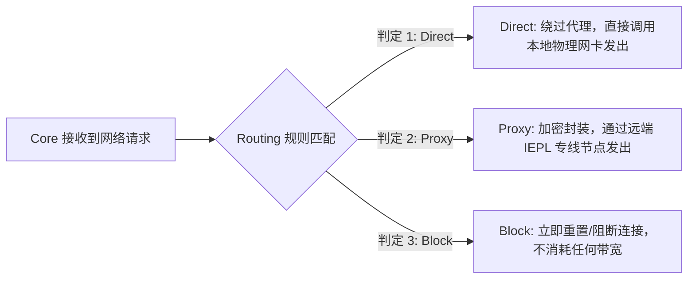
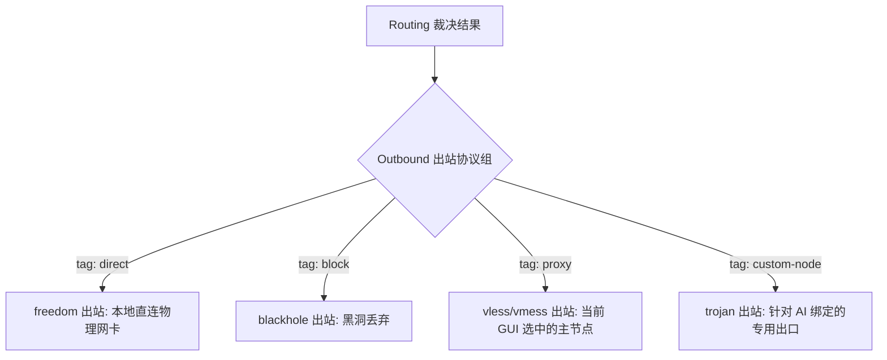
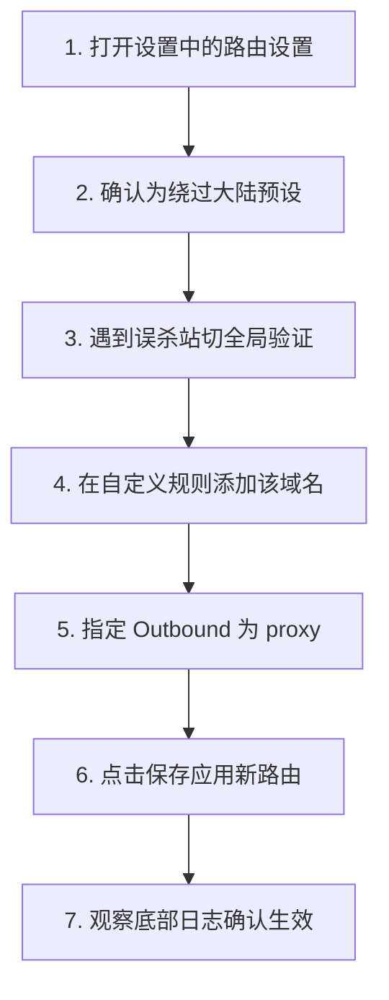

在 Windows 电脑上使用 v2rayN 科学上网与日常办公时，进阶用户经常会遇到一系列令人困惑的**“流量分流与出口异常”**问题：

**“为什么在 v2rayN 主界面明明选中了日本或美国节点，但在访问某些特定网站或在 IP 查询站测试时，依然显示的是我本地宽带的国内真实 IP？”**  
**“为什么在浏览海外网页时，Google 和 YouTube 都能秒开，但某个特定的海外小众技术论坛或生僻 API 却死活打不开？”**  
**“在底部路由模式里看到的【Direct（直连）】、【Proxy（代理）】和【Block（阻止）】到底代表什么意思？选择 Direct 是不是就等同于关闭了 v2rayN？”**  
**“Outbound（出站协议）和机场节点之间到底是什么关系？一个 Outbound 是不是就严格对应一个机场节点？”**  
**“能不能把 Clash 配置文件里的 `DOMAIN-SUFFIX` 或 `RULE-SET` 语法直接复制粘贴进 v2rayN 的自定义路由设置里？”**  
**“基于域名的分流规则（geosite）和基于 IP 的分流规则（geoip）有什么本质区别？为什么 DNS 解析结果会直接改变 IP 规则的匹配走向？”**  
**“为什么网站的主页能够正常加载，但页面上的验证码、评论区或登录按钮却频繁报错丢失？”**

**v2rayN 中的 Routing（路由规则引擎）是驻留在代理 Core 内核内部的“分流调度中枢”。它的核心职责，是当网络请求成功进入客户端后，根据预设的域名、IP、端口等匹配条件，精准裁决该请求究竟应该走 Direct（本地直连不耗流量）、Proxy（走境外专线代理）、Block（主动拦截阻止），还是分发给特定的独立 Outbound 出口。**

如果把 **System Proxy / TUN** 比作“将整机流量送进 Core 的入口”，把 **DNS** 比作“将域名翻译为真实 IP 的地图”，那么 **Routing** 就是“决定每个数据包到底从哪个出口大门走出去的指挥官”。

本文作为 **v2rayN Routing 路由规则与 Outbound 分流机制的权威深度指南**，将带你从 **Direct/Proxy/Block 核心机制、Outbound 出口拓扑模型、域名规则 vs IP 规则、Clash 语法兼容性红线、到多域名复杂网站误杀排障** 建立透彻的全局认知。

---

## ⚡ 30 秒快速看懂：Routing 分流决策流

```text
┌────────────────────────────────────────────────────────────────────────┐
│                   v2rayN Routing 分流 30 秒极速决策流                  │
├────────────────────────────────────────────────────────────────────────┤
│ 1. 【日常省心首选】➔ 保持底部路由为「绕过大陆 (bypass mainland)」(国内直连海外走专线)│
│ 2. 【生僻海外站打不开】➔ 临时将路由切为「全局 (Global)」➔ 若恢复则属规则误杀 Direct │
│ 3. 【选了节点查IP不变】➔ 查 IP 站命中 Direct 规则 ➔ 访问海外 ipinfo.io 验证真实出口 │
│ 4. 【网页缺失验证码/API】➔ 检查是否有过于激进的 Block 广告规则误杀目标 CDN 资源域名  │
│ 5. 【语法兼容底线】➔ 严禁直接把 Clash 的 YAML 规则复制进 v2rayN 路由设置中          │
└────────────────────────────────────────────────────────────────────────┘
```

---

## 一、破除迷思：Routing、System Proxy、TUN 与 DNS 的四层分工

在配置路由规则前，必须在脑海中建立清晰的 Windows 四层网络分流模型：

```mermaid
graph TD
    UserApp[Windows 应用程序: Chrome / 终端 / 游戏] --> EntryLayer{1. 流量捕获入口层}
    
    EntryLayer -->|应用层 HTTP/SOCKS 转发| SysProxy[System Proxy (系统代理 127.0.0.1:10809)]
    EntryLayer -->|网络层 Layer 3 虚拟网卡| TUNNet[TUN 模式 (Wintun 驱动接管整机)]
    
    SysProxy --> CoreEngine[v2rayN 代理内核 (Xray-core / sing-box)]
    TUNNet --> CoreEngine
    
    CoreEngine --> DNSLayer{2. 域名寻址解析层 (DNS)}
    DNSLayer -->|获得目标 A / AAAA IP 地址| RoutingEngine{3. 路由调度中枢层 (Routing)}
    
    RoutingEngine -->|命中国内规则 / 私网 IP| OutDirect[Outbound: Direct (本地网络直连)]
    RoutingEngine -->|命中海外规则 / 默认出口| OutProxy[Outbound: Proxy (走所选境外节点)]
    RoutingEngine -->|命中广告 / 追踪拦截规则| OutBlock[Outbound: Block (主动丢弃连接)]
    
    OutDirect --> DomesticWeb[国内网站: 百度 / 微信 (不耗流量)]
    OutProxy --> GlobalWeb[海外网站: Google / YouTube / GitHub]
    OutBlock --> Discard[拦截广告与恶意追踪]
```

```text
┌────────────────────────────────────────────────────────────────────────┐
│                   Windows 代理四大核心模块职能分工表                   │
├──────────────┬────────────────────────┬────────────────────────────────┤
│ 核心模块     │ 负责的核心职能         │ 常见用户误区                   │
├──────────────┼────────────────────────┼────────────────────────────────┤
│ **System**   │ 告诉 Windows 浏览器把  │ ❌ 以为开启系统代理就是直接连  │
│ **Proxy**    │ 流量送入本机 10809 端口│ 到了远端机场机房               │
├──────────────┼────────────────────────┼────────────────────────────────┤
│ **TUN 模式** │ 通过底层虚拟网卡接管   │ ❌ 以为开启 TUN 就是所谓的“全局│
│              │ 整机所有软件与游戏流量 │ 超级提速/降延迟模式”           │
├──────────────┼────────────────────────┼────────────────────────────────┤
│ **DNS 模块** │ 将网址域名解析翻译为   │ ❌ 以为修改公共 DNS 就能让持续 │
│              │ 可连接的 A / AAAA IP   │ 下载速度翻倍                   │
├──────────────┼────────────────────────┼────────────────────────────────┤
│ **Routing**  │ **根据规则裁决每个请求**│ ❌ 以为选了节点所有流量就必须  │
│ *(本篇核心)* │ **到底走哪个 Outbound** │ 强制从该节点出口发出           │
└──────────────┴────────────────────────┴────────────────────────────────┘
```

---

## 二、三大出站行为：Direct、Proxy 与 Block 深度解析

流量进入 Core 经过 Routing 裁决后，最终必然流向以下三种核心状态之一：



### 1. Direct（直连）
- **具体行为**：Core 不对该请求进行任何代理封装，而是直接通过你本地的家用物理网卡（以太网/Wi-Fi）建立连接。
- **典型场景**：访问百度、淘宝、Bilibili、QQ 微信、以及局域网内的路由器（`192.168.1.1`）和 NAS 设备。
- 💡 **认知破除**：**Direct 绝不等于“关闭了 v2rayN”！** 请求依然完整经过了 Core 的审查调度，只是 Core 聪明地决定“不耗费你的机场流量，直接用本地宽带直连”。

### 2. Proxy（代理）
- **具体行为**：Core 将数据包进行强加密打包，通过你所连接的境外代理节点（如香港、日本专线）传输至目标服务器。
- **典型场景**：访问 Google、YouTube、Twitter、GitHub、ChatGPT 等被限制的海外资源。

### 3. Block（阻止 / 拦截）
- **具体行为**：Core 在路由层直接返回 `RST` 阻断信号或丢弃数据包，拒绝建立连接。
- **典型场景**：拦截已知的广告联盟域名、恶意追踪脚本及恶意挖矿代码。
- ⚠️ **误杀风险**：若 Block 规则库过于激进，很容易误拦截某些网站依赖的公共字体 CDN 或登录验证 API，导致页面排版错乱。

---

## 三、Outbound 与节点模型：为什么“Outbound 不等于单一节点”？

在 Xray-core / sing-box 的底层架构中，**Outbound（出站连接器）** 是一个高度抽象的概念：



- **Outbound 是出口通道，节点是通道的具体配置**：一个 v2rayN 客户端配置中通常包含多个 Outbound（如 `direct` 出口、`block` 黑洞出口、以及挂载了具体节点服务器的 `proxy` 出口）；
- **为什么选了日本节点，某网站还是显示本地 IP？**：因为根据 Routing 规则，该网站被判定为了 `direct` 出站，流量根本没有走 `proxy` 出口，自然显示本地 IP！

---

## 四、规则匹配机制：域名规则 vs IP 规则

v2rayN 支持两种维度的规则匹配方式，理解它们的区别是避免规则失效的核心：

```text
┌────────────────────────────────────────────────────────────────────────┐
│                   域名规则与 IP 规则全方位对比表                       │
├──────────────┬────────────────────────┬────────────────────────────────┤
│ 比较维度     │ 域名规则 (Domain-based)│ IP 规则 (IP-based)             │
├──────────────┼────────────────────────┼────────────────────────────────┤
│ **匹配依据** │ 请求的目标网址域名     │ 请求的目标 IPv4 / IPv6 地址    │
│              │ (如 `geosite:google`)  │ (如 `geoip:cn`、`192.168.0.0/16`)│
├──────────────┼────────────────────────┼────────────────────────────────┤
│ **依赖 DNS** │ ❌ 完全不依赖 DNS 解析 │ ✅ **强依赖 DNS 解析结果**     │
├──────────────┼────────────────────────┼────────────────────────────────┤
│ **匹配速度** │ 极快 (拿到域名瞬间判定)│ 稍慢 (必须等待 DNS 解析出 IP)  │
├──────────────┼────────────────────────┼────────────────────────────────┤
│ **代表数据** │ `geosite.dat` 规则集   │ `geoip.dat` 规则集             │
├──────────────┼────────────────────────┼────────────────────────────────┤
│ **典型用途** │ 明确域名的国外/国内网站│ 无明确域名的独立 IP、直连私网段│
└──────────────┴────────────────────────┴────────────────────────────────┘
```

> ⚠️ **为什么 DNS 解析会直接影响 IP 规则？**  
> 当你访问一个未被 `geosite` 域名库收录的小众海外网站时，Routing 引擎只能通过 IP 规则来判定。如果本地 DNS 发生了污染，解析出了一个虚假的国内 IP，该请求就会被**错误地判定为 `geoip:cn` 从而走 Direct 直连**，最终导致网页彻底打不开！

---

## 五、技术红线：严禁将 Clash 规则直接复制进 v2rayN

很多从 Clash 转到 v2rayN 的用户常犯一个严重错误：把 Clash 的 YAML 规则直接贴进 v2rayN 自定义路由。

```text
┌────────────────────────────────────────────────────────────────────────┐
│                   Clash 与 v2rayN 路由规则语法差异对照                 │
├────────────────────────────────┬───────────────────────────────────────┤
│ Clash / Mihomo 语法 (YAML 格式)│ v2rayN / Xray-core 规范语法 (JSON/GUI)│
├────────────────────────────────┼───────────────────────────────────────┤
│ `DOMAIN-SUFFIX,google.com,PROXY`│ `domain:google.com` ➔ Outbound: `proxy`│
│ `GEOIP,CN,DIRECT`              │ `geoip:cn` ➔ Outbound: `direct`       │
│ `MATCH,FINAL`                  │ 默认兜底出站规则 (Default Outbound)   │
│ `RULE-SET,reject,REJECT`       │ `geosite:category-ads-all` ➔ `block`  │
└────────────────────────────────┴───────────────────────────────────────┘
```

- **概念相似 $\ne$ 语法兼容**：虽然两者都有直连、代理和黑名单的概念，但底层配置文件的语法解析器完全不同。在 v2rayN 中应当使用 GUI 界面提供的可视化规则编辑器，或遵循 Xray/V2Ray 标准的 Routing JSON 规范。

---

## 六、图解实操：v2rayN 路由规则配置与误杀排查 7 步走



### 步骤 1：进入 v2rayN 路由设置界面
- 点击 v2rayN 顶部菜单栏的 **「设置」** ➔ 选择 **「路由设置」**（Routing Settings）。

### 步骤 2：选择推荐的预设分流方案
- 在预设方案中，建议绝大多数用户保持默认的 **「绕过大陆（bypass mainland）」** 或 `绕过大陆和局域网`。

### 步骤 3：为打不开的生僻网站添加独立代理规则
- 点击 **「添加规则（Add Rule）」**：
  - **规则类型**：选择 `Domain`（域名）；
  - **规则内容**：输入目标网站的主域名（例如 `domain:githubusercontent.com` 或 `domain:v2ex.com`）；
  - **目标出站（Outbound）**：选择 **`proxy`**；
  - 点击确定并保存。

### 步骤 4：通过实时日志验证规则命中
- 在 Chrome 中刷新该网页，观察 v2rayN 主界面下方的实时连接日志：
  - 若日志清晰显示 `[routing] match domain:xxx -> proxy`，说明分流规则已完美生效并成功通过代理出海！

---

## 七、2026 高可用智能分流企业级专线推荐

精细的 Routing 规则负责本地精准调度，而境外出口的数据吞吐则依赖物理专线的高稳定性。建议搭配支持全场景分流的高可用品牌：

```text
┌────────────────────────────────────────────────────────────────────────────────────────┐
│                        2026 稳定适配 Routing 智能分流物理专线推荐                      │
├──────────┬──────────────────────────┬──────────────┬──────────────┬────────────────────┤
│ 适配场景 │ 推荐品牌候选             │ 实际起付门槛 │ 每月流量配额 │ 智能分流与专线优势 │
├──────────┼──────────────────────────┼──────────────┼──────────────┼────────────────────┤
│ 旗舰全能 │ 光速云 (GuangSuYun)      │ 约 ¥7.5/月起 │ 59G~238G /月 │ 全线 IEPL 专线，完美适配 Routing 智能分流，4K 秒开 │
│ 平价轻量 │ 微风网络 (BreezeNet)     │ 约 ¥7/月起   │ 50GB / 月    │ 优质 BGP 优化线路，分流精准，日常查资料办公轻量首选│
│ 弹性月付 │ 唯兔云 (V2Yun)           │ ¥14.9/月     │ 100GB / 月   │ 纯单月付，多地区原生 IP 出口，支持流媒体精准分流   │
│ 应急备用 │ 星岛梦 (XingDaoMeng)     │ 约 ¥8/月起   │ 60G/不限时包 │ 0月租不限时包，节点长期有效，路由调试备用首选      │
│ AI/开发  │ 速界 (SpeedWorld)        │ ¥25/月       │ 150GB / 月   │ 原生住宅 IP 独立大带宽，支持 ChatGPT/GitHub 独立分流│
└──────────┴──────────────────────────┴──────────────┴──────────────┴────────────────────┘
```

- 🏆 **全场景分流首选**：[光速云](/reviews/guangsu-cloud/) —— 全球企业级 IEPL 独立专线，晚高峰 0 丢包，精准适配绕过大陆规则；
- 🍃 **超低预算轻量**：[微风网络](/reviews/weifeng-cloud/) —— 针对 PC 端日常查资料优化的 50GB 小流量专线，年付折算仅约 ¥7/月；
- 💳 **拒绝绑定的单月付**：[唯兔云](/recommend/best-airports/) —— ¥14.9 纯单月付，100GB 充沛流量，节点丰富。

---

## 八、避坑指南：35 个关于“v2rayN Routing 规则”的致命认知误区

```text
❌ 误区 1：Routing（路由规则）就是机场的节点服务器 ➔ 事实：Routing 是 Core 内部的分流决策逻辑，节点是实际出站服务器。
❌ 误区 2：Direct（直连）代表关闭了 v2rayN 代理客户端 ➔ 事实：Direct 代表该请求由 Core 裁决走本地物理网络直连，不耗流量。
❌ 误区 3：选中日本节点后，访问所有网站都必须显示日本出口 IP ➔ 事实：国内网站命中 Direct 直连规则，必然显示本地真实 IP。
❌ 误区 4：一个 Outbound 必须且只能严格对应一个机场节点 ➔ 事实：Outbound 可以代表 direct 直连、block 黑洞或一组代理出口。
❌ 误区 5：可以直接把 Clash 的 YAML 规则复制进 v2rayN 路由设置 ➔ 事实：两者语法完全不同，直接填入会导致 Core 启动解析崩溃。
❌ 误区 6：把路由模式设为全局（Global）能让国内百度打开更快 ➔ 事实：全局模式导致国内请求绕道境外节点，延迟反而翻倍增加。
❌ 误区 7：路由规则写得越多（如添加上万条规则）代表客户端越专业 ➔ 事实：规则过多会导致匹配性能下降，并极大增加误杀排障难度。
❌ 误区 8：Block 规则可以 100% 完美拦截所有广告且绝不误伤网页 ➔ 事实：激进的 Block 规则极易误拦截网站依赖的验证码与公共 API。
❌ 误区 9：打不开海外小众网站一定是机场节点挂了 ➔ 事实：很可能是该生僻域名未被收录而被误判为了 Direct，切全局即可测试。
❌ 误区 10：DNS 解析结果与 Routing 路由规则没有任何因果关系 ➔ 事实：基于 IP 的分流规则强依赖 DNS 解析出的 IP 是否属于 CN。
❌ 误区 11：在网上随便下载一个未经核验的第三方规则集导入最省心 ➔ 事实：第三方规则集存在供应链篡改与内网穿透劫持的安全风险。
❌ 误区 12：局域网打印机或 NAS 连不上与 v2rayN 路由规则无关 ➔ 事实：需确保局域网私网 IP（192.168.x.x）被正确配置为 Direct 直连。
❌ 误区 13：只要修改了路由规则，就必须立即重启整个 Windows 系统 ➔ 事实：在 v2rayN 中点击保存，Core 会自动平滑重载新配置。
❌ 误区 14：修改路由规则能够让节点物理带宽从 100M 翻倍到 500M ➔ 事实：Routing 仅决定路径走向，完全不改变节点的物理带宽上限。
❌ 误区 15：域名规则和 IP 规则在所有场景下的匹配结果永远完全一致 ➔ 事实：CDN 动态解析与 DNS 污染可能导致 IP 规则发生判定偏移。
❌ 误区 16：开启 TUN 模式后所有的 Routing 路由规则就会自动失效 ➔ 事实：TUN 仅负责捕获流量进 Core，进入后依然严格遵循 Routing 规则。
❌ 误区 17：不开 TUN 模式，v2rayN 的 Routing 规则就完全无法工作 ➔ 事实：通过系统代理（System Proxy）进入的流量同样受 Routing 调度。
❌ 误区 18：只要在 IP 查询网站查到香港 IP 就证明所有流量都走代理 ➔ 事实：仅代表该特定 IP 查询站命中了 Proxy 规则，其他站可能 Direct。
❌ 误区 19：给 ChatGPT 专门写一条规则就能保证永久 100% 解锁 ➔ 事实：OpenAI 的 API 和 CDN 域名动态更新，需维护完整的规则组。
❌ 误区 20：所有支持 V2Ray 的客户端其路由规则语法都是完全通用的 ➔ 事实：Xray-core、sing-box 与原生 V2Ray 在规则格式上存在差异。
❌ 误区 21：只要在规则列表里添加了一条规则，它就永远拥有最高优先级 ➔ 事实：取决于 Core 的自上而下匹配顺序，需注意规则先后层级。
❌ 误区 22：把所有规则全部清空，只保留全局代理是最安全的方式 ➔ 事实：全局模式会导致国内微信、网银登录发生异地安全风控。
❌ 误区 23：关闭 Windows Defender 可以彻底解决路由规则不生效 ➔ 事实：杀毒软件不影响 Core 内部的分流逻辑，切勿关闭安全防护。
❌ 误区 24：提示 Routing Configuration Error 说明机场服务器宕机了 ➔ 事实：说明本地自定义的路由语法有误（如 JSON 标点错误）。
❌ 误区 25：可以在公司电脑上通过修改路由规则绕过企业的安全审计 ➔ 事实：企业边界防火墙依然会在网络出口拦截未授权的加密流。
❌ 误区 26：Steam 商店和游戏联机可以通过同一条 Direct 规则处理 ➔ 事实：商店是网页 HTTP 流量，游戏是 UDP 流量，分流策略不同。
❌ 误区 27：更换节点后网页出口 IP 没变说明 Routing 规则彻底崩溃了 ➔ 事实：浏览器保持着长连接复用，关闭标签页重开即可刷新。
❌ 误区 28：geosite.dat 规则文件永远不需要更新 ➔ 事实：网络域名生态不断演进，定期更新规则文件可避免最新网站被误判。
❌ 误区 29：只要在日志里看到 direct 字样就代表翻墙彻底失败了 ➔ 事实：访问国内资源显示 direct 说明智能分流工作非常完美。
❌ 误区 30：把本地监听端口改大能让 Routing 匹配速度提升 10 倍 ➔ 事实：端口号只是网络地址标识，与内存中的规则匹配性能无关。
❌ 误区 31：同时开启两个不同规则的 v2rayN 能实现双重分流加速 ➔ 事实：双实例会争抢本地监听端口与系统代理，引发严重断流。
❌ 误区 32：在公司局域网内开启全局代理会导致无法连接内网打印机 ➔ 事实：全局模式将局域网私网 IP 强行发往境外，导致内网失联。
❌ 误区 33：使用单节点链接导入比使用订阅链接的 Routing 性能更好 ➔ 事实：两者在 Core 内部的分流处理效率完全没有任何区别。
❌ 误区 34：只要买了企业专线，就不需要设置任何 Routing 路由规则 ➔ 事实：专线管跨境质量，Routing 管智能分流，两者相辅相成。
❌ 误区 35：遇到任何 Routing 异常，第一步就应该卸载重装电脑系统 ➔ 事实：在路由设置中点击“恢复默认预设”即可 1 秒钟复原。
```

---

## 九、常见问题深度解答（FAQ · 50 问）

### Q1：v2rayN Routing 是什么？
**答**：指代理 Core 内核内部的路由分流中枢，负责根据预设规则裁决每个网络请求究竟走 Direct（直连）、Proxy（走节点代理）还是 Block（阻止拦截）。

### Q2：Direct（直连）是什么意思？
**答**：表示该请求不走境外代理节点，直接使用你本地的宽带网络连接目标服务器，完全不消耗机场套餐流量。

### Q3：Proxy（代理）是什么意思？
**答**：表示该请求通过 Core 进行加密封装，经由你所选中的境外代理专线节点出站访问目标网站。

### Q4：Block（阻止）是什么意思？
**答**：表示 Core 在路由层直接丢弃该请求的数据包或返回阻断信号，主要用于拦截广告域名和恶意追踪代码。

### Q5：为什么选了日本节点，查 IP 依然显示本地真实 IP？
**答**：因为你访问的国内 IP 查询网站命中了解析直连规则（Direct），Core 自动使用本地宽带访问；访问海外网站（如 `ipinfo.io`）才会显示日本 IP。

### Q6：为什么 Google 能打开，但某个海外小网站打不开？
**答**：该生僻小众网站未被预设域名规则收录，且解析出的 IP 被误判为了 Direct 直连。将底部路由临时切为 **「全局（Global）」** 即可秒开。

### Q7：v2rayN 怎么恢复默认路由规则？
**答**：在「设置」➔「路由设置」中，选择预设的 **「绕过大陆（bypass mainland）」** 方案并点击保存，即可一键重置为标准官方规则。

### Q8：Clash 的规则可以复制粘贴进 v2rayN 吗？
**答**：**坚决不能。** Clash 使用 YAML 语法（如 `DOMAIN-SUFFIX`），而 v2rayN 遵循 Xray/V2Ray 规范，直接复制会导致内核解析崩溃。

### Q9：域名规则和 IP 规则有什么区别？
**答**：域名规则直接根据网址（如 `google.com`）判断，不依赖 DNS；IP 规则必须等 DNS 解析出 IP 后再判断，依赖 DNS 解析的准确性。

### Q10：为什么 DNS 会影响基于 IP 的路由规则？
**答**：若本地 DNS 遭到污染返回了虚假的国内 IP，Core 会误认为该目标是国内网站从而执行 Direct 直连，导致网页无法打开。

### Q11：规则是按什么顺序匹配的？
**答**：Core 通常遵循 **「自上而下、先命中先执行」** 的原则。越具体的专属规则（如特定域名）应放置在靠前位置。

### Q12：开启 TUN 模式后 Routing 规则还生效吗？
**答**：**依然完美生效。** TUN 模式只负责把整机流量抓进 Core，进入 Core 后的分流依然严格由 Routing 规则调度。

### Q13：不开启 TUN 模式，Routing 规则能工作吗？
**答**：能工作。通过系统代理（System Proxy）进入 Core 的所有浏览器流量，均会正常执行 Routing 分流判定。

### Q14：为什么部分网页打开后验证码无法显示？
**答**：通常是因为勾选了过于激进的广告拦截规则（Block），导致第三方验证码服务域名被误杀，放行对应域名即可。

### Q15：如何查看某个请求到底走了哪个 Outbound？
**答**：刷新网页，观察 v2rayN 主界面下方的实时连接日志，日志会清晰标注 `[routing] match -> proxy` 或 `direct`。

### Q16：Outbound 和节点是一对一的关系吗？
**答**：不是。Outbound 是出站通道（如 direct、block、proxy 等标签），节点是挂载在 proxy 出站上的具体物理服务器参数。

### Q17：局域网内的 NAS 和路由器打不开和 Routing 有关吗？
**答**：有关。必须确保私网 IP 段（`192.168.0.0/16`、`10.0.0.0/8`）在规则中被明确指定为 Direct 直连出站。

### Q18：可以为 ChatGPT 单独指定走美国节点吗？
**答**：可以。在高级路由中创建自定义 Outbound 绑定美国节点，并将 `geosite:openai` 规则指向该特定 Outbound。

### Q19：修改路由规则后需要重启电脑吗？
**答**：**完全不需要。** 在 v2rayN 界面点击确定保存，后台 Core 会在毫秒级内平滑重载新配置。

### Q20：为什么全局模式下国内网站打开变慢了？
**答**：全局模式强迫国内流量绕道境外节点再访问国内服务器，物理路径绕远且延迟翻倍，日常推荐用“绕过大陆”。

### Q21：提示 `Routing Configuration Error` 怎么办？
**答**：说明自定义路由语法存在格式错误（如缺少括号或英文逗号），恢复默认预设方案即可解决。

### Q22：可以在公司电脑上修改 Routing 绕过企业审计吗？
**答**：不能。企业边界防火墙拥有深层流量检测能力，修改本地规则无法规避组织层面的网络安全策略。

### Q23：换了新节点后为什么出口 IP 没变？
**答**：浏览器保持着与原节点的 TCP 长连接复用，彻底关闭浏览器标签页并重新打开即可刷新为新节点 IP。

### Q24：规则集文件（geosite.dat / geoip.dat）需要更新吗？
**答**：建议每隔数月在客户端中更新一次规则文件，以获取最新的全球域名与 IP 分配数据库。

### Q25：如何构建最省心的日常分流方案？
**答**：采用 **「绕过大陆预设路由 + 企业级 IEPL 专线 + 默认 DNS」** 的黄金组合，国内极速直连、国外秒开出海。

---

## 🏁 总结：v2rayN 路由分流认知金字塔

掌握 Windows 流量精准调度，请牢记以下**核心铁律**：

```text
1. 明分工 ➔ System Proxy/TUN 管流量进门，DNS 管地址寻道，Routing 管出口去向
2. 辨行为 ➔ Direct 直连省流量，Proxy 代理走专线，Block 拦截广告但谨防误杀
3. 忌混用 ➔ 严禁直接套用 Clash YAML 语法，遵循 Xray/V2Ray 标准路由规则规范
4. 巧排查 ➔ 遇生僻海外站打不开先切全局排除误判，善用实时日志定位命中规则
5. 优基座 ➔ 唯有企业级 IEPL 物理专线与纯净节点池，才能让智能分流发挥极致威力
```

---

### 📚 延伸进阶阅读与选型专栏
- 💻 **Windows 客户端主教程**：[《v2rayN怎么用？Windows下载安装、订阅、节点、系统代理与TUN完整教程》](/tutorials/v2rayn-windows/)
- 🌐 **V2Ray 生态超级 Pillar**：[《V2Ray是什么？V2Ray客户端、节点、订阅、VLESS/VMess与新手完整教程》](/tutorials/v2ray-tizi/)
- 📋 **v2rayN 订阅导入教程**：[《v2rayN订阅怎么导入？订阅链接、节点更新、404/403与更新失败完整教程》](/tutorials/v2rayn-subscription/)
- 🚨 **v2rayN 超时排查**：[《v2rayN节点 Timeout 怎么办？全部节点连接超时、Core、网络与服务器异常完整排查》](/issues/v2rayn-node-timeout/)
- 🔌 **v2rayN 有节点没网**：[《v2rayN有节点但无法上网怎么办？系统代理、TUN、DNS与Routing完整排查》](/issues/v2rayn-connected-no-internet/)
- 🚀 **v2rayN 速度慢排查**：[《v2rayN速度慢怎么办？节点、线路、丢包、Windows网络与晚高峰完整排查》](/issues/v2rayn-slow-speed/)
- 🛠️ **v2rayN TUN 深度指南**：[《v2rayN TUN怎么用？系统代理、TUN、虚拟网卡、Routing与DNS完整指南》](/tutorials/v2rayn-tun/)
- 🖧 **v2rayN 系统代理排查**：[《v2rayN系统代理失效怎么办？Windows代理残留、本地端口、Chrome/Edge与关闭软件后没网完整排查》](/issues/v2rayn-system-proxy/)
- 🌐 **v2rayN DNS 设置指南**：[《v2rayN DNS怎么设置？Windows域名解析、IPv6、DoH与网站打不开完整指南》](/tutorials/v2rayn-dns/)
- ⚡ **老牌旗舰专线**：[《光速云深度评测：2020老牌IEPL专线与解锁实测》](/reviews/guangsu-cloud/)
- 🍃 **平价轻量专线**：[《微风网络深度评测：小流量套餐值不值得买？》](/reviews/weifeng-cloud/)
- 🏆 **2026 全景大榜**：[《2026梯子推荐：稳定、速度、价格、安全与不同使用场景怎么选》](/recommend/best-tizi/)
