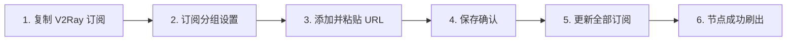
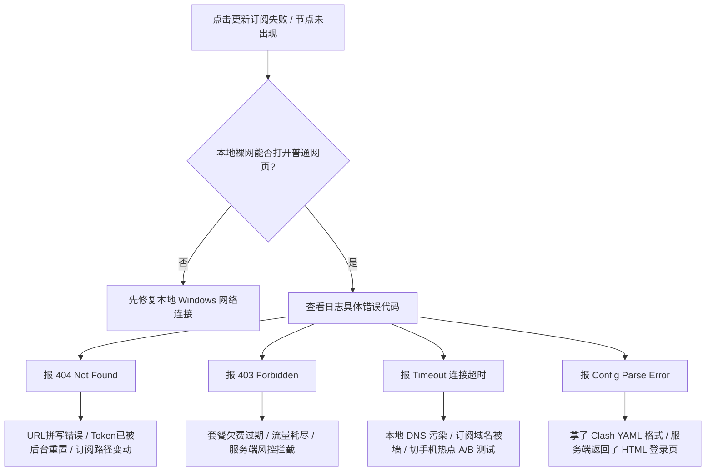

在 Windows 电脑上使用 v2rayN 进行科学上网时，**“订阅导入与节点更新”** 是所有新手用户迈入该生态的第一个核心关卡。

然而，在实际导入过程中，大量用户经常会遭遇各种令人摸不着头脑的报错与异常状态：

**“在机场后台复制了订阅链接，粘贴到 v2rayN 保存后，为什么主界面依然空空如也，一个节点都没有？”**  
**“点击‘更新全部订阅’时，底部日志弹出红色报错：`The remote server returned an error: (404) Not Found` 或 `(403) Forbidden`，这是什么意思？”**  
**“更新订阅提示 `Timeout（连接超时）` 或 `The SSL connection could not be established`，是我的网络问题还是机场跑路了？”**  
**“为什么在服务商后台看到新增加了几个日本/美国节点，但在 v2rayN 点击更新后，节点列表毫无变化？”**  
**“单条 `vmess://` 或 `vless://` 链接与订阅链接到底有什么区别？Clash 的订阅能直接导入 v2rayN 吗？”**  
**“如果不小心把自己的订阅链接公开发布到了 GitHub 或技术交流群，会有什么严重后果？该如何紧急补救？”**

**v2rayN 订阅通常是由代理服务商提供的一条远程配置入口链接（URL），客户端通过该链接向服务器发起 HTTP/HTTPS 请求，批量获取并动态更新多个节点的底层连接参数。**

把订阅 URL 成功保存到客户端，仅仅代表 v2rayN “记录了地址”，**并不等于订阅已经成功拉取，更不代表生成的节点一定能够连通**。一个完整的订阅生命周期必须经历：**「URL 地址完整有效 ➔ 客户端连通订阅服务器 ➔ 服务端鉴权通过 ➔ 返回 Base64/JSON 格式数据 ➔ v2rayN 成功解析 ➔ 列表正确渲染节点 ➔ 用户选择节点发起代理测试」**。

本文作为 **v2rayN 订阅层的深度专题排障指南**，将带你从 **订阅底层原理、标准导入流程、三种更新辨析、404/403/Timeout/解析失败全场景排查，到订阅 Token 隐私安全保护** 建立全链路的排错能力。

---

## ⚡ 30 秒快速上手：v2rayN 订阅极速导入与更新流

```text
┌────────────────────────────────────────────────────────────────────────┐
│                   v2rayN 订阅 30 秒极速导入排障速查表                  │
├────────────────────────────────────────────────────────────────────────┤
│ 1. 【获取链接】➔ 登录机场后台，复制「V2Ray / 通用订阅链接」(含专属 Token)│
│ 2. 【添加分组】➔ 打开 v2rayN 顶部「订阅分组」➔「订阅分组设置」➔ 点击「添加」│
│ 3. 【填写参数】➔ 备注输入机场名称，在「可选地址 (Url)」粘贴复制的链接 ➔ 确定│
│ 4. 【执行更新】➔ 点击顶部「订阅分组」➔「更新全部订阅 (不通过代理)」        │
│ 5. 【核验节点】➔ 确认主界面刷新出香港、日本、美国等节点列表 (节点成功生成) │
│ 6. 【异常分流】➔ 若报错 404/403/Timeout，切勿开 TUN，直接查本文第四节排障  │
└────────────────────────────────────────────────────────────────────────┘
```

---

## 一、核心认知：v2rayN 订阅是什么？它与单节点的本质区别

理解订阅与节点的结构关系，是避免绝大多数操作混乱的基础：

```mermaid
graph TD
    Airport[机场服务商后台] --> SubURL[专属订阅链接 (含 Token 鉴权)]
    
    SubURL -->|v2rayN 批量拉取| Client[v2rayN 订阅解析引擎]
    Client --> Node1[🇭🇰 香港 IEPL 01 - VMess]
    Client --> Node2[🇯🇵 日本 专线 02 - VLESS]
    Client --> Node3[🇸🇬 新加坡 原生 01 - Trojan]
    Client --> Node4[🇺🇸 美国 4K 解锁 01 - Shadowsocks]
    
    SingleURI[单节点链接 vmess:// 或 vless://] -.->|仅包含 1 台静态服务器| Node1
```

### 1. 订阅链接（Subscription URL）
- **定义**：一个远程 API 网址。服务商通过该网址向你的客户端动态下发几十个甚至上百个服务器节点的最新连接参数；
- **核心优势**：当机房更换 IP、维护端口或新增地区节点时，服务商在服务端修改后，用户只需在客户端**点击一次“更新订阅”**，所有最新节点就会自动同步，无需手动逐个重新配置。

### 2. 单节点链接（URI：`vmess://` / `vless://`）
- **定义**：一段经过 Base64 编码的纯文本字符串，里面仅固化硬编码了**单一台服务器**的 IP、端口和 UUID；
- **致命缺陷**：一旦该单台服务器发生网络故障或 IP 被墙，节点立即永久失效，必须手动重新获取新链接。

> 🛡️ **重要安全红线：订阅链接具有密码级敏感度**  
> 订阅链接末尾通常携带你的个人唯一标识符（`token=xxxxxx`）。任何拿到你订阅链接的人，都可以将其导入自己的客户端，**共享消耗你的每月流量配额，甚至导致你的账户触发多设备 IP 异常并发而被机场系统自动封禁**！严禁将完整订阅发到 GitHub、公开群聊或论坛！

---

## 二、图解实操：v2rayN 订阅导入与更新标准 6 步走



### 步骤 1：从服务商后台获取兼容格式的订阅
- 登录机场后台控制面板，找到 **“便捷导入 / 订阅管理”**；
- 优先选择点击 **“复制 V2Ray 订阅”** 或 **“复制通用订阅”**（**不要**直接复制 Clash YAML 格式订阅，除非你的机场已做了双协议自适应）。

### 步骤 2：打开 v2rayN 订阅管理界面
- 双击打开 v2rayN，在顶部菜单栏依次点击 **「订阅分组」➔「订阅分组设置」**。

### 步骤 3：新建订阅分组并填入参数
- 在弹出的配置窗口左下角点击 **「添加」** 按钮：
  - **别名（备注）**：输入便于识别的名字（如 `光速云`、`微风网络`）；
  - **可选地址 (Url)**：鼠标右键粘贴刚才复制的完整订阅网址。

### 步骤 4：确认保存配置
- 检查 URL 前后是否有意外混入的空格，点击右下角 **「确定」** 关闭窗口。*(此时列表仍为空，必须执行下一步更新)*。

### 步骤 5：执行拉取与更新
- 点击顶部菜单栏 **「订阅分组」➔「更新全部订阅 (不通过代理)」**；
- 观察主界面底部状态栏，会显示 `开始更新订阅...`。

### 步骤 6：核验节点列表生成
- 等待 1~3 秒，主界面中央表格内瞬间刷出数十个包含国家国旗、协议类型、别名的节点列表，订阅导入正式宣告大功告成！

---

## 三、概念理清：客户端更新 vs 内核更新 vs 订阅更新

许多新手在遇到问题时常常把以下三种更新混为一谈：

```text
┌────────────────────────────────────────────────────────────────────────┐
│                   三种更新机制深度对照表                               │
├──────────────┬──────────────────┬──────────────────┬───────────────────┤
│ 更新类型     │ 更新的对象是什么 │ 什么时候需要执行 │ 常见认知误区      │
├──────────────┼──────────────────┼──────────────────┼───────────────────┤
│ **订阅更新** │ 机场的服务器节点 │ 节点失效、机场加 │ ❌ 误以为会升级   │
│ *(本篇核心)* │ 列表与连接参数   │ 节点、定期维护时 │    v2rayN 软件版本│
├──────────────┼──────────────────┼──────────────────┼───────────────────┤
│ **客户端更新**│ v2rayN 视窗外壳  │ 软件出新功能、修 │ ❌ 误以为升级软件 │
│ *(GUI 升级)* │ 程序本体 (.exe)  │ 复界面 Bug 时    │    会自动刷新节点 │
├──────────────┼──────────────────┼──────────────────┼───────────────────┤
│ **Core 内核更新** 底层 Xray/v2ray │ 支持全新前沿协议 │ ❌ 误以为内核更新 │
│ *(引擎升级)* │ 加解密执行程序   │ (如 REALITY) 时  │    能修复订阅失效 │
└──────────────┴──────────────────┴──────────────┴───────────────────┘
```

---

## 四、排障大典：v2rayN 订阅更新失败全场景深度剖析

当你在 v2rayN 中点击更新订阅却弹红报错时，请根据以下**标准故障诊断树**对号入座：



---

### 1. 报错 `404 Not Found`（资源不存在）
- **根本诱因**：客户端请求的订阅路径在服务器上根本不存在。
- **常见原因**：
  1. 复制链接时不小心漏掉了末尾的字符或 Token 参数；
  2. 聊天工具（如微信/QQ）自动截断或转义了 URL 中的特殊字符；
  3. 机场后台重新生成了订阅，导致旧的 Token 永久作废；
  4. 机场管理系统进行了大版本迁移，更换了订阅 API 路径。
- **权威解决方案**：
  - 登录机场后台控制面板，重新点击“复制 V2Ray 订阅”，在 v2rayN 中将旧的 URL 彻底覆盖替换并保存更新。

---

### 2. 报错 `403 Forbidden`（服务器拒绝访问）
- **根本诱因**：订阅服务器收到了请求，但鉴权失败，直接拒绝向你下发节点数据。
- **常见原因**：
  1. **套餐已经到期欠费**：很多机场在套餐过期后，API 会直接返回 403 阻断更新；
  2. **月度流量已经 100% 耗尽**：流量用完后自动触发订阅停用策略；
  3. **账户已被系统冻结**：可能触发了异常高频拉取或多 IP 滥用封控。
- **权威解决方案**：
  - 登录机场后台查看账户财务状态，确认套餐剩余流量与有效期。

---

### 3. 报错 `Timeout` 或 `无法连接到远程服务器`（连接超时）
- **根本诱因**：v2rayN 无法与机场的订阅服务器建立 TCP 握手。
- **常见原因**：
  1. 机场的订阅域名遭遇了本地运营商（如移动/电信）的 DNS 污染或阻断；
  2. 机场订阅服务器本身处于机房宕机维护状态。
- **权威解决方案**：
  - **手机热点 A/B 测试**：将电脑断开家用 Wi-Fi，连上手机 5G 热点后再次点击更新。如果热点下更新成功，说明是你家宽带的 DNS 问题，可将电脑 DNS 修改为 `223.5.5.5` 或 `119.29.29.29`。

---

### 4. 报错 `Config Parse Error` 或更新后节点列表为空
- **根本诱因**：v2rayN 成功下载了内容，但内容不是它能看懂的 Base64 编码节点数据。
- **典型表现**：
  - **拿错了 Clash 订阅**：Clash 订阅是 YAML 语法结构，v2rayN 默认无法直接当成 Base64 文本解析；
  - **服务端返回了 HTML 网页**：如果订阅服务器被 Cloudflare 防火墙拦截，返回的是一个“5秒盾验证页面”或“用户登录界面”的 HTML 代码，v2rayN 解析引擎自然会崩溃报错。
- **权威解决方案**：
  - 在浏览器隐私窗口中直接打开该订阅链接，查看网页返回的是一行密密麻麻的 Base64 乱码字母，还是一个有排版的 HTML 网页。如果是网页，请联系机场客服修复 API 节点下发接口。

---

## 五、订阅安全攻防：Token 泄露与多端共享准则

```text
┌────────────────────────────────────────────────────────────────────────┐
│                   v2rayN 订阅隐私与安全自查 Checklist                  │
├────────────────────────────────────────────────────────────────────────┤
│ □ 严禁将订阅 URL 提交至任何未知的第三方“在线订阅转换”公共网站          │
│ □ 严禁在 GitHub、Gitee 公开代码仓库中提交包含订阅链接的配置文件       │
│ □ 在技术论坛或工单中截图求助时，必须对订阅 URL 中的 Token 彻底打码     │
│ □ 订阅一旦发生意外泄露，第一时间登录机场后台点击【重置订阅 / 重置Token】│
│ □ 清楚了解所在机场的【同时在线设备数限制】，避免与多位好友共用导致封号 │
└────────────────────────────────────────────────────────────────────────┘
```

> ⚠️ **为什么不要随便使用“第三方免费在线订阅转换”？**  
> 网上大部分免费订阅转换网站由个人搭建。当你将私人订阅链接粘贴进去并点击转换时，你的订阅 Token 与全部节点配置就已经**在第三方服务器的后端数据库中留下了明文备份**，极易被后台脚本爬取并二次倒卖为“免费共享节点池”。优先使用机场后台原生提供的 v2rayN 链接！

---

## 六、2026 高可用原生支持 v2rayN 订阅专线推荐

精选在 Windows v2rayN 下具备原生订阅一键下发、API 解析稳定、晚高峰 0 丢包的标杆专线服务商：

```text
┌────────────────────────────────────────────────────────────────────────────────────────┐
│                        2026 v2rayN 高适配原生专线品牌推荐                              │
├──────────┬──────────────────────────┬──────────────┬──────────────┬────────────────────┤
│ 适配场景 │ 推荐品牌候选             │ 实际起付门槛 │ 每月流量配额 │ 订阅下发与专线优势 │
├──────────┼──────────────────────────┼──────────────┼──────────────┼────────────────────┤
│ 旗舰全能 │ 光速云 (GuangSuYun)      │ 约 ¥7.5/月起 │ 59G~238G /月 │ 原生下发 VLESS/VMess/Trojan 订阅，节点解析 100% 兼容│
│ 平价轻量 │ 微风网络 (BreezeNet)     │ 约 ¥7/月起   │ 50GB / 月    │ 专属纯净 V2Ray 订阅源，超轻量不冗余，Windows 办公首选│
│ 弹性月付 │ 唯兔云 (V2Yun)           │ ¥14.9/月     │ 100GB / 月   │ 纯单月付，订阅更新极速，支持 Base64 全协议多地区下发│
│ 应急备用 │ 星岛梦 (XingDaoMeng)     │ 约 ¥8/月起   │ 60G/不限时包 │ 不限时流量包，订阅长期有效，防止主力故障时无网可用 │
│ AI/开发  │ 速界 (SpeedWorld)        │ ¥25/月       │ 150GB / 月   │ 独立原生 IP 专线，订阅直连无污染，ChatGPT 专属出口 │
└──────────┴──────────────────────────┴──────────────┴──────────────┴────────────────────┘
```

- 🏆 **全协议旗舰首选**：[光速云](/reviews/guangsu-cloud/) —— 全线企业级 IEPL 物理专线，后台提供完美适配 v2rayN 的原生通用订阅，节点秒出；
- 🍃 **超低预算轻量**：[微风网络](/reviews/weifeng-cloud/) —— 针对 PC 端日常查资料优化的 50GB 小流量专线，年付折算仅约 ¥7/月；
- 💳 **拒绝绑定的单月付**：[唯兔云](/recommend/best-airports/) —— ¥14.9 纯单月付，100GB 充沛流量，节点丰富。

---

## 七、避坑指南：25 个关于“v2rayN 订阅导入”的致命认知误区

```text
❌ 误区 1：订阅链接保存成功，就代表节点已经可以正常翻墙了 ➔ 事实：保存只是记录地址，必须点击“更新全部订阅”拉取节点。
❌ 误区 2：v2rayN 软件自带官方提供的免费无限流量订阅 ➔ 事实：v2rayN 纯开源无服务器，订阅必须自行购买或配置。
❌ 误区 3：所有的 Clash 订阅都可以直接粘贴到 v2rayN 中使用 ➔ 事实：两者格式不同，需在机场后台选择“V2Ray / 通用订阅”。
❌ 误区 4：单条 vmess:// 链接就是完整的机场订阅 ➔ 事实：单节点链接只含 1 台服务器且无法自动更新，订阅包含完整集群。
❌ 误区 5：订阅更新报错 404 就一定是机场跑路了 ➔ 事实：通常是 Token 变化、URL 复制不全或服务端调整了 API 路径。
❌ 误区 6：订阅更新报错 403 代表我的电脑被杀毒软件完全锁定了 ➔ 事实：403 是服务器返回的权限拒绝，多为套餐过期或欠费。
❌ 误区 7：订阅更新 Timeout 说明电脑里的 Xray 内核崩溃了 ➔ 事实：Timeout 是客户端连不上订阅服务器，属于网络或 DNS 污染。
❌ 误区 8：订阅更新成功后，所有生成的节点就保证 100% 能连通 ➔ 事实：拉取配置只代表获得了参数，服务器是否通畅需单独测试。
❌ 误区 9：每次电脑开机都必须重新复制粘贴一遍订阅链接 ➔ 事实：订阅只需添加一次，后续直接点击更新即可。
❌ 误区 10：疯狂频繁点击更新订阅可以让节点网速变快 ➔ 事实：更新订阅只拉取配置，频繁更新可能触发机场防火墙封 IP。
❌ 误区 11：更新订阅会同时将 v2rayN 客户端升级到最新版 ➔ 事实：订阅更新只更新节点数据，客户端升级需去 GitHub 重新下载。
❌ 误区 12：在 GitHub 升级了 v2rayN，节点列表就会自动同步更新 ➔ 事实：客户端升级只更新程序本身，节点需手动在订阅菜单刷新。
❌ 误区 13：订阅更新失败时，只要在顶部开启 TUN 模式就能解决 ➔ 事实：TUN 模式是流量接管机制，解决不了订阅服务器连通性问题。
❌ 误区 14：为了让订阅更新成功，必须把 Windows Defender 彻底关闭 ➔ 事实：Defender 与 HTTP 订阅拉取无关，切勿关闭杀毒。
❌ 误区 15：订阅链接泄露后只要从代码仓库里把文件删除就安全了 ➔ 事实：Git 历史记录依然可见，唯一安全的补救是去后台重置 Token。
❌ 误区 16：使用免费在线订阅转换网站没有任何隐私安全风险 ➔ 事实：第三方后端能轻而易举抓取你的 Token 并倒卖你的节点。
❌ 误区 17：一个订阅链接可以在宿舍/公司 10 台电脑上无限制同时用 ➔ 事实：大部分机场有 2~5 台设备同时在线并发限制，超出会封号。
❌ 误区 18：只要机场官网还能打开，订阅链接就一定能正常更新 ➔ 事实：官网前台与订阅 API 经常部署在不同服务器，可能独立故障。
❌ 误区 19：只要旧节点还能上网，就代表订阅更新一定处于正常状态 ➔ 事实：本地缓存的旧节点能用，不代表订阅 API 依然畅通。
❌ 误区 20：订阅更新后节点数量变少，代表客户端发生了数据丢失 ➔ 事实：多为服务商下线了维护机房或对节点进行了合并优化。
❌ 误区 21：v2rayN 只能添加一个订阅分组 ➔ 事实：支持添加多个不同机场的分组，方便日常切换与备用容灾。
❌ 误区 22：把订阅 URL 里的 http:// 改成 https:// 没有任何区别 ➔ 事实：部分不支持 SSL 的订阅源改 https 会直接握手失败。
❌ 误区 23：所有支持 V2Ray 的机场其订阅更新机制都完全一样 ➔ 事实：不同机场使用的后台系统不同，错误代码与逻辑存在差异。
❌ 误区 24：订阅解析报错时只要重装电脑系统就能彻底解决 ➔ 事实：99% 的解析失败是拿错了订阅格式或返回了 HTML 登录拦截页。
❌ 误区 25：订阅链接是永久不变的，买了一次可以终身保存 ➔ 事实：当服务商更换主域名或用户重置密码后，旧订阅链接会立即失效。
```

---

## 八、常见问题深度解答（FAQ · 45 问）

### Q1：v2rayN 订阅是什么？
**答**：指代理服务商提供的一条专属远程网址，v2rayN 通过该网址能批量拉取并自动更新几十台境外服务器节点的完整配置。

### Q2：v2rayN 订阅怎么导入？
**答**：复制机场订阅 ➔ 打开 v2rayN ➔ 点击「订阅分组」➔「订阅分组设置」➔「添加」➔ 粘贴 URL 并保存 ➔ 点击「更新全部订阅」即可。

### Q3：v2rayN 订阅链接从哪里获取？
**答**：登录你购买的正规专线机场（如光速云、微风网络等）后台控制面板，在“一键导入 / 订阅管理”中点击“复制 V2Ray 订阅”即可。

### Q4：订阅链接和单节点链接有什么区别？
**答**：单节点链接（如 `vmess://`）只含单一固定服务器，无法更新；订阅链接包含整个服务器集群的动态下发通道，可一键批量同步。

### Q5：可以把 Clash 的订阅直接填进 v2rayN 吗？
**答**：**默认不可以。** Clash 订阅为 YAML 格式，v2rayN 默认识别 Base64 编码，需在机场后台明确选择“V2Ray 兼容订阅”。

### Q6：为什么保存了订阅 URL 界面却没有节点？
**答**：因为保存仅仅是记录了网址，必须在顶部菜单点击 **「订阅分组」➔「更新全部订阅」**，客户端才会真正向服务器发起拉取。

### Q7：v2rayN 怎么更新订阅节点？
**答**：在顶部菜单栏点击 **「订阅分组」➔「更新全部订阅 (不通过代理)」**，等待底部状态栏显示更新完成即可。

### Q8：为什么点击更新订阅后节点没有任何变化？
**答**：① 服务端本身没有调整节点；② 订阅链接已被后台重置，当前拉取的是旧缓存；③ 机场套餐到期未续费。

### Q9：订阅更新报错 `404 Not Found` 是什么意思？
**答**：代表请求的订阅路径不存在。通常是因为 URL 复制不全、Token 已被后台重置，或机场变更了订阅下发地址。

### Q10：订阅更新报错 `403 Forbidden` 是什么意思？
**答**：代表服务器拒绝下发数据。核心原因通常是**套餐已过期欠费**、**月度流量已耗尽**或账户被系统拦截。

### Q11：订阅更新报错 `Timeout` 怎么办？
**答**：说明客户端连接订阅服务器超时。通常是本地 DNS 污染所致，切断宽带改连手机 5G 热点重新更新即可解决。

### Q12：订阅 Timeout 和节点 Timeout 有什么区别？
**答**：**订阅 Timeout** 是无法下载节点列表（发生在节点生成前）；**节点 Timeout** 是节点已在列表里但无法连通（发生在连接测试时）。

### Q13：订阅更新报错 `SSL/TLS Error` 怎么办？
**答**：检查 Windows 系统的当前日期与北京时间是否精准同步，时间偏差过大会导致 HTTPS 证书握手校验失败。

### Q14：为什么订阅更新提示解析失败（Parse Error）？
**答**：说明下载到的内容不是合法的节点格式。通常是因为拿错了 Clash 格式订阅，或机场接口被 Cloudflare 拦截返回了 HTML 网页。

### Q15：为什么以前有节点，今天更新后节点列表全空了？
**答**：通常是因为套餐到期或流量用完，服务端返回了空配置，v2rayN 同步清空了本地旧列表。登录后台确认套餐状态即可。

### Q16：订阅链接里的 Token 是什么？
**答**：Token 是你的个人唯一身份鉴权密钥（相当于密码），服务器据此识别你的账号身份并下发你所购买的节点权限。

### Q17：订阅链接不小心泄露了怎么办？
**答**：**立即登录机场后台控制面板，点击“重置订阅链接 / 重置 Token”**，旧链接将瞬间失效，随后在 v2rayN 中填入新链接。

### Q18：订阅链接可以发在技术群里让网友帮忙测速吗？
**答**：**坚决不可以！** 别人获取你的订阅后可以随意蹭用你的流量，且多地同时并发连接会导致你的账号被机场封禁。

### Q19：可以在多台电脑上使用同一个订阅链接吗？
**答**：可以。但需注意所购机场套餐允许的**同时在线设备数限制**（通常为 2~5 台）。

### Q20：手机和电脑可以共用同一个订阅链接吗？
**答**：可以。在安卓 v2rayNG、苹果小火箭和 Windows v2rayN 中均可导入同一个订阅链接。

### Q21：机场官网打不开，为什么 v2rayN 还能正常更新订阅？
**答**：因为机场的前台官网和后端的订阅 API 节点通常部署在完全独立的服务器与域名上，互不影响。

### Q22：机场官网正常，为什么订阅却更新失败？
**答**：同理，官网正常仅代表网页服务器存活，可能是后端的订阅生成 API 遭遇了机房维护或网络故障。

### Q23：为什么旧节点还能翻墙，但订阅却更新报错了？
**答**：因为旧节点的 IP 参数已保存在本地电脑中，只要节点服务器没封就能用；但订阅 API 出故障会导致无法获取新节点。

### Q24：v2rayN 支持单节点导入吗？
**答**：支持。复制 `vmess://`、`vless://` 或 `ss://` 链接后，在主界面按下 **Ctrl + V** 即可导入单节点。

### Q25：使用在线订阅转换网站安全吗？
**答**：**存在严重安全隐患。** 第三方平台可随意抓取你的 Token 并劫持你的节点，强烈建议只使用机场官方原生订阅。

### Q26：如何给不同机场的订阅设置不同的分组？
**答**：在「订阅分组设置」中多次点击「添加」，为每个机场起不同的别名并填入各自的 URL，即可实现多机场独立管理。

### Q27：订阅更新后节点名字前面的序号乱了怎么恢复？
**答**：鼠标点击表头的“别名”或“序号”列，可以重新按照字母或数字正序排列。

### Q28：为什么部分节点名字显示“已过期”或“剩余流量 0”？
**答**：这是很多机场在订阅中内嵌的“信息提示节点”，用来在客户端直观显示你的账户状态，并非真实的代理服务器。

### Q29：v2rayN 支持定时自动更新订阅吗？
**答**：支持。在「订阅分组设置」中，可以勾选“自动更新”并设置更新间隔时间（如每 1440 分钟更新一次）。

### Q30：自动更新订阅有什么潜在风险吗？
**答**：如果机场服务端错误推送了空配置，自动更新可能会覆盖冲掉本地正常可用的旧节点，重要生产环境建议手动更新。

### Q31：订阅导入成功后需要重启电脑吗？
**答**：**完全不需要。** 节点刷出后，直接回车选中节点并在底部开启系统代理即可出海。

### Q32：更新订阅时应该选“通过代理”还是“不通过代理”？
**答**：新手**强烈推荐选择“不通过代理”**。只有当机场的订阅域名在国内被彻底阻断时，才需借由已有可用节点“通过代理”更新。

### Q33：提示订阅链接格式不正确怎么办？
**答**：检查 URL 开头是否为 `http://` 或 `https://`，并确认链接中没有混入换行符或中文全角字符。

### Q34：为什么更新订阅会导致原有自定义节点的设置被覆盖？
**答**：每次更新订阅，v2rayN 会重新拉取服务端的全量配置并重置该分组内的节点，请勿在订阅分组内手动修改节点参数。

### Q35：如何备份已经导入的订阅？
**答**：v2rayN 所在目录下的 `guiConfigs\config.json` 即保存了全部订阅与节点信息，将该文件复制备份即可。

### Q36：订阅链接永久有效吗？
**答**：只要套餐处于有效期且你没有主动重置 Token，订阅链接在较长时间内是固定的；但机场更换域名时需更新 URL。

### Q37：订阅更新失败需要重新下载 v2rayN 软件吗？
**答**：**坚决不需要。** 99% 的订阅失败出在网络连通性、URL 拼写或套餐状态上，与客户端软件本体毫无关系。

### Q38：节点已经成功刷出来了，但全部测试显示红色 Timeout 怎么办？
**答**：这说明订阅层已完美通过，故障已转入“节点连接层”，请参考后续专项教程检查本地网络与杀毒拦截。

### Q39：为什么订阅更新后所有节点延迟都显示 -1ms？
**答**：`-1ms` 代表尚未进行延迟测试或测试超时，按下键盘 **Ctrl + R** 即可对所有节点重新发起真连接延迟测试。

### Q40：订阅更新时能同时开启 Clash 吗？
**答**：切勿同时开启两者的系统代理，否则会导致本地 10809 端口冲突，导致订阅请求直接断流失败。

### Q41：如何彻底删除一个失效的订阅分组？
**答**：进入「订阅分组设置」，在左侧列表选中该分组，点击「删除」并确认，主界面该分组下的全部节点将被同步移除。

### Q42：公司网络限制了订阅更新怎么办？
**答**：断开公司局域网，使用手机热点更新好节点后，再连回公司网络使用（节点走加密协议通常不受订阅 API 拦截影响）。

### Q43：订阅链接被微信拦截打不开，还能导入 v2rayN 吗？
**答**：可以。微信拦截仅针对微信内置浏览器的网页访问，v2rayN 客户端直接通过 HTTP 接口拉取不受其影响。

### Q44：免费公开领取的订阅链接为什么用几小时就挂了？
**答**：因为免费公共订阅涌入了成千上万用户同时抓取，服务器带宽瞬间被打爆或 IP 迅速遭到封锁，无法长期使用。

### Q45：如何构建最可靠的 v2rayN 订阅容灾环境？
**答**：在客户端中同时添加 **两家不同机场的独立订阅分组**（如一家主力 IEPL 专线 + 一家 0 月租不限时备用包），实现双保险。

---

## 🏁 总结：v2rayN 订阅排障终极模型

遇到任何订阅问题，请牢记以下**四步终极定位法**：

```text
1. 查状态 ➔ 登录机场后台，确认套餐未欠费、流量未用尽、Token 未被重置
2. 辨错误 ➔ 404 查 URL 拼写，403 查账户权限，Timeout 查本地网络与 DNS
3. 做测试 ➔ 电脑切换手机 5G 热点做 A/B 对比，秒级排除家用宽带污染
4. 守隐私 ➔ 订阅链接即个人密码，严禁公开发布，泄露后第一时间重置 Token
```

---

### 📚 延伸进阶阅读与选型专栏
- 💻 **Windows 客户端教程**：[《v2rayN怎么用？Windows下载安装、订阅、节点、系统代理与TUN完整教程》](/tutorials/v2rayn-windows/)
- 🌐 **V2Ray 生态超级 Pillar**：[《V2Ray是什么？V2Ray客户端、节点、订阅、VLESS/VMess与新手完整教程》](/tutorials/v2ray-tizi/)
- 📱 **小火箭订阅教程**：[《Shadowrocket订阅怎么导入？小火箭订阅链接、节点更新与订阅失败完整教程》](/tutorials/shadowrocket-subscription-import/)
- 🚀 **Clash 订阅教程**：[《Clash订阅怎么导入？Clash Verge Rev订阅链接、节点更新与导入失败完整教程》](/tutorials/clash-subscription-import/)
- ⚡ **老牌旗舰专线**：[《光速云深度评测：2020老牌IEPL专线与解锁实测》](/reviews/guangsu-cloud/)
- 🍃 **平价轻量专线**：[《微风网络深度评测：小流量套餐值不值得买？》](/reviews/weifeng-cloud/)
- 🏆 **2026 全景大榜**：[《2026梯子推荐：稳定、速度、价格、安全与不同使用场景怎么选》](/recommend/best-tizi/)
