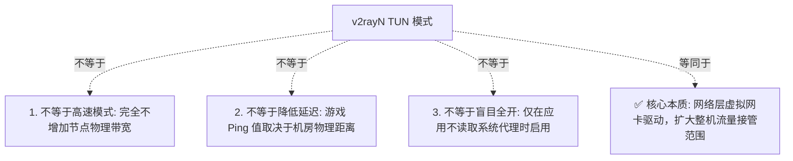
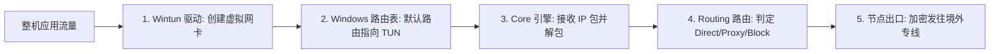
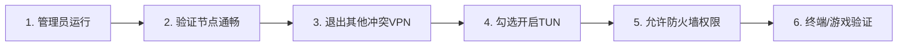

在 Windows 电脑上使用 v2rayN 进行科学上网与网络开发时，**TUN 模式（TUN Mode / 虚拟网卡接管）** 是进阶玩家与技术人员最常接触、却也最容易产生严重误解的核心功能。

随着现代应用生态的多样化，大量 Windows 用户常常遇到以下典型痛点：

**“为什么在 Chrome 浏览器里能看 YouTube 4K，但在 Windows 终端里运行 `git clone`、`npm install` 或 Docker 拉取镜像时却频频报错超时？”**  
**“玩 Steam 外服游戏或使用部分桌面独立客户端时，为什么它们完全不走底层的 v2rayN 代理节点？”**  
**“听说开启 TUN 模式是‘终极全局高速模式’，开了一定能大幅降低游戏 Ping 值和翻倍网速，这是真的吗？”**  
**“为什么在 v2rayN 顶部勾选了【开启 TUN 模式】之后，整台电脑的所有网页反而瞬间全部瘫痪断网？”**  
**“电脑里多出来一个名为 `wintun` 的虚拟网络适配器，这个网卡到底是什么？能不能随便右键删除？”**  
**“TUN 模式、System Proxy（系统代理）、Routing（路由规则）和 DNS 之间到底是什么关系？流量在 Windows 底层到底是怎么走的？”**

**v2rayN 中的 TUN 模式绝不是所谓的“高速加速器”或“降延迟神技”。它的核心技术本质，是通过在 Windows 网络层创建虚拟网络适配器（Virtual Network Interface）并修改系统路由表，将比普通系统代理更广泛的整机网络流量（包括非 HTTP 协议、原生 UDP 与不读取系统代理的命令行/游戏）强制捕获并输送至代理 Core 内核处理。**

如果你的日常需求仅仅是在 Chrome、Edge 浏览器中查资料、看视频，那么传统的 **System Proxy（系统代理）** 凭借极高的稳定性和极低系统开销，就已经完全足够。

本文作为 **v2rayN TUN 模式与 Windows 底层流量接管的权威深度指南**，将带你从 **System Proxy 与 TUN 架构对比、虚拟网卡驱动底层运作、Routing 路由与 DNS 分流交互、Git/Docker/游戏实战接管，到 TUN 开启后全盘断网的深度排障** 建立透彻的全局认知。

---

## ⚡ 30 秒快速看懂：TUN 模式极速决策流

```text
┌────────────────────────────────────────────────────────────────────────┐
│                   v2rayN TUN 模式 30 秒极速决策流                      │
├────────────────────────────────────────────────────────────────────────┤
│ 1. 【日常网页浏览】➔ 保持「自动配置系统代理」，无需开启 TUN (最稳定、零冲突)│
│ 2. 【终端/开发/游戏】➔ Git/Docker/外服游戏不走代理 ➔ 优先查应用自身代理设置 │
│ 3. 【无自身代理能力】➔ 右键以管理员身份运行 v2rayN ➔ 顶部勾选开启 TUN 模式 │
│ 4. 【开 TUN 后正常】➔ 畅享全协议整机接管，配合「绕过大陆」路由规则极速出海│
│ 5. 【开 TUN 后全断】➔ 立即取消勾选 TUN ➔ 退出 Clash/商业VPN ➔ 排除驱动冲突 │
└────────────────────────────────────────────────────────────────────────┘
```

---

## 一、破除神话：TUN 模式到底是什么？四大核心认知

在动手配置 TUN 之前，必须彻底纠正网络上流传的一系列认知误区：



### 1. TUN 不是“速度提升模式”
- TUN 改变的只是**流量进入客户端的捕获路径（从应用层下沉到网络层）**。你的实际下载速度与带宽上限，依然 100% 取决于所购买节点的物理线路（如 IEPL 专线）与服务器负载。

### 2. TUN 不会自动降低游戏 Ping 值
- 游戏延迟是由你家到境外游戏机房的物理光纤距离决定的。TUN 模式只是**允许游戏的 UDP 数据包能够进入代理通道**，若节点本身延迟高，开启 TUN 也绝不可能凭空降低延迟。

### 3. TUN 与 System Proxy 是平级选择，而非高低档次
- System Proxy 侵入性小、极其稳定；TUN 模式系统权限高、接管全面但配置更复杂。两者是针对不同软件生态的技术方案，没有谁比谁更高级。

---

## 二、架构对决：System Proxy 与 TUN 模式全方位对比

理解两者在 Windows 操作系统底层的不同运作链路，是排查一切接管故障的基础：

```mermaid
graph TD
    subgraph 传统应用层: System Proxy 链路
        App1[Chrome / Edge 浏览器] -->|读取 Windows 代理设置| WinProxyRegistry[系统注册表代理开关]
        WinProxyRegistry -->|转发 HTTP/SOCKS 流量| LocalPort[127.0.0.1:10809 本地端口]
        LocalPort --> XrayCore1[Xray-core / sing-box 引擎]
    end
    
    subgraph 底层网络层: TUN 模式链路
        App2[Git / Docker / 外服游戏 / 任意程序] -->|由 Windows 路由表接管| WinStack[Windows TCP/IP 协议栈]
        WinStack -->|写入底层虚拟网络接口| WintunDevice[wintun.dll 虚拟网卡]
        WintunDevice -->|读取原始 IP 数据包| XrayCore2[Xray-core / sing-box 引擎]
    end
```



```text
┌────────────────────────────────────────────────────────────────────────┐
│                   System Proxy 与 TUN 模式全方位深度对比               │
├──────────────┬──────────────────────────┬──────────────────────────────┤
│ 比较维度     │ 系统代理 (System Proxy)  │ TUN 虚拟网卡模式 (TUN Mode)  │
├──────────────┼──────────────────────────┼──────────────────────────────┤
│ **工作层级** │ 应用层 (Layer 7 / HTTP)  │ 网络层 (Layer 3 / IP 数据包) │
│ **接管机制** │ Windows 注册表代理开关   │ Wintun 虚拟网卡驱动 + 路由表 │
│ **接管范围** │ 仅限遵循系统代理的软件   │ **整机全量软件 (含游戏与终端)**│
│ **协议支持** │ 主要支持 TCP (HTTP/HTTPS)│ **完美支持 TCP 与 UDP 数据包**│
│ **权限要求** │ 普通用户权限即可运行     │ **必须拥有 Windows 管理员权限**│
│ **系统影响** │ 极小，不修改底层网卡路由 │ 较高，接管默认网关与 DNS 栈  │
│ **冲突概率** │ 极低 (仅本地端口占用冲突)│ 中高 (易与其他 VPN 虚拟网卡冲突)│
│ **适合人群** │ 新手、日常刷网页、看视频 │ 程序员、外服游戏玩家、高级用户│
└──────────────┴──────────────────────────┴──────────────────────────────┘
```

---

## 三、底层中枢：虚拟网卡（Wintun）与 Core 引擎的角色分工

在 v2rayN 的 TUN 架构中，各个组件有着严格的流水线分工：



### 1. Wintun 虚拟网卡驱动
- v2rayN 通常基于高性能开源驱动（`wintun.dll`）在 Windows 网络连接中创建一个虚拟网络适配器。它的作用就像一根“虚拟网线”，将系统发出的底层 IP 数据包无缝截获并送入客户端。

### 2. 为什么不能随便删除虚拟网卡？
- 打开 Windows「网络连接」面板，你会看到一个额外的网络适配器。**切勿在没有故障的情况下手动右键禁用或删除它**，否则会导致 v2rayN 再次开启 TUN 时因找不到网络接口而直接崩溃！

---

## 四、流量分流中枢：TUN、Routing 与 DNS 的三角关系

开启 TUN 模式仅仅完成了**“流量捕获”**，流量进入客户端后，如何分流依然由 **Routing（路由规则）** 和 **DNS** 共同决定：

```mermaid
graph TD
    CapturedIP[TUN 虚拟网卡捕获的原始请求] --> DNSEngine{DNS 寻址解析引擎}
    DNSEngine -->|本地 DNS / 境外远程 DNS| DomainResult[解析得到域名或 IP]
    
    DomainResult --> RouteJudge{v2rayN 路由分流引擎}
    
    RouteJudge -->|判定为国内流量 (CN IP / Direct 域名)| DirectOut[Direct 直连: 绕出 TUN 走本地物理网卡]
    RouteJudge -->|判定为国外流量 (Proxy 域名 / 境外 IP)| ProxyOut[Proxy 代理: 加密走境外专线节点]
    RouteJudge -->|判定为广告 / 追踪域名| BlockOut[Block 阻止: 丢弃数据包]
```

### 1. TUN 不是 Routing（路由分流）
- **TUN 负责“抓流量”**：把所有流量从 Windows 抓进 v2rayN；
- **Routing 负责“分流量”**：判断这个流量是该 **Direct（直连不耗流量）** 还是 **Proxy（走节点代理）**。如果路由规则把某个海外网站错误判定为了 Direct，即使开了 TUN 依然会打不开！

### 2. TUN 模式下的 DNS 劫持与防污染
- 在 TUN 模式下，系统所有的 DNS 请求（UDP 53 端口）也会被虚拟网卡拦截并交给 Core 处理。Core 会使用内置的远程 DNS（如 `8.8.8.8` 或 `1.1.1.1`）进行无污染解析，彻底杜绝本地宽带运营商的 DNS 投毒。

---

## 五、图解实操：v2rayN TUN 模式开启标准 6 步走



### 步骤 1：以管理员身份运行 v2rayN
- 彻底退出 v2rayN，在桌面上找到 `v2rayN.exe` 图标，鼠标右键选择 **「以管理员身份运行」**（*TUN 模式创建虚拟网卡必须拥有管理员提权*）。

### 步骤 2：确保节点本身在系统代理下能正常连通
- 在未开启 TUN 的状态下，确保列表中有延迟正常（如 30ms）的节点，且浏览器能正常访问海外网页。

### 步骤 3：退出所有可能冲突的其他代理软件
- 彻底关闭电脑后台的 Clash Verge、EasyConnect、商业 VPN、Watt Toolkit 或游戏加速器，避免虚拟网卡与路由表打架。

### 步骤 4：勾选开启 TUN 模式
- 在 v2rayN 主界面顶部导航栏，找到并勾选 **【开启 TUN 模式】**（部分版本会提示下载或激活 Wintun 驱动，点击允许即可）。

### 步骤 5：允许 Windows Defender 防火墙网络访问
- 若弹出 Windows 安全中心提示，勾选“专用网络”和“公用网络”并点击 **“允许访问”**。

### 步骤 6：在终端与非浏览器应用中验证
- 打开 Windows PowerShell，输入 `curl.exe -I https://www.google.com`。若瞬间返回 `HTTP/2 200`，说明 TUN 模式已成功接管整机全量终端与应用！

---

## 六、排障大典：开启 TUN 模式后全盘断网深度剖析

如果你一旦勾选 TUN 模式整台电脑瞬间断网，请按以下**黄金排错决策树**依次排查：

```mermaid
graph TD
    TUNFail[开启 TUN 模式后电脑彻底断网] --> CheckA{立即取消勾选 TUN 模式能否恢复?}
    CheckA -->|否| FixBase[属于系统代理残留或宽带断网，去设置关闭手动代理]
    CheckA -->|是| CheckB{是否以【管理员身份】启动了 v2rayN?}
    
    CheckB -->|否| FixAdmin[右键 v2rayN 属性 ➔ 勾选以管理员身份运行]
    CheckB -->|是| CheckC{电脑是否后台运行了 Clash/商业VPN/WARP?}
    
    CheckC -->|是| FixConflict[任务管理器彻底结束其他 VPN 进程与虚拟网卡]
    CheckC -->|否| CheckD{路由模式是否被误选为了全部 Direct 或全局拦截?}
    
    CheckD -->|是| FixRoute[将底部路由恢复为「绕过大陆 (bypass mainland)」]
    CheckD -->|否| FixCore[检查 Core 设置，更新 Xray-core / sing-box 至稳定版]
```

---

## 七、开发与游戏实战场景全解析

```text
┌────────────────────────────────────────────────────────────────────────┐
│                   三大高频场景 TUN 模式应用指南                        │
├──────────────┬─────────────────────────────────────────────────────────┤
│ 应用场景     │ 为什么需要 TUN 与最佳实践                               │
├──────────────┼─────────────────────────────────────────────────────────┤
│ **Git 终端开发** 很多开发者不想为每一个命令行工具单独配置代理变量，开启 │
│              │ TUN 模式后，`git clone`、`npm install`、`pip` 自动全走代理│
├──────────────┼─────────────────────────────────────────────────────────┤
│ **Docker 容器** Docker Desktop 内部容器网络走独立网桥，开启 TUN 模式可   │
│              │ 实现容器内拉取海外镜像与 API 无感知全透明加速           │
├──────────────┼─────────────────────────────────────────────────────────┤
│ **Steam/外服游戏** 游戏 UDP 流量无法被普通系统代理捕获，开启 TUN 模式并配合│
│              │ 香港/日本低延迟物理专线，可实现联机与语音无障碍连通     │
└──────────────┴─────────────────────────────────────────────────────────┘
```

---

## 八、2026 高可用原生支持 TUN 流量专线推荐

TUN 模式对节点的 UDP 转发质量和带宽稳定性要求极高，建议选择支持全协议企业级专线的标杆品牌：

```text
┌────────────────────────────────────────────────────────────────────────────────────────┐
│                        2026 稳定适配 TUN 模式物理专线推荐                              │
├──────────┬──────────────────────────┬──────────────┬──────────────┬────────────────────┤
│ 适配场景 │ 推荐品牌候选             │ 实际起付门槛 │ 每月流量配额 │ TUN 接管与专线优势 │
├──────────┼──────────────────────────┼──────────────┼──────────────┼────────────────────┤
│ 旗舰全能 │ 光速云 (GuangSuYun)      │ 约 ¥7.5/月起 │ 59G~238G /月 │ 全球企业 IEPL 专线，完整支持 UDP/TCP，TUN 模式 0 丢包│
│ 平价轻量 │ 微风网络 (BreezeNet)     │ 约 ¥7/月起   │ 50GB / 月    │ 优质 BGP 优化线路，纯净节点池，开发与终端轻量首选   │
│ 弹性月付 │ 唯兔云 (V2Yun)           │ ¥14.9/月     │ 100GB / 月   │ 纯单月付，多地区原生 IP 出口，TUN 下流媒体解锁强   │
│ 应急备用 │ 星岛梦 (XingDaoMeng)     │ 约 ¥8/月起   │ 60G/不限时包 │ 0月租不限时包，节点长期有效，TUN 调试应急无压力     │
│ AI/开发  │ 速界 (SpeedWorld)        │ ¥25/月       │ 150GB / 月   │ 原生独立大带宽，Git/Docker/终端开发极速拉满        │
└──────────┴──────────────────────────┴──────────────┴──────────────┴────────────────────┘
```

- 🏆 **全协议旗舰首选**：[光速云](/reviews/guangsu-cloud/) —— 全线 IEPL 独立光纤，全协议支持，TUN 模式下极速畅通；
- 🍃 **超低预算轻量**：[微风网络](/reviews/weifeng-cloud/) —— 针对 PC 端日常查资料优化的 50GB 小流量专线，年付折算仅约 ¥7/月；
- 💳 **拒绝绑定的单月付**：[唯兔云](/recommend/best-airports/) —— ¥14.9 纯单月付，100GB 充沛流量，节点丰富。

---

## 九、避坑指南：35 个关于“v2rayN TUN 模式”的致命认知误区

```text
❌ 误区 1：TUN 模式是让翻墙速度翻倍的“全局高速模式” ➔ 事实：TUN 只扩大流量接管范围，完全不增加物理线路带宽。
❌ 误区 2：开启 TUN 模式一定能降低外服游戏的物理 Ping 值 ➔ 事实：游戏延迟由物理距离决定，TUN 仅负责转发 UDP 数据。
❌ 误区 3：日常刷网页和看视频也必须永远开着 TUN 模式 ➔ 事实：普通网页用系统代理更稳定，开 TUN 易增加系统开销。
❌ 误区 4：电脑里多出来的 Wintun 虚拟网卡是恶意软件生成的 ➔ 事实：Wintun 是官方安全开源驱动，专门用于网络层数据转发。
❌ 误区 5：遇到任何网络异常，第一反应就是去网络设置里把 Wintun 删除 ➔ 事实：乱删虚拟网卡会导致 TUN 模式彻底损坏无法启动。
❌ 误区 6：普通用户权限双击打开 v2rayN 也能完美运行 TUN 模式 ➔ 事实：创建虚拟网卡必须使用 Windows 管理员权限运行。
❌ 误区 7：TUN 模式开启后，系统代理（System Proxy）就不起任何作用了 ➔ 事实：两者可协同工作，TUN 兜底未走代理的整机流量。
❌ 误区 8：TUN 模式和 Routing 路由规则是完全同一个功能 ➔ 事实：TUN 负责把流量抓进客户端，Routing 负责判定直连还是代理。
❌ 误区 9：开启 TUN 模式后，访问国内百度也会消耗境外节点流量 ➔ 事实：在“绕过大陆”路由规则下，国内流量依然走本地直连。
❌ 误区 10：可以把 Clash 的 YAML 路由规则直接复制进 v2rayN TUN ➔ 事实：两者语法完全不同，直接填入会导致内核解析崩溃。
❌ 误区 11：可以同时开启 Clash TUN 模式和 v2rayN TUN 模式 ➔ 事实：双重虚拟网卡抢占默认网关会导致整机网络瞬间死锁。
❌ 误区 12：开着公司企业 VPN（如 EasyConnect）也能无缝开 TUN ➔ 事实：企业 VPN 驱动通常会强制锁定路由表，导致 TUN 冲突断网。
❌ 误区 13：为了解决 TUN 开启断网，必须彻底关闭 Windows Defender ➔ 事实：只需允许防火墙网络权限，切勿关闭杀毒软件。
❌ 误区 14：开启 TUN 模式后，微信和 QQ 会被强制走境外代理 ➔ 事实：内置的 GeoIP/Geosite 规则会自动将国内通讯软件直连。
❌ 误区 15：打不开某个海外小众网站一定是 TUN 驱动坏了 ➔ 事实：是该网站被 Routing 规则误判为了 Direct，切全局即可。
❌ 误区 16：修改 Windows 系统 DNS 会直接破坏 TUN 模式的正常运行 ➔ 事实：TUN 模式会自动接管系统的 DNS 请求通道。
❌ 误区 17：关闭电脑的 IPv6 协议是解决 TUN 断网的唯一有效手段 ➔ 事实：仅对部分 IPv6 路由异常的环境有微弱影响，非万能药。
❌ 误区 18：在 IP 查询网站查到国内 IP 说明 TUN 模式彻底失效 ➔ 事实：国内 IP 查询站命中直连规则，需查海外 IP 站点。
❌ 误区 19：WSL2 子系统开启后会自动无缝继承 Windows 的 TUN 模式 ➔ 事实：WSL2 采用独立虚拟网络，需额外配置镜像网络模式。
❌ 误区 20：Docker 容器内的所有流量不需要任何配置自动走 TUN ➔ 事实：取决于 Docker 的网桥模式，大部分情况下 TUN 能透明接管。
❌ 误区 21：只要开启了 TUN 模式，Git clone 就绝对不会再报错 ➔ 事实：若 GitHub 遭遇网络抖动或节点被封，依然需换可用节点。
❌ 误区 22：TUN 模式会显著增加电脑 CPU 的负担导致严重发热 ➔ 事实：Wintun 驱动基于内核态优化，日常流量 CPU 占用极低。
❌ 误区 23：在外面连公共 Wi-Fi 时开启 TUN 模式会导致账号密码泄露 ➔ 事实：TUN 模式将整机流量全量加密传输，反而更安全。
❌ 误区 24：TUN 模式下更换节点不需要刷新浏览器 ➔ 事实：已建立的 TCP 长连接需关闭标签页重新连接以应用新节点 IP。
❌ 误区 25：遇到 TUN 启动失败只要盲目重装 Windows 系统即可 ➔ 事实：检查管理员权限、杀毒拦截与端口占用即可解决 99% 的问题。
❌ 误区 26：TUN 模式只能在 Windows 11 上运行，Win 10 完全不支持 ➔ 事实：Windows 10 与 11 均完美支持 Wintun 驱动架构。
❌ 误区 27：退出 v2rayN 之后，TUN 虚拟网卡还会偷偷在后台跑流量 ➔ 事实：软件退出后虚拟网卡驱动自动休眠，绝不产生后台流量。
❌ 误区 28：开启 TUN 模式可以让无法连接的 Timeout 节点瞬间复活 ➔ 事实：TUN 不解决节点服务器连通性，节点超时需先修节点。
❌ 误区 29：所有支持 V2Ray 的客户端其 TUN 模式实现都一模一样 ➔ 事实：v2rayN、sing-box 与 Clash 的 TUN 驱动与路由策略存在差异。
❌ 误区 30：把电脑时间调慢 10 分钟对 TUN 模式没有影响 ➔ 事实：时间偏差大会导致底层 TLS 证书握手彻底失败。
❌ 误区 31：只要买了昂贵的专线套餐，就永远不需要理会 TUN 设置 ➔ 事实：专线管跨境传输，TUN 管本地接管，两者相辅相成。
❌ 误区 32：在任务管理器中强制结束 v2rayN 不会影响 TUN 虚拟网卡 ➔ 事实：强杀进程可能导致虚拟网卡未能正常注销，引发断网。
❌ 误区 33：开启 TUN 模式后不需要在主界面选择节点 ➔ 事实：必须选择一个绿色可用节点作为 TUN 流量的出口。
❌ 误区 34：只要把路由模式改为全局，游戏延迟就能大幅降低 ➔ 事实：全局模式导致游戏直连服务器绕远路，延迟反而更高。
❌ 误区 35：TUN 模式开启后不能与局域网内的其他设备共享代理 ➔ 事实：在设置中开启“允许来自局域网连接”依然可以共享。
```

---

## 十、常见问题深度解答（FAQ · 50 问）

### Q1：v2rayN TUN 是什么？
**答**：指通过在 Windows 系统中创建虚拟网络适配器（Wintun），在网络层（Layer 3）将整机所有软件的流量强制捕获并交给代理 Core 处理的高级接管机制。

### Q2：v2rayN 怎么开启 TUN 模式？
**答**：右键以管理员身份运行 v2rayN ➔ 在顶部导航栏找到并勾选 **【开启 TUN 模式】** ➔ 允许防火墙提示即可。

### Q3：v2rayN 日常使用需要开 TUN 模式吗？
**答**：**不需要。** 只要普通浏览器（Chrome/Edge）通过默认的“自动配置系统代理”能正常上网，日常无需开启 TUN。

### Q4：什么情况下才必须开启 TUN 模式？
**答**：当需要使用不遵循系统代理的软件（如某些外服联机游戏、未配代理的 Git 命令行、Docker 容器或特定独立桌面应用）时。

### Q5：TUN 模式和系统代理（System Proxy）有什么区别？
**答**：系统代理仅在应用层生效（只管浏览器等遵循系统设置的软件）；TUN 模式在网络层生效（整机全量接管，支持 UDP 和非 HTTP 应用）。

### Q6：开启 TUN 模式会提高网速吗？
**答**：**绝对不会。** TUN 模式只扩大接管范围，不增加物理带宽，上网速度依然取决于节点线路质量。

### Q7：开启 TUN 模式会降低游戏延迟（Ping）吗？
**答**：**不会。** 物理延迟由机房地理距离决定，TUN 模式只是让游戏数据包能进入代理隧道，不改变光纤传播物理极限。

### Q8：为什么一勾选 TUN 模式整台电脑瞬间断网？
**答**：通常是因为：未以管理员权限运行、电脑上有其他 VPN（如 Clash/EasyConnect）网卡冲突、或路由规则发生死循环。

### Q9：开启 TUN 断网后怎么快速恢复？
**答**：立即在顶部取消勾选 TUN 模式，退出软件并以管理员身份重新打开，关闭其他所有网络代理工具。

### Q10：v2rayN 虚拟网卡（Wintun）是什么？
**答**：是由官方开源驱动创建的软件虚拟网络适配器，专门用于在 Windows 协议栈底层收发原始 IP 数据包。

### Q11：可以手动把网络连接里的虚拟网卡删除吗？
**答**：**坚决不要手动删除！** 乱删虚拟网卡会导致 v2rayN 再次开启 TUN 模式时因找不到网络适配器而崩溃报错。

### Q12：开启 TUN 模式必须使用管理员权限吗？
**答**：**是的。** Windows 操作系统安全机制要求，安装底层网卡驱动和修改系统核心路由表必须具有管理员提权。

### Q13：TUN 模式和 Routing（路由规则）有什么关系？
**答**：TUN 负责把流量全部抓进客户端，Routing 负责判断抓进来的流量走 Direct（直连不耗流量）还是 Proxy（走节点代理）。

### Q14：开启 TUN 模式后国内网站会消耗代理流量吗？
**答**：不会。只要路由模式设置为 **「绕过大陆（bypass mainland）」**，百度、B站等国内请求会被自动判定为直连。

### Q15：为什么开启 TUN 模式后某个国外小网站打不开？
**答**：因为该网站未被预设规则库收录而被误判为了 Direct 直连。将底部路由临时切换为 **「全局」** 即可正常访问。

### Q16：TUN 模式下 DNS 是怎么处理的？
**答**：整机的 DNS 请求（UDP 53 端口）会被虚拟网卡透明捕获并交给 Core 引擎，通过境外远程无污染 DNS 进行寻址解析。

### Q17：为什么开启 TUN 模式会导致 Clash 无法使用？
**答**：两者同时开启 TUN 模式会争抢 Windows 的默认路由网关，造成网络死锁，同一时间电脑只能运行一个 TUN 工具。

### Q18：企业 VPN（如深信服/EasyConnect）能和 TUN 同时开吗？
**答**：通常会冲突。企业 VPN 具有强行锁定路由表的安全机制，建议在关闭企业 VPN 后再开启 v2rayN TUN。

### Q19：Git 命令行需要开 TUN 模式吗？
**答**：非必须。可以直接在终端执行 `git config --global http.proxy http://127.0.0.1:10809`，不想逐个配置时可开启 TUN。

### Q20：Docker 容器怎么通过 TUN 模式上网？
**答**：开启 v2rayN TUN 模式后，Docker Desktop 的容器流量会自动通过宿主机虚拟网卡透明出海，无需额外配置。

### Q21：WSL2 子系统如何配合 TUN 模式？
**答**：在 `.wslconfig` 中开启 `networkingMode=mirrored`（镜像网络模式），WSL2 即可完美无缝继承 Windows 的 TUN 代理。

### Q22：外服游戏联机开 TUN 模式效果好吗？
**答**：效果极佳。TUN 完整支持 UDP 数据包转发，配合低延迟的香港或日本 IEPL 专线可实现流畅联机与游戏内语音。

### Q23：Steam 商店能被 TUN 模式接管吗？
**答**：可以。Steam 的客户端登录、社区页面、好友聊天和游戏联机均会被 TUN 模式全量透明加速。

### Q24：为什么开 TUN 模式后 Google 能打开但 ChatGPT 报错？
**答**：说明 TUN 模式工作完全正常，原因是所选节点的出口 IP 遭到了 OpenAI 风控封锁，切换专用原生节点即可。

### Q25：在 IP 查询网站查到本地宽带 IP 说明 TUN 失效了吗？
**答**：没有。国内 IP 查询网站默认命中 Direct 直连规则走本地网络，需访问海外 IP 查询网站核验。

### Q26：如何验证某个软件是否真正走了 TUN 模式？
**答**：观察 v2rayN 主界面底部的实时日志窗口，运行该软件时若有对应的外网 IP 和连接记录刷出，即证明已被接管。

### Q27：开启 TUN 模式会增加 CPU 占用吗？
**答**：增幅微乎其微。现代 Wintun 驱动基于高性能内核态开发，日常千兆吞吐下 CPU 占用率通常不足 2%。

### Q28：TUN 模式支持 IPv6 吗？
**答**：支持。Core 引擎支持 IPv4/IPv6 双栈网络转发，若本地 IPv6 异常可在设置中优先选择 IPv4 路由。

### Q29：需要关闭 Windows Defender 才能开 TUN 吗？
**答**：**坚决不需要。** 只要将解压目录添加为排除项并允许防火墙访问即可，切勿关闭杀毒。

### Q30：为什么退出 v2rayN 后整台电脑无法上网？
**答**：这是系统代理残留或虚拟网卡未正常注销。在 Windows 设置中关闭“使用代理服务器”开关即可恢复。

### Q31：TUN 模式下怎么测速？
**答**：直接在浏览器打开 YouTube 播放 4K 视频查看详细统计，或在终端使用测速命令行工具进行真实吞吐测试。

### Q32：为什么开启 TUN 模式后国内局域网打印机连不上了？
**答**：检查路由规则中是否包含了局域网私有 IP（`192.168.x.x`、`10.x.x.x`）的直连白名单，确保局域网流量 Direct。

### Q33：提示 `Wintun.dll not found` 怎么办？
**答**：说明客户端缺少驱动文件，请前往官方 GitHub 仓库下载完整的 `v2rayN-With-Core.zip` 压缩包解压使用。

### Q34：TUN 模式支持多网卡负载均衡吗？
**答**：默认不支持。TUN 模式接管的是当前活跃的默认网关物理网络。

### Q35：如何在开机时自动启动并开启 TUN 模式？
**答**：在「参数设置」中勾选“开机自启”，并设置 v2rayN 快捷方式属性为“以管理员身份运行此程序”。

### Q36：为什么开启 TUN 模式后视频会议（Zoom）画面卡顿？
**答**：说明当前节点丢包率较高或上行带宽受限，切换为企业级 IEPL 物理专线节点即可解决。

### Q37：遇到 TUN 模式问题需要重装系统吗？
**答**：**完全不需要。** 99.9% 的问题出在管理员权限、驱动缺失或软件冲突，关闭冲突进程即可。

### Q38：TUN 模式下能同时开网页下载工具（IDM）吗？
**答**：完全可以。IDM 的多线程下载流量会被 TUN 模式自动透明接管并拉满带宽。

### Q39：为什么切换了新节点后游戏还是卡在原服务器？
**答**：游戏与原节点保持着 UDP 长连接，需彻底退出游戏客户端并重新登录以应用新节点。

### Q40：如何彻底关闭 TUN 模式？
**答**：在主界面顶部取消勾选【开启 TUN 模式】，右键托盘图标退出软件，虚拟网卡将自动释放。

---

## 🏁 总结：v2rayN 流量接管认知金字塔

掌握 Windows 流量接管，请牢记以下**核心铁律**：

```text
1. 辨需求 ➔ 网页日常首选 System Proxy，游戏/终端/Docker 才开 TUN
2. 明原理 ➔ TUN 只负责网络层抓取流量，绝不提供物理带宽加速或降延迟
3. 防冲突 ➔ 开 TUN 前务必退出 Clash、WARP 及企业 VPN，避免路由死锁
4. 守权限 ➔ 必须以管理员身份运行 v2rayN，切勿手动乱删 Wintun 虚拟网卡
5. 优选线 ➔ TUN 接管整机全量流量，唯有企业级 IEPL 专线才能保障全天稳定
```

---

### 📚 延伸进阶阅读与选型专栏
- 💻 **Windows 客户端主教程**：[《v2rayN怎么用？Windows下载安装、订阅、节点、系统代理与TUN完整教程》](/tutorials/v2rayn-windows/)
- 🌐 **V2Ray 生态超级 Pillar**：[《V2Ray是什么？V2Ray客户端、节点、订阅、VLESS/VMess与新手完整教程》](/tutorials/v2ray-tizi/)
- 📋 **v2rayN 订阅导入教程**：[《v2rayN订阅怎么导入？订阅链接、节点更新、404/403与更新失败完整教程》](/tutorials/v2rayn-subscription/)
- 🚨 **v2rayN 超时排查**：[《v2rayN节点 Timeout 怎么办？全部节点连接超时、Core、网络与服务器异常完整排查》](/issues/v2rayn-node-timeout/)
- 🔌 **v2rayN 有节点没网**：[《v2rayN有节点但无法上网怎么办？系统代理、TUN、DNS与Routing完整排查》](/issues/v2rayn-connected-no-internet/)
- 🚀 **v2rayN 速度慢排查**：[《v2rayN速度慢怎么办？节点、线路、丢包、Windows网络与晚高峰完整排查》](/issues/v2rayn-slow-speed/)
- ⚡ **老牌旗舰专线**：[《光速云深度评测：2020老牌IEPL专线与解锁实测》](/reviews/guangsu-cloud/)
- 🍃 **平价轻量专线**：[《微风网络深度评测：小流量套餐值不值得买？》](/reviews/weifeng-cloud/)
- 🏆 **2026 全景大榜**：[《2026梯子推荐：稳定、速度、价格、安全与不同使用场景怎么选》](/recommend/best-tizi/)
