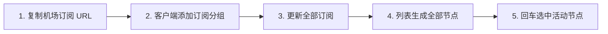
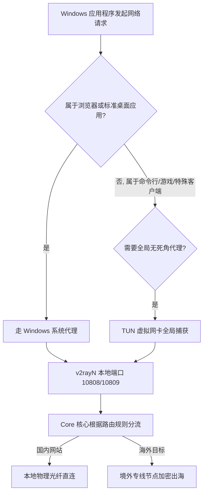

在 Windows 操作系统中，**v2rayN** 是目前生态最成熟、功能最完备、支持代理协议最全面的开源图形化客户端之一。

然而，许多 Windows 新手在初次接触 v2rayN 时，常常会遇到一系列令人困惑的技术疑问与操作死锁：

**“在网上下载了解压包，双击运行后软件界面空空如也，为什么什么网页都打不开？”**  
**“在 GitHub 上下载时，看到 `v2rayN-With-Core.zip`、`v2rayN-windows-64.zip` 和各种架构包，到底该下哪一个？”**  
**“机场后台复制的‘V2Ray 订阅链接’应该粘贴到哪里？更新订阅和单节点导入有什么区别？”**  
**“为什么节点测试有延迟（比如 45ms），但 Edge 和 Chrome 浏览器依然提示无法连接互联网？”**  
**“任务栏右下角的图标从蓝色变成红色代表什么？‘自动配置系统代理’和‘TUN 模式’有什么区别？”**  
**“为什么浏览器可以正常科学上网，但 Git、cmd 命令行、游戏或某些桌面软件却依然无法出海？”**  
**“为什么退出或关闭 v2rayN 以后，整台电脑的微信和国内网站反而全都断网打不开了？”**

**v2rayN 是一款 Windows 端的图形化代理客户端管理工具，它负责帮助用户管理底层 Core 内核、订阅链接、节点配置、Windows 系统代理、TUN 虚拟网卡以及路由分流规则，但软件本身绝不自带任何翻墙服务器节点。**

想要在 Windows 上实现流畅、稳定的科学上网，用户需要经历一个清晰的完整链路：**「官方渠道下载客户端 ➔ 导入自己的合法专线订阅 ➔ 批量拉取服务器节点 ➔ 选中活动节点 ➔ 开启 Windows 自动系统代理（或按需开启 TUN 模式） ➔ 浏览器与终端验证」**。

本文将作为 **Windows 端 v2rayN 的核心操作总指南**，带你从 **可信版本辨别、安装运行环境、订阅与节点管理、系统代理与 TUN 深度对比，到系统代理残留与各种断网故障的完整排查**。

---

## ⚡ 30 秒快速上手：v2rayN Windows 极速使用决策流

```text
┌────────────────────────────────────────────────────────────────────────┐
│                   v2rayN Windows 30 秒极速上手决策流                   │
├────────────────────────────────────────────────────────────────────────┤
│ 1. 【下载解压】➔ 前往官方 GitHub 下载 `v2rayN-With-Core.zip` (自带内核) │
│ 2. 【准备订阅】➔ 登录专线机场后台，复制专属的「V2Ray / 通用订阅链接」 │
│ 3. 【添加订阅】➔ 打开 v2rayN ➔「订阅分组」➔「添加」➔ 粘贴 URL 并保存   │
│ 4. 【拉取节点】➔ 点击「订阅分组」➔「更新全部订阅 (不通过代理)」        │
│ 5. 【选择节点】➔ 鼠标选中一个香港或日本低延迟节点，按键盘【Enter 回车】 │
│ 6. 【开启代理】➔ 底部「系统代理」下拉框选择【自动配置系统代理】(图标变红)│
│ 7. 【分流验证】➔ 路由选择【绕过大陆】，打开浏览器访问 Google 验证成功  │
└────────────────────────────────────────────────────────────────────────┘
```

---

## 一、清晰界定：v2rayN 是什么？“三不等于”原则

要彻底用好 v2rayN，首先必须理清客户端与底层技术的关系：

```mermaid
graph TD
    User[Windows 用户] --> GUI[v2rayN 图形界面]
    GUI -->|管理配置与调度| Core[底层 Core 内核 (Xray-core / v2ray-core)]
    Core -->|系统网络接口| Traffic[Windows 系统代理 / TUN 虚拟网卡]
    Core -->|专线加密通信| AirportNode[机场境外服务器节点]
```

### 1. v2rayN 不等于机场
- **真相**：v2rayN 是由开发者 `2dust` 维护的纯开源免费软件。开发者不提供、不运营、也不销售任何服务器节点。安装 v2rayN 后，必须配置自己的机场订阅才能使用。

### 2. v2rayN 不等于 V2Ray Core
- **真相**：v2rayN 本质上是一个**图形界面外壳（GUI）**。它负责把用户的鼠标点击操作翻译成配置文件，真正执行网络连接、加密解密和数据转发的是后台运行的命令行核心程序（如 `xray.exe` 或 `wv2ray.exe`）。

### 3. v2rayN 不等于单一协议工具
- **真相**：现代版本的 v2rayN 通过集成强大的 Xray-core、sing-box-core 等内核，不仅支持传统的 VMess 和 Shadowsocks，还深度支持现代的 **VLESS (含 REALITY / XTLS)**、**Trojan** 和 **Hysteria 2** 等全量前沿协议。

---

## 二、下载与安装：如何识别官方正版与运行环境配置

在搜索引擎中直接搜索“v2rayN 下载”，极易误入第三方捆绑软件站或带有后门的二次打包镜像站。请务必遵循以下安全准则：

```text
┌────────────────────────────────────────────────────────────────────────┐
│                   v2rayN 官方版本识别与下载文件选型指南                │
├────────────────────┬───────────────────────────────────────────────────┤
│ **唯一官方仓库**   │ GitHub: `2dust/v2rayN` (认准作者 2dust 与数十k Stars)│
├────────────────────┼───────────────────────────────────────────────────┤
│ **推荐下载包**     │ **`v2rayN-With-Core.zip`** (新手强烈首选，自带全套核心)│
├────────────────────┼───────────────────────────────────────────────────┤
│ **纯净版下载包**   │ `v2rayN-windows-64.zip` (体积小，需手动放入 Core 文件) │
├────────────────────┼───────────────────────────────────────────────────┤
│ **ARM 设备下载包** │ `v2rayN-arm64.zip` (适用于 Surface Pro 等 ARM 架构设备) │
├────────────────────┼───────────────────────────────────────────────────┤
│ **系统环境要求**   │ Windows 10 / Windows 11 (需安装 .NET 8.0 Desktop Runtime)│
└────────────────────┴───────────────────────────────────────────────────┘
```

> 🛡️ **安全下载实战防坑守则**：
> - **文件解压路径**：解压后的文件夹请放置在纯英文路径下（例如 `D:\Tools\v2rayN\`），**严禁放在包含中文字符或特殊符号的路径**，否则会导致底层 Core 读取配置失败；
> - **运行环境报错**：若双击 `v2rayN.exe` 弹出提示缺少 `.NET`，请根据微软官方提示下载安装最新的 **.NET Desktop Runtime（桌面运行时）**。

---

## 三、实操核心：v2rayN 订阅导入与节点管理全流程



### 1. 批量导入机场订阅链接（推荐方式）
1. 登录机场后台，复制专门的 **“V2Ray 订阅链接”**；
2. 打开 v2rayN，点击顶部菜单栏 **「订阅分组」➔「订阅分组设置」**；
3. 在弹出的窗口中点击 **「添加」**：
   - **备注**：输入机场名称（如 `光速云`）；
   - **可选地址 (Url)**：粘贴刚才复制的订阅链接；
4. 点击底部 **「确定」** 保存；
5. 点击顶部菜单栏 **「订阅分组」➔「更新全部订阅 (不通过代理)」**，界面中将瞬间同步出数十个不同地区的节点。

### 2. 单节点导入方式（剪贴板 / URI）
- 如果朋友分享了一条以 `vmess://`、`vless://`、`ss://` 或 `trojan://` 开头的单节点链接，直接复制该文本，回到 v2rayN 界面按下快捷键 **Ctrl + V**，即可将单个节点快速导入当前列表。

### 3. 选择并激活主力节点
- 在节点列表中，单击选中一个香港或日本节点，按下键盘上的 **Enter（回车键）**；
- 看到该节点前面的序号或名称变为**高亮/蓝色字体**，即代表该节点已被成功设为当前主力出海连接。

---

## 四、深入中枢：系统代理（System Proxy）与 TUN 模式全方位对比

这是让无数新手困惑的核心环节。v2rayN 提供了两种截然不同的流量接管方式：

```text
┌────────────────────────────────────────────────────────────────────────┐
│                   System Proxy vs TUN 模式深度全景对比表               │
├────────────────────┬────────────────────────────┬──────────────────────┤
│ 对比维度           │ **系统代理 (System Proxy)** │ **TUN 模式 (虚拟网卡)**│
├────────────────────┼────────────────────────────┼──────────────────────┤
│ **流量接管范围**   │ 仅接管遵循系统代理的应用   │ **强制接管整台电脑 100% 流量**│
│                    │ (如 Chrome, Edge, 常见桌面 App)│ (包含 cmd, Git, 游戏, 后台)  │
├────────────────────┼────────────────────────────┼──────────────────────┤
│ **系统底层机制**   │ 修改 Windows 网络代理设置  │ 创建一张虚拟 TUN 虚拟网卡    │
├────────────────────┼────────────────────────────┼──────────────────────┤
│ **系统权限要求**   │ 普通用户权限即可运行       │ **必须以管理员身份运行**     │
├────────────────────┼────────────────────────────┼──────────────────────┤
│ **系统资源占用**   │ 极低，几乎无额外开销       │ 略高 (需处理全局数据包转发)  │
├────────────────────┼────────────────────────────┼──────────────────────┤
│ **日常推荐程度**   │ ⭐⭐⭐⭐⭐ (网页/日常首选)    │ ⭐⭐⭐ (按需开启，排障稍复杂)│
└────────────────────┴────────────────────────────┴──────────────────────┘
```



### 1. 怎么开启系统代理？
- 在 v2rayN 主界面底部，找到 **「系统代理」** 下拉菜单，选择 **「自动配置系统代理」**；
- 此时观察 Windows 任务栏右下角托盘，v2rayN 的小图标会由 **蓝色（未代理）** 变为 **红色（已开启系统代理）**。

### 2. 什么时候才需要开启 TUN 模式？
> ⚠️ **重要认知：TUN 不是加速模式！**  
> 开启 TUN 模式**并不会让 50Mbps 的节点凭空变成 500Mbps**。它仅仅解决“流量捕获范围”问题。  
> 只有当你在使用 **Git 命令行、npm/pip 下载、外服网游、Docker 容器** 等不遵循 Windows 系统代理的应用时，才需要在顶部开启 TUN 模式。日常看 YouTube、查资料只需使用「系统代理」即可。

---

## 五、分流与路由：Routing 规则如何保证国内网站直连

在 v2rayN 底部，你可以选择不同的 **路由规则（Routing Mode）**：

- **绕过大陆 (Bypass Mainland - 强烈推荐)**：所有 `.cn` 域名以及国内 IP 地址直接走你本地的家庭电信/联通宽带直连，只有被墙的海外网站（如 Google、YouTube、ChatGPT）才走代理节点，**完全不消耗套餐流量，且国内微信/淘宝速度极快**；
- **全局 (Global)**：整台电脑的所有网络请求全部强行通过境外节点转发（访问百度也会走香港节点，极易触发国内 App 异地登录风控，日常切勿常开）；
- **直连 (Direct)**：所有流量全部不走代理，相当于裸网直连。

---

## 六、高频故障排查：v2rayN 典型断网与异常解决手册

```text
┌────────────────────────────────────────────────────────────────────────┐
│                   v2rayN 常见故障症状与精准定位排查表                   │
├────────────────────┬────────────────────┬──────────────────────────────┤
│ 故障现象           │ 根本诱因剖析       │ 针对性标准修复步骤           │
├────────────────────┼────────────────────┼──────────────────────────────┤
│ **关闭软件后整台** │ 系统代理未正常注销，│ ① 重新打开 v2rayN 并在底部将 │
│ **电脑彻底断网**   │ 导致 Windows 代理残│    系统代理设为“清除系统代理”；│
│                    │ 留指向失效本地端口 │ ② 或进入 Windows 设置手动关代理│
├────────────────────┼────────────────────┼──────────────────────────────┤
│ **节点测速全部显示**│ 本地断网 / 杀毒拦截│ ① 检查本地 Wi-Fi 连通性；    │
│ **-1ms 或 Timeout**│ / Core 启动失败    │ ② 将 v2rayN 目录加入杀毒信任；│
│                    │                    │ ③ 检查订阅是否过期并重新更新 │
├────────────────────┼────────────────────┼──────────────────────────────┤
│ **节点有延迟但网页**│ 系统代理未开 / 路由│ ① 确认右下角小图标已变成红色；│
│ **打不开 (有节点没网)** 设置为全局直连  │ ② 确认底部路由设为“绕过大陆” │
├────────────────────┼────────────────────┼──────────────────────────────┤
│ **开启 TUN 模式后**│ 虚拟网卡冲突 / 缺少│ ① 以“管理员身份运行”v2rayN； │
│ **全网断流无响应** │ 管理员运行权限     │ ② 关闭其它同时运行的 VPN 软件 │
└────────────────────┴────────────────────┴──────────────────────────────┘
```

### 重点拆解：彻底解决“退出 v2rayN 后浏览器打不开网页”
很多用户在使用完 v2rayN 后直接强制关机或强杀进程，导致 Windows 系统代理依然指向 `127.0.0.1:10809`，造成全网断网。

**官方标准修复步骤**：
1. 打开 Windows **「设置」➔「网络和 Internet」➔「代理」**；
2. 找到 **「手动设置代理」** 选项，点击编辑；
3. 将 **「使用代理服务器」** 开关直接**关闭**并点击保存，浏览器网络瞬间恢复正常！

---

## 七、2026 适配 v2rayN 的高可用专线品牌推荐

为保证在 Windows v2rayN 上享受全协议兼容、秒级握手与 4K 极速体验，精选以下标杆服务商：

```text
┌────────────────────────────────────────────────────────────────────────────────────────┐
│                        2026 Windows v2rayN 高适配专线品牌推荐                          │
├──────────┬──────────────────────────┬──────────────┬──────────────┬────────────────────┤
│ 适配场景 │ 推荐品牌候选             │ 实际起付门槛 │ 每月流量配额 │ 协议支持与专线优势 │
├──────────┼──────────────────────────┼──────────────┼──────────────┼────────────────────┤
│ 旗舰全能 │ 光速云 (GuangSuYun)      │ 约 ¥7.5/月起 │ 59G~238G /月 │ 全线 IEPL 专线，原生下发 VLESS-REALITY 与 VMess 订阅│
│ 平价轻量 │ 微风网络 (BreezeNet)     │ 约 ¥7/月起   │ 50GB / 月    │ Windows 办公日常查资料首选，超高性价比年付百元内 │
│ 弹性月付 │ 唯兔云 (V2Yun)           │ ¥14.9/月     │ 100GB / 月   │ 纯单月付无套路，节点丰富，适合 Windows 电脑备用 │
│ 应急备用 │ 星岛梦 (XingDaoMeng)     │ 约 ¥8/月起   │ 60G/不限时包 │ 0月租不限时流量包，长期有效，主力节点故障秒级顶上 │
│ AI/开发  │ 速界 (SpeedWorld)        │ ¥25/月       │ 150GB / 月   │ 纯净原生 IP 专线，ChatGPT/Claude/GitHub 专属加速 │
└──────────┴──────────────────────────┴──────────────┴──────────────┴────────────────────┘
```

- 🏆 **全协议旗舰首选**：[光速云](/reviews/guangsu-cloud/) —— 全线部署企业级 IEPL 物理专线，完美适配 v2rayN 的 Xray 内核与 VLESS/VMess 全特性；
- 🍃 **超低预算轻量**：[微风网络](/reviews/weifeng-cloud/) —— 针对 PC 端日常查资料优化的 50GB 轻量专线，年付折算仅约 ¥7/月；
- 💳 **按月灵活支付**：[唯兔云](/recommend/best-airports/) —— ¥14.9 纯单月付，100GB 充沛流量，随用随充。

---

## 八、避坑指南：35 个关于“v2rayN 使用”的致命认知误区

```text
❌ 误区 1：v2rayN 是一家翻墙软件公司，安装后就能免费翻墙 ➔ 事实：v2rayN 仅是客户端工具，必须搭配节点订阅才能上网。
❌ 误区 2：v2rayN-With-Core.zip 和普通 zip 没有区别 ➔ 事实：With-Core 版本已打包好 Xray 等核心程序，新手开箱即用。
❌ 误区 3：v2rayN 只能在 Windows 11 上运行 ➔ 事实：v2rayN 完美兼容 Windows 10 与 Windows 11。
❌ 误区 4：在第三方绿色软件站下载的汉化优化版更安全 ➔ 事实：非官方渠道打包的 v2rayN 极易被植入木马与恶意后门。
❌ 误区 5：v2rayN 打不开只要关掉 Windows Defender 就能解决 ➔ 事实：通常是因为缺少 .NET 桌面运行时，切勿盲目关闭杀毒软件。
❌ 误区 6：订阅链接和单节点链接是一模一样的东西 ➔ 事实：单节点只含 1 台服务器，订阅包含几十台服务器的动态更新通道。
❌ 误区 7：在 GitHub 上更新了 v2rayN 软件，节点就会自动更新 ➔ 事实：软件更新只升级客户端，节点需手动在订阅菜单中点击更新。
❌ 误区 8：只要把节点设为活动连接，浏览器就能直接上网 ➔ 事实：必须在底部将系统代理开启为“自动配置系统代理”。
❌ 误区 9：系统代理开启后任务栏图标依然是蓝色 ➔ 事实：开启系统代理后托盘图标由蓝变红，蓝色代表直连未代理。
❌ 误区 10：开启 TUN 模式相当于给宽带开启了硬件加速 ➔ 事实：TUN 模式只扩大接管软件范围，不具备提升物理带宽的能力。
❌ 误区 11：看 YouTube 网页卡顿，只要开启 TUN 模式就能秒开 ➔ 事实：视频卡顿应切换持续带宽更大的专线节点，TUN 无法提速。
❌ 误区 12：可以在电脑上同时打开 Clash 和 v2rayN 的系统代理 ➔ 事实：两款工具会争抢 10809 本地代理端口，导致全网断流死锁。
❌ 误区 13：退出 v2rayN 导致浏览器断网是因为电脑中毒了 ➔ 事实：属于正常的系统代理残留，去 Windows 设置关闭代理即可恢复。
❌ 误区 14：v2rayN 本地端口永远固定是 10808 ➔ 事实：端口可在设置中自定义，常见 Socks 为 10808，HTTP 为 10809。
❌ 误区 15：单节点测试显示红色 Timeout 代表整个机场倒闭了 ➔ 事实：可能只是该单台服务器维护，切换其它地区节点测试即可。
❌ 误区 16：路由模式选“全局”比“绕过大陆”网速更快 ➔ 事实：全局会导致国内网站也绕道境外，访问微信、淘宝极度缓慢。
❌ 误区 17：选了 VLESS 协议的节点就保证 100% 能访问 ChatGPT ➔ 事实：ChatGPT 封锁看的是出口 IP 纯净度，与协议名称无关。
❌ 误区 18：只要节点 Ping 显示 25ms，下载速度就一定能跑满千兆 ➔ 事实：Ping 仅代表响应延迟，持续大文件下载取决于带宽储备与丢包率。
❌ 误区 19：订阅链接可以直接发在公开技术群里让群友测试 ➔ 事实：订阅链接包含个人密钥 Token，公开会导致套餐流量被盗刷。
❌ 误区 20：所有 Clash 的 YAML 订阅链接都能直接填入 v2rayN ➔ 事实：v2rayN 需使用 Base64 通用订阅或配合对应内核转换。
❌ 误区 21：开启 TUN 模式不需要任何系统权限 ➔ 事实：创建虚拟网卡必须使用“管理员身份运行”v2rayN。
❌ 误区 22：v2rayN 中的 Core 内核永远不需要更新 ➔ 事实：定期在“检查更新”中升级 Xray-core 可获得前沿协议与安全补丁。
❌ 误区 23：电脑睡眠唤醒后断网需要彻底重装系统 ➔ 事实：睡眠会导致代理端口断连，重启 v2rayN 客户端即可恢复。
❌ 误区 24：免费公开节点延迟低，可以放心用来登录个人银行 ➔ 事实：公共节点存在中间人流量嗅探风险，严禁用于敏感操作。
❌ 误区 25：v2rayN 文件夹可以随意放在 C 盘包含空格或中文的目录下 ➔ 事实：中文路径会导致底层 Core 进程无法读取配置崩溃退出。
❌ 误区 26：把电脑系统时间随意调慢 10 分钟不会影响翻墙 ➔ 事实：VMess 协议时钟校验严格，误差超 90 秒将直接握手失败。
❌ 误区 27：v2rayN 只能导入 VMess 协议节点 ➔ 事实：v2rayN 完美支持 VLESS、Trojan、Shadowsocks、Hysteria 2 等。
❌ 误区 28：REALITY 是 v2rayN 专门开发的一种代理协议 ➔ 事实：REALITY 属于底层安全伪装层技术，由 Xray 团队提出。
❌ 误区 29：只要节点连得上，就代表整台电脑所有软件都在走代理 ➔ 事实：部分命令行或专业开发工具需单独配置代理或开启 TUN。
❌ 误区 30：遇到任何连接故障，第一步都应该重装 v2rayN ➔ 事实：99% 的问题出在订阅过期、系统代理未开或网络设置冲突。
❌ 误区 31：更新订阅失败只要狂点更新就能解决 ➔ 事实：应首先检查订阅是否欠费，或当前网络是否被本地防火墙拦截。
❌ 误区 32：在公司电脑上使用 v2rayN 可以完全无视企业网络审计 ➔ 事实：企业网关依然能监测到大流量出境特征，需遵守公司网络规范。
❌ 误区 33：必须安装第三方虚拟网卡驱动才能使用 v2rayN ➔ 事实：日常系统代理模式无需任何虚拟网卡，即开即用。
❌ 误区 34：v2rayN 界面里的各种高级 DNS 设置必须全部改一遍 ➔ 事实：新手保持默认 DNS 设置最稳定，盲目乱改极易导致域名解析瘫痪。
❌ 误区 35：买了一次性流量包，v2rayN 里的节点就永远不会失效 ➔ 事实：服务器 IP 可能会遭遇封锁，需定期更新订阅同步最新可用节点。
```

---

## 九、常见问题深度解答（FAQ · 50 问）

### Q1：v2rayN 是什么？
**答**：v2rayN 是 Windows 平台上最主流的开源图形化代理客户端外壳，负责管理代理核心、节点订阅、系统代理和分流规则。

### Q2：v2rayN 怎么用？
**答**：标准五步：① 从官方 GitHub 下载解压；② 导入机场订阅链接并更新节点；③ 回车选中主力节点；④ 底部系统代理选择“自动配置系统代理”；⑤ 浏览器出海验证。

### Q3：v2rayN 和 V2Ray 有什么区别？
**答**：v2rayN 是面向用户的 Windows“图形操作界面”；V2Ray/Xray 是在后台真正执行数据传输的“底层核心引擎”。

### Q4：v2rayN 是不是机场？
**答**：**坚决不是。** v2rayN 纯开源免费，不销售也不提供任何服务器；节点必须从第三方正规机场获取。

### Q5：v2rayN 官方下载地址在哪里？
**答**：唯一官方渠道为 GitHub 仓库 `2dust/v2rayN` 的 Releases 页面，认准包含 Core 的稳定版本。

### Q6：下载 v2rayN 应该选哪一个压缩包？
**答**：新手**强烈首选 `v2rayN-With-Core.zip`**，内置了完整的 Xray 等核心文件，解压即可运行，省去手动配置核心的麻烦。

### Q7：v2rayN 支持 Windows 10 和 Windows 11 吗？
**答**：**完美支持。** v2rayN 深度兼容 64 位的 Windows 10 与 Windows 11 全版本。

### Q8：Surface 等 ARM 架构的 Windows 设备能用吗？
**答**：可以。官方 Releases 页面专门提供了 `v2rayN-arm64.zip`，专为 ARM64 架构芯片编译优化。

### Q9：双击 v2rayN 提示缺少 .NET 怎么办？
**答**：点击弹窗中的下载链接，前往微软官网下载并安装最新的 **.NET Desktop Runtime（桌面运行时）** 即可正常启动。

### Q10：为什么下载解压后双击 v2rayN 没有任何反应？
**答**：① 确认文件夹路径是否含有中文字符；② 检查是否被杀毒软件误拦截；③ 确认是否安装了对应版本的 .NET 环境。

### Q11：v2rayN 默认使用的是什么 Core 内核？
**答**：现代版本的 v2rayN 默认主力采用 **Xray-core**，兼具极高的性能与全量 VLESS/REALITY 协议支持。

### Q12：v2rayN 订阅是什么意思？
**答**：由机场提供的一个专属网址，v2rayN 通过该网址可以一次性自动拉取几十台海外代理服务器的最新配置。

### Q13：v2rayN 怎么添加机场订阅？
**答**：点击顶部菜单「订阅分组」➔「订阅分组设置」➔「添加」➔ 粘贴订阅 URL 并保存 ➔ 点击「更新全部订阅」即可。

### Q14：为什么更新订阅后节点列表没有任何变化？
**答**：① 检查机场套餐是否欠费过期；② 确认订阅链接是否复制完整；③ 点击更新时选择“不通过代理”重新尝试。

### Q15：如何导入单条 `vmess://` 或 `vless://` 节点？
**答**：直接复制该节点链接，在 v2rayN 主界面任意空白处按下快捷键 **Ctrl + V**，节点即可瞬间添加成功。

### Q16：v2rayN 支持屏幕扫描二维码导入吗？
**答**：支持。点击顶部菜单「服务器」➔「扫描屏幕上的二维码」，客户端会自动识别当前桌面显示的节点二维码。

### Q17：在列表中如何快速切换不同的节点？
**答**：鼠标单击想要切换的节点，按下键盘上的 **Enter（回车键）**，节点名称高亮显示即代表切换生效。

### Q18：节点测速 Ping 只有 30ms 为什么看 4K 依然卡顿？
**答**：低 Ping 仅代表响应延迟低，4K 视频流畅度取决于节点的持续下行物理带宽储备与晚高峰丢包率。

### Q19：v2rayN 系统代理是什么意思？
**答**：自动修改 Windows 系统的网络代理配置，让 Chrome、Edge 等浏览器自动将流量发送给 v2rayN 进行代理转发。

### Q20：v2rayN 怎么开启系统代理？
**答**：在界面底部「系统代理」下拉菜单中选择 **「自动配置系统代理」**，任务栏右下角小图标变红即代表开启成功。

### Q21：任务栏右下角的 v2rayN 图标蓝色和红色代表什么？
**答**：**蓝色** 代表软件运行但未开启系统代理（直连模式）；**红色** 代表系统代理已激活（出海模式）。

### Q22：为什么节点选好了、图标变红了依然打不开 Google？
**答**：① 检查底部路由模式是否误设为“直连”；② 确认所选节点在测速时是否有有效响应；③ 重启浏览器清除 DNS 缓存。

### Q23：为什么浏览器能出海，但 cmd 命令行或 Git 不能用？
**答**：因为大部分命令行工具不主动读取 Windows 系统代理，需在终端单独配置代理或开启 v2rayN 的 TUN 模式。

### Q24：为什么退出 v2rayN 后整台电脑连百度都打不开了？
**答**：这是典型的“系统代理残留”。由于软件异常退出未及时清理代理设置，去 Windows 设置中关闭手动代理即可恢复。

### Q25：如何彻底避免退出 v2rayN 后的断网问题？
**答**：养成良好习惯：退出软件前，在底部将系统代理切换为 **「清除系统代理」**，等待图标变蓝后再退出客户端。

### Q26：v2rayN 默认的本地监听端口是多少？
**答**：默认本地 Socks 端口为 `10808`，HTTP 端口为 `10809`，支持在“参数设置”中自定义修改。

### Q27：提示本地端口冲突（Port in use）怎么办？
**答**：说明 Clash 或其它代理软件正在占用 10809 端口。关闭其它冲突软件，或在 v2rayN 设置中将端口修改为 20809。

### Q28：v2rayN TUN 模式是什么？
**答**：通过在系统内创建虚拟网卡，强制捕获并接管整台电脑 100% 的全部网络流量，实现真全局代理。

### Q29：日常看视频查资料需要开 TUN 模式吗？
**答**：**完全不需要。** 日常使用“自动配置系统代理”即可，开销更低、兼容性更好。

### Q30：什么时候才真正需要开启 TUN 模式？
**答**：在使用外服游戏、Git 终端拉取代码、Docker 容器构建或使用不遵循系统代理的专业软件时才建议开启。

### Q31：开启 TUN 模式需要管理员权限吗？
**答**：**必须需要。** 创建和接管 Windows 虚拟网卡必须鼠标右键点击 v2rayN 选择“以管理员身份运行”。

### Q32：为什么开启 TUN 模式后电脑反而彻底断网？
**答**：通常是因为与其他 VPN 虚拟网卡发生驱动冲突，先关闭 TUN 模式并退出其它网络工具即可恢复。

### Q33：v2rayN 路由模式中的“绕过大陆”是什么意思？
**答**：访问国内网站和 App 时走本地宽带直连，只有访问被封锁的境外网站才走代理节点，省流量且速度极快。

### Q34：v2rayN 路由模式选“全局”有什么后果？
**答**：访问国内微信、网易云、淘宝等全部绕道境外节点，不仅白白浪费套餐流量，还会导致国内 App 频繁异地风控。

### Q35：v2rayN 可以搭配 ChatGPT 使用吗？
**答**：可以。但必须在节点列表中选择美区、日区或新加坡的**纯净原生专线节点**，避开被 OpenAI 封禁的机房 IP。

### Q36：为什么 Google 能打开但 ChatGPT 提示地区不支持？
**答**：说明 v2rayN 代理链路正常，但当前节点的境外出口 IP 已经被 OpenAI 识别并加入封锁黑名单，需切换其它节点。

### Q37：v2rayN 支持观看 Netflix 奈飞 4K 吗？
**答**：支持。选择标注有“流媒体解锁”或“Netflix”的专线节点即可解锁非自制剧与 4K 高清播放。

### Q38：VLESS 和 VMess 节点在 v2rayN 上怎么选？
**答**：两者皆可。VLESS 性能开销更低，搭配 REALITY 伪装极佳；VMess 兼容性极强，日常优先选择延迟更低的专线节点。

### Q39：使用 v2rayN 需要安装自定义根证书吗？
**答**：**日常使用坚决不需要！** 正常科学上网切勿随意导入未知的第三方 CA 根证书，防止流量被恶意解密。

### Q40：Windows Defender 报毒拦截 v2rayN 怎么办？
**答**：开源代理工具常被杀毒误报。只要确认是从官方 GitHub 下载的正版，在 Defender 中将解压文件夹添加为“排除项”即可。

### Q41：使用 v2rayN 需要彻底关闭电脑防火墙吗？
**答**：**坚决不要关闭！** 只需在防火墙弹窗中允许 `v2rayN.exe` 和 `xray.exe` 的专用/公用网络访问权限即可。

### Q42：网上公开的免费 V2Ray 节点可以在 v2rayN 上用吗？
**答**：技术上可以导入，但免费节点极不稳定、时常断线，且存在严重的信息泄露风险，不建议用于主力日常。

### Q43：电脑睡眠唤醒后 v2rayN 连不上网怎么办？
**答**：右键点击托盘图标退出 v2rayN，重新打开软件并重新切换一次节点，即可唤醒网络端口。

### Q44：如何给 v2rayN 配置自动启动？
**答**：在顶部菜单「设置」➔「参数设置」➔「v2rayN设置」中，勾选 **「开机自动启动」** 并保存即可。

### Q45：v2rayN 可以同时导入多家机场的订阅吗？
**答**：可以。在订阅分组中可以添加多个不同的机场分组，随时按需一键切换不同服务商的节点。

### Q46：v2rayN 如何查看实时的网络错误日志？
**答**：在主界面底部切换到 **「日志」** 标签页，勾选“实时日志”，即可清晰看到底层 Core 的连接握手与报错详情。

### Q47：v2rayN 节点列表排序乱了怎么恢复？
**答**：点击表头的“别名”或“延迟”可以重新进行正序或倒序排列，也可以直接鼠标拖拽节点调整顺序。

### Q48：什么时候才真正需要重新下载安装 v2rayN？
**答**：仅当软件核心组件损坏无法启动、或升级大版本架构时才需重装，日常订阅和连接问题无需重装软件。

### Q49：v2rayN 和 Clash Verge Rev 相比哪个更适合 Windows？
**答**：**各具优势。** Clash Verge Rev 界面极客、规则组可视化强；v2rayN 底层内核更新快（秒级跟进 REALITY）、多协议兼容极度扎实。

### Q50：Windows 上最省心稳定的出海方案是什么？
**答**：使用官方正版 **v2rayN（内置 Xray-core）**，搭配一家拥有 **IEPL 物理专线** 的高可用机场，日常保持“绕过大陆”即可畅行无阻。

---

## 🏁 总结：Windows v2rayN 使用心法

彻底玩转 Windows 科学上网，请牢记以下**黄金实操准则**：

```text
1. 官方来源 ➔ 认准 2dust/v2rayN GitHub Releases，优先下载 With-Core 版本
2. 订阅为基 ➔ 节点来自正规专线机场订阅，定期更新订阅同步最新服务器
3. 系统代理 ➔ 日常首选“自动配置系统代理”+“绕过大陆”，图标变红即出海
4. 按需 TUN  ➔ 仅在终端、游戏等不走系统代理的场景下，以管理员身份开启 TUN
5. 优雅退出 ➔ 关机前先切换为“清除系统代理”，彻底杜绝 Windows 断网残留
```

---

### 📚 延伸进阶阅读与选型专栏
- 🌐 **V2Ray 生态超级 Pillar**：[《V2Ray是什么？V2Ray客户端、节点、订阅、VLESS/VMess与新手完整教程》](/tutorials/v2ray-tizi/)
- 💻 **电脑端梯子总指南**：[《电脑梯子怎么用？Windows/Mac客户端、订阅导入与防断流配置教程》](/recommend/pc-tizi/)
- 📱 **小火箭超级Pillar**：[《Shadowrocket怎么用？小火箭订阅、节点、规则与iPhone完整配置教程》](/tutorials/shadowrocket-tizi/)
- 🚀 **Clash 超级Pillar**：[《Clash梯子怎么用？Clash Verge Rev、Mihomo、订阅与节点完整教程》](/tutorials/clash-tizi/)
- ⚡ **老牌旗舰专线**：[《光速云深度评测：2020老牌IEPL专线与解锁实测》](/reviews/guangsu-cloud/)
- 🍃 **平价轻量专线**：[《微风网络深度评测：小流量套餐值不值得买？》](/reviews/weifeng-cloud/)
- 🏆 **2026 全景大榜**：[《2026梯子推荐：稳定、速度、价格、安全与不同使用场景怎么选》](/recommend/best-tizi/)
