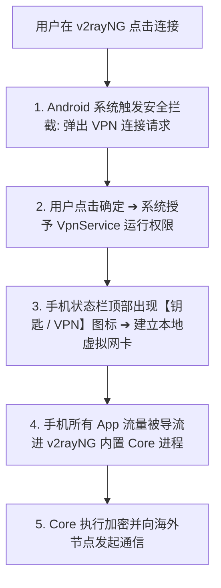
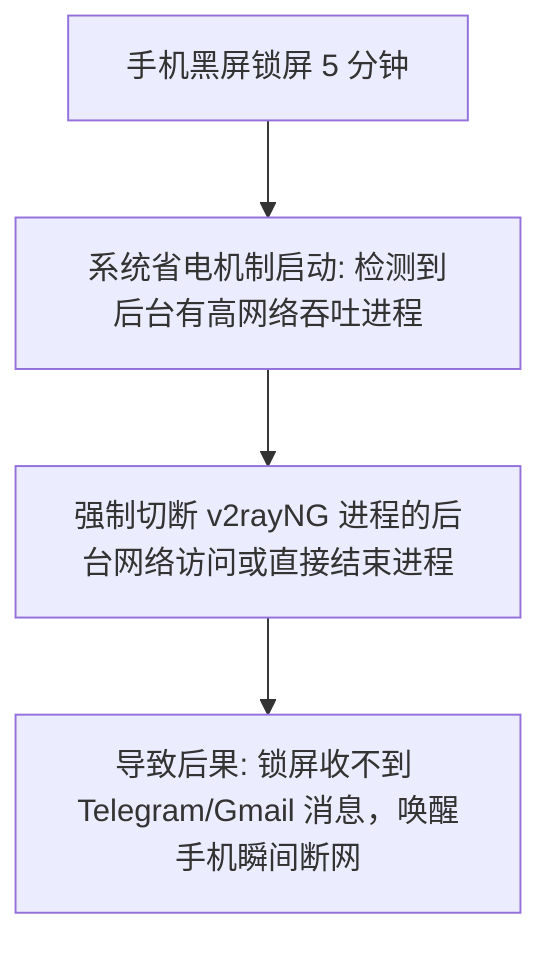

在 Android 安卓手机或平板上进行科学上网，**“v2rayNG”** 是整个生态中普及度最高、开源透明且兼具极高稳定性的第一梯队客户端。

然而，由于 Android 系统高度碎片化、各家手机厂商（小米 HyperOS、三星 One UI、华为/荣耀、OPPO ColorOS、vivo OriginOS 等）后台杀进程策略严苛，加上新手对代理概念的不熟悉，在初次使用 v2rayNG 时往往会遇到各种困惑与故障：

**“v2rayNG 到底是什么？为什么我在应用商店里搜索不到官方正版？”**  
**“在 GitHub Release 下载时，`arm64-v8a`、`armeabi-v7a`、`universal` 到底该下载哪一个 APK 安装包？”**  
**“安装时手机提示‘禁止安装未知应用’，甚至报风险提示，这软件到底安全吗？”**  
**“把机场的订阅链接复制进去了，为什么节点列表里还是空空如也？”**  
**“点击右下角的连接按钮后，手机弹出的‘VPN 连接请求’是什么意思？v2rayNG 是不是传统商业 VPN 软件？”**  
**“为什么手机顶部状态栏明明已经出现了‘钥匙 / VPN 图标’，但浏览器和 YouTube 却依然打不开、提示无法连接网络？”**  
**“为什么手机一锁屏黑屏，或者从家里 Wi-Fi 切换到 5G 移动网络后，代理就会瞬间断开或者彻底断流没网？”**  
**“为什么同一个节点在电脑上用着很快，在安卓手机上测速却全红报 Timeout？”**

**v2rayNG 是一款运行在 Android 端的开源代理客户端（GUI），它负责管理订阅与节点，并通过 Android 系统的 `VpnService` 虚拟接口把手机应用流量交由底层的 Xray-core / v2ray-core 处理。它本身并不附带、也不售卖任何机场节点。**

新手使用 v2rayNG，绝不能停留在“以为点了连接就能翻”的浅层认知，而必须清晰区分：**“官方 APK 获取 ➔ 架构适配安装 ➔ 订阅动态拉取 ➔ 节点科学初选 ➔ VpnService 授权接管 ➔ 真实出口验证 ➔ 后台电池白名单保活”** 的完整闭环。

本文作为 **v2rayNG Android 客户端的终极官方级新手核心 Pillar 教程**，将带你从零开始，建立一套规范、安全、抗杀后台的安卓科学上网标准化配置体系。

---

## ⚡ 60 秒极速上手：v2rayNG 安卓使用标准链路

```mermaid
graph LR
    S1[1. 获取官方 APK (arm64-v8a)] --> S2[2. 安装并授予临时安装权限]
    S2 --> S3[3. 订阅设置 ➔ 粘贴订阅 URL ➔ 保存]
    S3 --> S4[4. 主界面右上角 ➔ 更新订阅 ➔ 刷出节点]
    S4 --> S5[5. 点击选中节点 ➔ 点击右下角 V 启动]
    S5 --> S6[6. 允许 Android VPN 连接请求 (出现钥匙图标)]
    S6 --> S7[7. 访问 ipinfo.io 验证海外出口 IP (成功出海!)]
```

---

## 一、架构基石：v2rayNG 与 Android 系统的四层解耦模型

为什么很多用户会发出“v2rayNG 是不是节点服务”、“v2rayNG 和 v2rayN 是不是同一个东西”的疑问？理解其运行机制，必须对照以下 **四层关系模型**：

```mermaid
graph TD
    subgraph 1. 上层应用与安卓系统 (Android OS)
        App[Chrome / YouTube / Twitter / Telegram 等安卓应用]
        App --> VpnSvc[Android VpnService 系统虚拟网络接口]
    end

    subgraph 2. 图形客户端外壳 (GUI)
        VpnSvc --> v2rayNG[v2rayNG APK 客户端 (负责订阅管理与界面交互)]
    end

    subgraph 3. 底层代理内核 (Core Engine)
        v2rayNG --> Core[内置 Xray-core / v2ray-core (负责加解密与分流路由)]
    end

    subgraph 4. 远端节点与互联网 (Remote Network)
        Core --> Node[海外代理服务器 ➔ 跨境专线 ➔ 目标网站]
    end
```

### 核心对比：v2rayNG (Android) vs v2rayN (Windows)

```text
┌────────────────────────────────────────────────────────────────────────────────────────┐
│                        v2rayNG vs v2rayN 全方位技术对比表                              │
├──────────────┬────────────────────────────────────────┬────────────────────────────────┤
│ 比较维度     │ v2rayNG (安卓手机/平板)                │ v2rayN (Windows 桌面电脑)      │
├──────────────┼────────────────────────────────────────┼────────────────────────────────┤
│ **运行平台** │ Android (支持 APK 安装包)              │ Windows (基于 .NET 运行库)     │
│ **流量接管** │ 依靠 Android `VpnService` 虚拟网络接口 │ 依靠 Windows 系统代理注册表或 TUN 虚拟网卡│
│ **权限要求** │ 需要用户明确授权“VPN 连接请求”         │ 需要普通或管理员权限写注册表   │
│ **后台保活** │ 极度依赖厂商电池优化与前台服务保活     │ 最小化到系统托盘，后台不易被杀 │
│ **内置内核** │ 通常直接打包集成 Xray-core 二进制      │ 目录中外挂独立 xray.exe / v2ray.exe│
│ **分应用代理**│ 原生支持选择指定 App 走代理 (Per-App)   │ 需依赖 Routing 进程规则或 TUN  │
└──────────────┴────────────────────────────────────────┴────────────────────────────────┘
```

---

## 二、安全下载与架构匹配：彻底避开第三方流氓改版

```mermaid
graph TD
    Source[1. 获取渠道] --> GitHub[GitHub 官方开源 Release (最安全、版本最新)]
    Source --> PlayStore[Google Play 商店 (需核对官方开发者)]
    
    GitHub --> ArchCheck[2. CPU 架构选择 (核对安装包后缀)]
    ArchCheck --> ARM64["arm64-v8a ➔ 绝大多数 2018 年后现代 64 位安卓手机首选"]
    ArchCheck --> ARM32["armeabi-v7a ➔ 老旧 32 位低端安卓设备 / 旧款电视盒子"]
    ArchCheck --> X86["x86_64 ➔ PC 端的安卓模拟器 (如雷电/夜神等)"]
    ArchCheck --> Uni["universal ➔ 全架构通用整合包 (体积略大，兼容性最广)"]
```

### 1. 官方发布渠道与防假冒红线
- ⚠️ **安全警告**：坚决不要从百度搜索出来的随机 APK 站、破解论坛、网盘合集或 Telegram 陌生群组下载所谓的“v2rayNG 破解版”、“极速魔改版”！这些安装包极易被植入后台暗刷广告、挖矿木马，甚至截获窃取你的全部订阅与节点 Token。
- **官方渠道**：请直接认准官方 GitHub 开源仓库（`2dust/v2rayNG`）的 Releases 页面。
- 📅 **最后核验声明**：*截至 2026-08 最新官方版本核验，v2rayNG 均保持纯开源无广告发布。*

### 2. Android 权限与“未知应用安装”规范
- **禁止安装未知应用提示**：从手机浏览器下载 APK 后，系统会弹出安全拦截，此时只需在弹窗中选择**“仅本次允许该来源安装应用”**即可；
- 🚨 **安全红线**：**切勿在手机系统设置里“全局永久开启所有未知来源”**，更**不要盲目关闭 Google Play Protect**！完成 v2rayNG 官方 APK 的安装后，保持系统安全防护开启才是最规范的操作。

---

## 三、订阅导入实战：订阅 URL vs 单节点 URI

```mermaid
graph TD
    subgraph 订阅 URL (推荐新手使用)
        SubURL["https://api.example.com/sub?token=xxx"] --> FetchSub["在【订阅分组设置】中填入并点击【更新订阅】"]
        FetchSub --> MultiList["一次性拉取 50+ 节点，支持随时一键批量刷新"]
    end

    subgraph 单节点链接 (分享与调试)
        URI_Node["vless://... 或 vmess://... 字符串"] --> Scan["通过【从剪贴板导入】或【扫描屏幕/相机二维码】"]
        Scan --> SingleNode["仅生成单个静态节点，服务器改 IP 后无法自动更新"]
    end
```

### 1. 导入机场订阅 4 步标准流程
1. **复制订阅**：登录机场官网后台，复制属于你的专属 `v2rayNG 订阅链接 / V2Ray 订阅 URL`；
2. **打开订阅管理**：打开 v2rayNG，点击左上角侧边栏（三条杠）➔ 进入 **“订阅分组设置”**；
3. **添加订阅**：点击右上角 **“+”** 号，在“备注”中随意填写名字（如 `光速云专线`），在“可选地址（URL）”中完整粘贴刚才复制的订阅链接，点击右上角 **“√”** 保存；
4. **触发更新**：返回 v2rayNG 主界面，点击右上角 **“三个点”** 菜单 ➔ 点击 **“更新订阅”**。此时下方列表就会瞬间刷出所有可用节点！

### 2. 关键排错认知：保存订阅 ≠ 更新成功 ≠ 节点能用
- **保存订阅**：仅仅是在手机本地把这串 URL 文本存了下来；
- **更新订阅**：手机向机场服务器发起网络请求，成功拉取到了节点列表；
- **节点能用**：必须经过实际网络握手，海外机房正常响应才算真正通畅。

---

## 四、启动连接与 Android VpnService 深度解析

当你选定一个节点后，点击右下角浮动的圆形连接按钮（通常为一个大写字母 **V** 或启动图标），手机系统会立即弹出如下提示：

```text
┌────────────────────────────────────────────────────────┐
│                   网络连接请求                         │
│                                                        │
│ v2rayNG 想要设置一个 VPN 连接，以便监控网络流量。     │
│ 只有当您信任该来源时，才应接受此请求。                │
│ 在 VPN 处于活动状态时，屏幕顶部会显示一个钥匙图标。   │
│                                                        │
│              [ 取消 ]            [ 确定 / 允许 ]      │
└────────────────────────────────────────────────────────┘
```



### 1. v2rayNG 是不是传统商业 VPN？
- **不是。** Android 系统只要检测到底层调用了系统级的 `VpnService` API 接口来接管流量，就会统统弹出“VPN 连接请求”并显示钥匙图标；
- 这并不代表 v2rayNG 是一家 VPN 公司，它只是利用了安卓系统的底层网络接管能力。

### 2. 状态栏出现钥匙图标 ≠ 节点一定可用（高频误区）
- 钥匙图标出现，**仅仅代表安卓系统成功把本地流量交给了 v2rayNG 软件**；
- 如果你选择的海外节点本身已经欠费、超时、服务器离线，或者你的手机处于断网状态，虽然钥匙图标依然常驻，但你的所有应用依然会无法联网。

---

## 五、抗杀后台实战：锁屏掉线与各家手机电池优化全攻略

安卓系统最臭名昭著的问题莫过于“激进的后台省电杀进程”。很多用户反馈“亮屏时好好的，手机一装进口袋锁屏 5 分钟就断网”，这 100% 是手机系统将后台的 v2rayNG 强行休眠冻结所致。



### 主流安卓手机后台保活 3 步设置指南：

```text
┌────────────────────────────────────────────────────────────────────────────────────────┐
│                        主流品牌安卓手机后台保活设置速查表                              │
├──────────────┬─────────────────────────────────────────────────────────────────────────┤
│ 手机品牌系统 │ 核心设置路径与推荐操作                                                  │
├──────────────┼─────────────────────────────────────────────────────────────────────────┤
│ **小米 / Redmi** 手机设置 ➔ 应用设置 ➔ 应用管理 ➔ v2rayNG ➔ **省电策略设为“无限制”**；   │
│ (HyperOS/MIUI)并在多任务后台界面中，长按 v2rayNG 卡片点击 **“小锁图标”** 锁定后台。    │
├──────────────┼─────────────────────────────────────────────────────────────────────────┤
│ **华为 / 荣耀** 手机设置 ➔ 电池 ➔ 应用启动管理 ➔ 找到 v2rayNG ➔ 关闭自动管理，改为 **“手动│
│ (HarmonyOS)**  管理”并全部开启（允许自启动、允许关联启动、允许后台活动）。            │
├──────────────┼─────────────────────────────────────────────────────────────────────────┤
│ **OPPO / 一加** 手机设置 ➔ 应用 ➔ 应用管理 ➔ v2rayNG ➔ 耗电管理 ➔ 开启 **“允许完全后台行为│
│ (ColorOS)**    ”与“允许应用自启动”。                                                  │
├──────────────┼─────────────────────────────────────────────────────────────────────────┤
│ **vivo / iQOO** 手机设置 ➔ 电池 ➔ 后台高耗电 ➔ 找到 v2rayNG 勾选 **“允许后台高耗电运行”**。 │
│ (OriginOS)**                                                                           │
├──────────────┼─────────────────────────────────────────────────────────────────────────┤
│ **三星 (One UI)** 设置 ➔ 应用程序 ➔ v2rayNG ➔ 电池 ➔ 设为 **“不受限制”**；在最近任务锁定。│
├──────────────┼─────────────────────────────────────────────────────────────────────────┤
│ **Google Pixel** 设置 ➔ 应用 ➔ v2rayNG ➔ 应用耗电量 ➔ 选择 **“不受限制 (Unrestricted)”**。   │
└──────────────┴─────────────────────────────────────────────────────────────────────────┘
```

---

## 六、高级实用功能：分应用代理（Per-App Proxy）与路由基础

### 1. 什么是分应用代理？
- 在日常使用中，很多人既想用手机看 YouTube，又想同时点美团外卖、刷微信或使用手机银行；
- 如果让所有流量全走代理，国内 App 会疯狂报警异地登录，且浪费宝贵的海外专线流量。
- **分应用代理** 允许你在 v2rayNG 中自主勾选：**仅让 Chrome、YouTube、Twitter、Telegram 等指定海外 App 走代理，国内微信、淘宝、抖音等全部直连走本地网络**。

### 2. 开启分应用代理操作法
- 打开 v2rayNG 左上角侧边栏 ➔ 点击 **“设置”** ➔ 找到 **“分应用代理”** 并开启；
- 勾选你希望走代理的海外应用，保存后重新连接即可。

---

## 七、2026 全协议兼容与 Android 极速自适应专线推荐

有了好用的客户端，搭配一条 **全协议免转换、针对移动网络深度优化、全线 IEPL 企业专线** 的高速节点服务至关重要：

```text
┌────────────────────────────────────────────────────────────────────────────────────────┐
│                        2026 Android 移动端全协议高速专线推荐                           │
├──────────┬──────────────────────────┬──────────────┬──────────────┬────────────────────┤
│ 适配场景 │ 推荐品牌候选             │ 实际起付门槛 │ 每月流量配额 │ Android 适配与专线优势│
├──────────┼──────────────────────────┼──────────────┼──────────────┼────────────────────┤
│ 旗舰全能 │ 光速云 (GuangSuYun)      │ 约 ¥7.5/月起 │ 59G~238G /月 │ 全线 IEPL 专线，完美适配 v2rayNG 一键订阅，晚高峰极稳│
│ 平价轻量 │ 微风网络 (BreezeNet)     │ 约 ¥7/月起   │ 50GB / 月    │ 优质 BGP 优化，轻量极速，适合安卓端日常查资料办公  │
│ 弹性月付 │ 唯兔云 (V2Yun)           │ ¥14.9/月     │ 100GB / 月   │ 14.9 元纯单月付，多地区原生 IP 出口，节点极其丰富  │
│ 应急备用 │ 星岛梦 (XingDaoMeng)     │ 约 ¥8/月起   │ 60G/不限时包 │ 0月租不限时包，节点永不过期，安卓双卡随时热点备用  │
│ 极速专精 │ 速界 (SpeedWorld)        │ ¥25/月       │ 150GB / 月   │ 企业级大带宽独立专线，手机 4K 秒开零缓冲           │
└──────────┴──────────────────────────┴──────────────┴──────────────┴────────────────────┘
```

- 🏆 **全协议旗舰专线首选**：[光速云](/reviews/guangsu-cloud/) —— 2020 老牌专线，v2rayNG 一键导入即用，晚高峰物理级 0 丢包；
- 🍃 **超低预算轻量**：[微风网络](/reviews/weifeng-cloud/) —— 50GB 精品小流量专线，年付折算仅约 ¥7/月；
- 💳 **拒绝绑定的单月付**：[唯兔云](/recommend/best-airports/) —— ¥14.9 纯单月付，100GB 充沛流量。

---

## 八、避坑指南：50 个关于“v2rayNG 使用”的致命认知误区

```text
❌ 误区 1：v2rayNG 就是 V2Ray 本身 ➔ 事实：v2rayNG 是安卓客户端 GUI，V2Ray 是底层生态与协议。
❌ 误区 2：v2rayNG 是一家海外机场的名字 ➔ 事实：v2rayNG 是纯开源免费软件，不售卖任何节点。
❌ 误区 3：只要下载安装了 v2rayNG，手机就能免费直接上网 ➔ 事实：客户端只是外壳，必须导入有效的机场订阅或节点。
❌ 误区 4：Google Play 商店里搜到的任何叫 v2rayNG 的都绝对是官方正版 ➔ 事实：需仔细核对开发者名称，防止仿冒恶意软件。
❌ 误区 5：从随机 APK 下载站下载所谓“极速魔改版”比官方版更好 ➔ 事实：魔改版极易携带偷取订阅 Token 的恶意后门。
❌ 误区 6：所有安卓手机都必须无脑下载 x86_64 架构安装包 ➔ 事实：绝大多数现代安卓手机需下载 arm64-v8a 安装包。
❌ 误区 7：Universal 通用版安装包性能一定比 arm64-v8a 更好 ➔ 事实：通用版只是打包了全部架构导致体积变大，性能无差别。
❌ 误区 8：安装 APK 时手机提示风险，就证明该软件一定是病毒 ➔ 事实：代理工具因包含网络接管驱动，常被手机厂商安全管家误报。
❌ 误区 9：安装 v2rayNG 必须在系统设置里永久开放所有未知来源 ➔ 事实：只需在安装时临时允许该来源，装完即可关闭。
❌ 误区 10：为了安装 v2rayNG，必须彻底关闭 Google Play Protect ➔ 事实：切勿全局关闭安全防护，保持正版签名验证最安全。
❌ 误区 11：v2rayNG 运行时必须给它读取通讯录和相册的权限 ➔ 事实：除了扫码需要临时相机权限，v2rayNG 绝不需要任何隐私权限。
❌ 误区 12：订阅链接和单节点链接是一模一样的概念 ➔ 事实：订阅链接是拉取几十个节点的动态 URL，单节点只是静态快照。
❌ 误区 13：以 vless:// 开头的单节点链接可以直接填入订阅管理中 ➔ 事实：单节点链接必须通过“从剪贴板导入”添加。
❌ 误区 14：节点配置二维码本身是一种神秘的高级代理协议 ➔ 事实：二维码只是将节点参数字符串图形化编码。
❌ 误区 15：订阅导入成功后，就代表手机已经自动连接上了代理 ➔ 事实：导入只是获取列表，必须手动点击选中节点并点击启动。
❌ 误区 16：在软件里保存了订阅 URL 就等于完成了节点更新 ➔ 事实：必须在主界面右上角菜单中手动点击“更新订阅”。
❌ 误区 17：更新订阅成功，就代表里面的所有节点都绝对能连通 ➔ 事实：节点是否能连通取决于远端机房服务器的实时网络状态。
❌ 误区 18：只要节点测速显示有延迟数字，就证明该节点绝对能打开网页 ➔ 事实：测速仅代表 TCP 握手通畅，不代表 DNS 与出口正常。
❌ 误区 19：节点列表中测出的延迟数字越低，网速就一定越快 ➔ 事实：Ping 仅反映响应耗时，不代表视频持续吞吐带宽。
❌ 误区 20：香港节点在安卓手机上的体验永远是所有地区里最好的 ➔ 事实：公网直连香港在晚高峰极易拥堵，体验常不如专线日本。
❌ 误区 21：美国节点在安卓手机上绝对不能用来刷推特和看视频 ➔ 事实：美国机房带宽充沛，看 4K 视频极为丝滑。
❌ 误区 22：手机状态栏出现了钥匙/VPN 图标，就证明节点已经连通 ➔ 事实：钥匙图标仅代表安卓系统开启了 VpnService 接口。
❌ 误区 23：允许了 Android 的 VPN 连接请求，就等于购买了商业 VPN ➔ 事实：这是安卓系统的标准流量接管权限提示。
❌ 误区 24：手机里可以同时开启两个不同的代理 VPN 软件叠加提速 ➔ 事实：安卓系统同一时间只允许一个主 VPN 接口工作。
❌ 误区 25：锁屏后 v2rayNG 断网一定是海外机场节点崩溃了 ➔ 事实：99% 是手机系统电池优化将后台进程强行休眠所致。
❌ 误区 26：把手机系统的省电模式全局关闭就能彻底解决掉线 ➔ 事实：只需单独在应用管理中针对 v2rayNG 开启“无限制”白名单。
❌ 误区 27：所有安卓手机的后台保活设置菜单名称和路径完全一样 ➔ 事实：各家厂商定制 ROM 差异极大，需按品牌分别设置。
❌ 误区 28：关闭 v2rayNG 的前台服务通知可以省电且不影响运行 ➔ 事实：关闭通知会导致安卓系统更容易判定其为低优先级后台并杀掉。
❌ 误区 29：家庭 Wi-Fi 连不上，说明当前节点一定在全网被封了 ➔ 事实：可能是家庭路由器问题，切到 5G 热点 A/B 测试即可破案。
❌ 误区 30：手机从 Wi-Fi 切到 5G 移动网络，所有长连接都会无缝保持 ➔ 事实：网络物理 IP 切换会导致底层 Socket 重建，属正常现象。
❌ 误区 31：v2rayNG 的分应用代理功能可以自动提升节点网速 ➔ 事实：分应用只是分流控制，不改变物理节点的传输性能。
❌ 误区 32：可以把 Clash 的 YAML 规则直接复制进 v2rayNG 运行 ➔ 事实：两者的分流语法完全不同，无法通用。
❌ 误区 33：Clash 的专属订阅链接可以直接无缝导入 v2rayNG ➔ 事实：需使用机场提供的通用 V2Ray / v2rayNG 格式订阅。
❌ 误区 34：新手第一次使用必须立刻把 DNS 改成 8.8.8.8 ➔ 事实：乱改自定义 DNS 容易引发解析死锁，新手保持默认最稳。
❌ 误区 35：在设置里强行关闭 IPv6 能解决所有节点的卡顿 ➔ 事实：仅当本地运营商 IPv6 路由异常时才需排查，非默认步骤。
❌ 误区 36：节点连不上时，立刻把 v2rayNG 卸载重装最快 ➔ 事实：卸载会导致配置丢失，应先排查节点超时、订阅与网络。
❌ 误区 37：v2rayNG 开源就代表你导入的任何免费订阅都是安全的 ➔ 事实：免费订阅的节点服务器可能存在明文窃听与日志收集。
❌ 误区 38：把 v2rayNG 的订阅链接分享给好友不会消耗自己的流量 ➔ 事实：订阅 URL 绑定了你的账号配额，他人使用会扣你的流量。
❌ 误区 39：v2rayNG 的多任务后台卡片可以随意上滑清理掉 ➔ 事实：在很多手机上，上滑清理会直接终止 VPN 进程导致瞬间断网。
❌ 误区 40：只要手机性能好，v2rayNG 就可以在后台永远不被杀死 ➔ 事实：安卓系统的内存回收机制只看白名单与前台服务等级。
❌ 误区 41：节点测速很快，但 ChatGPT 提示地区不支持是软件坏了 ➔ 事实：这是节点出口 IP 被 OpenAI 风控，需切换美日纯净节点。
❌ 误区 42：在设置里随意切换底层 Core 版本能让网速翻倍 ➔ 事实：Core 无法改变物理线路带宽，盲目切换易引发兼容报错。
❌ 误区 43：必须每天定时重启一次手机才能保证 v2rayNG 稳定 ➔ 事实：只要正确配置了电池白名单，连续运行数月依然极其稳定。
❌ 误区 44：v2rayNG 只能导入 VMess 节点，无法导入 VLESS 节点 ➔ 事实：现代 v2rayNG 原生完美支持 VLESS 及 REALITY 节点。
❌ 误区 45：只要搞懂了 v2rayNG 的全部设置，就能免流量卡白嫖上网 ➔ 事实：科学上网必须建立在合法的本地宽带与海外服务器之上。
```

---

## 九、常见问题深度解答（FAQ · 55 问）

### Q1：v2rayNG 是什么？
**答**：v2rayNG 是 Android 平台上最主流的开源网络代理客户端之一。它负责图形化管理节点订阅，并通过安卓系统的 `VpnService` 接口调用底层的 Xray-core 实现网络加密代理。

### Q2：v2rayNG 去哪里下载最安全？
**答**：**认准 GitHub 官方开源仓库 Releases 页面**（`2dust/v2rayNG`）。切勿从第三方未知 APK 网站下载，以防植入恶意后门。

### Q3：下载时 `arm64-v8a` 和 `universal` 选哪个？
**答**：绝大多数 2018 年以后的现代安卓手机直接下载 **`arm64-v8a`** 即可，体积小且性能最优；老旧设备或不确定架构的可选 `universal` 通用版。

### Q4：安装 APK 提示“禁止安装未知应用”怎么办？
**答**：在系统弹出的安全提示中点击“设置”，临时允许“该来源（如浏览器或文件管理器）安装应用”即可正常完成安装。

### Q5：v2rayNG 需要开启什么权限？
**答**：**核心只需允许“VPN 连接请求”**。扫码添加节点时需临时授权相机权限，日常使用绝不需要通讯录、短信、位置等无关隐私权限。

### Q6：为什么点击连接会弹出“VPN 连接请求”？
**答**：这是 Android 系统的标准安全机制。任何应用要接管整机网络流量，系统都会强制要求用户明确确认并显示状态栏钥匙图标。

### Q7：状态栏有钥匙图标，为什么还是无法上网？
**答**：钥匙图标仅代表本地虚拟网卡建立成功。如果所选节点已经离线、服务器欠费、本地网络阻断或 DNS 失败，依然无法访问外网。

### Q8：v2rayNG 怎么导入订阅链接？
**答**：打开左侧边栏 ➔ 订阅分组设置 ➔ 点击右上角“+” ➔ 填写备注并粘贴订阅 URL ➔ 保存 ➔ 返回主界面右上角点击“更新订阅”。

### Q9：为什么保存了订阅 URL 列表里却没有节点？
**答**：保存只是存储了地址，必须在主界面右上角“三个点”菜单中主动点击一次 **“更新订阅”** 才能拉取节点列表。

### Q10：`vless://` 和 `vmess://` 怎么导入？
**答**：复制以 `vless://` 或 `vmess://` 开头的整串文本，打开 v2rayNG 主界面，点击右上角“+”号 ➔ 选择 **“从剪贴板导入”** 即可。

### Q11：为什么手机一锁屏就会断流掉线？
**答**：这是手机厂商的激进省电策略把后台进程休眠了。前往手机设置 ➔ 应用管理 ➔ 找到 v2rayNG ➔ 将电池优化设为 **“无限制 / 允许后台高耗电”**。

### Q12：什么是分应用代理？怎么用？
**答**：分应用代理允许指定某些 App（如 YouTube/Twitter）走海外节点，国内 App（微信/淘宝）走直连。在设置中开启“分应用代理”并勾选目标 App 即可。

### Q13：为什么从家里 Wi-Fi 切换到 5G 移动网络后断网了？
**答**：物理网络切换会导致底层 TCP 连接断开。在 v2rayNG 中点击断开连接，重新点击启动即可快速恢复。

### Q14：v2rayNG 支持 VLESS-REALITY 节点吗？
**答**：**完全支持。** 现代版本的 v2rayNG 内置了最新的 Xray-core，原生支持 VLESS、VMess、Trojan、Shadowsocks 及 REALITY 伪装。

### Q15：新手应该选香港节点还是美国节点？
**答**：日常查资料、看网页首选低延迟的**香港或日本节点**；访问 OpenAI/Claude 官方服务及大文件下载推荐使用**美国专线节点**。

---

## 🏁 总结：v2rayNG 安卓使用核心认知金字塔

理清 v2rayNG 的使用与排障逻辑，请牢记以下**核心铁律**：

```text
1. 认官方 ➔ 认准 GitHub 官方 Release，按手机架构首选 arm64-v8a，拒用任何第三方破解版
2. 懂流程 ➔ 订阅保存后必须手动点击“更新订阅”，选中节点后点击启动才真正生效
3. 辨钥匙 ➔ 状态栏钥匙图标仅代表本地 VPN 授权成功，能否出海看真实出口 IP 查询
4. 保后台 ➔ 锁屏掉线必查系统电池优化，将 v2rayNG 加入“无限制”白名单并锁定多任务
5. 分应用 ➔ 善用分应用代理功能，实现海外应用极速翻墙、国内应用流畅直连互不干扰
```

---

### 📚 延伸进阶阅读与选型专栏
- 🗺️ **节点地区深度选型**：[《V2Ray节点怎么选？香港、日本、新加坡、美国节点、线路、延迟与使用场景完整指南》](/tutorials/v2ray-node-selection/)
- 🚀 **现代协议深度解析**：[《VLESS是什么？VLESS、VMess、TLS、REALITY到底有什么区别》](/protocols/vless-vs-vmess/)
- 📜 **经典协议深度指南**：[《VMess是什么？VMess节点、UUID、TLS与VLESS区别完整指南》](/protocols/vmess-protocol/)
- 💻 **Windows 客户端主教程**：[《v2rayN怎么用？Windows下载安装、订阅、节点、系统代理与TUN完整教程》](/tutorials/v2rayn-windows/)
- 🛣️ **线路深度科普**：[《IEPL、IPLC与中转直连有什么区别？跨境专线深度解析》](/protocols/iepl-vs-iplc-transit/)
- ⚡ **老牌旗舰专线**：[《光速云深度评测：2020老牌IEPL专线与解锁实测》](/reviews/guangsu-cloud/)
- 🍃 **平价轻量专线**：[《微风网络深度评测：小流量套餐值不值得买？》](/reviews/weifeng-cloud/)
- 🏆 **2026 全景大榜**：[《2026梯子推荐：稳定、速度、价格、安全与不同使用场景怎么选》](/recommend/best-tizi/)
