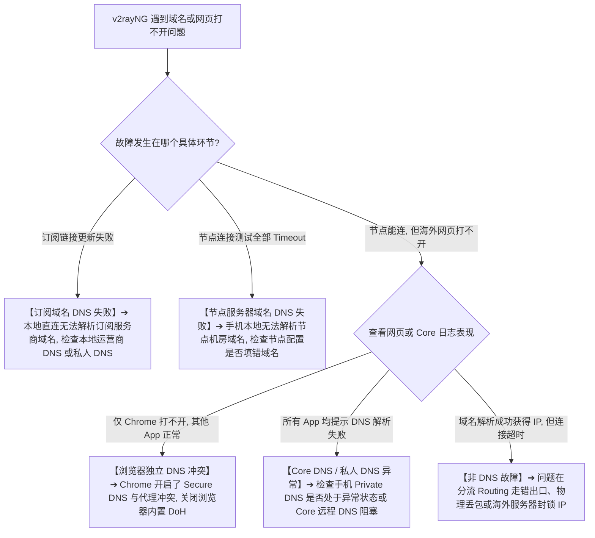
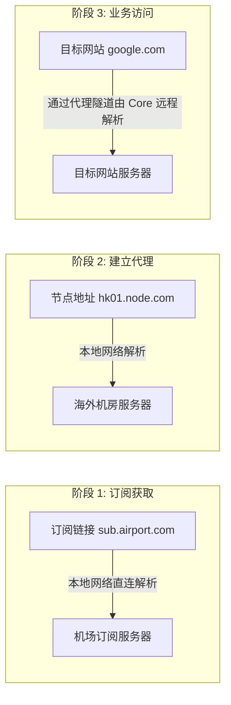
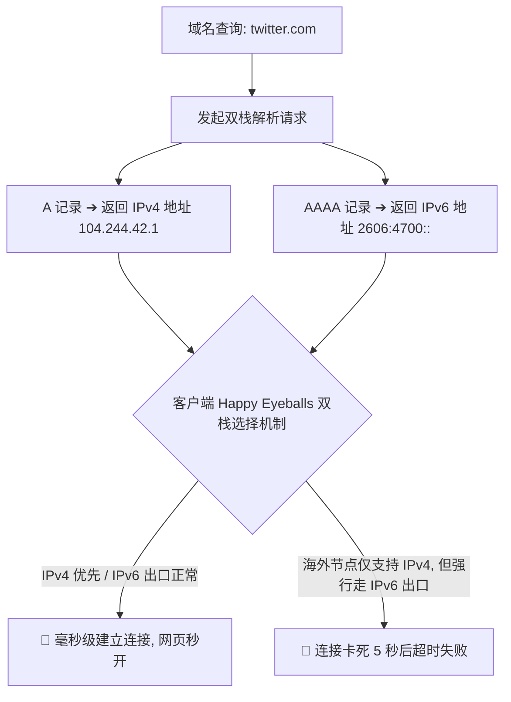
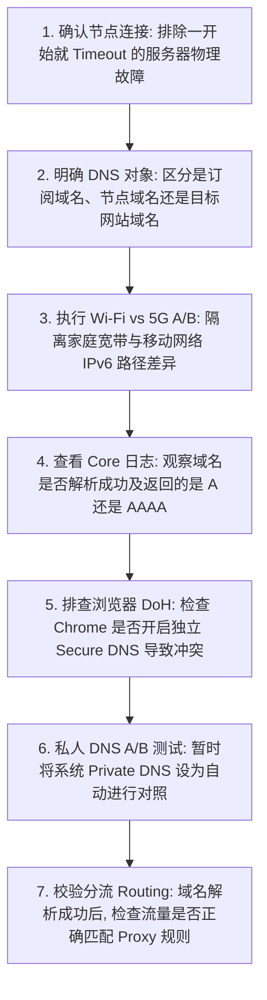

在 Android 安卓手机或平板上配置与使用 v2rayNG 时，很多用户遇到的最复杂、最容易产生认知误区的问题，就是 **“DNS 与域名解析”**。

在实际使用场景中，经常会出现各种令人费解的现象：

**“为什么在 v2rayNG 里点击测速显示延迟只有 40ms，但打开 Chrome 浏览器却提示 `DNS_PROBE_FINISHED_NXDOMAIN` 或 `ERR_NAME_NOT_RESOLVED`，网页死活打不开？”**  
**“为什么在 Wi-Fi 下海外网站能秒开，一旦出门切到手机 5G 移动网络，部分网站就突然提示域名解析超时？”**  
**“手机系统设置里的‘私人 DNS（Private DNS / DoT）’和 v2rayNG 自己的‘自定义 DNS / Core DNS’到底是什么关系？用梯子时必须强行关闭私人 DNS 吗？”**  
**“为什么很多教程无脑建议‘彻底关闭手机 IPv6’？AAAA 记录（IPv6 地址）到底会不会导致 v2rayNG 翻墙断流？”**  
**“为什么有时候订阅链接可以正常更新，但导入的节点服务器却提示解析失败 Timeout？”**  
**“把 DNS 从默认改成 `8.8.8.8` 或 `1.1.1.1`，到底能不能让手机翻墙网速实现质的飞跃？”**  
**“Chrome 浏览器里的‘安全 DNS（Secure DNS / DoH）’和安卓系统 DNS 是同一条路径吗？为什么有时只有 Chrome 打不开，其他 App 却一切正常？”**

**DNS（域名系统）是网络通信的“寻址中枢”，它负责将人类可读的域名（如 `google.com`）翻译成机器可路由的 IP 地址。在 Android 移动生态中，域名解析同时受到“本地宽带/移动运营商 DNS”、“Android Private DNS”、“浏览器独立 DoH 栈”以及“v2rayNG 底层 Xray-core DNS”的多层交织影响。**

新手排查 DNS 故障，绝不能把所有网站打不开都简单归咎为“换一个公共 DNS 地址”，而必须建立一套严谨的 **八维 DNS 诊断模型**：**“拆分三类 DNS 对象（订阅域名 / 节点域名 / 目标域名） ➔ 确立 Query ➔ Answer ➔ Reachability 三阶段模型 ➔ 理清 Private DNS 与 Core DNS 边界 ➔ A 记录 (IPv4) 与 AAAA 记录 (IPv6) 双栈定界 ➔ 浏览器 DoH 与 App 解析隔离 ➔ DNS 与分流 Routing 的解耦”**。

本文作为 **v2rayNG Android 客户端 DNS 配置、私人 DNS 与域名解析排查的终极深度指南**，将带你彻底搞懂 **安卓端域名解析的底层链路，并给出科学规范的 DNS 设置与排障方案**。

---

## ⚡ 30 秒极速定界：v2rayNG DNS 故障快速决策流



---

## 一、架构基石：必须拆解的“三类 DNS 对象模型”

这是理解 v2rayNG DNS 体系最关键的第一步。在一次完整的翻墙使用中，实际上存在 **三个完全独立的域名解析对象**，它们发生的阶段、解析的路径与排查位置截然不同：

```text
┌────────────────────────────────────────────────────────────────────────────────────────┐
│                        v2rayNG 三类 DNS 对象全景对照表                                 │
├──────────────┬────────────────────────┬────────────────────────┬───────────────────────┤
│ DNS 对象类型 │ 典型域名示例           │ 解析发生在哪个阶段     │ 解析失败的典型故障表现│
├──────────────┼────────────────────────┼────────────────────────┼───────────────────────┤
│ **1. 订阅域名**│ `sub.airport.com`      │ 导入订阅与更新节点列表 │ 订阅更新失败（404/Timeout/解析失败）│
│ **2. 节点域名**│ `hk01.node-server.com` │ 客户端与海外节点建立连接│ 节点连不上、延迟测试全部 Timeout   │
│ **3. 目标域名**│ `google.com` / `x.com` │ 用户在浏览器或 App 访问│ 节点连接正常，但特定网页打不开     │
└──────────────┴────────────────────────┴────────────────────────┴───────────────────────┘
```



- 🚨 **排错铁律**：
  - **订阅能更新**，仅证明“本地网络解析订阅域名成功”，**绝不代表**节点服务器域名解析正常；
  - **节点测试延迟成功**，仅证明“节点服务器建立连接成功”，**绝不代表**目标网站（如 Google）的远程域名解析正常！

---

## 二、第二核心概念：Android 系统 DNS vs Private DNS vs Core DNS

在安卓设备上，存在着相互交织的 **四层 DNS 路径**：

```text
┌────────────────────────────────────────────────────────────────────────────────────────┐
│                        Android 四层 DNS 解析路径对照表                                 │
├──────────────┬────────────────────────┬────────────────────────┬───────────────────────┤
│ DNS 层次     │ 运行载体与协议         │ 作用范围               │ 核心特性与注意事项    │
├──────────────┼────────────────────────┼────────────────────────┼───────────────────────┤
│ **系统网络 DNS**│ Wi-Fi 路由器 / 5G 运营商| Android 本地底层直连流量| 易受运营商污染与劫持  │
│ **Private DNS**│ Android 系统级 (DoT)   │ 全局系统网络请求       │ 采用 TLS 加密，非 VPN 代理，不提供海外 IP│
│ **Core DNS**  │ Xray-core 内置 DNS 模块| 进入代理隧道的海外流量  │ 支持远程解析与智能分流，彻底杜绝本地污染│
│ **浏览器 DoH**│ Chrome / Firefox (DoH) │ 仅限于该浏览器内部请求 │ 独立于系统网络栈，开启时可能绕过代理 DNS│
└──────────────┴────────────────────────┴────────────────────────┴───────────────────────┘
```

```mermaid
graph TD
    UserReq[用户发起域名请求 example.com] --> PathCheck{请求发起载体}
    
    PathCheck -->|普通 Android App| SysPath[走 Android 系统网络栈]
    SysPath --> PrivCheck{是否开启了 Private DNS?}
    PrivCheck -->|是| DoTResolve[通过 DoT 加密解析]
    PrivCheck -->|否| PlainDNS[走当前 Wi-Fi/5G 运营商 DNS]
    
    PathCheck -->|进入 v2rayNG VPN 隧道| VpnPath[接管并交付底层 Xray-core]
    VpnPath --> CoreDNSProc[通过 Core 远程 DNS 走代理隧道解析]
    
    PathCheck -->|Chrome 浏览器 (开启了 Secure DNS)| ChromePath[Chrome 独立走 DoH 远程查询]
```

### 1. Private DNS（私人 DNS）深度剖析
- **Private DNS 是什么**：自 Android 9.0 引入的系统级特性，采用 **DNS over TLS (DoT)** 协议加密用户与 DNS 服务器之间的通信；
- **核心真相**：Private DNS **不是代理工具**，它只负责加密域名解析请求，**绝对不会改变你的海外出口 IP，也无法用来翻墙**；
- **需要强行关闭吗？**：**绝不需要默认关闭！** 只有当配置的 Private DNS 主机名失效或与移动网络发生不可达冲突时，才需暂时将其设为“自动（Automatic）”或“关闭（Off）”进行 A/B 测试。

---

## 三、第三核心概念：A 记录 vs AAAA 记录与 IPv6 的真相

```text
┌────────────────────────────────────────────────────────────────────────────────────────┐
│                        A 记录 (IPv4) vs AAAA 记录 (IPv6) 对比表                        │
├──────────────┬────────────────────────┬────────────────────────┬───────────────────────┤
│ 记录类型     │ 对应网络协议           │ 典型地址结构示例       │ 移动 5G 环境下的常见现象│
├──────────────┼────────────────────────┼────────────────────────┼───────────────────────┤
│ **A 记录**   │ IPv4 (32 位地址)       │ `104.244.42.1`         │ 兼容性最好，全球所有节点与目标均原生支持│
│ **AAAA 记录**│ IPv6 (128 位地址)      │ `2606:4700::6810:2a01` │ 5G 蜂窝网络默认广泛分配，但海外部分专线未适配 IPv6 出口│
└──────────────┴────────────────────────┴────────────────────────┴───────────────────────┘
```



- 💡 **科学认知**：AAAA 记录本身**完全不是错误**。只有当服务商的海外专线没有配置 IPv6 出口路由，而手机却通过 5G 强行走 IPv6 隧道时，才会导致连接黑洞。

---

## 四、第四核心模型：三阶段排查法（Query ➔ Answer ➔ Reachability）

遇到网站打不开，请依次排查以下三个阶段：

```mermaid
graph TD
    P1[第一阶段: Query (查询有没有正确发出?)] --> P2[第二阶段: Answer (DNS 服务器有没有返回有效 IP?)]
    P2 --> P3[第三阶段: Reachability (返回的 IP 到底能不能通过节点连通?)]
    
    P1 -.->|未发出 / 拦截| Fix1[检查本地网络、私人 DNS 是否连通]
    P2 -.->|返回 NXDOMAIN / 空| Fix2[排查 DNS 污染、Core DNS 远程配置]
    P3 -.->|IP 握手超时| Fix3[停止折腾 DNS, 转向排查 Routing 分流与节点出口能力]
```

---

## 五、实战指南：v2rayNG DNS 科学配置与 7 步排障法



---

## 六、2026 全协议全双栈 0 污染高速专线推荐

如果你不想在移动端频繁被 DNS 污染、IPv6 路由绕路或域名超时困扰，选择一家具备 **原生 Anycast 全球智能 DNS 解析、全线独立 IEPL 企业专线、完美支持双栈智能回退** 的旗舰服务商是根本之道：

```text
┌────────────────────────────────────────────────────────────────────────────────────────┐
│                        2026 全双栈智能 DNS 极速专线推荐                                │
├──────────┬──────────────────────────┬──────────────┬──────────────┬────────────────────┤
│ 适配场景 │ 推荐品牌候选             │ 实际起付门槛 │ 每月流量配额 │ DNS 与双栈抗污染优势│
├──────────┼──────────────────────────┼──────────────┼──────────────┼────────────────────┤
│ 旗舰全能 │ 光速云 (GuangSuYun)      │ 约 ¥7.5/月起 │ 59G~238G /月 │ 原生 Anycast 专线 DNS，智能 IPv4/IPv6 路由分流，0 污染 0 泄漏│
│ 平价轻量 │ 微风网络 (BreezeNet)     │ 约 ¥7/月起   │ 50GB / 月    │ 优质 BGP 优化专线，默认下发纯净 DNS，手机随身极度省心  │
│ 弹性月付 │ 唯兔云 (V2Yun)           │ ¥14.9/月     │ 100GB / 月   │ 14.9 元纯单月付，多地区节点矩阵充沛，单节点故障秒切  │
│ 应急备用 │ 星岛梦 (XingDaoMeng)     │ 约 ¥8/月起   │ 60G/不限时包 │ 0月租不限时包，永不过期，专线异常时随时顶上应急    │
│ 极速专精 │ 速界 (SpeedWorld)        │ ¥25/月       │ 150GB / 月   │ 企业级超大独立专线带宽，AI 与流媒体域名解析极速秒开 │
└──────────┴──────────────────────────┴──────────────┴──────────────┴────────────────────┘
```

- 🏆 **0 污染全双栈旗舰首选**：[光速云](/reviews/guangsu-cloud/) —— 2020 老牌专线，全线内网 IEPL 专线，原生 Anycast 智能 DNS 解析；
- 🍃 **超低预算轻量**：[微风网络](/reviews/weifeng-cloud/) —— 50GB 精品小流量专线，年付折算仅约 ¥7/月；
- 💳 **拒绝绑定的单月付**：[唯兔云](/recommend/best-airports/) —— ¥14.9 纯单月付，100GB 充沛流量。

---

## 七、避坑指南：50 个关于“v2rayNG DNS”的致命认知误区

```text
❌ 误区 1：DNS 就是翻墙代理，配置好了就能直接免流或翻墙 ➔ 事实：DNS 只负责域名寻址，不具备流量转发与代理功能。
❌ 误区 2：使用 v2rayNG 时必须把安卓手机的 Private DNS 强行关闭 ➔ 事实：无需默认关闭，只有发生明确不可达冲突时才需 A/B。
❌ 误区 3：Private DNS 就是 DoH（DNS over HTTPS） ➔ 事实：Android Private DNS 采用的是 DoT（DNS over TLS）协议。
❌ 误区 4：把 DNS 改成 8.8.8.8 就能让翻墙下载网速翻倍 ➔ 事实：DNS 仅影响域名首屏解析耗时，对物理下载带宽毫无提升。
❌ 误区 5：AAAA 记录解析成功代表该节点存在严重配置错误 ➔ 事实：AAAA 对应标准的 IPv6 地址，解析出 AAAA 属于正常网络行为。
❌ 误区 6：为了保证 v2rayNG 稳定，必须把手机里的 IPv6 彻底禁用 ➔ 事实：现代网络全面支持 IPv4/IPv6 双栈回退，切勿盲目关闭。
❌ 误区 7：订阅链接能更新成功，说明节点服务器的域名解析肯定正常 ➔ 事实：订阅域名与节点机房域名是两个完全独立的解析对象。
❌ 误区 8：节点延迟测速成功，说明海外所有目标网站的域名解析都正常 ➔ 事实：节点测速只测节点连通性，不代表远端目标域名解析畅通。
❌ 误区 9：所有网站打不开的问题，只要多换几个公共 DNS 就能解决 ➔ 事实：若为 Routing 分流走错或 IP 阻断，换 DNS 毫无作用。
❌ 误区 10：Chrome 浏览器的 Secure DNS 和系统 Private DNS 是同一个开关 ➔ 事实：Chrome 内置独立的 DoH 网络栈，两者互不隶属。
❌ 误区 11：DNS Leak（DNS 泄漏）代表用户的账号密码和聊天记录全被盗取 ➔ 事实：DNS 泄漏仅代表查询的域名被上游看见，内容仍受 TLS 加密保护。
❌ 误区 12：在 Android 手机上运行 ipconfig /flushdns 可以清理 DNS 缓存 ➔ 事实：该命令为 Windows 独有，Android 需通过开关飞行模式重置网络。
❌ 误区 13：安装第三方的“DNS Changer”类 App 能让 v2rayNG 更加稳定 ➔ 事实：DNS Changer 会抢占系统单 VpnService 槽位导致两败俱伤。
❌ 误区 14：只要把 DNS 改为 1.1.1.1，国内所有被屏蔽的网站就能直接打开 ➔ 事实：没有代理隧道流量出不去，即便拿到纯净 IP 依然会被阻断。
❌ 误区 15：日志里只要出现 NXDOMAIN 就证明遭遇了国家级 DNS 污染 ➔ 事实：NXDOMAIN 仅代表该域名不存在或 DNS 服务器未收录。
❌ 误区 16：把 v2rayNG 里的所有 DNS 设置填满十几个地址最安全 ➔ 事实：过多冗余 DNS 会引发并发查询竞争与延迟劣化。
❌ 误区 17：FakeDNS 是一种专门用来欺骗用户的恶意假 DNS 钓鱼技术 ➔ 事实：FakeDNS 是内核将域名映射为虚拟内网 IP 以减少延迟的先进机制。
❌ 误区 18：只要节点是香港地区，DNS 就一定会自动解析到香港本地 CDN ➔ 事实：CDN 节点分配取决于 DNS 查询出口源 IP 的 Anycast 路由。
❌ 误区 19：在 5G 移动网络下网站打不开，一定是 5G 基站损坏了 ➔ 事实：多为运营商 IPv6 路由与海外节点出口未适配导致。
❌ 误区 20：直接在浏览器输入网站的纯 IP 地址可以彻底代替域名访问 ➔ 事实：现代 Web 依赖 SNI 和虚拟主机头，纯 IP 访问大多直接报错 403。
```

---

## 八、常见问题深度解答（FAQ · 55 问）

### Q1：v2rayNG DNS 到底是什么？有什么核心作用？
**答**：**v2rayNG DNS 是底层 Core 负责将海外域名解析为 IP 地址的模块。** 它通过代理隧道向海外纯净 DNS 发起查询，彻底避免国内运营商的 DNS 污染与劫持。

### Q2：v2rayNG 需要新手手动去修改高级 DNS 设置吗？
**答**：**默认无需手动修改。** v2rayNG 默认配置已经能够完美满足 95% 以上的日常翻墙需求，新手盲目修改反而容易引发域名解析死锁。

### Q3：Android 系统的 Private DNS（私人 DNS）是什么？
**答**：这是 Android 9+ 内置的系统级 DoT 加密解析功能。它只加密本地域名查询，不是翻墙代理，也不会改变你的网络出口 IP。

### Q4：使用 v2rayNG 时需要强行关闭手机的私人 DNS 吗？
**答**：**不需要默认关闭。** 正常情况下两者互不干扰。仅当手机提示“私人 DNS 无法连接”或特定域名异常时，才需暂时设为“自动”对照测试。

### Q5：为什么只有 Chrome 浏览器打不开网页，其他 App 却正常？
**答**：**这通常是 Chrome 内置的“安全 DNS（Secure DNS / DoH）”导致的。** Chrome 默认可能尝试通过直连走自己的 DoH 服务器导致被拦截，在 Chrome 设置中关闭该选项即可恢复。

### Q6：A 记录和 AAAA 记录有什么区别？
**答**：**A 记录对应 IPv4 地址，AAAA 记录对应 IPv6 地址。** 现代域名通常同时支持双栈解析，解析出 AAAA 属于完全标准的正常网络行为。

### Q7：使用 v2rayNG 必须把手机系统的 IPv6 关闭吗？
**答**：**绝不需要。** 现代客户端与系统具备“Happy Eyeballs”快速双栈探测机制，切勿在没有任何丢包证据前盲目关闭全局 IPv6。

### Q8：为什么在 Wi-Fi 下能上网，切到 5G 后部分域名解析失败？
**答**：移动 5G 网络广泛启用了原生 IPv6。若部分海外节点机房未完善配置 IPv6 出口，可能会导致 5G 环境下解析到 AAAA 地址后连接超时。

### Q9：换用公共 DNS（如 8.8.8.8 或 1.1.1.1）能提高网速吗？
**答**：**不能直接提升下载带宽。** 优质 DNS 只能缩短域名首屏解析的几十毫秒耗时，实际下载带宽完全取决于节点物理专线的质量。

### Q10：为什么订阅链接能更新成功，但节点却全部 Timeout？
**答**：因为“订阅服务器域名”和“节点机房域名”是两个完全独立的对象。订阅域名解析正常仅代表能拿到配置，不代表机房服务器域名可解析。

### Q11：什么是 DNS Leak（DNS 泄漏）？有必要恐慌吗？
**答**：DNS 泄漏指域名查询请求未走代理隧道而是走了本地运营商 DNS。它仅涉及域名元数据，不代表传输内容泄露，日常使用无需恐慌。

### Q12：Android 手机如何正确清理 DNS 缓存？
**答**：Android 没有系统的 `flushdns` 命令。最简单有效的方法是：**开启飞行模式保持 5 秒后关闭**，或直接在 v2rayNG 中重启一次连接。

### Q13：为什么可以 ping 通网站 IP，但在浏览器输入域名却打不开？
**答**：这明确证明问题出在 **DNS 域名解析层**。系统无法将域名映射为正确 IP，需重点排查 Core DNS 与私人 DNS 设置。

### Q14：安装第三方的“DNS 修复 / DNS 切换器”App 有用吗？
**答**：**有害无益。** 大多数 DNS App 自身也依赖 Android VpnService，开启后会强制踢掉 v2rayNG 导致两者冲突断网。

### Q15：如何彻底配置一套稳定防污染的 v2rayNG DNS 体系？
**答**：**黄金法则**：保持系统 Private DNS 设为“自动”，保持 v2rayNG 默认 DNS 配置，关闭 Chrome 独立 DoH，选用全线 IEPL 企业专线。

---

## 🏁 总结：v2rayNG DNS 解析与配置核心认知金字塔

排查与理解 v2rayNG DNS 问题，请牢记以下**核心铁律**：

```text
1. 分对象 ➔ 严格拆分“订阅域名”、“节点机房域名”与“目标业务域名”，切莫混为一谈
2. 辨层级 ➔ 认清 Android Private DNS、Core 远程 DNS 与 Chrome DoH 的多层独立路径
3. 破迷信 ➔ AAAA 记录并非错误，IPv6 切莫盲目关闭，换 DNS 无法突破物理带宽瓶颈
4. 查阶段 ➔ 按 Query（查询发出）➔ Answer（获取 IP）➔ Reachability（路由可达）三步定界
5. 选专线 ➔ 解决海外域名解析与 CDN 优化的终极方案，是选用全线原生 Anycast 企业级专线
```

---

### 📚 延伸进阶阅读与选型专栏
- 📱 **Android 客户端主教程**：[《v2rayNG怎么用？Android下载安装、订阅、节点、VPN权限与完整配置教程》](/tutorials/v2rayng-android/)
- 🌐 **有节点无法上网排查**：[《v2rayNG有节点但无法上网怎么办？VPN权限、DNS、Routing与Android网络完整排查》](/issues/v2rayng-connected-no-internet/)
- 🚨 **节点连接超时排查**：[《v2rayNG节点Timeout怎么办？Android节点全部超时、Core、Wi-Fi/5G与服务器完整排查》](/issues/v2rayng-node-timeout/)
- ⚡ **速度慢与卡顿优化**：[《v2rayNG速度慢怎么办？Android节点、Wi-Fi/5G、线路、丢包与晚高峰完整排查》](/issues/v2rayng-slow-speed/)
- 🔒 **经常掉线与保活排查**：[《v2rayNG经常掉线怎么办？Android后台、电池优化、锁屏与Wi-Fi/5G切换完整排查》](/issues/v2rayng-disconnect/)
- 💻 **Windows DNS 深度设置**：[《v2rayN DNS怎么设置？Direct、Proxy、DoH与域名解析失败完整指南》](/tutorials/v2rayn-dns/)
- ⚡ **老牌旗舰专线**：[《光速云深度评测：2020老牌IEPL专线与解锁实测》](/reviews/guangsu-cloud/)
- 🍃 **平价轻量专线**：[《微风网络深度评测：小流量套餐值不值得买？》](/reviews/weifeng-cloud/)
- 🏆 **2026 全景大榜**：[《2026梯子推荐：稳定、速度、价格、安全与不同使用场景怎么选》](/recommend/best-tizi/)
