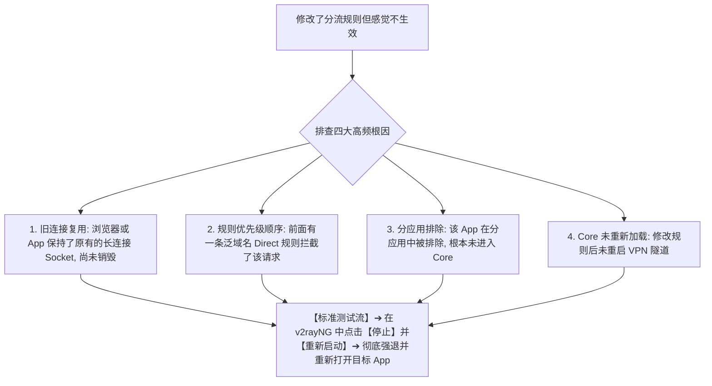
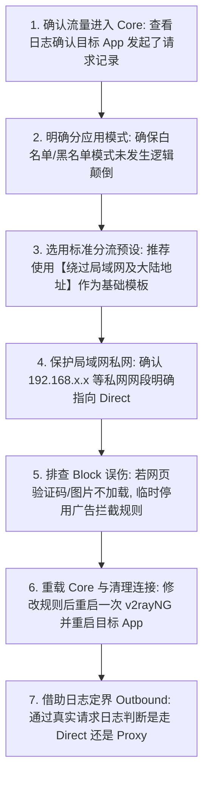

在 Android 安卓手机或平板上使用 v2rayNG 时，很多用户遇到的最复杂、最容易引起误解的问题，就是 **“分流与 Routing（路由规则）设置”**。

在实际使用中，新手常常陷入各种困惑与故障怪圈：

**“为什么在 v2rayNG 里选中了日本节点，但在网页上查 IP 却依然显示是国内本地电信/联通 IP？”**  
**“为什么微信、淘宝或美团等国内 App 在开启梯子后变得非常卡顿，甚至被误判为境外异地登录？”**  
**“为什么家里的局域网 NAS、打印机或 192.168.1.1 路由器管理后台在开启 v2rayNG 后死活打不开？”**  
**“手机里的‘分应用代理（Per-App Proxy）’和‘自定义路由规则（Routing）’到底有什么区别？两者的执行先后顺序是怎样的？”**  
**“为什么打开某些海外网站时，主文字能显示，但图片、登录验证码或支付 API 接口却无限报错加载失败？”**  
**“把分流规则从‘绕过局域网及大陆地址’改成‘全局代理’，到底有什么利弊？为什么修改了规则之后网页仍然走旧路径？”**  
**“把 Clash 的 yaml 规则或 v2rayN 的电脑分流规则直接抄到 v2rayNG 上，为什么完全不生效？”**

**Routing（路由分流）是 v2rayNG 与底层 Xray-core 的“交通管制中枢”，它负责决定“已经进入代理内核的流量，到底应该送往哪个出口（Outbound）——是走海外节点（Proxy）、本地直连（Direct），还是直接掐断丢弃（Block）”。**

新手配置与排查 Routing 故障，绝不能盲目去复制所谓“全网最强规则库”，而必须建立一套严谨的 **八维 Android 分流认知模型**：**“先定分应用（App 到底进没进 VPN） ➔ 辨析三大 Outbound（Direct / Proxy / Block） ➔ 域名规则 vs IP 规则 ➔ 规则优先级与顺序 ➔ 局域网私网地址保护 ➔ 旧 Socket 连接复用与重载 ➔ 辨析平台风控与路由分流边界”**。

本文作为 **v2rayNG Android 客户端 Routing 路由、分应用代理与分流排障的终极深度指南**，将带你彻底搞懂 **安卓端分流决策的底层逻辑，并给出规范清晰的分流配置方案**。

---

## ⚡ 30 秒极速定界：v2rayNG 分流与 Routing 决策流

```mermaid
graph TD
    Start[v2rayNG 遇到分流异常或出口 IP 不对] --> Step1{该 App 的流量到底有没有进入 v2rayNG?}
    
    Step1 -->|未进入 Core / 日志完全无记录| PerAppIssue["【分应用代理问题】➔ 检查【分应用代理】开关是否勾选错误 (是否开启了绕过模式)"]
    Step1 -->|已进入 Core / 日志有该请求记录| CheckOutbound{查看日志中该请求命中的 Outbound 出口}
    
    CheckOutbound -->|命中了 Direct (直连)| DirectCheck["【直连规则生效】➔ 目标域名或 IP 命中了大陆白名单或局域网规则, 走本地出口是正常的"]
    CheckOutbound -->|命中了 Block (拦截)| BlockIssue["【规则误伤】➔ 目标验证码、静态资源或 API 域名被广告过滤规则误杀, 需放行该域名"]
    CheckOutbound -->|命中了 Proxy (代理)| ProxyCheck{目标服务访问状态}
    
    ProxyCheck -->|成功翻墙且显示海外 IP| AllOK[🚀 路由分流与代理工作完全正常]
    ProxyCheck -->|显示代理出口 IP 但被平台拒绝访问| RegionBlock["【非 Routing 故障】➔ 出口 IP 正确但被 ChatGPT/Netflix 判定为机房 IP 拦截, 需换原生节点"]
```

---

## 一、架构基石：必须拆解的“三大核心概念与分工”

很多新手把“VPN 权限”、“分应用代理”、“DNS 解析”和“Routing 路由规则”混为一谈。在 Android 系统中，它们承担着 **严格递进、互不替代** 的角色：

```text
┌────────────────────────────────────────────────────────────────────────────────────────┐
│                        Android 流量流转四大阶段与功能对照表                            │
├──────────────┬────────────────────────┬────────────────────────┬───────────────────────┤
│ 阶段名称     │ 核心负责机构           │ 解决的根本问题         │ 常见认知误区与排查要点│
├──────────────┼────────────────────────┼────────────────────────┼───────────────────────┤
│ **1. VPN 接管**│ Android VpnService     │ 手机全局流量是否交给 v2rayNG| 没授权 VPN 时所有流量均在系统外│
│ **2. 分应用过滤**│ v2rayNG 应用层过滤     │ **哪些 App 的流量允许进入 Core**| 被排除的 App **根本不会经过 Routing**│
│ **3. DNS 寻址**│ Android / Core DNS     │ 目标域名解析成什么 IP  │ DNS 只管找地址，不决定流量走哪个出口│
│ **4. Routing 路由**│ Xray-core 路由引擎     │ **进入 Core 的流量走哪个 Outbound**| 决定走 Direct、Proxy 还是 Block│
└──────────────┴────────────────────────┴────────────────────────┴───────────────────────┘
```

```mermaid
graph TD
    UserApp[用户 App 产生网络请求] --> VpnService[1. Android VpnService 系统底层网卡]
    VpnService --> PerApp{2. v2rayNG 分应用代理筛选}
    
    PerApp -->|被排除的 App (如微信)| DirectEgress[🔴 直接走手机本地网络直连 (不经过 Core)]
    PerApp -->|允许接管的 App (如 Chrome)| XrayCore[3. 进入 Xray-core 内核处理]
    
    XrayCore --> Routing[4. Core Routing 路由匹配引擎]
    Routing -->|命中代理规则| ProxyOut[🟢 Proxy Outbound ➔ 走海外节点出口]
    Routing -->|命中直连规则| DirectOut[🟡 Direct Outbound ➔ 走本地出口]
    Routing -->|命中阻断规则| BlockOut[⛔ Block Outbound ➔ 丢弃数据包]
```

- 🚨 **排错铁律**：如果一个 App 在“分应用代理”中被排除了，它的流量**根本不会进入 Xray-core**，此时在 Routing 里写任何高级规则都**毫无意义**！

---

## 二、第二核心概念：Direct vs Proxy vs Block 三大 Outbound

当流量进入 Core 后，Routing 会根据规则将其分发到以下三大 **出口（Outbound）**：

```text
┌────────────────────────────────────────────────────────────────────────────────────────┐
│                        Direct vs Proxy vs Block 深度辨析表                             │
├──────────────┬────────────────────────┬────────────────────────┬───────────────────────┤
│ 出口类型     │ 物理通信路径           │ 适用典型场景           │ 误判引发的典型故障表现│
├──────────────┼────────────────────────┼────────────────────────┼───────────────────────┤
│ **Proxy (代理)**│ 流量封装后发往海外节点服务器│ Google、YouTube、Twitter、ChatGPT| 节点故障时该类网站全断；消耗节点流量│
│ **Direct (直连)**│ 流量直接由本地宽带/5G 发送 │ 百度、微信、国内视频、局域网 NAS| **查 IP 显示本地**；不消耗海外流量│
│ **Block (拦截)**│ 流量在 Core 内部直接丢弃返回│ 恶意广告、追踪器、隐私收集域名| 误伤时导致登录验证码或页面图片挂掉│
└──────────────┴────────────────────────┴────────────────────────┴───────────────────────┘
```

### 1. Direct 不是“关闭 v2rayNG”
- 很多新手误以为“请求走了 Direct 就是梯子关了”。**事实并非如此！** v2rayNG 的 VPN 与内核一直在高速运转，只是内核经过智能研判后，把国内流量以原生网速直接送出，既保护了访问速度，又节约了宝贵的专线流量。

### 2. Block 误伤机制深度警示
- 现代网页是高度模块化的，一个网页可能由主域名、API 域名、静态资源 CDN、第三方极验验证码等数十个独立域名共同组成；
- 如果你盲目启用了激进的广告拦截规则，只要把**登录验证码（Captcha）域名**判定为 Block，就会出现“网页打开完全正常，但点击登录按钮死活没反应”的诡异故障！

---

## 三、第三核心场景：分应用代理实战配置（包含 vs 排除）

在 v2rayNG 侧边栏 ➔ **“设置”** ➔ 开启 **“分应用代理”**：

```mermaid
graph TD
    PerAppSet[配置 v2rayNG 分应用代理] --> ModeCheck{判断当前分应用工作模式}
    
    ModeCheck -->|模式 A: 仅代理选中的应用 (白名单)| ModeA["【白名单模式】➔ 勾选 Chrome / Telegram / YouTube / ChatGPT (适合绝大多数国内日常用户)"]
    ModeCheck -->|模式 B: 绕过选中的应用 (黑名单)| ModeB["【黑名单模式】➔ 勾选 微信 / 支付宝 / 银行 App / 手游 (其余所有应用默认全走代理)"]
```

- 💡 **防踩坑警示**：新手最容易犯的错误是**把模式弄反**——在“绕过选中的应用”模式下勾选了 Chrome，结果导致 Chrome 永远走直连无法翻墙！

---

## 四、第四核心场景：局域网私网地址 Direct 保护（NAS / 路由器）

开启 v2rayNG 后，很多用户发现打不开家里的路由器后台（`192.168.1.1`）或私有 NAS（群晖/威联通/极空间）：

```text
┌────────────────────────────────────────────────────────────────────────────────────────┐
│                        RFC 1918 标准局域网私网网段表                                   │
├──────────────┬────────────────────────┬────────────────────────────────────────────────┤
│ 私网网段     │ 掩码与 IP 范围         │ 典型设备与用途                                 │
├──────────────┼────────────────────────┼────────────────────────────────────────────────┤
│ **10.0.0.0/8**│ `10.0.0.0 ~ 10.255.255.255`| 大型企业内网、校园网、云服务器内网互联         │
│ **172.16.0.0/12**│ `172.16.0.0 ~ 172.31.255.255`| Docker 容器网络、企业分流网段                  │
│ **192.168.0.0/16**│ `192.168.0.0 ~ 192.168.255.255`| 家用 Wi-Fi 路由器、智能家居、局域网 NAS 存储   │
│ **127.0.0.0/8**│ `127.0.0.1 (localhost)`| 本地回环地址、本地开发测试端口                 │
└──────────────┴────────────────────────┴────────────────────────────────────────────────┘
```

- **根本原因**：如果分流规则未配置私网直连，`192.168.x.x` 的请求会被强制送往海外香港或日本服务器。由于海外机房找不到你家里的内网设备，连接必然超时报错；
- **解决方案**：在 v2rayNG 预设规则中选择 **“绕过局域网及大陆地址 (Bypass LAN and mainland China)”**，即可实现内网设备与海外翻墙双向秒开。

---

## 五、第五核心场景：规则不生效与旧 Socket 复用排障

为什么明明添加了规则，打开网页依然走旧路径？



---

## 六、实战指南：v2rayNG 分流与 Routing 配置 7 步法



---

## 七、2026 全场景智能分流与原生 IP 高速专线推荐

如果你不想在移动端因出口 IP 被识别为机房广播 IP 而频繁触发 Cloudflare 验证码或 ChatGPT 403 封锁，选择一家具备 **全线原生住宅/原生商业 IP、智能 BGP 分流优化、全线独立 IEPL 专线** 的旗舰服务商是根本之道：

```text
┌────────────────────────────────────────────────────────────────────────────────────────┐
│                        2026 智能分流与原生纯净出口专线推荐                            │
├──────────┬──────────────────────────┬──────────────┬──────────────┬────────────────────┤
│ 适配场景 │ 推荐品牌候选             │ 实际起付门槛 │ 每月流量配额 │ 分流与原生出口优势 │
├──────────┼──────────────────────────┼──────────────┼──────────────┼────────────────────┤
│ 旗舰全能 │ 光速云 (GuangSuYun)      │ 约 ¥7.5/月起 │ 59G~238G /月 │ 全线原生 IP 专线，完美适配 ChatGPT/流媒体分流，0 验证码 0 拦截│
│ 平价轻量 │ 微风网络 (BreezeNet)     │ 约 ¥7/月起   │ 50GB / 月    │ 优质 BGP 优化专线，轻量随身，国内直连流畅如丝  │
│ 弹性月付 │ 唯兔云 (V2Yun)           │ ¥14.9/月     │ 100GB / 月   │ 14.9 元纯单月付，多地区节点矩阵充沛，单节点故障秒切  │
│ 应急备用 │ 星岛梦 (XingDaoMeng)     │ 约 ¥8/月起   │ 60G/不限时包 │ 0月租不限时包，永不过期，专线拥塞时随时顶上应急    │
│ 极速专精 │ 速界 (SpeedWorld)        │ ¥25/月       │ 150GB / 月   │ 企业级超大独立专线带宽，AI 与流媒体分流极速响应     │
└──────────┴──────────────────────────┴──────────────┴──────────────┴────────────────────┘
```

- 🏆 **智能分流原生出口旗舰首选**：[光速云](/reviews/guangsu-cloud/) —— 2020 老牌专线，全线内网 IEPL 专线，原生纯净 IP 完美通过 AI 认证；
- 🍃 **超低预算轻量**：[微风网络](/reviews/weifeng-cloud/) —— 50GB 精品小流量专线，年付折算仅约 ¥7/月；
- 💳 **拒绝绑定的单月付**：[唯兔云](/recommend/best-airports/) —— ¥14.9 纯单月付，100GB 充沛流量。

---

## 八、避坑指南：55 个关于“v2rayNG 分流与 Routing”的致命认知误区

```text
❌ 误区 1：Routing 就是 VPN 权限 ➔ 事实：VPN 权限决定接管流量，Routing 决定接管后的流量去哪。
❌ 误区 2：在分应用中排除了某个 App，该 App 依然可以通过 Routing 规则走代理 ➔ 事实：被排除的 App 根本不进入 Core。
❌ 误区 3：Direct 选项代表把 v2rayNG 彻底关掉了 ➔ 事实：Direct 代表流量通过内核以本地网络直连发送。
❌ 误区 4：在 v2rayNG 里勾选了一个 App，就绝对代表“让它走代理” ➔ 事实：若分应用模式设为“绕过”，勾选则代表让它走直连。
❌ 误区 5：Block 规则只能用来拦截网页广告 ➔ 事实：Block 可以用来阻断任何恶意域名、追踪器或特定协议。
❌ 误区 6：开启全局代理模式是解决所有分流问题最好的方法 ➔ 事实：全局会导致微信、网银变慢并触发异地登录风控。
❌ 误区 7：把 Clash 的 yaml 规则文件直接改后缀就能在 v2rayNG 中使用 ➔ 事实：Clash 与 Xray 的规则语法和内核完全不通用。
❌ 误区 8：v2rayN 电脑端的路由设置可以 1:1 原样照搬到安卓 v2rayNG ➔ 事实：移动端涉及分应用与独立的包名机制，不可硬搬。
❌ 误区 9：选了日本节点但查 IP 仍然显示本地，说明节点连接坏了 ➔ 事实：该 IP 查询网站命中了 Direct 直连规则。
❌ 误区 10：一个 IP 查询网站的结果能代表手机上所有 App 的流量出口 ➔ 事实：不同域名会根据分流规则走向不同的出口。
❌ 误区 11：修改了分流规则后，已打开的网页立刻刷新就能验证新规则 ➔ 事实：浏览器复用旧 TCP/QUIC 连接，需重启 App。
❌ 误区 12：局域网 NAS 打不开，一定是家里宽带断网了 ➔ 事实：私网 192.168.x.x 被误送往海外机房 Proxy 导致超时。
❌ 误区 13：Block 规则越多越安全，拦截列表越长越好 ➔ 事实：过度拦截极易误杀正常登录验证码与支付接口。
❌ 误区 14：ChatGPT 只需要配置一个 `chatgpt.com` 域名走代理即可 ➔ 事实：AI 平台包含认证、CDN、静态资源等多个附属域名。
❌ 误区 15：GeoIP 和 GeoSite 数据库永远准确无需更新 ➔ 事实：全球 IP 与域名分配动态变化，规则库需定期维护。
❌ 误区 16：规则数量越多，手机翻墙的速度就一定会越卡 ➔ 事实：Xray 采用高效前缀树匹配，百条规则耗时基本在微秒级。
❌ 误区 17：盲目从网上导入所谓的“全网最强万能规则库” ➔ 事实：第三方规则库可能暗藏恶意域名劫持或大面积误杀。
❌ 误区 18：更新订阅节点就等同于更新了分流规则库 ➔ 事实：节点订阅与规则库是两个完全独立的资源。
❌ 误区 19：只要 DNS 解析成功，Routing 就绝对不可能走错 ➔ 事实：DNS 负责拿 IP，拿到 IP 后仍需经过 Routing 判定出口。
❌ 误区 20：所有打不开的网页，只要把 v2rayNG 卸载重装一遍就能自动修好 ➔ 事实：重装会丢失所有规则配置，无法解决规则冲突。
```

---

## 九、常见问题深度解答（FAQ · 60 问）

### Q1：v2rayNG Routing 到底是什么？有什么核心作用？
**答**：**Routing 是底层 Core 的流量分流引擎。** 它根据域名、IP 或地理分类，智能决定流量走海外节点（Proxy）、本地网络（Direct）还是丢弃（Block）。

### Q2：Routing 和“分应用代理”有什么本质区别？
**答**：**分应用决定哪些 App 进入 v2rayNG；Routing 决定进入 Core 后的流量怎么走。** 被分应用排出的 App 根本不经过 Routing 规则。

### Q3：v2rayNG 的 Direct 是什么意思？是关闭代理吗？
**答**：**不是关闭代理。** Direct 是让匹配的流量直接使用手机本地宽带/5G 直连，不走海外节点，既保证国内 App 极速又节省专线流量。

### Q4：为什么选了日本节点，在某些查 IP 网站上依然显示国内 IP？
**答**：因为该 IP 查询网站（如 `ip138.com`）命中了“大陆域名直连”规则走了解析 Direct。访问海外 `ipinfo.io` 即可看到真正的日本节点 IP。

### Q5：为什么家里的路由器后台（192.168.1.1）或 NAS 打不开了？
**答**：因为局域网私网 IP 被错误地送入了 Proxy 代理出口。在设置中开启“绕过局域网及大陆地址”即可瞬间恢复访问。

### Q6：分应用代理中的“白名单”与“黑名单”怎么选？
**答**：**推荐白名单模式。** 仅勾选需要翻墙的 Chrome、YouTube、Telegram、ChatGPT 等 App，其余国内应用彻底不进 VPN，最省电且免冲突。

### Q7：为什么某些网页打开了，但验证码或图片却加载不出来？
**答**：**高概率是 Block 广告拦截规则误伤。** 验证码或图片 CDN 域名被误判为广告丢弃，临时关闭广告过滤规则即可恢复。

### Q8：修改了分流规则后，为什么网页依然走旧的出口？
**答**：**旧 Socket 连接复用导致的。** 浏览器保持了原有的长连接，在 v2rayNG 中重启一次连接，并彻底强退重启浏览器即可生效。

### Q9：Clash 的分流规则可以直接复制到 v2rayNG 里用吗？
**答**：**不能直接复制。** Clash 与 Xray-core 的配置语法、规则集格式完全不同，强行照搬会导致解析语法错误。

### Q10：把分流模式设为“全局代理”有什么坏处？
**答**：会导致微信、美团等国内 App 流量全走海外，不仅加载变慢、白白浪费专线流量，还容易触发微信/网银的境外异地登录风控。

### Q11：什么是 GeoIP 和 GeoSite？
**答**：GeoIP 是全球 IP 地理归属数据库（如 cn 代表中国 IP）；GeoSite 是常见网站域名分类库（如 category-ads-all 代表广告域名）。

### Q12：如何配置让 ChatGPT / Claude 稳定走代理？
**答**：确保该 App 包含在分应用中，并在路由中确保 `openai.com`、`anthropic.com`、`claude.ai` 等主域名及其 API 域名均命中 Proxy。

### Q13：为什么只有 Chrome 走代理，其他国产浏览器不走？
**答**：检查分应用代理是否遗漏勾选了该国产浏览器，或者该浏览器自身开启了内置的免流/私有代理通道。

### Q14：遇到规则混乱分流错误，如何一键恢复？
**答**：在设置 ➔ 路由设置中，点击右上角菜单选择 **“恢复默认预设”**，重新选择“绕过局域网及大陆地址”即可恢复标准健康状态。

### Q15：如何搭建一套最稳定、免维护的 v2rayNG 分流方案？
**答**：**黄金组合**：1. 分应用代理仅勾选海外 App；2. 路由预设选择“绕过局域网及大陆”；3. 不乱加第三方臃肿 Block 规则；4. 选用全线 IEPL 原生专线。

---

## 🏁 总结：v2rayNG 分流与 Routing 核心认知金字塔

配置与排查 v2rayNG Routing，请牢记以下**核心铁律**：

```text
1. 辨先后 ➔ 先看分应用（App 进没进 Core），再看 Routing（进 Core 后走 Direct / Proxy / Block）
2. 懂出口 ➔ Direct 是本地极速直连而非关软件，Proxy 走专线，Block 误杀会坏验证码
3. 保内网 ➔ 192.168.x.x 与 10.x.x.x 局域网私网段必须 Direct，切莫送往海外机房
4. 破执念 ➔ 查 IP 显本地仅代表该网站走了直连，切勿单凭一个国内测速站判断节点好坏
5. 慎规则 ➔ 拒绝盲目导入全网臃肿规则库，官方默认“绕过局域网及大陆”已是最稳解法
```

---

### 📚 延伸进阶阅读与选型专栏
- 📱 **Android 客户端主教程**：[《v2rayNG怎么用？Android下载安装、订阅、节点、VPN权限与完整配置教程》](/tutorials/v2rayng-android/)
- 🌐 **有节点无法上网排查**：[《v2rayNG有节点但无法上网怎么办？VPN权限、DNS、Routing与Android网络完整排查》](/issues/v2rayng-connected-no-internet/)
- 🧭 **DNS 与域名解析指南**：[《v2rayNG DNS怎么设置？Private DNS、IPv6、域名解析与网站打不开完整指南》](/tutorials/v2rayng-dns/)
- ⚡ **速度慢与卡顿优化**：[《v2rayNG速度慢怎么办？Android节点、Wi-Fi/5G、线路、丢包与晚高峰完整排查》](/issues/v2rayng-slow-speed/)
- 🔒 **经常掉线与保活排查**：[《v2rayNG经常掉线怎么办？Android后台、电池优化、锁屏与Wi-Fi/5G切换完整排查》](/issues/v2rayng-disconnect/)
- 💻 **Windows Routing 深度指南**：[《v2rayN Routing怎么设置？Direct、Proxy、Block与分流规则完整教程》](/tutorials/v2rayn-routing/)
- ⚡ **老牌旗舰专线**：[《光速云深度评测：2020老牌IEPL专线与解锁实测》](/reviews/guangsu-cloud/)
- 🍃 **平价轻量专线**：[《微风网络深度评测：小流量套餐值不值得买？》](/reviews/weifeng-cloud/)
- 🏆 **2026 全景大榜**：[《2026梯子推荐：稳定、速度、价格、安全与不同使用场景怎么选》](/recommend/best-tizi/)
