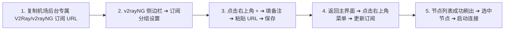
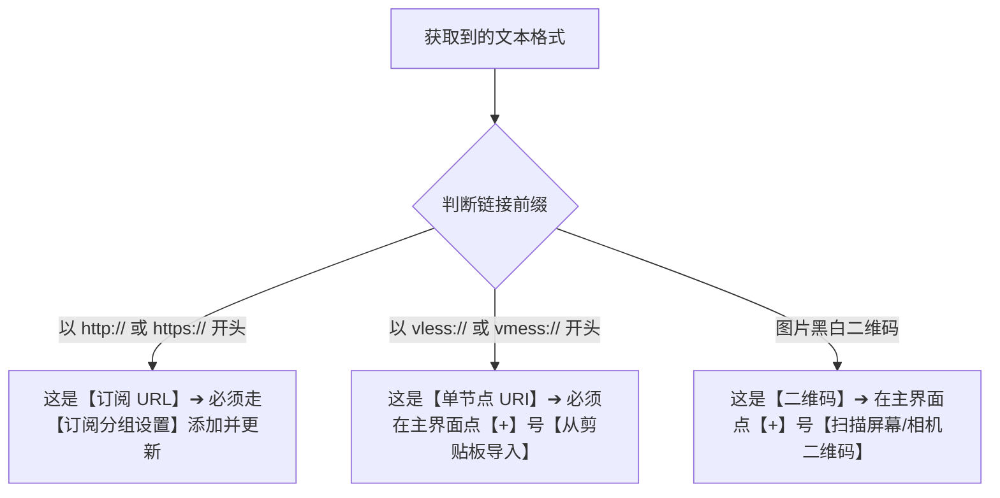
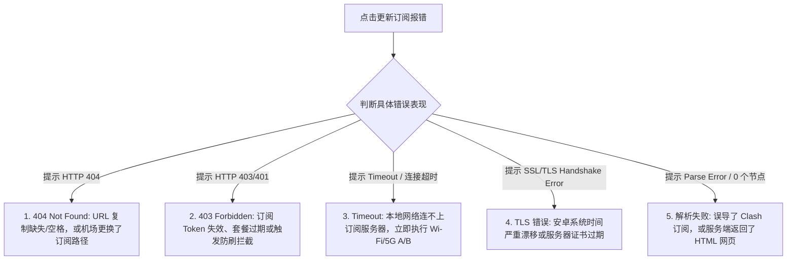
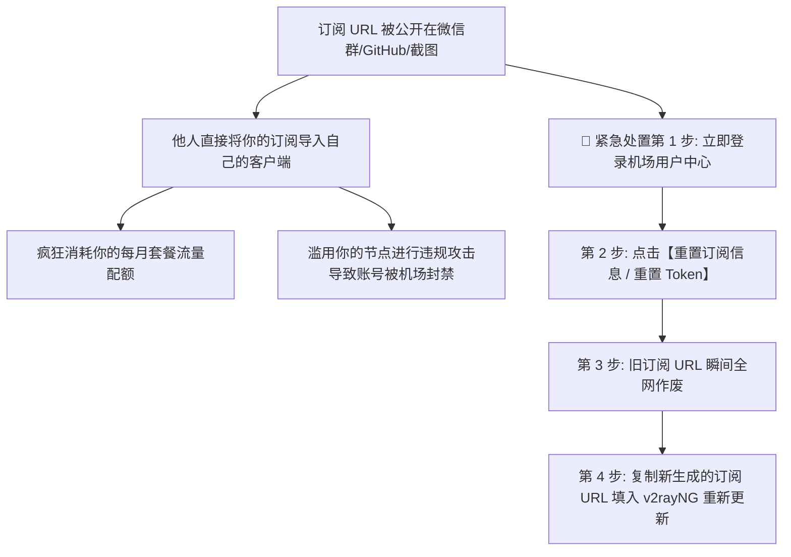

在 Android 安卓手机或平板上使用 v2rayNG 时，绝大多数新手遇到的第一个真正拦路虎不是怎么安装软件，而是 **“如何正确导入订阅，并成功拉取出一整张可用的节点列表”**。

在实际操作中，新手常常陷入各种困惑与误区：

**“为什么在订阅设置里填好了名字和链接，点击右上角保存后，主界面依然空空如也、一个节点都没有？”**  
**“为什么在点击‘更新订阅’时，软件底部弹出一串红字提示 `404 Not Found`、`403 Forbidden` 或者 `Timeout`？”**  
**“订阅提示更新成功了，为什么节点列表数量显示的却是 `0`，或者提示 `Parse Error`（解析失败）？”**  
**“朋友发给我一串以 `vless://` 或 `vmess://` 开头的长链接，这到底是不是订阅地址？为什么填进订阅管理里更新会报错？”**  
**“用相机扫描了机场提供的二维码，为什么导入进来之后列表里只有单独的一个节点，而不是几十个节点？”**  
**“为什么在家里连着 Wi-Fi 更新订阅一直转圈失败，关掉 Wi-Fi 切成手机 5G 流量后却能秒级更新成功？”**  
**“更新订阅之后，我之前手动修改过名字的旧节点会不会被覆盖删除？节点列表的排列顺序代表网速快慢吗？”**  
**“把订阅链接发送到公共微信群或者在线转换网站，到底会有多大的安全风险？”**

**v2rayNG 中的“订阅”是服务提供方（机场）用于远程分发与动态同步一组节点配置的 HTTPS 接口。**

新手必须建立一个极为严谨的 **“五阶段成功模型”**：**“订阅保存成功 ≠ 订阅请求成功 ≠ 节点解析成功 ≠ 节点成功连接 ≠ 目标网站能够访问”**。

- **保存订阅**：仅仅是将 URL 字符串保存在本地；
- **更新订阅**：手机向远程服务器发起 HTTPS 请求；
- **解析成功**：客户端成功将 Base64 或 JSON 文本解析为一个个独立的节点对象；
- **节点可用**：海外机房服务器必须响应 TCP/TLS 握手；
- **最终上网**：路由（Routing）、DNS 与本地网络接管必须全链路畅通。

本文作为 **v2rayNG 订阅导入、节点同步与故障排查的专项终极指南**，将带你彻底搞懂 **订阅 URL 与单节点 URI 的本质区别、404/403/Timeout/解析失败的底层诱因、Wi-Fi 与 5G 的 A/B 诊断法、以及保护订阅 Token 安全的核心法则**。

---

## ⚡ 60 秒极速导入：v2rayNG 订阅添加标准链路



---

## 一、认知基石：订阅运作链路与“五阶段成功模型”

为什么很多用户一看到报错就以为客户端坏了？理解订阅问题，必须对照以下 **五阶段分层模型**：

```mermaid
graph TD
    subgraph 1. 订阅配置层
        P1[第一阶段: 订阅保存成功 (URL 文本存入本地数据库)] --> P2[第二阶段: 订阅请求成功 (HTTP 200 OK 拿到数据负载)]
        P2 --> P3[第三阶段: 配置解析成功 (解码 Base64/JSON 刷出节点列表)]
    end

    subgraph 2. 代理网络层
        P3 --> P4[第四阶段: 节点连接成功 (Core 与海外服务器完成握手，测出延迟)]
        P4 --> P5[第五阶段: 业务访问成功 (通过路由与 DNS 成功打开 YouTube/Google)]
    end
```

### 五阶段排错对照表：
1. **第一阶段失败**：URL 格式错误、包含非法空格或字符；
2. **第二阶段失败**：网络超时（Timeout）、HTTP 404（地址失效）、HTTP 403（鉴权失败/WAF拦截）、DNS 解析失败；
3. **第三阶段失败**：格式不兼容（误填 Clash 订阅）、服务端返回了 HTML 登录页或防爬挑战页；
4. **第四阶段失败**：海外节点服务器离线、IP 被阻断、端口被封（需转入节点 Timeout 排查）；
5. **第五阶段失败**：DNS 污染、分流规则配置错误、本地 VpnService 接管异常。

---

## 二、概念澄清：订阅 URL vs 单节点 URI vs 二维码

许多新手经常把单节点链接和订阅链接混为一谈，导致导入频繁出错：

```text
┌────────────────────────────────────────────────────────────────────────────────────────┐
│                        订阅 URL vs 单节点 URI vs 节点二维码对比表                      │
├──────────────┬────────────────────────┬────────────────────────┬───────────────────────┤
│ 对比维度     │ 订阅链接 (Subscription)│ 单节点 URI (vless/vmess)│ 节点二维码 (QR Code)  │
├──────────────┼────────────────────────┼────────────────────────┼───────────────────────┤
│ **典型形态** │ `https://sub.domain/api/v2ray?token=xxx` | `vless://uuid@server:443?security=...` | 图形化黑白矩阵二维码  │
│ **节点数量** │ **批量获取 (通常 30~100+ 节点)** | **仅单个节点**         | 通常为单节点 (少数为订阅URL)│
│ **动态更新** │ ✅ 支持一键刷新与自动拉取最新配置 | ❌ 无法更新，机房换 IP 后失效 | ❌ 无法更新 (若编码为单节点)│
│ **导入方式** │ 订阅分组设置 ➔ 更新订阅│ 主界面 + 号 ➔ 从剪贴板导入 │ 主界面 + 号 ➔ 扫描二维码  │
│ **敏感属性** │ **极高 (相当于主账号 API 密钥)**| 高 (泄露单个节点的密码)│ 高 (公开相当于公开节点信息)│
└──────────────┴────────────────────────┴────────────────────────┴───────────────────────┘
```



---

## 三、实战操作：v2rayNG 导入订阅与单节点步骤

### 1. 订阅链接导入标准 5 步（主流方式）
1. **复制链接**：在机场用户中心复制你的专属 `V2Ray / v2rayNG 订阅链接`；
2. **进入订阅设置**：打开 v2rayNG，点击左上角侧边栏（三条杠）➔ 选择 **“订阅分组设置”**；
3. **新增订阅条目**：点击右上角 **“+”** 号，填写“备注”（如 `光速云专线`），在“可选地址（URL）”中完整粘贴订阅链接，点击右上角 **“√”** 保存；
4. **触发拉取更新**：返回主界面，点击右上角 **“三个点”** 菜单 ➔ 点击 **“更新订阅”**；
5. **核验节点列表**：下方列表刷出所有节点即表示订阅拉取大功告成！

### 2. 单节点链接与剪贴板导入（备用调试）
- 复制好友分享或测试用的 `vless://...` 或 `vmess://...` 字符串；
- 打开 v2rayNG 主界面，点击右上角 **“+”** ➔ 点击 **“从剪贴板导入”** 即可秒级添加单节点。

---

## 四、核心故障诊断：订阅更新失败的 6 大诱因与决策树

当点击“更新订阅”后弹出报错红字时，请严格根据错误码进行定位：



### 1. HTTP 404 Not Found（资源未找到）
- **根本原因**：请求的订阅路径在服务器上根本不存在。
- **排查步骤**：
  - 检查复制的 URL 结尾是否有多余的空格、换行符或漏掉了字符；
  - 登录机场后台，重新复制最新的订阅链接（机场可能升级了系统并更换了订阅分发域名）；
  - 🚨 **严禁做法**：切勿自己去随意猜测或修改 URL 里的字母参数！

### 2. HTTP 403 Forbidden / 401 Unauthorized（拒绝访问 / 鉴权失败）
- **根本原因**：订阅服务器拒绝了你的访问请求。
- **排查步骤**：
  - 登录机场后台检查套餐是否已经到期欠费，或当月流量是否已耗尽；
  - 机场后台重置订阅 Token，获取新生成的 URL 重新填入 v2rayNG；
  - 若仅在特定网络下 403，说明你的当前 IP 被机房 WAF 防火墙误判为恶意请求。

### 3. 订阅 Timeout（连接超时）
- **根本原因**：你的手机网络无法在规定时间内与订阅服务器建立 TCP/HTTPS 连接。
- **排查步骤**：
  - **Wi-Fi 与 5G 快速 A/B 测试**：断开当前家庭 Wi-Fi，切到手机 5G 移动网络再次点击更新；
  - 如果 5G 下能秒更新，说明是你家庭宽带的 DNS 污染了订阅域名或运营商跨境互联受阻；
  - 区分认知：**“订阅 Timeout（拿不到配置）” ≠ “节点 Timeout（连不上海外代理）”**。

### 4. Parse Error / 更新成功但节点数为 0（解析失败）
- **根本原因**：v2rayNG 成功拿到了返回内容，但内容不是它能识别的 V2Ray/Xray 格式。
- **排查步骤**：
  - **格式不兼容**：确认你没有把专供 Clash 使用的 YAML 规则订阅链接填进了 v2rayNG；
  - **HTML 拦截页**：在某些公用网络下，机场服务器返回了 Cloudflare 5秒盾验证页或登录跳转页，客户端把 HTML 代码当作节点解析自然会报错；
  - **解决方案**：在机场后台明确选择“导出 v2rayNG 格式订阅”或“通用 Base64 订阅”。

---

## 五、网络隔离诊断：Wi-Fi vs 4G/5G A/B 实战

安卓手机的一大天然优势就是拥有两套完全独立的物理网络（蜂窝移动网络与 Wi-Fi 局域网）：

```text
┌────────────────────────────────────────────────────────────────────────────────────────┐
│                        Wi-Fi vs 4G/5G 订阅更新 A/B 测试诊断表                          │
├────────────────────────┬────────────────────────┬──────────────────────────────────────┤
│ 家庭 Wi-Fi 表现        │ 手机 4G/5G 表现        │ 最终诊断结论与处理方案               │
├────────────────────────┼────────────────────────┼──────────────────────────────────────┤
│ ❌ 更新失败 (Timeout)  │ ✅ 秒级更新成功        │ 家庭路由器 DNS 污染或宽带拦截订阅域名。可在 Wi-Fi│
│                        │                        │ 设置中将 DNS 临时指定为 223.5.5.5 或用 5G 更新。│
├────────────────────────┼────────────────────────┼──────────────────────────────────────┤
│ ✅ 秒级更新成功        │ ❌ 更新失败 (Timeout)  │ 手机运营商蜂窝网络对该订阅域名解析异常或 APN 问题。│
│                        │                        │ 优先使用 Wi-Fi 完成更新，节点使用不受影响。    │
├────────────────────────┼────────────────────────┼──────────────────────────────────────┤
│ ❌ 更新失败 (404/403)  │ ❌ 更新失败 (404/403)  │ 与本地网络无关！100% 为订阅 URL 错误、套餐失效或│
│                        │                        │ 服务商后端系统维护，需登录机场后台核验。      │
└────────────────────────┴────────────────────────┴──────────────────────────────────────┘
```

---

## 六、安全红线：订阅链接泄露风险与紧急补救

很多用户不知道，**你的订阅 URL 实际上等同于你账号的免密提款卡**：



### 1. 订阅保护三不原则
- **不公开截图**：求助时若需发截图，必须将域名后方的 `token=`、`uuid`、`key` 等字符全部打码涂黑；
- **不用第三方未知转换器**：网络上充斥着大量不知名个人搭建的“免费在线订阅转换网站”，一旦输入你的订阅链接，后台程序会在 0.1 秒内悄悄截留并备份你的全部节点；
- **不长期驻留剪贴板**：导入完成后，建议清理手机剪贴板历史记录。

---

## 七、2026 全协议一键兼容与免转换高速专线推荐

选择一家后台 **原生提供 v2rayNG 专属订阅、全线 IEPL 企业专线** 的服务商，能让你免去任何转换与更新烦恼：

```text
┌────────────────────────────────────────────────────────────────────────────────────────┐
│                        2026 稳定兼容 v2rayNG 的高速专线推荐                            │
├──────────┬──────────────────────────┬──────────────┬──────────────┬────────────────────┤
│ 适配场景 │ 推荐品牌候选             │ 实际起付门槛 │ 每月流量配额 │ v2rayNG 兼容与专线优势│
├──────────┼──────────────────────────┼──────────────┼──────────────┼────────────────────┤
│ 旗舰全能 │ 光速云 (GuangSuYun)      │ 约 ¥7.5/月起 │ 59G~238G /月 │ 原生 v2rayNG 订阅一键导入，全线 IEPL 专线晚高峰 0 丢包│
│ 平价轻量 │ 微风网络 (BreezeNet)     │ 约 ¥7/月起   │ 50GB / 月    │ 优质 BGP 优化，轻量极速，适合安卓端日常查资料办公  │
│ 弹性月付 │ 唯兔云 (V2Yun)           │ ¥14.9/月     │ 100GB / 月   │ 14.9 元纯单月付，多地区原生 IP 出口，节点极其丰富  │
│ 应急备用 │ 星岛梦 (XingDaoMeng)     │ 约 ¥8/月起   │ 60G/不限时包 │ 0月租不限时包，节点永不过期，安卓端随时备用更新    │
│ 极速专精 │ 速界 (SpeedWorld)        │ ¥25/月       │ 150GB / 月   │ 企业级大带宽独立专线，手机 4K 秒开零缓冲           │
└──────────┴──────────────────────────┴──────────────┴──────────────┴────────────────────┘
```

- 🏆 **全协议旗舰专线首选**：[光速云](/reviews/guangsu-cloud/) —— 2020 老牌专线，原生提供 v2rayNG/V2Ray 一键订阅，更新极速；
- 🍃 **超低预算轻量**：[微风网络](/reviews/weifeng-cloud/) —— 50GB 精品小流量专线，年付折算仅约 ¥7/月；
- 💳 **拒绝绑定的单月付**：[唯兔云](/recommend/best-airports/) —— ¥14.9 纯单月付，100GB 充沛流量。

---

## 八、避坑指南：50 个关于“v2rayNG 订阅导入”的致命认知误区

```text
❌ 误区 1：v2rayNG 软件自带免费的节点订阅 ➔ 事实：v2rayNG 仅为开源客户端外壳，不附带任何订阅。
❌ 误区 2：在软件里保存了订阅链接就等于已经完成了更新 ➔ 事实：保存只是存储文本，必须在主界面右上角主动点击“更新订阅”。
❌ 误区 3：更新订阅成功就代表里面的所有节点绝对能连通 ➔ 事实：更新成功只代表拿到了配置，节点可用性需单独测速连接。
❌ 误区 4：更新订阅后列表里有节点，就证明手机能打开 YouTube ➔ 事实：还需点击启动、开启 VPN 并确保 DNS 和路由分流正常。
❌ 误区 5：以 vless:// 开头的链接可以直接当成订阅 URL 填入 ➔ 事实：vless:// 是单节点 URI，需通过“从剪贴板导入”添加。
❌ 误区 6：以 vmess:// 开头的链接就是机场的订阅地址 ➔ 事实：vmess:// 只是单个 VMess 节点的静态字符串。
❌ 误区 7：扫码导入成功但列表只有一个节点说明软件坏了 ➔ 事实：所扫二维码本身编码的就是单个节点，而非批量订阅。
❌ 误区 8：订阅更新报 404 错误说明机场老板绝对跑路了 ➔ 事实：404 多为 URL 复制缺失空格或机场后端更换了分发路径。
❌ 误区 9：订阅更新报 403 错误一定说明你的账号被永久封禁了 ➔ 事实：403 可能是套餐欠费、流量耗尽或当前网络触发了 WAF 防御。
❌ 误区 10：订阅 Timeout 说明所有海外节点都已经被封锁 ➔ 事实：Timeout 是手机连不上订阅分发服务器，海外代理节点可能完全正常。
❌ 误区 11：订阅更新报 Parse Error 说明 v2rayNG 软件损坏 ➔ 事实：多为误填了 Clash 订阅格式，或服务器返回了 HTML 网页。
❌ 误区 12：Clash 的订阅链接可以直接原封不动填进 v2rayNG ➔ 事实：Clash 是 YAML 语法结构，v2rayNG 需要 Base64 订阅。
❌ 误区 13：把订阅链接发到公共群里让群友帮忙测试没有危险 ➔ 事实：他人获取你的订阅后会疯狂盗刷你的套餐流量。
❌ 误区 14：截图求助时只要把机场的域名打码就绝对安全了 ➔ 事实：后方的 Token 参数才是最重要的免密认证凭据，必须打码。
❌ 误区 15：使用网上不知名的在线订阅转换网站完全无害 ➔ 事实：恶意转换站会在后台备份盗取你的全部订阅与节点。
❌ 误区 16：订阅更新越频繁越好，最好每 5 分钟自动更新一次 ➔ 事实：频繁请求会消耗手机电量并可能被机场服务器拉黑 IP。
❌ 误区 17：必须每天早晚手动更新一次订阅才能正常上网 ➔ 事实：只要节点可用，几周不更新订阅完全不影响正常使用。
❌ 误区 18：更新订阅会把你手动添加的自建单节点全部强制删除 ➔ 事实：v2rayNG 会区分订阅节点与手动配置，通常互不干扰。
❌ 误区 19：更新订阅后节点数量变少了，代表机场在偷工减料 ➔ 事实：机场可能合并优化了低效节点，或正在维护离线机房。
❌ 误区 20：更新订阅后节点名称变了，代表海外机房实体被搬走了 ➔ 事实：名称只是服务商给节点加的展示标签，与物理机房无关。
❌ 误区 21：节点列表排在第一位的节点一定是网速最快的 ➔ 事实：排列顺序由服务商默认设定，优劣需按实际延迟与场景测试。
❌ 误区 22：浏览器能打开订阅链接，说明 v2rayNG 没理由更新失败 ➔ 事实：浏览器与安卓应用的网络栈、DNS 及 User-Agent 策略不同。
❌ 误区 23：在手机浏览器里打开订阅 URL 看到一堆乱码说明链接坏了 ➔ 事实：那是标准的 Base64 加密节点字符串，正常现象。
❌ 误区 24：Wi-Fi 下更新失败一定是机场服务器故障 ➔ 事实：切到手机 5G 即可验证是否为家庭路由器 DNS 拦截。
❌ 误区 25：5G 下更新失败说明手机停机了 ➔ 事实：可能是运营商蜂窝网络路由异常，切回 Wi-Fi 即可对照排查。
❌ 误区 26：只要改了手机系统的公共 DNS 就能解决所有订阅 403 ➔ 事实：403 是服务器鉴权问题，改 DNS 无法解决权限不足。
❌ 误区 27：在设置里关闭 HTTPS 证书校验能修好订阅更新 ➔ 事实：盲目关闭证书验证会导致中间人攻击风险剧增。
❌ 误区 28：订阅更新失败时把 v2rayNG 卸载重装是最好办法 ➔ 事实：重装会抹掉所有配置，应先排查 URL 与网络层。
❌ 误区 29：同一个订阅链接可以在 100 台安卓设备上同时使用 ➔ 事实：大部分机场套餐限制了同时在线设备数，超载会被封禁。
❌ 误区 30：订阅 Token 泄露后只要在论坛删帖就能确保安全 ➔ 事实：爬虫早已抓取记录，必须在机场后台立即点击“重置 Token”。
❌ 误区 31：订阅 URL 越长代表包含的节点质量越高级 ➔ 事实：URL 长度仅代表参数多少，与节点物理性能毫无关系。
❌ 误区 32：所有的“通用订阅”都能在全平台任何客户端直接通用 ➔ 事实：“通用”并非国际标准，需以实际协议兼容为准。
❌ 误区 33：订阅更新成功后测速全红全超时说明订阅导入失败 ➔ 事实：订阅层已成功，问题进入节点网络与服务器连通层。
❌ 误区 34：只要点击了更新订阅，手机就会自动切换到延迟最低的节点 ➔ 事实：v2rayNG 不会自动切换节点，需手动点击选择。
❌ 误区 35：更新订阅会消耗几十 GB 的手机流量 ➔ 事实：订阅拉取仅传输几百 KB 的文本配置数据。
❌ 误区 36：安卓系统升级后订阅失效是因为系统封杀了 v2rayNG ➔ 事实：系统升级可能重置了网络权限，重新授权 VPN 即可。
❌ 误区 37：在不同安卓手机之间分享订阅二维码不会泄露账号 ➔ 事实：二维码包含完整解密配置，分享即授权。
❌ 误区 38：把订阅名称改成“超高速专线”节点速度就会变快 ➔ 事实：备注名称只是本地标签，对传输性能毫无影响。
❌ 误区 39：订阅链接包含敏感词会导致手机被直接锁定 ➔ 事实：订阅采用 HTTPS 加密传输，通信内容对中间网络透明。
❌ 误区 40：只要订阅更新成功，就算不连 Wi-Fi 也能免流量上网 ➔ 事实：科学上网必须建立在合法的本地宽带与蜂窝网络之上。
```

---

## 九、常见问题深度解答（FAQ · 55 问）

### Q1：v2rayNG 订阅是什么？
**答**：订阅是机场提供给用户的专属远程 HTTPS 链接。v2rayNG 通过请求该链接，能够一次性批量获取几十个节点的最新服务器地址、端口、UUID 与协议参数。

### Q2：为什么保存了订阅之后列表里没有节点？
**答**：**保存只是将链接存入本地，并未发起网络请求。** 必须返回主界面，点击右上角菜单中的 **“更新订阅”**，软件才会真正从远端拉取节点。

### Q3：订阅更新提示 `404 Not Found` 怎么解决？
**答**：404 表示请求路径不存在。检查复制的链接末尾是否漏字符或有空格，若无误则登录机场后台重新复制最新的订阅链接。

### Q4：订阅更新提示 `403 Forbidden` 是什么原因？
**答**：通常代表鉴权失败。可能是当月流量已用尽、套餐已过期、或该订阅 Token 已在后台被重置。登录机场用户中心核验账户状态即可。

### Q5：`vless://` 链接可以直接填进订阅分组吗？
**答**：**不能。** `vless://` 是单节点链接，直接填入订阅会报解析错误。应在主界面点击右上角“+” ➔ 选择“从剪贴板导入”。

### Q6：扫码导入成功后为什么只有一个节点？
**答**：因为你扫描的二维码本身只编码了单个节点。若需批量获取节点，必须在机场后台找到“订阅二维码”扫描，或直接复制订阅 URL 导入。

### Q7：为什么在 Wi-Fi 下更新失败，切到 5G 却成功了？
**答**：这说明你的家庭宽带或路由器 DNS 污染/拦截了该订阅服务器域名。在手机 5G 下更新完成后，切回 Wi-Fi 依然可以正常连接节点。

### Q8：订阅更新提示 `Parse Error`（解析失败）怎么办？
**答**：说明返回内容不是标准的 V2Ray 格式。核对是否误导了 Clash 专用的 YAML 订阅，或在机场后台选择明确标注“v2rayNG / V2Ray”的订阅导出。

### Q9：订阅链接不小心发到群里泄露了怎么办？
**答**：**立即登录机场后台点击“重置订阅信息 / 重置 Token”。** 旧链接会瞬间失效，随后将新生成的链接更新进 v2rayNG 即可。

### Q10：更新订阅会删除我之前手动添加的节点吗？
**答**：**不会。** v2rayNG 将订阅分组拉取的节点与手动添加的自建节点分开管理，更新订阅仅同步对应分组下的节点。

### Q11：为什么更新订阅后节点列表的名称全变了？
**答**：这是机场管理员在后台统一修改了节点的展示备注（如优化了线路标识），属于正常维护现象，不影响使用。

### Q12：在线订阅转换网站安全吗？
**答**：**极度不推荐使用陌生第三方转换站。** 你的订阅 Token 会完整暴露给转换站后端，存在严重的节点被盗刷与滥用风险。

### Q13：需要开启 v2rayNG 的自动定时更新订阅吗？
**答**：通常不需要。节点配置相对固定，只有在遇到节点大面积失效或机场通知调整时，手动点击一次“更新订阅”即可。

### Q14：更新订阅成功了，但所有节点测速全红报 Timeout？
**答**：这说明订阅配置层已成功，问题出在后方的海外节点服务器连通层（服务器离线、本地网络阻断或系统时间错误），需转入节点 Timeout 专项排查。

### Q15：可以在一台手机上添加多个不同机场的订阅吗？
**答**：**完全可以。** 在订阅分组设置中可以添加多个条目并分别备注，更新时会自动合并归类展示在主列表中。

---

## 🏁 总结：v2rayNG 订阅管理核心认知金字塔

管理与排查 v2rayNG 订阅，请牢记以下**核心铁律**：

```text
1. 辨五阶 ➔ 牢记“保存 ➔ 请求 ➔ 解析 ➔ 连通 ➔ 上网”五阶段，分层定界故障所在
2. 区别类 ➔ 订阅 URL 走“订阅分组”，单节点 URI 走“剪贴板导入”，切莫混淆
3. 查错误 ➔ 404 查地址路径，403 查套餐鉴权，Timeout 做 Wi-Fi/5G A/B 对照，Parse 查订阅格式
4. 保凭据 ➔ 订阅 Token 等同账号密码，截图必打码，严禁使用任何第三方在线转换网站
5. 止折腾 ➔ 节点列表一旦刷出，若全红超时立即停止折腾订阅，直接进入节点与网络层排查
```

---

### 📚 延伸进阶阅读与选型专栏
- 📱 **Android 客户端主教程**：[《v2rayNG怎么用？Android下载安装、订阅、节点、VPN权限与完整配置教程》](/tutorials/v2rayng-android/)
- 🗺️ **节点地区深度选型**：[《V2Ray节点怎么选？香港、日本、新加坡、美国节点、线路、延迟与使用场景完整指南》](/tutorials/v2ray-node-selection/)
- 💻 **Windows 订阅深度教程**：[《v2rayN订阅怎么导入？批量节点更新、自动同步与更新失败完整排查》](/tutorials/v2rayn-subscription/)
- 🚀 **现代协议深度解析**：[《VLESS是什么？VLESS、VMess、TLS、REALITY到底有什么区别》](/protocols/vless-vs-vmess/)
- 📜 **经典协议深度指南**：[《VMess是什么？VMess节点、UUID、TLS与VLESS区别完整指南》](/protocols/vmess-protocol/)
- ⚡ **老牌旗舰专线**：[《光速云深度评测：2020老牌IEPL专线与解锁实测》](/reviews/guangsu-cloud/)
- 🍃 **平价轻量专线**：[《微风网络深度评测：小流量套餐值不值得买？》](/reviews/weifeng-cloud/)
- 🏆 **2026 全景大榜**：[《2026梯子推荐：稳定、速度、价格、安全与不同使用场景怎么选》](/recommend/best-tizi/)
