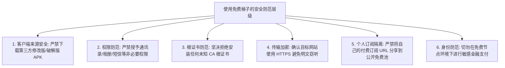

在各大搜索引擎中，“**免费梯子哪个好**”、“**有没有永久免费的梯子**”始终是搜索热度最高、也最容易衍生安全风险的话题。

对于许多初学者或预算有限的用户来说，零门槛、不花钱就能访问海外网络无疑具有巨大的吸引力。然而在跨境网络传输这一需要持续投入昂贵物理光缆、机房服务器与带宽租金的技术领域，**“天下没有免费的午餐”是一条无法违背的物理与商业铁律**。

用户口中的“免费梯子”往往涵盖了完全不同的产品形态：**有正规商业品牌的限时试用、有内置广告的免费 VPN、有开源社区维护的公益节点、也有纯粹提供免费空壳软件但需自备节点的客户端工具**。

本文不搞虚假的“永久免费高速神仙节点”营销，而是从**免费模式分类、商业维持逻辑、实际测速与晚高峰表现、隐私日志与安全红线、场景适配度（AI/YouTube）**等维度，对免费梯子进行客观、深度的全景剖析，帮助你理清利弊，并在合适的时候做出最省心的决策。

---

## ⚡ 30 秒看懂：常见的“免费梯子”到底分哪几类？

当你搜索或下载一个“免费梯子”时，它通常属于以下 8 种形态之一：

```text
┌─────────────────────────┬────────────────────────────────────────────────────────────────────────┐
│ 免费模式类别            │ 本质特征与实际限制                                                     │
├─────────────────────────┼────────────────────────────────────────────────────────────────────────┤
│ 1. 商业 VPN 免费档      │ 知名大厂提供每月 2GB~10GB 免费额度，限速限节点，旨在引导升级付费        │
│ 2. 机场免费体验/试用    │ 专线服务商提供 1GB~5GB 或 24 小时体验，供用户在购买前测试本地网络兼容性 │
│ 3. 永久免费小作坊 App   │ 界面充斥大量弹窗开屏广告，每次连接强制看 30s 视频，隐私政策通常极度不透明│
│ 4. 公开分享的免费节点   │ 论坛、群组或 GitHub 抓取的开源节点，数万人共享，存活周期极短且易被风控   │
│ 5. 社区公益节点         │ 技术爱好者或非营利组织自费搭建，带有访问量与用途限制，维护随缘          │
│ 6. 免费开源客户端       │ Clash Verge Rev / v2rayN 等软件本身免费，但底层并不自带任何可用网络节点│
│ 7. 免费浏览器代理插件   │ 仅代理浏览器网页流量，无法代理桌面软件、终端命令行或手机全局流量        │
│ 8. 自建代理方案         │ 代理协议与客户端开源免费，但后端的海外 VPS 云服务器依然需要每月支付租金 │
└─────────────────────────┴────────────────────────────────────────────────────────────────────────┘
```

> 💡 **核心认知分工**：
> “客户端软件免费”绝不等于“网络服务免费”。下载了开源免费的 Clash 或 v2rayN 只是拥有了“空壳车”，依然需要配置可用的服务器节点才能正常联网。

---

## 一、永久免费的梯子是真的吗？免费服务靠什么维持运转？

在网络中，**国际带宽、跨境专线光纤租用、海外机房电力与运维人员工资都是白纸黑字的刚性成本**。

如果一个平台声称自己“**永久免费、无限流量、高速千兆、无广告、且绝对安全**”，这在商业逻辑与物理常识上是无法自圆其说的。持续存在的免费服务通常依赖以下几种合法的商业模式运转：

```mermaid
graph TD
    FreeService[网络代理服务客观存在物理成本] --> ModelA[商业模式 1: 付费套餐补贴免费用户 (Freemium 模式)]
    FreeService --> ModelB[商业模式 2: 流量广告变现 (App 弹窗 / 激励视频广告)]
    FreeService --> ModelC[商业模式 3: 体验转化引流 (提供 1~2G 试用, 引导购买专线)]
    FreeService --> ModelD[商业模式 4: 开源社区/极客自费赞助 (非盈利学术公益)]
    FreeService --> RiskModel[⚠️ 灰色/高危模式: 收集转售用户行为数据 / 捆绑挖矿脚本]
```

### 1. 常见且相对健康的免费模式：
- **免费增值模式（Freemium）**：大厂（如 ProtonVPN、Cloudflare WARP）通过海量付费企业用户的利润，补贴极少数基础免费用户，免费档严格限制节点与速率；
- **试用引流模式**：正规专线机场（如部分老牌平台）提供 1 元试用或 2GB 体验包，让用户在付月费前实测晚高峰表现；
- **广告补贴模式**：部分小工具通过展示 Google AdMob 广告赚取微薄的服务器开销。

### 2. 必须高度警惕的高危隐性模式：
- **数据变现**：在用户协议中隐藏免责条款，将用户的 DNS 查询记录、访问偏好打包脱敏后出售给大数据营销公司；
- **恶意捆绑与挖矿**：安装包中内嵌后台挖矿脚本或恶意广告弹窗 SDK，严重拖慢手机与电脑性能。

---

## 二、免费梯子客观类型深度对比大表

| 免费方案类型 | 是否真正长期免费 | 是否需要注册 | 常见流量配额 | 常见速度表现 | 节点数量与地区 | 潜在主要风险 | 适合人群 |
| :--- | :---: | :---: | :--- | :--- | :--- | :--- | :--- |
| **知名大厂免费 VPN** | 🟢 是 | 通常需要邮箱 | 每月 2GB~10GB | 🟡 限制在 2~5Mbps | 仅 3~5 个拥堵地区 | 速度慢、高峰转圈 | 临时应急收发邮件 |
| **正规机场体验试用** | 🟡 限时/限量 | 需要注册 | 1GB~5GB 一次性 | 🟢 真实专线高速 | 涵盖港日美核心节点 | 额度用完即止 | 购前实测线路质量 |
| **广告类免费手机 App** | 🟢 是 | 通常免注册 | 标称无限/日限 | 🔴 极慢且频繁断流 | 随机不可控节点 | 权限过大、广告泛滥 | 极度偶尔查单词翻译 |
| **公开分享免费节点池** | 🔴 随时失效 | 免注册 | 视节点而定 | 🔴 高延迟高丢包 | 数量多但 80% 超时 | IP 脏、被平台黑名单 | 技术人员测试客户端 |
| **社区自建公益节点** | 🟡 视维护者 | 视具体规则 | 有限额度 | 🟡 一般 | 1~2 台冷门服务器 | 维护随时可能终止 | 学习研究与极客交流 |
| **浏览器免费代理插件** | 🟢 是 | 通常免注册 | 通常有限制 | 🟡 仅网页端可用 | 极少数共享 IP | 仅限浏览器内部流量 | 轻度查阅维基百科 |

---

## 三、免费梯子的优缺点客观平衡评估

为了保持中立客观，我们绝不能把所有免费工具一棒子打死：

### 🟢 免费方案的真实优势：
1. **零资金门槛**：无需绑定信用卡或支付账户即可上手体验海外网络；
2. **测试与学习利器**：非常适合新手用来熟悉 Clash、Shadowrocket 或 v2rayN 等客户端的导入、配置与分流机制；
3. **临时应急备用**：当主力付费网络因欠费或维护临时中断时，免费节点可以用来紧急登录后台续费或查阅官方公告。

### 🔴 免费方案的典型物理限制：
1. **严重的带宽与速率锁死**：由于免费节点被数千人同时挤占，下行速率通常被锁在 500KB/s~2Mbps，无法顺畅加载 1080P 或 4K 视频；
2. **极短的节点存活周期**：公开分享的免费节点平均存活时间往往只有数天甚至数小时，需要频繁到处寻找新链接；
3. **极脏的 IP 信誉（Fraud Score 高）**：免费节点 IP 几乎 100% 被 Cloudflare、Google reCAPTCHA 频繁弹验证码，**ChatGPT、Claude、Netflix 会直接报 403 阻断拒绝服务**；
4. **无任何售后与可用性保障**：节点掉线没有任何客服或工单支持，完全依赖随缘维护。

---

## 四、速度与稳定性实测真相：为什么免费梯子晚上特别卡？

许多用户常常发现：“**白天用免费节点打开网页还算凑合，为什么一到晚上 8 点到 10 点就彻底断网转圈了？**”

```text
┌────────────────────────────────────────────────────────────────────────┐
│                   免费梯子 vs 付费专线 晚高峰抗压对比                  │
├───────────────┬───────────────────────────┬────────────────────────────┤
│ 网络指标      │ 免费共享节点 / 免费 VPN   │ 付费 IEPL / IPLC 物理专线  │
├───────────────┼───────────────────────────┼────────────────────────────┤
│ 白天 Ping     │ 60~120ms (一般)           │ 25~45ms (极低)             │
│ 白天下行速率  │ 5~20 Mbps (可看 720P)     │ 300~800 Mbps (4K 秒开)     │
│ 晚高峰丢包率  │ 🔴 15% ~ 35% (严重卡死)   │ 🟢 0% (内网隔离无丢包)     │
│ 晚高峰速率    │ 🔴 0.2 ~ 1.5 Mbps (转圈)  │ 🟢 100 ~ 500 Mbps (满速)   │
│ YouTube 体验  │ 频繁降至 360P/480P 缓冲   │ 4K 60fps 全程无缓冲丝滑    │
└───────────────┴───────────────────────────┴────────────────────────────┘
```

### 晚高峰崩盘的底层物理原因：
1. **免费用户没有 QoS 优先级**：在国际出口带宽遭遇骨干网高峰拥堵时，机房会优先保障付费大客户的带宽，免费流量会被路由器最先抛弃（Drop）；
2. **免费节点资源严重超售**：一台原本只够容纳 50 人的廉价 VPS，可能被公开订阅分享给了 5000 人同时使用，导致 CPU 和网卡带宽瞬间被打满。

详细原理解析推荐阅读：[《为什么机场节点延迟低但速度慢？解析延迟与带宽的真实关系》](/issues/low-ping-slow-speed-reasons/)。

---

## 五、安全与隐私红线：使用免费梯子必须注意的 6 大雷区

安全是使用免费工具时最需要保持清醒的环节：



### 1. 坚决拒绝安装任何“未知 CA 根证书”
这是最核心的安全红线！正常的代理软件只需要系统网络权限。如果某个免费软件在安装时弹出提示要求你**“安装并信任一个设备根证书（Root Certificate）”**，请立即卸载并取消。恶意根证书能够解密你访问的所有 HTTPS 银行与密码流量。

### 2. HTTPS 能保护你什么？
在访问正规 HTTPS 网站时，通信内容经过了端到端加密，免费代理节点只能看到你正在访问什么域名（如 `github.com`），但**无法直接看到你的账号密码与聊天明文**。

### 3. 免费梯子能做到完全匿名吗？
**绝对不能。** 更改出口 IP 只是改变了网络物理地址。目标网站依然可以通过你登录的账号、本地 Cookie 以及**浏览器指纹（分辨率/操作系统字体/语言）**准确定位你的身份。

---

## 六、核心使用场景实测评估：ChatGPT、YouTube 与 Netflix

| 目标场景 | 免费梯子能否胜任 | 实际遇到的核心阻碍 | 建议解决方案 |
| :--- | :---: | :--- | :--- |
| **🤖 ChatGPT / OpenAI** | 🔴 **极难稳定使用** | 免费共享 IP 欺诈分极高，OpenAI 直接拦截报 403 Access Denied | 换用具备纯净住宅/原生 IP 的专线节点 |
| **🧠 Claude 3.5 Sonnet** | 🔴 **基本无法使用** | Claude 对地区和机房 IP 检测极为严苛，账号极易被风控封禁 | 必须使用纯净美区/日区固定专线 |
| **📺 YouTube 视频浏览** | 🟡 **勉强支持标清** | 白天看 720P 尚可，晚高峰频繁卡顿转圈，无法流畅播放 4K | 轻度看短视频可选，长视频需专线 |
| **🎬 Netflix / Disney+** | 🔴 **无法解锁非自制剧** | 免费 IP 100% 被流媒体版权库拉黑，只能看少量自制剧且严重限速 | 需使用具备 DNS 流媒体原生解锁的节点 |
| **💻 GitHub / 查学术文献** | 🟢 **基本可以满足** | 纯文本与学术代码拉取数据量小，受带宽影响相对较低 | 免费节点可作为临时下载使用 |

---

## 七、什么时候免费方案适合你？什么时候应该转向低成本付费？

```text
┌────────────────────────────────────────────────────────────────────────┐
│                        免费 vs 付费 需求分水岭决策表                   │
├─────────────────────────────────────┬──────────────────────────────────┤
│ ✅ 适合继续使用免费方案的场景       │ 🚀 强烈建议考虑低成本付费专线的场景│
├─────────────────────┬───────────────┼──────────────────┬───────────────┤
│ 1. 极偶尔查单词、文献│ 频率：每月1~2次│ 1. 深度依赖 AI 编程│ 频率：每天高频│
│ 2. 仅用来测试客户端配置│ 临时测试环境  │ 2. 长期看 YouTube 4K│ 追求画质无转圈│
│ 3. 预算极度有限的学生党│ 仅收发邮件    │ 3. 外贸/远程跨国办公│ 0 丢包不掉线  │
│ 4. 具备技术折腾能力者│ 愿意频繁换节点│ 4. 不想浪费时间到处找节点│ 时间成本更贵  │
└─────────────────────┴───────────────┴──────────────────┴───────────────┘
```

> 💡 **理性算一笔账**：
> 目前市场上优质的平价 IEPL 专线机场（如 [微风网络](/reviews/weifeng-cloud/)、[飞猫云](/compare/longmao-cloud-alternatives/)），每月仅需 **¥7~8 元**（相当于一瓶饮料的钱），就能提供 50GB 高速专线流量、原生解锁 ChatGPT 并保障晚高峰 0 丢包。**如果每天需要花费 20 分钟到处找免费节点且经常断网，你的宝贵时间成本其实远超这几块钱的月费**。

---

## 八、平价低门槛替代方案推荐（给准备升级的新手）

如果你发现免费工具已经无法满足工作或学习需求，建议优先考虑以下**起付门槛极低、支持短周期或年付百元以内**的正规老牌专线服务，避免踩坑：

| 推荐品牌候选 | 核心定位 | 实际起付价格 | 每月流量 | 核心线路架构 | 为什么适合作为免费替代 | 详细评测 |
| :--- | :--- | :--- | :--- | :--- | :--- | :--- |
| **微风网络** | 平价小流量专线首选 | **约 ¥7 / 月 (年付折算)** | 50GB / 月 | IEPL 企业内网专线 | 百元以内极低负担，专线晚高峰极稳，完美替代免费节点 | [《微风网络深度评测》](/reviews/weifeng-cloud/) |
| **飞猫云** | 超低门槛轻量专线 | **约 ¥7 / 月 (年付折算)** | 50GB / 月 | IEPL 专线集群 | 专为轻度查资料与文字 AI 设计，无复杂套路 | [《飞猫云横评选型》](/compare/longmao-cloud-alternatives/) |
| **唯兔云** | 拒绝年付绑定的主流月付 | **¥14.9 / 月 (真实月付)** | 100GB / 月 | BGP 三网优化中转 | 15 元单月结算，不满意随时不续费，100GB 充沛流量 | [《唯兔云套餐评测》](/recommend/best-airports/) |
| **星岛梦** | 长期不过期备用流量包 | **约 ¥8 / 月 (或按量包)** | 60GB / 不限时 | 企业级专线多协议 | 0 月租不限时流量包，适合作为防断网的长效备用通道 | [《星岛梦选型分析》](/recommend/best-airports/) |
| **光速云** | 2020 老牌旗舰全能专线 | **约 ¥7.5 / 月起 (折算)** | 59G~238G /月 | IEPL + 全球物理 IPLC | 追求极致稳定与 ChatGPT/4K 影音生产力用户的终极之选 | [《光速云深度评测》](/reviews/guangsu-cloud/) |

---

## 九、免费梯子使用安全自查清单（Checklist · 17 项）

在下载或使用任何声称免费的网络工具前，请逐一核对：

```text
┌────────────────────────────────────────────────────────────────────────┐
│                   免费梯子 17 项安全与可用性通关自查清单               │
├────────────────────────────────────────────────────────────────────────┤
│ □ 1. 客户端是否来自官方开源渠道 (如 GitHub 官方 Release)，绝非修改版   │
│ □ 2. 软件安装时是否索取了非必要的敏感权限 (如通讯录/短信/相册权限)     │
│ □ 3. 软件是否弹窗要求在操作系统中安装未信任的 CA 根证书 (坚决拒绝)     │
│ □ 4. 软件是否包含过量、无法关闭的流氓全屏弹窗广告                      │
│ □ 5. 服务商是否有公开、清晰的隐私政策与日志保留声明                    │
│ □ 6. 免费服务靠什么商业模式维持 (是正规试用引流，还是广告补贴)         │
│ □ 7. 免费流量配额是否明确标注 (例如每月 2GB 或单日 500MB)              │
│ □ 8. 节点连接后是否能够正常加载 HTTPS 网页且证书验证无警告            │
│ □ 9. 节点在晚高峰 (20:00~23:00) 是否依然能维持基本可用速度            │
│ □ 10. ChatGPT / Claude 是否能够正常登录且不频繁弹验证码                │
│ □ 11. 节点是否支持我的核心设备 (Windows / Mac / iPhone / Android)       │
│ □ 12. 节点分享链接是否包含来源不明的重定向恶意规则                    │
│ □ 13. 我确认绝不将自己的付费机场订阅 URL 公开粘贴到免费分享群中        │
│ □ 14. 我确认不在免费节点环境下进行网银大额转账等高度敏感操作          │
│ □ 15. 我已了解更改 IP 并不等于完全匿名，并承诺合规文明用网             │
│ □ 16. 当免费节点失效时，我已准备好备用节点或知道如何更新配置          │
│ □ 17. 当找节点的时间成本过高时，我已了解百元内低成本付费专线选项      │
└────────────────────────────────────────────────────────────────────────┘
```

---

## 十、常见问题深度解答（FAQ · 25 问）

### Q1：免费梯子哪个好？
**答**：取决于具体需求：如果是**购前测试专线质量**，推荐使用知名正规机场（如光速云、微风网络）提供的体验测试套餐；如果是**大厂免费 VPN**，可考虑 ProtonVPN 官方免费档（限速但相对规范）；如果是**技术测试**，可使用开源社区分享的测试节点。

### Q2：2026 年还有真正免费的梯子吗？
**答**：有的，但绝大多数都带有严格的**流量限制（如每月 2GB）、速率限制（限速 2Mbps）、节点数量极少或带有广告**。

### Q3：永久免费的梯子是真的吗？
**答**：**不是真的。** 海外物理机房与跨境专线带宽每月都需要高昂租金，不存在没有任何商业回报却长期提供免费高速带宽的慈善机构。

### Q4：免费梯子安全吗？
**答**：存在一定风险。只要客户端来自官方开源渠道且不安装未知根证书，常规 HTTPS 加密可以保护密码明文；但免费工具的 DNS 记录与连接日志透明度通常较低。

### Q5：免费梯子会看到我的密码吗？
**答**：正常情况下**不会**。访问主流 HTTPS 网站时，密码在浏览器端已经经过端到端高强度加密，代理服务器无法解密。但切记不可安装来源不明的第三方根证书。

### Q6：免费梯子速度怎么样？
**答**：通常较慢。由于成千上万用户同时挤占极少数免费服务器，平均下载速率通常在 500KB/s~2Mbps 之间，仅够文字查资料，看 1080P/4K 视频会频繁缓冲。

### Q7：免费梯子为什么晚上特别慢？
**答**：因为遭遇了**晚高峰（20:00~23:00）国际骨干网拥堵**。机房优先保障付费大客户带宽，免费流量由于没有 QoS 优先级，会被路由器优先丢弃导致严重丢包。

### Q8：免费梯子可以用多久？
**答**：正规试用套餐通常为 24 小时或流量耗尽即止；公开分享的免费节点平均存活周期通常只有几天甚至几小时；大厂免费 VPN 档位可长期使用但额度有限。

### Q9：免费梯子适合用来用 ChatGPT 吗？
**答**：**极难稳定使用。** 免费节点的共享 IP 通常被大量滥用，欺诈分极高，OpenAI 会频繁拦截并提示 403 Access Denied 或强推验证码。

### Q10：免费梯子能用 Claude 吗？
**答**：基本无法使用。Claude 对出口 IP 的纯净度与地区合规性审查极其严苛，机房劣质共享节点会导致账号直接被封禁。

### Q11：免费梯子适合看 YouTube 吗？
**答**：勉强可以看 480P 或 720P 标清视频；如果想流畅播放 1080P 60fps 或 4K HDR，免费节点的持续带宽通常无法支撑。

### Q12：免费梯子能看 Netflix 吗？
**答**：不能解锁非自制剧。Netflix 会精准屏蔽几乎所有公共机房共享 IP，只有配备原生家庭宽带 IP 或专用 DNS 解锁的付费专线才能看全量版权剧集。

### Q13：免费节点和免费梯子有什么区别？
**答**：免费梯子是包含客户端和服务的通俗统称；免费节点只是其中的一个服务器 IP 和密钥。一个节点必须导入到客户端中才能工作。

### Q14：公开分享的免费订阅链接安全吗？
**答**：安全性较低。来源不明的订阅配置可能包含恶意域名重定向规则或被植入广告分流规则，且极易迅速失效。

### Q15：Clash 软件自带免费节点吗？
**答**：**不自带。** Clash（包括 Clash Verge Rev）是纯粹的开源客户端空壳，本身不提供任何节点，必须由用户自行导入可用订阅。

### Q16：Shadowrocket 小火箭自带免费节点吗？
**答**：**不自带。** 小火箭是苹果 iOS 平台的第三方代理工具 App，同样需要用户购买或导入外部节点订阅。

### Q17：Android 安卓手机怎么选免费梯子？
**答**：坚决从官方 GitHub 下载开源客户端（如 Clash Meta for Android 或 v2rayNG），配合正规试用订阅使用，严禁在第三方小网站下载来历不明的“破解版 VPN APK”。

### Q18：iPhone 苹果手机有免费梯子吗？
**答**：Shadowrocket 本身在美区 App Store 售价约 $2.99，客户端本身非免费；用户可使用免费大厂 App（如 ProtonVPN 免费版）作为应急。

### Q19：免费梯子打不开网页怎么办？
**答**：第一步检查节点是否已经变红超时（Timeout）；第二步切换手机 5G 热点排除本地宽带 DNS 污染；第三步确认客户端系统代理开关是否开启。

### Q20：为什么免费节点全部显示 Timeout 红色？
**答**：说明该公开节点的服务器 IP 已经被封锁拦截或维护者已关闭服务器，需要重新获取最新的可用节点。

### Q21：使用免费梯子会泄露个人隐私吗？
**答**：部分以广告变现的劣质小作坊软件可能会收集并转售用户的域名访问偏好。建议选择知名大厂或开源生态方案。

### Q22：什么是公益节点？
**答**：指网络极客、海外留学生或学术非营利组织自费搭建并免费公开的代理节点，通常用于学术交流，但带宽和稳定性较为随缘。

### Q23：能不能把自己的付费机场订阅分享到免费群？
**答**：**坚决不能！** 你的订阅链接包含你的个人 Token，一旦分享会被他人瞬间刷光你的每月流量配额，甚至导致账号被服务商判定违规共享而封禁。

### Q24：什么时候应该彻底放弃免费方案转向付费？
**答**：当你的核心需求是**每天工作、AI 辅助编程、看超清视频或跨国办公**，且每天需要花费大量时间四处找节点、频繁忍受断网卡顿时，就应该果断选择低成本付费专线。

### Q25：一个月几块钱的便宜专线靠谱吗？
**答**：对于年付折算在 ¥7~8 / 月左右的正规小流量专线（如微风网络），只要服务商运营历史在 2 年以上且不强制预付多年，是非常高性价比的成熟选择。

---

## 🏁 总结：理性的免费工具用网哲学

面对免费梯子，请始终保持以下三条核心认知准则：

```text
1. 临时应急与学习测试 ➔ 免费工具与正规体验包完全够用，零成本上手
2. 涉及核心生产力与娱乐 ➔ 果断放弃到处找节点的低效折腾，拥抱稳定专线
3. 安全红线绝不妥协 ➔ 拒绝来源不明客户端、拒绝安装未知根证书、保护个人订阅 URL
```

---

### 📚 延伸进阶阅读与选型专栏
- 🏆 **2026 全景大榜**：[《2026梯子推荐：稳定、速度、价格、安全与不同使用场景怎么选》](/recommend/best-tizi/)
- 🎯 **深度决策指南**：[《梯子哪个好用？稳定性、速度、价格、节点与客户端完整选择指南》](/recommend/which-tizi-is-best/)
- 📖 **基础概念认知**：[《梯子是什么？梯子工具、VPN、机场、代理到底有什么区别？》](/wiki/what-is-tizi/)
- 🍃 **平价低成本专线**：[《微风网络深度评测：小流量套餐值不值得买？》](/reviews/weifeng-cloud/)
- 🛠️ **电脑客户端配置**：[《Clash Verge Rev 下载与安装配置完整教程》](/tutorials/clash-verge-rev/)
- 🚨 **排障实战手册**：[《Clash 有节点但无法上网怎么办？7 步系统排查与修复指南》](/issues/clash-connected-no-internet/)
- ⚠️ **防坑避险预警**：[《机场跑路前有哪些风险信号？10 个预警与防坑避险指南》](/risk/airport-running-away-warning-signs/)
