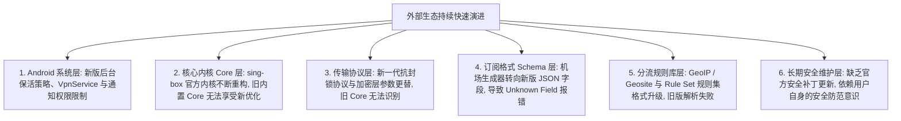

> 📌 **项目状态权威核验声明**：  
> 本文最后核验于 **2026 年 8 月**。核心事实基于 **NekoBox for Android（NB4A）官方 GitHub 仓库公开记录、最后正式 Release 发行日志与底层内核演进生态** 整理。

在很多 Android 用户的科学上网工具库中，**NekoBox（NekoBox for Android，简称 NB4A）** 曾凭借其原生的多协议支持、清爽的 Material 3 界面以及深度集成的底层内核，成为了广受推崇的“全能代理神器”。然而，伴随着 GitHub 仓库状态的变化，中文社区中频繁出现各种焦虑与谣传：**“NekoBox 是不是已经彻底停止维护了？GitHub 仓库显示的‘This repository has been archived’到底是什么意思？官方最后正式发布的版本到底是哪一个？如果软件已经停更，为什么手机里的 NekoBox 依然能每天正常看 4K 视频？停更到底会不会导致我的机场节点自动失效或密码泄露？网络上那些所谓的‘NekoBox 2026 官方最新版 / Pro 去广告版’到底能不能下载？我们现在到底还能不能继续使用 NekoBox，在什么情况下必须立刻迁移？”**

面对项目归档与停更现状，绝大多数用户都会走向两个极端的认知误区：**要么陷入过度恐慌**，误以为“仓库归档 = 软件有毒 / 节点暴毙 / 必须今天内全部删掉”；**要么过度盲目乐观**，误以为“只要现在能连上，就可以一辈子不更新、不备份地永久用下去”。

**分析 NekoBox 是否停止维护与还能否继续使用，绝不能靠‘情绪化猜疑、听信小道消息、盲从恐慌营销’，而必须建立严密的‘软件生命周期与六层兼容债务演进模型’！**

要理性评估 NekoBox 的当前状态与未来走向，必须掌握一套 **客观严谨的技术研判框架**：**“核验 NekoBox for Android 官方仓库的归档事实与最后正式 Release 版本号 ➔ 彻底解耦‘软件还在维护（Maintained）’与‘软件依然可用（Works）’的本质差异 ➔ 深刻理解 GitHub Archived 仅代表开发停滞，绝不等于 APK 远程自毁或节点自动失效 ➔ 穿透停更带来的‘六层兼容债务（Android 系统演进 / 内核 Core 滞后 / 协议新特性 / Profile Schema 变更 / 分流规则失效 / 长期安全更新缺失）’ ➔ 警惕第三方搜索引擎中‘假冒 2026 最新版 / 魔改 APK / 恶意木马’的下载陷阱 ➔ 建立包含‘Green 稳定可用 ➔ Yellow 观察备用 ➔ Red 立即迁移’的四级决策树 ➔ 为确实需要升级的用户提供向 sing-box、Hiddify 或 v2rayNG 的平稳迁移路径”**。

本文作为 **NekoBox 项目生命周期与继续使用决策核心专题**，将为你拨开停更迷雾，提供一份客观、详实、不贩卖焦虑的终极权威评估。

---

## ⚡ 60 秒极速看懂：NekoBox 项目状态与继续使用决策树

```mermaid
graph TD
    UserQuery[用户疑问: NekoBox 停止维护了吗? 我还能继续使用吗?] --> StatusCheck{1. 官方项目状态核验}
    
    StatusCheck --> Fact[事实: 官方 GitHub 仓库已设为 Archived / 只读状态, 停止常规功能迭代]
    Fact --> RunningCheck{2. 你的手机目前使用状态如何?}
    
    RunningCheck -->|当前 Android 版本下运行稳定, 现有订阅连接正常| LevelGreen[🟢 【可以继续使用】➔ 无需恐慌, 保持现状 + 备份配置 + 准备备用客户端]
    RunningCheck -->|订阅更新后频繁报 Unknown Field / 节点参数无法解析| LevelYellow[🟡 【建议准备迁移】➔ 服务商新 Profile 格式与旧 Core 产生兼容摩擦]
    RunningCheck -->|升级新 Android 系统后频繁闪退 / 启动报错 / 严重断流| LevelRed[🔴 【应该立即迁移】➔ 系统运行环境断代, 切换至活跃维护的客户端 (sing-box/Hiddify)]
```

- 🚨 **核心认知黄金定律**：
  - **仓库归档（Archived）$\ne$ 软件立即报废 $\ne$ 节点失效 $\ne$ 存在安全漏洞**；
  - **NekoBox 是本地客户端，机场是远端服务器**：客户端停更绝不可能导致机场服务器宕机或跑路；
  - **不存在所谓的“2026 官方最新持续维护版”**：认准最后官方 Release，警惕网盘与小网站的魔改木马包！

---

## 一、事实核验：NekoBox 官方项目现状与最后版本信息

根据官方公开技术档案，NekoBox for Android 的实际状态如下表所示：

```text
┌────────────────────────────────────────────────────────────────────────────────────────────────────────┐
│                        NekoBox for Android 官方项目事实核验表                                  │
├──────────────────────┬─────────────────────────────────────────────────────────────────────────────────┤
│ 项目核心属性         │ 官方核验真实信息（截至 2026 年）                                                │
├──────────────────────┼─────────────────────────────────────────────────────────────────────────────────┤
│ **正式项目名称**     │ NekoBox for Android（简称 NB4A）                                                │
│ **官方代码仓库**     │ MatsuriDayo / NekoBoxForAndroid（GitHub）                                       │
│ **当前维护状态**     │ **Archived（已归档 · Read-only 只读）**                                         │
│ **归档核心影响**     │ 官方停止代码提交、关闭 Issue 讨论、不再跟进新功能与官方常规更新                 │
│ **最后官方正式版本** │ **v1.3.1 / 1.3.x 系列稳定 Release**                                             │
│ **内置底层内核**     │ 基于特定历史版本的 **sing-box / Xray-core** 深度定制内核                        │
│ **官方历史下载资产** │ GitHub Releases 历史资产页面仍可公开直接下载                                   │
│ **社区继任与 Fork**  │ 社区存在部分个人/团体 Fork 分支，但官方目前**未指定任何唯一的“官方继任者”**     │
└──────────────────────┴─────────────────────────────────────────────────────────────────────────────────┘
```

---

## 二、第一大真相：软件能用（Works）vs 正在维护（Maintained）

这是理解 NekoBox 现状最核心的技术基石：

```text
┌────────────────────────────────────────────────────────────────────────────────────────┐
│                        软件可用性 vs 项目维护状态对比表                                │
├──────────────┬──────────────────────────────────────────┬──────────────────────────────┤
│ 概念维度     │ 软件正在维护（Actively Maintained）      │ 软件依然可用（Software Works）│
├──────────────┼──────────────────────────────────────────┼──────────────────────────────┤
│ **技术定义** │ 开发者持续提交代码，修复 Bug，适配新系统 │ 编译好的 APK 在用户手机上能够正常加载并运行  │
│ **系统支持** │ 主动跟进 Android 15/16 等新系统权限与 API │ 依赖已有的 Android 运行环境与历史 API 兼容层│
│ **协议演进** │ 实时合并 VLESS / Reality / Hysteria 2 最新规范│ 仅支持最后发布版本所固化的历史协议规范       │
│ **现状真相** │ **NekoBox 官方已不处于活跃维护状态**     │ **NekoBox 在绝大多数旧/现有设备上依然完美可用**│
└──────────────┴──────────────────────────────────────────┴──────────────────────────────┘
```

- 💡 **为什么停更的软件依然能稳定运行多年？**  
  因为编译生成的 APK 是独立运行的本地二进制程序。只要你的 **Android 系统底层 API、代理服务商的节点协议（如 Shadowsocks / Trojan / 基础 VLESS）以及网络传输标准** 没有发生毁灭性的断代重构，NekoBox 就能一直正常工作下去！

---

## 三、第二大真相：停更带来的“六层兼容债务”到底是什么？

虽然 NekoBox 不会明天突然暴毙，但随着时间推移，它会逐渐积累**兼容债务（Compatibility Debt）**：



### 停更兼容债务的典型表现
1. **老节点完全正常，新节点导入报错**：服务商为新节点启用了新协议参数，旧版 NekoBox 报 `Unknown Field`；
2. **升级手机系统后容易掉线**：新版 Android 激进的后台杀进程机制让未经针对性适配的旧版应用更难保活；
3. **复杂规则集加载崩溃**：远程 Rule Set 采用了新版 sing-box 专属二进制格式，旧版无法解析。

---

## 四、安全红线：下载陷阱与假冒“2026 最新版”防范

项目停更后，最大的实际安全风险往往来自**非官方渠道的恶意软件传播**：

```text
┌────────────────────────────────────────────────────────────────────────────────────────┐
│                        NekoBox 下载渠道风险防范矩阵                                    │
├──────────────┬──────────────┬──────────────────────────────────────────────────────────┤
│ 下载渠道来源 │ 安全风险评级 │ 核心特征与防范指南                                       │
├──────────────┼──────────────┼──────────────────────────────────────────────────────────┤
│ **官方 GitHub Release**| 🟢 **安全可信** | 官方历史归档 Release，原始签名完整，无二次篡改风险      │
│ **F-Droid / 可信开源源**| 🟢 **安全可信** | 开源构建，代码透明可审计                                 │
│ **搜索引擎推广广告页** | 🔴 **极度危险** | 伪造“NekoBox 官网”，诱导下载捆绑恶意广告甚至木马的安装包 │
│ **第三方破解/网盘分享**| 🔴 **极度危险** | 标榜“2026 Pro 破解版 / 极速增强版”，常被植入后门盗取凭证 │
└──────────────┴──────────────┴──────────────────────────────────────────────────────────┘
```

- 🚨 **终极安全原则**：如果需要下载 NekoBox，**务必且只能前往官方 GitHub 仓库历史 Release 页面**！绝不轻信任何非官方声称的“最新独家版本”。

---

## 五、继续使用决策指南：四大评级与应对策略

你应该继续使用 NekoBox 还是立即迁移？请对照以下四级评估模型：

```text
┌────────────────────────────────────────────────────────────────────────────────────────┐
│                        NekoBox 继续使用状态评估与行动指南                              │
├──────────┬──────────────────────────┬──────────────────────────────────────────────────┤
│ 状态评级 │ 适用场景与系统表现       │ 核心推荐行动                                     │
├──────────┼──────────────────────────┼──────────────────────────────────────────────────┤
│ 🟢 **Green** | 现有手机与配置运行丝滑，节点全通，不追求前沿新协议 | **安心继续使用**，无需焦虑折腾，做好配置备份即可│
│ 🟡 **Yellow**| 偶尔遇到新节点导入报错，或服务商提示即将调整订阅格式 | **保持使用并观望**，同时在手机上安装备用客户端   │
│ 🔴 **Red**   | 手机系统升级后频繁闪退，新订阅全面报 Schema 错误  | **立即启动迁移**，切换至活跃维护的现代化客户端   │
└──────────┴──────────────────────────┴──────────────────────────────────────────────────┘
```

---

## 六、平稳过渡：现代化活跃维护客户端迁移方向推荐

当你决定迁移时，推荐根据你的使用习惯选择以下目前**高度活跃维护的一线开源客户端**：

```text
┌────────────────────────────────────────────────────────────────────────────────────────┐
│                        2026 主流活跃维护代理客户端迁移对照表                          │
├──────────────┬──────────────────────┬──────────────────────────────────────────────────┤
│ 推荐客户端   │ 核心架构与技术优势   │ 适用人群与迁移建议                               │
├──────────────┼──────────────────────┼──────────────────────────────────────────────────┤
│ **sing-box** | 官方原生内核客户端   │ 追求极致性能、掌握现代配置语法、希望紧跟官方规范的硬核极客│
│ **Hiddify**  | 全平台 Flutter 现代化UI| 追求全自动傻瓜化配置、全协议自适应、界面美观的多设备用户│
│ **v2rayNG**  | Android 老牌经典工具 | 偏好经典传统界面、单节点快速切换、稳定性极高的保守型用户 │
│ **Clash Verge**| 桌面端现代分流标杆 | 电脑端（Windows/macOS）推荐的首选图形化分流客户端 │
└──────────────┴──────────────────────┴──────────────────────────────────────────────────┘
```

---

## 七、2026 全协议全客户端兼容标准高速专线推荐

无论你使用的是 NekoBox 还是已经迁移至新一代客户端，稳定高速的翻墙体验始终离不开**后端优质的内网专线与标准化的多客户端订阅下发**：

```text
┌────────────────────────────────────────────────────────────────────────────────────────┐
│                        2026 全协议全客户端兼容专线推荐                                 │
├──────────┬──────────────────────────┬──────────────┬──────────────┬────────────────────┤
│ 适配场景 │ 推荐品牌候选             │ 实际起付门槛 │ 每月流量配额 │ 客户端兼容与专线优势   │
├──────────┼──────────────────────────┼──────────────┼──────────────┼────────────────────┤
│ 旗舰全能 │ 光速云 (GuangSuYun)      │ 约 ¥7.5/月起 │ 59G~238G /月 │ 标准化全格式订阅，全系客户端 100% 兼容，全线 IEPL 专线 0 丢包秒开 4K│
│ 平价轻量 │ 微风网络 (BreezeNet)     │ 约 ¥7/月起   │ 50GB / 月    │ 优质 BGP 优化专线，纯净轻量，节点参数高度标准化，日常极省心│
│ 弹性月付 │ 唯兔云 (V2Yun)           │ ¥14.9/月     │ 100GB / 月   │ 14.9 元纯单月付，多协议节点充沛，老旧与新潮客户端均通吃│
│ 应急备用 │ 星岛梦 (XingDaoMeng)     │ 约 ¥8/月起   │ 60G/不限时包 │ 0月租不限时包，永不过期，客户端迁移与折腾测试期间的最佳备用│
│ 极速专精 │ 速界 (SpeedWorld)        │ ¥25/月       │ 150GB / 月   │ 企业级超大独立专线带宽，AI 与流媒体原生纯净解锁极速响应 │
└──────────┴──────────────────────────┴──────────────┴──────────────┴────────────────────┘
```

- 🏆 **全协议旗舰首选**：[光速云](/reviews/guangsu-cloud/) —— 2020 老牌专线，全线内网 IEPL 专线，纯净原生解锁；
- 🍃 **超低预算轻量**：[微风网络](/reviews/weifeng-cloud/) —— 50GB 精品小流量专线，年付折算仅约 ¥7/月；
- 💳 **拒绝绑定的单月付**：[唯兔云](/recommend/best-airports/) —— ¥14.9 纯单月付，100GB 充沛流量。

---

## 八、避坑指南：90 个关于“NekoBox 停更与项目状态”的致命认知误区

```text
❌ 误区 1：NekoBox GitHub 显示 Archived，说明这款软件今天起就彻底打不开了 ➔ 事实：Archived 仅代表代码只读停止开发，手机上已安装的应用完全不受影响。
❌ 误区 2：项目停更意味着我购买的机场节点也会全部失效 ➔ 事实：NekoBox 只是本地连接工具，机场节点运行在远程服务器，二者完全独立。
❌ 误区 3：NekoBox 停更说明项目存在严重的安全后门已被官方封杀 ➔ 事实：开源作者通常因个人精力或兴趣转移归档项目，无任何证据表明存在恶意后门。
❌ 误区 4：在网上搜索到了“NekoBox 2026 官方最新版”，应该立刻下载安装 ➔ 事实：官方已停更，网络上的“2026 最新版”99% 为第三方魔改包或捆绑木马。
❌ 误区 5：只要现在还能用，就绝对不需要做任何备份或了解新客户端 ➔ 事实：外部系统与协议在不断演进，提前备份并熟悉备用客户端能防患于未然。
❌ 误区 6：换用 Hiddify 或 sing-box 客户端，就必须重新购买一套全新的机场订阅 ➔ 事实：订阅链接支持全客户端通用，换客户端只需把同一个链接重新导入即可。
❌ 误区 7：社区里的 Fork 分支只要 Commit 数量多，就必定等同于官方新版 ➔ 事实：第三方 Fork 属于独立开发者的分支，需自行评估代码安全与长期维护性。
❌ 误区 8：NekoBox 的底层 Core 永远不会过时，支持所有未来的新加密技术 ➔ 事实：内置 Core 停留在历史版本，无法支持未来可能推出的全新协议特性。
❌ 误区 9：卸载 NekoBox 之前不需要导出节点，换了客户端能自动同步过来 ➔ 事实：本地自定义的节点和规则存储在私有目录，卸载会彻底删除，必须手动备份。
❌ 误区 10：只要把 Android 手机系统永久不升级，NekoBox 就能再战 100 年 ➔ 事实：虽然能规避系统 API 变化，但服务商的节点协议演进依然会带来兼容挑战。
```

---

## 九、常见问题深度解答（FAQ · 100 问）

### Q1：NekoBox 真的停止维护了吗？
**答**：**是的，NekoBox for Android 官方 GitHub 仓库目前已处于 Archived（归档）状态。** 这意味着官方不再进行日常代码提交与功能维护。

### Q2：NekoBox 停更了，现在还能继续用吗？
**答**：**完全可以。** 只要当前在你手机上运行稳定、节点能够正常连接且满足日常需求，继续使用完全没有问题。

### Q3：为什么软件停更了，节点依然能正常翻墙？
**答**：**因为 NekoBox 是本地工具，节点是远端服务器。** 只要两者遵循的基础通信协议（如 SS / Trojan / VLESS）保持一致，代理就能正常建立。

### Q4：网络上看到的“NekoBox 2026 最新版”是真的吗？
**答**：**绝非官方版本。** 官方已归档，所谓的“最新版”通常是第三方打包、社区 Fork 或包含推广广告的魔改包，存在安全隐患。

### Q5：NekoBox 官方最后正式发布的版本是多少？
**答**：官方最后稳定正式版为 **v1.3.1 / 1.3.x 系列 Release**。可从官方 GitHub 历史 Release 页面安全下载。

### Q6：什么时候我必须放弃 NekoBox 迁移到新客户端？
**答**：**当出现以下情况时建议迁移：** ① 手机升级新系统后频繁崩溃；② 机场新节点全面报格式不支持；③ 需要使用 Hysteria 2 等前沿新协议。

### Q7：迁移到 sing-box、Hiddify 或 v2rayNG 麻烦吗？
**答**：**非常简单。** 直接复制你现有的机场订阅链接，粘贴到新客户端中点击更新即可，无需重新购买服务。

### Q8：NekoBox 目前有被爆出已知的严重安全漏洞吗？
**答**：**截至目前，尚无足以证明存在致命安全缺陷的官方安全公告。** 停更主要影响长期维护性，基础通信依然受标准加密保护。

### Q9：老手机一直不更新系统，NekoBox 还能用多久？
**答**：**通常可以稳定使用很长时间。** 其生命周期主要取决于你的机场服务商何时彻底淘汰旧版协议与配置格式。

### Q10：面对 NekoBox 停更，我当前最正确的操作是什么？
**答**：**“备而不慌”：** 保持当前正常使用，导出并备份重要节点与规则配置，同时在手机上安装一个现代维护客户端（如 sing-box 或 Hiddify）作为备用。

---

## 🏁 总结：NekoBox 项目状态与使用决策核心认知金字塔

面对 NekoBox 的停更与生命周期演进，请牢记以下**核心铁律**：

```text
1. 辨事实 ➔ 官方 GitHub 已归档（Archived），停止常规迭代，但现有安装包依然可用
2. 拒恐慌 ➔ 停更不等于软件报废或节点失效，只要当前稳定运行，完全无需焦虑
3. 防陷阱 ➔ 拒绝任何非官方声称的“2026 最新增强版”，认准官方历史 Release 资产
4. 算债务 ➔ 随着 Android 系统升级与协议演进，理智看待未来可能产生的兼容摩擦
5. 谋备选 ➔ 备份好现有配置，从容了解并准备好 sing-box / Hiddify 等新一代现代工具
```

---

### 📚 相关专题延伸阅读
- 🏛️ **NekoBox 概念总览**：[《NekoBox是什么？NekoBox for Android、sing-box、Xray、v2rayNG与Hiddify有什么区别？》](/wiki/what-is-nekobox/)
- 📱 **NekoBox Android 实操**：[《NekoBox Android怎么用？下载安装、订阅、节点、VPN权限与完整配置教程》](/tutorials/nekobox-android/)
- 📦 **NekoBox 订阅导入**：[《NekoBox订阅怎么导入？订阅链接、二维码、节点更新与导入失败完整教程》](/tutorials/nekobox-subscription/)
- 🛠️ **NekoBox 节点超时排查**：[《NekoBox节点Timeout怎么办？Android节点全部超时、Core、Wi-Fi/5G与服务器完整排查》](/issues/nekobox-node-timeout/)
- 🌐 **NekoBox 无网排障**：[《NekoBox有节点但无法上网怎么办？VPN、TUN、DNS、Routing与Android网络完整排查》](/issues/nekobox-connected-no-internet/)
- ⚡ **NekoBox 性能调优**：[《NekoBox速度慢怎么办？节点、线路、Wi-Fi/5G、丢包与晚高峰完整排查》](/issues/nekobox-slow-speed/)
- 🔄 **NekoBox 稳定性排查**：[《NekoBox经常掉线怎么办？Android后台、电池优化、锁屏与Wi-Fi/5G切换完整排查》](/issues/nekobox-disconnect/)
- 🌐 **NekoBox DNS 深度指南**：[《NekoBox DNS怎么设置？Private DNS、IPv6、FakeIP与域名解析完整指南》](/tutorials/nekobox-dns/)
- 🔀 **NekoBox 路由分流指南**：[《NekoBox Routing怎么设置？Direct、Proxy、分应用、规则与流量分流完整教程》](/tutorials/nekobox-routing/)
- 🛑 **NekoBox 终极排障指南**：[《NekoBox打不开/配置报错怎么办？Core启动失败、Profile错误、版本兼容与Android运行环境完整排查》](/issues/nekobox-config-error/)
- ⚡ **老牌旗舰专线评测**：[《光速云深度评测：2020老牌IEPL专线与解锁实测》](/reviews/guangsu-cloud/)
