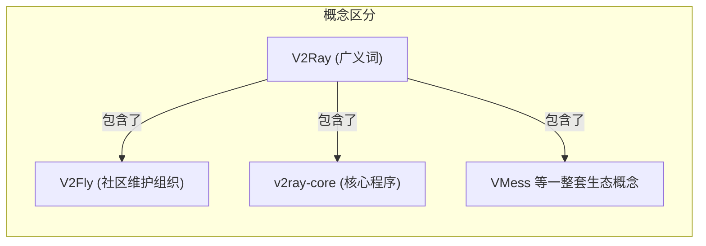
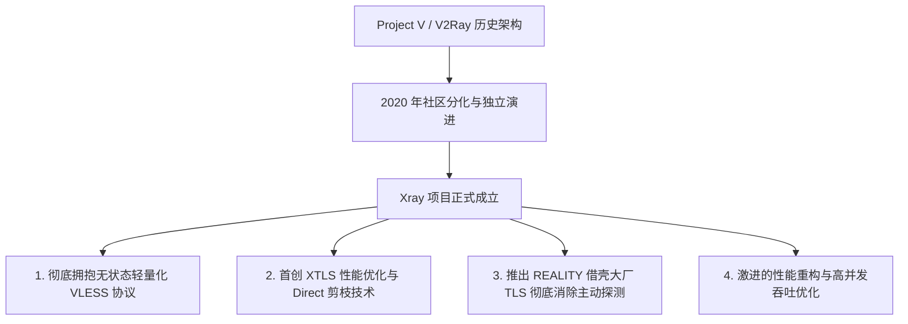
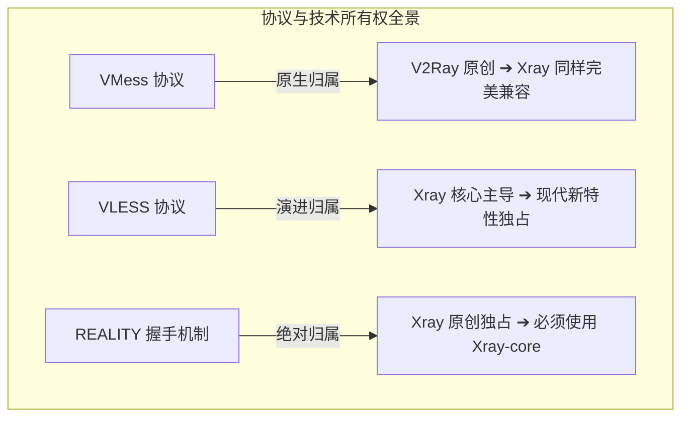
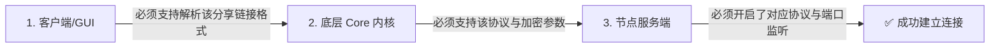

在科学上网和现代代理工具的语境下，**“V2Ray”** 和 **“Xray”** 是出现频率最高、却也是被绝大多数用户混淆得最严重的两个核心词汇。

打开 Windows 上的 v2rayN、安卓上的 v2rayNG，或者在机场后台查看节点时，你一定会频繁看到各种交织在一起的技术标识：**“v2ray-core 已启动”、“Xray-core 监听中”、“V2Ray 订阅”、“Xray VLESS REALITY 节点”、“V2Fly 社区”**……

这导致了大量新手乃至老玩家产生了各种典型的认知混乱与争论：

**“V2Ray 和 Xray 到底是什么关系？Xray 是不是就是 V2Ray 换了个英文名字？”**  
**“Xray 是不是 V2Ray 的 2.0 升级版？现在是不是必须把所有 V2Ray 彻底淘汰换成 Xray？”**  
**“V2Fly 又是什么？它和 V2Ray 是同一个人做的吗？”**  
**“为什么我下载的软件明明叫 `v2rayN`，但底层运行的进程却叫 `xray.exe`？v2rayN 到底算 V2Ray 还是算 Xray？”**  
**“VLESS 协议和 REALITY 伪装技术到底属于 V2Ray 还是属于 Xray？”**  
**“在客户端里把内核从 v2ray-core 切换到 Xray-core，网速真的能瞬间提升 30%、延迟降低一半吗？”**  
**“为什么同一个节点在 v2ray-core 下连不上，换成 Xray-core 就能正常上网？两者的配置文件能直接复制互换吗？”**  
**“为什么有的机场宣传‘Xray 专线节点’，这和普通的 V2Ray 节点到底有什么本质区别？”**

**V2Ray、V2Fly、v2ray-core、Xray-core、v2rayN、VLESS 和 REALITY 根本不是同一个维度的东西。**

最科学清晰的理解方式，是将它们放入严谨的 **网络代理五层关系模型** 中：
- **V2Fly 与 Xray** 属于 **开源项目与社区生态层**；
- **v2ray-core 与 Xray-core** 属于 **底层代理内核引擎层（Core）**；
- **v2rayN 与 v2rayNG** 属于 **上层图形客户端（GUI）**；
- **VLESS 与 VMess** 属于 **应用层代理协议**；
- **REALITY 与 TLS** 属于 **连接安全与握手伪装层**。

本文作为 **V2Ray 与 Xray 生态架构关系的终极权威百科**，将摒弃一切无意义的社区站队与主观偏见，从 **项目演进历史、内核架构差异、协议与安全归属、客户端与 Core 调用机制、到跨内核配置迁移** 建立一套完整、客观、专业的技术认知框架。

---

## ⚡ 30 秒极速看懂：V2Ray 与 Xray 关系全景图

```text
┌────────────────────────────────────────────────────────────────────────┐
│             V2Ray / V2Fly / Xray 五层技术关系与定位全景                │
├──────────────────┬──────────────────┬──────────────────────────────────┤
│ 技术层级         │ 核心代表实例     │ 真实角色与技术定位              │
├──────────────────┼──────────────────┼──────────────────────────────────┤
│ **1. 项目/生态** │ V2Fly / Xray     │ 开源社区与项目组织，负责规范定义与版本迭代│
│ **2. 内核 (Core)**│ v2ray-core / Xray-core 底层代理引擎(Go编写)，负责协议加密与路由转发│
│ **3. 客户端(GUI)**│ v2rayN / v2rayNG │ 图形界面外壳，负责订阅管理并调度底层 Core │
│ **4. 代理协议**  │ VLESS / VMess    │ 客户端与服务端通信的指令规范与数据格式  │
│ **5. 安全与伪装**│ TLS / REALITY    │ 外层通信加密、证书验证与借壳抗探测机制  │
└──────────────────┴──────────────────┴──────────────────────────────────┘
```

---

## 一、架构基石：代理生态的“五层关系模型”

为什么很多讨论“v2rayN 和 Xray 哪个好”、“VLESS 是不是 Xray 客户端”从一开始就是常识性错误？因为他们把图形外壳、底层内核与代理协议强行混为一谈。理解整个生态，必须首先对照以下 **五层关系模型**：

```mermaid
graph TD
    subgraph 1. 开源项目与社区生态 (Ecosystem)
        ProjV[Project V / V2Fly 社区]
        ProjX[Xray 社区]
    end

    subgraph 2. 底层代理内核 (Core Engine)
        VCore[v2ray-core (独立二进制进程)]
        XCore[Xray-core (独立二进制进程)]
    end

    subgraph 3. 上层图形客户端 (Client / GUI)
        GUI_Win[Windows: v2rayN / Clash Verge Rev]
        GUI_And[Android: v2rayNG]
        GUI_iOS[iOS: Shadowrocket]
    end

    subgraph 4. 代理协议层 (Proxy Protocol)
        Proto_VMess[VMess 协议]
        Proto_VLESS[VLESS 协议]
        Proto_Others[Trojan / Shadowsocks]
    end

    subgraph 5. 安全与传输机制 (Security & Transport)
        Sec_TLS[TLS 标准加密]
        Sec_REALITY[REALITY 借壳抗探测]
        Trans[TCP / WebSocket / gRPC]
    end

    ProjV --> VCore
    ProjX --> XCore

    GUI_Win -->|调用与管理| VCore
    GUI_Win -->|调用与管理| XCore
    GUI_And -->|内置调用| XCore

    VCore --> Proto_VMess
    XCore --> Proto_VLESS
    XCore --> Proto_VMess

    Proto_VLESS --> Sec_REALITY
    Proto_VLESS --> Sec_TLS
```

- 💡 **分层认知铁律**：
  - **v2rayN 不是 V2Ray，也不是 Xray**：它只是一个运行在 Windows 上的 C# 图形外壳，专门负责把你的鼠标点击转换成配置文件，然后启动后台的 `xray.exe` 或 `v2ray.exe`；
  - **Xray 不是 V2Ray 的改名**：Xray 是从 Project V 分支独立演进的现代化分支项目，拥有完全独立的版本发布节奏、架构优化与特色功能；
  - **VLESS 不是 Xray 独占的软件**：VLESS 是一种开放的代理协议标准，由 Xray 社区推向极致并广泛普及。

---

## 二、名词溯源：V2Ray、V2Fly 与 v2ray-core 的真实含义

在日常交流中，“V2Ray” 这个词往往具有极大的歧义。要消除误解，必须精准区分以下三个概念：



### 1. V2Ray（广义生态概念）
- **起源**：2015 年由著名开源开发者 Victoria Raymond 发起的 Project V 项目核心组件；
- **含义**：在广义上，V2Ray 通常指代这一整套基于模块化路由、多入站出站、自带加密分流的现代科学上网技术体系。

### 2. V2Fly（社区与维护组织）
- **背景**：在原作者隐退之后，社区核心开发者联合组建了 **V2Fly 社区**，接管了 V2Ray 官方项目的日常维护与代码审查工作；
- **定位**：V2Fly 是一个非营利性质的开源组织，而不是某个翻墙协议，也不是客户端软件。

### 3. v2ray-core（核心代理引擎）
- **定义**：由 Go 语言编写的底层网络代理核心程序（在系统中体现为 `v2ray.exe` 或 `v2ray` 二进制文件）；
- **职责**：负责读取 `config.json` 配置文件、监听本地 SOCKS/HTTP 端口（Inbound）、执行路由规则分流（Routing）、向海外服务器建立加密代理连接（Outbound）。

---

## 三、Xray 与 Xray-core：独立演进与技术突破



### 1. Xray 诞生的历史背景与技术分歧
- **分化原点**：2020 年底，围绕 **XTLS（一种能够大幅降低 TLS 加密计算开销的技术）** 的开源协议许可证（License）以及 VLESS 协议的演进路线，社区内部产生了不同的技术见解；
- **独立演进**：为了能够更激进、更自由地推进行业前沿技术创新，开发者 rprx 携核心力量创立了 **Xray-core** 项目；
- **核心定位**：Xray 是一个完全独立的开源代理项目，它在继承了 V2Ray 优秀的模块化架构基础之上，对底层网络性能、握手伪装机制进行了大刀阔斧的重构。

### 2. Xray-core 的三大标志性技术突破
1. **VLESS 协议的全面深化**：将 VLESS 打造为现代科学上网的标杆协议，去除了所有历史包袱与内层冗余加密；
2. **XTLS 与数据零拷贝优化**：在特定场景下实现了 TLS 数据的内核级直接转发，极大地解放了路由器和低功耗设备的 CPU；
3. **REALITY 借壳伪装技术**：2023 年推出的 REALITY 技术，直接消除了自建节点需要购买域名与申请证书的痛点，通过借用海外大厂真实 TLS 证书指纹，彻底防御了防火墙的主动探测。

---

## 四、核心对比表：V2Ray (v2ray-core) vs Xray (Xray-core)

```text
┌────────────────────────────────────────────────────────────────────────────────────────┐
│                        V2Ray vs Xray 核心架构与功能特性全景对比表                      │
├──────────────┬────────────────────────────────────────┬────────────────────────────────┤
│ 比较维度     │ V2Ray (v2ray-core / V2Fly)             │ Xray (Xray-core / XTLS)        │
├──────────────┼────────────────────────────────────────┼────────────────────────────────┤
│ **项目定位** │ 经典老牌代理核心，追求标准化与稳健     │ 现代激进性能核心，追求新技术与高吞吐   │
│ **维护社区** │ V2Fly 社区                             │ XTLS / Xray 核心团队           │
│ **核心可执行文件** `v2ray.exe` / `v2ray`              │ `xray.exe` / `xray`            │
│ **VMess 支持**│ ✅ 原创设计，完整支持 (AEAD 强制启用)  │ ✅ 完整支持并优化              │
│ **VLESS 支持**│ ⚠️ 早期版本支持，演进相对保守          │ ✅ 官方原生全力主导，特性最完整 │
│ **REALITY 支持** ❌ 官方核心未原生集成 REALITY 特性     │ ✅ 原生原创支持 (REALITY 规范制定者)│
│ **XTLS 特性** │ ❌ 因协议争议未合并 XTLS-Flow          │ ✅ 原生深度集成与持续演进      │
│ **Routing 引擎** 标准域名与 IP 规则匹配               │ 高性能规则匹配，支持更丰富的语法扩展│
│ **配置兼容性**│ 基础 Inbound/Outbound 结构与 Xray 类似 │ 大部分兼容旧配置，但独占大量高级字段│
│ **主流客户端支持** 绝大多数客户端均提供支持           │ 现代主流客户端（v2rayN/v2rayNG等）标配│
│ **最新核验状态** [最后核验：2026-08 稳定维护中]        │ [最后核验：2026-08 活跃演进中] │
└──────────────┴────────────────────────────────────────┴────────────────────────────────┘
```

---

## 五、协议与技术归属：VLESS、VMess、REALITY 到底属于谁？

很多用户搞不清楚某个协议或技术到底该配哪个 Core，以下是清晰的归属关系：



- 📌 **归属判定法则**：
  1. **如果你使用的是 VMess 节点** ➔ `v2ray-core` 和 `Xray-core` 均能 100% 完美支持；
  2. **如果你使用的是标准的 VLESS + TLS 节点** ➔ `Xray-core` 是最佳选择（某些旧版 `v2ray-core` 可能仅支持部分基础 VLESS 语法）；
  3. **如果你使用的是 VLESS + REALITY 节点** ➔ **必须使用 Xray-core**！`v2ray-core` 无法识别 `realitySettings` 配置字段，强行运行会直接报配置解析错误。

---

## 六、客户端与 Core 的协同机制：以 v2rayN / v2rayNG 为例

```mermaid
graph TD
    subgraph 客户端调用机制 (以 v2rayN 为例)
        UserClick[用户在 v2rayN 界面点击选择节点并开启系统代理]
        UserClick --> Parser[1. v2rayN 读取本地节点配置并生成标准 config.json]
        Parser --> Exec[2. v2rayN 唤起后台独立进程: xray.exe 或 v2ray.exe]
        Exec --> CoreWork[3. Core 进程接管本地 10808 端口并建立出海代理]
        CoreWork --> Status[4. Core 将运行日志回传给 v2rayN 底部窗口显示]
    end
```

### 1. 为什么 v2rayN 能使用 Xray-core？
- **v2rayN** 本质上是一个“调度器”与“配置生成器”。它的安装目录中通常会自带 `bin\Xray\xray.exe` 和 `bin\v2ray\v2ray.exe` 两个独立的内核；
- 当你在 v2rayN 的菜单中选择使用 Xray 内核时，v2rayN 就会在后台启动 `xray.exe` 来执行真正的网络代理。

### 2. 区分三种完全不同的“更新”
在日常维护软件时，千万不要把不同层级的更新搞混：

```text
┌────────────────────────────────────────────────────────────────────────┐
│                   三种完全不同的“更新”层级辨析表                       │
├──────────────┬────────────────────────┬────────────────────────────────┤
│ 更新类型     │ 操作对象               │ 影响范围与作用                 │
├──────────────┼────────────────────────┼────────────────────────────────┤
│ **客户端更新**│ 更新 v2rayN.exe 程序   │ 仅升级图形界面、新增 UI 按钮与修复交互 Bug │
│ **Core 内核更新** 更新 xray.exe 二进制文件│ 升级底层加密协议、提升吞吐性能与新增网络特性│
│ **订阅更新**  │ 在软件中点击“更新订阅” │ 仅从机场拉取最新的海外服务器 IP、域名与密码│
└──────────────┴────────────────────────┴────────────────────────────────┘
```

---

## 七、实战避坑：客户端、Core 与服务端“三方兼容模型”

很多用户在导入节点后遇到无法连接，往往会盲目发问：“为什么 Xray 连不上？”。排查故障必须检查以下 **三方兼容链路**：



- ❌ **故障案例 A（Core 不兼容）**：你在客户端里成功导入了一个 `VLESS + REALITY` 节点，UI 界面显示得很完美，但你在设置里勾选的默认内核是旧版 `v2ray-core`。此时启动 Core 必定闪退报错，因为底层的 `v2ray-core` 根本不认识 REALITY；
- ❌ **故障案例 B（服务端不匹配）**：你听说 Xray 很强大，擅自把客户端里的 VMess 节点协议字段手动改成了 VLESS。由于远端服务器上只配置了 VMess 入口，客户端强行用 VLESS 发起握手，连接必定超时（Timeout）。

---

## 八、打破迷信：切换 Core 到底能不能提升网速？

网络上充斥着“换 Xray 速度翻倍”、“Xray 延迟比 V2Ray 低一半”的虚假宣传。真实的网络规律究竟如何？

```mermaid
graph LR
    subgraph 决定网络体验的核心因素
        Line[物理线路 (IEPL专线 vs 普通公网)] -->|占 80% 影响权重| Speed[真实网速与晚高峰稳定性]
        ExitIP[出口机房 IP 属性与纯净度] -->|占 100% 影响权重| Unlock[ChatGPT / Netflix 解锁能力]
        CoreOpt[Core 内核效率与协议开销] -->|占 10%~20% 影响权重| Perf[高并发下载吞吐与低CPU占用]
    end
```

- 🏆 **性能边界真相**：
  1. **延迟（Ping）与 Core 无关**：物理延迟由光纤传播距离决定，无论用哪个 Core，从北京到美国机房的物理延迟永远在 150ms 以上；
  2. **晚高峰丢包与 Core 无关**：如果公网国际出口拥堵丢包 30%，切换 Core 无法改变运营商骨干网的拥塞；
  3. **AI 与流媒体解锁与 Core 无关**：ChatGPT 和 Netflix 仅检测服务器出口 IP 的机房属性，底层跑什么 Core 对风控系统完全透明；
  4. **Core 的真正价值**：在 **千兆大带宽并发下载、4K/8K 极限码率压测、以及弱算力软路由设备** 上，Xray-core 的 CPU 占用更低、内存更省、单核吞吐上限明显更高。

---

## 九、2026 全协议与全内核自适应高速专线推荐

对于绝大多数普通用户而言，无需在底层 Core 上过度内耗。选择一家具备 **全协议智能下发、全线 IEPL 企业级物理专线** 的大厂服务商，才能获得最省心、最稳定的上网体验：

```text
┌────────────────────────────────────────────────────────────────────────────────────────┐
│                        2026 全协议兼容与抗拥塞高速专线推荐                             │
├──────────┬──────────────────────────┬──────────────┬──────────────┬────────────────────┤
│ 适配场景 │ 推荐品牌候选             │ 实际起付门槛 │ 每月流量配额 │ 协议与 Core 自适应表现│
├──────────┼──────────────────────────┼──────────────┼──────────────┼────────────────────┤
│ 旗舰全能 │ 光速云 (GuangSuYun)      │ 约 ¥7.5/月起 │ 59G~238G /月 │ 全线 IEPL 专线，自适应 Xray 与 V2Ray 全协议，晚高峰极稳│
│ 平价轻量 │ 微风网络 (BreezeNet)     │ 约 ¥7/月起   │ 50GB / 月    │ 优质 BGP 优化，轻量极速，适合日常查资料与轻度办公  │
│ 弹性月付 │ 唯兔云 (V2Yun)           │ ¥14.9/月     │ 100GB / 月   │ 14.9 元纯单月付，多地区原生 IP 出口，节点极其丰富  │
│ 应急备用 │ 星岛梦 (XingDaoMeng)     │ 约 ¥8/月起   │ 60G/不限时包 │ 0月租不限时包，节点永不过期，多内核联调备用首选    │
│ 极速专精 │ 速界 (SpeedWorld)        │ ¥25/月       │ 150GB / 月   │ 企业级大带宽独立专线，流媒体与 AI 4K 秒开零缓冲    │
└──────────┴──────────────────────────┴──────────────┴──────────────┴────────────────────┘
```

- 🏆 **全协议旗舰专线首选**：[光速云](/reviews/guangsu-cloud/) —— 2020 老牌专线，全协议全内核兼容，晚高峰物理级 0 丢包；
- 🍃 **超低预算轻量**：[微风网络](/reviews/weifeng-cloud/) —— 50GB 精品小流量专线，年付折算仅约 ¥7/月；
- 💳 **拒绝绑定的单月付**：[唯兔云](/recommend/best-airports/) —— ¥14.9 纯单月付，100GB 充沛流量。

---

## 十、避坑指南：45 个关于“V2Ray 与 Xray”的致命认知误区

```text
❌ 误区 1：V2Ray 就是指 Windows 上的那个 v2rayN 软件 ➔ 事实：v2rayN 只是图形界面外壳，V2Ray 是底层的项目和协议生态。
❌ 误区 2：Xray 就是 V2Ray 换了个英文名字而已 ➔ 事实：Xray 是独立演进的开源分支项目，拥有完全独立的代码库与特性。
❌ 误区 3：Xray 是 V2Ray 的 2.0 官方升级版 ➔ 事实：两者由不同社区独立维护，具有不同的技术路线与演进目标。
❌ 误区 4：Xray-core 就是 v2rayN.exe 程序 ➔ 事实：Xray-core 是后台运行的 xray.exe 命令行内核，v2rayN 负责调用它。
❌ 误区 5：v2rayNG 是 Android 上的 V2Ray 官方内核 ➔ 事实：v2rayNG 是安卓客户端 GUI，内部通常打包集成了 Xray-core。
❌ 误区 6：VLESS 协议就是 Xray 项目本身 ➔ 事实：VLESS 是一种无状态代理协议，Xray 是实现该协议的 Core 之一。
❌ 误区 7：REALITY 是一种可以独立运行的客户端 ➔ 事实：REALITY 是 Xray 中的安全握手伪装机制，通常与 VLESS 协议搭配。
❌ 误区 8：VMess 协议只能由 v2ray-core 运行，Xray 无法运行 ➔ 事实：Xray-core 完美兼容并深度优化了 VMess 协议。
❌ 误区 9：v2ray-core 可以直接运行 VLESS-REALITY 节点 ➔ 事实：REALITY 是 Xray 独占特性，v2ray-core 无法解析该配置。
❌ 误区 10：把客户端内核切换成 Xray-core 就能让 100M 带宽变成 1000M ➔ 事实：物理带宽由宽带运营商和服务器机房决定，Core 无法突破物理上限。
❌ 误区 11：切换 Xray-core 能把 200ms 的公网延迟降到 30ms ➔ 事实：物理延迟由光纤距离决定，Core 无法改变光速。
❌ 误区 12：切换 Xray-core 就能自动解决晚高峰骨干网丢包卡顿 ➔ 事实：晚高峰拥塞由物理线路决定，唯有换用 IEPL 专线才能解决丢包。
❌ 误区 13：只要使用了 Xray 节点，就能 100% 解锁 ChatGPT 和 Claude ➔ 事实：AI 平台只检测服务器出口 IP 纯净度，与使用的 Core 完全无关。
❌ 误区 14：只要使用了 Xray 节点，就能解锁 Netflix 奈飞非自制剧 ➔ 事实：流媒体解锁取决于机房 IP 属性，Core 对流媒体平台完全透明。
❌ 误区 15：节点名字带“Xray”就证明该节点一定是企业级专线 ➔ 事实：Xray 只是协议与内核标识，跑在普通公网上的 Xray 节点依然会卡顿。
❌ 误区 16：节点在客户端列表里显示成功，就代表当前 Core 绝对能连通 ➔ 事实：GUI 仅负责展示文本，若 Core 不支持该协议，真正发起连接时会报错。
❌ 误区 17：所有的 V2Ray 配置文件都可以一字不改直接交给 Xray 运行 ➔ 事实：虽然基础字段相似，但两者的高级路由与流控字段存在差异。
❌ 误区 18：更新了 v2rayN 客户端就等于自动更新了底层的 Xray-core ➔ 事实：客户端更新与 Core 内核更新是两个独立操作，需分别下载或升级。
❌ 误区 19：在软件里点击“更新订阅”就等于把 Core 升级到了最新版 ➔ 事实：更新订阅只是下载最新的节点 IP 和密码，不会改变任何程序文件。
❌ 误区 20：所有用户必须紧跟潮流，每天把 Core 升级到最新的 Pre-release ➔ 事实：预发布版可能存在未经充分测试的 Bug，生产环境推荐使用稳定版。
❌ 误区 21：V2Ray 社区和 Xray 社区水火不容，两者完全无法共存 ➔ 事实：现代客户端（如 v2rayN）完美集成了两个 Core，用户可按需自由切换。
❌ 误区 22：开源的 Xray-core 意味着导入的任何机场节点都是绝对安全的 ➔ 事实：Core 开源只保证本地程序无后门，节点流量安全取决于节点运营方。
❌ 误区 23：可以从第三方软件下载站下载所谓的“Xray 极速破解版” ➔ 事实：官方 Core 完全开源免费，第三方打包版极易被植入挖矿木马与后门。
❌ 误区 24：XTLS 是一种必须在所有节点上强制开启的加速功能 ➔ 事实：XTLS 需配合特定协议与配置使用，不支持的环境强行开启会握手失败。
❌ 误区 25：v2rayN 只能在 Windows 电脑上运行 ➔ 事实：v2rayN 基于 .NET 开发，专门面向 Windows 桌面平台。
❌ 误区 26：Shadowrocket 小火箭是 iOS 上的 Xray 官方客户端 ➔ 事实：Shadowrocket 是独立商业客户端，自行实现了对各类代理协议的支持。
❌ 误区 27：Clash 客户端底层运行的一定是 v2ray-core ➔ 事实：Clash 使用独立编写的 Go 代理内核（如 Mihomo / Clash Core）。
❌ 误区 28：切换 Core 后如果连不上，只要重装 Windows 就能解决 ➔ 事实：只需检查节点协议是否与当前 Core 匹配，切勿盲目重装系统。
❌ 误区 29：Xray-core 只能在 64 位系统上运行 ➔ 事实：官方提供了 x86、x64、arm64 等多种 CPU 架构的编译版本。
❌ 误区 30：把 v2ray-core 目录下的文件全部复制到 Xray 目录能完成合体 ➔ 事实：暴力混杂二进制文件会导致程序无法定位依赖而崩溃。
❌ 误区 31：只要机场支持 V2Ray 订阅，任何新旧客户端都能导入全部节点 ➔ 事实：若订阅内包含 VLESS-REALITY 节点，老旧客户端导入后会无法识别。
❌ 误区 32：v2ray-core 已经停止维护，完全无法使用了 ➔ 事实：V2Fly 社区依然在稳健维护 v2ray-core 并定期发布安全更新。
❌ 误区 33：普通小白用户必须精通 JSON 配置文件手写才能使用 Xray ➔ 事实：现代 GUI 客户端已经将配置完全可视化，一键导入即可使用。
❌ 误区 34：修改 Inbound 监听端口可以提升 100M 上网速度 ➔ 事实：Inbound 端口仅用于本地应用连接，与外网传输速度毫无关系。
❌ 误区 35：Routing 分流规则是由服务器端决定的，本地无法干预 ➔ 事实：Routing 规则完全由本地 Core 引擎根据客户端配置独立执行判断。
❌ 误区 36：使用 Xray-core 可以绕过网站的所有反爬虫与机器人验证 ➔ 事实：Cloudflare 等验证取决于 IP 欺诈分和浏览器指纹，与 Core 无关。
❌ 误区 37：只要把 Core 升级到最新版，被封锁的海外服务器就能自动复活 ➔ 事实：服务器 IP 若被阻断，任何 Core 都无法直接建立 TCP 握手。
❌ 误区 38：Xray-core 是由一家跨国商业公司全资控股开发的 ➔ 事实：Xray 是由全球开源志愿者共同贡献和维护的纯开源项目。
❌ 误区 39：所有的手机客户端都允许用户自由替换底层的 Core 二进制文件 ➔ 事实：受移动端安全沙盒限制，手机 App 通常只能使用内置打包的 Core。
❌ 误区 40：只要使用了 VLESS 协议，就必须同时开启 REALITY ➔ 事实：VLESS 可以搭配普通 TLS、也可以搭配 REALITY 或无加密传输。
❌ 误区 41：在任务管理器中看到 xray.exe 占用了 50MB 内存说明程序泄漏 ➔ 事实：Go 语言运行时正常内存占用在数十兆左右，属于正常物理开销。
❌ 误区 42：双击 xray.exe 弹出一个黑框一闪而过说明软件损坏了 ➔ 事实：Core 是命令行程序，直接双击由于未指定配置文件会自动退出。
❌ 误区 43：机场提供的“V2Ray 一键导入”和“Clash 一键导入”指向同一个节点 ➔ 事实：不同格式的订阅由服务端转换并下发不同的配置结构。
❌ 误区 44：只有自建服务器才能使用 Xray-core ➔ 事实：主流机场订阅已全线支持并推荐使用 Xray 兼容的节点配置。
❌ 误区 45：只要搞懂了 V2Ray 与 Xray 的区别，就能够自己徒手造出翻墙协议 ➔ 事实：理解生态分层是为了科学选型与精准排障，协议开发涉及深厚网络安全工程。
```

---

## 十一、常见问题深度解答（FAQ · 50 问）

### Q1：V2Ray 是什么？
**答**：广义上，V2Ray 是指由 Project V 发起的模块化网络代理项目及其技术生态；狭义上，它通常指代由 V2Fly 社区维护的 `v2ray-core` 底层代理内核。

### Q2：Xray 是什么？
**答**：Xray 是从 V2Ray 生态独立演进出的现代化开源网络代理项目，以激进的性能优化、首创 VLESS 深度实现与 REALITY 安全伪装技术而闻名。

### Q3：V2Fly 是什么？
**答**：V2Fly 是接管并维护 V2Ray 官方开源项目的核心社区组织名称，负责 `v2ray-core` 的版本迭代与技术文档维护。

### Q4：v2ray-core 是什么？
**答**：`v2ray-core` 是 V2Fly 社区维护的底层代理可执行程序（如 `v2ray.exe`），负责实际的网络数据加密、解密与路由分流。

### Q5：Xray-core 是什么？
**答**：`Xray-core` 是 Xray 项目的底层代理可执行程序（如 `xray.exe`），是目前支持 VLESS 和 REALITY 最完善的高性能代理引擎之一。

### Q6：V2Ray 和 Xray 有什么区别？
**答**：两者是独立维护的两个开源 Core 项目。V2Ray 偏向稳健与经典标准（VMess 主力）；Xray 偏向现代高性能与抗封锁技术创新（VLESS、REALITY、XTLS）。

### Q7：Xray 是 V2Ray 换了个名字吗？
**答**：**绝对不是。** Xray 是由独立团队维护的分支项目，拥有完全独立的代码演进路径、特色功能与版本发布体系。

### Q8：Xray 是 V2Ray 2.0 吗？
**答**：**不是官方意义上的 2.0。** 虽然 Xray 继承了 V2Ray 的架构思想并进行了现代化重构，但两者属于并行的开源分支。

### Q9：V2Ray 和 Xray 哪个更好？
**答**：对于需要使用 VLESS-REALITY 最新抗封锁节点的用户，**Xray 体验更佳**；对于只需要兼容经典 VMess 节点的老旧设备，**两者表现同样稳定**。

### Q10：Xray 比 V2Ray 网速更快吗？
**答**：在相同的物理专线和网络环境下，Xray 的 CPU 开销更低，极限吞吐略强；但真实网速主要由物理线路带宽决定，协议差异影响微乎其微。

### Q11：VLESS 属于 V2Ray 还是 Xray？
**答**：VLESS 协议诞生于 V2Ray 生态，但其后续的规范完善、性能优化与广泛普及主要由 **Xray 团队** 全力主导并推向极致。

### Q12：VMess 属于 V2Ray 还是 Xray？
**答**：VMess 是 V2Ray 原创设计的经典协议，但 **Xray-core 同样提供了 100% 的向下兼容支持**。

### Q13：REALITY 属于 V2Ray 还是 Xray？
**答**：**绝对属于 Xray。** REALITY 是 Xray 团队原创研发的安全握手伪装技术，标准的 `v2ray-core` 无法原生支持该特性。

### Q14：v2rayN 是 V2Ray 还是 Xray？
**答**：**两者都不是。** v2rayN 是一个 Windows 上的图形管理外壳（GUI），它同时内置并支持调用 `xray.exe` 和 `v2ray.exe` 两种内核。

### Q15：v2rayNG 是什么？
**答**：`v2rayNG` 是 Android 平台上最主流的图形代理客户端之一，底层通常内置打包了 `Xray-core` 引擎。

### Q16：客户端与 Core 有什么区别？
**答**：客户端（GUI）负责提供友好的操作界面、管理订阅与生成配置；Core 负责在后台执行真正的网络数据包路由与加密传输。

### Q17：什么是“Xray 节点”？
**答**：这是机场服务商的统称，通常指代采用了 `VLESS` 协议或配置了 `REALITY` 伪装机制的节点配置。

### Q18：切换 Core 能降低游戏延迟（Ping）吗？
**答**：**不能。** 物理延迟由光纤传播距离决定，任何 Core 都无法突破物理光速限制。

### Q19：切换 Core 能解决晚高峰卡顿吗？
**答**：**不能。** 晚高峰卡顿源于公网骨干网拥塞丢包，只有换用具备物理独立光纤的 **IEPL 企业专线** 才能根治。

### Q20：普通用户需要自己纠结选哪个 Core 吗？
**答**：**通常不需要。** 现代主流客户端（如 v2rayN / v2rayNG）会根据你导入的节点协议自动调用最匹配的 Core 运行。

---

## 🏁 总结：V2Ray 与 Xray 生态认知金字塔

理清整个生态与选型逻辑，请牢记以下**核心铁律**：

```text
1. 识层级 ➔ V2Fly/Xray 是社区，v2ray-core/Xray-core 是引擎，v2rayN/v2rayNG 是外壳
2. 懂归属 ➔ VMess 属经典老牌全兼容，VLESS/REALITY 属 Xray 现代化主导独占
3. 辨更新 ➔ 客户端更新改界面，Core更新改性能协议，订阅更新只改节点列表
4. 破迷信 ➔ Core 无法突破物理带宽与光速延迟，优质 IEPL 专线才是晚高峰硬道理
5. 顺自然 ➔ 客户端自动调度最匹配内核，普通用户无需盲目折腾 Core 二进制
```

---

### 📚 延伸进阶阅读与选型专栏
- 🚀 **现代协议超级 Pillar**：[《VLESS是什么？VLESS、VMess、TLS、REALITY到底有什么区别》](/protocols/vless-vs-vmess/)
- 🌐 **V2Ray 生态核心指南**：[《V2Ray是什么？V2Ray客户端、节点、订阅、VLESS/VMess与新手完整教程》](/tutorials/v2ray-tizi/)
- 💻 **Windows 客户端主教程**：[《v2rayN怎么用？Windows下载安装、订阅、节点、系统代理与TUN完整教程》](/tutorials/v2rayn-windows/)
- 🛣️ **线路深度科普**：[《IEPL、IPLC与中转直连有什么区别？跨境专线深度解析》](/protocols/iepl-vs-iplc-transit/)
- 🚪 **v2rayN 端口冲突排查**：[《v2rayN端口冲突怎么办？本地监听、Core启动失败、Address already in use与Windows端口占用完整排查》](/issues/v2rayn-port-conflict/)
- 🚨 **v2rayN 启动故障排查**：[《v2rayN打不开怎么办？Windows启动失败、Core错误、配置损坏与运行环境完整排查》](/issues/v2rayn-startup-error/)
- ⚡ **老牌旗舰专线**：[《光速云深度评测：2020老牌IEPL专线与解锁实测》](/reviews/guangsu-cloud/)
- 🍃 **平价轻量专线**：[《微风网络深度评测：小流量套餐值不值得买？》](/reviews/weifeng-cloud/)
- 🏆 **2026 全景大榜**：[《2026梯子推荐：稳定、速度、价格、安全与不同使用场景怎么选》](/recommend/best-tizi/)
