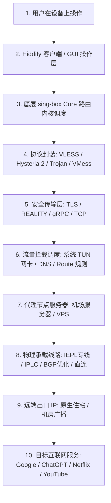
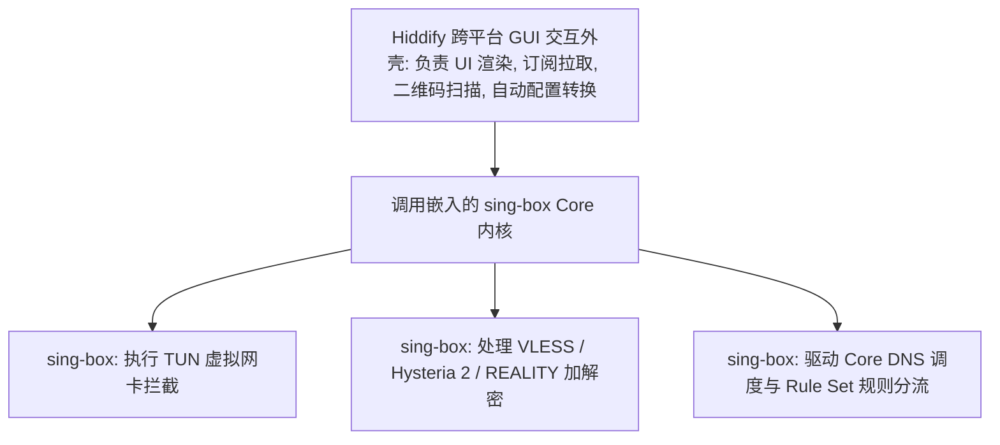

在当今繁荣的科学上网与开源代理工具生态中，**Hiddify（以及此前广为人知的 Hiddify Next）** 以其优雅现代的 UI 界面、全平台覆盖支持（Android、Windows、macOS、iOS、Linux）以及对新一代抗封锁协议的极致兼容，迅速成为了全球技术圈与普通用户关注的焦点。

然而，面对层出不穷的技术名词与软件名称，绝大多数刚接触网络工具的新手都会陷入一系列认知误区与概念混乱：

**“Hiddify 到底是一家卖节点的机场服务商，还是一款开源的翻墙客户端软件？下载安装后为什么连不上网？”**  
**“网上很多人说的 Hiddify Next 和现在官网下载的 Hiddify App 到底是不是同一个软件？它们之间是什么关系？”**  
**“听说 Hiddify 底层使用的是 sing-box 内核，那它和原生 sing-box 客户端有什么区别？为什么支持 VLESS 和 REALITY 却不需要 Xray-core？”**  
**“在 Android 手机上，Hiddify、v2rayNG 和 Clash Verge Rev / Mihomo 到底哪个更好？换用 Hiddify 真的能让原本卡顿的宽带网速翻倍吗？”**  
**“为什么很多机场提供的 Clash 或 V2Ray 订阅链接可以直接粘贴进 Hiddify？所谓的‘全协议通用订阅’到底在客户端内部经历了什么转换？”**

**要真正理解 Hiddify，绝不能把软件当成节点，更不能把客户端、路由内核（Core）、代理协议（Protocol）与网络物理线路（Line）混为一谈！**

理解 Hiddify 的技术本质，必须建立一套 **八层网络代理生态认知与选型模型**：**“厘清客户端（GUI）与节点提供商（Airport）的权责边界 ➔ 理解 Hiddify Next 到 Hiddify 的品牌演进 ➔ 拆解 Hiddify GUI 与底层 sing-box Core 的协同机制 ➔ 严格区分 Core 内核（sing-box / Xray / v2ray-core / Mihomo） ➔ 掌握协议层（VLESS / VMess / Trojan / Hysteria 2 / TUIC / REALITY）的技术实现 ➔ 辨析传输层安全（TLS/REALITY）与物理专线（IEPL/IPLC）的本质差异 ➔ 科学评估跨平台特性与多格式订阅解析 ➔ 结合自身设备与网络需求做出最理性的客户端选型”**。

本文作为 **Hiddify 生态总入口的顶级 Pillar 核心指南**，将带你彻底穿透代理工具的技术迷雾，建立清晰完整的全局网络认知。

---

## ⚡ 60 秒极速看懂：Hiddify 完整代理流转架构



```text
┌────────────────────────────────────────────────────────────────────────────────────────┐
│                        现代代理网络四维分层体系对照表                                  │
├──────────────┬──────────────────────────────┬──────────────────────────────────────────┤
│ 体系分层     │ 包含的典型实体               │ 承担的核心职责与技术本质                 │
├──────────────┼──────────────────────────────┼──────────────────────────────────────────┤
│ **客户端层** │ **Hiddify** / v2rayNG / Clash │ **人机交互、订阅解析、节点展示与系统开关**│
│ **内核层**   │ **sing-box** / Xray / Mihomo │ **数据包捕获、加密解密、DNS 调度与分流** │
│ **协议层**   │ **VLESS** / Hysteria 2 / Trojan│ **客户端与服务器之间的隧道通信封装规范** │
│ **线路层**   │ **IEPL 专线** / IPLC / BGP优化│ **物理层海缆、陆缆与运营商骨干网络质量** │
└──────────────┴──────────────────────────────┴──────────────────────────────────────────┘
```

- 🚨 **核心认知铁律**：
  - **Hiddify 是客户端软件，不生产节点，也不自带任何网络流量**；
  - **VLESS / Hysteria 2 是协议，IEPL / IPLC 是物理线路，两者处于不同技术维度**；
  - **换用 Hiddify 不能把普通公网直连变成企业内网专线，亦无法改变节点的出口 IP 纯净度！**

---

## 一、第一大核心概念：Hiddify 到底是什么？

### 1. Hiddify 的本质定义
**Hiddify 是一款现代化的、多平台通用的开源代理客户端（Proxy Client）。** 它的核心目标是为终端用户提供一个极其现代化、跨平台一致、操作极简且功能强大的图形化界面（GUI），让用户能够轻松导入、管理和使用各类代理节点。

### 2. 必须破除的四大基础误区
- ❌ **Hiddify 不是机场服务商**：安装 Hiddify 后如果没有导入有效的第三方节点订阅，客户端无法提供任何上网服务；
- ❌ **Hiddify 不是代理协议**：网络上不存在所谓的“Hiddify 协议”，Hiddify 运行的是 VLESS、Trojan、Hysteria 2 等公开行业协议；
- ❌ **Hiddify 不是传统商业 VPN**：虽然在手机状态栏会显示系统 VPN 钥匙图标（利用了系统的 VpnService 虚拟网卡技术），但它本质是代理规则调度器；
- ❌ **Hiddify 不是原版 sing-box 的简单复制**：Hiddify 在 sing-box Core 之上构建了高完成度的自动化订阅解析、策略分流和跨平台 UI 外壳。

---

## 二、第二大核心概念：Hiddify Next 品牌演进与产品矩阵

很多用户在搜索教程时经常看到“Hiddify Next”这个词，必须明确其品牌变迁历程：

```text
┌────────────────────────────────────────────────────────────────────────────────────────┐
│                        Hiddify 品牌历史演进与产品矩阵对照表                            │
├──────────────┬────────────────────────┬────────────────────────────────────────────────┤
│ 产品/阶段    │ 历史与当前定位         │ 核心功能与适用人群                             │
├──────────────┼────────────────────────┼────────────────────────────────────────────────┤
│ **Hiddify Next**| **早期通用客户端名称** | 项目初期开发的跨平台客户端（现已全面升级统一） │
│ **Hiddify (App)**| **当前官方正式客户端品牌**| 统一维护的 Android/iOS/Windows/macOS/Linux 客户端│
│ **Hiddify Manager**| **服务端部署与管理面板**| 面向服务器管理员（VPS）的后台一键部署面板系统  │
└──────────────┴────────────────────────┴────────────────────────────────────────────────┘
```

- 💡 **特别提醒**：
  - 目前官方已将通用客户端统一命名为 **Hiddify**（在各大应用商店与 GitHub 仓库中统一标识）；
  - 普通用户只需下载 **Hiddify 客户端（Client/App）**，无需理会面向运维人员的 Hiddify Manager 服务端面板。

---

## 三、第三大核心辨析：Hiddify 与 sing-box 的深层血缘关系



### 1. Hiddify 与 sing-box 的分工
- **sing-box 扮演的角色**：作为底层动力引擎（Core），负责最高性能的网络数据包转发、密码学加解密、TUN 虚拟网卡驱动与 DNS 解析；
- **Hiddify 扮演的角色**：作为驾驶室（GUI），屏蔽了手写繁琐 JSON 文件的极高门槛，将节点的导入、自动测速、策略切换与图形化开关封装为友好的界面。

### 2. 关键纠错：支持 VLESS / REALITY 并不代表使用了 Xray-core
很多老用户认为“只有 Xray 才能跑 VLESS 和 REALITY”。事实上，**sing-box 内核早已对 VLESS 协议、Vision 控流与 REALITY 伪装实现了深度且高效的原生支持**。因此，Hiddify 可以在完全不依赖 Xray-core 的前提下，完美运行所有主流的 VLESS-REALITY 节点！

---

## 四、第四大核心辨析：Hiddify 与 V2Ray、Xray、Clash / Mihomo 全景对比

```text
┌────────────────────────────────────────────────────────────────────────────────────────┐
│                   Hiddify 与主流代理生态五大维度全景对比表                              │
├──────────────┬──────────────────┬──────────────────┬──────────────────┬────────────────┤
│ 对比维度     │ **Hiddify**      │ **v2rayNG**      │ **Clash Verge Rev**| **sing-box 原生**│
├──────────────┼──────────────────┼──────────────────┼──────────────────┼────────────────┤
│ **主要定位** │ 现代化全平台客户端| Android 经典客户端| 桌面端主力分流工具| 极客轻量底层 Core  │
│ **底层内核** │ **sing-box Core** | Xray-core / v2ray| **Mihomo (Clash Meta)**| sing-box 自身   │
│ **覆盖平台** │ 全平台 (Win/Mac/安卓/iOS)| 专注 Android 端   | 专注 Windows/macOS/Linux| 跨平台 CLI/基础GUI│
│ **配置方式** │ 一键订阅/极简操作 | 节点导入/参数微调 | YAML 配置文件/订阅| JSON / SRS 纯代码│
│ **协议支持** │ VLESS/Hy2/TUIC/Trojan| VLESS/VMess/Trojan| VLESS/Hy2/Trojan/SS| 最全最前沿协议支持│
│ **上手难度** │ ⭐ (极低，适合小白)| ⭐⭐ (中等，界面传统)| ⭐⭐⭐ (需理解分流组)| ⭐⭐⭐⭐⭐ (极高，需代码)|
└──────────────┴──────────────────┴──────────────────┴──────────────────┴────────────────┘
```

---

## 五、第五大核心辨析：Hiddify 协议支持矩阵与传输安全

```text
┌────────────────────────────────────────────────────────────────────────────────────────┐
│                        Hiddify 主流协议与传输特性支持矩阵                              │
├──────────────┬──────────────────┬──────────────────────────────────────────────────────┤
│ 协议类型     │ 底层技术规范     │ 核心特性与技术优势                                   │
├──────────────┼──────────────────┼──────────────────────────────────────────────────────┤
│ **VLESS**    │ 新一代轻量无状态协议| 搭配 XTLS / Vision，性能开销极低，握手极速           │
│ **Hysteria 2**| 基于 UDP / QUIC 协议| 恶劣丢包网络下具备极强爆发力，晚高峰抗拥塞利器       │
│ **TUIC**     │ 基于 QUIC 开发的高速协议| 专为高延迟长距离海缆设计，多路复用性能卓越           │
│ **Trojan**   │ 伪装标准 HTTPS 流量| 经典成熟的 TLS 穿透协议，抗封锁稳定性好             │
│ **VMess**    │ V2Ray 经典加密协议 | 兼容性最广的老牌协议，但 CPU 与时延开销略高          │
│ **Shadowsocks**| 经典轻量对称加密协议| 结构简单，在 IEPL 专线中常用于降低转发延迟           │
└──────────────┴──────────────────┴──────────────────────────────────────────────────────┘
```

---

## 六、实战决策指南：Hiddify、v2rayNG 与 Clash 怎么选？

```mermaid
graph TD
    Start[选择最适合自己的科学上网客户端] --> CheckPlatform{1. 你的主要使用平台是什么?}
    
    CheckPlatform -->|多平台全家桶 (Windows+Mac+Android+iOS)| ChoiceHiddify[📱 优先选择 Hiddify: 跨平台 UI 风格高度一致, 学习成本最低]
    CheckPlatform -->|主要在 Android 手机| CheckPref{2. 你的操作偏好是什么?}
    
    CheckPref -->|追求极简, 喜欢现代化卡片美学| ChoiceHiddify
    CheckPref -->|习惯传统树状节点列表与精细单节点微调| ChoiceV2rayNG[🤖 选择 v2rayNG: 经典成熟, 社区资料极度丰富]
    
    CheckPlatform -->|主要在 Windows / macOS 电脑| CheckDesk{3. 桌面端的核心诉求?}
    CheckDesk -->|深度依赖复杂分流规则与 YAML 扩展配置| ChoiceVerge[💻 选择 Clash Verge Rev: 强大的规则组与生态兼容]
    CheckDesk -->|开箱即用, 拒绝繁琐配置| ChoiceHiddify
```

---

## 七、2026 全协议完美兼容与标准 Hiddify 高速专线推荐

无论选用 Hiddify、v2rayNG 还是 Clash，**客户端本身无法提升物理带宽上限**。要保障 4K 视频秒开与 AI 平台稳定访问，核心在于搭配**高带宽内网专线与纯净住宅出口**的优质服务：

```text
┌────────────────────────────────────────────────────────────────────────────────────────┐
│                        2026 全协议兼容与标准专线推荐                                   │
├──────────┬──────────────────────────┬──────────────┬──────────────┬────────────────────┤
│ 适配场景 │ 推荐品牌候选             │ 实际起付门槛 │ 每月流量配额 │ Hiddify 兼容与专线优势 │
├──────────┼──────────────────────────┼──────────────┼──────────────┼────────────────────┤
│ 旗舰全能 │ 光速云 (GuangSuYun)      │ 约 ¥7.5/月起 │ 59G~238G /月 │ 全线 IEPL 专线，完美适配 Hiddify 多协议订阅，4K 秒开无拥塞│
│ 平价轻量 │ 微风网络 (BreezeNet)     │ 约 ¥7/月起   │ 50GB / 月    │ 优质 BGP 优化专线，纯净轻量，节点更新秒级响应，日常极稳│
│ 弹性月付 │ 唯兔云 (V2Yun)           │ ¥14.9/月     │ 100GB / 月   │ 14.9 元纯单月付，多协议节点充沛，单节点故障秒切  │
│ 应急备用 │ 星岛梦 (XingDaoMeng)     │ 约 ¥8/月起   │ 60G/不限时包 │ 0月租不限时包，永不过期，专线拥塞时随时顶上应急  │
│ 极速专精 │ 速界 (SpeedWorld)        │ ¥25/月       │ 150GB / 月   │ 企业级超大独立专线带宽，AI 与流媒体原生解锁极速响应 │
└──────────┴──────────────────────────┴──────────────┴──────────────┴────────────────────┘
```

- 🏆 **全协议旗舰首选**：[光速云](/reviews/guangsu-cloud/) —— 2020 老牌专线，全线内网 IEPL 专线，标准 Hiddify/sing-box 订阅支持；
- 🍃 **超低预算轻量**：[微风网络](/reviews/weifeng-cloud/) —— 50GB 精品小流量专线，年付折算仅约 ¥7/月；
- 💳 **拒绝绑定的单月付**：[唯兔云](/recommend/best-airports/) —— ¥14.9 纯单月付，100GB 充沛流量。

---

## 八、避坑指南：65 个关于“Hiddify”的致命认知误区

```text
❌ 误区 1：下载安装了 Hiddify 就能直接免费翻墙上外网 ➔ 事实：Hiddify 是空壳客户端，必须导入有效的代理节点订阅才能使用。
❌ 误区 2：Hiddify 是一家位于国外的 VPN 梯子公司 ➔ 事实：Hiddify 是一个开源软件项目，本身不提供任何收费 VPN 节点服务。
❌ 误区 3：Hiddify Next 和 Hiddify 是两款完全不同的独立软件 ➔ 事实：Hiddify Next 是该客户端早期的产品名称，现已统一品牌为 Hiddify。
❌ 误区 4：Hiddify Manager 就是手机上用来连接节点的客户端 ➔ 事实：Hiddify Manager 是服务端管理面板，普通终端用户只需使用 Hiddify 客户端。
❌ 误区 5：Hiddify 底层用的是 sing-box，所以 Hiddify 就等于 sing-box ➔ 事实：Hiddify 是包含 UI、订阅转换与自动化规则的高级应用外壳。
❌ 误区 6：因为 Hiddify 支持 VLESS 协议，所以它底层一定运行着 Xray-core ➔ 事实：Hiddify 底层的 sing-box 内核原生实现了对 VLESS 的支持。
❌ 误区 7：REALITY 是一种由 Hiddify 独创的私有加密协议 ➔ 事实：REALITY 是开源社区的 TLS 伪装技术，Hiddify 仅进行了客户端调用。
❌ 误区 8：换用 Hiddify 客户端后，原本卡顿的普通直连节点能自动变成 IEPL 专线 ➔ 事实：客户端无法改变物理线路质量，网络性能取决于服务器节点。
❌ 误区 9：Hiddify 客户端开源就代表使用它上网具有 100% 的绝对隐私 ➔ 事实：节点提供商依然能看到你的连接请求，开源客户端无法为节点安全性背书。
❌ 误区 10：只要在手机上看到 VPN 钥匙图标，就代表所有 App 都走代理了 ➔ 事实：分流规则可能将国内 App（如微信）判定为 Direct 本地直连。
❌ 误区 11：所有的机场订阅链接都可以无条件直接导入 Hiddify ➔ 事实：必须是提供通用订阅、Clash 格式或 sing-box 格式的兼容链接。
❌ 误区 12：Hiddify 的测速延迟最低，就代表用它看 4K 视频速度一定最快 ➔ 事实：测速延迟（Ping）只代表握手耗时，视频流畅度取决于持续吞吐带宽。
❌ 误区 13：Hiddify 会自动帮用户解锁 ChatGPT 和 Netflix 的地域限制 ➔ 事实：解锁能力取决于节点的出口 IP 属性，与使用的客户端软件无关。
❌ 误区 14：在网上随便找一个第三方网盘下载的 Hiddify APK 最方便 ➔ 事实：第三方修改版可能植入后门，必须通过 GitHub Releases 或官方应用商店下载。
❌ 误区 15：Hiddify 比 v2rayNG 和 Clash 高级，所有人都应该立即抛弃旧客户端 ➔ 事实：工具各有侧重，适合自己的配置习惯与生态才是最佳选择。
```

---

## 九、常见问题深度解答（FAQ · 70 问）

### Q1：Hiddify 是什么？
**答**：**Hiddify 是一款基于 sing-box 内核的现代化全平台开源代理客户端。** 它支持 Android、iOS、Windows、macOS 和 Linux，提供极其简便的节点管理与分流体验。

### Q2：Hiddify 和 Hiddify Next 是什么关系？
**答**：**Hiddify Next 是该项目的历史名称。** 随着项目迭代，官方已将其正式统一定名为 **Hiddify**（或 Hiddify App），两者属于同一项目的演进。

### Q3：Hiddify 是机场吗？自带免费节点吗？
**答**：**不是，也不自带节点。** Hiddify 纯粹是客户端软件工具。用户需要自行购买机场服务商的订阅，或使用自建 VPS 节点导入后方可联网。

### Q4：Hiddify 底层使用的是什么内核？
**答**：**底层主要基于 sing-box Core。** 借助 sing-box 的卓越性能，Hiddify 原生支持 VLESS、Hysteria 2、TUIC、Trojan、Shadowsocks 等全套新一代协议。

### Q5：Hiddify 和 sing-box 官方客户端有什么区别？
**答**：**Hiddify 提供了更友好的 UI 与自动化订阅解析。** 原生 sing-box 侧重纯代码配置；Hiddify 则将复杂的规则与参数封装为小白用户一键开关的图形化界面。

### Q6：Hiddify 和 v2rayNG 哪个更好用？
**答**：**取决于个人偏好。** Hiddify 界面更现代、全平台通用且原生支持 Hysteria 2/TUIC；v2rayNG 在 Android 生态耕耘多年，节点列表传统且调试资料极其丰富。

### Q7：Hiddify 支持导入 Clash 订阅吗？
**答**：**支持绝大多数主流标准订阅。** Hiddify 内置了智能订阅转换器，可直接解析 Clash YAML、V2Ray 链接以及通用的 Base64 订阅。

### Q8：使用 Hiddify 为什么依然无法访问 ChatGPT 或 Netflix？
**答**：**因为目标平台封锁了节点的机房出口 IP。** 客户端仅负责建立连接隧道，能否通过风控检测取决于节点服务商提供的 IP 是否为原生纯净住宅 IP。

### Q9：Hiddify 需要给手机 Root 权限吗？
**答**：**完全不需要。** Hiddify 通过 Android 标准的 VpnService API 建立虚拟网卡，任何未 Root 的普通安卓设备均可一键开启。

### Q10：Hiddify 在 iOS 苹果手机上可以用吗？
**答**：**可以。** Hiddify 已上架非国区 App Store，iOS 用户可切换外区 Apple ID 后直接搜索下载使用。

### Q11：下一步应该如何上手使用 Hiddify？
**答**：建议接下来关注本站即将推出的《Hiddify Android怎么用？下载安装、订阅、节点、VPN权限与完整配置教程》，或者先阅读 [《sing-box Android怎么用？下载安装、配置、订阅、TUN与完整使用教程》](/tutorials/sing-box-android/)，掌握底层内核操作。

---

## 🏁 总结：Hiddify 生态认知金字塔

理解与选型 Hiddify，请牢记以下**核心铁律**：

```text
1. 明定位 ➔ Hiddify 是客户端而非机场，不自带节点，需配合第三方订阅使用
2. 识血缘 ➔ Hiddify 是 sing-box Core 的跨平台 GUI 封装，兼具顶级性能与友好交互
3. 分图层 ➔ 客户端管人机交互，Core 管加解密，Protocol 管隧道封装，Line 决定物理速度
4. 慎期望 ➔ 换客户端不能把直连变专线，解锁 AI 与流媒体核心在于纯净出口 IP
5. 认正品 ➔ 认准 GitHub 官方 Release 与正规应用商店，彻底远离第三方魔改后门
```

---

### 📚 相关专题延伸阅读
- 📱 **sing-box Android 教程**：[《sing-box Android怎么用？下载安装、配置、订阅、TUN与完整使用教程》](/tutorials/sing-box-android/)
- 🏛️ **sing-box 概念总览**：[《sing-box是什么？和V2Ray、Xray、Clash有什么区别？》](/wiki/what-is-sing-box/)
- 🤖 **V2Ray 与 Xray 对比**：[《V2Ray和Xray有什么区别？生态演进与协议对比》](/wiki/v2ray-vs-xray/)
- 🧭 **Clash 生态解析**：[《Clash是什么？内核演进与客户端全景指南》](/wiki/what-is-clash/)
- ⚡ **老牌旗舰专线评测**：[《光速云深度评测：2020老牌IEPL专线与解锁实测》](/reviews/guangsu-cloud/)
- 🏆 **2026 全景大榜**：[《2026梯子推荐：稳定、速度、价格、安全与不同使用场景怎么选》](/recommend/best-tizi/)
