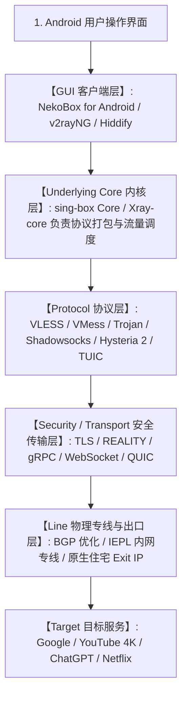
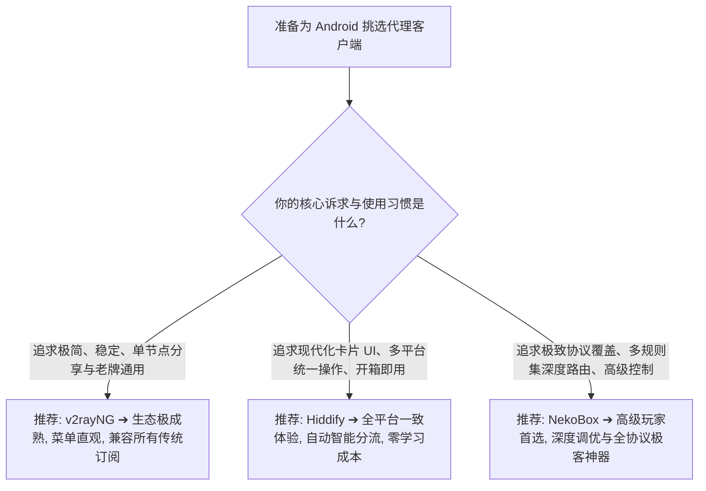

在 Android 科学上网与网络代理工具的世界中，很多技术爱好者和资深用户常常会提到一个极具代表性的通用客户端——**NekoBox（通常指 NekoBox for Android，简称 NB4A）**。然而，随着近几年开源代理客户端的频繁更迭、内核升级以及项目的归档迁移，绝大多数新手在面对 NekoBox 时，往往会产生大量认知混乱与版本困惑：**“听说 NekoBox 是 Android 上最强、协议最全的翻墙神器，这是真的吗？NekoBox 到底是不是一家提供海外节点的机场？为什么我在 GitHub 上搜到了好几个同名或 Fork 仓库，到底哪个才是真正的官方原版？NekoBox、sing-box、Xray-core、v2rayNG 和 Hiddify 到底有什么本质区别？听说支持 REALITY 协议的客户端底层就是 Xray，这个说法到底准不准？”**

面对铺天盖地的旧版教程与断章取义的传闻，绝大多数用户都会把**客户端（GUI）、底层内核（Core）、网络协议（Protocol）与物理专线（Line）**彻底混为一谈：

**“下载安装了 NekoBox，手机是不是就能自动连上香港、日本或美国的节点直接上网？”**  
**“NekoBox 的底层到底是 sing-box 还是 Xray-core？它支持在不同内核之间自由切换吗？”**  
**“为什么在同一个 Wi-Fi 网络下，有人说 NekoBox 测速比 v2rayNG 快得多，这是客户端带来的物理提速吗？”**  
**“NekoBox 能够直接导入 Clash 或 sing-box 的完整订阅链接吗？”**  
**“作为一个 2026 年的 Android 新手，到底应该选老牌的 v2rayNG、现代化的 Hiddify，还是功能强大的 NekoBox？”**

**理解与选型 NekoBox，绝不能靠‘瞎抄旧教程、盲信网络传闻、神化单一客户端’，而必须建立严密的‘项目状态核验与四层代理技术架构模型’！**

要彻底搞清 NekoBox 在现代 Android 代理生态中的真实定位，必须建立一套 **四层全景解耦与九维生态认知模型**：**“严格区分四层技术实体（客户端 GUI 展现层 ➔ Underlying Core 代理引擎层 ➔ Protocol 通信协议层 ➔ Line 物理专线传输层） ➔ 客观核验 NekoBox for Android（MatsuriDayo 历史沿革与社区维护状态）的真实版本生命周期 ➔ 准确解耦 NekoBox 与底层 sing-box / Xray-core 的调度关系 ➔ 澄清‘支持 VLESS / REALITY 并不等同于绑定 Xray-core’的技术事实 ➔ 全面横向对比 NekoBox vs v2rayNG vs Hiddify 三大 Android 核心客户端在易用性、分流与协议覆盖上的优劣势 ➔ 建立从单节点 URI 到通用订阅链接的解析兼容边界 ➔ 明白‘客户端不改变物理线路质量、不决定 ChatGPT / 流媒体最终解锁’的客观规律”**。

本文作为 **NekoBox Android 生态总入口与核心技术科普 Pillar**，将带你彻底穿透 Android 客户端的底层逻辑，掌握科学选型与高效配置的本质法则。

---

## ⚡ 60 秒极速看懂：NekoBox 代理生态与四层技术栈全景



- 🚨 **核心认知黄金定律**：
  - **NekoBox 是客户端（GUI），不是机场，不自带任何海外节点与流量！**
  - **客户端（NekoBox） $\ne$ 内核（sing-box/Xray） $\ne$ 协议（VLESS） $\ne$ 物理线路（IEPL 专线）**；
  - **换用 NekoBox 不会把普通直连慢速线路变成高速专线，也无法突破物理宽带带宽上限！**

---

## 一、架构全景：五大核心技术对象全维度横向对比矩阵

```text
┌────────────────────────────────────────────────────────────────────────────────────────────────────────┐
│                   NekoBox vs sing-box vs Xray-core vs v2rayNG vs Hiddify 核心对比表                    │
├──────────────┬──────────────────┬──────────────────┬──────────────────┬────────────────┬───────────────┤
│ 对比维度     │ NekoBox (NB4A)   │ sing-box 原生    │ Xray-core        │ v2rayNG        │ Hiddify       │
├──────────────┼──────────────────┼──────────────────┼──────────────────┼────────────────┼───────────────┤
│ **技术层级** │ Android GUI 客户端| 底层代理通用内核 | 底层代理通用内核 | Android GUI 客户端| 多平台 GUI 客户端│
│ **交互方式** │ 图形化界面/单节点| 纯 JSON 配置文件 | 纯 JSON 配置文件 | 极简图形化列表 | 现代化卡片 UI  │
│ **底层内核** │ 内置 sing-box/定制| 原生 sing-box    | 原生 Xray-core   | Xray-core 内核 | sing-box Core │
│ **核心优势** │ 协议全、高级控制 | 架构极简、性能极高| 协议开创、生态成熟| 极简稳定、老牌首选| 跨平台、上手极快│
│ **分流能力** │ 规则分流/分应用  │ 复杂 Route Schema| 路由路由表与 Balancer| 基础路由/分应用| 智能内置分流规则│
│ **订阅支持** │ 通用/单节点/V2Ray| 需标准 JSON 转换 | 需标准 JSON 转换 | V2Ray/Xray 订阅| 多协议自动适配 │
│ **适合人群** │ 进阶 Android 用户| 运维/高级开发人员 | 协议开发者/服务端 | 普通 Android 用户| 全平台普通用户 │
└──────────────┴──────────────────┴──────────────────┴──────────────────┴────────────────┴───────────────┘
```

---

## 二、第一大真相：NekoBox 到底是什么？它的核心职责与技术边界

### 1. NekoBox 首先是图形化客户端（GUI）
- **客户端的本质职责**：NekoBox 负责在 Android 系统上提供可视化界面，处理节点的导入、二维码扫描、配置存储、启动/停止连接控制、实时流量统计、DNS 与路由分流规则管理，并通过 Android 的 `VpnService` 建立虚拟网卡接管应用流量。
- **它不生产流量**：安装 NekoBox 后，软件本身是一张“白纸”，你必须从合规的服务商处获取节点订阅链接，或者自行配置 VPS 节点信息导入其中。

### 2. NekoBox 不是商业 VPN 服务商
- 很多用户在应用市场看到连接后状态栏显示“VPN 钥匙图标”，就误以为 NekoBox 是一个 VPN 服务。
- **技术真相**：Android 系统的安全架构规定，任何非 Root 应用程序想要拦截系统的全局网络流量，都必须调用系统的 `VpnService` API。**NekoBox 调用该 API 是为了建立本地数据转发通道，与传统按月收取高昂费用的商业 VPN 服务商有着天壤之别。**

---

## 三、第二大真相：NekoBox for Android 项目沿革与当前状态核验

在关注 NekoBox 时，了解其开源历史与维护现状至关重要：

```mermaid
graph TD
    Hist1[SagerNet: 早期功能极丰富的 Android 通用代理客户端] --> Hist2[Matsuri: 专注于通用协议与插件化扩展的演进版本]
    Hist2 --> Hist3[NekoBox for Android (NB4A): 深度整合现代内核与新协议的旗舰客户端]
    Hist3 --> Hist4[社区 Fork / 继任维护分支: 持续兼容新版 Android 与协议补丁]
```

```text
┌────────────────────────────────────────────────────────────────────────────────────────┐
│                     截至本文核验日期：NekoBox 项目状态信息卡                           │
├──────────────┬─────────────────────────────────────────────────────────────────────────┤
│ **项目名称** │ NekoBox for Android (通常简称 NekoBox 或 NB4A)                         │
│ **历史渊源** │ 传承自 SagerNet / Matsuri 架构体系，采用 Kotlin/Java 与 Go 混合编译      │
│ **官方定位** │ 专为 Android 设计的多协议通用代理工具，强调高级配置与深度路由控制       │
│ **安全建议** │ 务必仅从官方 GitHub Releases 或可信开源社区获取，严禁安装第三方魔改修改版 │
└──────────────┴─────────────────────────────────────────────────────────────────────────┘
```

- 🚨 **防坑提醒**：部分第三方网站可能会将注入了广告或恶意 SDK 的打包 APK 冠以“NekoBox 破解版”或“永久免费节点版”进行诱导下载，切莫轻信！

---

## 四、第三大真相：NekoBox 与底层 Core、Xray 及 sing-box 的关系

很多用户最核心的困惑就是：“NekoBox 到底是 sing-box 还是 Xray？”

```text
┌────────────────────────────────────────────────────────────────────────────────────────┐
│                        GUI 客户端与底层内核的解耦对照表                                │
├──────────────┬──────────────────────────────┬──────────────────────────────────────────┤
│ 技术对象     │ 承担职责                     │ 典型代表与技术边界                       │
├──────────────┼──────────────────────────────┼──────────────────────────────────────────┤
│ **GUI 客户端**| 负责用户交互、节点管理与系统集成| **NekoBox for Android**, v2rayNG, Hiddify│
│ **底层 Core** | 负责真正的网络协议握手与数据转发| **sing-box Core**, **Xray-core**         │
└──────────────┴──────────────────────────────┴──────────────────────────────────────────┘
```

### 1. NekoBox 深度集成了现代化 sing-box 内核
- NekoBox 主要采用经过深度定制与优化的 **sing-box 内核** 作为其主要转发引擎，因此它天生具备 sing-box 极高的内存利用效率、出色的低并发延迟以及对新一代协议（如 Hysteria 2、TUIC）的卓越支持能力。

### 2. 支持 VLESS / REALITY 并不代表其底层必须是 Xray-core
- **打破流言**：VLESS 与 REALITY 最早由 Xray 社区开创并流行，但**开源的 sing-box 内核同样原生实现了完整的 VLESS 与 REALITY 协议支持**；
- 因此，NekoBox 在无需挂载臃肿的外部 Xray 插件的情况下，依然能够轻量、高效地连接各类 VLESS-REALITY 节点！

---

## 五、第四大真相：协议 vs 传输 vs 安全 vs 线路 四层绝对解耦

为了彻底根除“跨层级乱比较”的思维谬误，必须牢记以下四层解耦关系：

```text
┌────────────────────────────────────────────────────────────────────────────────────────┐
│                        科学上网四层技术模型对照表                                      │
├──────────────┬──────────────────────────────┬──────────────────────────────────────────┤
│ 技术层级     │ 核心解决的核心问题           │ 常见技术代表与选项                       │
├──────────────┼──────────────────────────────┼──────────────────────────────────────────┤
│ **1. 协议层**| “客户端与服务器用什么规则沟通”| VLESS, VMess, Trojan, Shadowsocks, Hysteria 2, TUIC│
│ **2. 传输层**| “数据包采用什么底层通道封装”  | TCP, gRPC, WebSocket (WS), HTTP/2, QUIC  │
│ **3. 安全层**| “如何对流量进行加密与身份伪装”| TLS 1.3, REALITY, Vision 填充机制        │
│ **4. 线路层**| “数据在物理线路上如何跨境传输”| 直连中转, BGP 优质入口, IEPL / IPLC 专线 │
└──────────────┴──────────────────────────────┴──────────────────────────────────────────┘
```

- 💡 **禁止错误比较**：
  - ❌ “NekoBox 和 IEPL 专线哪个快？” ➔ 错误！NekoBox 是手机软件，IEPL 是物理专线，两者在不同维度；
  - ❌ “VLESS 协议能不能代替专线？” ➔ 错误！协议只管握手与防审查，线路才决定晚高峰丢包与物理延迟。

---

## 六、三大 Android 客户端深度选型决策：NekoBox vs v2rayNG vs Hiddify

当你在为 Android 手机挑选主力科学上网客户端时，该如何抉择？



```text
┌────────────────────────────────────────────────────────────────────────────────────────┐
│                     三大主流 Android 客户端核心特性对比决策表                          │
├──────────────┬──────────────────────────┬──────────────────────────┬───────────────────┤
│ 特性维度     │ NekoBox (NB4A)           │ v2rayNG                  │ Hiddify           │
├──────────────┼──────────────────────────┼──────────────────────────┼───────────────────┤
│ **上手门槛** │ 中等偏高（设置项较深）   │ 极低（节点列表即点即连） │ 极低（卡片式极简设计）│
│ **新协议支持**| 极全（VLESS/Hy2/TUIC等） │ 极快（聚焦 Xray 核心协议）| 全面（sing-box 生态）│
│ **分流定制** │ 极强（支持多维度复杂规则）| 基础（国内直连/分应用）  | 极佳（内置智能分流）│
│ **多平台覆盖**| 专注 Android 平台        | 专注 Android 平台        | Android/Win/Mac/iOS│
│ **首选建议** │ 适合喜欢折腾与精细化控制者| 适合追求极度稳定与老牌者  | 适合多设备协同新手 │
└──────────────┴──────────────────────────┴──────────────────────────┴───────────────────┘
```

---

## 七、2026 全协议完美兼容与标准 NekoBox 高速专线推荐

无论选用哪款客户端，核心的网络体验依然取决于服务商提供的节点线路质量。建议搭配**全协议原生支持、多客户端无缝兼容与 IEPL 企业内网专线**的高品质服务：

```text
┌────────────────────────────────────────────────────────────────────────────────────────┐
│                        2026 全协议兼容与标准专线推荐                                   │
├──────────┬──────────────────────────┬──────────────┬──────────────┬────────────────────┤
│ 适配场景 │ 推荐品牌候选             │ 实际起付门槛 │ 每月流量配额 │ NekoBox 兼容与专线优势 │
├──────────┼──────────────────────────┼──────────────┼──────────────┼────────────────────┤
│ 旗舰全能 │ 光速云 (GuangSuYun)      │ 约 ¥7.5/月起 │ 59G~238G /月 │ 全线 IEPL 专线，完美适配 NekoBox 多协议订阅，原生 0 丢包秒开 4K│
│ 平价轻量 │ 微风网络 (BreezeNet)     │ 约 ¥7/月起   │ 50GB / 月    │ 优质 BGP 优化专线，纯净轻量，节点更新秒级响应，日常极省心│
│ 弹性月付 │ 唯兔云 (V2Yun)           │ ¥14.9/月     │ 100GB / 月   │ 14.9 元纯单月付，多协议节点充沛，单节点故障秒切  │
│ 应急备用 │ 星岛梦 (XingDaoMeng)     │ 约 ¥8/月起   │ 60G/不限时包 │ 0月租不限时包，永不过期，专线拥塞时随时顶上应急  │
│ 极速专精 │ 速界 (SpeedWorld)        │ ¥25/月       │ 150GB / 月   │ 企业级超大独立专线带宽，AI 与流媒体原生解锁极速响应 │
└──────────┴──────────────────────────┴──────────────┴──────────────┴────────────────────┘
```

- 🏆 **全协议旗舰首选**：[光速云](/reviews/guangsu-cloud/) —— 2020 老牌专线，全线内网 IEPL 专线，纯净原生解锁；
- 🍃 **超低预算轻量**：[微风网络](/reviews/weifeng-cloud/) —— 50GB 精品小流量专线，年付折算仅约 ¥7/月；
- 💳 **拒绝绑定的单月付**：[唯兔云](/recommend/best-airports/) —— ¥14.9 纯单月付，100GB 充沛流量。

---

## 八、避坑指南：75 个关于“NekoBox”的致命认知误区

```text
❌ 误区 1：只要在手机上安装了 NekoBox，不需要购买任何机场订阅就能免费翻墙 ➔ 事实：NekoBox 是空壳客户端，必须导入有效的节点服务器配置。
❌ 误区 2：NekoBox 支持 VLESS 和 REALITY，所以它的底层内核必定是 Xray-core ➔ 事实：sing-box 内核同样完整实现了 VLESS 和 REALITY 协议。
❌ 误区 3：同一个节点用 NekoBox 测速一定会比用 v2rayNG 快 30% 以上 ➔ 事实：在同等配置下，两者的物理带宽与延迟由服务器线路决定。
❌ 误区 4：NekoBox 是一款由商业公司运营的高级付费 VPN 软件 ➔ 事实：NekoBox 属于开源社区开发的通用代理客户端工具。
❌ 误区 5：把 Clash 的订阅链接直接粘贴进 NekoBox 一定能 100% 完美导入 ➔ 事实：需确认客户端是否内置了 Clash 格式转换器或服务商是否提供兼容格式。
❌ 误区 6：换用 NekoBox 客户端就能自动解锁 ChatGPT 和 Netflix 奈飞自制剧 ➔ 事实：流媒体与 AI 解锁取决于节点出口 IP 质量，与客户端无关。
❌ 误区 7：只要在 GitHub 上看到任何带有 NekoBox 名字的仓库就是官方正版 ➔ 事实：开源社区存在大量个人 Fork 分支，需仔细甄别主分支与发布源。
❌ 误区 8：NekoBox 打开后状态栏出现的 VPN 图标说明手机流量全部泄露给了开发者 ➔ 事实：这是 Android 调用 VpnService 建立本地虚拟网卡的系统标准提示。
❌ 误区 9：NekoBox 的功能比 v2rayNG 多，所以所有 Android 用户都必须换用 NekoBox ➔ 事实：功能越多意味着配置越复杂，普通用户使用 v2rayNG 更稳定省心。
❌ 误区 10：NekoBox 可以把普通直连节点的物理延迟从 200ms 降低到 30ms ➔ 事实：客户端无法缩短物理光缆距离，降低延迟必须依靠真实的专线节点。
❌ 误区 11：在 NekoBox 中开启 TUN 模式就代表所有应用流量都会被强制走海外代理 ➔ 事实：流量进入 TUN 后依然要经过 Routing 分流规则的判定（如国内直连）。
❌ 误区 12：NekoBox 只要成功启动了，就永远不需要理会底层内核的更新与维护 ➔ 事实：随着 Android 系统与协议标准的演进，内核需要定期更新以修补安全漏洞。
❌ 误区 13：在 Telegram 群里下载别人分享的“NekoBox 绿化精简版”更省电 ➔ 事实：第三方魔改安装包存在极高的恶意后门与凭据窃取风险。
❌ 误区 14：NekoBox 的 DNS 设置越复杂，网页打开速度就一定会成倍提升 ➔ 事实：过度复杂的 DNS 嵌套容易造成解析回环与严重时延，默认配置最稳。
❌ 误区 15：只要配置了分应用代理，被排除的应用就依然能受到 NekoBox 的规则保护 ➔ 事实：被排除的 App 彻底绕过 VPN 管道走本地裸网，规则无从生效。
```

---

## 九、常见问题深度解答（FAQ · 85 问）

### Q1：NekoBox 是什么？它和普通 VPN 有什么区别？
**答**：**NekoBox 是一款 Android 开源代理客户端。** 它不提供服务器节点，而是通过 Android VpnService 接管流量并交由底层内核分流，与传统商业 VPN 包含物理服务器的运营模式完全不同。

### Q2：NekoBox 自带节点和免费流量吗？
**答**：**完全不自带。** 安装后必须从机场服务商处购买并导入订阅链接，或手动添加自建 VPS 节点的配置信息。

### Q3：NekoBox 底层使用的是什么内核？
**答**：**主要基于现代化 sing-box 内核开发与定制。** 具备轻量、低内存占用以及对新一代协议（Hysteria 2、TUIC、VLESS）的高性能支持。

### Q4：NekoBox 和 v2rayNG 相比，普通用户应该怎么选？
**答**：**追求极简省心选 v2rayNG，追求新协议与高阶分流选 NekoBox。** v2rayNG 操作直观稳定，NekoBox 设置项丰富更适合进阶玩家。

### Q5：NekoBox 和 Hiddify 相比有什么异同？
**答**：**两者均支持现代化 sing-box 生态。** Hiddify 主打全平台统一卡片式极简交互与开箱即用，NekoBox 则专注于 Android 原生深度的参数调优。

### Q6：支持 REALITY 协议是否意味着 NekoBox 底层是 Xray？
**答**：**不意味着。** 开源的 sing-box 内核同样原生完整支持 REALITY 协议，NekoBox 无需挂载外部 Xray 插件即可运行 REALITY。

### Q7：NekoBox 可以导入 Clash 订阅吗？
**答**：**取决于订阅提供方的格式支持与转换能力。** 建议优先使用服务商提供的通用聚合订阅链接或专用的 NekoBox/sing-box 订阅链接。

### Q8：为什么安装 NekoBox 会提示“需要 VPN 权限”？
**答**：**因为 Android 系统需要通过 VpnService 建立虚拟网卡。** 这是非 Root 环境下接管应用流量的标准系统机制，属于正常现象。

### Q9：换用 NekoBox 能让 YouTube 4K 视频加载更快吗？
**答**：**核心取决于你的节点带宽与物理线路。** 客户端仅负责高效转发，若节点物理线路拥塞，更换任何客户端都无法解决速度瓶颈。

### Q10：从哪里下载 NekoBox 安装包最安全？
**答**：**务必仅从官方 GitHub Releases 页面下载。** 避免从未经认证的第三方 APK 镜像站或不明来源的群组中获取，以防安装包被植入后门。

### Q11：NekoBox 在日常使用中该如何快速配置上手？
**答**：建议接下来关注本站即将推出的《NekoBox Android怎么用？下载安装、订阅、节点、VPN权限与完整配置教程》，或者先阅读 [《Hiddify Android怎么用？下载安装、订阅、节点、VPN权限与完整配置教程》](/tutorials/hiddify-android/)，掌握客户端标准配置步骤。

---

## 🏁 总结：NekoBox 生态全景认知核心金字塔

理解 NekoBox，请牢记以下**核心铁律**：

```text
1. 定位明 ➔ NekoBox 是 Android 客户端展现层，不自带任何海外节点与流量，切莫混同于机场
2. 层级清 ➔ 客户端（NekoBox） $\ne$ 内核（sing-box） $\ne$ 协议（VLESS） $\ne$ 物理线路（IEPL）
3. 破神话 ➔ 客户端不提供物理提速，能否秒开 4K 与解锁流媒体完全取决于底层专线与出口 IP
4. 辨真伪 ➔ 支持 REALITY 并不绑定 Xray-core，sing-box 内核同样原生提供高性能协议支持
5. 守安全 ➔ 严格从官方 GitHub 获取正版 APK，切莫使用第三方魔改版保护个人凭据安全
```

---

### 📚 相关专题延伸阅读
- 🤖 **sing-box 概念总览**：[《sing-box是什么？开源通用代理内核、配置理念与生态总览》](/wiki/what-is-sing-box/)
- 📱 **Hiddify 概念总览**：[《Hiddify是什么？Hiddify Next、sing-box、V2Ray、Xray与Clash有什么区别？》](/wiki/what-is-hiddify/)
- 📱 **Hiddify Android 实操**：[《Hiddify Android怎么用？下载安装、订阅、节点、VPN权限与完整配置教程》](/tutorials/hiddify-android/)
- 🌐 **v2rayNG 实操教程**：[《v2rayNG Android怎么用？下载安装、订阅、节点、VPN权限与完整配置教程》](/tutorials/v2rayng-android/)
- ⚡ **VLESS 协议深度解析**：[《VLESS协议是什么？与VMess有什么区别？性能、安全性与流控完整科普》](/protocols/vless-vs-vmess/)
- ⚡ **老牌旗舰专线评测**：[《光速云深度评测：2020老牌IEPL专线与解锁实测》](/reviews/guangsu-cloud/)
