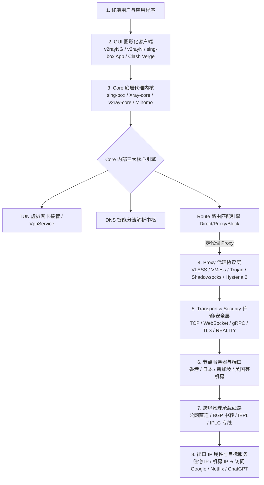
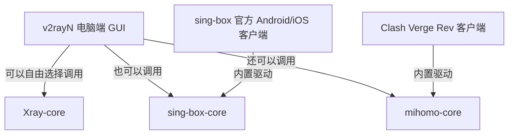
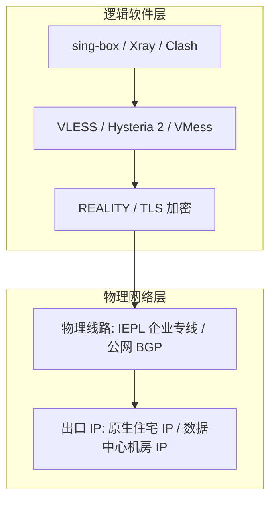
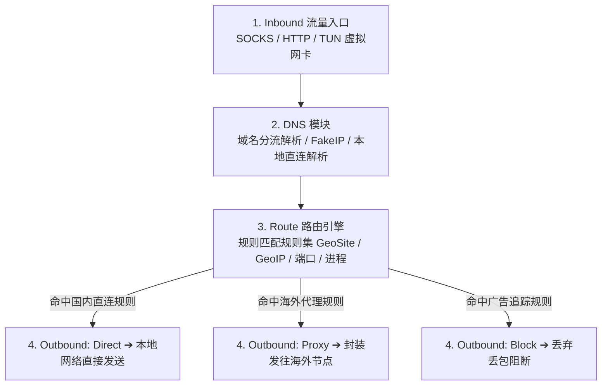
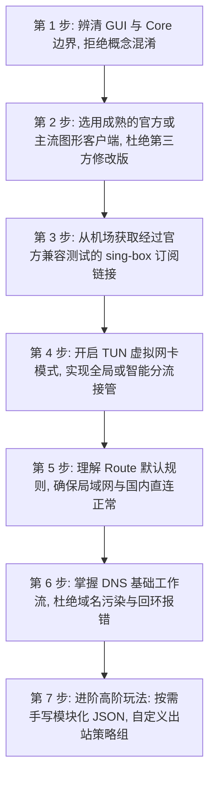

在科学上网与网络代理工具领域，随着技术的演进，越来越多的用户在各大论坛、GitHub 社区和机场文档中频繁看到一个崭新的名字——**sing-box**。

伴随它的出现，网络上也充斥着各种各样的说法与激烈的争论：

**“sing-box 到底是个什么软件？它是专门用来翻墙的 VPN，还是一家新开的机场？”**  
**“为什么有人说 sing-box 是‘下一代万能代理内核’？它和我们熟知的 V2Ray、Xray、Clash 以及 Mihomo 到底有什么本质区别？”**  
**“sing-box 到底能不能直接替代 Xray 或 Clash？听说换了 sing-box 速度能翻倍、延迟能减半，这是真的吗？”**  
**“为什么我把 Clash 的 YAML 订阅或者 v2rayN 的节点直接导入 sing-box 客户端，软件会疯狂报错甚至解析失败？”**  
**“sing-box 支持哪些协议？它支持 VLESS、VMess、Trojan、Shadowsocks 和 Hysteria 2 吗？支持 REALITY 伪装吗？”**  
**“所谓的 Core（代理内核）、GUI（图形化客户端）、Protocol（代理协议）、Transport（传输方式）、TLS/REALITY（安全层）、Route（路由分流）和 TUN（虚拟网卡），它们之间到底是什么从属关系？”**  
**“作为一个刚接触代理工具的新手，到底适不适合一上来就去手写 sing-box 的 JSON 配置文件？”**

**sing-box（星盒）本质上是一个现代化的通用网络代理核心（Core）与底层网络处理平台实现。它负责处理底层加密代理协议、路由分流规则、DNS 解析中枢以及 TUN 虚拟网卡流量接管等硬核能力。但它本身绝不等于机场服务、不等于远端节点服务器，也不是某一种单一的代理协议。**

理解 sing-box 以及整个现代代理生态，绝不能陷入“背名字”、“排座次”或盲目相信“某个软件能秒杀一切”的营销神话中。用户必须建立一套严谨清晰的 **八层代理生态全景认知模型**：**“GUI 客户端 ➔ Core 代理内核 ➔ Proxy 代理协议 ➔ Transport / Security 安全传输 ➔ DNS / Route / TUN 规则中枢 ➔ 节点服务器 ➔ 跨境物理线路 ➔ 目标平台与出口 IP”**。

本文作为 **sing-box 生态总入口与核心架构概念的终极 Pillar 指南**，将为你彻底理清 **sing-box 与 V2Ray、Xray、Clash、Mihomo 之间的技术血缘与生态边界，带你系统建立现代网络代理的底层认知体系**。

---

## ⚡ 60 秒极速看懂：现代代理生态八层流转全景图



- 🚨 **核心认知金字塔**：
  - **GUI 客户端**：给用户提供图形界面的外壳（按钮、列表、开关）；
  - **Core 代理内核**：在后台默默干活的发动机（解析协议、加密封包、匹配规则、管理 DNS）；
  - **Proxy 协议**：数据打包的加密语法格式（VLESS、VMess、Trojan 等）；
  - **物理线路**：海底光缆与企业专线（IEPL、IPLC、直连），**线路质量决定物理速度上限，Core 绝不能凭空改善光纤延迟**！

---

## 一、架构基石：sing-box 到底是什么？先定“边界与定义”

要彻底搞懂 sing-box，首先必须用排除法剔除网络上最常见的五大认知混淆：

```text
┌────────────────────────────────────────────────────────────────────────────────────────┐
│                        sing-box 是什么 vs 不是什么边界澄清表                           │
├──────────────┬────────────────────────┬────────────────────────────────────────────────┤
│ 常见混淆对象 │ sing-box 的真实技术定义│ 为什么不能画等号                               │
├──────────────┼────────────────────────┼────────────────────────────────────────────────┤
│ **不是“机场”**│ sing-box 是开源软件内核│ 机场是卖节点流量的商业服务商；sing-box 自身不含任何节点│
│ **不是“节点”**│ sing-box 负责发起连接  │ 节点是远端服务器 IP 与端口；sing-box 是本地运行的客户端工具│
│ **不是“协议”**│ sing-box 实现多种协议  │ VLESS、VMess、Hysteria 2 是协议；sing-box 是实现协议的平台│
│ **不是“VPN”** │ sing-box 具备代理能力  │ 商业 VPN 是中心化服务；sing-box 是可自由配置的多协议通用 Core│
│ **是“代理 Core”**│ **通用的网络代理平台内核**│ 负责底层流量转发、路由分流、DNS 解析与跨平台 TUN 网络驱动│
└──────────────┴────────────────────────┴────────────────────────────────────────────────┘
```

### 1. sing-box 项目的官方定位
- sing-box 是由开源社区独立设计并开发的高性能、模块化、跨平台的通用网络代理平台；
- 它的设计理念强调 **“现代、简洁、高吞吐、低内存占用以及标准化的抽象结构”**，旨在用统一的架构优雅地支持市场上主流的各种代理协议与网络特性。

### 2. 为什么有人把 sing-box 叫“客户端”，有人叫“Core”？
- **广义的 sing-box**：既包括官方提供的底层核心程序（命令行/二进制 Core），也包括官方针对 Android、iOS、macOS、Windows 平台推出的图形化客户端（GUI App）；
- **狭义的 sing-box**：专指底层的代理引擎核心（Core）。其他第三方客户端（如部分集成 sing-box 内核的客户端）也可以调用它的能力。

---

## 二、第二核心大山：GUI 客户端 vs Core 代理内核的本质解耦

这是所有代理教程中最重要的分水岭。很多新手之所以频繁配错，就是因为把 **“操作界面的名字”** 和 **“底层跑的内核”** 混成了一团。

```text
┌────────────────────────────────────────────────────────────────────────────────────────┐
│                        GUI 客户端 vs Core 代理内核深度对照表                           │
├──────────────┬────────────────────────┬────────────────────────────────────────────────┤
│ 对比维度     │ GUI 图形化客户端       │ Core 底层代理内核                              │
├──────────────┼────────────────────────┼────────────────────────────────────────────────┤
│ **主要角色** │ 人机交互界面（UI 外壳）│ 网络协议引擎（动力心脏）                       │
│ **典型代表** │ v2rayNG, v2rayN, Clash Verge Rev, sing-box GUI| sing-box-core, Xray-core, v2ray-core, Mihomo-core │
│ **核心职责** │ 订阅更新、节点切换、日志展示、开关控制| 协议握手、数据加解密、DNS 解析、Route 路由分发、TUN 虚拟网卡│
│ **替换关系** │ 同一个 GUI 可以切换集成不同 Core| 同一个 Core 可以被多个不同的 GUI 客户端调用驱动│
│ **故障表现** │ 界面卡顿、按钮无反应、闪退| 连接超时、Core Error、配置 Parse 报错、丢包     │
└──────────────┴────────────────────────┴────────────────────────────────────────────────┘
```



- 💡 **核心定律：四层支持兼容模型**
  ```text
  GUI Client 支持 ➔ Core 内核支持 ➔ Server 服务端支持 ➔ Provider 机场下发支持
  ```
  只有当这四层**全部对齐兼容**时，一个代理节点才能真正稳定跑通！你不能只因为客户端界面里有个“Hysteria 2”勾选框，就认为你的所有节点都能跑 Hysteria 2。

---

## 三、第三核心矩阵：sing-box vs V2Ray vs Xray vs Clash vs Mihomo

各大主流代理生态并非简单的“前浪与后浪”，而是有着各自独特的设计哲学、配置模型与演进路径：

```text
┌───────────────────────────────────────────────────────────────────────────────────────────────────────┐
│                           2026 主流代理 Core 生态全景横向评测矩阵表                                   │
├──────────────┬──────────────────┬──────────────────┬──────────────────┬───────────────────────────────┤
│ 比较维度     │ **sing-box**     │ **Xray-core**    │ **Mihomo (原Clash.Meta)**│ **v2ray-core (V2Fly)**       │
├──────────────┼──────────────────┼──────────────────┼──────────────────┼───────────────────────────────┤
│ **项目定位** │ 通用现代代理平台 │ VLESS/REALITY 先驱│ Clash 规则生态集大成者│ 经典模块化代理鼻祖            │
│ **配置格式** │ 结构化 JSON 规范 │ 经典 JSON 嵌套   │ YAML 声明式配置  │ 经典 JSON / Protobuf          │
│ **VLESS 协议**│ ✅ 完整支持      │ ✅ 原生领头羊    │ ✅ 完整支持      │ ⚠️ 基础支持 (不含最新特性)    │
│ **VMess 协议**│ ✅ 完整支持      │ ✅ 完整支持      │ ✅ 完整支持      │ ✅ 原生发源地 (AEAD 标准)     │
│ **Trojan**   │ ✅ 完整支持      │ ✅ 完整支持      │ ✅ 完整支持      │ ✅ 完整支持                   │
│ **Shadowsocks**│ ✅ 完整支持 (含2022)| ✅ 完整支持 (含2022)| ✅ 完整支持 (含2022)| ✅ 基础支持                   │
│ **Hysteria 2**│ ✅ 原生级完整支持│ ⚠️ 需特定插件/扩展│ ✅ 原生级完整支持│ ❌ 不支持                     │
│ **REALITY 伪装**│ ✅ 完整支持   │ ✅ 原创先锋设计  │ ✅ 完整支持      │ ❌ 不支持                     │
│ **TUN 虚拟网卡**│ ✅ 极速高性能内核级│ ⚠️ 依赖系统或扩展│ ✅ 强大的 Tun 驱动│ ⚠️ 依赖外挂插件               │
│ **DNS 系统** │ ✅ 强大的抽象解析链│ ✅ 基础路由 DNS  │ ✅ 极度丰富的策略组 FakeIP| ✅ 基础 DNS 模块            │
│ **路由分流** │ Inbound/Route/Outbound| 经典 Routing 规则| 强大的 Proxy Group / Rules| 经典 Routing 规则          │
│ **更适合谁** │ 极客/追求纯净与全能| 专注 Xray/VLESS/REALITY| 习惯 Clash 策略组/规则分流用户| 传统老旧配置维护者             │
└──────────────┴──────────────────┴──────────────────┴──────────────────┴───────────────────────────────┘
```
*(注：上述支持特性基于 2026 年最新官方文档与稳定 Release 实测核验。)*

### 1. sing-box 与 V2Ray（v2ray-core）是什么关系？
- **不是简单的“V2Ray 2.0”**：V2Ray 是历史悠久的开源项目，定义了 VMess 协议与经典的 Inbound/Outbound 架构；
- sing-box 是一个**完全独立重构**的新型现代 Core，它吸收了 V2Ray 的架构精髓，但采用了更高效的底层实现与现代配置模型。

### 2. sing-box 与 Xray（Xray-core）是什么关系？
- **两者是并行的独立顶级项目**：Xray 从 V2Ray 分支独立发展，开创了革命性的 **VLESS 协议与 REALITY 零证书伪装技术**；
- sing-box 实现了对 VLESS 与 REALITY 的深度兼容支持，同时在 TUN 网络接管、Hysteria 2 原生集成以及跨平台 GUI 统一度上做出了极为亮眼的架构创新。

### 3. sing-box 与 Clash / Mihomo 是什么关系？
- **不能把 sing-box 叫“新版 Clash”**：Clash 的核心是“代理策略组（Proxy Groups）”与“YAML 规则分流”；
- Mihomo（原 Clash.Meta）是 Clash 生态中最强大的现代继承者；
- sing-box 的分流哲学更偏向结构化的“路由规则（Route Rules）与出站映射（Outbound）”，**Clash 的 YAML 文件绝不能直接改后缀塞给 sing-box 使用**！

---

## 四、第四核心层级：Proxy 协议 vs Transport vs Security vs 物理线路

很多用户常问：“到底是 sing-box 快，还是 VLESS 快，还是 IEPL 专线快？”——**这个问题把四个完全不同的技术层级混在了一起！**

```text
┌────────────────────────────────────────────────────────────────────────────────────────┐
│                        现代代理网络四维分层解析表                                      │
├──────────────┬────────────────────────┬────────────────────────┬───────────────────────┤
│ 物理分层     │ 包含的核心技术对象     │ 解决的核心任务         │ 对访问速度与体验的影响│
├──────────────┼────────────────────────┼────────────────────────┼───────────────────────┤
│ **1. 代理协议**│ VLESS, VMess, Trojan, Shadowsocks, Hysteria 2| 客户端与服务器的数据握手与鉴权| 协议开销影响 CPU 与轻微吞吐│
│ **2. 安全伪装**│ TLS, REALITY, XTLS-Vision| 流量加密、防被阻断与防嗅探探测| 握手 RTT 与抗封锁生存能力    │
│ **3. 传输协议**│ TCP, WebSocket, gRPC, QUIC| 底层数据载荷的传输通道封装  | 影响抗丢包能力与 CDN 兼容性  │
│ **4. 物理线路**│ 公网直连, BGP 优化, IEPL/IPLC 专线| **数据包在物理海底光缆中的传输**| **决定 90% 的真实延迟、丢包与速度上限**│
└──────────────┴────────────────────────┴────────────────────────┴───────────────────────┘
```



- 🚨 **排错铁律**：
  - **更换 Core（如从 Xray 换到 sing-box）**：改善的是本地客户端的内存开销、连接调度效率与协议支持度；
  - **更换线路（如从公网直连换到 IEPL 专线）**：改善的是跨境物理延迟、晚高峰丢包与物理带宽！
  - **换 Core 绝不能把劣质卡顿的公网线路变成企业级 IEPL 专线！**

---

## 五、第五核心系统：Inbound ➔ DNS ➔ Route ➔ Outbound 分流中枢

在 sing-box 的世界里，所有网络流量都严格遵循 **“入口 ➔ 解析 ➔ 路由 ➔ 出口”** 的流水线机制：



1. **Inbound（入口）**：流量通过什么方式进入 sing-box（例如手机端的 TUN 虚拟网卡，或本地 10808 端口）；
2. **DNS（域名解析）**：根据规则决定海外域名走远端加密解析（防止污染），国内域名走本地 223.5.5.5 解析（保证 CDN 极速）；
3. **Route（路由分流）**：根据域名（GeoSite）、IP（GeoIP）或 App 进程名，决定数据包该分配给哪个出口；
4. **Outbound（出口）**：数据的最终发往方向（Direct 本地直连、Proxy 节点代理，或 Block 拦截）。

---

## 六、实战指南：新手探索 sing-box 的 7 步循序渐进路线



- 💡 **避坑警示**：新手**千万不要第一天就去手写 1000 行的 JSON 配置文件**！先使用带有良好 UI 的客户端体验完整的分流与代理，再逐步进阶到底层规则定制。

---

## 七、2026 全协议完美兼容与标准 sing-box 高速专线推荐

无论你使用的是 sing-box、Xray 还是 Clash，节点的底层**物理线路质量与出口 IP 纯净度**始终是决定网络体验的决定性因素。以下为经过 2026 年多协议、跨内核实测的标杆专线：

```text
┌────────────────────────────────────────────────────────────────────────────────────────┐
│                        2026 全协议兼容与标准专线推荐                                   │
├──────────┬──────────────────────────┬──────────────┬──────────────┬────────────────────┤
│ 适配场景 │ 推荐品牌候选             │ 实际起付门槛 │ 每月流量配额 │ sing-box 兼容与专线优势│
├──────────┼──────────────────────────┼──────────────┼──────────────┼────────────────────┤
│ 旗舰全能 │ 光速云 (GuangSuYun)      │ 约 ¥7.5/月起 │ 59G~238G /月 │ 全线 IEPL 专线，完美适配 sing-box/Xray/Clash，原生纯净 IP 0 封锁│
│ 平价轻量 │ 微风网络 (BreezeNet)     │ 约 ¥7/月起   │ 50GB / 月    │ 优质 BGP 优化专线，轻量随身，标准协议下发，手机日常极稳│
│ 弹性月付 │ 唯兔云 (V2Yun)           │ ¥14.9/月     │ 100GB / 月   │ 14.9 元纯单月付，多协议节点充沛，单节点故障秒切  │
│ 应急备用 │ 星岛梦 (XingDaoMeng)     │ 约 ¥8/月起   │ 60G/不限时包 │ 0月租不限时包，永不过期，专线拥塞时随时顶上应急  │
│ 极速专精 │ 速界 (SpeedWorld)        │ ¥25/月       │ 150GB / 月   │ 企业级超大独立专线带宽，AI 与流媒体分流极速响应     │
└──────────┴──────────────────────────┴──────────────┴──────────────┴────────────────────┘
```

- 🏆 **全协议旗舰首选**：[光速云](/reviews/guangsu-cloud/) —— 2020 老牌专线，全线内网 IEPL 专线，原生纯净 IP 完美通过 AI 认证；
- 🍃 **超低预算轻量**：[微风网络](/reviews/weifeng-cloud/) —— 50GB 精品小流量专线，年付折算仅约 ¥7/月；
- 💳 **拒绝绑定的单月付**：[唯兔云](/recommend/best-airports/) —— ¥14.9 纯单月付，100GB 充沛流量。

---

## 八、避坑指南：60 个关于“sing-box 与代理生态”的致命认知误区

```text
❌ 误区 1：sing-box 是一家新成立的买节点翻墙机场 ➔ 事实：sing-box 是开源代理平台内核，不售卖任何网络服务。
❌ 误区 2：只要下载安装了 sing-box，手机就能自动免费翻墙 ➔ 事实：必须配置有效的远端代理节点服务器才能上网。
❌ 误区 3：sing-box 是一种全新的代理通信协议 ➔ 事实：它是代理平台/Core，负责实现 VLESS、Trojan、Hysteria 2 等协议。
❌ 误区 4：sing-box 是 V2Ray 的 2.0 升级版 ➔ 事实：sing-box 是独立设计的现代 Core，与 V2Ray 属于不同开源项目。
❌ 误区 5：sing-box 是 Xray 的官方替代品 ➔ 事实：两者是并行的顶级项目，各自拥有独特的生态与创新路线。
❌ 误区 6：sing-box 就是新版的 Clash ➔ 事实：Clash 生态以 YAML 与策略组为核心，与 sing-box 的 JSON 架构完全不同。
❌ 误区 7：把 Clash 的 YAML 文件改名叫 config.json 就能在 sing-box 中跑 ➔ 事实：语法结构与字段 Schema 完全不兼容。
❌ 误区 8：GUI 客户端和底层 Core 代理内核是一模一样的东西 ➔ 事实：GUI 是人机操作外壳，Core 是底层协议与网络引擎。
❌ 误区 9：v2rayNG 是基于 sing-box 开发的安卓客户端 ➔ 事实：v2rayNG 主要基于 Xray-core / v2ray-core 构建。
❌ 误区 10：客户端界面上有 Hysteria 2 选项，就代表所有节点都能跑 Hysteria 2 ➔ 事实：服务端也必须配置对应的协议服务。
❌ 误区 11：只要换成 sing-box，原本卡顿的公网直连节点就能变成高速专线 ➔ 事实：Core 不能改变物理光缆的延迟与丢包。
❌ 误区 12：REALITY 是一种速度比 IEPL 更快的专线网络 ➔ 事实：REALITY 是防嗅探的安全握手层，绝不是物理线路。
❌ 误区 13：TUN 模式是一种比 Shadowsocks 更高级的代理协议 ➔ 事实：TUN 是虚拟网卡流量接管机制，属于系统网络层。
❌ 误区 14：sing-box 能够自动完美解锁 Netflix 与 Disney+ ➔ 事实：流媒体解锁取决于节点出口 IP 属性，与本地 Core 无关。
❌ 误区 15：sing-box 能够保证 ChatGPT 绝对不被封号 ➔ 事实：AI 封号取决于 IP 欺诈分与风控，与客户端软件无关。
❌ 误区 16：开源的 Core 意味着你购买的第三方机场也绝对安全 ➔ 事实：Core 开源只能保证本地软件安全，无法监管服务端机房。
❌ 误区 17：手写的 JSON 配置文件行数越多，翻墙速度就会越快 ➔ 事实：冗余复杂的规则反而会增加本地 DNS 与路由匹配开销。
❌ 误区 18：从网上随便找个订阅在线转换网站是绝对安全的 ➔ 事实：第三方转换器可能会窃取你的私人订阅 Token 盗刷流量。
❌ 误区 19：sing-box 的配置文件一旦写好，未来 5 年都不需要修改 ➔ 事实：随着版本演进，部分废弃字段会发生 Schema 迁移。
❌ 误区 20：新手必须先精通 JSON 语法才能开始使用 sing-box ➔ 事实：推荐新手先从成熟的 GUI 客户端与标准一键订阅上手。
```

---

## 九、常见问题深度解答（FAQ · 65 问）

### Q1：sing-box 到底是什么？一句话怎么概括？
**答**：**sing-box 是一个现代化的通用网络代理平台核心（Core）。** 它负责在本地处理各种网络代理协议、规则分流、DNS 解析与 TUN 虚拟网卡流量接管。

### Q2：sing-box 是机场吗？它提供免费节点吗？
**答**：**不是机场，也不提供节点。** sing-box 仅仅是一个纯净的开源工具软件，用户必须自行导入合法的代理服务器节点才能正常使用。

### Q3：sing-box 和 V2Ray（v2ray-core）有什么区别？
**答**：**两者是完全独立的代理内核项目。** V2Ray 奠定了经典代理架构；sing-box 则采用了全新的现代代码重构，在性能、内存占用和多协议整合上更为轻量现代。

### Q4：sing-box 和 Xray-core 有什么区别？
**答**：**两者是并行的顶级 Core。** Xray 是 VLESS 和 REALITY 的原创先锋；sing-box 则以极简抽象的通用架构完美兼容这些特性，并在跨平台原生 GUI 与 TUN 上独树一帜。

### Q5：sing-box 和 Clash / Mihomo 有什么区别？
**答**：**配置模型与分流哲学不同。** Clash/Mihomo 采用直观的 YAML 策略组；sing-box 采用结构化的 Inbound/Route/Outbound JSON 语法，两者配置文件不能直接通用。

### Q6：sing-box 支持哪些主流代理协议？
**答**：根据最新官方规范，sing-box 完整支持 **VLESS、VMess、Trojan、Shadowsocks（含 2022）、Hysteria 2、TUIC、WireGuard、SOCKS5、HTTP** 等主流协议。

### Q7：什么是 GUI 客户端？什么是 Core？
**答**：**GUI 是给用户看的图形界面**（用于导入订阅、点击开关）；**Core 是在后台默默执行加密与转发的发动机**。同一个 GUI 可以集成不同的 Core。

### Q8：换用 sing-box 能让翻墙网速变快吗？
**答**：**物理网速取决于节点线路。** sing-box 能优化本地 CPU 占用和连接建立效率，但无法把原本拥塞的公网线路变成低延迟 IEPL 专线。

### Q9：什么是 TUN 模式？有什么用？
**答**：**TUN 是虚拟网卡流量接管技术。** 开启后，sing-box 会在系统中创建虚拟网卡，强制捕获电脑或手机的全局网络流量（包括不支持代理设置的游戏或应用）。

### Q10：Clash 的订阅链接可以直接导入 sing-box 吗？
**答**：**不能直接导入原生 Clash 订阅。** 需要机场服务商后台提供专门针对 sing-box 格式的订阅，或者使用经过官方兼容测试的客户端进行合法解析转换。

### Q11：使用第三方在线订阅转换安全吗？
**答**：**存在严重安全隐患。** 将私人订阅 URL 上传至不明第三方转换站，可能导致 Token 泄露被他人盗刷，甚至存在节点被中间人劫持的风险。

### Q12：sing-box 适合刚接触科学上网的新手吗？
**答**：**如果使用官方或成熟 GUI 客户端，新手完全可以使用。** 但不建议新手一上来就脱离图形界面去纯手写复杂的 JSON 配置文件。

### Q13：sing-box 在 Android 端有哪些好用的客户端？
**答**：首选 **sing-box 官方 Android 客户端（SFA）**，也可以使用集成了 sing-box 内核的成熟第三方客户端，具体视个人操作习惯而定。

### Q14：sing-box 能自动帮我解锁 Netflix 或 ChatGPT 吗？
**答**：**不能。** 流媒体与 AI 平台的可用性取决于节点出口 IP 的纯净度与地理位置，与本地客户端使用哪个 Core 没有必然联系。

### Q15：学习 sing-box 的下一步应该看什么？
**答**：建议接下来关注本站即将推出的《sing-box Android怎么用？下载安装、配置、订阅、TUN与完整使用教程》，或者先阅读 [《安卓梯子怎么选？2026 Android科学上网客户端全景指南》](/tutorials/android-tizi/)，实操掌握移动端的完整使用流程。

---

## 🏁 总结：sing-box 与现代代理生态认知金字塔

理解 sing-box 与整个网络代理生态，请牢记以下**核心铁律**：

```text
1. 定层级 ➔ sing-box 是现代 Core/平台，绝非机场、节点或单一协议
2. 辨外壳 ➔ GUI 客户端是操作界面，Core 是动力心脏，两者严格解耦
3. 识协议 ➔ VLESS/VMess/Hysteria 2 是打包语法，REALITY/TLS 是安全外衣
4. 破迷信 ➔ Core 决定连接效率，物理线路（IEPL/专线）决定物理延迟与速度上限
5. 循序进 ➔ 新手先用成熟客户端与标准订阅，切勿第一天盲目手写复杂 JSON 配置文件
```

---

### 📚 sing-box 垂直知识库与全景导航
- 📱 **Android 梯子全景指南**：[《安卓梯子怎么选？2026 Android科学上网客户端全景指南》](/tutorials/android-tizi/)
- 🌐 **V2Ray 核心概念科普**：[《V2Ray是什么？和Xray、VMess、VLESS到底什么关系？》](/wiki/v2ray-vs-xray/)
- 🛡️ **VLESS 协议深度解析**：[《VLESS是什么？和VMess有什么区别？》](/protocols/vless-vs-vmess/)
- 🐱 **Clash 与 Mihomo 深度对比**：[《Mihomo和Clash有什么区别？Clash.Meta内核完整解析》](/wiki/mihomo-vs-clash/)
- 💻 **Windows 客户端指南**：[《v2rayN怎么用？Windows下载安装、订阅、节点与系统代理完整教程》](/tutorials/v2rayn-windows/)
- 📱 **Android v2rayNG 主教程**：[《v2rayNG怎么用？Android下载安装、订阅、节点与完整配置教程》](/tutorials/v2rayng-android/)
- ⚡ **老牌旗舰专线评测**：[《光速云深度评测：2020老牌IEPL专线与解锁实测》](/reviews/guangsu-cloud/)
- 🏆 **2026 全景大榜**：[《2026梯子推荐：稳定、速度、价格、安全与不同使用场景怎么选》](/recommend/best-tizi/)
